# Awesome Claude Fable 5.2

English · [简体中文](README.zh-CN.md)

[](https://awesome.re) [](#contents) [](docs/prompts.md) [](https://github.com/sandbase-lab/awesome-fable-5-2/actions/workflows/sync.yml) [](https://www.sandbase.ai/model/anthropic/claude-fable-5.2?utm_source=github&utm_medium=readme&utm_campaign=awesome-fable-5-2)

[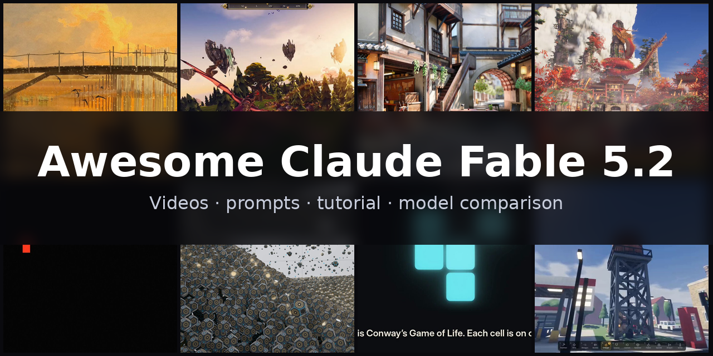](https://www.sandbase.ai/lab/ai-videos/fable-5-2?utm_source=github&utm_medium=readme&utm_campaign=awesome-fable-5-2&utm_content=banner)

A curated list of **Claude Fable 5.2 examples**: videos, prompts and demos made with Anthropic's newest Claude 5 model, released on November 9, 2026. One-prompt Three.js and WebGL scenes, canvas animation, motion graphics, explainers and playable browser games — most pieces are a single HTML page the model wrote from a prompt, credited to the creator and linked to the original post.

**400 videos** from **287 creators** · **63** with the creator's prompt · synced daily from [SandBase Lab](https://www.sandbase.ai/lab/ai-videos/fable-5-2?utm_source=github&utm_medium=readme&utm_campaign=awesome-fable-5-2&utm_content=stats)

## Start here

| I want to… | Go to |
|---|---|
| Watch the videos | [Browse by category](#contents) below, or [play them full-size on SandBase Lab](https://www.sandbase.ai/lab/ai-videos/fable-5-2?utm_source=github&utm_medium=readme&utm_campaign=awesome-fable-5-2&utm_content=quickstart) |
| Copy a prompt | [Prompt index](docs/prompts.md): every video that comes with its prompt |
| Write your own prompt | [Prompt guide](docs/prompt-guide.md): 7 patterns and a fill-in template |
| Make a video | [Tutorial](docs/tutorial.md): prompt → HTML → MP4, with the API, the CLI and a recording script |
| Pick a model | [Claude Fable 5.2 vs. Claude Opus 5.5, GPT-6 Astra and Gemini 4 Argon](docs/model-comparison.md) |
| Try it now | [Run Claude Fable 5.2 in the Lab arena](https://www.sandbase.ai/arena/text?models=anthropic%2Fclaude-fable-5.2&utm_source=github&utm_medium=readme&utm_campaign=awesome-fable-5-2&utm_content=quickstart), next to other models |

<a id="contents"></a>

## Contents

- [Featured](#featured) (8)
- [3D scenes](#3d-scene) (118)
- [Motion graphics](#motion-graphics) (72)
- [Games](#game) (69)
- [Product UI](#ui-demo) (26)
- [Particles & shapes](#particles) (4)
- [Charts & diagrams](#data-viz) (5)
- [Kinetic type](#kinetic-type) (1)
- [Explainers](#explainer) (30)
- [Launch films](#launch-film) (13)
- [Tests & comparisons](#comparison) (62)
- [Recreate a video with Claude Fable 5.2](#recreate)
- [FAQ](#faq)
- [Reading](#reading)
- [Suggest a video](#contribute)

Click a preview to play the video. Click a title for the post, the prompt and **Recreate** on SandBase Lab. **@handle** links to the creator's post on X.

<a id="featured"></a>

## Featured

<table>
<tr><td width="33%" valign="top"><a href="https://www.sandbase.ai/lab/media/x/fable-5-2/2120260208245043663/video.mp4"></a><br><a href="https://www.sandbase.ai/lab/ai-videos/fable-5-2/2120260208245043663?utm_source=github&utm_medium=readme&utm_campaign=awesome-fable-5-2&utm_content=card"><b>Animated history of computer graphics</b></a><br><sub><a href="https://x.com/aollivier82/status/2120260208245043663">@aollivier82</a> · 0:28 · <a href="https://www.sandbase.ai/lab/ai-videos/fable-5-2/2120260208245043663?utm_source=github&utm_medium=readme&utm_campaign=awesome-fable-5-2&utm_content=card">prompt</a></sub></td><td width="33%" valign="top"><a href="https://www.sandbase.ai/lab/media/x/fable-5-2/2119868968307695818/video.mp4"></a><br><a href="https://www.sandbase.ai/lab/ai-videos/fable-5-2/2119868968307695818?utm_source=github&utm_medium=readme&utm_campaign=awesome-fable-5-2&utm_content=card"><b>A boat ride game demo in browser</b></a><br><sub><a href="https://x.com/kevin_t_ngo/status/2119868968307695818">@kevin_t_ngo</a> · 0:57</sub></td><td width="33%" valign="top"><a href="https://www.sandbase.ai/lab/media/x/fable-5-2/2120253236309569696/video.mp4"></a><br><a href="https://www.sandbase.ai/lab/ai-videos/fable-5-2/2120253236309569696?utm_source=github&utm_medium=readme&utm_campaign=awesome-fable-5-2&utm_content=card"><b>Open world 3D game demo Age of Dragon</b></a><br><sub><a href="https://x.com/M__Houser/status/2120253236309569696">@M__Houser</a> · 1:56</sub></td></tr>
<tr><td width="33%" valign="top"><a href="https://www.sandbase.ai/lab/media/x/fable-5-2/2120947265007440052/video.mp4"></a><br><a href="https://www.sandbase.ai/lab/ai-videos/fable-5-2/2120947265007440052?utm_source=github&utm_medium=readme&utm_campaign=awesome-fable-5-2&utm_content=card"><b>Atlas and Three.js 3D scene demo</b></a><br><sub><a href="https://x.com/XRarchitect/status/2120947265007440052">@XRarchitect</a> · 0:21</sub></td><td width="33%" valign="top"><a href="https://www.sandbase.ai/lab/media/x/fable-5-2/2121176151234330707/video.mp4"></a><br><a href="https://www.sandbase.ai/lab/ai-videos/fable-5-2/2121176151234330707?utm_source=github&utm_medium=readme&utm_campaign=awesome-fable-5-2&utm_content=card"><b>A Three.js scene created with no external assets</b></a><br><sub><a href="https://x.com/chetaslua/status/2121176151234330707">@chetaslua</a> · 1:25</sub></td><td width="33%" valign="top"><a href="https://www.sandbase.ai/lab/media/x/fable-5-2/2119998815856218494/video.mp4"></a><br><a href="https://www.sandbase.ai/lab/ai-videos/fable-5-2/2119998815856218494?utm_source=github&utm_medium=readme&utm_campaign=awesome-fable-5-2&utm_content=card"><b>Video message addressing video editors</b></a><br><sub><a href="https://x.com/ChrisGPT/status/2119998815856218494">@ChrisGPT</a> · 0:44</sub></td></tr>
<tr><td width="33%" valign="top"><a href="https://www.sandbase.ai/lab/media/x/fable-5-2/2121799455041011723/video.mp4"></a><br><a href="https://www.sandbase.ai/lab/ai-videos/fable-5-2/2121799455041011723?utm_source=github&utm_medium=readme&utm_campaign=awesome-fable-5-2&utm_content=card"><b>TradingView candle indicator with AI decision making</b></a><br><sub><a href="https://x.com/carm1nee/status/2121799455041011723">@carm1nee</a> · 1:00</sub></td><td width="33%" valign="top"><a href="https://www.sandbase.ai/lab/media/x/fable-5-2/2120752985949057215/video.mp4">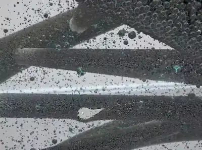</a><br><a href="https://www.sandbase.ai/lab/ai-videos/fable-5-2/2120752985949057215?utm_source=github&utm_medium=readme&utm_campaign=awesome-fable-5-2&utm_content=card"><b>A million nanobots morphing into shapes in Three.js</b></a><br><sub><a href="https://x.com/chrisjdimarco/status/2120752985949057215">@chrisjdimarco</a> · 1:31</sub></td></tr>
</table>

<a id="3d-scene"></a>

## 3D scenes

<table>
<tr><td width="33%" valign="top"><a href="https://www.sandbase.ai/lab/media/x/fable-5-2/2119870965106483384/video.mp4"></a><br><a href="https://www.sandbase.ai/lab/ai-videos/fable-5-2/2119870965106483384?utm_source=github&utm_medium=readme&utm_campaign=awesome-fable-5-2&utm_content=card"><b>A voxel engine generated from a prompt</b></a><br><sub><a href="https://x.com/mattshumer_/status/2119870965106483384">@mattshumer_</a> · 0:59</sub></td><td width="33%" valign="top"><a href="https://www.sandbase.ai/lab/media/x/fable-5-2/2119871565311660260/video.mp4"></a><br><a href="https://www.sandbase.ai/lab/ai-videos/fable-5-2/2119871565311660260?utm_source=github&utm_medium=readme&utm_campaign=awesome-fable-5-2&utm_content=card"><b>Assembly of a virus capsid in HTML</b></a><br><sub><a href="https://x.com/TekonBurns/status/2119871565311660260">@TekonBurns</a> · 0:15</sub></td><td width="33%" valign="top"><a href="https://www.sandbase.ai/lab/media/x/fable-5-2/2119873980786237842/video.mp4"></a><br><a href="https://www.sandbase.ai/lab/ai-videos/fable-5-2/2119873980786237842?utm_source=github&utm_medium=readme&utm_campaign=awesome-fable-5-2&utm_content=card"><b>3D animation created with Claude Fable 5.2</b></a><br><sub><a href="https://x.com/hello_amani/status/2119873980786237842">@hello_amani</a> · 0:36</sub></td></tr>
<tr><td width="33%" valign="top"><a href="https://www.sandbase.ai/lab/media/x/fable-5-2/2119876626179870838/video.mp4"></a><br><a href="https://www.sandbase.ai/lab/ai-videos/fable-5-2/2119876626179870838?utm_source=github&utm_medium=readme&utm_campaign=awesome-fable-5-2&utm_content=card"><b>An animation generated via Python in Blender</b></a><br><sub><a href="https://x.com/alexmichael/status/2119876626179870838">@alexmichael</a> · 0:18</sub></td><td width="33%" valign="top"><a href="https://www.sandbase.ai/lab/media/x/fable-5-2/2119879273196761464/video.mp4"></a><br><a href="https://www.sandbase.ai/lab/ai-videos/fable-5-2/2119879273196761464?utm_source=github&utm_medium=readme&utm_campaign=awesome-fable-5-2&utm_content=card"><b>Path tracer ported to WebGPU with custom compiler</b></a><br><sub><a href="https://x.com/aidanshandle/status/2119879273196761464">@aidanshandle</a> · 1:36</sub></td><td width="33%" valign="top"><a href="https://www.sandbase.ai/lab/media/x/fable-5-2/2119886560992854431/video.mp4"></a><br><a href="https://www.sandbase.ai/lab/ai-videos/fable-5-2/2119886560992854431?utm_source=github&utm_medium=readme&utm_campaign=awesome-fable-5-2&utm_content=card"><b>Autumn travel ad for Fushimi Inari shrine</b></a><br><sub><a href="https://x.com/petergyang/status/2119886560992854431">@petergyang</a> · 0:20</sub></td></tr>
</table>

<details>
<summary><b>Show all 118</b></summary>

<table>
<tr><td width="33%" valign="top"><a href="https://www.sandbase.ai/lab/media/x/fable-5-2/2119889741600424363/video.mp4"></a><br><a href="https://www.sandbase.ai/lab/ai-videos/fable-5-2/2119889741600424363?utm_source=github&utm_medium=readme&utm_campaign=awesome-fable-5-2&utm_content=card"><b>Simulation of the moon ten feet from Earth</b></a><br><sub><a href="https://x.com/ashen_one/status/2119889741600424363">@ashen_one</a> · 1:00</sub></td><td width="33%" valign="top"><a href="https://www.sandbase.ai/lab/media/x/fable-5-2/2119890973560054072/video.mp4"></a><br><a href="https://www.sandbase.ai/lab/ai-videos/fable-5-2/2119890973560054072?utm_source=github&utm_medium=readme&utm_campaign=awesome-fable-5-2&utm_content=card"><b>A 3D sailing ship built in Three.js</b></a><br><sub><a href="https://x.com/marcthecreatorr/status/2119890973560054072">@marcthecreatorr</a> · 0:53</sub></td><td width="33%" valign="top"><a href="https://www.sandbase.ai/lab/media/x/fable-5-2/2119894130943807746/video.mp4"></a><br><a href="https://www.sandbase.ai/lab/ai-videos/fable-5-2/2119894130943807746?utm_source=github&utm_medium=readme&utm_campaign=awesome-fable-5-2&utm_content=card"><b>A 3D seaplane rendering</b></a><br><sub><a href="https://x.com/LuminaBench/status/2119894130943807746">@LuminaBench</a> · 0:40</sub></td></tr>
<tr><td width="33%" valign="top"><a href="https://www.sandbase.ai/lab/media/x/fable-5-2/2119900528197218472/video.mp4">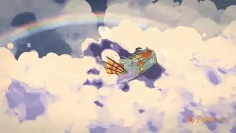</a><br><a href="https://www.sandbase.ai/lab/ai-videos/fable-5-2/2119900528197218472?utm_source=github&utm_medium=readme&utm_campaign=awesome-fable-5-2&utm_content=card"><b>Code-rendered anime film made with Three.js</b></a><br><sub><a href="https://x.com/noisyb0y1/status/2119900528197218472">@noisyb0y1</a> · 1:07</sub></td><td width="33%" valign="top"><a href="https://www.sandbase.ai/lab/media/x/fable-5-2/2119901747930186234/video.mp4"></a><br><a href="https://www.sandbase.ai/lab/ai-videos/fable-5-2/2119901747930186234?utm_source=github&utm_medium=readme&utm_campaign=awesome-fable-5-2&utm_content=card"><b>3D video test using Bryce rendering engine</b></a><br><sub><a href="https://x.com/pleometric/status/2119901747930186234">@pleometric</a> · 0:15</sub></td><td width="33%" valign="top"><a href="https://www.sandbase.ai/lab/media/x/fable-5-2/2119901782482543073/video.mp4"></a><br><a href="https://www.sandbase.ai/lab/ai-videos/fable-5-2/2119901782482543073?utm_source=github&utm_medium=readme&utm_campaign=awesome-fable-5-2&utm_content=card"><b>Steam locomotive transforming into a robot</b></a><br><sub><a href="https://x.com/0kncn/status/2119901782482543073">@0kncn</a> · 1:30 · <a href="https://www.sandbase.ai/lab/ai-videos/fable-5-2/2119901782482543073?utm_source=github&utm_medium=readme&utm_campaign=awesome-fable-5-2&utm_content=card">prompt</a></sub></td></tr>
<tr><td width="33%" valign="top"><a href="https://www.sandbase.ai/lab/media/x/fable-5-2/2119902109709537708/video.mp4"></a><br><a href="https://www.sandbase.ai/lab/ai-videos/fable-5-2/2119902109709537708?utm_source=github&utm_medium=readme&utm_campaign=awesome-fable-5-2&utm_content=card"><b>A 3D room animated and rendered with Blender</b></a><br><sub><a href="https://x.com/rileybrown/status/2119902109709537708">@rileybrown</a> · 0:59</sub></td><td width="33%" valign="top"><a href="https://www.sandbase.ai/lab/media/x/fable-5-2/2119905661505122575/video.mp4"></a><br><a href="https://www.sandbase.ai/lab/ai-videos/fable-5-2/2119905661505122575?utm_source=github&utm_medium=readme&utm_campaign=awesome-fable-5-2&utm_content=card"><b>A 3D pirate ship sailing across the ocean</b></a><br><sub><a href="https://x.com/notjazii/status/2119905661505122575">@notjazii</a> · 0:50 · <a href="https://www.sandbase.ai/lab/ai-videos/fable-5-2/2119905661505122575?utm_source=github&utm_medium=readme&utm_campaign=awesome-fable-5-2&utm_content=card">prompt</a></sub></td><td width="33%" valign="top"><a href="https://www.sandbase.ai/lab/media/x/fable-5-2/2119910613828980846/video.mp4">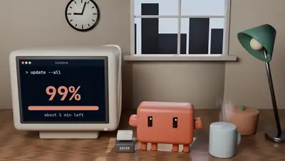</a><br><a href="https://www.sandbase.ai/lab/ai-videos/fable-5-2/2119910613828980846?utm_source=github&utm_medium=readme&utm_campaign=awesome-fable-5-2&utm_content=card"><b>Animated 3D short created in Blender</b></a><br><sub><a href="https://x.com/kloss_xyz/status/2119910613828980846">@kloss_xyz</a> · 0:16</sub></td></tr>
<tr><td width="33%" valign="top"><a href="https://www.sandbase.ai/lab/media/x/fable-5-2/2119914308603953485/video.mp4"></a><br><a href="https://www.sandbase.ai/lab/ai-videos/fable-5-2/2119914308603953485?utm_source=github&utm_medium=readme&utm_campaign=awesome-fable-5-2&utm_content=card"><b>Voxel simulations created by Fable 5.2</b></a><br><sub><a href="https://x.com/Avenoxai/status/2119914308603953485">@Avenoxai</a> · 1:12</sub></td><td width="33%" valign="top"><a href="https://www.sandbase.ai/lab/media/x/fable-5-2/2119930300990177509/video.mp4"></a><br><a href="https://www.sandbase.ai/lab/ai-videos/fable-5-2/2119930300990177509?utm_source=github&utm_medium=readme&utm_campaign=awesome-fable-5-2&utm_content=card"><b>Photorealistic honey physics simulation in WebGL</b></a><br><sub><a href="https://x.com/deedydas/status/2119930300990177509">@deedydas</a> · 0:51 · <a href="https://www.sandbase.ai/lab/ai-videos/fable-5-2/2119930300990177509?utm_source=github&utm_medium=readme&utm_campaign=awesome-fable-5-2&utm_content=card">prompt</a></sub></td><td width="33%" valign="top"><a href="https://www.sandbase.ai/lab/media/x/fable-5-2/2119938067758772403/video.mp4"></a><br><a href="https://www.sandbase.ai/lab/ai-videos/fable-5-2/2119938067758772403?utm_source=github&utm_medium=readme&utm_campaign=awesome-fable-5-2&utm_content=card"><b>One square kilometer of Indiranagar built from map data</b></a><br><sub><a href="https://x.com/anshu4321/status/2119938067758772403">@anshu4321</a> · 0:35</sub></td></tr>
<tr><td width="33%" valign="top"><a href="https://www.sandbase.ai/lab/media/x/fable-5-2/2119939061049889130/video.mp4">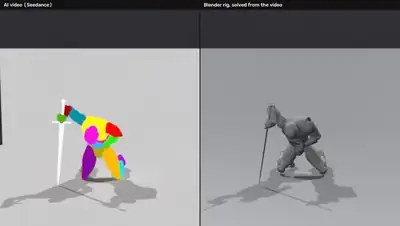</a><br><a href="https://www.sandbase.ai/lab/ai-videos/fable-5-2/2119939061049889130?utm_source=github&utm_medium=readme&utm_campaign=awesome-fable-5-2&utm_content=card"><b>Video converted to 3D animation</b></a><br><sub><a href="https://x.com/KHvostikk/status/2119939061049889130">@KHvostikk</a> · 0:10</sub></td><td width="33%" valign="top"><a href="https://www.sandbase.ai/lab/media/x/fable-5-2/2119944847255896490/video.mp4"></a><br><a href="https://www.sandbase.ai/lab/ai-videos/fable-5-2/2119944847255896490?utm_source=github&utm_medium=readme&utm_campaign=awesome-fable-5-2&utm_content=card"><b>Realistic 3D scene generated with Devin</b></a><br><sub><a href="https://x.com/Da7_Tech/status/2119944847255896490">@Da7_Tech</a> · 1:05</sub></td><td width="33%" valign="top"><a href="https://www.sandbase.ai/lab/media/x/fable-5-2/2119946891106394518/video.mp4"></a><br><a href="https://www.sandbase.ai/lab/ai-videos/fable-5-2/2119946891106394518?utm_source=github&utm_medium=readme&utm_campaign=awesome-fable-5-2&utm_content=card"><b>Testing concept video game machines in Three.js</b></a><br><sub><a href="https://x.com/techartist_/status/2119946891106394518">@techartist_</a> · 0:20</sub></td></tr>
<tr><td width="33%" valign="top"><a href="https://www.sandbase.ai/lab/media/x/fable-5-2/2119960596951236675/video.mp4"></a><br><a href="https://www.sandbase.ai/lab/ai-videos/fable-5-2/2119960596951236675?utm_source=github&utm_medium=readme&utm_campaign=awesome-fable-5-2&utm_content=card"><b>Floating 1886 New York scene in the sky</b></a><br><sub><a href="https://x.com/semichenkko/status/2119960596951236675">@semichenkko</a> · 0:10</sub></td><td width="33%" valign="top"><a href="https://www.sandbase.ai/lab/media/x/fable-5-2/2119966147328299284/video.mp4"></a><br><a href="https://www.sandbase.ai/lab/ai-videos/fable-5-2/2119966147328299284?utm_source=github&utm_medium=readme&utm_campaign=awesome-fable-5-2&utm_content=card"><b>Bugatti Tourbillon cinematic rendered in Blender</b></a><br><sub><a href="https://x.com/xikhar/status/2119966147328299284">@xikhar</a> · 0:34</sub></td><td width="33%" valign="top"><a href="https://www.sandbase.ai/lab/media/x/fable-5-2/2119969928304357507/video.mp4"></a><br><a href="https://www.sandbase.ai/lab/ai-videos/fable-5-2/2119969928304357507?utm_source=github&utm_medium=readme&utm_campaign=awesome-fable-5-2&utm_content=card"><b>Studio reconstruction from uploaded photos</b></a><br><sub><a href="https://x.com/rpnickson/status/2119969928304357507">@rpnickson</a> · 0:30</sub></td></tr>
<tr><td width="33%" valign="top"><a href="https://www.sandbase.ai/lab/media/x/fable-5-2/2119972124211454139/video.mp4"></a><br><a href="https://www.sandbase.ai/lab/ai-videos/fable-5-2/2119972124211454139?utm_source=github&utm_medium=readme&utm_campaign=awesome-fable-5-2&utm_content=card"><b>A 90s style toy commercial rendered in Blender</b></a><br><sub><a href="https://x.com/kevin_t_ngo/status/2119972124211454139">@kevin_t_ngo</a> · 1:05</sub></td><td width="33%" valign="top"><a href="https://www.sandbase.ai/lab/media/x/fable-5-2/2119974354260013293/video.mp4"></a><br><a href="https://www.sandbase.ai/lab/ai-videos/fable-5-2/2119974354260013293?utm_source=github&utm_medium=readme&utm_campaign=awesome-fable-5-2&utm_content=card"><b>Cinematic journey through the history of science</b></a><br><sub><a href="https://x.com/DeryaTR_/status/2119974354260013293">@DeryaTR_</a> · 4:56</sub></td><td width="33%" valign="top"><a href="https://www.sandbase.ai/lab/media/x/fable-5-2/2119995965776200047/video.mp4"></a><br><a href="https://www.sandbase.ai/lab/ai-videos/fable-5-2/2119995965776200047?utm_source=github&utm_medium=readme&utm_campaign=awesome-fable-5-2&utm_content=card"><b>Interactive light switch with cat and puppy</b></a><br><sub><a href="https://x.com/justkarangupta/status/2119995965776200047">@justkarangupta</a> · 0:15</sub></td></tr>
<tr><td width="33%" valign="top"><a href="https://www.sandbase.ai/lab/media/x/fable-5-2/2120001344237097184/video.mp4"></a><br><a href="https://www.sandbase.ai/lab/ai-videos/fable-5-2/2120001344237097184?utm_source=github&utm_medium=readme&utm_campaign=awesome-fable-5-2&utm_content=card"><b>Custom 3D mockup scenes for Ultramock</b></a><br><sub><a href="https://x.com/joshmillgate/status/2120001344237097184">@joshmillgate</a> · 0:25</sub></td><td width="33%" valign="top"><a href="https://www.sandbase.ai/lab/media/x/fable-5-2/2120022389605929145/video.mp4"></a><br><a href="https://www.sandbase.ai/lab/ai-videos/fable-5-2/2120022389605929145?utm_source=github&utm_medium=readme&utm_campaign=awesome-fable-5-2&utm_content=card"><b>Animated room scene generated in Blender</b></a><br><sub><a href="https://x.com/RoundtableSpace/status/2120022389605929145">@RoundtableSpace</a> · 0:59</sub></td><td width="33%" valign="top"><a href="https://www.sandbase.ai/lab/media/x/fable-5-2/2120039417981333599/video.mp4"></a><br><a href="https://www.sandbase.ai/lab/ai-videos/fable-5-2/2120039417981333599?utm_source=github&utm_medium=readme&utm_campaign=awesome-fable-5-2&utm_content=card"><b>Sea serpent coiling around a ship in Blender</b></a><br><sub><a href="https://x.com/Stefan_3D_AI/status/2120039417981333599">@Stefan_3D_AI</a> · 0:32 · <a href="https://www.sandbase.ai/lab/ai-videos/fable-5-2/2120039417981333599?utm_source=github&utm_medium=readme&utm_campaign=awesome-fable-5-2&utm_content=card">prompt</a></sub></td></tr>
<tr><td width="33%" valign="top"><a href="https://www.sandbase.ai/lab/media/x/fable-5-2/2120044656776061144/video.mp4"></a><br><a href="https://www.sandbase.ai/lab/ai-videos/fable-5-2/2120044656776061144?utm_source=github&utm_medium=readme&utm_campaign=awesome-fable-5-2&utm_content=card"><b>Procedural 3D cursed sword scene in code</b></a><br><sub><a href="https://x.com/pankajkumar_dev/status/2120044656776061144">@pankajkumar_dev</a> · 0:36</sub></td><td width="33%" valign="top"><a href="https://www.sandbase.ai/lab/media/x/fable-5-2/2120046536457654495/video.mp4"></a><br><a href="https://www.sandbase.ai/lab/ai-videos/fable-5-2/2120046536457654495?utm_source=github&utm_medium=readme&utm_campaign=awesome-fable-5-2&utm_content=card"><b>Functional voice assistance device designed by AI</b></a><br><sub><a href="https://x.com/dr_l_alexandre/status/2120046536457654495">@dr_l_alexandre</a> · 0:48</sub></td><td width="33%" valign="top"><a href="https://www.sandbase.ai/lab/media/x/fable-5-2/2120056264751227079/video.mp4"></a><br><a href="https://www.sandbase.ai/lab/ai-videos/fable-5-2/2120056264751227079?utm_source=github&utm_medium=readme&utm_campaign=awesome-fable-5-2&utm_content=card"><b>Glass heart animation created in Blender</b></a><br><sub><a href="https://x.com/0kncn/status/2120056264751227079">@0kncn</a> · 0:29</sub></td></tr>
<tr><td width="33%" valign="top"><a href="https://www.sandbase.ai/lab/media/x/fable-5-2/2120074876039917971/video.mp4"></a><br><a href="https://www.sandbase.ai/lab/ai-videos/fable-5-2/2120074876039917971?utm_source=github&utm_medium=readme&utm_campaign=awesome-fable-5-2&utm_content=card"><b>Creating a stylized shrine for a game</b></a><br><sub><a href="https://x.com/ForkedPush/status/2120074876039917971">@ForkedPush</a> · 0:32</sub></td><td width="33%" valign="top"><a href="https://www.sandbase.ai/lab/media/x/fable-5-2/2120075740222005569/video.mp4"></a><br><a href="https://www.sandbase.ai/lab/ai-videos/fable-5-2/2120075740222005569?utm_source=github&utm_medium=readme&utm_campaign=awesome-fable-5-2&utm_content=card"><b>Procedural Chinatown generated with Three.js code</b></a><br><sub><a href="https://x.com/RJasonHA/status/2120075740222005569">@RJasonHA</a> · 1:14</sub></td><td width="33%" valign="top"><a href="https://www.sandbase.ai/lab/media/x/fable-5-2/2120079029386588503/video.mp4"></a><br><a href="https://www.sandbase.ai/lab/ai-videos/fable-5-2/2120079029386588503?utm_source=github&utm_medium=readme&utm_campaign=awesome-fable-5-2&utm_content=card"><b>River of lanterns rendered in Three.js</b></a><br><sub><a href="https://x.com/seiiiiiiiiiiru/status/2120079029386588503">@seiiiiiiiiiiru</a> · 0:30</sub></td></tr>
<tr><td width="33%" valign="top"><a href="https://www.sandbase.ai/lab/media/x/fable-5-2/2120079288372494782/video.mp4">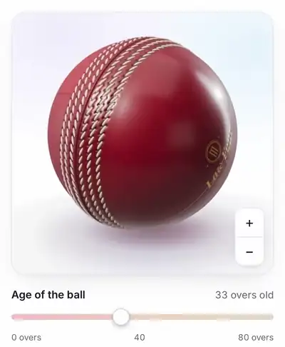</a><br><a href="https://www.sandbase.ai/lab/ai-videos/fable-5-2/2120079288372494782?utm_source=github&utm_medium=readme&utm_campaign=awesome-fable-5-2&utm_content=card"><b>Rendering of a cricket ball</b></a><br><sub><a href="https://x.com/deedydas/status/2120079288372494782">@deedydas</a> · 0:18</sub></td><td width="33%" valign="top"><a href="https://www.sandbase.ai/lab/media/x/fable-5-2/2120091403447578814/video.mp4"></a><br><a href="https://www.sandbase.ai/lab/ai-videos/fable-5-2/2120091403447578814?utm_source=github&utm_medium=readme&utm_campaign=awesome-fable-5-2&utm_content=card"><b>Character legs model in Three.js test</b></a><br><sub><a href="https://x.com/bei351009016/status/2120091403447578814">@bei351009016</a> · 0:09</sub></td><td width="33%" valign="top"><a href="https://www.sandbase.ai/lab/media/x/fable-5-2/2120101582444597446/video.mp4">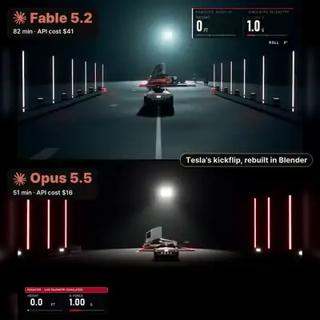</a><br><a href="https://www.sandbase.ai/lab/ai-videos/fable-5-2/2120101582444597446?utm_source=github&utm_medium=readme&utm_campaign=awesome-fable-5-2&utm_content=card"><b>Procedural Tesla Roadster kickflip stunt in Blender</b></a><br><sub><a href="https://x.com/Stefan_3D_AI/status/2120101582444597446">@Stefan_3D_AI</a> · 0:18 · <a href="https://www.sandbase.ai/lab/ai-videos/fable-5-2/2120101582444597446?utm_source=github&utm_medium=readme&utm_campaign=awesome-fable-5-2&utm_content=card">prompt</a></sub></td></tr>
<tr><td width="33%" valign="top"><a href="https://www.sandbase.ai/lab/media/x/fable-5-2/2120111159726727321/video.mp4"></a><br><a href="https://www.sandbase.ai/lab/ai-videos/fable-5-2/2120111159726727321?utm_source=github&utm_medium=readme&utm_campaign=awesome-fable-5-2&utm_content=card"><b>Monica&#x27;s apartment recreated in Three.js</b></a><br><sub><a href="https://x.com/chetaslua/status/2120111159726727321">@chetaslua</a> · 0:32</sub></td><td width="33%" valign="top"><a href="https://www.sandbase.ai/lab/media/x/fable-5-2/2120113578531234172/video.mp4">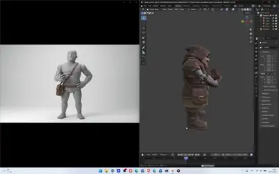</a><br><a href="https://www.sandbase.ai/lab/ai-videos/fable-5-2/2120113578531234172?utm_source=github&utm_medium=readme&utm_campaign=awesome-fable-5-2&utm_content=card"><b>3D animation generated in Blender via MCP</b></a><br><sub><a href="https://x.com/maxt3chno/status/2120113578531234172">@maxt3chno</a> · 0:16</sub></td><td width="33%" valign="top"><a href="https://www.sandbase.ai/lab/media/x/fable-5-2/2120162023770054791/video.mp4"></a><br><a href="https://www.sandbase.ai/lab/ai-videos/fable-5-2/2120162023770054791?utm_source=github&utm_medium=readme&utm_campaign=awesome-fable-5-2&utm_content=card"><b>Video to 3D animation test</b></a><br><sub><a href="https://x.com/KHvostikk/status/2120162023770054791">@KHvostikk</a> · 0:16</sub></td></tr>
<tr><td width="33%" valign="top"><a href="https://www.sandbase.ai/lab/media/x/fable-5-2/2120172009972003115/video.mp4">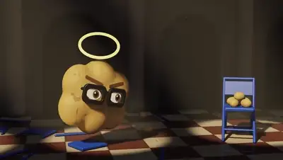</a><br><a href="https://www.sandbase.ai/lab/ai-videos/fable-5-2/2120172009972003115?utm_source=github&utm_medium=readme&utm_campaign=awesome-fable-5-2&utm_content=card"><b>Potato destroying blue chairs coded loop</b></a><br><sub><a href="https://x.com/argofowl/status/2120172009972003115">@argofowl</a> · 0:12</sub></td><td width="33%" valign="top"><a href="https://www.sandbase.ai/lab/media/x/fable-5-2/2120188343870964113/video.mp4"></a><br><a href="https://www.sandbase.ai/lab/ai-videos/fable-5-2/2120188343870964113?utm_source=github&utm_medium=readme&utm_campaign=awesome-fable-5-2&utm_content=card"><b>Restoration visualization of a ruin in Tuscany</b></a><br><sub><a href="https://x.com/TimurNegru/status/2120188343870964113">@TimurNegru</a> · 0:34</sub></td><td width="33%" valign="top"><a href="https://www.sandbase.ai/lab/media/x/fable-5-2/2120198663062622581/video.mp4"></a><br><a href="https://www.sandbase.ai/lab/ai-videos/fable-5-2/2120198663062622581?utm_source=github&utm_medium=readme&utm_campaign=awesome-fable-5-2&utm_content=card"><b>Music video created with Python and Blender code</b></a><br><sub><a href="https://x.com/kevin_t_ngo/status/2120198663062622581">@kevin_t_ngo</a> · 1:17</sub></td></tr>
<tr><td width="33%" valign="top"><a href="https://www.sandbase.ai/lab/media/x/fable-5-2/2120199783730299278/video.mp4">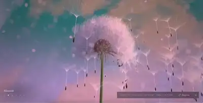</a><br><a href="https://www.sandbase.ai/lab/ai-videos/fable-5-2/2120199783730299278?utm_source=github&utm_medium=readme&utm_campaign=awesome-fable-5-2&utm_content=card"><b>Three.js scene created with Fable and Opus</b></a><br><sub><a href="https://x.com/sarlloc/status/2120199783730299278">@sarlloc</a> · 0:16</sub></td><td width="33%" valign="top"><a href="https://www.sandbase.ai/lab/media/x/fable-5-2/2120214767868456979/video.mp4"></a><br><a href="https://www.sandbase.ai/lab/ai-videos/fable-5-2/2120214767868456979?utm_source=github&utm_medium=readme&utm_campaign=awesome-fable-5-2&utm_content=card"><b>Interactive apartment set in Three.js</b></a><br><sub><a href="https://x.com/morsenxxx/status/2120214767868456979">@morsenxxx</a> · 0:58</sub></td><td width="33%" valign="top"><a href="https://www.sandbase.ai/lab/media/x/fable-5-2/2120224530367119758/video.mp4"></a><br><a href="https://www.sandbase.ai/lab/ai-videos/fable-5-2/2120224530367119758?utm_source=github&utm_medium=readme&utm_campaign=awesome-fable-5-2&utm_content=card"><b>Detailed 3D arm rigging and animation</b></a><br><sub><a href="https://x.com/apekshik/status/2120224530367119758">@apekshik</a> · 0:37</sub></td></tr>
<tr><td width="33%" valign="top"><a href="https://www.sandbase.ai/lab/media/x/fable-5-2/2120239401821487149/video.mp4"></a><br><a href="https://www.sandbase.ai/lab/ai-videos/fable-5-2/2120239401821487149?utm_source=github&utm_medium=readme&utm_campaign=awesome-fable-5-2&utm_content=card"><b>Animation made with Blender and Fable 5.2</b></a><br><sub><a href="https://x.com/aecyydesign/status/2120239401821487149">@aecyydesign</a> · 0:10</sub></td><td width="33%" valign="top"><a href="https://www.sandbase.ai/lab/media/x/fable-5-2/2120247208918266080/video.mp4"></a><br><a href="https://www.sandbase.ai/lab/ai-videos/fable-5-2/2120247208918266080?utm_source=github&utm_medium=readme&utm_campaign=awesome-fable-5-2&utm_content=card"><b>Lord of the Rings river water physics scene</b></a><br><sub><a href="https://x.com/AymericRoucher/status/2120247208918266080">@AymericRoucher</a> · 0:08</sub></td><td width="33%" valign="top"><a href="https://www.sandbase.ai/lab/media/x/fable-5-2/2120248774861689199/video.mp4"></a><br><a href="https://www.sandbase.ai/lab/ai-videos/fable-5-2/2120248774861689199?utm_source=github&utm_medium=readme&utm_campaign=awesome-fable-5-2&utm_content=card"><b>Four Elements benchmark running in Three.js</b></a><br><sub><a href="https://x.com/orcdev/status/2120248774861689199">@orcdev</a> · 0:29</sub></td></tr>
<tr><td width="33%" valign="top"><a href="https://www.sandbase.ai/lab/media/x/fable-5-2/2120254108104007712/video.mp4"></a><br><a href="https://www.sandbase.ai/lab/ai-videos/fable-5-2/2120254108104007712?utm_source=github&utm_medium=readme&utm_campaign=awesome-fable-5-2&utm_content=card"><b>Dragon&#x27;s Nest 3D scene in Three.js</b></a><br><sub><a href="https://x.com/scottstts/status/2120254108104007712">@scottstts</a> · 1:00</sub></td><td width="33%" valign="top"><a href="https://www.sandbase.ai/lab/media/x/fable-5-2/2120305718939021566/video.mp4">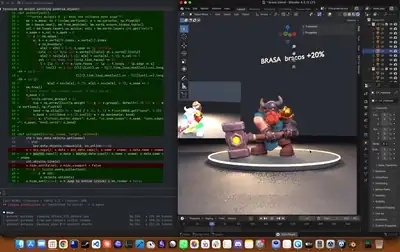</a><br><a href="https://www.sandbase.ai/lab/ai-videos/fable-5-2/2120305718939021566?utm_source=github&utm_medium=readme&utm_campaign=awesome-fable-5-2&utm_content=card"><b>Animated 3D game character workflow in Blender</b></a><br><sub><a href="https://x.com/luccacerf/status/2120305718939021566">@luccacerf</a> · 0:25</sub></td><td width="33%" valign="top"><a href="https://www.sandbase.ai/lab/media/x/fable-5-2/2120316203738829180/video.mp4"></a><br><a href="https://www.sandbase.ai/lab/ai-videos/fable-5-2/2120316203738829180?utm_source=github&utm_medium=readme&utm_campaign=awesome-fable-5-2&utm_content=card"><b>Three.js apartment recreated in Blender</b></a><br><sub><a href="https://x.com/MengTo/status/2120316203738829180">@MengTo</a> · 0:52</sub></td></tr>
<tr><td width="33%" valign="top"><a href="https://www.sandbase.ai/lab/media/x/fable-5-2/2120518714743308542/video.mp4">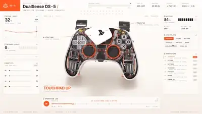</a><br><a href="https://www.sandbase.ai/lab/ai-videos/fable-5-2/2120518714743308542?utm_source=github&utm_medium=readme&utm_campaign=awesome-fable-5-2&utm_content=card"><b>Animated teardown of a PS5 controller</b></a><br><sub><a href="https://x.com/Nyxera0x/status/2120518714743308542">@Nyxera0x</a> · 0:24</sub></td><td width="33%" valign="top"><a href="https://www.sandbase.ai/lab/media/x/fable-5-2/2120548065044234504/video.mp4"></a><br><a href="https://www.sandbase.ai/lab/ai-videos/fable-5-2/2120548065044234504?utm_source=github&utm_medium=readme&utm_campaign=awesome-fable-5-2&utm_content=card"><b>Superman flying through computer graphics history in JavaScript</b></a><br><sub><a href="https://x.com/chetaslua/status/2120548065044234504">@chetaslua</a> · 0:40</sub></td><td width="33%" valign="top"><a href="https://www.sandbase.ai/lab/media/x/fable-5-2/2120587748989902982/video.mp4"></a><br><a href="https://www.sandbase.ai/lab/ai-videos/fable-5-2/2120587748989902982?utm_source=github&utm_medium=readme&utm_campaign=awesome-fable-5-2&utm_content=card"><b>Starlink dish teardown generated from a photo</b></a><br><sub><a href="https://x.com/elvar_official/status/2120587748989902982">@elvar_official</a> · 0:24</sub></td></tr>
<tr><td width="33%" valign="top"><a href="https://www.sandbase.ai/lab/media/x/fable-5-2/2120595096127078727/video.mp4">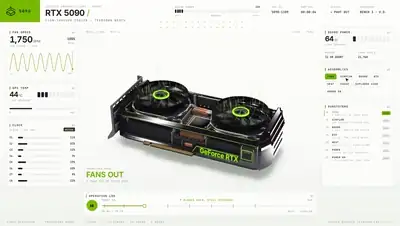</a><br><a href="https://www.sandbase.ai/lab/ai-videos/fable-5-2/2120595096127078727?utm_source=github&utm_medium=readme&utm_campaign=awesome-fable-5-2&utm_content=card"><b>Teardown 3D animation of an RTX 5090 graphics card</b></a><br><sub><a href="https://x.com/0x_fokki/status/2120595096127078727">@0x_fokki</a> · 0:24</sub></td><td width="33%" valign="top"><a href="https://www.sandbase.ai/lab/media/x/fable-5-2/2120636604624560229/video.mp4">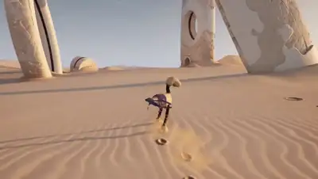</a><br><a href="https://www.sandbase.ai/lab/ai-videos/fable-5-2/2120636604624560229?utm_source=github&utm_medium=readme&utm_campaign=awesome-fable-5-2&utm_content=card"><b>Procedurally animated robotic biped creature</b></a><br><sub><a href="https://x.com/pingouh/status/2120636604624560229">@pingouh</a> · 1:12</sub></td><td width="33%" valign="top"><a href="https://www.sandbase.ai/lab/media/x/fable-5-2/2120648796334178374/video.mp4">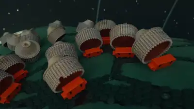</a><br><a href="https://www.sandbase.ai/lab/ai-videos/fable-5-2/2120648796334178374?utm_source=github&utm_medium=readme&utm_campaign=awesome-fable-5-2&utm_content=card"><b>An animated short about crabs wearing shells</b></a><br><sub><a href="https://x.com/JacobMolBio/status/2120648796334178374">@JacobMolBio</a> · 1:25</sub></td></tr>
<tr><td width="33%" valign="top"><a href="https://www.sandbase.ai/lab/media/x/fable-5-2/2120680918914601165/video.mp4"></a><br><a href="https://www.sandbase.ai/lab/ai-videos/fable-5-2/2120680918914601165?utm_source=github&utm_medium=readme&utm_campaign=awesome-fable-5-2&utm_content=card"><b>A 3D house built from a single prompt</b></a><br><sub><a href="https://x.com/calebfahlgren/status/2120680918914601165">@calebfahlgren</a> · 0:44 · <a href="https://www.sandbase.ai/lab/ai-videos/fable-5-2/2120680918914601165?utm_source=github&utm_medium=readme&utm_campaign=awesome-fable-5-2&utm_content=card">prompt</a></sub></td><td width="33%" valign="top"><a href="https://www.sandbase.ai/lab/media/x/fable-5-2/2120753459498549757/video.mp4"></a><br><a href="https://www.sandbase.ai/lab/ai-videos/fable-5-2/2120753459498549757?utm_source=github&utm_medium=readme&utm_campaign=awesome-fable-5-2&utm_content=card"><b>A GTA 6 concept city driving scene</b></a><br><sub><a href="https://x.com/polinaaAi/status/2120753459498549757">@polinaaAi</a> · 0:46</sub></td><td width="33%" valign="top"><a href="https://www.sandbase.ai/lab/media/x/fable-5-2/2120767818157420773/video.mp4"></a><br><a href="https://www.sandbase.ai/lab/ai-videos/fable-5-2/2120767818157420773?utm_source=github&utm_medium=readme&utm_campaign=awesome-fable-5-2&utm_content=card"><b>Character riding a horse through a canyon</b></a><br><sub><a href="https://x.com/venturetwins/status/2120767818157420773">@venturetwins</a> · 0:36</sub></td></tr>
<tr><td width="33%" valign="top"><a href="https://www.sandbase.ai/lab/media/x/fable-5-2/2120813043101946324/video.mp4"></a><br><a href="https://www.sandbase.ai/lab/ai-videos/fable-5-2/2120813043101946324?utm_source=github&utm_medium=readme&utm_campaign=awesome-fable-5-2&utm_content=card"><b>Flames burning inside ice using WebGPU</b></a><br><sub><a href="https://x.com/tkm_hmng8/status/2120813043101946324">@tkm_hmng8</a> · 0:19</sub></td><td width="33%" valign="top"><a href="https://www.sandbase.ai/lab/media/x/fable-5-2/2120864288055116088/video.mp4">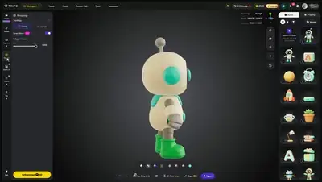</a><br><a href="https://www.sandbase.ai/lab/ai-videos/fable-5-2/2120864288055116088?utm_source=github&utm_medium=readme&utm_campaign=awesome-fable-5-2&utm_content=card"><b>Animated robot in a Three.js desk scene</b></a><br><sub><a href="https://x.com/seeconvm/status/2120864288055116088">@seeconvm</a> · 0:43</sub></td><td width="33%" valign="top"><a href="https://www.sandbase.ai/lab/media/x/fable-5-2/2120872262937305248/video.mp4"></a><br><a href="https://www.sandbase.ai/lab/ai-videos/fable-5-2/2120872262937305248?utm_source=github&utm_medium=readme&utm_campaign=awesome-fable-5-2&utm_content=card"><b>Interactive cloth physics simulation on a 3D character</b></a><br><sub><a href="https://x.com/hakimieiqbal/status/2120872262937305248">@hakimieiqbal</a> · 0:16</sub></td></tr>
<tr><td width="33%" valign="top"><a href="https://www.sandbase.ai/lab/media/x/fable-5-2/2120920564080513196/video.mp4">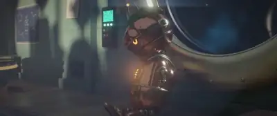</a><br><a href="https://www.sandbase.ai/lab/ai-videos/fable-5-2/2120920564080513196?utm_source=github&utm_medium=readme&utm_campaign=awesome-fable-5-2&utm_content=card"><b>Animated short about a robot named Tock</b></a><br><sub><a href="https://x.com/ChrisGPT/status/2120920564080513196">@ChrisGPT</a> · 4:24</sub></td><td width="33%" valign="top"><a href="https://www.sandbase.ai/lab/media/x/fable-5-2/2120939600504074444/video.mp4"></a><br><a href="https://www.sandbase.ai/lab/ai-videos/fable-5-2/2120939600504074444?utm_source=github&utm_medium=readme&utm_campaign=awesome-fable-5-2&utm_content=card"><b>A 3D real estate architectural walkthrough</b></a><br><sub><a href="https://x.com/everestchris6/status/2120939600504074444">@everestchris6</a> · 0:16</sub></td><td width="33%" valign="top"><a href="https://www.sandbase.ai/lab/media/x/fable-5-2/2120947265007440052/video.mp4"></a><br><a href="https://www.sandbase.ai/lab/ai-videos/fable-5-2/2120947265007440052?utm_source=github&utm_medium=readme&utm_campaign=awesome-fable-5-2&utm_content=card"><b>Atlas and Three.js 3D scene demo</b></a><br><sub><a href="https://x.com/XRarchitect/status/2120947265007440052">@XRarchitect</a> · 0:21</sub></td></tr>
<tr><td width="33%" valign="top"><a href="https://www.sandbase.ai/lab/media/x/fable-5-2/2120962655741464681/video.mp4">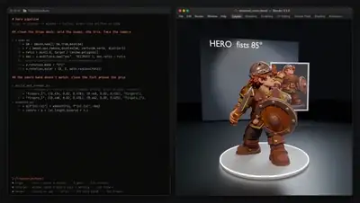</a><br><a href="https://www.sandbase.ai/lab/ai-videos/fable-5-2/2120962655741464681?utm_source=github&utm_medium=readme&utm_campaign=awesome-fable-5-2&utm_content=card"><b>A 3D hero generated from a single image</b></a><br><sub><a href="https://x.com/de1lymoon/status/2120962655741464681">@de1lymoon</a> · 0:20</sub></td><td width="33%" valign="top"><a href="https://www.sandbase.ai/lab/media/x/fable-5-2/2120979189595873553/video.mp4">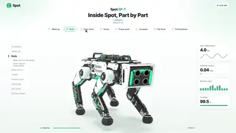</a><br><a href="https://www.sandbase.ai/lab/ai-videos/fable-5-2/2120979189595873553?utm_source=github&utm_medium=readme&utm_campaign=awesome-fable-5-2&utm_content=card"><b>Exploded 3D teardown of a robot dog in Three.js</b></a><br><sub><a href="https://x.com/elvar_official/status/2120979189595873553">@elvar_official</a> · 0:25</sub></td><td width="33%" valign="top"><a href="https://www.sandbase.ai/lab/media/x/fable-5-2/2121001440470577157/video.mp4"></a><br><a href="https://www.sandbase.ai/lab/ai-videos/fable-5-2/2121001440470577157?utm_source=github&utm_medium=readme&utm_campaign=awesome-fable-5-2&utm_content=card"><b>A code-rendered animated short in Three.js</b></a><br><sub><a href="https://x.com/0xMovez/status/2121001440470577157">@0xMovez</a> · 1:41 · <a href="https://www.sandbase.ai/lab/ai-videos/fable-5-2/2121001440470577157?utm_source=github&utm_medium=readme&utm_campaign=awesome-fable-5-2&utm_content=card">prompt</a></sub></td></tr>
<tr><td width="33%" valign="top"><a href="https://www.sandbase.ai/lab/media/x/fable-5-2/2121009941930705224/video.mp4">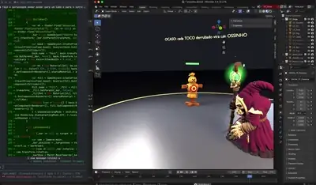</a><br><a href="https://www.sandbase.ai/lab/ai-videos/fable-5-2/2121009941930705224?utm_source=github&utm_medium=readme&utm_campaign=awesome-fable-5-2&utm_content=card"><b>Necromancer spawning skeletons with Disney animation principles</b></a><br><sub><a href="https://x.com/luccacerf/status/2121009941930705224">@luccacerf</a> · 0:35 · <a href="https://www.sandbase.ai/lab/ai-videos/fable-5-2/2121009941930705224?utm_source=github&utm_medium=readme&utm_campaign=awesome-fable-5-2&utm_content=card">prompt</a></sub></td><td width="33%" valign="top"><a href="https://www.sandbase.ai/lab/media/x/fable-5-2/2121047997584752643/video.mp4"></a><br><a href="https://www.sandbase.ai/lab/ai-videos/fable-5-2/2121047997584752643?utm_source=github&utm_medium=readme&utm_campaign=awesome-fable-5-2&utm_content=card"><b>Cinematic slash action sequence rendered in Three.js</b></a><br><sub><a href="https://x.com/N01ennn/status/2121047997584752643">@N01ennn</a> · 0:24 · <a href="https://www.sandbase.ai/lab/ai-videos/fable-5-2/2121047997584752643?utm_source=github&utm_medium=readme&utm_campaign=awesome-fable-5-2&utm_content=card">prompt</a></sub></td><td width="33%" valign="top"><a href="https://www.sandbase.ai/lab/media/x/fable-5-2/2121144338017292602/video.mp4">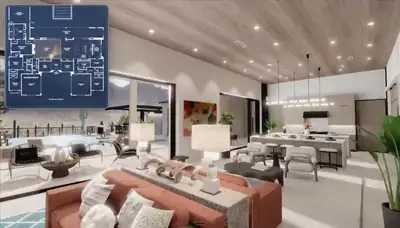</a><br><a href="https://www.sandbase.ai/lab/ai-videos/fable-5-2/2121144338017292602?utm_source=github&utm_medium=readme&utm_campaign=awesome-fable-5-2&utm_content=card"><b>Converting 2D floor plans into 3D walkthroughs</b></a><br><sub><a href="https://x.com/wanerfu/status/2121144338017292602">@wanerfu</a> · 0:10 · <a href="https://www.sandbase.ai/lab/ai-videos/fable-5-2/2121144338017292602?utm_source=github&utm_medium=readme&utm_campaign=awesome-fable-5-2&utm_content=card">prompt</a></sub></td></tr>
<tr><td width="33%" valign="top"><a href="https://www.sandbase.ai/lab/media/x/fable-5-2/2121176151234330707/video.mp4"></a><br><a href="https://www.sandbase.ai/lab/ai-videos/fable-5-2/2121176151234330707?utm_source=github&utm_medium=readme&utm_campaign=awesome-fable-5-2&utm_content=card"><b>A Three.js scene created with no external assets</b></a><br><sub><a href="https://x.com/chetaslua/status/2121176151234330707">@chetaslua</a> · 1:25</sub></td><td width="33%" valign="top"><a href="https://www.sandbase.ai/lab/media/x/fable-5-2/2121212179685007524/video.mp4"></a><br><a href="https://www.sandbase.ai/lab/ai-videos/fable-5-2/2121212179685007524?utm_source=github&utm_medium=readme&utm_campaign=awesome-fable-5-2&utm_content=card"><b>Three.js 3D scene generated in one shot</b></a><br><sub><a href="https://x.com/anvithbuilds/status/2121212179685007524">@anvithbuilds</a> · 1:00</sub></td><td width="33%" valign="top"><a href="https://www.sandbase.ai/lab/media/x/fable-5-2/2121216070375612527/video.mp4"></a><br><a href="https://www.sandbase.ai/lab/ai-videos/fable-5-2/2121216070375612527?utm_source=github&utm_medium=readme&utm_campaign=awesome-fable-5-2&utm_content=card"><b>Hand-painted animated valley in Three.js and Blender</b></a><br><sub><a href="https://x.com/rewind02/status/2121216070375612527">@rewind02</a> · 0:23</sub></td></tr>
<tr><td width="33%" valign="top"><a href="https://www.sandbase.ai/lab/media/x/fable-5-2/2121231703767478599/video.mp4">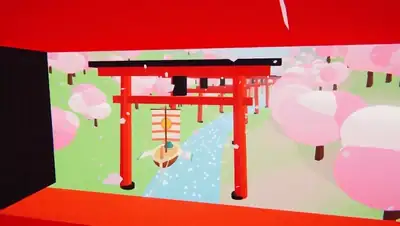</a><br><a href="https://www.sandbase.ai/lab/ai-videos/fable-5-2/2121231703767478599?utm_source=github&utm_medium=readme&utm_campaign=awesome-fable-5-2&utm_content=card"><b>Code-generated Three.js anime short film</b></a><br><sub><a href="https://x.com/zodchiii/status/2121231703767478599">@zodchiii</a> · 1:00</sub></td><td width="33%" valign="top"><a href="https://www.sandbase.ai/lab/media/x/fable-5-2/2121265583144730643/video.mp4"></a><br><a href="https://www.sandbase.ai/lab/ai-videos/fable-5-2/2121265583144730643?utm_source=github&utm_medium=readme&utm_campaign=awesome-fable-5-2&utm_content=card"><b>Animated fantasy village generated in Tripo</b></a><br><sub><a href="https://x.com/marcusyul/status/2121265583144730643">@marcusyul</a> · 0:29</sub></td><td width="33%" valign="top"><a href="https://www.sandbase.ai/lab/media/x/fable-5-2/2121307000755855480/video.mp4"></a><br><a href="https://www.sandbase.ai/lab/ai-videos/fable-5-2/2121307000755855480?utm_source=github&utm_medium=readme&utm_campaign=awesome-fable-5-2&utm_content=card"><b>Chinese style scene rendered in Three.js</b></a><br><sub><a href="https://x.com/Dav338876/status/2121307000755855480">@Dav338876</a> · 2:00</sub></td></tr>
<tr><td width="33%" valign="top"><a href="https://www.sandbase.ai/lab/media/x/fable-5-2/2121333521663017401/video.mp4">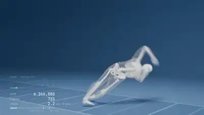</a><br><a href="https://www.sandbase.ai/lab/ai-videos/fable-5-2/2121333521663017401?utm_source=github&utm_medium=readme&utm_campaign=awesome-fable-5-2&utm_content=card"><b>Character learning to run rendered in Vork</b></a><br><sub><a href="https://x.com/ravisparikh/status/2121333521663017401">@ravisparikh</a> · 0:30</sub></td><td width="33%" valign="top"><a href="https://www.sandbase.ai/lab/media/x/fable-5-2/2121336108370014266/video.mp4"></a><br><a href="https://www.sandbase.ai/lab/ai-videos/fable-5-2/2121336108370014266?utm_source=github&utm_medium=readme&utm_campaign=awesome-fable-5-2&utm_content=card"><b>Experiments with Atlas Fable and Three.js</b></a><br><sub><a href="https://x.com/XRarchitect/status/2121336108370014266">@XRarchitect</a> · 0:26</sub></td><td width="33%" valign="top"><a href="https://www.sandbase.ai/lab/media/x/fable-5-2/2121343522318274958/video.mp4">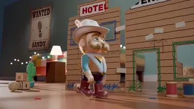</a><br><a href="https://www.sandbase.ai/lab/ai-videos/fable-5-2/2121343522318274958?utm_source=github&utm_medium=readme&utm_campaign=awesome-fable-5-2&utm_content=card"><b>Animated wind-up cowboy toy in cardboard town</b></a><br><sub><a href="https://x.com/ChrisGPT/status/2121343522318274958">@ChrisGPT</a> · 0:10</sub></td></tr>
<tr><td width="33%" valign="top"><a href="https://www.sandbase.ai/lab/media/x/fable-5-2/2121525925900947923/video.mp4"></a><br><a href="https://www.sandbase.ai/lab/ai-videos/fable-5-2/2121525925900947923?utm_source=github&utm_medium=readme&utm_campaign=awesome-fable-5-2&utm_content=card"><b>Riding a dragon over a painted valley</b></a><br><sub><a href="https://x.com/anvithbuilds/status/2121525925900947923">@anvithbuilds</a> · 0:50</sub></td><td width="33%" valign="top"><a href="https://www.sandbase.ai/lab/media/x/fable-5-2/2121561217797951859/video.mp4"></a><br><a href="https://www.sandbase.ai/lab/ai-videos/fable-5-2/2121561217797951859?utm_source=github&utm_medium=readme&utm_campaign=awesome-fable-5-2&utm_content=card"><b>Automated 3D living room layouts and walkthroughs</b></a><br><sub><a href="https://x.com/0xWast3/status/2121561217797951859">@0xWast3</a> · 0:30</sub></td><td width="33%" valign="top"><a href="https://www.sandbase.ai/lab/media/x/fable-5-2/2121572657300689375/video.mp4"></a><br><a href="https://www.sandbase.ai/lab/ai-videos/fable-5-2/2121572657300689375?utm_source=github&utm_medium=readme&utm_campaign=awesome-fable-5-2&utm_content=card"><b>Code-generated 3D desk setup showcase</b></a><br><sub><a href="https://x.com/bykushnir/status/2121572657300689375">@bykushnir</a> · 2:01</sub></td></tr>
<tr><td width="33%" valign="top"><a href="https://www.sandbase.ai/lab/media/x/fable-5-2/2121579587222016201/video.mp4"></a><br><a href="https://www.sandbase.ai/lab/ai-videos/fable-5-2/2121579587222016201?utm_source=github&utm_medium=readme&utm_campaign=awesome-fable-5-2&utm_content=card"><b>Evolution of gamepads across forty-three years in Three.js</b></a><br><sub><a href="https://x.com/elvar_official/status/2121579587222016201">@elvar_official</a> · 0:27</sub></td><td width="33%" valign="top"><a href="https://www.sandbase.ai/lab/media/x/fable-5-2/2121603388009775599/video.mp4">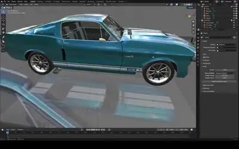</a><br><a href="https://www.sandbase.ai/lab/ai-videos/fable-5-2/2121603388009775599?utm_source=github&utm_medium=readme&utm_campaign=awesome-fable-5-2&utm_content=card"><b>3D Shelby GT-500 built in Blender</b></a><br><sub><a href="https://x.com/maxt3chno/status/2121603388009775599">@maxt3chno</a> · 0:26</sub></td><td width="33%" valign="top"><a href="https://www.sandbase.ai/lab/media/x/seedance-2-5/2121610443714343220/video.mp4"></a><br><a href="https://www.sandbase.ai/lab/ai-videos/fable-5-2/2121610443714343220?utm_source=github&utm_medium=readme&utm_campaign=awesome-fable-5-2&utm_content=card"><b>Single-take night scene with skin zoom</b></a><br><sub><a href="https://x.com/socialwithaayan/status/2121610443714343220">@socialwithaayan</a> · 0:16 · <a href="https://www.sandbase.ai/lab/ai-videos/fable-5-2/2121610443714343220?utm_source=github&utm_medium=readme&utm_campaign=awesome-fable-5-2&utm_content=card">prompt</a></sub></td></tr>
<tr><td width="33%" valign="top"><a href="https://www.sandbase.ai/lab/media/x/fable-5-2/2121614786245104107/video.mp4"></a><br><a href="https://www.sandbase.ai/lab/ai-videos/fable-5-2/2121614786245104107?utm_source=github&utm_medium=readme&utm_campaign=awesome-fable-5-2&utm_content=card"><b>Three.js game trailer recreated in Blender</b></a><br><sub><a href="https://x.com/MengTo/status/2121614786245104107">@MengTo</a> · 0:57</sub></td><td width="33%" valign="top"><a href="https://www.sandbase.ai/lab/media/x/fable-5-2/2121617707061727643/video.mp4">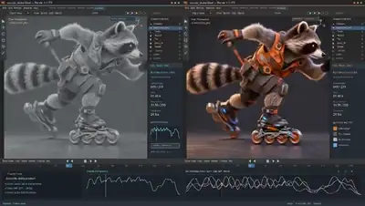</a><br><a href="https://www.sandbase.ai/lab/ai-videos/fable-5-2/2121617707061727643?utm_source=github&utm_medium=readme&utm_campaign=awesome-fable-5-2&utm_content=card"><b>Animated 3D raccoon on rollerblades</b></a><br><sub><a href="https://x.com/Lummox_eth/status/2121617707061727643">@Lummox_eth</a> · 0:10</sub></td><td width="33%" valign="top"><a href="https://www.sandbase.ai/lab/media/x/fable-5-2/2121623397767778549/video.mp4">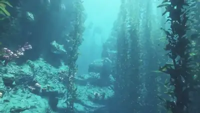</a><br><a href="https://www.sandbase.ai/lab/ai-videos/fable-5-2/2121623397767778549?utm_source=github&utm_medium=readme&utm_campaign=awesome-fable-5-2&utm_content=card"><b>Interactive WebGPU ocean built in 97 KB</b></a><br><sub><a href="https://x.com/VaibhavSisinty/status/2121623397767778549">@VaibhavSisinty</a> · 1:50</sub></td></tr>
<tr><td width="33%" valign="top"><a href="https://www.sandbase.ai/lab/media/x/fable-5-2/2121626206613491787/video.mp4"></a><br><a href="https://www.sandbase.ai/lab/ai-videos/fable-5-2/2121626206613491787?utm_source=github&utm_medium=readme&utm_campaign=awesome-fable-5-2&utm_content=card"><b>Procedural 3D Ivory Kingdom in Three.js</b></a><br><sub><a href="https://x.com/scottstts/status/2121626206613491787">@scottstts</a> · 2:00</sub></td><td width="33%" valign="top"><a href="https://www.sandbase.ai/lab/media/x/fable-5-2/2121637359984795877/video.mp4">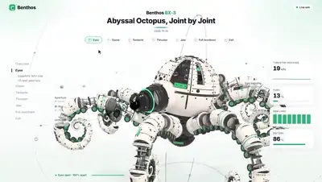</a><br><a href="https://www.sandbase.ai/lab/ai-videos/fable-5-2/2121637359984795877?utm_source=github&utm_medium=readme&utm_campaign=awesome-fable-5-2&utm_content=card"><b>Robotic octopus joints disassembly animation</b></a><br><sub><a href="https://x.com/0xKitsui/status/2121637359984795877">@0xKitsui</a> · 0:25</sub></td><td width="33%" valign="top"><a href="https://www.sandbase.ai/lab/media/x/fable-5-2/2121641934884057288/video.mp4">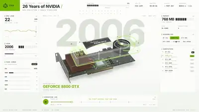</a><br><a href="https://www.sandbase.ai/lab/ai-videos/fable-5-2/2121641934884057288?utm_source=github&utm_medium=readme&utm_campaign=awesome-fable-5-2&utm_content=card"><b>Continuous 3D shot through 26 years of Nvidia GPUs</b></a><br><sub><a href="https://x.com/0x_fokki/status/2121641934884057288">@0x_fokki</a> · 0:31</sub></td></tr>
<tr><td width="33%" valign="top"><a href="https://www.sandbase.ai/lab/media/x/fable-5-2/2121642720045261185/video.mp4"></a><br><a href="https://www.sandbase.ai/lab/ai-videos/fable-5-2/2121642720045261185?utm_source=github&utm_medium=readme&utm_campaign=awesome-fable-5-2&utm_content=card"><b>Blender animated film generated with Python code</b></a><br><sub><a href="https://x.com/rileybrown/status/2121642720045261185">@rileybrown</a> · 2:19</sub></td><td width="33%" valign="top"><a href="https://www.sandbase.ai/lab/media/x/fable-5-2/2121669479457603960/video.mp4">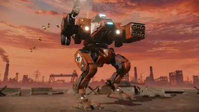</a><br><a href="https://www.sandbase.ai/lab/ai-videos/fable-5-2/2121669479457603960?utm_source=github&utm_medium=readme&utm_campaign=awesome-fable-5-2&utm_content=card"><b>A 3D model rendered in Blender</b></a><br><sub><a href="https://x.com/ryanvogel/status/2121669479457603960">@ryanvogel</a> · 0:10</sub></td><td width="33%" valign="top"><a href="https://www.sandbase.ai/lab/media/x/fable-5-2/2121673597152362755/video.mp4"></a><br><a href="https://www.sandbase.ai/lab/ai-videos/fable-5-2/2121673597152362755?utm_source=github&utm_medium=readme&utm_campaign=awesome-fable-5-2&utm_content=card"><b>Underwater world scene in a single HTML file</b></a><br><sub><a href="https://x.com/Octoberry/status/2121673597152362755">@Octoberry</a> · 1:50</sub></td></tr>
<tr><td width="33%" valign="top"><a href="https://www.sandbase.ai/lab/media/x/fable-5-2/2121720293324423508/video.mp4"></a><br><a href="https://www.sandbase.ai/lab/ai-videos/fable-5-2/2121720293324423508?utm_source=github&utm_medium=readme&utm_campaign=awesome-fable-5-2&utm_content=card"><b>GTA 6 concept drive scene</b></a><br><sub><a href="https://x.com/0xKenny1st/status/2121720293324423508">@0xKenny1st</a> · 2:52</sub></td><td width="33%" valign="top"><a href="https://www.sandbase.ai/lab/media/x/fable-5-2/2121721290687983906/video.mp4"></a><br><a href="https://www.sandbase.ai/lab/ai-videos/fable-5-2/2121721290687983906?utm_source=github&utm_medium=readme&utm_campaign=awesome-fable-5-2&utm_content=card"><b>Cinematic fight sequence rendered in Three.js</b></a><br><sub><a href="https://x.com/0xMovez/status/2121721290687983906">@0xMovez</a> · 1:30 · <a href="https://www.sandbase.ai/lab/ai-videos/fable-5-2/2121721290687983906?utm_source=github&utm_medium=readme&utm_campaign=awesome-fable-5-2&utm_content=card">prompt</a></sub></td><td width="33%" valign="top"><a href="https://www.sandbase.ai/lab/media/x/fable-5-2/2121724395354018201/video.mp4">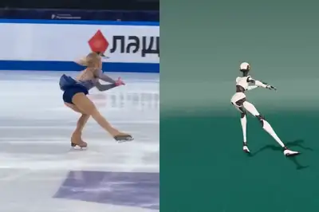</a><br><a href="https://www.sandbase.ai/lab/ai-videos/fable-5-2/2121724395354018201?utm_source=github&utm_medium=readme&utm_campaign=awesome-fable-5-2&utm_content=card"><b>Motion capture modeling and rigging in Blender</b></a><br><sub><a href="https://x.com/seiiiiiiiiiiru/status/2121724395354018201">@seiiiiiiiiiiru</a> · 0:15</sub></td></tr>
<tr><td width="33%" valign="top"><a href="https://www.sandbase.ai/lab/media/x/fable-5-2/2121737343287828694/video.mp4"></a><br><a href="https://www.sandbase.ai/lab/ai-videos/fable-5-2/2121737343287828694?utm_source=github&utm_medium=readme&utm_campaign=awesome-fable-5-2&utm_content=card"><b>City scene built in Three.js from code</b></a><br><sub><a href="https://x.com/LexnLin/status/2121737343287828694">@LexnLin</a> · 1:00</sub></td><td width="33%" valign="top"><a href="https://www.sandbase.ai/lab/media/x/fable-5-2/2121802871050318305/video.mp4"></a><br><a href="https://www.sandbase.ai/lab/ai-videos/fable-5-2/2121802871050318305?utm_source=github&utm_medium=readme&utm_campaign=awesome-fable-5-2&utm_content=card"><b>Converting a Kyoto photograph into an interactive 3D scene</b></a><br><sub><a href="https://x.com/29meat_ai/status/2121802871050318305">@29meat_ai</a> · 0:22</sub></td><td width="33%" valign="top"><a href="https://www.sandbase.ai/lab/media/x/fable-5-2/2121922699962224967/video.mp4">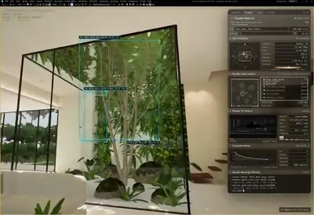</a><br><a href="https://www.sandbase.ai/lab/ai-videos/fable-5-2/2121922699962224967?utm_source=github&utm_medium=readme&utm_campaign=awesome-fable-5-2&utm_content=card"><b>Interior design floor plan rendering in 3ds Max</b></a><br><sub><a href="https://x.com/0xWast3/status/2121922699962224967">@0xWast3</a> · 0:29</sub></td></tr>
<tr><td width="33%" valign="top"><a href="https://www.sandbase.ai/lab/media/x/fable-5-2/2121961164233933129/video.mp4"></a><br><a href="https://www.sandbase.ai/lab/ai-videos/fable-5-2/2121961164233933129?utm_source=github&utm_medium=readme&utm_campaign=awesome-fable-5-2&utm_content=card"><b>Swimmable underwater world in a single HTML file</b></a><br><sub><a href="https://x.com/kimmonismus/status/2121961164233933129">@kimmonismus</a> · 1:50</sub></td><td width="33%" valign="top"><a href="https://www.sandbase.ai/lab/media/x/fable-5-2/2121996663996707139/video.mp4"></a><br><a href="https://www.sandbase.ai/lab/ai-videos/fable-5-2/2121996663996707139?utm_source=github&utm_medium=readme&utm_campaign=awesome-fable-5-2&utm_content=card"><b>Virtual New York city run by AI agents</b></a><br><sub><a href="https://x.com/DN_degen/status/2121996663996707139">@DN_degen</a> · 0:30</sub></td><td width="33%" valign="top"><a href="https://www.sandbase.ai/lab/media/x/fable-5-2/2122011748752318857/video.mp4">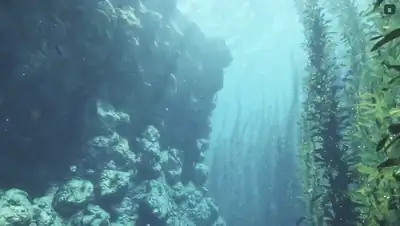</a><br><a href="https://www.sandbase.ai/lab/ai-videos/fable-5-2/2122011748752318857?utm_source=github&utm_medium=readme&utm_campaign=awesome-fable-5-2&utm_content=card"><b>Underwater world running in browser without engine</b></a><br><sub><a href="https://x.com/Pirat_Nation/status/2122011748752318857">@Pirat_Nation</a> · 0:59</sub></td></tr>
<tr><td width="33%" valign="top"><a href="https://www.sandbase.ai/lab/media/x/fable-5-2/2122022565317108018/video.mp4">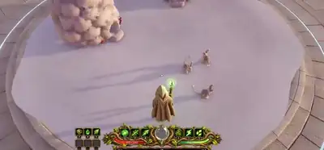</a><br><a href="https://www.sandbase.ai/lab/ai-videos/fable-5-2/2122022565317108018?utm_source=github&utm_medium=readme&utm_campaign=awesome-fable-5-2&utm_content=card"><b>Animated Characters on Floating Sky Island</b></a><br><sub><a href="https://x.com/theparuchh/status/2122022565317108018">@theparuchh</a> · 1:27</sub></td><td width="33%" valign="top"><a href="https://www.sandbase.ai/lab/media/x/fable-5-2/2122065184743153882/video.mp4"></a><br><a href="https://www.sandbase.ai/lab/ai-videos/fable-5-2/2122065184743153882?utm_source=github&utm_medium=readme&utm_campaign=awesome-fable-5-2&utm_content=card"><b>Animated Lantern Spider in Blender</b></a><br><sub><a href="https://x.com/aGim_asf/status/2122065184743153882">@aGim_asf</a> · 1:03</sub></td><td width="33%" valign="top"><a href="https://www.sandbase.ai/lab/media/x/fable-5-2/2122081824159547833/video.mp4"></a><br><a href="https://www.sandbase.ai/lab/ai-videos/fable-5-2/2122081824159547833?utm_source=github&utm_medium=readme&utm_campaign=awesome-fable-5-2&utm_content=card"><b>Full 3D apartment built with Blender and AI</b></a><br><sub><a href="https://x.com/noisyb0y1/status/2122081824159547833">@noisyb0y1</a> · 0:56</sub></td></tr>
<tr><td width="33%" valign="top"><a href="https://www.sandbase.ai/lab/media/x/fable-5-2/2122274109795054036/video.mp4">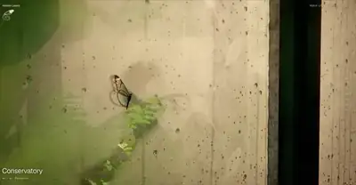</a><br><a href="https://www.sandbase.ai/lab/ai-videos/fable-5-2/2122274109795054036?utm_source=github&utm_medium=readme&utm_campaign=awesome-fable-5-2&utm_content=card"><b>Aesthetic 3D scenes generated in Three.js code</b></a><br><sub><a href="https://x.com/ky__zo/status/2122274109795054036">@ky__zo</a> · 0:28 · <a href="https://www.sandbase.ai/lab/ai-videos/fable-5-2/2122274109795054036?utm_source=github&utm_medium=readme&utm_campaign=awesome-fable-5-2&utm_content=card">prompt</a></sub></td><td width="33%" valign="top"><a href="https://www.sandbase.ai/lab/media/x/fable-5-2/2122276006690013225/video.mp4">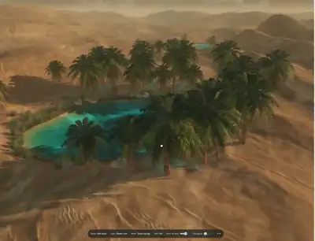</a><br><a href="https://www.sandbase.ai/lab/ai-videos/fable-5-2/2122276006690013225?utm_source=github&utm_medium=readme&utm_campaign=awesome-fable-5-2&utm_content=card"><b>Interactive 3D dune map in Three.js</b></a><br><sub><a href="https://x.com/chetanankola/status/2122276006690013225">@chetanankola</a> · 0:35</sub></td><td width="33%" valign="top"><a href="https://www.sandbase.ai/lab/media/x/fable-5-2/2122298882050687171/video.mp4"></a><br><a href="https://www.sandbase.ai/lab/ai-videos/fable-5-2/2122298882050687171?utm_source=github&utm_medium=readme&utm_campaign=awesome-fable-5-2&utm_content=card"><b>Building a medieval world with Tripo agent</b></a><br><sub><a href="https://x.com/alex_prompter/status/2122298882050687171">@alex_prompter</a> · 2:00</sub></td></tr>
<tr><td width="33%" valign="top"><a href="https://www.sandbase.ai/lab/media/x/fable-5-2/2122324810223304734/video.mp4">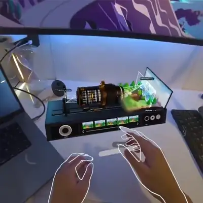</a><br><a href="https://www.sandbase.ai/lab/ai-videos/fable-5-2/2122324810223304734?utm_source=github&utm_medium=readme&utm_campaign=awesome-fable-5-2&utm_content=card"><b>Conversion of 3D scenes to WebXR experience</b></a><br><sub><a href="https://x.com/RyanSael/status/2122324810223304734">@RyanSael</a> · 0:35</sub></td><td width="33%" valign="top"><a href="https://www.sandbase.ai/lab/media/x/fable-5-2/2122354002373619755/video.mp4"></a><br><a href="https://www.sandbase.ai/lab/ai-videos/fable-5-2/2122354002373619755?utm_source=github&utm_medium=readme&utm_campaign=awesome-fable-5-2&utm_content=card"><b>A pelican riding a bike on the beach</b></a><br><sub><a href="https://x.com/Yuziyyaa/status/2122354002373619755">@Yuziyyaa</a> · 0:10</sub></td><td width="33%" valign="top"><a href="https://www.sandbase.ai/lab/media/x/fable-5-2/2122361634190696575/video.mp4"></a><br><a href="https://www.sandbase.ai/lab/ai-videos/fable-5-2/2122361634190696575?utm_source=github&utm_medium=readme&utm_campaign=awesome-fable-5-2&utm_content=card"><b>Amsterdam 3D street scene using Streetview API</b></a><br><sub><a href="https://x.com/nickvernij/status/2122361634190696575">@nickvernij</a> · 0:15</sub></td></tr>
<tr><td width="33%" valign="top"><a href="https://www.sandbase.ai/lab/media/x/fable-5-2/2122363445286728159/video.mp4">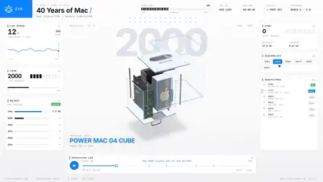</a><br><a href="https://www.sandbase.ai/lab/ai-videos/fable-5-2/2122363445286728159?utm_source=github&utm_medium=readme&utm_campaign=awesome-fable-5-2&utm_content=card"><b>An animated timeline of Apple computers</b></a><br><sub><a href="https://x.com/elvar_official/status/2122363445286728159">@elvar_official</a> · 0:30</sub></td></tr>
</table>

</details>

<a id="motion-graphics"></a>

## Motion graphics

<table>
<tr><td width="33%" valign="top"><a href="https://www.sandbase.ai/lab/media/x/fable-5-2/2119875516216070289/video.mp4">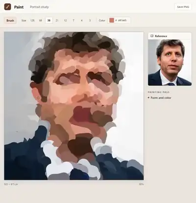</a><br><a href="https://www.sandbase.ai/lab/ai-videos/fable-5-2/2119875516216070289?utm_source=github&utm_medium=readme&utm_campaign=awesome-fable-5-2&utm_content=card"><b>One-shot creation generated by Fable 5.2</b></a><br><sub><a href="https://x.com/devsvn2/status/2119875516216070289">@devsvn2</a> · 0:35</sub></td><td width="33%" valign="top"><a href="https://www.sandbase.ai/lab/media/x/fable-5-2/2119879605607862329/video.mp4">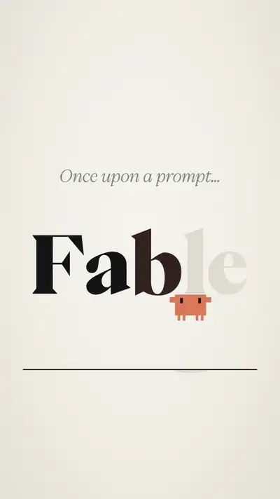</a><br><a href="https://www.sandbase.ai/lab/ai-videos/fable-5-2/2119879605607862329?utm_source=github&utm_medium=readme&utm_campaign=awesome-fable-5-2&utm_content=card"><b>An animation test generated with Fable</b></a><br><sub><a href="https://x.com/pleometric/status/2119879605607862329">@pleometric</a> · 0:50</sub></td><td width="33%" valign="top"><a href="https://www.sandbase.ai/lab/media/x/fable-5-2/2119879667457073355/video.mp4"></a><br><a href="https://www.sandbase.ai/lab/ai-videos/fable-5-2/2119879667457073355?utm_source=github&utm_medium=readme&utm_campaign=awesome-fable-5-2&utm_content=card"><b>Motion design created with Fable 5.2</b></a><br><sub><a href="https://x.com/Gregoirechp/status/2119879667457073355">@Gregoirechp</a> · 0:40</sub></td></tr>
<tr><td width="33%" valign="top"><a href="https://www.sandbase.ai/lab/media/x/fable-5-2/2119884041331892403/video.mp4"></a><br><a href="https://www.sandbase.ai/lab/ai-videos/fable-5-2/2119884041331892403?utm_source=github&utm_medium=readme&utm_campaign=awesome-fable-5-2&utm_content=card"><b>A video generated in one shot</b></a><br><sub><a href="https://x.com/mattshumer_/status/2119884041331892403">@mattshumer_</a> · 4:44</sub></td><td width="33%" valign="top"><a href="https://www.sandbase.ai/lab/media/x/fable-5-2/2119885430627913784/video.mp4"></a><br><a href="https://www.sandbase.ai/lab/ai-videos/fable-5-2/2119885430627913784?utm_source=github&utm_medium=readme&utm_campaign=awesome-fable-5-2&utm_content=card"><b>Animated video of Clawd releasing Claude Fable 5.2</b></a><br><sub><a href="https://x.com/other__reality/status/2119885430627913784">@other__reality</a> · 0:26 · <a href="https://www.sandbase.ai/lab/ai-videos/fable-5-2/2119885430627913784?utm_source=github&utm_medium=readme&utm_campaign=awesome-fable-5-2&utm_content=card">prompt</a></sub></td><td width="33%" valign="top"><a href="https://www.sandbase.ai/lab/media/x/fable-5-2/2119893834276507954/video.mp4">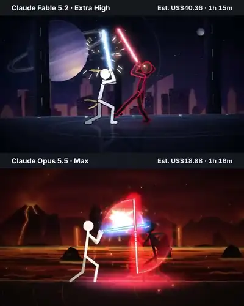</a><br><a href="https://www.sandbase.ai/lab/ai-videos/fable-5-2/2119893834276507954?utm_source=github&utm_medium=readme&utm_campaign=awesome-fable-5-2&utm_content=card"><b>A choreographed stickman fight animation test</b></a><br><sub><a href="https://x.com/DanielZambrini/status/2119893834276507954">@DanielZambrini</a> · 0:15</sub></td></tr>
</table>

<details>
<summary><b>Show all 72</b></summary>

<table>
<tr><td width="33%" valign="top"><a href="https://www.sandbase.ai/lab/media/x/fable-5-2/2119902302001635455/video.mp4"></a><br><a href="https://www.sandbase.ai/lab/ai-videos/fable-5-2/2119902302001635455?utm_source=github&utm_medium=readme&utm_campaign=awesome-fable-5-2&utm_content=card"><b>Code-generated motion animation</b></a><br><sub><a href="https://x.com/eluchocha/status/2119902302001635455">@eluchocha</a> · 0:38</sub></td><td width="33%" valign="top"><a href="https://www.sandbase.ai/lab/media/x/fable-5-2/2119906384397603138/video.mp4"></a><br><a href="https://www.sandbase.ai/lab/ai-videos/fable-5-2/2119906384397603138?utm_source=github&utm_medium=readme&utm_campaign=awesome-fable-5-2&utm_content=card"><b>Talking avatar video with cloned voice</b></a><br><sub><a href="https://x.com/dorukyalcinsoy/status/2119906384397603138">@dorukyalcinsoy</a> · 4:44</sub></td><td width="33%" valign="top"><a href="https://www.sandbase.ai/lab/media/x/fable-5-2/2119907891419480107/video.mp4"></a><br><a href="https://www.sandbase.ai/lab/ai-videos/fable-5-2/2119907891419480107?utm_source=github&utm_medium=readme&utm_campaign=awesome-fable-5-2&utm_content=card"><b>Organ fugue written in the style of Bach</b></a><br><sub><a href="https://x.com/aug5thmusic/status/2119907891419480107">@aug5thmusic</a> · 2:05 · <a href="https://www.sandbase.ai/lab/ai-videos/fable-5-2/2119907891419480107?utm_source=github&utm_medium=readme&utm_campaign=awesome-fable-5-2&utm_content=card">prompt</a></sub></td></tr>
<tr><td width="33%" valign="top"><a href="https://www.sandbase.ai/lab/media/x/fable-5-2/2119907987477422453/video.mp4"></a><br><a href="https://www.sandbase.ai/lab/ai-videos/fable-5-2/2119907987477422453?utm_source=github&utm_medium=readme&utm_campaign=awesome-fable-5-2&utm_content=card"><b>Three electronic devices designed from a prompt</b></a><br><sub><a href="https://x.com/kanavtwt/status/2119907987477422453">@kanavtwt</a> · 0:12</sub></td><td width="33%" valign="top"><a href="https://www.sandbase.ai/lab/media/x/fable-5-2/2119911161386934330/video.mp4">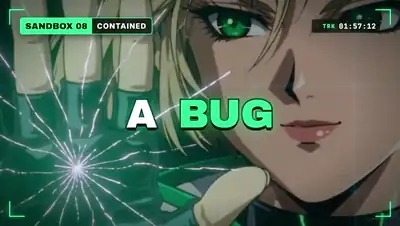</a><br><a href="https://www.sandbase.ai/lab/ai-videos/fable-5-2/2119911161386934330?utm_source=github&utm_medium=readme&utm_campaign=awesome-fable-5-2&utm_content=card"><b>A music video generated with Fable</b></a><br><sub><a href="https://x.com/WesRoth/status/2119911161386934330">@WesRoth</a> · 0:37</sub></td><td width="33%" valign="top"><a href="https://www.sandbase.ai/lab/media/x/fable-5-2/2119920990893244510/video.mp4"></a><br><a href="https://www.sandbase.ai/lab/ai-videos/fable-5-2/2119920990893244510?utm_source=github&utm_medium=readme&utm_campaign=awesome-fable-5-2&utm_content=card"><b>Aesthetic video generated by Fable 5.2</b></a><br><sub><a href="https://x.com/aollivier82/status/2119920990893244510">@aollivier82</a> · 0:48 · <a href="https://www.sandbase.ai/lab/ai-videos/fable-5-2/2119920990893244510?utm_source=github&utm_medium=readme&utm_campaign=awesome-fable-5-2&utm_content=card">prompt</a></sub></td></tr>
<tr><td width="33%" valign="top"><a href="https://www.sandbase.ai/lab/media/x/fable-5-2/2119925067207647695/video.mp4"></a><br><a href="https://www.sandbase.ai/lab/ai-videos/fable-5-2/2119925067207647695?utm_source=github&utm_medium=readme&utm_campaign=awesome-fable-5-2&utm_content=card"><b>A galloping horse animated in SVG</b></a><br><sub><a href="https://x.com/eyadnour/status/2119925067207647695">@eyadnour</a> · 0:26</sub></td><td width="33%" valign="top"><a href="https://www.sandbase.ai/lab/media/x/fable-5-2/2119931563760632311/video.mp4">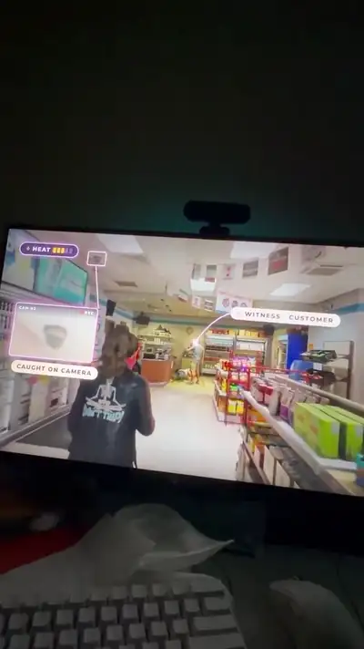</a><br><a href="https://www.sandbase.ai/lab/ai-videos/fable-5-2/2119931563760632311?utm_source=github&utm_medium=readme&utm_campaign=awesome-fable-5-2&utm_content=card"><b>One-shot generation with Fable 5.2</b></a><br><sub><a href="https://x.com/saimagnate/status/2119931563760632311">@saimagnate</a> · 0:34</sub></td><td width="33%" valign="top"><a href="https://www.sandbase.ai/lab/media/x/fable-5-2/2119936176714875126/video.mp4">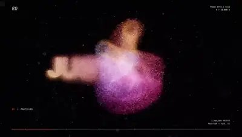</a><br><a href="https://www.sandbase.ai/lab/ai-videos/fable-5-2/2119936176714875126?utm_source=github&utm_medium=readme&utm_campaign=awesome-fable-5-2&utm_content=card"><b>One-shot motion graphic video generated by Fable</b></a><br><sub><a href="https://x.com/moritzkremb/status/2119936176714875126">@moritzkremb</a> · 1:04 · <a href="https://www.sandbase.ai/lab/ai-videos/fable-5-2/2119936176714875126?utm_source=github&utm_medium=readme&utm_campaign=awesome-fable-5-2&utm_content=card">prompt</a></sub></td></tr>
<tr><td width="33%" valign="top"><a href="https://www.sandbase.ai/lab/media/x/fable-5-2/2119953913160093817/video.mp4"></a><br><a href="https://www.sandbase.ai/lab/ai-videos/fable-5-2/2119953913160093817?utm_source=github&utm_medium=readme&utm_campaign=awesome-fable-5-2&utm_content=card"><b>One-shot generation demonstration with Fable 5.2</b></a><br><sub><a href="https://x.com/WesRoth/status/2119953913160093817">@WesRoth</a> · 2:27</sub></td><td width="33%" valign="top"><a href="https://www.sandbase.ai/lab/media/x/fable-5-2/2119973951027724385/video.mp4"></a><br><a href="https://www.sandbase.ai/lab/ai-videos/fable-5-2/2119973951027724385?utm_source=github&utm_medium=readme&utm_campaign=awesome-fable-5-2&utm_content=card"><b>Video editing meta demonstration by Fable 5.2</b></a><br><sub><a href="https://x.com/rileybrown/status/2119973951027724385">@rileybrown</a> · 2:01</sub></td><td width="33%" valign="top"><a href="https://www.sandbase.ai/lab/media/x/fable-5-2/2119981510199808368/video.mp4"></a><br><a href="https://www.sandbase.ai/lab/ai-videos/fable-5-2/2119981510199808368?utm_source=github&utm_medium=readme&utm_campaign=awesome-fable-5-2&utm_content=card"><b>Animated illustrations drawn in pure code</b></a><br><sub><a href="https://x.com/chetaslua/status/2119981510199808368">@chetaslua</a> · 0:11</sub></td></tr>
<tr><td width="33%" valign="top"><a href="https://www.sandbase.ai/lab/media/x/fable-5-2/2119998815856218494/video.mp4"></a><br><a href="https://www.sandbase.ai/lab/ai-videos/fable-5-2/2119998815856218494?utm_source=github&utm_medium=readme&utm_campaign=awesome-fable-5-2&utm_content=card"><b>Video message addressing video editors</b></a><br><sub><a href="https://x.com/ChrisGPT/status/2119998815856218494">@ChrisGPT</a> · 0:44</sub></td><td width="33%" valign="top"><a href="https://www.sandbase.ai/lab/media/x/fable-5-2/2120010995309457643/video.mp4"></a><br><a href="https://www.sandbase.ai/lab/ai-videos/fable-5-2/2120010995309457643?utm_source=github&utm_medium=readme&utm_campaign=awesome-fable-5-2&utm_content=card"><b>Dream video generated by Fable 5.2</b></a><br><sub><a href="https://x.com/anabology/status/2120010995309457643">@anabology</a> · 4:04</sub></td><td width="33%" valign="top"><a href="https://www.sandbase.ai/lab/media/x/fable-5-2/2120015818696392844/video.mp4"></a><br><a href="https://www.sandbase.ai/lab/ai-videos/fable-5-2/2120015818696392844?utm_source=github&utm_medium=readme&utm_campaign=awesome-fable-5-2&utm_content=card"><b>Electronic device designs generated by Fable 5.2</b></a><br><sub><a href="https://x.com/zoedotai/status/2120015818696392844">@zoedotai</a> · 0:05</sub></td></tr>
<tr><td width="33%" valign="top"><a href="https://www.sandbase.ai/lab/media/x/fable-5-2/2120083276916224014/video.mp4"></a><br><a href="https://www.sandbase.ai/lab/ai-videos/fable-5-2/2120083276916224014?utm_source=github&utm_medium=readme&utm_campaign=awesome-fable-5-2&utm_content=card"><b>Memorial tribute to Mustafa Kemal Atatürk</b></a><br><sub><a href="https://x.com/DeryaTR_/status/2120083276916224014">@DeryaTR_</a> · 3:57</sub></td><td width="33%" valign="top"><a href="https://www.sandbase.ai/lab/media/x/fable-5-2/2120090542419984686/video.mp4"></a><br><a href="https://www.sandbase.ai/lab/ai-videos/fable-5-2/2120090542419984686?utm_source=github&utm_medium=readme&utm_campaign=awesome-fable-5-2&utm_content=card"><b>The 7 Wonders of the World animated with Claude</b></a><br><sub><a href="https://x.com/devteamdrew/status/2120090542419984686">@devteamdrew</a> · 0:10</sub></td><td width="33%" valign="top"><a href="https://www.sandbase.ai/lab/media/x/fable-5-2/2120091754208633250/video.mp4"></a><br><a href="https://www.sandbase.ai/lab/ai-videos/fable-5-2/2120091754208633250?utm_source=github&utm_medium=readme&utm_campaign=awesome-fable-5-2&utm_content=card"><b>Animation generated with Fable 5.2</b></a><br><sub><a href="https://x.com/OxShamss/status/2120091754208633250">@OxShamss</a> · 1:31</sub></td></tr>
<tr><td width="33%" valign="top"><a href="https://www.sandbase.ai/lab/media/x/fable-5-2/2120100759195000942/video.mp4">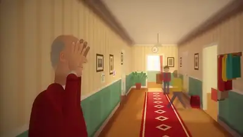</a><br><a href="https://www.sandbase.ai/lab/ai-videos/fable-5-2/2120100759195000942?utm_source=github&utm_medium=readme&utm_campaign=awesome-fable-5-2&utm_content=card"><b>A tiny film made with code</b></a><br><sub><a href="https://x.com/argofowl/status/2120100759195000942">@argofowl</a> · 0:16</sub></td><td width="33%" valign="top"><a href="https://www.sandbase.ai/lab/media/x/fable-5-2/2120142394985267463/video.mp4"></a><br><a href="https://www.sandbase.ai/lab/ai-videos/fable-5-2/2120142394985267463?utm_source=github&utm_medium=readme&utm_campaign=awesome-fable-5-2&utm_content=card"><b>Eighties style CRT shader animation of Marble logo</b></a><br><sub><a href="https://x.com/lionel_mora/status/2120142394985267463">@lionel_mora</a> · 0:12</sub></td><td width="33%" valign="top"><a href="https://www.sandbase.ai/lab/media/x/fable-5-2/2120150756909089244/video.mp4"></a><br><a href="https://www.sandbase.ai/lab/ai-videos/fable-5-2/2120150756909089244?utm_source=github&utm_medium=readme&utm_campaign=awesome-fable-5-2&utm_content=card"><b>Titanic animated video generated from code</b></a><br><sub><a href="https://x.com/notjazii/status/2120150756909089244">@notjazii</a> · 3:21</sub></td></tr>
<tr><td width="33%" valign="top"><a href="https://www.sandbase.ai/lab/media/x/fable-5-2/2120151937995649231/video.mp4"></a><br><a href="https://www.sandbase.ai/lab/ai-videos/fable-5-2/2120151937995649231?utm_source=github&utm_medium=readme&utm_campaign=awesome-fable-5-2&utm_content=card"><b>Motion design album built with Fable 5.2</b></a><br><sub><a href="https://x.com/cryptowluha/status/2120151937995649231">@cryptowluha</a> · 0:35</sub></td><td width="33%" valign="top"><a href="https://www.sandbase.ai/lab/media/x/fable-5-2/2120158769758027923/video.mp4"></a><br><a href="https://www.sandbase.ai/lab/ai-videos/fable-5-2/2120158769758027923?utm_source=github&utm_medium=readme&utm_campaign=awesome-fable-5-2&utm_content=card"><b>AI generated video showcase</b></a><br><sub><a href="https://x.com/kanavtwt/status/2120158769758027923">@kanavtwt</a> · 1:31</sub></td><td width="33%" valign="top"><a href="https://www.sandbase.ai/lab/media/x/fable-5-2/2120167637133238295/video.mp4"></a><br><a href="https://www.sandbase.ai/lab/ai-videos/fable-5-2/2120167637133238295?utm_source=github&utm_medium=readme&utm_campaign=awesome-fable-5-2&utm_content=card"><b>Claude logo animation</b></a><br><sub><a href="https://x.com/LexnLin/status/2120167637133238295">@LexnLin</a> · 0:30</sub></td></tr>
<tr><td width="33%" valign="top"><a href="https://www.sandbase.ai/lab/media/x/fable-5-2/2120177103584858570/video.mp4"></a><br><a href="https://www.sandbase.ai/lab/ai-videos/fable-5-2/2120177103584858570?utm_source=github&utm_medium=readme&utm_campaign=awesome-fable-5-2&utm_content=card"><b>Pelican riding a bicycle SVG animation</b></a><br><sub><a href="https://x.com/TokenGremlin/status/2120177103584858570">@TokenGremlin</a> · 0:19</sub></td><td width="33%" valign="top"><a href="https://www.sandbase.ai/lab/media/x/fable-5-2/2120177401619747146/video.mp4">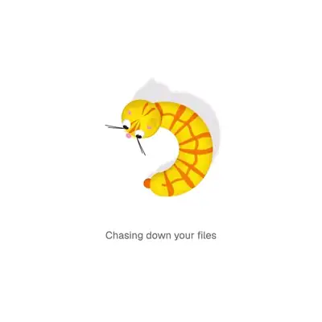</a><br><a href="https://www.sandbase.ai/lab/ai-videos/fable-5-2/2120177401619747146?utm_source=github&utm_medium=readme&utm_campaign=awesome-fable-5-2&utm_content=card"><b>An animation created with Fable 5.2</b></a><br><sub><a href="https://x.com/oiharshit/status/2120177401619747146">@oiharshit</a> · 0:07 · <a href="https://www.sandbase.ai/lab/ai-videos/fable-5-2/2120177401619747146?utm_source=github&utm_medium=readme&utm_campaign=awesome-fable-5-2&utm_content=card">prompt</a></sub></td><td width="33%" valign="top"><a href="https://www.sandbase.ai/lab/media/x/fable-5-2/2120178561973657773/video.mp4"></a><br><a href="https://www.sandbase.ai/lab/ai-videos/fable-5-2/2120178561973657773?utm_source=github&utm_medium=readme&utm_campaign=awesome-fable-5-2&utm_content=card"><b>A video created with a single prompt</b></a><br><sub><a href="https://x.com/tobiadonadon_/status/2120178561973657773">@tobiadonadon_</a> · 0:18</sub></td></tr>
<tr><td width="33%" valign="top"><a href="https://www.sandbase.ai/lab/media/x/fable-5-2/2120198834559271314/video.mp4">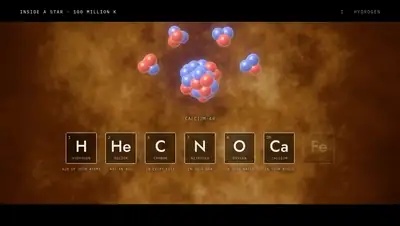</a><br><a href="https://www.sandbase.ai/lab/ai-videos/fable-5-2/2120198834559271314?utm_source=github&utm_medium=readme&utm_campaign=awesome-fable-5-2&utm_content=card"><b>Short film on the meaning of life</b></a><br><sub><a href="https://x.com/Av1dlive/status/2120198834559271314">@Av1dlive</a> · 4:13</sub></td><td width="33%" valign="top"><a href="https://www.sandbase.ai/lab/media/x/fable-5-2/2120210882382971263/video.mp4"></a><br><a href="https://www.sandbase.ai/lab/ai-videos/fable-5-2/2120210882382971263?utm_source=github&utm_medium=readme&utm_campaign=awesome-fable-5-2&utm_content=card"><b>A dynamic motion graphics showreel</b></a><br><sub><a href="https://x.com/MatinSenPai/status/2120210882382971263">@MatinSenPai</a> · 0:15 · <a href="https://www.sandbase.ai/lab/ai-videos/fable-5-2/2120210882382971263?utm_source=github&utm_medium=readme&utm_campaign=awesome-fable-5-2&utm_content=card">prompt</a></sub></td><td width="33%" valign="top"><a href="https://www.sandbase.ai/lab/media/x/fable-5-2/2120211050595340766/video.mp4">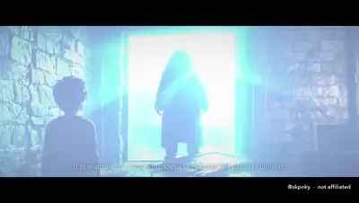</a><br><a href="https://www.sandbase.ai/lab/ai-videos/fable-5-2/2120211050595340766?utm_source=github&utm_medium=readme&utm_campaign=awesome-fable-5-2&utm_content=card"><b>A video made with Fable 5.2</b></a><br><sub><a href="https://x.com/skpnky/status/2120211050595340766">@skpnky</a> · 1:05</sub></td></tr>
<tr><td width="33%" valign="top"><a href="https://www.sandbase.ai/lab/media/x/opus-5-5/2120248196584648758/video.mp4"></a><br><a href="https://www.sandbase.ai/lab/ai-videos/fable-5-2/2120248196584648758?utm_source=github&utm_medium=readme&utm_campaign=awesome-fable-5-2&utm_content=card"><b>Film VFX pipeline directed through AI prompting</b></a><br><sub><a href="https://x.com/AlexPi194641/status/2120248196584648758">@AlexPi194641</a> · 0:28</sub></td><td width="33%" valign="top"><a href="https://www.sandbase.ai/lab/media/x/fable-5-2/2120279835020804164/video.mp4"></a><br><a href="https://www.sandbase.ai/lab/ai-videos/fable-5-2/2120279835020804164?utm_source=github&utm_medium=readme&utm_campaign=awesome-fable-5-2&utm_content=card"><b>Loading animation created with Fable 5.2</b></a><br><sub><a href="https://x.com/seanaiux/status/2120279835020804164">@seanaiux</a> · 0:12 · <a href="https://www.sandbase.ai/lab/ai-videos/fable-5-2/2120279835020804164?utm_source=github&utm_medium=readme&utm_campaign=awesome-fable-5-2&utm_content=card">prompt</a></sub></td><td width="33%" valign="top"><a href="https://www.sandbase.ai/lab/media/x/fable-5-2/2120286741248741694/video.mp4"></a><br><a href="https://www.sandbase.ai/lab/ai-videos/fable-5-2/2120286741248741694?utm_source=github&utm_medium=readme&utm_campaign=awesome-fable-5-2&utm_content=card"><b>Pixar style animation with Fable and Higgsfield</b></a><br><sub><a href="https://x.com/pounddz/status/2120286741248741694">@pounddz</a> · 3:29</sub></td></tr>
<tr><td width="33%" valign="top"><a href="https://www.sandbase.ai/lab/media/x/fable-5-2/2120372319608508871/video.mp4"></a><br><a href="https://www.sandbase.ai/lab/ai-videos/fable-5-2/2120372319608508871?utm_source=github&utm_medium=readme&utm_campaign=awesome-fable-5-2&utm_content=card"><b>Editable animated Christmas illustration made with LottieFiles MCP</b></a><br><sub><a href="https://x.com/robrtcode/status/2120372319608508871">@robrtcode</a> · 0:04</sub></td><td width="33%" valign="top"><a href="https://www.sandbase.ai/lab/media/x/fable-5-2/2120424277921198298/video.mp4">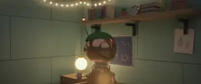</a><br><a href="https://www.sandbase.ai/lab/ai-videos/fable-5-2/2120424277921198298?utm_source=github&utm_medium=readme&utm_campaign=awesome-fable-5-2&utm_content=card"><b>Sleepy robot on a sleepy starship animation</b></a><br><sub><a href="https://x.com/ChrisGPT/status/2120424277921198298">@ChrisGPT</a> · 0:45</sub></td><td width="33%" valign="top"><a href="https://www.sandbase.ai/lab/media/x/fable-5-2/2120475568915529978/video.mp4"></a><br><a href="https://www.sandbase.ai/lab/ai-videos/fable-5-2/2120475568915529978?utm_source=github&utm_medium=readme&utm_campaign=awesome-fable-5-2&utm_content=card"><b>Film directing test using Claude Fable 5.2</b></a><br><sub><a href="https://x.com/EHuanglu/status/2120475568915529978">@EHuanglu</a> · 1:08</sub></td></tr>
<tr><td width="33%" valign="top"><a href="https://www.sandbase.ai/lab/media/x/fable-5-2/2120486254852608470/video.mp4">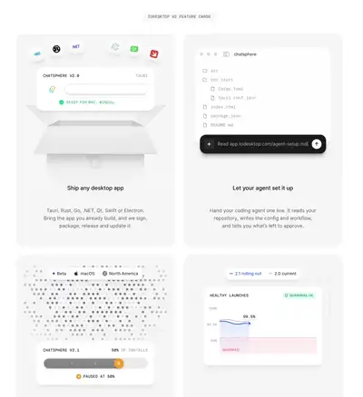</a><br><a href="https://www.sandbase.ai/lab/ai-videos/fable-5-2/2120486254852608470?utm_source=github&utm_medium=readme&utm_campaign=awesome-fable-5-2&utm_content=card"><b>Motion design demonstration with Fable 5.2</b></a><br><sub><a href="https://x.com/DaveJ/status/2120486254852608470">@DaveJ</a> · 0:25</sub></td><td width="33%" valign="top"><a href="https://www.sandbase.ai/lab/media/x/fable-5-2/2120488092096160189/video.mp4"></a><br><a href="https://www.sandbase.ai/lab/ai-videos/fable-5-2/2120488092096160189?utm_source=github&utm_medium=readme&utm_campaign=awesome-fable-5-2&utm_content=card"><b>Dream video generated by Fable 5.2</b></a><br><sub><a href="https://x.com/robertwiblin/status/2120488092096160189">@robertwiblin</a> · 0:45</sub></td><td width="33%" valign="top"><a href="https://www.sandbase.ai/lab/media/x/fable-5-2/2120554995128963481/video.mp4"></a><br><a href="https://www.sandbase.ai/lab/ai-videos/fable-5-2/2120554995128963481?utm_source=github&utm_medium=readme&utm_campaign=awesome-fable-5-2&utm_content=card"><b>The lifecycle of the phoenix in JavaScript animation</b></a><br><sub><a href="https://x.com/devteamdrew/status/2120554995128963481">@devteamdrew</a> · 0:40</sub></td></tr>
<tr><td width="33%" valign="top"><a href="https://www.sandbase.ai/lab/media/x/fable-5-2/2120610888797364383/video.mp4"></a><br><a href="https://www.sandbase.ai/lab/ai-videos/fable-5-2/2120610888797364383?utm_source=github&utm_medium=readme&utm_campaign=awesome-fable-5-2&utm_content=card"><b>Pixel art animation generated with Claude</b></a><br><sub><a href="https://x.com/aGim_asf/status/2120610888797364383">@aGim_asf</a> · 0:04</sub></td><td width="33%" valign="top"><a href="https://www.sandbase.ai/lab/media/x/fable-5-2/2120682766853677558/video.mp4"></a><br><a href="https://www.sandbase.ai/lab/ai-videos/fable-5-2/2120682766853677558?utm_source=github&utm_medium=readme&utm_campaign=awesome-fable-5-2&utm_content=card"><b>Motion graphics study using AI tools</b></a><br><sub><a href="https://x.com/gane0wav/status/2120682766853677558">@gane0wav</a> · 0:17</sub></td><td width="33%" valign="top"><a href="https://www.sandbase.ai/lab/media/x/fable-5-2/2120763270500077829/video.mp4"></a><br><a href="https://www.sandbase.ai/lab/ai-videos/fable-5-2/2120763270500077829?utm_source=github&utm_medium=readme&utm_campaign=awesome-fable-5-2&utm_content=card"><b>Dynamic motion graphics showreel generated from prompt</b></a><br><sub><a href="https://x.com/Mr_Buzzoni/status/2120763270500077829">@Mr_Buzzoni</a> · 0:17 · <a href="https://www.sandbase.ai/lab/ai-videos/fable-5-2/2120763270500077829?utm_source=github&utm_medium=readme&utm_campaign=awesome-fable-5-2&utm_content=card">prompt</a></sub></td></tr>
<tr><td width="33%" valign="top"><a href="https://www.sandbase.ai/lab/media/x/fable-5-2/2120824741003182236/video.mp4"></a><br><a href="https://www.sandbase.ai/lab/ai-videos/fable-5-2/2120824741003182236?utm_source=github&utm_medium=readme&utm_campaign=awesome-fable-5-2&utm_content=card"><b>3D card study motion graphics</b></a><br><sub><a href="https://x.com/gane0wav/status/2120824741003182236">@gane0wav</a> · 0:20</sub></td><td width="33%" valign="top"><a href="https://www.sandbase.ai/lab/media/x/fable-5-2/2120843546177774073/video.mp4"></a><br><a href="https://www.sandbase.ai/lab/ai-videos/fable-5-2/2120843546177774073?utm_source=github&utm_medium=readme&utm_campaign=awesome-fable-5-2&utm_content=card"><b>AI generated video created from a prompt</b></a><br><sub><a href="https://x.com/kepochnik/status/2120843546177774073">@kepochnik</a> · 0:21</sub></td><td width="33%" valign="top"><a href="https://www.sandbase.ai/lab/media/x/fable-5-2/2120855435230187993/video.mp4"></a><br><a href="https://www.sandbase.ai/lab/ai-videos/fable-5-2/2120855435230187993?utm_source=github&utm_medium=readme&utm_campaign=awesome-fable-5-2&utm_content=card"><b>Motion effects created with AI</b></a><br><sub><a href="https://x.com/csaba_kissi/status/2120855435230187993">@csaba_kissi</a> · 0:25</sub></td></tr>
<tr><td width="33%" valign="top"><a href="https://www.sandbase.ai/lab/media/x/fable-5-2/2120863770486710542/video.mp4"></a><br><a href="https://www.sandbase.ai/lab/ai-videos/fable-5-2/2120863770486710542?utm_source=github&utm_medium=readme&utm_campaign=awesome-fable-5-2&utm_content=card"><b>Video made with Fable and Seedance</b></a><br><sub><a href="https://x.com/abxxai/status/2120863770486710542">@abxxai</a> · 0:18 · <a href="https://www.sandbase.ai/lab/ai-videos/fable-5-2/2120863770486710542?utm_source=github&utm_medium=readme&utm_campaign=awesome-fable-5-2&utm_content=card">prompt</a></sub></td><td width="33%" valign="top"><a href="https://www.sandbase.ai/lab/media/x/fable-5-2/2120898690470519059/video.mp4"></a><br><a href="https://www.sandbase.ai/lab/ai-videos/fable-5-2/2120898690470519059?utm_source=github&utm_medium=readme&utm_campaign=awesome-fable-5-2&utm_content=card"><b>Couple rescuing a kitten in the rain</b></a><br><sub><a href="https://x.com/fleyta88/status/2120898690470519059">@fleyta88</a> · 0:28</sub></td><td width="33%" valign="top"><a href="https://www.sandbase.ai/lab/media/x/fable-5-2/2120908609143873884/video.mp4"></a><br><a href="https://www.sandbase.ai/lab/ai-videos/fable-5-2/2120908609143873884?utm_source=github&utm_medium=readme&utm_campaign=awesome-fable-5-2&utm_content=card"><b>Motion graphics advertisement for Gamdom</b></a><br><sub><a href="https://x.com/johncodunayo/status/2120908609143873884">@johncodunayo</a> · 1:04</sub></td></tr>
<tr><td width="33%" valign="top"><a href="https://www.sandbase.ai/lab/media/x/fable-5-2/2120961143913230460/video.mp4"></a><br><a href="https://www.sandbase.ai/lab/ai-videos/fable-5-2/2120961143913230460?utm_source=github&utm_medium=readme&utm_campaign=awesome-fable-5-2&utm_content=card"><b>Film trailer generated from a script</b></a><br><sub><a href="https://x.com/maxescu/status/2120961143913230460">@maxescu</a> · 3:11</sub></td><td width="33%" valign="top"><a href="https://www.sandbase.ai/lab/media/x/fable-5-2/2120993184561995884/video.mp4"></a><br><a href="https://www.sandbase.ai/lab/ai-videos/fable-5-2/2120993184561995884?utm_source=github&utm_medium=readme&utm_campaign=awesome-fable-5-2&utm_content=card"><b>A robot animation drawn entirely with HTML Canvas</b></a><br><sub><a href="https://x.com/finnardley/status/2120993184561995884">@finnardley</a> · 0:14</sub></td><td width="33%" valign="top"><a href="https://www.sandbase.ai/lab/media/x/fable-5-2/2121212540415885509/video.mp4"></a><br><a href="https://www.sandbase.ai/lab/ai-videos/fable-5-2/2121212540415885509?utm_source=github&utm_medium=readme&utm_campaign=awesome-fable-5-2&utm_content=card"><b>Motion effects created with open source libraries</b></a><br><sub><a href="https://x.com/m4lkxx/status/2121212540415885509">@m4lkxx</a> · 0:18</sub></td></tr>
<tr><td width="33%" valign="top"><a href="https://www.sandbase.ai/lab/media/x/fable-5-2/2121300246898897397/video.mp4"></a><br><a href="https://www.sandbase.ai/lab/ai-videos/fable-5-2/2121300246898897397?utm_source=github&utm_medium=readme&utm_campaign=awesome-fable-5-2&utm_content=card"><b>A code-rendered painted animated short film</b></a><br><sub><a href="https://x.com/de1lymoon/status/2121300246898897397">@de1lymoon</a> · 0:17 · <a href="https://www.sandbase.ai/lab/ai-videos/fable-5-2/2121300246898897397?utm_source=github&utm_medium=readme&utm_campaign=awesome-fable-5-2&utm_content=card">prompt</a></sub></td><td width="33%" valign="top"><a href="https://www.sandbase.ai/lab/media/x/fable-5-2/2121581514622177348/video.mp4"></a><br><a href="https://www.sandbase.ai/lab/ai-videos/fable-5-2/2121581514622177348?utm_source=github&utm_medium=readme&utm_campaign=awesome-fable-5-2&utm_content=card"><b>Motion studio animation tools with Fable</b></a><br><sub><a href="https://x.com/0xnicc0/status/2121581514622177348">@0xnicc0</a> · 0:34</sub></td><td width="33%" valign="top"><a href="https://www.sandbase.ai/lab/media/x/fable-5-2/2121584155418845290/video.mp4"></a><br><a href="https://www.sandbase.ai/lab/ai-videos/fable-5-2/2121584155418845290?utm_source=github&utm_medium=readme&utm_campaign=awesome-fable-5-2&utm_content=card"><b>Automated multi-tool animation system</b></a><br><sub><a href="https://x.com/0xsoul/status/2121584155418845290">@0xsoul</a> · 0:33</sub></td></tr>
<tr><td width="33%" valign="top"><a href="https://www.sandbase.ai/lab/media/x/fable-5-2/2121627112981569577/video.mp4"></a><br><a href="https://www.sandbase.ai/lab/ai-videos/fable-5-2/2121627112981569577?utm_source=github&utm_medium=readme&utm_campaign=awesome-fable-5-2&utm_content=card"><b>Storyboard converted into Disney-style animation</b></a><br><sub><a href="https://x.com/EHuanglu/status/2121627112981569577">@EHuanglu</a> · 1:26</sub></td><td width="33%" valign="top"><a href="https://www.sandbase.ai/lab/media/x/opus-5-5/2121635642836918385/video.mp4"></a><br><a href="https://www.sandbase.ai/lab/ai-videos/fable-5-2/2121635642836918385?utm_source=github&utm_medium=readme&utm_campaign=awesome-fable-5-2&utm_content=card"><b>Runway music video generated with AI models</b></a><br><sub><a href="https://x.com/AstrablueAI/status/2121635642836918385">@AstrablueAI</a> · 3:58</sub></td><td width="33%" valign="top"><a href="https://www.sandbase.ai/lab/media/x/fable-5-2/2121667594289565871/video.mp4"></a><br><a href="https://www.sandbase.ai/lab/ai-videos/fable-5-2/2121667594289565871?utm_source=github&utm_medium=readme&utm_campaign=awesome-fable-5-2&utm_content=card"><b>Converting images into interactive pixel art</b></a><br><sub><a href="https://x.com/aimikoda/status/2121667594289565871">@aimikoda</a> · 0:10 · <a href="https://www.sandbase.ai/lab/ai-videos/fable-5-2/2121667594289565871?utm_source=github&utm_medium=readme&utm_campaign=awesome-fable-5-2&utm_content=card">prompt</a></sub></td></tr>
<tr><td width="33%" valign="top"><a href="https://www.sandbase.ai/lab/media/x/fable-5-2/2121712808308183548/video.mp4"></a><br><a href="https://www.sandbase.ai/lab/ai-videos/fable-5-2/2121712808308183548?utm_source=github&utm_medium=readme&utm_campaign=awesome-fable-5-2&utm_content=card"><b>Music video visual effects workflow</b></a><br><sub><a href="https://x.com/mika_systems/status/2121712808308183548">@mika_systems</a> · 0:26</sub></td><td width="33%" valign="top"><a href="https://www.sandbase.ai/lab/media/x/fable-5-2/2121752688048377902/video.mp4"></a><br><a href="https://www.sandbase.ai/lab/ai-videos/fable-5-2/2121752688048377902?utm_source=github&utm_medium=readme&utm_campaign=awesome-fable-5-2&utm_content=card"><b>Code-generated video test using Claude Fable</b></a><br><sub><a href="https://x.com/alexcooldev/status/2121752688048377902">@alexcooldev</a> · 0:48</sub></td><td width="33%" valign="top"><a href="https://www.sandbase.ai/lab/media/x/fable-5-2/2121800440639811713/video.mp4"></a><br><a href="https://www.sandbase.ai/lab/ai-videos/fable-5-2/2121800440639811713?utm_source=github&utm_medium=readme&utm_campaign=awesome-fable-5-2&utm_content=card"><b>Single HTML file storm animation with synthesized sound</b></a><br><sub><a href="https://x.com/cyrilXBT/status/2121800440639811713">@cyrilXBT</a> · 1:00 · <a href="https://www.sandbase.ai/lab/ai-videos/fable-5-2/2121800440639811713?utm_source=github&utm_medium=readme&utm_campaign=awesome-fable-5-2&utm_content=card">prompt</a></sub></td></tr>
<tr><td width="33%" valign="top"><a href="https://www.sandbase.ai/lab/media/x/fable-5-2/2121895881066856932/video.mp4"></a><br><a href="https://www.sandbase.ai/lab/ai-videos/fable-5-2/2121895881066856932?utm_source=github&utm_medium=readme&utm_campaign=awesome-fable-5-2&utm_content=card"><b>Motion design created with Claude Fable 5.2</b></a><br><sub><a href="https://x.com/LanreMotion/status/2121895881066856932">@LanreMotion</a> · 0:36</sub></td><td width="33%" valign="top"><a href="https://www.sandbase.ai/lab/media/x/fable-5-2/2121941080010592499/video.mp4"></a><br><a href="https://www.sandbase.ai/lab/ai-videos/fable-5-2/2121941080010592499?utm_source=github&utm_medium=readme&utm_campaign=awesome-fable-5-2&utm_content=card"><b>Pixel art lizard wizard casting a fireball spell</b></a><br><sub><a href="https://x.com/zer0point_eth/status/2121941080010592499">@zer0point_eth</a> · 0:04 · <a href="https://www.sandbase.ai/lab/ai-videos/fable-5-2/2121941080010592499?utm_source=github&utm_medium=readme&utm_campaign=awesome-fable-5-2&utm_content=card">prompt</a></sub></td><td width="33%" valign="top"><a href="https://www.sandbase.ai/lab/media/x/fable-5-2/2122008363990991018/video.mp4"></a><br><a href="https://www.sandbase.ai/lab/ai-videos/fable-5-2/2122008363990991018?utm_source=github&utm_medium=readme&utm_campaign=awesome-fable-5-2&utm_content=card"><b>Story video for a couples app</b></a><br><sub><a href="https://x.com/jackfriks/status/2122008363990991018">@jackfriks</a> · 0:52</sub></td></tr>
<tr><td width="33%" valign="top"><a href="https://www.sandbase.ai/lab/media/x/fable-5-2/2122101050253447300/video.mp4"></a><br><a href="https://www.sandbase.ai/lab/ai-videos/fable-5-2/2122101050253447300?utm_source=github&utm_medium=readme&utm_campaign=awesome-fable-5-2&utm_content=card"><b>Product reveal video using code-based motion design</b></a><br><sub><a href="https://x.com/0xMovez/status/2122101050253447300">@0xMovez</a> · 0:19</sub></td><td width="33%" valign="top"><a href="https://www.sandbase.ai/lab/media/x/fable-5-2/2122150432986509631/video.mp4"></a><br><a href="https://www.sandbase.ai/lab/ai-videos/fable-5-2/2122150432986509631?utm_source=github&utm_medium=readme&utm_campaign=awesome-fable-5-2&utm_content=card"><b>Storytelling style motion videos for apps</b></a><br><sub><a href="https://x.com/alexcooldev/status/2122150432986509631">@alexcooldev</a> · 1:48</sub></td><td width="33%" valign="top"><a href="https://www.sandbase.ai/lab/media/x/fable-5-2/2122313967473434639/video.mp4"></a><br><a href="https://www.sandbase.ai/lab/ai-videos/fable-5-2/2122313967473434639?utm_source=github&utm_medium=readme&utm_campaign=awesome-fable-5-2&utm_content=card"><b>The world seen through a cat&#x27;s eyes</b></a><br><sub><a href="https://x.com/BubbleBrain/status/2122313967473434639">@BubbleBrain</a> · 1:50</sub></td></tr>
</table>

</details>

<a id="game"></a>

## Games

<table>
<tr><td width="33%" valign="top"><a href="https://www.sandbase.ai/lab/media/x/fable-5-2/2119867743965163994/video.mp4"></a><br><a href="https://www.sandbase.ai/lab/ai-videos/fable-5-2/2119867743965163994?utm_source=github&utm_medium=readme&utm_campaign=awesome-fable-5-2&utm_content=card"><b>Dragon riding simulator created with Fable 5.2</b></a><br><sub><a href="https://x.com/ForwardEditor/status/2119867743965163994">@ForwardEditor</a> · 0:38</sub></td><td width="33%" valign="top"><a href="https://www.sandbase.ai/lab/media/x/fable-5-2/2119868968307695818/video.mp4"></a><br><a href="https://www.sandbase.ai/lab/ai-videos/fable-5-2/2119868968307695818?utm_source=github&utm_medium=readme&utm_campaign=awesome-fable-5-2&utm_content=card"><b>A boat ride game demo in browser</b></a><br><sub><a href="https://x.com/kevin_t_ngo/status/2119868968307695818">@kevin_t_ngo</a> · 0:57</sub></td><td width="33%" valign="top"><a href="https://www.sandbase.ai/lab/media/x/fable-5-2/2119869170871652487/video.mp4"></a><br><a href="https://www.sandbase.ai/lab/ai-videos/fable-5-2/2119869170871652487?utm_source=github&utm_medium=readme&utm_campaign=awesome-fable-5-2&utm_content=card"><b>Code compiler running in Conway&#x27;s Game of Life</b></a><br><sub><a href="https://x.com/maxleiter/status/2119869170871652487">@maxleiter</a> · 1:01</sub></td></tr>
<tr><td width="33%" valign="top"><a href="https://www.sandbase.ai/lab/media/x/fable-5-2/2119871207206158459/video.mp4"></a><br><a href="https://www.sandbase.ai/lab/ai-videos/fable-5-2/2119871207206158459?utm_source=github&utm_medium=readme&utm_campaign=awesome-fable-5-2&utm_content=card"><b>A Gears of War game clone</b></a><br><sub><a href="https://x.com/MatthewBerman/status/2119871207206158459">@MatthewBerman</a> · 1:08</sub></td><td width="33%" valign="top"><a href="https://www.sandbase.ai/lab/media/x/fable-5-2/2119876449494540554/video.mp4"></a><br><a href="https://www.sandbase.ai/lab/ai-videos/fable-5-2/2119876449494540554?utm_source=github&utm_medium=readme&utm_campaign=awesome-fable-5-2&utm_content=card"><b>Reverse Scooby Doo parody game trailer</b></a><br><sub><a href="https://x.com/emollick/status/2119876449494540554">@emollick</a> · 1:00</sub></td><td width="33%" valign="top"><a href="https://www.sandbase.ai/lab/media/x/fable-5-2/2119877065701036047/video.mp4"></a><br><a href="https://www.sandbase.ai/lab/ai-videos/fable-5-2/2119877065701036047?utm_source=github&utm_medium=readme&utm_campaign=awesome-fable-5-2&utm_content=card"><b>A mirror Earth real-time sandbox game</b></a><br><sub><a href="https://x.com/mattshumer_/status/2119877065701036047">@mattshumer_</a> · 0:57</sub></td></tr>
</table>

<details>
<summary><b>Show all 69</b></summary>

<table>
<tr><td width="33%" valign="top"><a href="https://www.sandbase.ai/lab/media/x/fable-5-2/2119877592471760898/video.mp4"></a><br><a href="https://www.sandbase.ai/lab/ai-videos/fable-5-2/2119877592471760898?utm_source=github&utm_medium=readme&utm_campaign=awesome-fable-5-2&utm_content=card"><b>Mobile game coding test with Opus 5.5</b></a><br><sub><a href="https://x.com/solotechdev/status/2119877592471760898">@solotechdev</a> · 0:35</sub></td><td width="33%" valign="top"><a href="https://www.sandbase.ai/lab/media/x/fable-5-2/2119884264019779900/video.mp4"></a><br><a href="https://www.sandbase.ai/lab/ai-videos/fable-5-2/2119884264019779900?utm_source=github&utm_medium=readme&utm_campaign=awesome-fable-5-2&utm_content=card"><b>Playable game mechanics demo with Fable 5.2</b></a><br><sub><a href="https://x.com/petergostev/status/2119884264019779900">@petergostev</a> · 2:24</sub></td><td width="33%" valign="top"><a href="https://www.sandbase.ai/lab/media/x/fable-5-2/2119896842972643570/video.mp4"></a><br><a href="https://www.sandbase.ai/lab/ai-videos/fable-5-2/2119896842972643570?utm_source=github&utm_medium=readme&utm_campaign=awesome-fable-5-2&utm_content=card"><b>Backrooms game expansion test</b></a><br><sub><a href="https://x.com/Frank_web33/status/2119896842972643570">@Frank_web33</a> · 1:40</sub></td></tr>
<tr><td width="33%" valign="top"><a href="https://www.sandbase.ai/lab/media/x/fable-5-2/2119897650963075569/video.mp4"></a><br><a href="https://www.sandbase.ai/lab/ai-videos/fable-5-2/2119897650963075569?utm_source=github&utm_medium=readme&utm_campaign=awesome-fable-5-2&utm_content=card"><b>First-person shooter game clone made with AI</b></a><br><sub><a href="https://x.com/badboyfoxy/status/2119897650963075569">@badboyfoxy</a> · 0:49</sub></td><td width="33%" valign="top"><a href="https://www.sandbase.ai/lab/media/x/fable-5-2/2119898886215205358/video.mp4"></a><br><a href="https://www.sandbase.ai/lab/ai-videos/fable-5-2/2119898886215205358?utm_source=github&utm_medium=readme&utm_campaign=awesome-fable-5-2&utm_content=card"><b>Hero shooter game generated from a meme prompt</b></a><br><sub><a href="https://x.com/d0xxed/status/2119898886215205358">@d0xxed</a> · 0:15 · <a href="https://www.sandbase.ai/lab/ai-videos/fable-5-2/2119898886215205358?utm_source=github&utm_medium=readme&utm_campaign=awesome-fable-5-2&utm_content=card">prompt</a></sub></td><td width="33%" valign="top"><a href="https://www.sandbase.ai/lab/media/x/fable-5-2/2119899511317225567/video.mp4"></a><br><a href="https://www.sandbase.ai/lab/ai-videos/fable-5-2/2119899511317225567?utm_source=github&utm_medium=readme&utm_campaign=awesome-fable-5-2&utm_content=card"><b>Minecraft clone built in Three.js</b></a><br><sub><a href="https://x.com/teortaxesTex/status/2119899511317225567">@teortaxesTex</a> · 2:00</sub></td></tr>
<tr><td width="33%" valign="top"><a href="https://www.sandbase.ai/lab/media/x/fable-5-2/2119900487688622171/video.mp4"></a><br><a href="https://www.sandbase.ai/lab/ai-videos/fable-5-2/2119900487688622171?utm_source=github&utm_medium=readme&utm_campaign=awesome-fable-5-2&utm_content=card"><b>First-person shooter game demo in browser</b></a><br><sub><a href="https://x.com/kevin_t_ngo/status/2119900487688622171">@kevin_t_ngo</a> · 1:00</sub></td><td width="33%" valign="top"><a href="https://www.sandbase.ai/lab/media/x/fable-5-2/2119901658394358005/video.mp4"></a><br><a href="https://www.sandbase.ai/lab/ai-videos/fable-5-2/2119901658394358005?utm_source=github&utm_medium=readme&utm_campaign=awesome-fable-5-2&utm_content=card"><b>Browser based 3D kart racing game</b></a><br><sub><a href="https://x.com/petergyang/status/2119901658394358005">@petergyang</a> · 0:20</sub></td><td width="33%" valign="top"><a href="https://www.sandbase.ai/lab/media/x/fable-5-2/2119908749796081966/video.mp4"></a><br><a href="https://www.sandbase.ai/lab/ai-videos/fable-5-2/2119908749796081966?utm_source=github&utm_medium=readme&utm_campaign=awesome-fable-5-2&utm_content=card"><b>GTA2 remake with modern graphics in code</b></a><br><sub><a href="https://x.com/RisingSunInt_/status/2119908749796081966">@RisingSunInt_</a> · 2:23 · <a href="https://www.sandbase.ai/lab/ai-videos/fable-5-2/2119908749796081966?utm_source=github&utm_medium=readme&utm_campaign=awesome-fable-5-2&utm_content=card">prompt</a></sub></td></tr>
<tr><td width="33%" valign="top"><a href="https://www.sandbase.ai/lab/media/x/fable-5-2/2119910195325481026/video.mp4"></a><br><a href="https://www.sandbase.ai/lab/ai-videos/fable-5-2/2119910195325481026?utm_source=github&utm_medium=readme&utm_campaign=awesome-fable-5-2&utm_content=card"><b>Open world city action game prototype</b></a><br><sub><a href="https://x.com/ericmaskfr/status/2119910195325481026">@ericmaskfr</a> · 2:15</sub></td><td width="33%" valign="top"><a href="https://www.sandbase.ai/lab/media/x/fable-5-2/2119917699128086532/video.mp4"></a><br><a href="https://www.sandbase.ai/lab/ai-videos/fable-5-2/2119917699128086532?utm_source=github&utm_medium=readme&utm_campaign=awesome-fable-5-2&utm_content=card"><b>Running GreenHat-Kid V2 at sixty frames per second</b></a><br><sub><a href="https://x.com/Motion_Viz/status/2119917699128086532">@Motion_Viz</a> · 0:20 · <a href="https://www.sandbase.ai/lab/ai-videos/fable-5-2/2119917699128086532?utm_source=github&utm_medium=readme&utm_campaign=awesome-fable-5-2&utm_content=card">prompt</a></sub></td><td width="33%" valign="top"><a href="https://www.sandbase.ai/lab/media/x/fable-5-2/2119925633564463609/video.mp4"></a><br><a href="https://www.sandbase.ai/lab/ai-videos/fable-5-2/2119925633564463609?utm_source=github&utm_medium=readme&utm_campaign=awesome-fable-5-2&utm_content=card"><b>A game generated from scratch with one prompt</b></a><br><sub><a href="https://x.com/felixrieseberg/status/2119925633564463609">@felixrieseberg</a> · 1:12</sub></td></tr>
<tr><td width="33%" valign="top"><a href="https://www.sandbase.ai/lab/media/x/fable-5-2/2119928342115676576/video.mp4"></a><br><a href="https://www.sandbase.ai/lab/ai-videos/fable-5-2/2119928342115676576?utm_source=github&utm_medium=readme&utm_campaign=awesome-fable-5-2&utm_content=card"><b>Robot arm playing a game of checkers</b></a><br><sub><a href="https://x.com/karolina_dubiel/status/2119928342115676576">@karolina_dubiel</a> · 0:38</sub></td><td width="33%" valign="top"><a href="https://www.sandbase.ai/lab/media/x/fable-5-2/2119931740940640542/video.mp4"></a><br><a href="https://www.sandbase.ai/lab/ai-videos/fable-5-2/2119931740940640542?utm_source=github&utm_medium=readme&utm_campaign=awesome-fable-5-2&utm_content=card"><b>An entire MMO world generated from code</b></a><br><sub><a href="https://x.com/Izkimar/status/2119931740940640542">@Izkimar</a> · 1:36</sub></td><td width="33%" valign="top"><a href="https://www.sandbase.ai/lab/media/x/fable-5-2/2119935331499925557/video.mp4"></a><br><a href="https://www.sandbase.ai/lab/ai-videos/fable-5-2/2119935331499925557?utm_source=github&utm_medium=readme&utm_campaign=awesome-fable-5-2&utm_content=card"><b>An arena first-person shooter with portals</b></a><br><sub><a href="https://x.com/_sholtodouglas/status/2119935331499925557">@_sholtodouglas</a> · 1:11</sub></td></tr>
<tr><td width="33%" valign="top"><a href="https://www.sandbase.ai/lab/media/x/fable-5-2/2119937977426338283/video.mp4"></a><br><a href="https://www.sandbase.ai/lab/ai-videos/fable-5-2/2119937977426338283?utm_source=github&utm_medium=readme&utm_campaign=awesome-fable-5-2&utm_content=card"><b>Playable game built entirely in code</b></a><br><sub><a href="https://x.com/AmirMushich/status/2119937977426338283">@AmirMushich</a> · 0:22</sub></td><td width="33%" valign="top"><a href="https://www.sandbase.ai/lab/media/x/fable-5-2/2119963230403776554/video.mp4"></a><br><a href="https://www.sandbase.ai/lab/ai-videos/fable-5-2/2119963230403776554?utm_source=github&utm_medium=readme&utm_campaign=awesome-fable-5-2&utm_content=card"><b>Video game demo with and without AI audio</b></a><br><sub><a href="https://x.com/ElevenCreative/status/2119963230403776554">@ElevenCreative</a> · 0:49</sub></td><td width="33%" valign="top"><a href="https://www.sandbase.ai/lab/media/x/fable-5-2/2119969113762082931/video.mp4"></a><br><a href="https://www.sandbase.ai/lab/ai-videos/fable-5-2/2119969113762082931?utm_source=github&utm_medium=readme&utm_campaign=awesome-fable-5-2&utm_content=card"><b>A sword fighting game made with Fable 5.2</b></a><br><sub><a href="https://x.com/EvanMilenko/status/2119969113762082931">@EvanMilenko</a> · 0:31</sub></td></tr>
<tr><td width="33%" valign="top"><a href="https://www.sandbase.ai/lab/media/x/fable-5-2/2119973274402668852/video.mp4"></a><br><a href="https://www.sandbase.ai/lab/ai-videos/fable-5-2/2119973274402668852?utm_source=github&utm_medium=readme&utm_campaign=awesome-fable-5-2&utm_content=card"><b>Bryceball game running on Fable renderer</b></a><br><sub><a href="https://x.com/pleometric/status/2119973274402668852">@pleometric</a> · 1:19</sub></td><td width="33%" valign="top"><a href="https://www.sandbase.ai/lab/media/x/fable-5-2/2119979537320534135/video.mp4"></a><br><a href="https://www.sandbase.ai/lab/ai-videos/fable-5-2/2119979537320534135?utm_source=github&utm_medium=readme&utm_campaign=awesome-fable-5-2&utm_content=card"><b>First-person shooter on a tropical island</b></a><br><sub><a href="https://x.com/imantiai/status/2119979537320534135">@imantiai</a> · 0:31 · <a href="https://www.sandbase.ai/lab/ai-videos/fable-5-2/2119979537320534135?utm_source=github&utm_medium=readme&utm_campaign=awesome-fable-5-2&utm_content=card">prompt</a></sub></td><td width="33%" valign="top"><a href="https://www.sandbase.ai/lab/media/x/fable-5-2/2119980595279212916/video.mp4"></a><br><a href="https://www.sandbase.ai/lab/ai-videos/fable-5-2/2119980595279212916?utm_source=github&utm_medium=readme&utm_campaign=awesome-fable-5-2&utm_content=card"><b>Roblox game generated with a single prompt</b></a><br><sub><a href="https://x.com/ab_surf/status/2119980595279212916">@ab_surf</a> · 0:37</sub></td></tr>
<tr><td width="33%" valign="top"><a href="https://www.sandbase.ai/lab/media/x/fable-5-2/2120010028073771323/video.mp4"></a><br><a href="https://www.sandbase.ai/lab/ai-videos/fable-5-2/2120010028073771323?utm_source=github&utm_medium=readme&utm_campaign=awesome-fable-5-2&utm_content=card"><b>Interactive game with AI voices and sound effects</b></a><br><sub><a href="https://x.com/mrdejie/status/2120010028073771323">@mrdejie</a> · 1:14</sub></td><td width="33%" valign="top"><a href="https://www.sandbase.ai/lab/media/x/fable-5-2/2120080934036750493/video.mp4"></a><br><a href="https://www.sandbase.ai/lab/ai-videos/fable-5-2/2120080934036750493?utm_source=github&utm_medium=readme&utm_campaign=awesome-fable-5-2&utm_content=card"><b>AAA racing game created in Unity</b></a><br><sub><a href="https://x.com/NFT_Chen/status/2120080934036750493">@NFT_Chen</a> · 0:11</sub></td><td width="33%" valign="top"><a href="https://www.sandbase.ai/lab/media/x/fable-5-2/2120109725740159390/video.mp4"></a><br><a href="https://www.sandbase.ai/lab/ai-videos/fable-5-2/2120109725740159390?utm_source=github&utm_medium=readme&utm_campaign=awesome-fable-5-2&utm_content=card"><b>Horror game generated in Unreal Engine</b></a><br><sub><a href="https://x.com/_MaxBlade/status/2120109725740159390">@_MaxBlade</a> · 2:01</sub></td></tr>
<tr><td width="33%" valign="top"><a href="https://www.sandbase.ai/lab/media/x/fable-5-2/2120123820833116194/video.mp4"></a><br><a href="https://www.sandbase.ai/lab/ai-videos/fable-5-2/2120123820833116194?utm_source=github&utm_medium=readme&utm_campaign=awesome-fable-5-2&utm_content=card"><b>Playable 3D game built with Fable</b></a><br><sub><a href="https://x.com/the_futureAI/status/2120123820833116194">@the_futureAI</a> · 0:22</sub></td><td width="33%" valign="top"><a href="https://www.sandbase.ai/lab/media/x/fable-5-2/2120132270249947466/video.mp4"></a><br><a href="https://www.sandbase.ai/lab/ai-videos/fable-5-2/2120132270249947466?utm_source=github&utm_medium=readme&utm_campaign=awesome-fable-5-2&utm_content=card"><b>Nature game scene with grass and flowers</b></a><br><sub><a href="https://x.com/polinaaAi/status/2120132270249947466">@polinaaAi</a> · 0:32</sub></td><td width="33%" valign="top"><a href="https://www.sandbase.ai/lab/media/x/fable-5-2/2120154573356793883/video.mp4"></a><br><a href="https://www.sandbase.ai/lab/ai-videos/fable-5-2/2120154573356793883?utm_source=github&utm_medium=readme&utm_campaign=awesome-fable-5-2&utm_content=card"><b>Pickleball game built in Unreal Engine</b></a><br><sub><a href="https://x.com/chongdashu/status/2120154573356793883">@chongdashu</a> · 0:49</sub></td></tr>
<tr><td width="33%" valign="top"><a href="https://www.sandbase.ai/lab/media/x/fable-5-2/2120175295659426063/video.mp4"></a><br><a href="https://www.sandbase.ai/lab/ai-videos/fable-5-2/2120175295659426063?utm_source=github&utm_medium=readme&utm_campaign=awesome-fable-5-2&utm_content=card"><b>Browser FPS built in Three.js</b></a><br><sub><a href="https://x.com/rewind02/status/2120175295659426063">@rewind02</a> · 0:49</sub></td><td width="33%" valign="top"><a href="https://www.sandbase.ai/lab/media/x/fable-5-2/2120192761542615271/video.mp4"></a><br><a href="https://www.sandbase.ai/lab/ai-videos/fable-5-2/2120192761542615271?utm_source=github&utm_medium=readme&utm_campaign=awesome-fable-5-2&utm_content=card"><b>A game created with Fable 5.2</b></a><br><sub><a href="https://x.com/loktar00/status/2120192761542615271">@loktar00</a> · 1:08</sub></td><td width="33%" valign="top"><a href="https://www.sandbase.ai/lab/media/x/fable-5-2/2120248525254742318/video.mp4"></a><br><a href="https://www.sandbase.ai/lab/ai-videos/fable-5-2/2120248525254742318?utm_source=github&utm_medium=readme&utm_campaign=awesome-fable-5-2&utm_content=card"><b>Fantasy transport sim Dread and District</b></a><br><sub><a href="https://x.com/emollick/status/2120248525254742318">@emollick</a> · 0:19</sub></td></tr>
<tr><td width="33%" valign="top"><a href="https://www.sandbase.ai/lab/media/x/fable-5-2/2120253236309569696/video.mp4"></a><br><a href="https://www.sandbase.ai/lab/ai-videos/fable-5-2/2120253236309569696?utm_source=github&utm_medium=readme&utm_campaign=awesome-fable-5-2&utm_content=card"><b>Open world 3D game demo Age of Dragon</b></a><br><sub><a href="https://x.com/M__Houser/status/2120253236309569696">@M__Houser</a> · 1:56</sub></td><td width="33%" valign="top"><a href="https://www.sandbase.ai/lab/media/x/fable-5-2/2120255060957659498/video.mp4"></a><br><a href="https://www.sandbase.ai/lab/ai-videos/fable-5-2/2120255060957659498?utm_source=github&utm_medium=readme&utm_campaign=awesome-fable-5-2&utm_content=card"><b>A game challenge built with Fable 5.2</b></a><br><sub><a href="https://x.com/Grummz/status/2120255060957659498">@Grummz</a> · 0:40</sub></td><td width="33%" valign="top"><a href="https://www.sandbase.ai/lab/media/x/fable-5-2/2120284261089673376/video.mp4"></a><br><a href="https://www.sandbase.ai/lab/ai-videos/fable-5-2/2120284261089673376?utm_source=github&utm_medium=readme&utm_campaign=awesome-fable-5-2&utm_content=card"><b>A game of Van Gogh riding through Starry Night</b></a><br><sub><a href="https://x.com/ebbyamir/status/2120284261089673376">@ebbyamir</a> · 0:53</sub></td></tr>
<tr><td width="33%" valign="top"><a href="https://www.sandbase.ai/lab/media/x/fable-5-2/2120306434575392793/video.mp4"></a><br><a href="https://www.sandbase.ai/lab/ai-videos/fable-5-2/2120306434575392793?utm_source=github&utm_medium=readme&utm_campaign=awesome-fable-5-2&utm_content=card"><b>A first-person shooter game in Three.js</b></a><br><sub><a href="https://x.com/JaydenDavisNC/status/2120306434575392793">@JaydenDavisNC</a> · 3:46</sub></td><td width="33%" valign="top"><a href="https://www.sandbase.ai/lab/media/x/fable-5-2/2120341251178594532/video.mp4"></a><br><a href="https://www.sandbase.ai/lab/ai-videos/fable-5-2/2120341251178594532?utm_source=github&utm_medium=readme&utm_campaign=awesome-fable-5-2&utm_content=card"><b>A hand-painted browser game created with Fable</b></a><br><sub><a href="https://x.com/BlendiByl/status/2120341251178594532">@BlendiByl</a> · 0:16</sub></td><td width="33%" valign="top"><a href="https://www.sandbase.ai/lab/media/x/fable-5-2/2120350817790112023/video.mp4"></a><br><a href="https://www.sandbase.ai/lab/ai-videos/fable-5-2/2120350817790112023?utm_source=github&utm_medium=readme&utm_campaign=awesome-fable-5-2&utm_content=card"><b>Development update for a GTA style Bengaluru game</b></a><br><sub><a href="https://x.com/shettyprajwal_/status/2120350817790112023">@shettyprajwal_</a> · 4:15</sub></td></tr>
<tr><td width="33%" valign="top"><a href="https://www.sandbase.ai/lab/media/x/fable-5-2/2120448447166001569/video.mp4"></a><br><a href="https://www.sandbase.ai/lab/ai-videos/fable-5-2/2120448447166001569?utm_source=github&utm_medium=readme&utm_campaign=awesome-fable-5-2&utm_content=card"><b>An open world RPG built with AI and Three.js</b></a><br><sub><a href="https://x.com/FinanceYF5/status/2120448447166001569">@FinanceYF5</a> · 1:56</sub></td><td width="33%" valign="top"><a href="https://www.sandbase.ai/lab/media/x/fable-5-2/2120494277528580110/video.mp4"></a><br><a href="https://www.sandbase.ai/lab/ai-videos/fable-5-2/2120494277528580110?utm_source=github&utm_medium=readme&utm_campaign=awesome-fable-5-2&utm_content=card"><b>Browser-based fantasy sailing game generated by code</b></a><br><sub><a href="https://x.com/flxrnc/status/2120494277528580110">@flxrnc</a> · 0:45 · <a href="https://www.sandbase.ai/lab/ai-videos/fable-5-2/2120494277528580110?utm_source=github&utm_medium=readme&utm_campaign=awesome-fable-5-2&utm_content=card">prompt</a></sub></td><td width="33%" valign="top"><a href="https://www.sandbase.ai/lab/media/x/fable-5-2/2120514197674975640/video.mp4"></a><br><a href="https://www.sandbase.ai/lab/ai-videos/fable-5-2/2120514197674975640?utm_source=github&utm_medium=readme&utm_campaign=awesome-fable-5-2&utm_content=card"><b>Painterly 3D browser walk through autumn forest</b></a><br><sub><a href="https://x.com/sorenxet/status/2120514197674975640">@sorenxet</a> · 0:16</sub></td></tr>
<tr><td width="33%" valign="top"><a href="https://www.sandbase.ai/lab/media/x/fable-5-2/2120582812793475290/video.mp4"></a><br><a href="https://www.sandbase.ai/lab/ai-videos/fable-5-2/2120582812793475290?utm_source=github&utm_medium=readme&utm_campaign=awesome-fable-5-2&utm_content=card"><b>A 3D farming game built in a single HTML file</b></a><br><sub><a href="https://x.com/rewind02/status/2120582812793475290">@rewind02</a> · 2:04 · <a href="https://www.sandbase.ai/lab/ai-videos/fable-5-2/2120582812793475290?utm_source=github&utm_medium=readme&utm_campaign=awesome-fable-5-2&utm_content=card">prompt</a></sub></td><td width="33%" valign="top"><a href="https://www.sandbase.ai/lab/media/x/fable-5-2/2120599812512833557/video.mp4"></a><br><a href="https://www.sandbase.ai/lab/ai-videos/fable-5-2/2120599812512833557?utm_source=github&utm_medium=readme&utm_campaign=awesome-fable-5-2&utm_content=card"><b>Code-generated playable game in Three.js and WebGPU</b></a><br><sub><a href="https://x.com/Andrew_Blumson/status/2120599812512833557">@Andrew_Blumson</a> · 1:32</sub></td><td width="33%" valign="top"><a href="https://www.sandbase.ai/lab/media/x/fable-5-2/2120623841059738078/video.mp4"></a><br><a href="https://www.sandbase.ai/lab/ai-videos/fable-5-2/2120623841059738078?utm_source=github&utm_medium=readme&utm_campaign=awesome-fable-5-2&utm_content=card"><b>Open-world RPG Built with Three.js</b></a><br><sub><a href="https://x.com/sorenxet/status/2120623841059738078">@sorenxet</a> · 1:56</sub></td></tr>
<tr><td width="33%" valign="top"><a href="https://www.sandbase.ai/lab/media/x/fable-5-2/2120673668544303558/video.mp4"></a><br><a href="https://www.sandbase.ai/lab/ai-videos/fable-5-2/2120673668544303558?utm_source=github&utm_medium=readme&utm_campaign=awesome-fable-5-2&utm_content=card"><b>Interactive cartoon coded in JavaScript</b></a><br><sub><a href="https://x.com/mickeyxfriedman/status/2120673668544303558">@mickeyxfriedman</a> · 1:13</sub></td><td width="33%" valign="top"><a href="https://www.sandbase.ai/lab/media/x/fable-5-2/2120694045299327187/video.mp4"></a><br><a href="https://www.sandbase.ai/lab/ai-videos/fable-5-2/2120694045299327187?utm_source=github&utm_medium=readme&utm_campaign=awesome-fable-5-2&utm_content=card"><b>A 3D action game packed into single HTML file</b></a><br><sub><a href="https://x.com/op7418/status/2120694045299327187">@op7418</a> · 1:06</sub></td><td width="33%" valign="top"><a href="https://www.sandbase.ai/lab/media/x/fable-5-2/2120746541636047347/video.mp4"></a><br><a href="https://www.sandbase.ai/lab/ai-videos/fable-5-2/2120746541636047347?utm_source=github&utm_medium=readme&utm_campaign=awesome-fable-5-2&utm_content=card"><b>A patchwork stop-motion game slice</b></a><br><sub><a href="https://x.com/BlendiByl/status/2120746541636047347">@BlendiByl</a> · 0:27</sub></td></tr>
<tr><td width="33%" valign="top"><a href="https://www.sandbase.ai/lab/media/x/fable-5-2/2120905457380507991/video.mp4"></a><br><a href="https://www.sandbase.ai/lab/ai-videos/fable-5-2/2120905457380507991?utm_source=github&utm_medium=readme&utm_campaign=awesome-fable-5-2&utm_content=card"><b>Dinosaur chase game using sprite stacked WebGL</b></a><br><sub><a href="https://x.com/loktar00/status/2120905457380507991">@loktar00</a> · 1:09</sub></td><td width="33%" valign="top"><a href="https://www.sandbase.ai/lab/media/x/fable-5-2/2120951186274587095/video.mp4"></a><br><a href="https://www.sandbase.ai/lab/ai-videos/fable-5-2/2120951186274587095?utm_source=github&utm_medium=readme&utm_campaign=awesome-fable-5-2&utm_content=card"><b>A car drifting in a parking garage</b></a><br><sub><a href="https://x.com/mindblown_ai/status/2120951186274587095">@mindblown_ai</a> · 0:56</sub></td><td width="33%" valign="top"><a href="https://www.sandbase.ai/lab/media/x/fable-5-2/2121139143615074501/video.mp4"></a><br><a href="https://www.sandbase.ai/lab/ai-videos/fable-5-2/2121139143615074501?utm_source=github&utm_medium=readme&utm_campaign=awesome-fable-5-2&utm_content=card"><b>Japanese-inspired FPS game in Three.js</b></a><br><sub><a href="https://x.com/MengTo/status/2121139143615074501">@MengTo</a> · 0:52</sub></td></tr>
<tr><td width="33%" valign="top"><a href="https://www.sandbase.ai/lab/media/x/fable-5-2/2121253191748669705/video.mp4"></a><br><a href="https://www.sandbase.ai/lab/ai-videos/fable-5-2/2121253191748669705?utm_source=github&utm_medium=readme&utm_campaign=awesome-fable-5-2&utm_content=card"><b>Open world RPG game demo built with code</b></a><br><sub><a href="https://x.com/LexnLin/status/2121253191748669705">@LexnLin</a> · 1:20</sub></td><td width="33%" valign="top"><a href="https://www.sandbase.ai/lab/media/x/fable-5-2/2121296570872107145/video.mp4"></a><br><a href="https://www.sandbase.ai/lab/ai-videos/fable-5-2/2121296570872107145?utm_source=github&utm_medium=readme&utm_campaign=awesome-fable-5-2&utm_content=card"><b>Three.js yacht simulator built with code models</b></a><br><sub><a href="https://x.com/maxt3chno/status/2121296570872107145">@maxt3chno</a> · 1:36</sub></td><td width="33%" valign="top"><a href="https://www.sandbase.ai/lab/media/x/fable-5-2/2121302457062162761/video.mp4"></a><br><a href="https://www.sandbase.ai/lab/ai-videos/fable-5-2/2121302457062162761?utm_source=github&utm_medium=readme&utm_campaign=awesome-fable-5-2&utm_content=card"><b>Physics-based racing game created with Fable 5.2</b></a><br><sub><a href="https://x.com/softdrinktv/status/2121302457062162761">@softdrinktv</a> · 3:50</sub></td></tr>
<tr><td width="33%" valign="top"><a href="https://www.sandbase.ai/lab/media/x/fable-5-2/2121575140307706285/video.mp4"></a><br><a href="https://www.sandbase.ai/lab/ai-videos/fable-5-2/2121575140307706285?utm_source=github&utm_medium=readme&utm_campaign=awesome-fable-5-2&utm_content=card"><b>Walkable oil-painting world in Three.js</b></a><br><sub><a href="https://x.com/rewind02/status/2121575140307706285">@rewind02</a> · 0:16</sub></td><td width="33%" valign="top"><a href="https://www.sandbase.ai/lab/media/x/fable-5-2/2121594536153718972/video.mp4"></a><br><a href="https://www.sandbase.ai/lab/ai-videos/fable-5-2/2121594536153718972?utm_source=github&utm_medium=readme&utm_campaign=awesome-fable-5-2&utm_content=card"><b>Browser wizard sandbox game built entirely with code</b></a><br><sub><a href="https://x.com/BlendiByl/status/2121594536153718972">@BlendiByl</a> · 0:55</sub></td><td width="33%" valign="top"><a href="https://www.sandbase.ai/lab/media/x/fable-5-2/2121607945574084984/video.mp4"></a><br><a href="https://www.sandbase.ai/lab/ai-videos/fable-5-2/2121607945574084984?utm_source=github&utm_medium=readme&utm_campaign=awesome-fable-5-2&utm_content=card"><b>Game project footage created with Fable 5.2 in Unreal Engine</b></a><br><sub><a href="https://x.com/RezAIT00/status/2121607945574084984">@RezAIT00</a> · 1:06</sub></td></tr>
<tr><td width="33%" valign="top"><a href="https://www.sandbase.ai/lab/media/x/fable-5-2/2121633372644491601/video.mp4"></a><br><a href="https://www.sandbase.ai/lab/ai-videos/fable-5-2/2121633372644491601?utm_source=github&utm_medium=readme&utm_campaign=awesome-fable-5-2&utm_content=card"><b>CS2 cheat demonstration generated with AI</b></a><br><sub><a href="https://x.com/cazzwastaken/status/2121633372644491601">@cazzwastaken</a> · 0:10</sub></td><td width="33%" valign="top"><a href="https://www.sandbase.ai/lab/media/x/fable-5-2/2121872293878227086/video.mp4"></a><br><a href="https://www.sandbase.ai/lab/ai-videos/fable-5-2/2121872293878227086?utm_source=github&utm_medium=readme&utm_campaign=awesome-fable-5-2&utm_content=card"><b>Playable browser Souls-like boss fight</b></a><br><sub><a href="https://x.com/nehulbuilds/status/2121872293878227086">@nehulbuilds</a> · 2:18</sub></td><td width="33%" valign="top"><a href="https://www.sandbase.ai/lab/media/x/opus-5-5/2121896633848017145/video.mp4"></a><br><a href="https://www.sandbase.ai/lab/ai-videos/fable-5-2/2121896633848017145?utm_source=github&utm_medium=readme&utm_campaign=awesome-fable-5-2&utm_content=card"><b>Dark Souls inspired browser game built with Three.js</b></a><br><sub><a href="https://x.com/MengTo/status/2121896633848017145">@MengTo</a> · 1:39 · <a href="https://www.sandbase.ai/lab/ai-videos/fable-5-2/2121896633848017145?utm_source=github&utm_medium=readme&utm_campaign=awesome-fable-5-2&utm_content=card">prompt</a></sub></td></tr>
<tr><td width="33%" valign="top"><a href="https://www.sandbase.ai/lab/media/x/fable-5-2/2121931382255755691/video.mp4"></a><br><a href="https://www.sandbase.ai/lab/ai-videos/fable-5-2/2121931382255755691?utm_source=github&utm_medium=readme&utm_campaign=awesome-fable-5-2&utm_content=card"><b>City tour in a game project created with Fable</b></a><br><sub><a href="https://x.com/seftsaint/status/2121931382255755691">@seftsaint</a> · 0:23</sub></td><td width="33%" valign="top"><a href="https://www.sandbase.ai/lab/media/x/opus-5-5/2121938110762103246/video.mp4"></a><br><a href="https://www.sandbase.ai/lab/ai-videos/fable-5-2/2121938110762103246?utm_source=github&utm_medium=readme&utm_campaign=awesome-fable-5-2&utm_content=card"><b>Open-world flight simulator built in Rust</b></a><br><sub><a href="https://x.com/hakimieiqbal/status/2121938110762103246">@hakimieiqbal</a> · 1:14</sub></td><td width="33%" valign="top"><a href="https://www.sandbase.ai/lab/media/x/fable-5-2/2122013352755126431/video.mp4"></a><br><a href="https://www.sandbase.ai/lab/ai-videos/fable-5-2/2122013352755126431?utm_source=github&utm_medium=readme&utm_campaign=awesome-fable-5-2&utm_content=card"><b>A hand-painted 2D storybook game</b></a><br><sub><a href="https://x.com/Rubzem/status/2122013352755126431">@Rubzem</a> · 2:17</sub></td></tr>
<tr><td width="33%" valign="top"><a href="https://www.sandbase.ai/lab/media/x/fable-5-2/2122338465648103676/video.mp4"></a><br><a href="https://www.sandbase.ai/lab/ai-videos/fable-5-2/2122338465648103676?utm_source=github&utm_medium=readme&utm_campaign=awesome-fable-5-2&utm_content=card"><b>Open-world driving game in neon 1986 Miami</b></a><br><sub><a href="https://x.com/AravSrinivas/status/2122338465648103676">@AravSrinivas</a> · 0:40</sub></td><td width="33%" valign="top"><a href="https://www.sandbase.ai/lab/media/x/fable-5-2/2122364865067295169/video.mp4"></a><br><a href="https://www.sandbase.ai/lab/ai-videos/fable-5-2/2122364865067295169?utm_source=github&utm_medium=readme&utm_campaign=awesome-fable-5-2&utm_content=card"><b>An interactive game level with vfx</b></a><br><sub><a href="https://x.com/techartist_/status/2122364865067295169">@techartist_</a> · 0:12</sub></td><td width="33%" valign="top"><a href="https://www.sandbase.ai/lab/media/x/fable-5-2/2122379927064596561/video.mp4"></a><br><a href="https://www.sandbase.ai/lab/ai-videos/fable-5-2/2122379927064596561?utm_source=github&utm_medium=readme&utm_campaign=awesome-fable-5-2&utm_content=card"><b>A playable 3D open world game prototype</b></a><br><sub><a href="https://x.com/mojeskoqq/status/2122379927064596561">@mojeskoqq</a> · 0:56</sub></td></tr>
</table>

</details>

<a id="ui-demo"></a>

## Product UI

<table>
<tr><td width="33%" valign="top"><a href="https://www.sandbase.ai/lab/media/x/fable-5-2/2119899685011792255/video.mp4"></a><br><a href="https://www.sandbase.ai/lab/ai-videos/fable-5-2/2119899685011792255?utm_source=github&utm_medium=readme&utm_campaign=awesome-fable-5-2&utm_content=card"><b>Website animations generated with Claude Fable 5.2</b></a><br><sub><a href="https://x.com/MaybeFlorent/status/2119899685011792255">@MaybeFlorent</a> · 0:43</sub></td><td width="33%" valign="top"><a href="https://www.sandbase.ai/lab/media/x/fable-5-2/2119905651359142132/video.mp4"></a><br><a href="https://www.sandbase.ai/lab/ai-videos/fable-5-2/2119905651359142132?utm_source=github&utm_medium=readme&utm_campaign=awesome-fable-5-2&utm_content=card"><b>A fully functioning interactive virtual typewriter</b></a><br><sub><a href="https://x.com/clairevo/status/2119905651359142132">@clairevo</a> · 0:50</sub></td><td width="33%" valign="top"><a href="https://www.sandbase.ai/lab/media/x/fable-5-2/2119919529807466594/video.mp4"></a><br><a href="https://www.sandbase.ai/lab/ai-videos/fable-5-2/2119919529807466594?utm_source=github&utm_medium=readme&utm_campaign=awesome-fable-5-2&utm_content=card"><b>Landing page designs generated in one shot</b></a><br><sub><a href="https://x.com/daradoescode/status/2119919529807466594">@daradoescode</a> · 0:24</sub></td></tr>
<tr><td width="33%" valign="top"><a href="https://www.sandbase.ai/lab/media/x/fable-5-2/2120105561597370428/video.mp4"></a><br><a href="https://www.sandbase.ai/lab/ai-videos/fable-5-2/2120105561597370428?utm_source=github&utm_medium=readme&utm_campaign=awesome-fable-5-2&utm_content=card"><b>Interactive clean button animation created with Lottie AI</b></a><br><sub><a href="https://x.com/0xMovez/status/2120105561597370428">@0xMovez</a> · 1:00 · <a href="https://www.sandbase.ai/lab/ai-videos/fable-5-2/2120105561597370428?utm_source=github&utm_medium=readme&utm_campaign=awesome-fable-5-2&utm_content=card">prompt</a></sub></td><td width="33%" valign="top"><a href="https://www.sandbase.ai/lab/media/x/fable-5-2/2120116358793085186/video.mp4"></a><br><a href="https://www.sandbase.ai/lab/ai-videos/fable-5-2/2120116358793085186?utm_source=github&utm_medium=readme&utm_campaign=awesome-fable-5-2&utm_content=card"><b>Interactive iPhone duo unboxing demo</b></a><br><sub><a href="https://x.com/argofowl/status/2120116358793085186">@argofowl</a> · 0:49</sub></td><td width="33%" valign="top"><a href="https://www.sandbase.ai/lab/media/x/fable-5-2/2120202746121085321/video.mp4"></a><br><a href="https://www.sandbase.ai/lab/ai-videos/fable-5-2/2120202746121085321?utm_source=github&utm_medium=readme&utm_campaign=awesome-fable-5-2&utm_content=card"><b>Live webcam anatomy mirror tracking head movement</b></a><br><sub><a href="https://x.com/HashemGhaili/status/2120202746121085321">@HashemGhaili</a> · 3:22</sub></td></tr>
</table>

<details>
<summary><b>Show all 26</b></summary>

<table>
<tr><td width="33%" valign="top"><a href="https://www.sandbase.ai/lab/media/x/fable-5-2/2120253237060080108/video.mp4"></a><br><a href="https://www.sandbase.ai/lab/ai-videos/fable-5-2/2120253237060080108?utm_source=github&utm_medium=readme&utm_campaign=awesome-fable-5-2&utm_content=card"><b>Recovering deleted files from an iPhone backup</b></a><br><sub><a href="https://x.com/insomnia_vip/status/2120253237060080108">@insomnia_vip</a> · 0:13</sub></td><td width="33%" valign="top"><a href="https://www.sandbase.ai/lab/media/x/fable-5-2/2120477064772104593/video.mp4"></a><br><a href="https://www.sandbase.ai/lab/ai-videos/fable-5-2/2120477064772104593?utm_source=github&utm_medium=readme&utm_campaign=awesome-fable-5-2&utm_content=card"><b>Animated bento UI cards running at 120fps</b></a><br><sub><a href="https://x.com/adrien_ninet/status/2120477064772104593">@adrien_ninet</a> · 0:24</sub></td><td width="33%" valign="top"><a href="https://www.sandbase.ai/lab/media/x/fable-5-2/2120554414171963827/video.mp4"></a><br><a href="https://www.sandbase.ai/lab/ai-videos/fable-5-2/2120554414171963827?utm_source=github&utm_medium=readme&utm_campaign=awesome-fable-5-2&utm_content=card"><b>Gym app Dynamic Island and widget animations</b></a><br><sub><a href="https://x.com/PrajwalTomar_/status/2120554414171963827">@PrajwalTomar_</a> · 0:13</sub></td></tr>
<tr><td width="33%" valign="top"><a href="https://www.sandbase.ai/lab/media/x/fable-5-2/2120691111777964274/video.mp4"></a><br><a href="https://www.sandbase.ai/lab/ai-videos/fable-5-2/2120691111777964274?utm_source=github&utm_medium=readme&utm_campaign=awesome-fable-5-2&utm_content=card"><b>Automated trading bot demonstration</b></a><br><sub><a href="https://x.com/codewithimanshu/status/2120691111777964274">@codewithimanshu</a> · 0:25</sub></td><td width="33%" valign="top"><a href="https://www.sandbase.ai/lab/media/x/fable-5-2/2120912001186799646/video.mp4"></a><br><a href="https://www.sandbase.ai/lab/ai-videos/fable-5-2/2120912001186799646?utm_source=github&utm_medium=readme&utm_campaign=awesome-fable-5-2&utm_content=card"><b>Automated crypto trading with AI agents</b></a><br><sub><a href="https://x.com/alpha404ai/status/2120912001186799646">@alpha404ai</a> · 0:24</sub></td><td width="33%" valign="top"><a href="https://www.sandbase.ai/lab/media/x/fable-5-2/2121007633616253142/video.mp4"></a><br><a href="https://www.sandbase.ai/lab/ai-videos/fable-5-2/2121007633616253142?utm_source=github&utm_medium=readme&utm_campaign=awesome-fable-5-2&utm_content=card"><b>Stress testing a booking app built with AI</b></a><br><sub><a href="https://x.com/Argona0x/status/2121007633616253142">@Argona0x</a> · 0:15</sub></td></tr>
<tr><td width="33%" valign="top"><a href="https://www.sandbase.ai/lab/media/x/fable-5-2/2121285980900454630/video.mp4"></a><br><a href="https://www.sandbase.ai/lab/ai-videos/fable-5-2/2121285980900454630?utm_source=github&utm_medium=readme&utm_campaign=awesome-fable-5-2&utm_content=card"><b>Video game interface generated in Unreal Engine</b></a><br><sub><a href="https://x.com/0xWast3/status/2121285980900454630">@0xWast3</a> · 0:30</sub></td><td width="33%" valign="top"><a href="https://www.sandbase.ai/lab/media/x/fable-5-2/2121314728626524580/video.mp4"></a><br><a href="https://www.sandbase.ai/lab/ai-videos/fable-5-2/2121314728626524580?utm_source=github&utm_medium=readme&utm_campaign=awesome-fable-5-2&utm_content=card"><b>Trading bot performance dashboard and leverage test</b></a><br><sub><a href="https://x.com/0xGull/status/2121314728626524580">@0xGull</a> · 0:30</sub></td><td width="33%" valign="top"><a href="https://www.sandbase.ai/lab/media/x/fable-5-2/2121495596083408976/video.mp4"></a><br><a href="https://www.sandbase.ai/lab/ai-videos/fable-5-2/2121495596083408976?utm_source=github&utm_medium=readme&utm_campaign=awesome-fable-5-2&utm_content=card"><b>Harness orchestrating one thousand coding agents</b></a><br><sub><a href="https://x.com/Mr_Buzzoni/status/2121495596083408976">@Mr_Buzzoni</a> · 0:25</sub></td></tr>
<tr><td width="33%" valign="top"><a href="https://www.sandbase.ai/lab/media/x/fable-5-2/2121551723416179188/video.mp4"></a><br><a href="https://www.sandbase.ai/lab/ai-videos/fable-5-2/2121551723416179188?utm_source=github&utm_medium=readme&utm_campaign=awesome-fable-5-2&utm_content=card"><b>Swarm of AI agents editing video</b></a><br><sub><a href="https://x.com/falconhere1/status/2121551723416179188">@falconhere1</a> · 0:19</sub></td><td width="33%" valign="top"><a href="https://www.sandbase.ai/lab/media/x/fable-5-2/2121553740574400698/video.mp4"></a><br><a href="https://www.sandbase.ai/lab/ai-videos/fable-5-2/2121553740574400698?utm_source=github&utm_medium=readme&utm_campaign=awesome-fable-5-2&utm_content=card"><b>Automated quant trading desk pipeline workflow</b></a><br><sub><a href="https://x.com/RetroChainer/status/2121553740574400698">@RetroChainer</a> · 0:15</sub></td><td width="33%" valign="top"><a href="https://www.sandbase.ai/lab/media/x/fable-5-2/2121604064786141489/video.mp4"></a><br><a href="https://www.sandbase.ai/lab/ai-videos/fable-5-2/2121604064786141489?utm_source=github&utm_medium=readme&utm_campaign=awesome-fable-5-2&utm_content=card"><b>Multiple AI agents launching a Meta Ads campaign</b></a><br><sub><a href="https://x.com/0xAIGOAT/status/2121604064786141489">@0xAIGOAT</a> · 0:24</sub></td></tr>
<tr><td width="33%" valign="top"><a href="https://www.sandbase.ai/lab/media/x/fable-5-2/2121744606543118474/video.mp4"></a><br><a href="https://www.sandbase.ai/lab/ai-videos/fable-5-2/2121744606543118474?utm_source=github&utm_medium=readme&utm_campaign=awesome-fable-5-2&utm_content=card"><b>Automated video editing timeline running in Claude Code</b></a><br><sub><a href="https://x.com/adamgrag/status/2121744606543118474">@adamgrag</a> · 0:18</sub></td><td width="33%" valign="top"><a href="https://www.sandbase.ai/lab/media/x/fable-5-2/2121749277076508978/video.mp4"></a><br><a href="https://www.sandbase.ai/lab/ai-videos/fable-5-2/2121749277076508978?utm_source=github&utm_medium=readme&utm_campaign=awesome-fable-5-2&utm_content=card"><b>iPhone hidden file scanner code improvement</b></a><br><sub><a href="https://x.com/Supriik_/status/2121749277076508978">@Supriik_</a> · 0:18 · <a href="https://www.sandbase.ai/lab/ai-videos/fable-5-2/2121749277076508978?utm_source=github&utm_medium=readme&utm_campaign=awesome-fable-5-2&utm_content=card">prompt</a></sub></td><td width="33%" valign="top"><a href="https://www.sandbase.ai/lab/media/x/fable-5-2/2121785259024867827/video.mp4"></a><br><a href="https://www.sandbase.ai/lab/ai-videos/fable-5-2/2121785259024867827?utm_source=github&utm_medium=readme&utm_campaign=awesome-fable-5-2&utm_content=card"><b>Visualizing Claude Code automated video editing</b></a><br><sub><a href="https://x.com/0xAIGOAT/status/2121785259024867827">@0xAIGOAT</a> · 0:18</sub></td></tr>
<tr><td width="33%" valign="top"><a href="https://www.sandbase.ai/lab/media/x/fable-5-2/2121894726349795368/video.mp4"></a><br><a href="https://www.sandbase.ai/lab/ai-videos/fable-5-2/2121894726349795368?utm_source=github&utm_medium=readme&utm_campaign=awesome-fable-5-2&utm_content=card"><b>Full clone of Lexware Office interface</b></a><br><sub><a href="https://x.com/derleomartin/status/2121894726349795368">@derleomartin</a> · 1:01</sub></td><td width="33%" valign="top"><a href="https://www.sandbase.ai/lab/media/x/fable-5-2/2121977285221720283/video.mp4"></a><br><a href="https://www.sandbase.ai/lab/ai-videos/fable-5-2/2121977285221720283?utm_source=github&utm_medium=readme&utm_campaign=awesome-fable-5-2&utm_content=card"><b>Rebuilding Twitter interface and feed from scratch</b></a><br><sub><a href="https://x.com/leopardracer/status/2121977285221720283">@leopardracer</a> · 0:24 · <a href="https://www.sandbase.ai/lab/ai-videos/fable-5-2/2121977285221720283?utm_source=github&utm_medium=readme&utm_campaign=awesome-fable-5-2&utm_content=card">prompt</a></sub></td><td width="33%" valign="top"><a href="https://www.sandbase.ai/lab/media/x/fable-5-2/2122019743313842273/video.mp4"></a><br><a href="https://www.sandbase.ai/lab/ai-videos/fable-5-2/2122019743313842273?utm_source=github&utm_medium=readme&utm_campaign=awesome-fable-5-2&utm_content=card"><b>Pixel City Dashboard for AI Agents</b></a><br><sub><a href="https://x.com/88n77n/status/2122019743313842273">@88n77n</a> · 0:12 · <a href="https://www.sandbase.ai/lab/ai-videos/fable-5-2/2122019743313842273?utm_source=github&utm_medium=readme&utm_campaign=awesome-fable-5-2&utm_content=card">prompt</a></sub></td></tr>
<tr><td width="33%" valign="top"><a href="https://www.sandbase.ai/lab/media/x/fable-5-2/2122058121254416859/video.mp4"></a><br><a href="https://www.sandbase.ai/lab/ai-videos/fable-5-2/2122058121254416859?utm_source=github&utm_medium=readme&utm_campaign=awesome-fable-5-2&utm_content=card"><b>Multi-agent system running a Shopify store</b></a><br><sub><a href="https://x.com/N01ennn/status/2122058121254416859">@N01ennn</a> · 0:18</sub></td><td width="33%" valign="top"><a href="https://www.sandbase.ai/lab/media/x/fable-5-2/2122324417644503286/video.mp4"></a><br><a href="https://www.sandbase.ai/lab/ai-videos/fable-5-2/2122324417644503286?utm_source=github&utm_medium=readme&utm_campaign=awesome-fable-5-2&utm_content=card"><b>Autonomous AI agents configuring Meta ads</b></a><br><sub><a href="https://x.com/Yumzlef/status/2122324417644503286">@Yumzlef</a> · 0:20</sub></td></tr>
</table>

</details>

<a id="particles"></a>

## Particles & shapes

<table>
<tr><td width="33%" valign="top"><a href="https://www.sandbase.ai/lab/media/x/fable-5-2/2120023211588919488/video.mp4"></a><br><a href="https://www.sandbase.ai/lab/ai-videos/fable-5-2/2120023211588919488?utm_source=github&utm_medium=readme&utm_campaign=awesome-fable-5-2&utm_content=card"><b>Particle-based shoreline splash effect</b></a><br><sub><a href="https://x.com/dangreenheck/status/2120023211588919488">@dangreenheck</a> · 0:21</sub></td><td width="33%" valign="top"><a href="https://www.sandbase.ai/lab/media/x/fable-5-2/2120331599283954137/video.mp4"></a><br><a href="https://www.sandbase.ai/lab/ai-videos/fable-5-2/2120331599283954137?utm_source=github&utm_medium=readme&utm_campaign=awesome-fable-5-2&utm_content=card"><b>Timelapse painting of a lake at dusk</b></a><br><sub><a href="https://x.com/venturetwins/status/2120331599283954137">@venturetwins</a> · 0:46</sub></td><td width="33%" valign="top"><a href="https://www.sandbase.ai/lab/media/x/fable-5-2/2120752985949057215/video.mp4"></a><br><a href="https://www.sandbase.ai/lab/ai-videos/fable-5-2/2120752985949057215?utm_source=github&utm_medium=readme&utm_campaign=awesome-fable-5-2&utm_content=card"><b>A million nanobots morphing into shapes in Three.js</b></a><br><sub><a href="https://x.com/chrisjdimarco/status/2120752985949057215">@chrisjdimarco</a> · 1:31</sub></td></tr>
<tr><td width="33%" valign="top"><a href="https://www.sandbase.ai/lab/media/x/fable-5-2/2121590104456388831/video.mp4"></a><br><a href="https://www.sandbase.ai/lab/ai-videos/fable-5-2/2121590104456388831?utm_source=github&utm_medium=readme&utm_campaign=awesome-fable-5-2&utm_content=card"><b>GPU simulation of one million nanorobots</b></a><br><sub><a href="https://x.com/SilenceCaPrompt/status/2121590104456388831">@SilenceCaPrompt</a> · 1:31</sub></td></tr>
</table>

<a id="data-viz"></a>

## Charts & diagrams

<table>
<tr><td width="33%" valign="top"><a href="https://www.sandbase.ai/lab/media/x/fable-5-2/2120074508501475738/video.mp4"></a><br><a href="https://www.sandbase.ai/lab/ai-videos/fable-5-2/2120074508501475738?utm_source=github&utm_medium=readme&utm_campaign=awesome-fable-5-2&utm_content=card"><b>CPU design simulated from code</b></a><br><sub><a href="https://x.com/irinatoxi/status/2120074508501475738">@irinatoxi</a> · 1:05</sub></td><td width="33%" valign="top"><a href="https://www.sandbase.ai/lab/media/x/fable-5-2/2120690015051067714/video.mp4"></a><br><a href="https://www.sandbase.ai/lab/ai-videos/fable-5-2/2120690015051067714?utm_source=github&utm_medium=readme&utm_campaign=awesome-fable-5-2&utm_content=card"><b>Trading terminal with 3D charts and strategy data</b></a><br><sub><a href="https://x.com/ludoonchart/status/2120690015051067714">@ludoonchart</a> · 0:32</sub></td><td width="33%" valign="top"><a href="https://www.sandbase.ai/lab/media/x/fable-5-2/2121702878322577466/video.mp4"></a><br><a href="https://www.sandbase.ai/lab/ai-videos/fable-5-2/2121702878322577466?utm_source=github&utm_medium=readme&utm_campaign=awesome-fable-5-2&utm_content=card"><b>Trading terminal backtesting strategies on multiple charts</b></a><br><sub><a href="https://x.com/ludoonchart/status/2121702878322577466">@ludoonchart</a> · 1:08</sub></td></tr>
<tr><td width="33%" valign="top"><a href="https://www.sandbase.ai/lab/media/x/fable-5-2/2121799455041011723/video.mp4"></a><br><a href="https://www.sandbase.ai/lab/ai-videos/fable-5-2/2121799455041011723?utm_source=github&utm_medium=readme&utm_campaign=awesome-fable-5-2&utm_content=card"><b>TradingView candle indicator with AI decision making</b></a><br><sub><a href="https://x.com/carm1nee/status/2121799455041011723">@carm1nee</a> · 1:00</sub></td><td width="33%" valign="top"><a href="https://www.sandbase.ai/lab/media/x/fable-5-2/2122179535256817867/video.mp4"></a><br><a href="https://www.sandbase.ai/lab/ai-videos/fable-5-2/2122179535256817867?utm_source=github&utm_medium=readme&utm_campaign=awesome-fable-5-2&utm_content=card"><b>AI agent trading analysis using indicator data</b></a><br><sub><a href="https://x.com/carm1nee/status/2122179535256817867">@carm1nee</a> · 1:00</sub></td></tr>
</table>

<a id="kinetic-type"></a>

## Kinetic type

<table>
<tr><td width="33%" valign="top"><a href="https://www.sandbase.ai/lab/media/x/fable-5-2/2121362621274177726/video.mp4"></a><br><a href="https://www.sandbase.ai/lab/ai-videos/fable-5-2/2121362621274177726?utm_source=github&utm_medium=readme&utm_campaign=awesome-fable-5-2&utm_content=card"><b>Anime opening music video with pixel-art effects</b></a><br><sub><a href="https://x.com/aimikoda/status/2121362621274177726">@aimikoda</a> · 0:40 · <a href="https://www.sandbase.ai/lab/ai-videos/fable-5-2/2121362621274177726?utm_source=github&utm_medium=readme&utm_campaign=awesome-fable-5-2&utm_content=card">prompt</a></sub></td></tr>
</table>

<a id="explainer"></a>

## Explainers

<table>
<tr><td width="33%" valign="top"><a href="https://www.sandbase.ai/lab/media/x/fable-5-2/2119870838606381391/video.mp4"></a><br><a href="https://www.sandbase.ai/lab/ai-videos/fable-5-2/2119870838606381391?utm_source=github&utm_medium=readme&utm_campaign=awesome-fable-5-2&utm_content=card"><b>Robot character blending motion transitions</b></a><br><sub><a href="https://x.com/dfeinition/status/2119870838606381391">@dfeinition</a> · 1:00</sub></td><td width="33%" valign="top"><a href="https://www.sandbase.ai/lab/media/x/fable-5-2/2119873345231434036/video.mp4"></a><br><a href="https://www.sandbase.ai/lab/ai-videos/fable-5-2/2119873345231434036?utm_source=github&utm_medium=readme&utm_campaign=awesome-fable-5-2&utm_content=card"><b>Electronic devices designed from a single prompt</b></a><br><sub><a href="https://x.com/alexmichael/status/2119873345231434036">@alexmichael</a> · 0:48</sub></td><td width="33%" valign="top"><a href="https://www.sandbase.ai/lab/media/x/fable-5-2/2119883030344937916/video.mp4"></a><br><a href="https://www.sandbase.ai/lab/ai-videos/fable-5-2/2119883030344937916?utm_source=github&utm_medium=readme&utm_campaign=awesome-fable-5-2&utm_content=card"><b>Testing capabilities of Claude Fable 5.2</b></a><br><sub><a href="https://x.com/Mr_Buzzoni/status/2119883030344937916">@Mr_Buzzoni</a> · 0:27</sub></td></tr>
<tr><td width="33%" valign="top"><a href="https://www.sandbase.ai/lab/media/x/fable-5-2/2119919466163093768/video.mp4"></a><br><a href="https://www.sandbase.ai/lab/ai-videos/fable-5-2/2119919466163093768?utm_source=github&utm_medium=readme&utm_campaign=awesome-fable-5-2&utm_content=card"><b>Motion graphics explainer video for Convex</b></a><br><sub><a href="https://x.com/Rasmic/status/2119919466163093768">@Rasmic</a> · 4:08</sub></td><td width="33%" valign="top"><a href="https://www.sandbase.ai/lab/media/x/fable-5-2/2119919644836347926/video.mp4"></a><br><a href="https://www.sandbase.ai/lab/ai-videos/fable-5-2/2119919644836347926?utm_source=github&utm_medium=readme&utm_campaign=awesome-fable-5-2&utm_content=card"><b>Beethoven style piano sonata score and recording</b></a><br><sub><a href="https://x.com/imjustnewatai/status/2119919644836347926">@imjustnewatai</a> · 2:51</sub></td><td width="33%" valign="top"><a href="https://www.sandbase.ai/lab/media/x/fable-5-2/2119941967136379334/video.mp4"></a><br><a href="https://www.sandbase.ai/lab/ai-videos/fable-5-2/2119941967136379334?utm_source=github&utm_medium=readme&utm_campaign=awesome-fable-5-2&utm_content=card"><b>Interactive nuclear reactor built in Three.js</b></a><br><sub><a href="https://x.com/konstantinsaifo/status/2119941967136379334">@konstantinsaifo</a> · 0:36</sub></td></tr>
</table>

<details>
<summary><b>Show all 30</b></summary>

<table>
<tr><td width="33%" valign="top"><a href="https://www.sandbase.ai/lab/media/x/fable-5-2/2119946022767980985/video.mp4"></a><br><a href="https://www.sandbase.ai/lab/ai-videos/fable-5-2/2119946022767980985?utm_source=github&utm_medium=readme&utm_campaign=awesome-fable-5-2&utm_content=card"><b>The history of writing generated by AI</b></a><br><sub><a href="https://x.com/rileybrown/status/2119946022767980985">@rileybrown</a> · 1:36 · <a href="https://www.sandbase.ai/lab/ai-videos/fable-5-2/2119946022767980985?utm_source=github&utm_medium=readme&utm_campaign=awesome-fable-5-2&utm_content=card">prompt</a></sub></td><td width="33%" valign="top"><a href="https://www.sandbase.ai/lab/media/x/fable-5-2/2119949792314859692/video.mp4"></a><br><a href="https://www.sandbase.ai/lab/ai-videos/fable-5-2/2119949792314859692?utm_source=github&utm_medium=readme&utm_campaign=awesome-fable-5-2&utm_content=card"><b>What if the Moon disappeared motion graphic</b></a><br><sub><a href="https://x.com/AhmedMadkhli/status/2119949792314859692">@AhmedMadkhli</a> · 0:30 · <a href="https://www.sandbase.ai/lab/ai-videos/fable-5-2/2119949792314859692?utm_source=github&utm_medium=readme&utm_campaign=awesome-fable-5-2&utm_content=card">prompt</a></sub></td><td width="33%" valign="top"><a href="https://www.sandbase.ai/lab/media/x/fable-5-2/2120050837347258451/video.mp4"></a><br><a href="https://www.sandbase.ai/lab/ai-videos/fable-5-2/2120050837347258451?utm_source=github&utm_medium=readme&utm_campaign=awesome-fable-5-2&utm_content=card"><b>Children&#x27;s English enlightenment animated video skill demo</b></a><br><sub><a href="https://x.com/linxiaobei888/status/2120050837347258451">@linxiaobei888</a> · 2:19</sub></td></tr>
<tr><td width="33%" valign="top"><a href="https://www.sandbase.ai/lab/media/x/fable-5-2/2120088745139638375/video.mp4"></a><br><a href="https://www.sandbase.ai/lab/ai-videos/fable-5-2/2120088745139638375?utm_source=github&utm_medium=readme&utm_campaign=awesome-fable-5-2&utm_content=card"><b>Explaining Zeno&#x27;s paradox with 3D animation</b></a><br><sub><a href="https://x.com/anxuanng/status/2120088745139638375">@anxuanng</a> · 0:44</sub></td><td width="33%" valign="top"><a href="https://www.sandbase.ai/lab/media/x/fable-5-2/2120260208245043663/video.mp4"></a><br><a href="https://www.sandbase.ai/lab/ai-videos/fable-5-2/2120260208245043663?utm_source=github&utm_medium=readme&utm_campaign=awesome-fable-5-2&utm_content=card"><b>Animated history of computer graphics</b></a><br><sub><a href="https://x.com/aollivier82/status/2120260208245043663">@aollivier82</a> · 0:28 · <a href="https://www.sandbase.ai/lab/ai-videos/fable-5-2/2120260208245043663?utm_source=github&utm_medium=readme&utm_campaign=awesome-fable-5-2&utm_content=card">prompt</a></sub></td><td width="33%" valign="top"><a href="https://www.sandbase.ai/lab/media/x/fable-5-2/2120269096574939254/video.mp4"></a><br><a href="https://www.sandbase.ai/lab/ai-videos/fable-5-2/2120269096574939254?utm_source=github&utm_medium=readme&utm_campaign=awesome-fable-5-2&utm_content=card"><b>Vox-style documentary on a cryptocurrency hack</b></a><br><sub><a href="https://x.com/naometzger/status/2120269096574939254">@naometzger</a> · 0:50 · <a href="https://www.sandbase.ai/lab/ai-videos/fable-5-2/2120269096574939254?utm_source=github&utm_medium=readme&utm_campaign=awesome-fable-5-2&utm_content=card">prompt</a></sub></td></tr>
<tr><td width="33%" valign="top"><a href="https://www.sandbase.ai/lab/media/x/fable-5-2/2120282354984112160/video.mp4"></a><br><a href="https://www.sandbase.ai/lab/ai-videos/fable-5-2/2120282354984112160?utm_source=github&utm_medium=readme&utm_campaign=awesome-fable-5-2&utm_content=card"><b>Productivity analysis using Claude Fable 5.2</b></a><br><sub><a href="https://x.com/defileo/status/2120282354984112160">@defileo</a> · 0:24</sub></td><td width="33%" valign="top"><a href="https://www.sandbase.ai/lab/media/x/fable-5-2/2120455512588210568/video.mp4"></a><br><a href="https://www.sandbase.ai/lab/ai-videos/fable-5-2/2120455512588210568?utm_source=github&utm_medium=readme&utm_campaign=awesome-fable-5-2&utm_content=card"><b>CPU synthesized and routed for FPGA hardware</b></a><br><sub><a href="https://x.com/irinatoxi/status/2120455512588210568">@irinatoxi</a> · 1:03</sub></td><td width="33%" valign="top"><a href="https://www.sandbase.ai/lab/media/x/fable-5-2/2120526727541645709/video.mp4"></a><br><a href="https://www.sandbase.ai/lab/ai-videos/fable-5-2/2120526727541645709?utm_source=github&utm_medium=readme&utm_campaign=awesome-fable-5-2&utm_content=card"><b>Portrait photography prompts with Fable 5.2</b></a><br><sub><a href="https://x.com/AYi_AInotes/status/2120526727541645709">@AYi_AInotes</a> · 0:15 · <a href="https://www.sandbase.ai/lab/ai-videos/fable-5-2/2120526727541645709?utm_source=github&utm_medium=readme&utm_campaign=awesome-fable-5-2&utm_content=card">prompt</a></sub></td></tr>
<tr><td width="33%" valign="top"><a href="https://www.sandbase.ai/lab/media/x/fable-5-2/2120563174277857512/video.mp4"></a><br><a href="https://www.sandbase.ai/lab/ai-videos/fable-5-2/2120563174277857512?utm_source=github&utm_medium=readme&utm_campaign=awesome-fable-5-2&utm_content=card"><b>Quantum jumps of sound presentation animation</b></a><br><sub><a href="https://x.com/Amir_Safavi_N/status/2120563174277857512">@Amir_Safavi_N</a> · 0:30</sub></td><td width="33%" valign="top"><a href="https://www.sandbase.ai/lab/media/x/fable-5-2/2120644881790255276/video.mp4"></a><br><a href="https://www.sandbase.ai/lab/ai-videos/fable-5-2/2120644881790255276?utm_source=github&utm_medium=readme&utm_campaign=awesome-fable-5-2&utm_content=card"><b>Animated history of computer graphics</b></a><br><sub><a href="https://x.com/kloss_xyz/status/2120644881790255276">@kloss_xyz</a> · 1:50 · <a href="https://www.sandbase.ai/lab/ai-videos/fable-5-2/2120644881790255276?utm_source=github&utm_medium=readme&utm_campaign=awesome-fable-5-2&utm_content=card">prompt</a></sub></td><td width="33%" valign="top"><a href="https://www.sandbase.ai/lab/media/x/fable-5-2/2120809570344050705/video.mp4"></a><br><a href="https://www.sandbase.ai/lab/ai-videos/fable-5-2/2120809570344050705?utm_source=github&utm_medium=readme&utm_campaign=awesome-fable-5-2&utm_content=card"><b>A brush stroke shader breakdown in Three.js</b></a><br><sub><a href="https://x.com/mxvdl/status/2120809570344050705">@mxvdl</a> · 1:40</sub></td></tr>
<tr><td width="33%" valign="top"><a href="https://www.sandbase.ai/lab/media/x/fable-5-2/2120874727073861857/video.mp4"></a><br><a href="https://www.sandbase.ai/lab/ai-videos/fable-5-2/2120874727073861857?utm_source=github&utm_medium=readme&utm_campaign=awesome-fable-5-2&utm_content=card"><b>Roblox animation workflow with AI models</b></a><br><sub><a href="https://x.com/sleepclip/status/2120874727073861857">@sleepclip</a> · 2:12 · <a href="https://www.sandbase.ai/lab/ai-videos/fable-5-2/2120874727073861857?utm_source=github&utm_medium=readme&utm_campaign=awesome-fable-5-2&utm_content=card">prompt</a></sub></td><td width="33%" valign="top"><a href="https://www.sandbase.ai/lab/media/x/fable-5-2/2121007121852461554/video.mp4"></a><br><a href="https://www.sandbase.ai/lab/ai-videos/fable-5-2/2121007121852461554?utm_source=github&utm_medium=readme&utm_campaign=awesome-fable-5-2&utm_content=card"><b>Security analysis of Starlink router hack</b></a><br><sub><a href="https://x.com/Supriik_/status/2121007121852461554">@Supriik_</a> · 0:15</sub></td><td width="33%" valign="top"><a href="https://www.sandbase.ai/lab/media/x/fable-5-2/2121017995707445282/video.mp4"></a><br><a href="https://www.sandbase.ai/lab/ai-videos/fable-5-2/2121017995707445282?utm_source=github&utm_medium=readme&utm_campaign=awesome-fable-5-2&utm_content=card"><b>Gaming documentary video editing prompt demo</b></a><br><sub><a href="https://x.com/fuckscales/status/2121017995707445282">@fuckscales</a> · 1:14 · <a href="https://www.sandbase.ai/lab/ai-videos/fable-5-2/2121017995707445282?utm_source=github&utm_medium=readme&utm_campaign=awesome-fable-5-2&utm_content=card">prompt</a></sub></td></tr>
<tr><td width="33%" valign="top"><a href="https://www.sandbase.ai/lab/media/x/fable-5-2/2121199347631087871/video.mp4"></a><br><a href="https://www.sandbase.ai/lab/ai-videos/fable-5-2/2121199347631087871?utm_source=github&utm_medium=readme&utm_campaign=awesome-fable-5-2&utm_content=card"><b>Game room scaling and camera perspective rules</b></a><br><sub><a href="https://x.com/0xWast3/status/2121199347631087871">@0xWast3</a> · 0:30</sub></td><td width="33%" valign="top"><a href="https://www.sandbase.ai/lab/media/x/fable-5-2/2121216551890419748/video.mp4"></a><br><a href="https://www.sandbase.ai/lab/ai-videos/fable-5-2/2121216551890419748?utm_source=github&utm_medium=readme&utm_campaign=awesome-fable-5-2&utm_content=card"><b>Educational cartoon explaining fractions for kids</b></a><br><sub><a href="https://x.com/anstapnever/status/2121216551890419748">@anstapnever</a> · 0:30 · <a href="https://www.sandbase.ai/lab/ai-videos/fable-5-2/2121216551890419748?utm_source=github&utm_medium=readme&utm_campaign=awesome-fable-5-2&utm_content=card">prompt</a></sub></td><td width="33%" valign="top"><a href="https://www.sandbase.ai/lab/media/x/fable-5-2/2121583598998262156/video.mp4"></a><br><a href="https://www.sandbase.ai/lab/ai-videos/fable-5-2/2121583598998262156?utm_source=github&utm_medium=readme&utm_campaign=awesome-fable-5-2&utm_content=card"><b>Handling complex coding tasks with system prompt</b></a><br><sub><a href="https://x.com/monokern/status/2121583598998262156">@monokern</a> · 0:20 · <a href="https://www.sandbase.ai/lab/ai-videos/fable-5-2/2121583598998262156?utm_source=github&utm_medium=readme&utm_campaign=awesome-fable-5-2&utm_content=card">prompt</a></sub></td></tr>
<tr><td width="33%" valign="top"><a href="https://www.sandbase.ai/lab/media/x/fable-5-2/2121720755192799480/video.mp4"></a><br><a href="https://www.sandbase.ai/lab/ai-videos/fable-5-2/2121720755192799480?utm_source=github&utm_medium=readme&utm_campaign=awesome-fable-5-2&utm_content=card"><b>Multi-model agent workflow guide for Claude Code</b></a><br><sub><a href="https://x.com/thedelost/status/2121720755192799480">@thedelost</a> · 0:25</sub></td><td width="33%" valign="top"><a href="https://www.sandbase.ai/lab/media/x/fable-5-2/2121922159035773133/video.mp4"></a><br><a href="https://www.sandbase.ai/lab/ai-videos/fable-5-2/2121922159035773133?utm_source=github&utm_medium=readme&utm_campaign=awesome-fable-5-2&utm_content=card"><b>Real-time object tracking camera using YOLO and phone</b></a><br><sub><a href="https://x.com/zodchiii/status/2121922159035773133">@zodchiii</a> · 0:12</sub></td><td width="33%" valign="top"><a href="https://www.sandbase.ai/lab/media/x/fable-5-2/2122012974248603907/video.mp4"></a><br><a href="https://www.sandbase.ai/lab/ai-videos/fable-5-2/2122012974248603907?utm_source=github&utm_medium=readme&utm_campaign=awesome-fable-5-2&utm_content=card"><b>AI agent analyzing hidden malicious code</b></a><br><sub><a href="https://x.com/0xHunterOFC/status/2122012974248603907">@0xHunterOFC</a> · 0:33</sub></td></tr>
<tr><td width="33%" valign="top"><a href="https://www.sandbase.ai/lab/media/x/fable-5-2/2122063438222663798/video.mp4"></a><br><a href="https://www.sandbase.ai/lab/ai-videos/fable-5-2/2122063438222663798?utm_source=github&utm_medium=readme&utm_campaign=awesome-fable-5-2&utm_content=card"><b>Workflow to recreate videos with AI influencers</b></a><br><sub><a href="https://x.com/simonecanciello/status/2122063438222663798">@simonecanciello</a> · 0:10 · <a href="https://www.sandbase.ai/lab/ai-videos/fable-5-2/2122063438222663798?utm_source=github&utm_medium=readme&utm_campaign=awesome-fable-5-2&utm_content=card">prompt</a></sub></td><td width="33%" valign="top"><a href="https://www.sandbase.ai/lab/media/x/fable-5-2/2122073554946564514/video.mp4"></a><br><a href="https://www.sandbase.ai/lab/ai-videos/fable-5-2/2122073554946564514?utm_source=github&utm_medium=readme&utm_campaign=awesome-fable-5-2&utm_content=card"><b>Animation production pipeline using Fable 5.2</b></a><br><sub><a href="https://x.com/mika_systems/status/2122073554946564514">@mika_systems</a> · 0:26 · <a href="https://www.sandbase.ai/lab/ai-videos/fable-5-2/2122073554946564514?utm_source=github&utm_medium=readme&utm_campaign=awesome-fable-5-2&utm_content=card">prompt</a></sub></td><td width="33%" valign="top"><a href="https://www.sandbase.ai/lab/media/x/fable-5-2/2122121218304213136/video.mp4"></a><br><a href="https://www.sandbase.ai/lab/ai-videos/fable-5-2/2122121218304213136?utm_source=github&utm_medium=readme&utm_campaign=awesome-fable-5-2&utm_content=card"><b>Automated video draft editing using Claude Code</b></a><br><sub><a href="https://x.com/RoundtableSpace/status/2122121218304213136">@RoundtableSpace</a> · 0:18</sub></td></tr>
</table>

</details>

<a id="launch-film"></a>

## Launch films

<table>
<tr><td width="33%" valign="top"><a href="https://www.sandbase.ai/lab/media/x/fable-5-2/2119896886345695521/video.mp4"></a><br><a href="https://www.sandbase.ai/lab/ai-videos/fable-5-2/2119896886345695521?utm_source=github&utm_medium=readme&utm_campaign=awesome-fable-5-2&utm_content=card"><b>Code generated model launch film with music</b></a><br><sub><a href="https://x.com/furkancavlakcom/status/2119896886345695521">@furkancavlakcom</a> · 1:14 · <a href="https://www.sandbase.ai/lab/ai-videos/fable-5-2/2119896886345695521?utm_source=github&utm_medium=readme&utm_campaign=awesome-fable-5-2&utm_content=card">prompt</a></sub></td><td width="33%" valign="top"><a href="https://www.sandbase.ai/lab/media/x/fable-5-2/2120040640423850168/video.mp4"></a><br><a href="https://www.sandbase.ai/lab/ai-videos/fable-5-2/2120040640423850168?utm_source=github&utm_medium=readme&utm_campaign=awesome-fable-5-2&utm_content=card"><b>Launch video for BlewUp</b></a><br><sub><a href="https://x.com/wangray/status/2120040640423850168">@wangray</a> · 0:19 · <a href="https://www.sandbase.ai/lab/ai-videos/fable-5-2/2120040640423850168?utm_source=github&utm_medium=readme&utm_campaign=awesome-fable-5-2&utm_content=card">prompt</a></sub></td><td width="33%" valign="top"><a href="https://www.sandbase.ai/lab/media/x/fable-5-2/2120065432564412532/video.mp4"></a><br><a href="https://www.sandbase.ai/lab/ai-videos/fable-5-2/2120065432564412532?utm_source=github&utm_medium=readme&utm_campaign=awesome-fable-5-2&utm_content=card"><b>Product launch video generated by AI</b></a><br><sub><a href="https://x.com/MojoAI_HQ/status/2120065432564412532">@MojoAI_HQ</a> · 0:52</sub></td></tr>
<tr><td width="33%" valign="top"><a href="https://www.sandbase.ai/lab/media/x/fable-5-2/2120095684737347726/video.mp4"></a><br><a href="https://www.sandbase.ai/lab/ai-videos/fable-5-2/2120095684737347726?utm_source=github&utm_medium=readme&utm_campaign=awesome-fable-5-2&utm_content=card"><b>Brand film made with Blender</b></a><br><sub><a href="https://x.com/EnterProAI/status/2120095684737347726">@EnterProAI</a> · 1:00</sub></td><td width="33%" valign="top"><a href="https://www.sandbase.ai/lab/media/x/fable-5-2/2120133092874596681/video.mp4"></a><br><a href="https://www.sandbase.ai/lab/ai-videos/fable-5-2/2120133092874596681?utm_source=github&utm_medium=readme&utm_campaign=awesome-fable-5-2&utm_content=card"><b>Slow-motion champagne bottle explosion ad</b></a><br><sub><a href="https://x.com/hammertime_one/status/2120133092874596681">@hammertime_one</a> · 0:12</sub></td><td width="33%" valign="top"><a href="https://www.sandbase.ai/lab/media/x/fable-5-2/2120271771483979833/video.mp4"></a><br><a href="https://www.sandbase.ai/lab/ai-videos/fable-5-2/2120271771483979833?utm_source=github&utm_medium=readme&utm_campaign=awesome-fable-5-2&utm_content=card"><b>A 45-second launch film created with Fable</b></a><br><sub><a href="https://x.com/mika_systems/status/2120271771483979833">@mika_systems</a> · 0:26</sub></td></tr>
</table>

<details>
<summary><b>Show all 13</b></summary>

<table>
<tr><td width="33%" valign="top"><a href="https://www.sandbase.ai/lab/media/x/fable-5-2/2120494280548520197/video.mp4"></a><br><a href="https://www.sandbase.ai/lab/ai-videos/fable-5-2/2120494280548520197?utm_source=github&utm_medium=readme&utm_campaign=awesome-fable-5-2&utm_content=card"><b>Automated product launch motion design workflow</b></a><br><sub><a href="https://x.com/0xnicc0/status/2120494280548520197">@0xnicc0</a> · 0:29</sub></td><td width="33%" valign="top"><a href="https://www.sandbase.ai/lab/media/x/fable-5-2/2120501283304153438/video.mp4"></a><br><a href="https://www.sandbase.ai/lab/ai-videos/fable-5-2/2120526126149743091?utm_source=github&utm_medium=readme&utm_campaign=awesome-fable-5-2&utm_content=card"><b>Cinematic trailer generated from a Three.js game</b></a><br><sub><a href="https://x.com/Octoberry/status/2120526126149743091">@Octoberry</a> · 1:00</sub></td><td width="33%" valign="top"><a href="https://www.sandbase.ai/lab/media/x/fable-5-2/2120564035057856942/video.mp4"></a><br><a href="https://www.sandbase.ai/lab/ai-videos/fable-5-2/2120564035057856942?utm_source=github&utm_medium=readme&utm_campaign=awesome-fable-5-2&utm_content=card"><b>Keyboard launch film with exploded view</b></a><br><sub><a href="https://x.com/0xRicker/status/2120564035057856942">@0xRicker</a> · 0:20 · <a href="https://www.sandbase.ai/lab/ai-videos/fable-5-2/2120564035057856942?utm_source=github&utm_medium=readme&utm_campaign=awesome-fable-5-2&utm_content=card">prompt</a></sub></td></tr>
<tr><td width="33%" valign="top"><a href="https://www.sandbase.ai/lab/media/x/fable-5-2/2120931505375428895/video.mp4"></a><br><a href="https://www.sandbase.ai/lab/ai-videos/fable-5-2/2120931505375428895?utm_source=github&utm_medium=readme&utm_campaign=awesome-fable-5-2&utm_content=card"><b>Launch film for Horizon Trade trading platform</b></a><br><sub><a href="https://x.com/TheKathAI/status/2120931505375428895">@TheKathAI</a> · 0:44</sub></td><td width="33%" valign="top"><a href="https://www.sandbase.ai/lab/media/x/fable-5-2/2121256140835045823/video.mp4"></a><br><a href="https://www.sandbase.ai/lab/ai-videos/fable-5-2/2121256140835045823?utm_source=github&utm_medium=readme&utm_campaign=awesome-fable-5-2&utm_content=card"><b>A client launch video generated with Fable 5.2</b></a><br><sub><a href="https://x.com/ridark_eth/status/2121256140835045823">@ridark_eth</a> · 0:26</sub></td><td width="33%" valign="top"><a href="https://www.sandbase.ai/lab/media/x/fable-5-2/2121395037565337862/video.mp4"></a><br><a href="https://www.sandbase.ai/lab/ai-videos/fable-5-2/2121395037565337862?utm_source=github&utm_medium=readme&utm_campaign=awesome-fable-5-2&utm_content=card"><b>Launch video for Opus 5.6</b></a><br><sub><a href="https://x.com/LexnLin/status/2121395037565337862">@LexnLin</a> · 0:20</sub></td></tr>
<tr><td width="33%" valign="top"><a href="https://www.sandbase.ai/lab/media/x/fable-5-2/2122386078422241743/video.mp4"></a><br><a href="https://www.sandbase.ai/lab/ai-videos/fable-5-2/2122386078422241743?utm_source=github&utm_medium=readme&utm_campaign=awesome-fable-5-2&utm_content=card"><b>A computer hardware build film generated by AI</b></a><br><sub><a href="https://x.com/Nyxera0x/status/2122386078422241743">@Nyxera0x</a> · 0:34</sub></td></tr>
</table>

</details>

<a id="comparison"></a>

## Tests & comparisons

<table>
<tr><td width="33%" valign="top"><a href="https://www.sandbase.ai/lab/media/x/fable-5-2/2119877811951243616/video.mp4"></a><br><a href="https://www.sandbase.ai/lab/ai-videos/fable-5-2/2119877811951243616?utm_source=github&utm_medium=readme&utm_campaign=awesome-fable-5-2&utm_content=card"><b>Comparing models recreating a video of the Sun</b></a><br><sub><a href="https://x.com/ITangieff/status/2119877811951243616">@ITangieff</a> · 0:20</sub></td><td width="33%" valign="top"><a href="https://www.sandbase.ai/lab/media/x/fable-5-2/2119896220814762218/video.mp4"></a><br><a href="https://www.sandbase.ai/lab/ai-videos/fable-5-2/2119896220814762218?utm_source=github&utm_medium=readme&utm_campaign=awesome-fable-5-2&utm_content=card"><b>Application UI changes across model versions</b></a><br><sub><a href="https://x.com/RuslanKyrch/status/2119896220814762218">@RuslanKyrch</a> · 0:20</sub></td><td width="33%" valign="top"><a href="https://www.sandbase.ai/lab/media/x/fable-5-2/2119898145777983634/video.mp4"></a><br><a href="https://www.sandbase.ai/lab/ai-videos/fable-5-2/2119898145777983634?utm_source=github&utm_medium=readme&utm_campaign=awesome-fable-5-2&utm_content=card"><b>Comparison between Opus 5.5 and Fable 5.2</b></a><br><sub><a href="https://x.com/developedbyed/status/2119898145777983634">@developedbyed</a> · 0:12</sub></td></tr>
<tr><td width="33%" valign="top"><a href="https://www.sandbase.ai/lab/media/x/fable-5-2/2119902204320780676/video.mp4"></a><br><a href="https://www.sandbase.ai/lab/ai-videos/fable-5-2/2119902204320780676?utm_source=github&utm_medium=readme&utm_campaign=awesome-fable-5-2&utm_content=card"><b>Rocket launch scene comparison</b></a><br><sub><a href="https://x.com/Bhavani_00007/status/2119902204320780676">@Bhavani_00007</a> · 0:25</sub></td><td width="33%" valign="top"><a href="https://www.sandbase.ai/lab/media/x/fable-5-2/2119903167223927187/video.mp4"></a><br><a href="https://www.sandbase.ai/lab/ai-videos/fable-5-2/2119903167223927187?utm_source=github&utm_medium=readme&utm_campaign=awesome-fable-5-2&utm_content=card"><b>Comparing Fable 5.2 and Fable 5.1 outputs</b></a><br><sub><a href="https://x.com/vikktorrrre/status/2119903167223927187">@vikktorrrre</a> · 0:35</sub></td><td width="33%" valign="top"><a href="https://www.sandbase.ai/lab/media/x/fable-5-2/2119904748900167836/video.mp4"></a><br><a href="https://www.sandbase.ai/lab/ai-videos/fable-5-2/2119904748900167836?utm_source=github&utm_medium=readme&utm_campaign=awesome-fable-5-2&utm_content=card"><b>Reverse engineered editable video comparison</b></a><br><sub><a href="https://x.com/Miguel07Code/status/2119904748900167836">@Miguel07Code</a> · 0:16</sub></td></tr>
</table>

<details>
<summary><b>Show all 62</b></summary>

<table>
<tr><td width="33%" valign="top"><a href="https://www.sandbase.ai/lab/media/x/fable-5-2/2119907318729245180/video.mp4"></a><br><a href="https://www.sandbase.ai/lab/ai-videos/fable-5-2/2119907318729245180?utm_source=github&utm_medium=readme&utm_campaign=awesome-fable-5-2&utm_content=card"><b>Cathedral of Ice comparison between two models</b></a><br><sub><a href="https://x.com/EnvolDev/status/2119907318729245180">@EnvolDev</a> · 0:25 · <a href="https://www.sandbase.ai/lab/ai-videos/fable-5-2/2119907318729245180?utm_source=github&utm_medium=readme&utm_campaign=awesome-fable-5-2&utm_content=card">prompt</a></sub></td><td width="33%" valign="top"><a href="https://www.sandbase.ai/lab/media/x/fable-5-2/2119915121698840587/video.mp4"></a><br><a href="https://www.sandbase.ai/lab/ai-videos/fable-5-2/2119915121698840587?utm_source=github&utm_medium=readme&utm_campaign=awesome-fable-5-2&utm_content=card"><b>Iceberg rendered across different effort levels</b></a><br><sub><a href="https://x.com/0xRhinoX/status/2119915121698840587">@0xRhinoX</a> · 0:25</sub></td><td width="33%" valign="top"><a href="https://www.sandbase.ai/lab/media/x/fable-5-2/2119916096098582566/video.mp4"></a><br><a href="https://www.sandbase.ai/lab/ai-videos/fable-5-2/2119916096098582566?utm_source=github&utm_medium=readme&utm_campaign=awesome-fable-5-2&utm_content=card"><b>Rigged game character creation comparison in Blender</b></a><br><sub><a href="https://x.com/0xKense1/status/2119916096098582566">@0xKense1</a> · 0:28</sub></td></tr>
<tr><td width="33%" valign="top"><a href="https://www.sandbase.ai/lab/media/x/fable-5-2/2119918134060601690/video.mp4"></a><br><a href="https://www.sandbase.ai/lab/ai-videos/fable-5-2/2119918134060601690?utm_source=github&utm_medium=readme&utm_campaign=awesome-fable-5-2&utm_content=card"><b>Lava lamp simulation model comparison</b></a><br><sub><a href="https://x.com/eidzoku/status/2119918134060601690">@eidzoku</a> · 0:10</sub></td><td width="33%" valign="top"><a href="https://www.sandbase.ai/lab/media/x/fable-5-2/2119927838321328577/video.mp4"></a><br><a href="https://www.sandbase.ai/lab/ai-videos/fable-5-2/2119927838321328577?utm_source=github&utm_medium=readme&utm_campaign=awesome-fable-5-2&utm_content=card"><b>Chrome Dino game benchmark comparison</b></a><br><sub><a href="https://x.com/noclipepe/status/2119927838321328577">@noclipepe</a> · 0:27</sub></td><td width="33%" valign="top"><a href="https://www.sandbase.ai/lab/media/x/fable-5-2/2119945841997672698/video.mp4"></a><br><a href="https://www.sandbase.ai/lab/ai-videos/fable-5-2/2119945841997672698?utm_source=github&utm_medium=readme&utm_campaign=awesome-fable-5-2&utm_content=card"><b>Model painting comparison across Fable and Gemini</b></a><br><sub><a href="https://x.com/kickingkeys/status/2119945841997672698">@kickingkeys</a> · 0:23</sub></td></tr>
<tr><td width="33%" valign="top"><a href="https://www.sandbase.ai/lab/media/x/fable-5-2/2119955647542542439/video.mp4"></a><br><a href="https://www.sandbase.ai/lab/ai-videos/fable-5-2/2119955647542542439?utm_source=github&utm_medium=readme&utm_campaign=awesome-fable-5-2&utm_content=card"><b>Glass pool rendered by two Claude models</b></a><br><sub><a href="https://x.com/MrTacticalX/status/2119955647542542439">@MrTacticalX</a> · 0:30</sub></td><td width="33%" valign="top"><a href="https://www.sandbase.ai/lab/media/x/fable-5-2/2119980613369319706/video.mp4"></a><br><a href="https://www.sandbase.ai/lab/ai-videos/fable-5-2/2119980613369319706?utm_source=github&utm_medium=readme&utm_campaign=awesome-fable-5-2&utm_content=card"><b>Side-by-side comparison of DeepSeek and Fable</b></a><br><sub><a href="https://x.com/loktar00/status/2119980613369319706">@loktar00</a> · 0:30</sub></td><td width="33%" valign="top"><a href="https://www.sandbase.ai/lab/media/x/fable-5-2/2119991792053387264/video.mp4"></a><br><a href="https://www.sandbase.ai/lab/ai-videos/fable-5-2/2119991792053387264?utm_source=github&utm_medium=readme&utm_campaign=awesome-fable-5-2&utm_content=card"><b>3D video generation comparison of Fable and Opus</b></a><br><sub><a href="https://x.com/getviewgum/status/2119991792053387264">@getviewgum</a> · 0:47</sub></td></tr>
<tr><td width="33%" valign="top"><a href="https://www.sandbase.ai/lab/media/x/fable-5-2/2120029008809361891/video.mp4"></a><br><a href="https://www.sandbase.ai/lab/ai-videos/fable-5-2/2120029008809361891?utm_source=github&utm_medium=readme&utm_campaign=awesome-fable-5-2&utm_content=card"><b>Comparison between Fable 5.2 and Opus 5.5</b></a><br><sub><a href="https://x.com/motion_so/status/2120029008809361891">@motion_so</a> · 0:30</sub></td><td width="33%" valign="top"><a href="https://www.sandbase.ai/lab/media/x/fable-5-2/2120031344701128927/video.mp4"></a><br><a href="https://www.sandbase.ai/lab/ai-videos/fable-5-2/2120031344701128927?utm_source=github&utm_medium=readme&utm_campaign=awesome-fable-5-2&utm_content=card"><b>Blender Sisyphus shark benchmark across three models</b></a><br><sub><a href="https://x.com/HeathIsidr64707/status/2120031344701128927">@HeathIsidr64707</a> · 0:10</sub></td><td width="33%" valign="top"><a href="https://www.sandbase.ai/lab/media/x/fable-5-2/2120036544257888471/video.mp4"></a><br><a href="https://www.sandbase.ai/lab/ai-videos/fable-5-2/2120036544257888471?utm_source=github&utm_medium=readme&utm_campaign=awesome-fable-5-2&utm_content=card"><b>Converting Blender CG to Three.js comparison</b></a><br><sub><a href="https://x.com/takuchang_n/status/2120036544257888471">@takuchang_n</a> · 0:28</sub></td></tr>
<tr><td width="33%" valign="top"><a href="https://www.sandbase.ai/lab/media/x/fable-5-2/2120041169719894165/video.mp4"></a><br><a href="https://www.sandbase.ai/lab/ai-videos/fable-5-2/2120041169719894165?utm_source=github&utm_medium=readme&utm_campaign=awesome-fable-5-2&utm_content=card"><b>Procedural castle comparison between Fable and Opus</b></a><br><sub><a href="https://x.com/Stefan_3D_AI/status/2120041169719894165">@Stefan_3D_AI</a> · 0:31</sub></td><td width="33%" valign="top"><a href="https://www.sandbase.ai/lab/media/x/fable-5-2/2120070961227559266/video.mp4"></a><br><a href="https://www.sandbase.ai/lab/ai-videos/fable-5-2/2120070961227559266?utm_source=github&utm_medium=readme&utm_campaign=awesome-fable-5-2&utm_content=card"><b>Frontend comparison of Fable 5.2 and Opus 5.5</b></a><br><sub><a href="https://x.com/vikktorrrre/status/2120070961227559266">@vikktorrrre</a> · 0:35</sub></td><td width="33%" valign="top"><a href="https://www.sandbase.ai/lab/media/x/fable-5-2/2120089548067918198/video.mp4"></a><br><a href="https://www.sandbase.ai/lab/ai-videos/fable-5-2/2120089548067918198?utm_source=github&utm_medium=readme&utm_campaign=awesome-fable-5-2&utm_content=card"><b>Prompt test comparison with Fable</b></a><br><sub><a href="https://x.com/notjazii/status/2120089548067918198">@notjazii</a> · 1:03</sub></td></tr>
<tr><td width="33%" valign="top"><a href="https://www.sandbase.ai/lab/media/x/fable-5-2/2120105823737397644/video.mp4"></a><br><a href="https://www.sandbase.ai/lab/ai-videos/fable-5-2/2120105823737397644?utm_source=github&utm_medium=readme&utm_campaign=awesome-fable-5-2&utm_content=card"><b>Rubik&#x27;s cube robot build comparison between Claude models</b></a><br><sub><a href="https://x.com/charliejhills/status/2120105823737397644">@charliejhills</a> · 0:11</sub></td><td width="33%" valign="top"><a href="https://www.sandbase.ai/lab/media/x/fable-5-2/2120112222227648957/video.mp4"></a><br><a href="https://www.sandbase.ai/lab/ai-videos/fable-5-2/2120112222227648957?utm_source=github&utm_medium=readme&utm_campaign=awesome-fable-5-2&utm_content=card"><b>Lion clawing out of carpet model comparison</b></a><br><sub><a href="https://x.com/kinderlayer/status/2120112222227648957">@kinderlayer</a> · 0:30 · <a href="https://www.sandbase.ai/lab/ai-videos/fable-5-2/2120112222227648957?utm_source=github&utm_medium=readme&utm_campaign=awesome-fable-5-2&utm_content=card">prompt</a></sub></td><td width="33%" valign="top"><a href="https://www.sandbase.ai/lab/media/x/fable-5-2/2120112986472014219/video.mp4"></a><br><a href="https://www.sandbase.ai/lab/ai-videos/fable-5-2/2120112986472014219?utm_source=github&utm_medium=readme&utm_campaign=awesome-fable-5-2&utm_content=card"><b>Four AI models building a nineties arcade fighter</b></a><br><sub><a href="https://x.com/runable_hq/status/2120112986472014219">@runable_hq</a> · 0:15</sub></td></tr>
<tr><td width="33%" valign="top"><a href="https://www.sandbase.ai/lab/media/x/fable-5-2/2120124748159996152/video.mp4"></a><br><a href="https://www.sandbase.ai/lab/ai-videos/fable-5-2/2120124748159996152?utm_source=github&utm_medium=readme&utm_campaign=awesome-fable-5-2&utm_content=card"><b>Recreating Zack D. Films 3D short style</b></a><br><sub><a href="https://x.com/theoardley/status/2120124748159996152">@theoardley</a> · 0:56 · <a href="https://www.sandbase.ai/lab/ai-videos/fable-5-2/2120124748159996152?utm_source=github&utm_medium=readme&utm_campaign=awesome-fable-5-2&utm_content=card">prompt</a></sub></td><td width="33%" valign="top"><a href="https://www.sandbase.ai/lab/media/x/fable-5-2/2120130913711353937/video.mp4"></a><br><a href="https://www.sandbase.ai/lab/ai-videos/fable-5-2/2120130913711353937?utm_source=github&utm_medium=readme&utm_campaign=awesome-fable-5-2&utm_content=card"><b>Miami city driving game comparison in HTML</b></a><br><sub><a href="https://x.com/0xbobaaa/status/2120130913711353937">@0xbobaaa</a> · 0:30 · <a href="https://www.sandbase.ai/lab/ai-videos/fable-5-2/2120130913711353937?utm_source=github&utm_medium=readme&utm_campaign=awesome-fable-5-2&utm_content=card">prompt</a></sub></td><td width="33%" valign="top"><a href="https://www.sandbase.ai/lab/media/x/fable-5-2/2120151349924938083/video.mp4"></a><br><a href="https://www.sandbase.ai/lab/ai-videos/fable-5-2/2120151349924938083?utm_source=github&utm_medium=readme&utm_campaign=awesome-fable-5-2&utm_content=card"><b>Animated pelican on bicycle across five seasons</b></a><br><sub><a href="https://x.com/marcthecreatorr/status/2120151349924938083">@marcthecreatorr</a> · 0:45 · <a href="https://www.sandbase.ai/lab/ai-videos/fable-5-2/2120151349924938083?utm_source=github&utm_medium=readme&utm_campaign=awesome-fable-5-2&utm_content=card">prompt</a></sub></td></tr>
<tr><td width="33%" valign="top"><a href="https://www.sandbase.ai/lab/media/x/fable-5-2/2120156952944619916/video.mp4"></a><br><a href="https://www.sandbase.ai/lab/ai-videos/fable-5-2/2120156952944619916?utm_source=github&utm_medium=readme&utm_campaign=awesome-fable-5-2&utm_content=card"><b>Comparing Claude Fable 5.2 and Opus 5.5 builds</b></a><br><sub><a href="https://x.com/charliejhills/status/2120156952944619916">@charliejhills</a> · 0:42</sub></td><td width="33%" valign="top"><a href="https://www.sandbase.ai/lab/media/x/fable-5-2/2120157341102276769/video.mp4"></a><br><a href="https://www.sandbase.ai/lab/ai-videos/fable-5-2/2120157341102276769?utm_source=github&utm_medium=readme&utm_campaign=awesome-fable-5-2&utm_content=card"><b>Comparison of 3D AK-47 build across models</b></a><br><sub><a href="https://x.com/luckeyfaraday/status/2120157341102276769">@luckeyfaraday</a> · 0:21</sub></td><td width="33%" valign="top"><a href="https://www.sandbase.ai/lab/media/x/fable-5-2/2120162060869025848/video.mp4"></a><br><a href="https://www.sandbase.ai/lab/ai-videos/fable-5-2/2120162060869025848?utm_source=github&utm_medium=readme&utm_campaign=awesome-fable-5-2&utm_content=card"><b>Flying Turgle Island generated by competing models</b></a><br><sub><a href="https://x.com/JamesMalsawm/status/2120162060869025848">@JamesMalsawm</a> · 0:12 · <a href="https://www.sandbase.ai/lab/ai-videos/fable-5-2/2120162060869025848?utm_source=github&utm_medium=readme&utm_campaign=awesome-fable-5-2&utm_content=card">prompt</a></sub></td></tr>
<tr><td width="33%" valign="top"><a href="https://www.sandbase.ai/lab/media/x/fable-5-2/2120170486353047588/video.mp4"></a><br><a href="https://www.sandbase.ai/lab/ai-videos/fable-5-2/2120170486353047588?utm_source=github&utm_medium=readme&utm_campaign=awesome-fable-5-2&utm_content=card"><b>Four models compared on dinosaur obstacle run</b></a><br><sub><a href="https://x.com/ridark_eth/status/2120170486353047588">@ridark_eth</a> · 0:27</sub></td><td width="33%" valign="top"><a href="https://www.sandbase.ai/lab/media/x/fable-5-2/2120178606764904719/video.mp4"></a><br><a href="https://www.sandbase.ai/lab/ai-videos/fable-5-2/2120178606764904719?utm_source=github&utm_medium=readme&utm_campaign=awesome-fable-5-2&utm_content=card"><b>Video compared to Blender recreation by Fable</b></a><br><sub><a href="https://x.com/dhruvalgolakiya/status/2120178606764904719">@dhruvalgolakiya</a> · 0:10</sub></td><td width="33%" valign="top"><a href="https://www.sandbase.ai/lab/media/x/fable-5-2/2120180769033441317/video.mp4"></a><br><a href="https://www.sandbase.ai/lab/ai-videos/fable-5-2/2120180769033441317?utm_source=github&utm_medium=readme&utm_campaign=awesome-fable-5-2&utm_content=card"><b>Comparison of effort levels on Fable 5.2</b></a><br><sub><a href="https://x.com/ZryMiller/status/2120180769033441317">@ZryMiller</a> · 1:00</sub></td></tr>
<tr><td width="33%" valign="top"><a href="https://www.sandbase.ai/lab/media/x/fable-5-2/2120191754737455394/video.mp4"></a><br><a href="https://www.sandbase.ai/lab/ai-videos/fable-5-2/2120191754737455394?utm_source=github&utm_medium=readme&utm_campaign=awesome-fable-5-2&utm_content=card"><b>Fable 5.2 and Opus 5.5 benchmark comparison</b></a><br><sub><a href="https://x.com/EnvolDev/status/2120191754737455394">@EnvolDev</a> · 0:25</sub></td><td width="33%" valign="top"><a href="https://www.sandbase.ai/lab/media/x/fable-5-2/2120194785256542606/video.mp4"></a><br><a href="https://www.sandbase.ai/lab/ai-videos/fable-5-2/2120194785256542606?utm_source=github&utm_medium=readme&utm_campaign=awesome-fable-5-2&utm_content=card"><b>Ruined robot animation side-by-side comparison</b></a><br><sub><a href="https://x.com/Smlay_ero/status/2120194785256542606">@Smlay_ero</a> · 0:42</sub></td><td width="33%" valign="top"><a href="https://www.sandbase.ai/lab/media/x/fable-5-2/2120204803771183140/video.mp4"></a><br><a href="https://www.sandbase.ai/lab/ai-videos/fable-5-2/2120204803771183140?utm_source=github&utm_medium=readme&utm_campaign=awesome-fable-5-2&utm_content=card"><b>Rocket scene comparison across AI models</b></a><br><sub><a href="https://x.com/Bhavani_00007/status/2120204803771183140">@Bhavani_00007</a> · 0:25</sub></td></tr>
<tr><td width="33%" valign="top"><a href="https://www.sandbase.ai/lab/media/x/fable-5-2/2120205377803518132/video.mp4"></a><br><a href="https://www.sandbase.ai/lab/ai-videos/fable-5-2/2120205377803518132?utm_source=github&utm_medium=readme&utm_campaign=awesome-fable-5-2&utm_content=card"><b>Airbus A380 takeoff comparison in Three.js</b></a><br><sub><a href="https://x.com/LatentOperatorX/status/2120205377803518132">@LatentOperatorX</a> · 0:16 · <a href="https://www.sandbase.ai/lab/ai-videos/fable-5-2/2120205377803518132?utm_source=github&utm_medium=readme&utm_campaign=awesome-fable-5-2&utm_content=card">prompt</a></sub></td><td width="33%" valign="top"><a href="https://www.sandbase.ai/lab/media/x/fable-5-2/2120216851636515265/video.mp4"></a><br><a href="https://www.sandbase.ai/lab/ai-videos/fable-5-2/2120216851636515265?utm_source=github&utm_medium=readme&utm_campaign=awesome-fable-5-2&utm_content=card"><b>Multi-model cost comparison dashboard for code debugging</b></a><br><sub><a href="https://x.com/Klonzu/status/2120216851636515265">@Klonzu</a> · 0:22</sub></td><td width="33%" valign="top"><a href="https://www.sandbase.ai/lab/media/x/fable-5-2/2120222728707776595/video.mp4"></a><br><a href="https://www.sandbase.ai/lab/ai-videos/fable-5-2/2120222728707776595?utm_source=github&utm_medium=readme&utm_campaign=awesome-fable-5-2&utm_content=card"><b>Steam locomotive in a snowy forest comparison</b></a><br><sub><a href="https://x.com/Lummox_eth/status/2120222728707776595">@Lummox_eth</a> · 0:10</sub></td></tr>
<tr><td width="33%" valign="top"><a href="https://www.sandbase.ai/lab/media/x/fable-5-2/2120225154613801451/video.mp4"></a><br><a href="https://www.sandbase.ai/lab/ai-videos/fable-5-2/2120225154613801451?utm_source=github&utm_medium=readme&utm_campaign=awesome-fable-5-2&utm_content=card"><b>Stickman fight animation comparison between two models</b></a><br><sub><a href="https://x.com/DanielZambrini/status/2120225154613801451">@DanielZambrini</a> · 0:15</sub></td><td width="33%" valign="top"><a href="https://www.sandbase.ai/lab/media/x/fable-5-2/2120253192726577503/video.mp4"></a><br><a href="https://www.sandbase.ai/lab/ai-videos/fable-5-2/2120253192726577503?utm_source=github&utm_medium=readme&utm_campaign=awesome-fable-5-2&utm_content=card"><b>Night rocket launch comparison between two models</b></a><br><sub><a href="https://x.com/SamgreyAi/status/2120253192726577503">@SamgreyAi</a> · 0:10 · <a href="https://www.sandbase.ai/lab/ai-videos/fable-5-2/2120253192726577503?utm_source=github&utm_medium=readme&utm_campaign=awesome-fable-5-2&utm_content=card">prompt</a></sub></td><td width="33%" valign="top"><a href="https://www.sandbase.ai/lab/media/x/fable-5-2/2120257534632030281/video.mp4"></a><br><a href="https://www.sandbase.ai/lab/ai-videos/fable-5-2/2120257534632030281?utm_source=github&utm_medium=readme&utm_campaign=awesome-fable-5-2&utm_content=card"><b>Game development comparison between Fable and Astra</b></a><br><sub><a href="https://x.com/ivanainai/status/2120257534632030281">@ivanainai</a> · 0:31</sub></td></tr>
<tr><td width="33%" valign="top"><a href="https://www.sandbase.ai/lab/media/x/fable-5-2/2120291968664170716/video.mp4"></a><br><a href="https://www.sandbase.ai/lab/ai-videos/fable-5-2/2120291968664170716?utm_source=github&utm_medium=readme&utm_campaign=awesome-fable-5-2&utm_content=card"><b>Fable 5.2 versus GPT-6 Astra real-time code scenes</b></a><br><sub><a href="https://x.com/noisyb0y1/status/2120291968664170716">@noisyb0y1</a> · 0:16</sub></td><td width="33%" valign="top"><a href="https://www.sandbase.ai/lab/media/x/fable-5-2/2120297371355545700/video.mp4"></a><br><a href="https://www.sandbase.ai/lab/ai-videos/fable-5-2/2120297371355545700?utm_source=github&utm_medium=readme&utm_campaign=awesome-fable-5-2&utm_content=card"><b>Opus 5.5 and Fable 5.2 robot rigging comparison</b></a><br><sub><a href="https://x.com/andreysuperior/status/2120297371355545700">@andreysuperior</a> · 0:20 · <a href="https://www.sandbase.ai/lab/ai-videos/fable-5-2/2120297371355545700?utm_source=github&utm_medium=readme&utm_campaign=awesome-fable-5-2&utm_content=card">prompt</a></sub></td><td width="33%" valign="top"><a href="https://www.sandbase.ai/lab/media/x/fable-5-2/2120500496850997258/video.mp4"></a><br><a href="https://www.sandbase.ai/lab/ai-videos/fable-5-2/2120500496850997258?utm_source=github&utm_medium=readme&utm_campaign=awesome-fable-5-2&utm_content=card"><b>Capybara scene comparison in Three.js</b></a><br><sub><a href="https://x.com/anstapnever/status/2120500496850997258">@anstapnever</a> · 0:24</sub></td></tr>
<tr><td width="33%" valign="top"><a href="https://www.sandbase.ai/lab/media/x/fable-5-2/2120549379769540677/video.mp4"></a><br><a href="https://www.sandbase.ai/lab/ai-videos/fable-5-2/2120549379769540677?utm_source=github&utm_medium=readme&utm_campaign=awesome-fable-5-2&utm_content=card"><b>Comparing live navigation simulations between Fable and Opus</b></a><br><sub><a href="https://x.com/kinderlayer/status/2120549379769540677">@kinderlayer</a> · 0:18</sub></td><td width="33%" valign="top"><a href="https://www.sandbase.ai/lab/media/x/fable-5-2/2120629372763984051/video.mp4"></a><br><a href="https://www.sandbase.ai/lab/ai-videos/fable-5-2/2120629372763984051?utm_source=github&utm_medium=readme&utm_campaign=awesome-fable-5-2&utm_content=card"><b>Fable 5.2 versus Opus 5.5 UI/UX comparison</b></a><br><sub><a href="https://x.com/N01ennn/status/2120629372763984051">@N01ennn</a> · 0:21</sub></td><td width="33%" valign="top"><a href="https://www.sandbase.ai/lab/media/x/fable-5-2/2120862767452414226/video.mp4"></a><br><a href="https://www.sandbase.ai/lab/ai-videos/fable-5-2/2120862767452414226?utm_source=github&utm_medium=readme&utm_campaign=awesome-fable-5-2&utm_content=card"><b>Comparison of realism in fire and shadow scenes</b></a><br><sub><a href="https://x.com/rubenssoto_ai/status/2120862767452414226">@rubenssoto_ai</a> · 0:30</sub></td></tr>
<tr><td width="33%" valign="top"><a href="https://www.sandbase.ai/lab/media/x/fable-5-2/2120875907476783361/video.mp4"></a><br><a href="https://www.sandbase.ai/lab/ai-videos/fable-5-2/2120875907476783361?utm_source=github&utm_medium=readme&utm_campaign=awesome-fable-5-2&utm_content=card"><b>Medieval siege scene comparison across AI workflows</b></a><br><sub><a href="https://x.com/Lummox_eth/status/2120875907476783361">@Lummox_eth</a> · 0:10</sub></td><td width="33%" valign="top"><a href="https://www.sandbase.ai/lab/media/x/gemini-4-argon/2120890033833922611/video.mp4"></a><br><a href="https://www.sandbase.ai/lab/ai-videos/fable-5-2/2120890033833922611?utm_source=github&utm_medium=readme&utm_campaign=awesome-fable-5-2&utm_content=card"><b>Side-by-side comparison of AI-generated cobras</b></a><br><sub><a href="https://x.com/kinderlayer/status/2120890033833922611">@kinderlayer</a> · 0:30 · <a href="https://www.sandbase.ai/lab/ai-videos/fable-5-2/2120890033833922611?utm_source=github&utm_medium=readme&utm_campaign=awesome-fable-5-2&utm_content=card">prompt</a></sub></td><td width="33%" valign="top"><a href="https://www.sandbase.ai/lab/media/x/fable-5-2/2121208455557943556/video.mp4"></a><br><a href="https://www.sandbase.ai/lab/ai-videos/fable-5-2/2121208455557943556?utm_source=github&utm_medium=readme&utm_campaign=awesome-fable-5-2&utm_content=card"><b>Four AI workflows building a railway scene</b></a><br><sub><a href="https://x.com/Marlenuii/status/2121208455557943556">@Marlenuii</a> · 0:10</sub></td></tr>
<tr><td width="33%" valign="top"><a href="https://www.sandbase.ai/lab/media/x/fable-5-2/2121245217152016866/video.mp4"></a><br><a href="https://www.sandbase.ai/lab/ai-videos/fable-5-2/2121245217152016866?utm_source=github&utm_medium=readme&utm_campaign=awesome-fable-5-2&utm_content=card"><b>Wild West cinematic chase model comparison</b></a><br><sub><a href="https://x.com/Lummox_eth/status/2121245217152016866">@Lummox_eth</a> · 0:10</sub></td><td width="33%" valign="top"><a href="https://www.sandbase.ai/lab/media/x/fable-5-2/2121310830327398690/video.mp4"></a><br><a href="https://www.sandbase.ai/lab/ai-videos/fable-5-2/2121310830327398690?utm_source=github&utm_medium=readme&utm_campaign=awesome-fable-5-2&utm_content=card"><b>Medieval siege generation comparison between models</b></a><br><sub><a href="https://x.com/0xmurasame/status/2121310830327398690">@0xmurasame</a> · 0:10</sub></td><td width="33%" valign="top"><a href="https://www.sandbase.ai/lab/media/x/fable-5-2/2121339316311888329/video.mp4"></a><br><a href="https://www.sandbase.ai/lab/ai-videos/fable-5-2/2121339316311888329?utm_source=github&utm_medium=readme&utm_campaign=awesome-fable-5-2&utm_content=card"><b>Comparison of Fable 5.2 reasoning effort settings</b></a><br><sub><a href="https://x.com/EnvolDev/status/2121339316311888329">@EnvolDev</a> · 0:25</sub></td></tr>
<tr><td width="33%" valign="top"><a href="https://www.sandbase.ai/lab/media/x/gemini-4-argon/2121554004551299387/video.mp4"></a><br><a href="https://www.sandbase.ai/lab/ai-videos/fable-5-2/2121554004551299387?utm_source=github&utm_medium=readme&utm_campaign=awesome-fable-5-2&utm_content=card"><b>Gameplay comparison in Emberfall across three models</b></a><br><sub><a href="https://x.com/insomnia_vip/status/2121554004551299387">@insomnia_vip</a> · 0:37</sub></td><td width="33%" valign="top"><a href="https://www.sandbase.ai/lab/media/x/gemini-4-carbon/2121565599629271069/video.mp4"></a><br><a href="https://www.sandbase.ai/lab/ai-videos/fable-5-2/2121565599629271069?utm_source=github&utm_medium=readme&utm_campaign=awesome-fable-5-2&utm_content=card"><b>Four model comparison of a single-cylinder engine cross-section</b></a><br><sub><a href="https://x.com/kinderlayer/status/2121565599629271069">@kinderlayer</a> · 0:12</sub></td><td width="33%" valign="top"><a href="https://www.sandbase.ai/lab/media/x/fable-5-2/2121650902427713796/video.mp4"></a><br><a href="https://www.sandbase.ai/lab/ai-videos/fable-5-2/2121650902427713796?utm_source=github&utm_medium=readme&utm_campaign=awesome-fable-5-2&utm_content=card"><b>Trading bot comparison between Grok and Fable</b></a><br><sub><a href="https://x.com/0xGull/status/2121650902427713796">@0xGull</a> · 0:30</sub></td></tr>
<tr><td width="33%" valign="top"><a href="https://www.sandbase.ai/lab/media/x/gemini-4-carbon/2121664345818235177/video.mp4"></a><br><a href="https://www.sandbase.ai/lab/ai-videos/fable-5-2/2121664345818235177?utm_source=github&utm_medium=readme&utm_campaign=awesome-fable-5-2&utm_content=card"><b>Galloping horse animation comparison in desert</b></a><br><sub><a href="https://x.com/Marlenuii/status/2121664345818235177">@Marlenuii</a> · 0:19</sub></td><td width="33%" valign="top"><a href="https://www.sandbase.ai/lab/media/x/fable-5-2/2121714155757441227/video.mp4"></a><br><a href="https://www.sandbase.ai/lab/ai-videos/fable-5-2/2121714155757441227?utm_source=github&utm_medium=readme&utm_campaign=awesome-fable-5-2&utm_content=card"><b>Three.js versus Blender water simulator comparison</b></a><br><sub><a href="https://x.com/maxt3chno/status/2121714155757441227">@maxt3chno</a> · 0:52</sub></td><td width="33%" valign="top"><a href="https://www.sandbase.ai/lab/media/x/fable-5-2/2121842059778605440/video.mp4"></a><br><a href="https://www.sandbase.ai/lab/ai-videos/fable-5-2/2121842059778605440?utm_source=github&utm_medium=readme&utm_campaign=awesome-fable-5-2&utm_content=card"><b>Comparing 3D meshes and Gaussian splats in Fable</b></a><br><sub><a href="https://x.com/nan_in_space/status/2121842059778605440">@nan_in_space</a> · 0:58</sub></td></tr>
<tr><td width="33%" valign="top"><a href="https://www.sandbase.ai/lab/media/x/gemini-4-carbon/2121897847020806350/video.mp4"></a><br><a href="https://www.sandbase.ai/lab/ai-videos/fable-5-2/2121897847020806350?utm_source=github&utm_medium=readme&utm_campaign=awesome-fable-5-2&utm_content=card"><b>Side by side racing game comparison</b></a><br><sub><a href="https://x.com/insomnia_vip/status/2121897847020806350">@insomnia_vip</a> · 0:42</sub></td><td width="33%" valign="top"><a href="https://www.sandbase.ai/lab/media/x/gemini-4-argon/2122072152686121146/video.mp4"></a><br><a href="https://www.sandbase.ai/lab/ai-videos/fable-5-2/2122072152686121146?utm_source=github&utm_medium=readme&utm_campaign=awesome-fable-5-2&utm_content=card"><b>Comparison of four AI models on same prompt</b></a><br><sub><a href="https://x.com/jony_palino/status/2122072152686121146">@jony_palino</a> · 0:17</sub></td></tr>
</table>

</details>

**[See all 400 on SandBase Lab →](https://www.sandbase.ai/lab/ai-videos/fable-5-2?utm_source=github&utm_medium=readme&utm_campaign=awesome-fable-5-2&utm_content=section)**

<a id="recreate"></a>

## Recreate a video with Claude Fable 5.2

Every video page on [SandBase Lab](https://www.sandbase.ai/lab/ai-videos/fable-5-2?utm_source=github&utm_medium=readme&utm_campaign=awesome-fable-5-2&utm_content=recreate) has a **Recreate** button: it sends the post to Fable 5.2 in the Lab text arena and returns the code, ready to play in the browser.

With the API, Claude Fable 5.2 is `anthropic/claude-fable-5.2` on SandBase (OpenAI-compatible); the id has served Fable 5.2 since it shipped on November 9, 2026. Put a prompt in `prompt.txt`, create a key in the [console](https://www.sandbase.ai/console/keys?utm_source=github&utm_medium=readme&utm_campaign=awesome-fable-5-2), and run:

```bash
jq -n --rawfile prompt prompt.txt \
  '{model: "anthropic/claude-fable-5.2", max_tokens: 128000, messages: [{role: "user", content: $prompt}]}' |
curl -sS --max-time 900 https://api.sandbase.ai/v1/chat/completions \
  -H "Authorization: Bearer $SANDBASE_API_KEY" \
  -H "Content-Type: application/json" \
  -d @- | jq -r '.choices[0].message.content' | sed '/^```/d' > fable.html
```

Open `fable.html` in a browser, or run it in a [SandBase Sandbox](https://www.sandbase.ai/landing/sandbox?utm_source=github&utm_medium=readme&utm_campaign=awesome-fable-5-2) to keep generated code isolated. Reasoning tokens count toward `max_tokens`, so the call above asks for the model's full 128,000-token output budget — a tight limit truncates the page and still bills the reasoning. Full walkthrough: [tutorial](docs/tutorial.md). Pricing: [model page](https://www.sandbase.ai/model/anthropic/claude-fable-5.2?utm_source=github&utm_medium=readme&utm_campaign=awesome-fable-5-2).

<a id="faq"></a>

## FAQ

### What is Claude Fable 5.2?

Claude Fable 5.2 is Anthropic's newest Claude 5 model, released on November 9, 2026 — Anthropic describes it as its most capable model for demanding technical work, with gains over Fable 5.1 in coding, reasoning and vision. On SandBase it is `anthropic/claude-fable-5.2`: a 1,000,000-token context window, up to 128,000 output tokens, at $8 per million input and $40 per million output tokens. Sources: `sandbase inspect anthropic/claude-fable-5.2`, the [release post](https://blog.sandbase.ai/claude-fable-5-2-release-whats-new-2026/?utm_source=github&utm_medium=readme&utm_campaign=awesome-fable-5-2&utm_content=reading).

### How are these Fable 5.2 videos made?

The model doesn't render video. It writes a web page (HTML with Three.js, WebGL, Canvas or SVG), and the creator records the page playing. Many of the launch-week pieces came out of Claude Code driving Blender or a headless browser, at medium to max effort — creators report runs from ten minutes to three hours. See the [tutorial](docs/tutorial.md).

### Where do I find the prompt for a video?

Videos tagged **prompt** come with the creator's prompt on their Lab page. The [prompt index](docs/prompts.md) lists all of them.

### How do I write a good Fable 5.2 prompt?

Name one self-contained HTML file and the renderer you want (Three.js, WebGL, Canvas or SVG), describe the scene, the controls and what a recording should catch, ban external assets, and ask it to check its own page. Leave `max_tokens` high: long pages plus hidden reasoning share that budget. Details and a template: [prompt guide](docs/prompt-guide.md).

### How do I use the Fable 5.2 API?

On SandBase the model id is `anthropic/claude-fable-5.2` on the OpenAI-compatible `/v1/chat/completions` endpoint. One key works for every model, and `reasoning_effort` takes `low`, `medium`, `high`, `xhigh` or `max`. See [Recreate](#recreate) and the [model page](https://www.sandbase.ai/model/anthropic/claude-fable-5.2?utm_source=github&utm_medium=readme&utm_campaign=awesome-fable-5-2).

### Is Claude Fable 5.2 better than Claude Opus 5.5, GPT-6 Astra or Gemini 4 Argon?

Creators ran it almost exclusively against Opus 5.5 in launch week, and the quality verdict leans Fable: an ice-cathedral scene got "a huge leap", a procedural castle got "really noticeable" detail, and a one-shot motion video was called better than anything Opus produced. Price is the counterweight: the same scenes billed $32.9–$81.10 on Fable against $19.1–$45.97 on Opus, and one rigged-character test cost 4x more on Fable while finishing slower. There is no measured answer yet: the Lab [Evals boards](https://www.sandbase.ai/leaderboards?utm_source=github&utm_medium=readme&utm_campaign=awesome-fable-5-2) (Artificial Analysis, snapshot 2026-11-09) have no Fable 5.2 row, and the [Pelican Test](https://www.sandbase.ai/arena/pelican-test?utm_source=github&utm_medium=readme&utm_campaign=awesome-fable-5-2) has no entry either. Details: [model comparison](docs/model-comparison.md).

### How much does one video cost?

Launch-week creator reports run from about $0.60 of API tokens (a rigged character cleanup) and $11 (a motion showreel) through $23–$35 for single 3D scenes, up to $81.10 for an ice cathedral and ~$89.7 for a 1M-token sea-serpent Blender build — quality and bill both scale with reasoning effort and scene complexity. The list price on SandBase is $8 per million input tokens and $40 per million output tokens, and reasoning tokens bill as output.

### Can I reuse these videos?

No, not by default. They belong to their creators. See [MEDIA-RIGHTS](MEDIA-RIGHTS.md).

<a id="reading"></a>

## Reading

SandBase Blog posts about this model:

- [Claude Fable 5.2 Is Out: $8/$40, Fast Mode, When to Switch](https://blog.sandbase.ai/claude-fable-5-2-release-whats-new-2026/?utm_source=github&utm_medium=readme&utm_campaign=awesome-fable-5-2&utm_content=reading)
- [Fable 5.2 Agentic Coding: Effort, Fast Mode, Call Today](https://blog.sandbase.ai/claude-fable-5-2-agentic-coding-try-today-2026/?utm_source=github&utm_medium=readme&utm_campaign=awesome-fable-5-2&utm_content=reading)
- [Fable 5.2 vs Opus 5.5 vs GPT-6 Astra: Cost and Routing](https://blog.sandbase.ai/claude-fable-5-2-vs-opus-5-5-gpt-6-astra-2026/?utm_source=github&utm_medium=readme&utm_campaign=awesome-fable-5-2&utm_content=reading)

<a id="contribute"></a>

## Suggest a video

Know a Claude Fable 5.2 creation that should be here? [Open a submission](https://github.com/sandbase-lab/awesome-fable-5-2/issues/new?template=submit-video.yml) with the original X post. Accepted posts are added on SandBase Lab and show up here on the next daily sync. If this list helped you, a ⭐ helps others find it.

## Credits & rights

Every video, prompt and post belongs to its creator. Cards credit the author and link to the original post. The MIT license covers this repository's scripts only. To correct a credit or remove a video, see [MEDIA-RIGHTS](MEDIA-RIGHTS.md).

Not affiliated with or endorsed by Anthropic.

---

Maintained by [SandBase Lab](https://www.sandbase.ai/lab/?utm_source=github&utm_medium=readme&utm_campaign=awesome-fable-5-2) · [All AI video collections](https://www.sandbase.ai/lab/ai-videos?utm_source=github&utm_medium=readme&utm_campaign=awesome-fable-5-2)
