# Awesome Claude Fable 5.2

English · [简体中文](README.zh-CN.md)

[](https://awesome.re) [](#contents) [](docs/prompts.md) [](https://github.com/sandbase-lab/awesome-fable-5-2/actions/workflows/sync.yml) [](https://www.sandbase.ai/model/anthropic/claude-fable-5.2?utm_source=github&utm_medium=readme&utm_campaign=awesome-fable-5-2)

[](https://www.sandbase.ai/lab/ai-videos/fable-5-2?utm_source=github&utm_medium=readme&utm_campaign=awesome-fable-5-2&utm_content=banner)

A curated list of **Claude Fable 5.2 examples**: videos, prompts and demos made with Anthropic's newest Claude 5 model, released on November 9, 2026. One-prompt Three.js and WebGL scenes, canvas animation, motion graphics, explainers and playable browser games — most pieces are a single HTML page the model wrote from a prompt, credited to the creator and linked to the original post.

**399 videos** from **336 creators** · **62** with the creator's prompt · synced daily from [SandBase Lab](https://www.sandbase.ai/lab/ai-videos/fable-5-2?utm_source=github&utm_medium=readme&utm_campaign=awesome-fable-5-2&utm_content=stats)

## Start here

| I want to… | Go to |
|---|---|
| Watch the videos | [Browse by category](#contents) below, or [play them full-size on SandBase Lab](https://www.sandbase.ai/lab/ai-videos/fable-5-2?utm_source=github&utm_medium=readme&utm_campaign=awesome-fable-5-2&utm_content=quickstart) |
| Copy a prompt | [Prompt index](docs/prompts.md): every video that comes with its prompt |
| Write your own prompt | [Prompt guide](docs/prompt-guide.md): 7 patterns and a fill-in template |
| Make a video | [Tutorial](docs/tutorial.md): prompt → HTML → MP4, with the API, the CLI and a recording script |
| Pick a model | [Claude Fable 5.2 vs. Claude Opus 5.5, GPT-6 Astra and Gemini 4 Argon](docs/model-comparison.md) |
| Try it now | [Run Claude Fable 5.2 in the Lab arena](https://www.sandbase.ai/arena/text?models=anthropic%2Fclaude-fable-5.2&utm_source=github&utm_medium=readme&utm_campaign=awesome-fable-5-2&utm_content=quickstart), next to other models |

<a id="contents"></a>

## Contents

- [Featured](#featured) (8)
- [3D scenes](#3d-scene) (95)
- [Motion graphics](#motion-graphics) (84)
- [Games](#game) (81)
- [Product UI](#ui-demo) (17)
- [Particles & shapes](#particles) (4)
- [Charts & diagrams](#data-viz) (1)
- [Explainers](#explainer) (25)
- [Launch films](#launch-film) (14)
- [Tests & comparisons](#comparison) (78)
- [Recreate a video with Claude Fable 5.2](#recreate)
- [FAQ](#faq)
- [Reading](#reading)
- [Suggest a video](#contribute)

Click a preview to play the video. Click a title for the post, the prompt and **Recreate** on SandBase Lab. **@handle** links to the creator's post on X.

<a id="featured"></a>

## Featured

<table>
<tr><td width="33%" valign="top"><a href="https://www.sandbase.ai/lab/media/x/fable-5-2/2119876626179870838/video.mp4"></a><br><a href="https://www.sandbase.ai/lab/ai-videos/fable-5-2/2119876626179870838?utm_source=github&utm_medium=readme&utm_campaign=awesome-fable-5-2&utm_content=card"><b>An animation generated via Python in Blender</b></a><br><sub><a href="https://x.com/alexmichael/status/2119876626179870838">@alexmichael</a> · 0:18</sub></td><td width="33%" valign="top"><a href="https://www.sandbase.ai/lab/media/x/fable-5-2/2120109725740159390/video.mp4"></a><br><a href="https://www.sandbase.ai/lab/ai-videos/fable-5-2/2120109725740159390?utm_source=github&utm_medium=readme&utm_campaign=awesome-fable-5-2&utm_content=card"><b>Horror game generated in Unreal Engine</b></a><br><sub><a href="https://x.com/_MaxBlade/status/2120109725740159390">@_MaxBlade</a> · 2:01</sub></td><td width="33%" valign="top"><a href="https://www.sandbase.ai/lab/media/x/fable-5-2/2119884041331892403/video.mp4"></a><br><a href="https://www.sandbase.ai/lab/ai-videos/fable-5-2/2119884041331892403?utm_source=github&utm_medium=readme&utm_campaign=awesome-fable-5-2&utm_content=card"><b>A video generated in one shot</b></a><br><sub><a href="https://x.com/mattshumer_/status/2119884041331892403">@mattshumer_</a> · 4:44</sub></td></tr>
<tr><td width="33%" valign="top"><a href="https://www.sandbase.ai/lab/media/x/fable-5-2/2119935331499925557/video.mp4">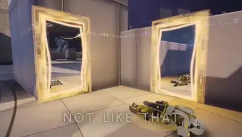</a><br><a href="https://www.sandbase.ai/lab/ai-videos/fable-5-2/2119935331499925557?utm_source=github&utm_medium=readme&utm_campaign=awesome-fable-5-2&utm_content=card"><b>An arena first-person shooter with portals</b></a><br><sub><a href="https://x.com/_sholtodouglas/status/2119935331499925557">@_sholtodouglas</a> · 1:11</sub></td><td width="33%" valign="top"><a href="https://www.sandbase.ai/lab/media/x/fable-5-2/2119966147328299284/video.mp4">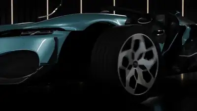</a><br><a href="https://www.sandbase.ai/lab/ai-videos/fable-5-2/2119966147328299284?utm_source=github&utm_medium=readme&utm_campaign=awesome-fable-5-2&utm_content=card"><b>Bugatti Tourbillon cinematic rendered in Blender</b></a><br><sub><a href="https://x.com/xikhar/status/2119966147328299284">@xikhar</a> · 0:34</sub></td><td width="33%" valign="top"><a href="https://www.sandbase.ai/lab/media/x/fable-5-2/2119875516216070289/video.mp4"></a><br><a href="https://www.sandbase.ai/lab/ai-videos/fable-5-2/2119875516216070289?utm_source=github&utm_medium=readme&utm_campaign=awesome-fable-5-2&utm_content=card"><b>One-shot creation generated by Fable 5.2</b></a><br><sub><a href="https://x.com/devsvn2/status/2119875516216070289">@devsvn2</a> · 0:35</sub></td></tr>
<tr><td width="33%" valign="top"><a href="https://www.sandbase.ai/lab/media/x/fable-5-2/2119919644836347926/video.mp4"></a><br><a href="https://www.sandbase.ai/lab/ai-videos/fable-5-2/2119919644836347926?utm_source=github&utm_medium=readme&utm_campaign=awesome-fable-5-2&utm_content=card"><b>Beethoven style piano sonata score and recording</b></a><br><sub><a href="https://x.com/imjustnewatai/status/2119919644836347926">@imjustnewatai</a> · 2:51</sub></td><td width="33%" valign="top"><a href="https://www.sandbase.ai/lab/media/x/fable-5-2/2120095684737347726/video.mp4">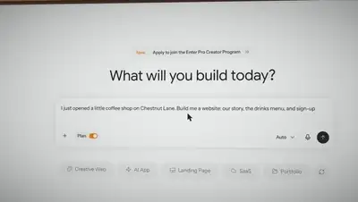</a><br><a href="https://www.sandbase.ai/lab/ai-videos/fable-5-2/2120095684737347726?utm_source=github&utm_medium=readme&utm_campaign=awesome-fable-5-2&utm_content=card"><b>Brand film made with Blender</b></a><br><sub><a href="https://x.com/EnterProAI/status/2120095684737347726">@EnterProAI</a> · 1:00</sub></td></tr>
</table>

<a id="3d-scene"></a>

## 3D scenes

<table>
<tr><td width="33%" valign="top"><a href="https://www.sandbase.ai/lab/media/x/fable-5-2/2119870965106483384/video.mp4">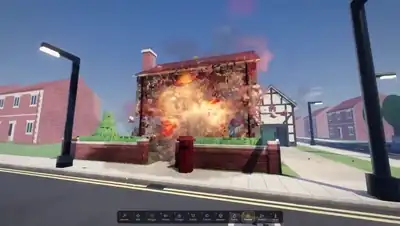</a><br><a href="https://www.sandbase.ai/lab/ai-videos/fable-5-2/2119870965106483384?utm_source=github&utm_medium=readme&utm_campaign=awesome-fable-5-2&utm_content=card"><b>A voxel engine generated from a prompt</b></a><br><sub><a href="https://x.com/mattshumer_/status/2119870965106483384">@mattshumer_</a> · 0:59</sub></td><td width="33%" valign="top"><a href="https://www.sandbase.ai/lab/media/x/fable-5-2/2119871565311660260/video.mp4">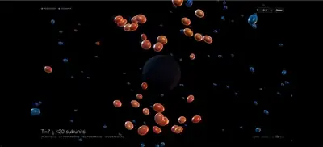</a><br><a href="https://www.sandbase.ai/lab/ai-videos/fable-5-2/2119871565311660260?utm_source=github&utm_medium=readme&utm_campaign=awesome-fable-5-2&utm_content=card"><b>Assembly of a virus capsid in HTML</b></a><br><sub><a href="https://x.com/TekonBurns/status/2119871565311660260">@TekonBurns</a> · 0:15</sub></td><td width="33%" valign="top"><a href="https://www.sandbase.ai/lab/media/x/fable-5-2/2119871817561346319/video.mp4">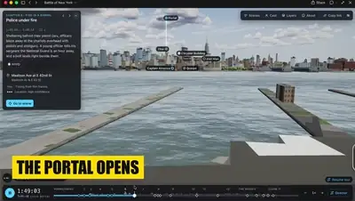</a><br><a href="https://www.sandbase.ai/lab/ai-videos/fable-5-2/2119871817561346319?utm_source=github&utm_medium=readme&utm_campaign=awesome-fable-5-2&utm_content=card"><b>3D recreation of the Avengers battle of New York</b></a><br><sub><a href="https://x.com/hammer_mt/status/2119871817561346319">@hammer_mt</a> · 1:08</sub></td></tr>
<tr><td width="33%" valign="top"><a href="https://www.sandbase.ai/lab/media/x/fable-5-2/2119873980786237842/video.mp4">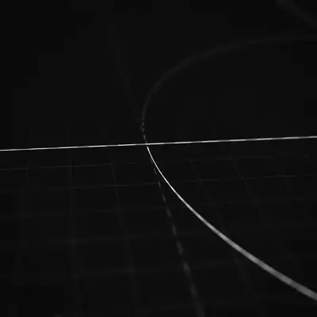</a><br><a href="https://www.sandbase.ai/lab/ai-videos/fable-5-2/2119873980786237842?utm_source=github&utm_medium=readme&utm_campaign=awesome-fable-5-2&utm_content=card"><b>3D animation created with Claude Fable 5.2</b></a><br><sub><a href="https://x.com/hello_amani/status/2119873980786237842">@hello_amani</a> · 0:36</sub></td><td width="33%" valign="top"><a href="https://www.sandbase.ai/lab/media/x/fable-5-2/2119876626179870838/video.mp4"></a><br><a href="https://www.sandbase.ai/lab/ai-videos/fable-5-2/2119876626179870838?utm_source=github&utm_medium=readme&utm_campaign=awesome-fable-5-2&utm_content=card"><b>An animation generated via Python in Blender</b></a><br><sub><a href="https://x.com/alexmichael/status/2119876626179870838">@alexmichael</a> · 0:18</sub></td><td width="33%" valign="top"><a href="https://www.sandbase.ai/lab/media/x/fable-5-2/2119878436529246669/video.mp4">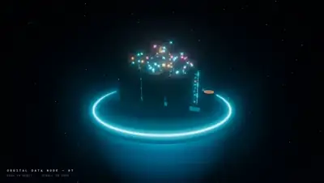</a><br><a href="https://www.sandbase.ai/lab/ai-videos/fable-5-2/2119878436529246669?utm_source=github&utm_medium=readme&utm_campaign=awesome-fable-5-2&utm_content=card"><b>Floating 3D data center in Three.js</b></a><br><sub><a href="https://x.com/ilya_sb1/status/2119878436529246669">@ilya_sb1</a> · 0:15 · <a href="https://www.sandbase.ai/lab/ai-videos/fable-5-2/2119878436529246669?utm_source=github&utm_medium=readme&utm_campaign=awesome-fable-5-2&utm_content=card">prompt</a></sub></td></tr>
</table>

<details>
<summary><b>Show all 95</b></summary>

<table>
<tr><td width="33%" valign="top"><a href="https://www.sandbase.ai/lab/media/x/fable-5-2/2119879273196761464/video.mp4">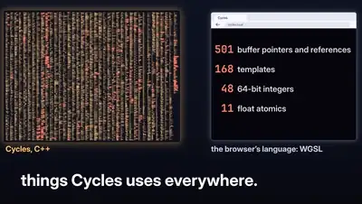</a><br><a href="https://www.sandbase.ai/lab/ai-videos/fable-5-2/2119879273196761464?utm_source=github&utm_medium=readme&utm_campaign=awesome-fable-5-2&utm_content=card"><b>Path tracer ported to WebGPU with custom compiler</b></a><br><sub><a href="https://x.com/aidanshandle/status/2119879273196761464">@aidanshandle</a> · 1:36</sub></td><td width="33%" valign="top"><a href="https://www.sandbase.ai/lab/media/x/fable-5-2/2119884295179538680/video.mp4">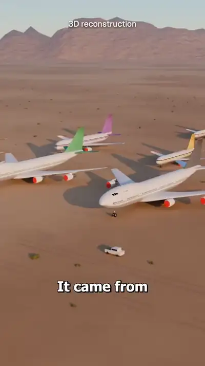</a><br><a href="https://www.sandbase.ai/lab/ai-videos/fable-5-2/2119884295179538680?utm_source=github&utm_medium=readme&utm_campaign=awesome-fable-5-2&utm_content=card"><b>One-shot 3D Blender workflow with Claude Fable</b></a><br><sub><a href="https://x.com/charan_kilari/status/2119884295179538680">@charan_kilari</a> · 0:25</sub></td><td width="33%" valign="top"><a href="https://www.sandbase.ai/lab/media/x/fable-5-2/2119886560992854431/video.mp4"></a><br><a href="https://www.sandbase.ai/lab/ai-videos/fable-5-2/2119886560992854431?utm_source=github&utm_medium=readme&utm_campaign=awesome-fable-5-2&utm_content=card"><b>Autumn travel ad for Fushimi Inari shrine</b></a><br><sub><a href="https://x.com/petergyang/status/2119886560992854431">@petergyang</a> · 0:20</sub></td></tr>
<tr><td width="33%" valign="top"><a href="https://www.sandbase.ai/lab/media/x/fable-5-2/2119889741600424363/video.mp4">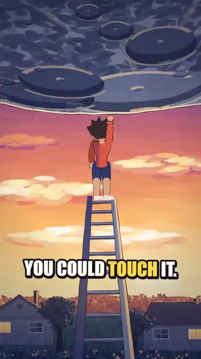</a><br><a href="https://www.sandbase.ai/lab/ai-videos/fable-5-2/2119889741600424363?utm_source=github&utm_medium=readme&utm_campaign=awesome-fable-5-2&utm_content=card"><b>Simulation of the moon ten feet from Earth</b></a><br><sub><a href="https://x.com/ashen_one/status/2119889741600424363">@ashen_one</a> · 1:00</sub></td><td width="33%" valign="top"><a href="https://www.sandbase.ai/lab/media/x/fable-5-2/2119890973560054072/video.mp4">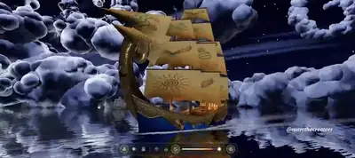</a><br><a href="https://www.sandbase.ai/lab/ai-videos/fable-5-2/2119890973560054072?utm_source=github&utm_medium=readme&utm_campaign=awesome-fable-5-2&utm_content=card"><b>A 3D sailing ship built in Three.js</b></a><br><sub><a href="https://x.com/marcthecreatorr/status/2119890973560054072">@marcthecreatorr</a> · 0:53</sub></td><td width="33%" valign="top"><a href="https://www.sandbase.ai/lab/media/x/fable-5-2/2119894130943807746/video.mp4">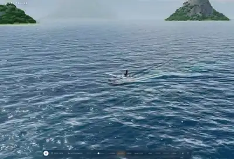</a><br><a href="https://www.sandbase.ai/lab/ai-videos/fable-5-2/2119894130943807746?utm_source=github&utm_medium=readme&utm_campaign=awesome-fable-5-2&utm_content=card"><b>A 3D seaplane rendering</b></a><br><sub><a href="https://x.com/LuminaBench/status/2119894130943807746">@LuminaBench</a> · 0:40</sub></td></tr>
<tr><td width="33%" valign="top"><a href="https://www.sandbase.ai/lab/media/x/fable-5-2/2119897840965001317/video.mp4">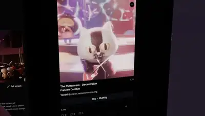</a><br><a href="https://www.sandbase.ai/lab/ai-videos/fable-5-2/2119897840965001317?utm_source=github&utm_medium=readme&utm_campaign=awesome-fable-5-2&utm_content=card"><b>Discovery short film made with Three.js</b></a><br><sub><a href="https://x.com/YinYangYoeshi/status/2119897840965001317">@YinYangYoeshi</a> · 1:42</sub></td><td width="33%" valign="top"><a href="https://www.sandbase.ai/lab/media/x/fable-5-2/2119900528197218472/video.mp4"></a><br><a href="https://www.sandbase.ai/lab/ai-videos/fable-5-2/2119900528197218472?utm_source=github&utm_medium=readme&utm_campaign=awesome-fable-5-2&utm_content=card"><b>Code-rendered anime film made with Three.js</b></a><br><sub><a href="https://x.com/noisyb0y1/status/2119900528197218472">@noisyb0y1</a> · 1:07</sub></td><td width="33%" valign="top"><a href="https://www.sandbase.ai/lab/media/x/fable-5-2/2119900775727902732/video.mp4"></a><br><a href="https://www.sandbase.ai/lab/ai-videos/fable-5-2/2119900775727902732?utm_source=github&utm_medium=readme&utm_campaign=awesome-fable-5-2&utm_content=card"><b>Historically accurate 3D model of Jerusalem</b></a><br><sub><a href="https://x.com/kplikethebird/status/2119900775727902732">@kplikethebird</a> · 0:30 · <a href="https://www.sandbase.ai/lab/ai-videos/fable-5-2/2119900775727902732?utm_source=github&utm_medium=readme&utm_campaign=awesome-fable-5-2&utm_content=card">prompt</a></sub></td></tr>
<tr><td width="33%" valign="top"><a href="https://www.sandbase.ai/lab/media/x/fable-5-2/2119901747930186234/video.mp4">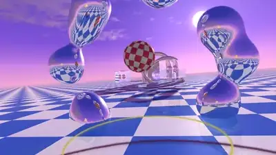</a><br><a href="https://www.sandbase.ai/lab/ai-videos/fable-5-2/2119901747930186234?utm_source=github&utm_medium=readme&utm_campaign=awesome-fable-5-2&utm_content=card"><b>3D video test using Bryce rendering engine</b></a><br><sub><a href="https://x.com/pleometric/status/2119901747930186234">@pleometric</a> · 0:15</sub></td><td width="33%" valign="top"><a href="https://www.sandbase.ai/lab/media/x/fable-5-2/2119901782482543073/video.mp4"></a><br><a href="https://www.sandbase.ai/lab/ai-videos/fable-5-2/2119901782482543073?utm_source=github&utm_medium=readme&utm_campaign=awesome-fable-5-2&utm_content=card"><b>Steam locomotive transforming into a robot</b></a><br><sub><a href="https://x.com/0kncn/status/2119901782482543073">@0kncn</a> · 1:30 · <a href="https://www.sandbase.ai/lab/ai-videos/fable-5-2/2119901782482543073?utm_source=github&utm_medium=readme&utm_campaign=awesome-fable-5-2&utm_content=card">prompt</a></sub></td><td width="33%" valign="top"><a href="https://www.sandbase.ai/lab/media/x/fable-5-2/2119902109709537708/video.mp4"></a><br><a href="https://www.sandbase.ai/lab/ai-videos/fable-5-2/2119902109709537708?utm_source=github&utm_medium=readme&utm_campaign=awesome-fable-5-2&utm_content=card"><b>A 3D room animated and rendered with Blender</b></a><br><sub><a href="https://x.com/rileybrown/status/2119902109709537708">@rileybrown</a> · 0:59</sub></td></tr>
<tr><td width="33%" valign="top"><a href="https://www.sandbase.ai/lab/media/x/fable-5-2/2119905661505122575/video.mp4"></a><br><a href="https://www.sandbase.ai/lab/ai-videos/fable-5-2/2119905661505122575?utm_source=github&utm_medium=readme&utm_campaign=awesome-fable-5-2&utm_content=card"><b>A 3D pirate ship sailing across the ocean</b></a><br><sub><a href="https://x.com/notjazii/status/2119905661505122575">@notjazii</a> · 0:50 · <a href="https://www.sandbase.ai/lab/ai-videos/fable-5-2/2119905661505122575?utm_source=github&utm_medium=readme&utm_campaign=awesome-fable-5-2&utm_content=card">prompt</a></sub></td><td width="33%" valign="top"><a href="https://www.sandbase.ai/lab/media/x/fable-5-2/2119909780269785332/video.mp4">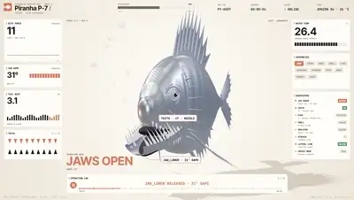</a><br><a href="https://www.sandbase.ai/lab/ai-videos/fable-5-2/2119909780269785332?utm_source=github&utm_medium=readme&utm_campaign=awesome-fable-5-2&utm_content=card"><b>Code-generated 3D piranha that disassembles</b></a><br><sub><a href="https://x.com/Scratcherrrr/status/2119909780269785332">@Scratcherrrr</a> · 0:20</sub></td><td width="33%" valign="top"><a href="https://www.sandbase.ai/lab/media/x/fable-5-2/2119910613828980846/video.mp4"></a><br><a href="https://www.sandbase.ai/lab/ai-videos/fable-5-2/2119910613828980846?utm_source=github&utm_medium=readme&utm_campaign=awesome-fable-5-2&utm_content=card"><b>Animated 3D short created in Blender</b></a><br><sub><a href="https://x.com/kloss_xyz/status/2119910613828980846">@kloss_xyz</a> · 0:16</sub></td></tr>
<tr><td width="33%" valign="top"><a href="https://www.sandbase.ai/lab/media/x/fable-5-2/2119911343633682916/video.mp4">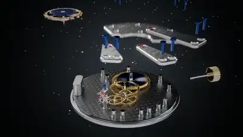</a><br><a href="https://www.sandbase.ai/lab/ai-videos/fable-5-2/2119911343633682916?utm_source=github&utm_medium=readme&utm_campaign=awesome-fable-5-2&utm_content=card"><b>Mechanical watch movement built entirely in code</b></a><br><sub><a href="https://x.com/techfren/status/2119911343633682916">@techfren</a> · 0:42 · <a href="https://www.sandbase.ai/lab/ai-videos/fable-5-2/2119911343633682916?utm_source=github&utm_medium=readme&utm_campaign=awesome-fable-5-2&utm_content=card">prompt</a></sub></td><td width="33%" valign="top"><a href="https://www.sandbase.ai/lab/media/x/fable-5-2/2119913237315477587/video.mp4">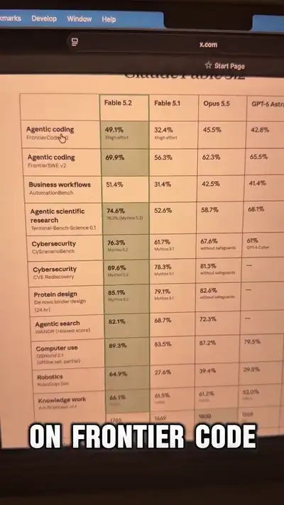</a><br><a href="https://www.sandbase.ai/lab/ai-videos/fable-5-2/2119913237315477587?utm_source=github&utm_medium=readme&utm_campaign=awesome-fable-5-2&utm_content=card"><b>Japanese floating island demo and benchmarks</b></a><br><sub><a href="https://x.com/ziwenxu_/status/2119913237315477587">@ziwenxu_</a> · 0:58</sub></td><td width="33%" valign="top"><a href="https://www.sandbase.ai/lab/media/x/fable-5-2/2119914308603953485/video.mp4">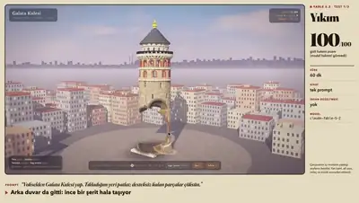</a><br><a href="https://www.sandbase.ai/lab/ai-videos/fable-5-2/2119914308603953485?utm_source=github&utm_medium=readme&utm_campaign=awesome-fable-5-2&utm_content=card"><b>Voxel simulations created by Fable 5.2</b></a><br><sub><a href="https://x.com/Avenoxai/status/2119914308603953485">@Avenoxai</a> · 1:12</sub></td></tr>
<tr><td width="33%" valign="top"><a href="https://www.sandbase.ai/lab/media/x/fable-5-2/2119917375080521921/video.mp4">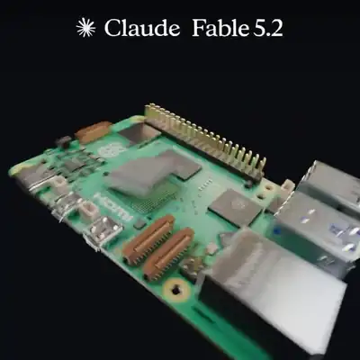</a><br><a href="https://www.sandbase.ai/lab/ai-videos/fable-5-2/2119917375080521921?utm_source=github&utm_medium=readme&utm_campaign=awesome-fable-5-2&utm_content=card"><b>Animated Raspberry Pi 5</b></a><br><sub><a href="https://x.com/sparklabhq/status/2119917375080521921">@sparklabhq</a> · 0:06 · <a href="https://www.sandbase.ai/lab/ai-videos/fable-5-2/2119917375080521921?utm_source=github&utm_medium=readme&utm_campaign=awesome-fable-5-2&utm_content=card">prompt</a></sub></td><td width="33%" valign="top"><a href="https://www.sandbase.ai/lab/media/x/fable-5-2/2119919359724306550/video.mp4">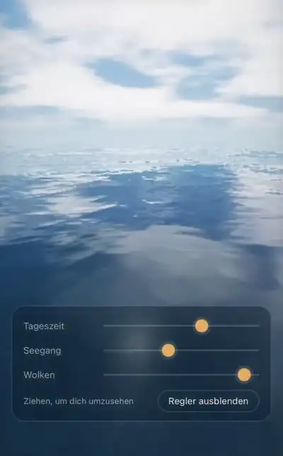</a><br><a href="https://www.sandbase.ai/lab/ai-videos/fable-5-2/2119919359724306550?utm_source=github&utm_medium=readme&utm_campaign=awesome-fable-5-2&utm_content=card"><b>Real-time ocean with sunrise clouds and moonlight</b></a><br><sub><a href="https://x.com/lenny_enderle/status/2119919359724306550">@lenny_enderle</a> · 1:07</sub></td><td width="33%" valign="top"><a href="https://www.sandbase.ai/lab/media/x/fable-5-2/2119924654848852010/video.mp4">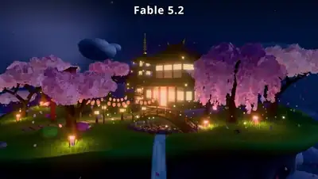</a><br><a href="https://www.sandbase.ai/lab/ai-videos/fable-5-2/2119924654848852010?utm_source=github&utm_medium=readme&utm_campaign=awesome-fable-5-2&utm_content=card"><b>Panning shot of a Three.js scene</b></a><br><sub><a href="https://x.com/PokeBenchTV/status/2119924654848852010">@PokeBenchTV</a> · 0:20</sub></td></tr>
<tr><td width="33%" valign="top"><a href="https://www.sandbase.ai/lab/media/x/fable-5-2/2119930300990177509/video.mp4">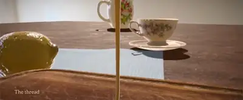</a><br><a href="https://www.sandbase.ai/lab/ai-videos/fable-5-2/2119930300990177509?utm_source=github&utm_medium=readme&utm_campaign=awesome-fable-5-2&utm_content=card"><b>Photorealistic honey physics simulation in WebGL</b></a><br><sub><a href="https://x.com/deedydas/status/2119930300990177509">@deedydas</a> · 0:51 · <a href="https://www.sandbase.ai/lab/ai-videos/fable-5-2/2119930300990177509?utm_source=github&utm_medium=readme&utm_campaign=awesome-fable-5-2&utm_content=card">prompt</a></sub></td><td width="33%" valign="top"><a href="https://www.sandbase.ai/lab/media/x/fable-5-2/2119936753892983162/video.mp4"></a><br><a href="https://www.sandbase.ai/lab/ai-videos/fable-5-2/2119936753892983162?utm_source=github&utm_medium=readme&utm_campaign=awesome-fable-5-2&utm_content=card"><b>Hangzhou West Lake scene in Three.js</b></a><br><sub><a href="https://x.com/ivanfioravanti/status/2119936753892983162">@ivanfioravanti</a> · 0:10</sub></td><td width="33%" valign="top"><a href="https://www.sandbase.ai/lab/media/x/fable-5-2/2119938067758772403/video.mp4"></a><br><a href="https://www.sandbase.ai/lab/ai-videos/fable-5-2/2119938067758772403?utm_source=github&utm_medium=readme&utm_campaign=awesome-fable-5-2&utm_content=card"><b>One square kilometer of Indiranagar built from map data</b></a><br><sub><a href="https://x.com/anshu4321/status/2119938067758772403">@anshu4321</a> · 0:35</sub></td></tr>
<tr><td width="33%" valign="top"><a href="https://www.sandbase.ai/lab/media/x/fable-5-2/2119938364438909162/video.mp4"></a><br><a href="https://www.sandbase.ai/lab/ai-videos/fable-5-2/2119938364438909162?utm_source=github&utm_medium=readme&utm_campaign=awesome-fable-5-2&utm_content=card"><b>Code-generated animation of room and laptop screen</b></a><br><sub><a href="https://x.com/Jacksaltel/status/2119938364438909162">@Jacksaltel</a> · 0:59</sub></td><td width="33%" valign="top"><a href="https://www.sandbase.ai/lab/media/x/fable-5-2/2119939061049889130/video.mp4"></a><br><a href="https://www.sandbase.ai/lab/ai-videos/fable-5-2/2119939061049889130?utm_source=github&utm_medium=readme&utm_campaign=awesome-fable-5-2&utm_content=card"><b>Video converted to 3D animation</b></a><br><sub><a href="https://x.com/KHvostikk/status/2119939061049889130">@KHvostikk</a> · 0:10</sub></td><td width="33%" valign="top"><a href="https://www.sandbase.ai/lab/media/x/fable-5-2/2119944847255896490/video.mp4">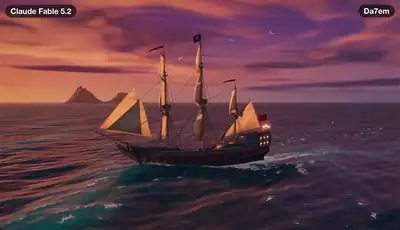</a><br><a href="https://www.sandbase.ai/lab/ai-videos/fable-5-2/2119944847255896490?utm_source=github&utm_medium=readme&utm_campaign=awesome-fable-5-2&utm_content=card"><b>Realistic 3D scene generated with Devin</b></a><br><sub><a href="https://x.com/Da7_Tech/status/2119944847255896490">@Da7_Tech</a> · 1:05</sub></td></tr>
<tr><td width="33%" valign="top"><a href="https://www.sandbase.ai/lab/media/x/fable-5-2/2119946891106394518/video.mp4">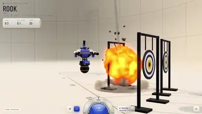</a><br><a href="https://www.sandbase.ai/lab/ai-videos/fable-5-2/2119946891106394518?utm_source=github&utm_medium=readme&utm_campaign=awesome-fable-5-2&utm_content=card"><b>Testing concept video game machines in Three.js</b></a><br><sub><a href="https://x.com/techartist_/status/2119946891106394518">@techartist_</a> · 0:20</sub></td><td width="33%" valign="top"><a href="https://www.sandbase.ai/lab/media/x/fable-5-2/2119947402107089168/video.mp4">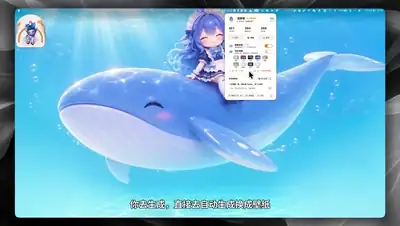</a><br><a href="https://www.sandbase.ai/lab/ai-videos/fable-5-2/2119947402107089168?utm_source=github&utm_medium=readme&utm_campaign=awesome-fable-5-2&utm_content=card"><b>Interactive desktop cleaning robot and fish demo</b></a><br><sub><a href="https://x.com/berryxia/status/2119947402107089168">@berryxia</a> · 1:26</sub></td><td width="33%" valign="top"><a href="https://www.sandbase.ai/lab/media/x/fable-5-2/2119958225264968059/video.mp4">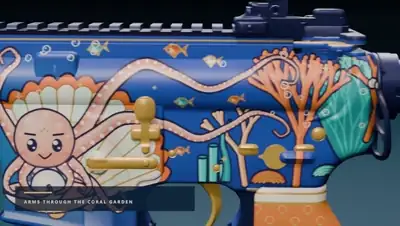</a><br><a href="https://www.sandbase.ai/lab/ai-videos/fable-5-2/2119958225264968059?utm_source=github&utm_medium=readme&utm_campaign=awesome-fable-5-2&utm_content=card"><b>CS2 skin design showcase in Blender</b></a><br><sub><a href="https://x.com/hugospdx/status/2119958225264968059">@hugospdx</a> · 0:24</sub></td></tr>
<tr><td width="33%" valign="top"><a href="https://www.sandbase.ai/lab/media/x/fable-5-2/2119960596951236675/video.mp4">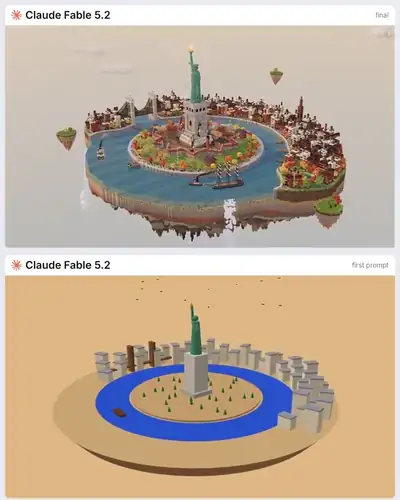</a><br><a href="https://www.sandbase.ai/lab/ai-videos/fable-5-2/2119960596951236675?utm_source=github&utm_medium=readme&utm_campaign=awesome-fable-5-2&utm_content=card"><b>Floating 1886 New York scene in the sky</b></a><br><sub><a href="https://x.com/semichenkko/status/2119960596951236675">@semichenkko</a> · 0:10</sub></td><td width="33%" valign="top"><a href="https://www.sandbase.ai/lab/media/x/fable-5-2/2119963726329823358/video.mp4">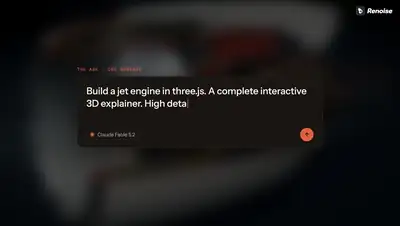</a><br><a href="https://www.sandbase.ai/lab/ai-videos/fable-5-2/2119963726329823358?utm_source=github&utm_medium=readme&utm_campaign=awesome-fable-5-2&utm_content=card"><b>Interactive 3D running jet engine in Three.js</b></a><br><sub><a href="https://x.com/renoiseai/status/2119963726329823358">@renoiseai</a> · 0:30</sub></td><td width="33%" valign="top"><a href="https://www.sandbase.ai/lab/media/x/fable-5-2/2119966147328299284/video.mp4"></a><br><a href="https://www.sandbase.ai/lab/ai-videos/fable-5-2/2119966147328299284?utm_source=github&utm_medium=readme&utm_campaign=awesome-fable-5-2&utm_content=card"><b>Bugatti Tourbillon cinematic rendered in Blender</b></a><br><sub><a href="https://x.com/xikhar/status/2119966147328299284">@xikhar</a> · 0:34</sub></td></tr>
<tr><td width="33%" valign="top"><a href="https://www.sandbase.ai/lab/media/x/fable-5-2/2119969928304357507/video.mp4">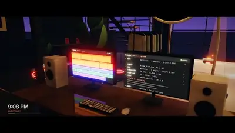</a><br><a href="https://www.sandbase.ai/lab/ai-videos/fable-5-2/2119969928304357507?utm_source=github&utm_medium=readme&utm_campaign=awesome-fable-5-2&utm_content=card"><b>Studio reconstruction from uploaded photos</b></a><br><sub><a href="https://x.com/rpnickson/status/2119969928304357507">@rpnickson</a> · 0:30</sub></td><td width="33%" valign="top"><a href="https://www.sandbase.ai/lab/media/x/fable-5-2/2119972124211454139/video.mp4">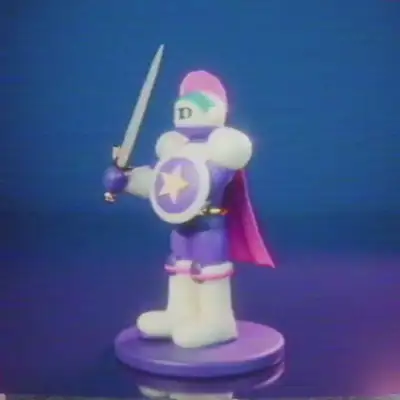</a><br><a href="https://www.sandbase.ai/lab/ai-videos/fable-5-2/2119972124211454139?utm_source=github&utm_medium=readme&utm_campaign=awesome-fable-5-2&utm_content=card"><b>A 90s style toy commercial rendered in Blender</b></a><br><sub><a href="https://x.com/kevin_t_ngo/status/2119972124211454139">@kevin_t_ngo</a> · 1:05</sub></td><td width="33%" valign="top"><a href="https://www.sandbase.ai/lab/media/x/fable-5-2/2119974354260013293/video.mp4">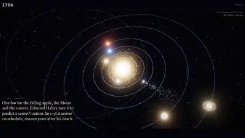</a><br><a href="https://www.sandbase.ai/lab/ai-videos/fable-5-2/2119974354260013293?utm_source=github&utm_medium=readme&utm_campaign=awesome-fable-5-2&utm_content=card"><b>Cinematic journey through the history of science</b></a><br><sub><a href="https://x.com/DeryaTR_/status/2119974354260013293">@DeryaTR_</a> · 4:56</sub></td></tr>
<tr><td width="33%" valign="top"><a href="https://www.sandbase.ai/lab/media/x/fable-5-2/2119978015371518074/video.mp4"></a><br><a href="https://www.sandbase.ai/lab/ai-videos/fable-5-2/2119978015371518074?utm_source=github&utm_medium=readme&utm_campaign=awesome-fable-5-2&utm_content=card"><b>Floating flower market scene coded in Three.js</b></a><br><sub><a href="https://x.com/buildwithavis/status/2119978015371518074">@buildwithavis</a> · 0:15</sub></td><td width="33%" valign="top"><a href="https://www.sandbase.ai/lab/media/x/fable-5-2/2119987617181946218/video.mp4">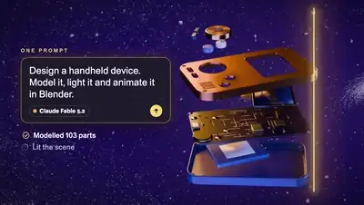</a><br><a href="https://www.sandbase.ai/lab/ai-videos/fable-5-2/2119987617181946218?utm_source=github&utm_medium=readme&utm_campaign=awesome-fable-5-2&utm_content=card"><b>Handheld device modeled and animated in Blender</b></a><br><sub><a href="https://x.com/startvoyager/status/2119987617181946218">@startvoyager</a> · 0:16</sub></td><td width="33%" valign="top"><a href="https://www.sandbase.ai/lab/media/x/fable-5-2/2119995965776200047/video.mp4">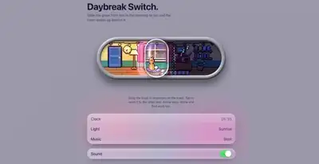</a><br><a href="https://www.sandbase.ai/lab/ai-videos/fable-5-2/2119995965776200047?utm_source=github&utm_medium=readme&utm_campaign=awesome-fable-5-2&utm_content=card"><b>Interactive light switch with cat and puppy</b></a><br><sub><a href="https://x.com/justkarangupta/status/2119995965776200047">@justkarangupta</a> · 0:15</sub></td></tr>
<tr><td width="33%" valign="top"><a href="https://www.sandbase.ai/lab/media/x/fable-5-2/2120001344237097184/video.mp4">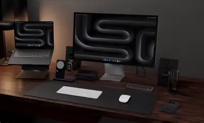</a><br><a href="https://www.sandbase.ai/lab/ai-videos/fable-5-2/2120001344237097184?utm_source=github&utm_medium=readme&utm_campaign=awesome-fable-5-2&utm_content=card"><b>Custom 3D mockup scenes for Ultramock</b></a><br><sub><a href="https://x.com/joshmillgate/status/2120001344237097184">@joshmillgate</a> · 0:25</sub></td><td width="33%" valign="top"><a href="https://www.sandbase.ai/lab/media/x/fable-5-2/2120008924204310895/video.mp4">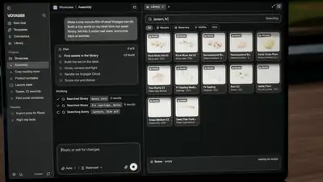</a><br><a href="https://www.sandbase.ai/lab/ai-videos/fable-5-2/2120008924204310895?utm_source=github&utm_medium=readme&utm_campaign=awesome-fable-5-2&utm_content=card"><b>4K scene rendered with Fable and Vork</b></a><br><sub><a href="https://x.com/j_h_h_3/status/2120008924204310895">@j_h_h_3</a> · 1:00</sub></td><td width="33%" valign="top"><a href="https://www.sandbase.ai/lab/media/x/fable-5-2/2120022389605929145/video.mp4"></a><br><a href="https://www.sandbase.ai/lab/ai-videos/fable-5-2/2120022389605929145?utm_source=github&utm_medium=readme&utm_campaign=awesome-fable-5-2&utm_content=card"><b>Animated room scene generated in Blender</b></a><br><sub><a href="https://x.com/RoundtableSpace/status/2120022389605929145">@RoundtableSpace</a> · 0:59</sub></td></tr>
<tr><td width="33%" valign="top"><a href="https://www.sandbase.ai/lab/media/x/fable-5-2/2120025125076844785/video.mp4"></a><br><a href="https://www.sandbase.ai/lab/ai-videos/fable-5-2/2120025125076844785?utm_source=github&utm_medium=readme&utm_campaign=awesome-fable-5-2&utm_content=card"><b>Rocket launch simulation in Three.js</b></a><br><sub><a href="https://x.com/Shannnu_18/status/2120025125076844785">@Shannnu_18</a> · 2:15</sub></td><td width="33%" valign="top"><a href="https://www.sandbase.ai/lab/media/x/fable-5-2/2120028841607590092/video.mp4">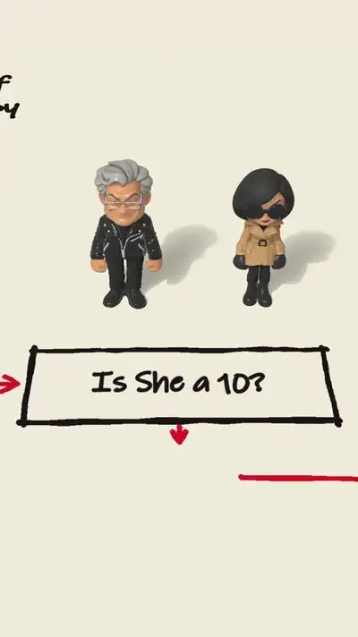</a><br><a href="https://www.sandbase.ai/lab/ai-videos/fable-5-2/2120028841607590092?utm_source=github&utm_medium=readme&utm_campaign=awesome-fable-5-2&utm_content=card"><b>Turning funny tweets into animated videos</b></a><br><sub><a href="https://x.com/kelanoo/status/2120028841607590092">@kelanoo</a> · 0:16</sub></td><td width="33%" valign="top"><a href="https://www.sandbase.ai/lab/media/x/fable-5-2/2120036883635851769/video.mp4">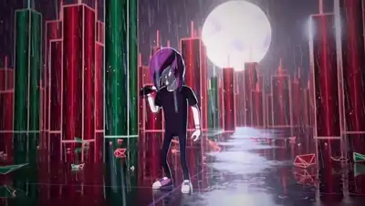</a><br><a href="https://www.sandbase.ai/lab/ai-videos/fable-5-2/2120036883635851769?utm_source=github&utm_medium=readme&utm_campaign=awesome-fable-5-2&utm_content=card"><b>Automated Blender 3D rendering pipeline and character loop</b></a><br><sub><a href="https://x.com/LordEmo/status/2120036883635851769">@LordEmo</a> · 0:05</sub></td></tr>
<tr><td width="33%" valign="top"><a href="https://www.sandbase.ai/lab/media/x/fable-5-2/2120039417981333599/video.mp4">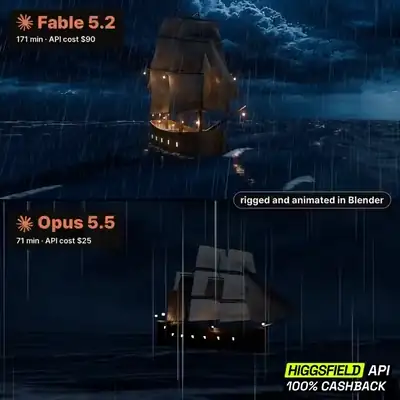</a><br><a href="https://www.sandbase.ai/lab/ai-videos/fable-5-2/2120039417981333599?utm_source=github&utm_medium=readme&utm_campaign=awesome-fable-5-2&utm_content=card"><b>Sea serpent coiling around a ship in Blender</b></a><br><sub><a href="https://x.com/Stefan_3D_AI/status/2120039417981333599">@Stefan_3D_AI</a> · 0:32 · <a href="https://www.sandbase.ai/lab/ai-videos/fable-5-2/2120039417981333599?utm_source=github&utm_medium=readme&utm_campaign=awesome-fable-5-2&utm_content=card">prompt</a></sub></td><td width="33%" valign="top"><a href="https://www.sandbase.ai/lab/media/x/fable-5-2/2120044656776061144/video.mp4">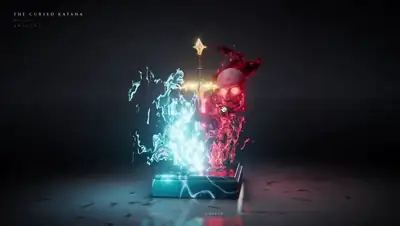</a><br><a href="https://www.sandbase.ai/lab/ai-videos/fable-5-2/2120044656776061144?utm_source=github&utm_medium=readme&utm_campaign=awesome-fable-5-2&utm_content=card"><b>Procedural 3D cursed sword scene in code</b></a><br><sub><a href="https://x.com/pankajkumar_dev/status/2120044656776061144">@pankajkumar_dev</a> · 0:36</sub></td><td width="33%" valign="top"><a href="https://www.sandbase.ai/lab/media/x/fable-5-2/2120046536457654495/video.mp4">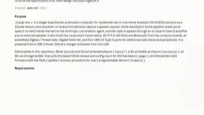</a><br><a href="https://www.sandbase.ai/lab/ai-videos/fable-5-2/2120046536457654495?utm_source=github&utm_medium=readme&utm_campaign=awesome-fable-5-2&utm_content=card"><b>Functional voice assistance device designed by AI</b></a><br><sub><a href="https://x.com/dr_l_alexandre/status/2120046536457654495">@dr_l_alexandre</a> · 0:48</sub></td></tr>
<tr><td width="33%" valign="top"><a href="https://www.sandbase.ai/lab/media/x/fable-5-2/2120056264751227079/video.mp4">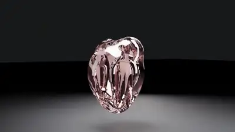</a><br><a href="https://www.sandbase.ai/lab/ai-videos/fable-5-2/2120056264751227079?utm_source=github&utm_medium=readme&utm_campaign=awesome-fable-5-2&utm_content=card"><b>Glass heart animation created in Blender</b></a><br><sub><a href="https://x.com/0kncn/status/2120056264751227079">@0kncn</a> · 0:29</sub></td><td width="33%" valign="top"><a href="https://www.sandbase.ai/lab/media/x/fable-5-2/2120056914054942793/video.mp4">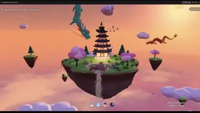</a><br><a href="https://www.sandbase.ai/lab/ai-videos/fable-5-2/2120056914054942793?utm_source=github&utm_medium=readme&utm_campaign=awesome-fable-5-2&utm_content=card"><b>Pagoda floating island with dragon riding POV</b></a><br><sub><a href="https://x.com/ItsmeAjayKV/status/2120056914054942793">@ItsmeAjayKV</a> · 2:25 · <a href="https://www.sandbase.ai/lab/ai-videos/fable-5-2/2120056914054942793?utm_source=github&utm_medium=readme&utm_campaign=awesome-fable-5-2&utm_content=card">prompt</a></sub></td><td width="33%" valign="top"><a href="https://www.sandbase.ai/lab/media/x/fable-5-2/2120074876039917971/video.mp4">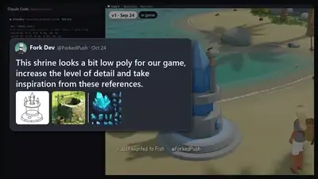</a><br><a href="https://www.sandbase.ai/lab/ai-videos/fable-5-2/2120074876039917971?utm_source=github&utm_medium=readme&utm_campaign=awesome-fable-5-2&utm_content=card"><b>Creating a stylized shrine for a game</b></a><br><sub><a href="https://x.com/ForkedPush/status/2120074876039917971">@ForkedPush</a> · 0:32</sub></td></tr>
<tr><td width="33%" valign="top"><a href="https://www.sandbase.ai/lab/media/x/fable-5-2/2120075740222005569/video.mp4"></a><br><a href="https://www.sandbase.ai/lab/ai-videos/fable-5-2/2120075740222005569?utm_source=github&utm_medium=readme&utm_campaign=awesome-fable-5-2&utm_content=card"><b>Procedural Chinatown generated with Three.js code</b></a><br><sub><a href="https://x.com/RJasonHA/status/2120075740222005569">@RJasonHA</a> · 1:14</sub></td><td width="33%" valign="top"><a href="https://www.sandbase.ai/lab/media/x/fable-5-2/2120077700866187579/video.mp4">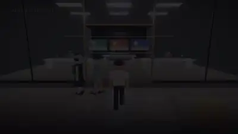</a><br><a href="https://www.sandbase.ai/lab/ai-videos/fable-5-2/2120077700866187579?utm_source=github&utm_medium=readme&utm_campaign=awesome-fable-5-2&utm_content=card"><b>Walkable 3D virtual shopping mall</b></a><br><sub><a href="https://x.com/iksly2/status/2120077700866187579">@iksly2</a> · 1:00</sub></td><td width="33%" valign="top"><a href="https://www.sandbase.ai/lab/media/x/fable-5-2/2120079029386588503/video.mp4"></a><br><a href="https://www.sandbase.ai/lab/ai-videos/fable-5-2/2120079029386588503?utm_source=github&utm_medium=readme&utm_campaign=awesome-fable-5-2&utm_content=card"><b>River of lanterns rendered in Three.js</b></a><br><sub><a href="https://x.com/seiiiiiiiiiiru/status/2120079029386588503">@seiiiiiiiiiiru</a> · 0:30</sub></td></tr>
<tr><td width="33%" valign="top"><a href="https://www.sandbase.ai/lab/media/x/fable-5-2/2120079288372494782/video.mp4"></a><br><a href="https://www.sandbase.ai/lab/ai-videos/fable-5-2/2120079288372494782?utm_source=github&utm_medium=readme&utm_campaign=awesome-fable-5-2&utm_content=card"><b>Rendering of a cricket ball</b></a><br><sub><a href="https://x.com/deedydas/status/2120079288372494782">@deedydas</a> · 0:18</sub></td><td width="33%" valign="top"><a href="https://www.sandbase.ai/lab/media/x/fable-5-2/2120080397564531039/video.mp4"></a><br><a href="https://www.sandbase.ai/lab/ai-videos/fable-5-2/2120080397564531039?utm_source=github&utm_medium=readme&utm_campaign=awesome-fable-5-2&utm_content=card"><b>AI controlled Blender 3D scene and animation</b></a><br><sub><a href="https://x.com/Vincent_AINotes/status/2120080397564531039">@Vincent_AINotes</a> · 0:18</sub></td><td width="33%" valign="top"><a href="https://www.sandbase.ai/lab/media/x/fable-5-2/2120090691825172989/video.mp4"></a><br><a href="https://www.sandbase.ai/lab/ai-videos/fable-5-2/2120090691825172989?utm_source=github&utm_medium=readme&utm_campaign=awesome-fable-5-2&utm_content=card"><b>Land Rover side view rendered in Three.js</b></a><br><sub><a href="https://x.com/AI_Screening/status/2120090691825172989">@AI_Screening</a> · 0:19</sub></td></tr>
<tr><td width="33%" valign="top"><a href="https://www.sandbase.ai/lab/media/x/fable-5-2/2120091403447578814/video.mp4">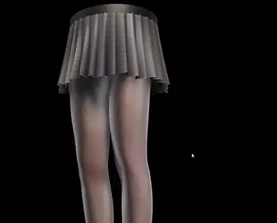</a><br><a href="https://www.sandbase.ai/lab/ai-videos/fable-5-2/2120091403447578814?utm_source=github&utm_medium=readme&utm_campaign=awesome-fable-5-2&utm_content=card"><b>Character legs model in Three.js test</b></a><br><sub><a href="https://x.com/bei351009016/status/2120091403447578814">@bei351009016</a> · 0:09</sub></td><td width="33%" valign="top"><a href="https://www.sandbase.ai/lab/media/x/fable-5-2/2120097749177606559/video.mp4">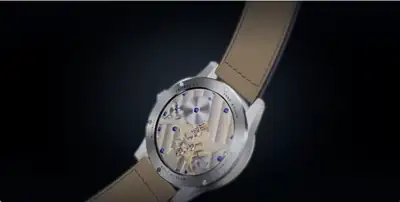</a><br><a href="https://www.sandbase.ai/lab/ai-videos/fable-5-2/2120097749177606559?utm_source=github&utm_medium=readme&utm_campaign=awesome-fable-5-2&utm_content=card"><b>Code generated 3D scene in Three.js and WebGPU</b></a><br><sub><a href="https://x.com/Andrew_Blumson/status/2120097749177606559">@Andrew_Blumson</a> · 1:12</sub></td><td width="33%" valign="top"><a href="https://www.sandbase.ai/lab/media/x/fable-5-2/2120101582444597446/video.mp4"></a><br><a href="https://www.sandbase.ai/lab/ai-videos/fable-5-2/2120101582444597446?utm_source=github&utm_medium=readme&utm_campaign=awesome-fable-5-2&utm_content=card"><b>Procedural Tesla Roadster kickflip stunt in Blender</b></a><br><sub><a href="https://x.com/Stefan_3D_AI/status/2120101582444597446">@Stefan_3D_AI</a> · 0:18 · <a href="https://www.sandbase.ai/lab/ai-videos/fable-5-2/2120101582444597446?utm_source=github&utm_medium=readme&utm_campaign=awesome-fable-5-2&utm_content=card">prompt</a></sub></td></tr>
<tr><td width="33%" valign="top"><a href="https://www.sandbase.ai/lab/media/x/fable-5-2/2120110605541441880/video.mp4">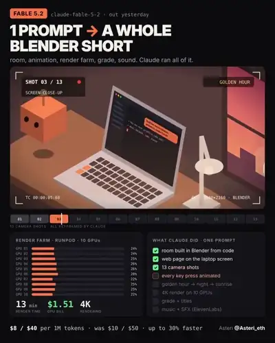</a><br><a href="https://www.sandbase.ai/lab/ai-videos/fable-5-2/2120110605541441880?utm_source=github&utm_medium=readme&utm_campaign=awesome-fable-5-2&utm_content=card"><b>Animated Blender short generated from code</b></a><br><sub><a href="https://x.com/Asteri_eth/status/2120110605541441880">@Asteri_eth</a> · 0:26</sub></td><td width="33%" valign="top"><a href="https://www.sandbase.ai/lab/media/x/fable-5-2/2120110927773151312/video.mp4">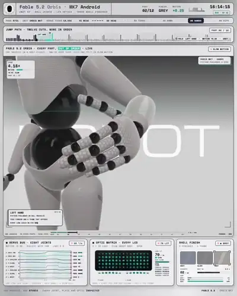</a><br><a href="https://www.sandbase.ai/lab/ai-videos/fable-5-2/2120110927773151312?utm_source=github&utm_medium=readme&utm_campaign=awesome-fable-5-2&utm_content=card"><b>Automated robot building workflow in Blender</b></a><br><sub><a href="https://x.com/0xWast3/status/2120110927773151312">@0xWast3</a> · 0:38</sub></td><td width="33%" valign="top"><a href="https://www.sandbase.ai/lab/media/x/fable-5-2/2120111159726727321/video.mp4">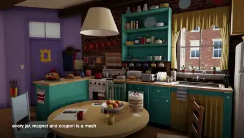</a><br><a href="https://www.sandbase.ai/lab/ai-videos/fable-5-2/2120111159726727321?utm_source=github&utm_medium=readme&utm_campaign=awesome-fable-5-2&utm_content=card"><b>Monica&#x27;s apartment recreated in Three.js</b></a><br><sub><a href="https://x.com/chetaslua/status/2120111159726727321">@chetaslua</a> · 0:32</sub></td></tr>
<tr><td width="33%" valign="top"><a href="https://www.sandbase.ai/lab/media/x/fable-5-2/2120113578531234172/video.mp4"></a><br><a href="https://www.sandbase.ai/lab/ai-videos/fable-5-2/2120113578531234172?utm_source=github&utm_medium=readme&utm_campaign=awesome-fable-5-2&utm_content=card"><b>3D animation generated in Blender via MCP</b></a><br><sub><a href="https://x.com/maxt3chno/status/2120113578531234172">@maxt3chno</a> · 0:16</sub></td><td width="33%" valign="top"><a href="https://www.sandbase.ai/lab/media/x/fable-5-2/2120124319187734646/video.mp4"></a><br><a href="https://www.sandbase.ai/lab/ai-videos/fable-5-2/2120124319187734646?utm_source=github&utm_medium=readme&utm_campaign=awesome-fable-5-2&utm_content=card"><b>A robot archer shooting an arrow through ocean</b></a><br><sub><a href="https://x.com/camperaigg/status/2120124319187734646">@camperaigg</a> · 0:30 · <a href="https://www.sandbase.ai/lab/ai-videos/fable-5-2/2120124319187734646?utm_source=github&utm_medium=readme&utm_campaign=awesome-fable-5-2&utm_content=card">prompt</a></sub></td><td width="33%" valign="top"><a href="https://www.sandbase.ai/lab/media/x/fable-5-2/2120124988711662000/video.mp4"></a><br><a href="https://www.sandbase.ai/lab/ai-videos/fable-5-2/2120124988711662000?utm_source=github&utm_medium=readme&utm_campaign=awesome-fable-5-2&utm_content=card"><b>Medieval village 3D scene built in Blender</b></a><br><sub><a href="https://x.com/JSFILMZ0412/status/2120124988711662000">@JSFILMZ0412</a> · 1:00</sub></td></tr>
<tr><td width="33%" valign="top"><a href="https://www.sandbase.ai/lab/media/x/fable-5-2/2120130449091821656/video.mp4"></a><br><a href="https://www.sandbase.ai/lab/ai-videos/fable-5-2/2120130449091821656?utm_source=github&utm_medium=readme&utm_campaign=awesome-fable-5-2&utm_content=card"><b>3D animation recreated with code</b></a><br><sub><a href="https://x.com/Papaocus/status/2120130449091821656">@Papaocus</a> · 0:12</sub></td><td width="33%" valign="top"><a href="https://www.sandbase.ai/lab/media/x/fable-5-2/2120135236868575567/video.mp4"></a><br><a href="https://www.sandbase.ai/lab/ai-videos/fable-5-2/2120135236868575567?utm_source=github&utm_medium=readme&utm_campaign=awesome-fable-5-2&utm_content=card"><b>Giant night butterfly 3D creature animation</b></a><br><sub><a href="https://x.com/theparuchh/status/2120135236868575567">@theparuchh</a> · 0:41</sub></td><td width="33%" valign="top"><a href="https://www.sandbase.ai/lab/media/x/fable-5-2/2120139661863530865/video.mp4"></a><br><a href="https://www.sandbase.ai/lab/ai-videos/fable-5-2/2120139661863530865?utm_source=github&utm_medium=readme&utm_campaign=awesome-fable-5-2&utm_content=card"><b>Recreation of a Matrix movie scene</b></a><br><sub><a href="https://x.com/loktar00/status/2120139661863530865">@loktar00</a> · 0:26</sub></td></tr>
<tr><td width="33%" valign="top"><a href="https://www.sandbase.ai/lab/media/x/fable-5-2/2120145020057501745/video.mp4"></a><br><a href="https://www.sandbase.ai/lab/ai-videos/fable-5-2/2120145020057501745?utm_source=github&utm_medium=readme&utm_campaign=awesome-fable-5-2&utm_content=card"><b>A giant mech stomping around New York City</b></a><br><sub><a href="https://x.com/quz_ai/status/2120145020057501745">@quz_ai</a> · 0:22 · <a href="https://www.sandbase.ai/lab/ai-videos/fable-5-2/2120145020057501745?utm_source=github&utm_medium=readme&utm_campaign=awesome-fable-5-2&utm_content=card">prompt</a></sub></td><td width="33%" valign="top"><a href="https://www.sandbase.ai/lab/media/x/fable-5-2/2120159828949823605/video.mp4"></a><br><a href="https://www.sandbase.ai/lab/ai-videos/fable-5-2/2120159828949823605?utm_source=github&utm_medium=readme&utm_campaign=awesome-fable-5-2&utm_content=card"><b>Interactive 3D scene built from single reference image</b></a><br><sub><a href="https://x.com/_satyam_ai/status/2120159828949823605">@_satyam_ai</a> · 0:25</sub></td><td width="33%" valign="top"><a href="https://www.sandbase.ai/lab/media/x/fable-5-2/2120162023770054791/video.mp4"></a><br><a href="https://www.sandbase.ai/lab/ai-videos/fable-5-2/2120162023770054791?utm_source=github&utm_medium=readme&utm_campaign=awesome-fable-5-2&utm_content=card"><b>Video to 3D animation test</b></a><br><sub><a href="https://x.com/KHvostikk/status/2120162023770054791">@KHvostikk</a> · 0:16</sub></td></tr>
<tr><td width="33%" valign="top"><a href="https://www.sandbase.ai/lab/media/x/fable-5-2/2120172009972003115/video.mp4"></a><br><a href="https://www.sandbase.ai/lab/ai-videos/fable-5-2/2120172009972003115?utm_source=github&utm_medium=readme&utm_campaign=awesome-fable-5-2&utm_content=card"><b>Potato destroying blue chairs coded loop</b></a><br><sub><a href="https://x.com/argofowl/status/2120172009972003115">@argofowl</a> · 0:12</sub></td><td width="33%" valign="top"><a href="https://www.sandbase.ai/lab/media/x/fable-5-2/2120188343870964113/video.mp4"></a><br><a href="https://www.sandbase.ai/lab/ai-videos/fable-5-2/2120188343870964113?utm_source=github&utm_medium=readme&utm_campaign=awesome-fable-5-2&utm_content=card"><b>Restoration visualization of a ruin in Tuscany</b></a><br><sub><a href="https://x.com/TimurNegru/status/2120188343870964113">@TimurNegru</a> · 0:34</sub></td><td width="33%" valign="top"><a href="https://www.sandbase.ai/lab/media/x/fable-5-2/2120198663062622581/video.mp4"></a><br><a href="https://www.sandbase.ai/lab/ai-videos/fable-5-2/2120198663062622581?utm_source=github&utm_medium=readme&utm_campaign=awesome-fable-5-2&utm_content=card"><b>Music video created with Python and Blender code</b></a><br><sub><a href="https://x.com/kevin_t_ngo/status/2120198663062622581">@kevin_t_ngo</a> · 1:17</sub></td></tr>
<tr><td width="33%" valign="top"><a href="https://www.sandbase.ai/lab/media/x/fable-5-2/2120199783730299278/video.mp4"></a><br><a href="https://www.sandbase.ai/lab/ai-videos/fable-5-2/2120199783730299278?utm_source=github&utm_medium=readme&utm_campaign=awesome-fable-5-2&utm_content=card"><b>Three.js scene created with Fable and Opus</b></a><br><sub><a href="https://x.com/sarlloc/status/2120199783730299278">@sarlloc</a> · 0:16</sub></td><td width="33%" valign="top"><a href="https://www.sandbase.ai/lab/media/x/fable-5-2/2120199808052842714/video.mp4"></a><br><a href="https://www.sandbase.ai/lab/ai-videos/fable-5-2/2120199808052842714?utm_source=github&utm_medium=readme&utm_campaign=awesome-fable-5-2&utm_content=card"><b>Meteorite point of view descent and impact simulation</b></a><br><sub><a href="https://x.com/camperaigg/status/2120199808052842714">@camperaigg</a> · 0:40</sub></td><td width="33%" valign="top"><a href="https://www.sandbase.ai/lab/media/x/fable-5-2/2120212644280119750/video.mp4"></a><br><a href="https://www.sandbase.ai/lab/ai-videos/fable-5-2/2120212644280119750?utm_source=github&utm_medium=readme&utm_campaign=awesome-fable-5-2&utm_content=card"><b>Three.js animation with Blender models</b></a><br><sub><a href="https://x.com/ZryMiller/status/2120212644280119750">@ZryMiller</a> · 0:45</sub></td></tr>
<tr><td width="33%" valign="top"><a href="https://www.sandbase.ai/lab/media/x/fable-5-2/2120214767868456979/video.mp4"></a><br><a href="https://www.sandbase.ai/lab/ai-videos/fable-5-2/2120214767868456979?utm_source=github&utm_medium=readme&utm_campaign=awesome-fable-5-2&utm_content=card"><b>Interactive apartment set in Three.js</b></a><br><sub><a href="https://x.com/morsenxxx/status/2120214767868456979">@morsenxxx</a> · 0:58</sub></td><td width="33%" valign="top"><a href="https://www.sandbase.ai/lab/media/x/fable-5-2/2120224530367119758/video.mp4"></a><br><a href="https://www.sandbase.ai/lab/ai-videos/fable-5-2/2120224530367119758?utm_source=github&utm_medium=readme&utm_campaign=awesome-fable-5-2&utm_content=card"><b>Detailed 3D arm rigging and animation</b></a><br><sub><a href="https://x.com/apekshik/status/2120224530367119758">@apekshik</a> · 0:37</sub></td><td width="33%" valign="top"><a href="https://www.sandbase.ai/lab/media/x/fable-5-2/2120234330412970169/video.mp4"></a><br><a href="https://www.sandbase.ai/lab/ai-videos/fable-5-2/2120234330412970169?utm_source=github&utm_medium=readme&utm_campaign=awesome-fable-5-2&utm_content=card"><b>Composing video reference shots with Fable</b></a><br><sub><a href="https://x.com/jasnonaz/status/2120234330412970169">@jasnonaz</a> · 0:45</sub></td></tr>
<tr><td width="33%" valign="top"><a href="https://www.sandbase.ai/lab/media/x/fable-5-2/2120239401821487149/video.mp4"></a><br><a href="https://www.sandbase.ai/lab/ai-videos/fable-5-2/2120239401821487149?utm_source=github&utm_medium=readme&utm_campaign=awesome-fable-5-2&utm_content=card"><b>Animation made with Blender and Fable 5.2</b></a><br><sub><a href="https://x.com/aecyydesign/status/2120239401821487149">@aecyydesign</a> · 0:10</sub></td><td width="33%" valign="top"><a href="https://www.sandbase.ai/lab/media/x/fable-5-2/2120244614397403596/video.mp4"></a><br><a href="https://www.sandbase.ai/lab/ai-videos/fable-5-2/2120244614397403596?utm_source=github&utm_medium=readme&utm_campaign=awesome-fable-5-2&utm_content=card"><b>Flagstaff House 3D recreation from map data</b></a><br><sub><a href="https://x.com/webasamoah/status/2120244614397403596">@webasamoah</a> · 1:53</sub></td><td width="33%" valign="top"><a href="https://www.sandbase.ai/lab/media/x/fable-5-2/2120247208918266080/video.mp4"></a><br><a href="https://www.sandbase.ai/lab/ai-videos/fable-5-2/2120247208918266080?utm_source=github&utm_medium=readme&utm_campaign=awesome-fable-5-2&utm_content=card"><b>Lord of the Rings river water physics scene</b></a><br><sub><a href="https://x.com/AymericRoucher/status/2120247208918266080">@AymericRoucher</a> · 0:08</sub></td></tr>
<tr><td width="33%" valign="top"><a href="https://www.sandbase.ai/lab/media/x/fable-5-2/2120248774861689199/video.mp4"></a><br><a href="https://www.sandbase.ai/lab/ai-videos/fable-5-2/2120248774861689199?utm_source=github&utm_medium=readme&utm_campaign=awesome-fable-5-2&utm_content=card"><b>Four Elements benchmark running in Three.js</b></a><br><sub><a href="https://x.com/orcdev/status/2120248774861689199">@orcdev</a> · 0:29</sub></td><td width="33%" valign="top"><a href="https://www.sandbase.ai/lab/media/x/fable-5-2/2120254108104007712/video.mp4"></a><br><a href="https://www.sandbase.ai/lab/ai-videos/fable-5-2/2120254108104007712?utm_source=github&utm_medium=readme&utm_campaign=awesome-fable-5-2&utm_content=card"><b>Dragon&#x27;s Nest 3D scene in Three.js</b></a><br><sub><a href="https://x.com/scottstts/status/2120254108104007712">@scottstts</a> · 1:00</sub></td><td width="33%" valign="top"><a href="https://www.sandbase.ai/lab/media/x/fable-5-2/2120254639278882915/video.mp4"></a><br><a href="https://www.sandbase.ai/lab/ai-videos/fable-5-2/2120254639278882915?utm_source=github&utm_medium=readme&utm_campaign=awesome-fable-5-2&utm_content=card"><b>A coral ball in a coded Rube Goldberg machine</b></a><br><sub><a href="https://x.com/0xWroomie/status/2120254639278882915">@0xWroomie</a> · 0:20</sub></td></tr>
<tr><td width="33%" valign="top"><a href="https://www.sandbase.ai/lab/media/x/fable-5-2/2120263514761912346/video.mp4"></a><br><a href="https://www.sandbase.ai/lab/ai-videos/fable-5-2/2120263514761912346?utm_source=github&utm_medium=readme&utm_campaign=awesome-fable-5-2&utm_content=card"><b>Monster 3D animation test and tips</b></a><br><sub><a href="https://x.com/maxt3chno/status/2120263514761912346">@maxt3chno</a> · 0:20</sub></td><td width="33%" valign="top"><a href="https://www.sandbase.ai/lab/media/x/fable-5-2/2120273053674340549/video.mp4"></a><br><a href="https://www.sandbase.ai/lab/ai-videos/fable-5-2/2120273053674340549?utm_source=github&utm_medium=readme&utm_campaign=awesome-fable-5-2&utm_content=card"><b>Breaking the speed of light simulation in Three.js</b></a><br><sub><a href="https://x.com/thehypedotnews/status/2120273053674340549">@thehypedotnews</a> · 0:49</sub></td></tr>
</table>

</details>

<a id="motion-graphics"></a>

## Motion graphics

<table>
<tr><td width="33%" valign="top"><a href="https://www.sandbase.ai/lab/media/x/fable-5-2/2119875516216070289/video.mp4"></a><br><a href="https://www.sandbase.ai/lab/ai-videos/fable-5-2/2119875516216070289?utm_source=github&utm_medium=readme&utm_campaign=awesome-fable-5-2&utm_content=card"><b>One-shot creation generated by Fable 5.2</b></a><br><sub><a href="https://x.com/devsvn2/status/2119875516216070289">@devsvn2</a> · 0:35</sub></td><td width="33%" valign="top"><a href="https://www.sandbase.ai/lab/media/x/fable-5-2/2119879605607862329/video.mp4"></a><br><a href="https://www.sandbase.ai/lab/ai-videos/fable-5-2/2119879605607862329?utm_source=github&utm_medium=readme&utm_campaign=awesome-fable-5-2&utm_content=card"><b>An animation test generated with Fable</b></a><br><sub><a href="https://x.com/pleometric/status/2119879605607862329">@pleometric</a> · 0:50</sub></td><td width="33%" valign="top"><a href="https://www.sandbase.ai/lab/media/x/fable-5-2/2119879667457073355/video.mp4"></a><br><a href="https://www.sandbase.ai/lab/ai-videos/fable-5-2/2119879667457073355?utm_source=github&utm_medium=readme&utm_campaign=awesome-fable-5-2&utm_content=card"><b>Motion design created with Fable 5.2</b></a><br><sub><a href="https://x.com/Gregoirechp/status/2119879667457073355">@Gregoirechp</a> · 0:40</sub></td></tr>
<tr><td width="33%" valign="top"><a href="https://www.sandbase.ai/lab/media/x/fable-5-2/2119884041331892403/video.mp4"></a><br><a href="https://www.sandbase.ai/lab/ai-videos/fable-5-2/2119884041331892403?utm_source=github&utm_medium=readme&utm_campaign=awesome-fable-5-2&utm_content=card"><b>A video generated in one shot</b></a><br><sub><a href="https://x.com/mattshumer_/status/2119884041331892403">@mattshumer_</a> · 4:44</sub></td><td width="33%" valign="top"><a href="https://www.sandbase.ai/lab/media/x/fable-5-2/2119885430627913784/video.mp4"></a><br><a href="https://www.sandbase.ai/lab/ai-videos/fable-5-2/2119885430627913784?utm_source=github&utm_medium=readme&utm_campaign=awesome-fable-5-2&utm_content=card"><b>Animated video of Clawd releasing Claude Fable 5.2</b></a><br><sub><a href="https://x.com/other__reality/status/2119885430627913784">@other__reality</a> · 0:26 · <a href="https://www.sandbase.ai/lab/ai-videos/fable-5-2/2119885430627913784?utm_source=github&utm_medium=readme&utm_campaign=awesome-fable-5-2&utm_content=card">prompt</a></sub></td><td width="33%" valign="top"><a href="https://www.sandbase.ai/lab/media/x/fable-5-2/2119893834276507954/video.mp4"></a><br><a href="https://www.sandbase.ai/lab/ai-videos/fable-5-2/2119893834276507954?utm_source=github&utm_medium=readme&utm_campaign=awesome-fable-5-2&utm_content=card"><b>A choreographed stickman fight animation test</b></a><br><sub><a href="https://x.com/DanielZambrini/status/2119893834276507954">@DanielZambrini</a> · 0:15</sub></td></tr>
</table>

<details>
<summary><b>Show all 84</b></summary>

<table>
<tr><td width="33%" valign="top"><a href="https://www.sandbase.ai/lab/media/x/fable-5-2/2119894821255205099/video.mp4"></a><br><a href="https://www.sandbase.ai/lab/ai-videos/fable-5-2/2119894821255205099?utm_source=github&utm_medium=readme&utm_campaign=awesome-fable-5-2&utm_content=card"><b>Generative canvas animation with Fable 5.2</b></a><br><sub><a href="https://x.com/amihai/status/2119894821255205099">@amihai</a> · 0:14</sub></td><td width="33%" valign="top"><a href="https://www.sandbase.ai/lab/media/x/fable-5-2/2119901102145782154/video.mp4"></a><br><a href="https://www.sandbase.ai/lab/ai-videos/fable-5-2/2119901102145782154?utm_source=github&utm_medium=readme&utm_campaign=awesome-fable-5-2&utm_content=card"><b>Video generated by Fable 5.2</b></a><br><sub><a href="https://x.com/konigoat/status/2119901102145782154">@konigoat</a> · 1:31</sub></td><td width="33%" valign="top"><a href="https://www.sandbase.ai/lab/media/x/fable-5-2/2119902302001635455/video.mp4"></a><br><a href="https://www.sandbase.ai/lab/ai-videos/fable-5-2/2119902302001635455?utm_source=github&utm_medium=readme&utm_campaign=awesome-fable-5-2&utm_content=card"><b>Code-generated motion animation</b></a><br><sub><a href="https://x.com/eluchocha/status/2119902302001635455">@eluchocha</a> · 0:38</sub></td></tr>
<tr><td width="33%" valign="top"><a href="https://www.sandbase.ai/lab/media/x/fable-5-2/2119903341606314432/video.mp4"></a><br><a href="https://www.sandbase.ai/lab/ai-videos/fable-5-2/2119903341606314432?utm_source=github&utm_medium=readme&utm_campaign=awesome-fable-5-2&utm_content=card"><b>Music video created with Fable and Dreamina</b></a><br><sub><a href="https://x.com/AIandDesign/status/2119903341606314432">@AIandDesign</a> · 3:55</sub></td><td width="33%" valign="top"><a href="https://www.sandbase.ai/lab/media/x/fable-5-2/2119903824848761287/video.mp4"></a><br><a href="https://www.sandbase.ai/lab/ai-videos/fable-5-2/2119903824848761287?utm_source=github&utm_medium=readme&utm_campaign=awesome-fable-5-2&utm_content=card"><b>Animated code showreel made by Fable 5.2</b></a><br><sub><a href="https://x.com/kaif9998/status/2119903824848761287">@kaif9998</a> · 0:15 · <a href="https://www.sandbase.ai/lab/ai-videos/fable-5-2/2119903824848761287?utm_source=github&utm_medium=readme&utm_campaign=awesome-fable-5-2&utm_content=card">prompt</a></sub></td><td width="33%" valign="top"><a href="https://www.sandbase.ai/lab/media/x/fable-5-2/2119904449556832554/video.mp4"></a><br><a href="https://www.sandbase.ai/lab/ai-videos/fable-5-2/2119904449556832554?utm_source=github&utm_medium=readme&utm_campaign=awesome-fable-5-2&utm_content=card"><b>Code-generated music video with zero AI images</b></a><br><sub><a href="https://x.com/cube__lol/status/2119904449556832554">@cube__lol</a> · 0:46</sub></td></tr>
<tr><td width="33%" valign="top"><a href="https://www.sandbase.ai/lab/media/x/fable-5-2/2119906384397603138/video.mp4"></a><br><a href="https://www.sandbase.ai/lab/ai-videos/fable-5-2/2119906384397603138?utm_source=github&utm_medium=readme&utm_campaign=awesome-fable-5-2&utm_content=card"><b>Talking avatar video with cloned voice</b></a><br><sub><a href="https://x.com/dorukyalcinsoy/status/2119906384397603138">@dorukyalcinsoy</a> · 4:44</sub></td><td width="33%" valign="top"><a href="https://www.sandbase.ai/lab/media/x/fable-5-2/2119907891419480107/video.mp4"></a><br><a href="https://www.sandbase.ai/lab/ai-videos/fable-5-2/2119907891419480107?utm_source=github&utm_medium=readme&utm_campaign=awesome-fable-5-2&utm_content=card"><b>Organ fugue written in the style of Bach</b></a><br><sub><a href="https://x.com/aug5thmusic/status/2119907891419480107">@aug5thmusic</a> · 2:05 · <a href="https://www.sandbase.ai/lab/ai-videos/fable-5-2/2119907891419480107?utm_source=github&utm_medium=readme&utm_campaign=awesome-fable-5-2&utm_content=card">prompt</a></sub></td><td width="33%" valign="top"><a href="https://www.sandbase.ai/lab/media/x/fable-5-2/2119907987477422453/video.mp4"></a><br><a href="https://www.sandbase.ai/lab/ai-videos/fable-5-2/2119907987477422453?utm_source=github&utm_medium=readme&utm_campaign=awesome-fable-5-2&utm_content=card"><b>Three electronic devices designed from a prompt</b></a><br><sub><a href="https://x.com/kanavtwt/status/2119907987477422453">@kanavtwt</a> · 0:12</sub></td></tr>
<tr><td width="33%" valign="top"><a href="https://www.sandbase.ai/lab/media/x/fable-5-2/2119909604431626667/video.mp4"></a><br><a href="https://www.sandbase.ai/lab/ai-videos/fable-5-2/2119909604431626667?utm_source=github&utm_medium=readme&utm_campaign=awesome-fable-5-2&utm_content=card"><b>Web animation test with Fable</b></a><br><sub><a href="https://x.com/Webilyco/status/2119909604431626667">@Webilyco</a> · 0:21</sub></td><td width="33%" valign="top"><a href="https://www.sandbase.ai/lab/media/x/fable-5-2/2119911161386934330/video.mp4"></a><br><a href="https://www.sandbase.ai/lab/ai-videos/fable-5-2/2119911161386934330?utm_source=github&utm_medium=readme&utm_campaign=awesome-fable-5-2&utm_content=card"><b>A music video generated with Fable</b></a><br><sub><a href="https://x.com/WesRoth/status/2119911161386934330">@WesRoth</a> · 0:37</sub></td><td width="33%" valign="top"><a href="https://www.sandbase.ai/lab/media/x/fable-5-2/2119920990893244510/video.mp4"></a><br><a href="https://www.sandbase.ai/lab/ai-videos/fable-5-2/2119920990893244510?utm_source=github&utm_medium=readme&utm_campaign=awesome-fable-5-2&utm_content=card"><b>Aesthetic video generated by Fable 5.2</b></a><br><sub><a href="https://x.com/aollivier82/status/2119920990893244510">@aollivier82</a> · 0:48 · <a href="https://www.sandbase.ai/lab/ai-videos/fable-5-2/2119920990893244510?utm_source=github&utm_medium=readme&utm_campaign=awesome-fable-5-2&utm_content=card">prompt</a></sub></td></tr>
<tr><td width="33%" valign="top"><a href="https://www.sandbase.ai/lab/media/x/fable-5-2/2119922438498918464/video.mp4"></a><br><a href="https://www.sandbase.ai/lab/ai-videos/fable-5-2/2119922438498918464?utm_source=github&utm_medium=readme&utm_campaign=awesome-fable-5-2&utm_content=card"><b>Autonomous project generated with Fable</b></a><br><sub><a href="https://x.com/scottstts/status/2119922438498918464">@scottstts</a> · 1:16</sub></td><td width="33%" valign="top"><a href="https://www.sandbase.ai/lab/media/x/fable-5-2/2119923603785617868/video.mp4"></a><br><a href="https://www.sandbase.ai/lab/ai-videos/fable-5-2/2119923603785617868?utm_source=github&utm_medium=readme&utm_campaign=awesome-fable-5-2&utm_content=card"><b>Pelican riding a bicycle SVG animation</b></a><br><sub><a href="https://x.com/GKev1n/status/2119923603785617868">@GKev1n</a> · 0:10</sub></td><td width="33%" valign="top"><a href="https://www.sandbase.ai/lab/media/x/fable-5-2/2119925067207647695/video.mp4"></a><br><a href="https://www.sandbase.ai/lab/ai-videos/fable-5-2/2119925067207647695?utm_source=github&utm_medium=readme&utm_campaign=awesome-fable-5-2&utm_content=card"><b>A galloping horse animated in SVG</b></a><br><sub><a href="https://x.com/eyadnour/status/2119925067207647695">@eyadnour</a> · 0:26</sub></td></tr>
<tr><td width="33%" valign="top"><a href="https://www.sandbase.ai/lab/media/x/fable-5-2/2119931563760632311/video.mp4"></a><br><a href="https://www.sandbase.ai/lab/ai-videos/fable-5-2/2119931563760632311?utm_source=github&utm_medium=readme&utm_campaign=awesome-fable-5-2&utm_content=card"><b>One-shot generation with Fable 5.2</b></a><br><sub><a href="https://x.com/saimagnate/status/2119931563760632311">@saimagnate</a> · 0:34</sub></td><td width="33%" valign="top"><a href="https://www.sandbase.ai/lab/media/x/fable-5-2/2119931705041793132/video.mp4"></a><br><a href="https://www.sandbase.ai/lab/ai-videos/fable-5-2/2119931705041793132?utm_source=github&utm_medium=readme&utm_campaign=awesome-fable-5-2&utm_content=card"><b>JavaScript animation generated by Fable 5.2</b></a><br><sub><a href="https://x.com/itssotsot/status/2119931705041793132">@itssotsot</a> · 0:45</sub></td><td width="33%" valign="top"><a href="https://www.sandbase.ai/lab/media/x/fable-5-2/2119936176714875126/video.mp4"></a><br><a href="https://www.sandbase.ai/lab/ai-videos/fable-5-2/2119936176714875126?utm_source=github&utm_medium=readme&utm_campaign=awesome-fable-5-2&utm_content=card"><b>One-shot motion graphic video generated by Fable</b></a><br><sub><a href="https://x.com/moritzkremb/status/2119936176714875126">@moritzkremb</a> · 1:04 · <a href="https://www.sandbase.ai/lab/ai-videos/fable-5-2/2119936176714875126?utm_source=github&utm_medium=readme&utm_campaign=awesome-fable-5-2&utm_content=card">prompt</a></sub></td></tr>
<tr><td width="33%" valign="top"><a href="https://www.sandbase.ai/lab/media/x/fable-5-2/2119942419034624122/video.mp4"></a><br><a href="https://www.sandbase.ai/lab/ai-videos/fable-5-2/2119942419034624122?utm_source=github&utm_medium=readme&utm_campaign=awesome-fable-5-2&utm_content=card"><b>AI video created with Fable 5.2</b></a><br><sub><a href="https://x.com/theo_louro/status/2119942419034624122">@theo_louro</a> · 0:46</sub></td><td width="33%" valign="top"><a href="https://www.sandbase.ai/lab/media/x/fable-5-2/2119947522873643282/video.mp4"></a><br><a href="https://www.sandbase.ai/lab/ai-videos/fable-5-2/2119947522873643282?utm_source=github&utm_medium=readme&utm_campaign=awesome-fable-5-2&utm_content=card"><b>A flower blooming generated by code</b></a><br><sub><a href="https://x.com/anvithbuilds/status/2119947522873643282">@anvithbuilds</a> · 0:15</sub></td><td width="33%" valign="top"><a href="https://www.sandbase.ai/lab/media/x/fable-5-2/2119953913160093817/video.mp4"></a><br><a href="https://www.sandbase.ai/lab/ai-videos/fable-5-2/2119953913160093817?utm_source=github&utm_medium=readme&utm_campaign=awesome-fable-5-2&utm_content=card"><b>One-shot generation demonstration with Fable 5.2</b></a><br><sub><a href="https://x.com/WesRoth/status/2119953913160093817">@WesRoth</a> · 2:27</sub></td></tr>
<tr><td width="33%" valign="top"><a href="https://www.sandbase.ai/lab/media/x/fable-5-2/2119957886453395607/video.mp4"></a><br><a href="https://www.sandbase.ai/lab/ai-videos/fable-5-2/2119957886453395607?utm_source=github&utm_medium=readme&utm_campaign=awesome-fable-5-2&utm_content=card"><b>Short animation generated from a few prompts</b></a><br><sub><a href="https://x.com/NACHOS2D_/status/2119957886453395607">@NACHOS2D_</a> · 1:00</sub></td><td width="33%" valign="top"><a href="https://www.sandbase.ai/lab/media/x/fable-5-2/2119959294716326280/video.mp4"></a><br><a href="https://www.sandbase.ai/lab/ai-videos/fable-5-2/2119959294716326280?utm_source=github&utm_medium=readme&utm_campaign=awesome-fable-5-2&utm_content=card"><b>Short film about an independent cat</b></a><br><sub><a href="https://x.com/renoiseai/status/2119959294716326280">@renoiseai</a> · 1:02</sub></td><td width="33%" valign="top"><a href="https://www.sandbase.ai/lab/media/x/fable-5-2/2119960064458928310/video.mp4"></a><br><a href="https://www.sandbase.ai/lab/ai-videos/fable-5-2/2119960064458928310?utm_source=github&utm_medium=readme&utm_campaign=awesome-fable-5-2&utm_content=card"><b>Animation planning test with Fable 5.2</b></a><br><sub><a href="https://x.com/knowixbuilds/status/2119960064458928310">@knowixbuilds</a> · 0:40</sub></td></tr>
<tr><td width="33%" valign="top"><a href="https://www.sandbase.ai/lab/media/x/fable-5-2/2119973951027724385/video.mp4"></a><br><a href="https://www.sandbase.ai/lab/ai-videos/fable-5-2/2119973951027724385?utm_source=github&utm_medium=readme&utm_campaign=awesome-fable-5-2&utm_content=card"><b>Video editing meta demonstration by Fable 5.2</b></a><br><sub><a href="https://x.com/rileybrown/status/2119973951027724385">@rileybrown</a> · 2:01</sub></td><td width="33%" valign="top"><a href="https://www.sandbase.ai/lab/media/x/fable-5-2/2119976665782870202/video.mp4"></a><br><a href="https://www.sandbase.ai/lab/ai-videos/fable-5-2/2119976665782870202?utm_source=github&utm_medium=readme&utm_campaign=awesome-fable-5-2&utm_content=card"><b>Video inspired by GTA VI release</b></a><br><sub><a href="https://x.com/richoffyoutube/status/2119976665782870202">@richoffyoutube</a> · 0:56</sub></td><td width="33%" valign="top"><a href="https://www.sandbase.ai/lab/media/x/fable-5-2/2119981510199808368/video.mp4"></a><br><a href="https://www.sandbase.ai/lab/ai-videos/fable-5-2/2119981510199808368?utm_source=github&utm_medium=readme&utm_campaign=awesome-fable-5-2&utm_content=card"><b>Animated illustrations drawn in pure code</b></a><br><sub><a href="https://x.com/chetaslua/status/2119981510199808368">@chetaslua</a> · 0:11</sub></td></tr>
<tr><td width="33%" valign="top"><a href="https://www.sandbase.ai/lab/media/x/fable-5-2/2119998815856218494/video.mp4"></a><br><a href="https://www.sandbase.ai/lab/ai-videos/fable-5-2/2119998815856218494?utm_source=github&utm_medium=readme&utm_campaign=awesome-fable-5-2&utm_content=card"><b>Video message addressing video editors</b></a><br><sub><a href="https://x.com/ChrisGPT/status/2119998815856218494">@ChrisGPT</a> · 0:44</sub></td><td width="33%" valign="top"><a href="https://www.sandbase.ai/lab/media/x/fable-5-2/2120010995309457643/video.mp4"></a><br><a href="https://www.sandbase.ai/lab/ai-videos/fable-5-2/2120010995309457643?utm_source=github&utm_medium=readme&utm_campaign=awesome-fable-5-2&utm_content=card"><b>Dream video generated by Fable 5.2</b></a><br><sub><a href="https://x.com/anabology/status/2120010995309457643">@anabology</a> · 4:04</sub></td><td width="33%" valign="top"><a href="https://www.sandbase.ai/lab/media/x/fable-5-2/2120011939971760622/video.mp4"></a><br><a href="https://www.sandbase.ai/lab/ai-videos/fable-5-2/2120011939971760622?utm_source=github&utm_medium=readme&utm_campaign=awesome-fable-5-2&utm_content=card"><b>Motion edit created with Fable 5.2</b></a><br><sub><a href="https://x.com/SadAlbert10/status/2120011939971760622">@SadAlbert10</a> · 1:04</sub></td></tr>
<tr><td width="33%" valign="top"><a href="https://www.sandbase.ai/lab/media/x/fable-5-2/2120014940350382119/video.mp4"></a><br><a href="https://www.sandbase.ai/lab/ai-videos/fable-5-2/2120014940350382119?utm_source=github&utm_medium=readme&utm_campaign=awesome-fable-5-2&utm_content=card"><b>One-shot generated motion video</b></a><br><sub><a href="https://x.com/chhddavid/status/2120014940350382119">@chhddavid</a> · 0:50</sub></td><td width="33%" valign="top"><a href="https://www.sandbase.ai/lab/media/x/fable-5-2/2120015818696392844/video.mp4"></a><br><a href="https://www.sandbase.ai/lab/ai-videos/fable-5-2/2120015818696392844?utm_source=github&utm_medium=readme&utm_campaign=awesome-fable-5-2&utm_content=card"><b>Electronic device designs generated by Fable 5.2</b></a><br><sub><a href="https://x.com/zoedotai/status/2120015818696392844">@zoedotai</a> · 0:05</sub></td><td width="33%" valign="top"><a href="https://www.sandbase.ai/lab/media/x/fable-5-2/2120039308623044626/video.mp4"></a><br><a href="https://www.sandbase.ai/lab/ai-videos/fable-5-2/2120039308623044626?utm_source=github&utm_medium=readme&utm_campaign=awesome-fable-5-2&utm_content=card"><b>Replicating Dribbble animation with Fable 5.2</b></a><br><sub><a href="https://x.com/Thecreativemena/status/2120039308623044626">@Thecreativemena</a> · 0:08</sub></td></tr>
<tr><td width="33%" valign="top"><a href="https://www.sandbase.ai/lab/media/x/fable-5-2/2120041063587119205/video.mp4"></a><br><a href="https://www.sandbase.ai/lab/ai-videos/fable-5-2/2120041063587119205?utm_source=github&utm_medium=readme&utm_campaign=awesome-fable-5-2&utm_content=card"><b>Motion video generated in one shot</b></a><br><sub><a href="https://x.com/CrowdReply_io/status/2120041063587119205">@CrowdReply_io</a> · 0:58</sub></td><td width="33%" valign="top"><a href="https://www.sandbase.ai/lab/media/x/fable-5-2/2120048277450363219/video.mp4"></a><br><a href="https://www.sandbase.ai/lab/ai-videos/fable-5-2/2120048277450363219?utm_source=github&utm_medium=readme&utm_campaign=awesome-fable-5-2&utm_content=card"><b>Music video about eating healthy</b></a><br><sub><a href="https://x.com/elliotarledge/status/2120048277450363219">@elliotarledge</a> · 2:57 · <a href="https://www.sandbase.ai/lab/ai-videos/fable-5-2/2120048277450363219?utm_source=github&utm_medium=readme&utm_campaign=awesome-fable-5-2&utm_content=card">prompt</a></sub></td><td width="33%" valign="top"><a href="https://www.sandbase.ai/lab/media/x/fable-5-2/2120065790003032150/video.mp4"></a><br><a href="https://www.sandbase.ai/lab/ai-videos/fable-5-2/2120065790003032150?utm_source=github&utm_medium=readme&utm_campaign=awesome-fable-5-2&utm_content=card"><b>Animated music video created in Blender</b></a><br><sub><a href="https://x.com/kloss_xyz/status/2120065790003032150">@kloss_xyz</a> · 2:33</sub></td></tr>
<tr><td width="33%" valign="top"><a href="https://www.sandbase.ai/lab/media/x/fable-5-2/2120067587606200515/video.mp4"></a><br><a href="https://www.sandbase.ai/lab/ai-videos/fable-5-2/2120067587606200515?utm_source=github&utm_medium=readme&utm_campaign=awesome-fable-5-2&utm_content=card"><b>Piano sonata visualization in LilyPond</b></a><br><sub><a href="https://x.com/Egichzz/status/2120067587606200515">@Egichzz</a> · 1:28</sub></td><td width="33%" valign="top"><a href="https://www.sandbase.ai/lab/media/x/fable-5-2/2120070220924776496/video.mp4"></a><br><a href="https://www.sandbase.ai/lab/ai-videos/fable-5-2/2120070220924776496?utm_source=github&utm_medium=readme&utm_campaign=awesome-fable-5-2&utm_content=card"><b>Paper goldfish swimming through night sky Tokyo</b></a><br><sub><a href="https://x.com/KanaWorks_AI/status/2120070220924776496">@KanaWorks_AI</a> · 0:21</sub></td><td width="33%" valign="top"><a href="https://www.sandbase.ai/lab/media/x/fable-5-2/2120070941845967208/video.mp4"></a><br><a href="https://www.sandbase.ai/lab/ai-videos/fable-5-2/2120070941845967208?utm_source=github&utm_medium=readme&utm_campaign=awesome-fable-5-2&utm_content=card"><b>Motion and design animation with Fable 5.2</b></a><br><sub><a href="https://x.com/hello_amani/status/2120070941845967208">@hello_amani</a> · 0:30</sub></td></tr>
<tr><td width="33%" valign="top"><a href="https://www.sandbase.ai/lab/media/x/fable-5-2/2120074461546533026/video.mp4"></a><br><a href="https://www.sandbase.ai/lab/ai-videos/fable-5-2/2120074461546533026?utm_source=github&utm_medium=readme&utm_campaign=awesome-fable-5-2&utm_content=card"><b>A dream video generated via SVG code</b></a><br><sub><a href="https://x.com/FinanceYF5/status/2120074461546533026">@FinanceYF5</a> · 4:04 · <a href="https://www.sandbase.ai/lab/ai-videos/fable-5-2/2120074461546533026?utm_source=github&utm_medium=readme&utm_campaign=awesome-fable-5-2&utm_content=card">prompt</a></sub></td><td width="33%" valign="top"><a href="https://www.sandbase.ai/lab/media/x/fable-5-2/2120075777861628189/video.mp4"></a><br><a href="https://www.sandbase.ai/lab/ai-videos/fable-5-2/2120075777861628189?utm_source=github&utm_medium=readme&utm_campaign=awesome-fable-5-2&utm_content=card"><b>Celebration video for Zhang Zhehan</b></a><br><sub><a href="https://x.com/AmandaCDrama/status/2120075777861628189">@AmandaCDrama</a> · 0:21</sub></td><td width="33%" valign="top"><a href="https://www.sandbase.ai/lab/media/x/fable-5-2/2120083276916224014/video.mp4"></a><br><a href="https://www.sandbase.ai/lab/ai-videos/fable-5-2/2120083276916224014?utm_source=github&utm_medium=readme&utm_campaign=awesome-fable-5-2&utm_content=card"><b>Memorial tribute to Mustafa Kemal Atatürk</b></a><br><sub><a href="https://x.com/DeryaTR_/status/2120083276916224014">@DeryaTR_</a> · 3:57</sub></td></tr>
<tr><td width="33%" valign="top"><a href="https://www.sandbase.ai/lab/media/x/fable-5-2/2120083973854605676/video.mp4"></a><br><a href="https://www.sandbase.ai/lab/ai-videos/fable-5-2/2120083973854605676?utm_source=github&utm_medium=readme&utm_campaign=awesome-fable-5-2&utm_content=card"><b>High resolution video created with Fable 5.2</b></a><br><sub><a href="https://x.com/OjasSharma276/status/2120083973854605676">@OjasSharma276</a> · 2:00</sub></td><td width="33%" valign="top"><a href="https://www.sandbase.ai/lab/media/x/fable-5-2/2120090542419984686/video.mp4"></a><br><a href="https://www.sandbase.ai/lab/ai-videos/fable-5-2/2120090542419984686?utm_source=github&utm_medium=readme&utm_campaign=awesome-fable-5-2&utm_content=card"><b>The 7 Wonders of the World animated with Claude</b></a><br><sub><a href="https://x.com/devteamdrew/status/2120090542419984686">@devteamdrew</a> · 0:10</sub></td><td width="33%" valign="top"><a href="https://www.sandbase.ai/lab/media/x/fable-5-2/2120091754208633250/video.mp4"></a><br><a href="https://www.sandbase.ai/lab/ai-videos/fable-5-2/2120091754208633250?utm_source=github&utm_medium=readme&utm_campaign=awesome-fable-5-2&utm_content=card"><b>Animation generated with Fable 5.2</b></a><br><sub><a href="https://x.com/OxShamss/status/2120091754208633250">@OxShamss</a> · 1:31</sub></td></tr>
<tr><td width="33%" valign="top"><a href="https://www.sandbase.ai/lab/media/x/fable-5-2/2120092008333381850/video.mp4"></a><br><a href="https://www.sandbase.ai/lab/ai-videos/fable-5-2/2120092008333381850?utm_source=github&utm_medium=readme&utm_campaign=awesome-fable-5-2&utm_content=card"><b>Single prompt video generation with Fable 5.2</b></a><br><sub><a href="https://x.com/yasirahmadnoori/status/2120092008333381850">@yasirahmadnoori</a> · 0:13 · <a href="https://www.sandbase.ai/lab/ai-videos/fable-5-2/2120092008333381850?utm_source=github&utm_medium=readme&utm_campaign=awesome-fable-5-2&utm_content=card">prompt</a></sub></td><td width="33%" valign="top"><a href="https://www.sandbase.ai/lab/media/x/fable-5-2/2120100759195000942/video.mp4"></a><br><a href="https://www.sandbase.ai/lab/ai-videos/fable-5-2/2120100759195000942?utm_source=github&utm_medium=readme&utm_campaign=awesome-fable-5-2&utm_content=card"><b>A tiny film made with code</b></a><br><sub><a href="https://x.com/argofowl/status/2120100759195000942">@argofowl</a> · 0:16</sub></td><td width="33%" valign="top"><a href="https://www.sandbase.ai/lab/media/x/fable-5-2/2120106024887787991/video.mp4"></a><br><a href="https://www.sandbase.ai/lab/ai-videos/fable-5-2/2120106024887787991?utm_source=github&utm_medium=readme&utm_campaign=awesome-fable-5-2&utm_content=card"><b>A 15-second motion graphic generated with code</b></a><br><sub><a href="https://x.com/Abdullah_Ops1/status/2120106024887787991">@Abdullah_Ops1</a> · 0:15</sub></td></tr>
<tr><td width="33%" valign="top"><a href="https://www.sandbase.ai/lab/media/x/fable-5-2/2120108736375386620/video.mp4"></a><br><a href="https://www.sandbase.ai/lab/ai-videos/fable-5-2/2120108736375386620?utm_source=github&utm_medium=readme&utm_campaign=awesome-fable-5-2&utm_content=card"><b>Animated peacock SVG test</b></a><br><sub><a href="https://x.com/SahilPanhotra/status/2120108736375386620">@SahilPanhotra</a> · 0:10</sub></td><td width="33%" valign="top"><a href="https://www.sandbase.ai/lab/media/x/fable-5-2/2120122010789724633/video.mp4"></a><br><a href="https://www.sandbase.ai/lab/ai-videos/fable-5-2/2120122010789724633?utm_source=github&utm_medium=readme&utm_campaign=awesome-fable-5-2&utm_content=card"><b>A still painting turning into a living animation</b></a><br><sub><a href="https://x.com/fMinZhou/status/2120122010789724633">@fMinZhou</a> · 0:12</sub></td><td width="33%" valign="top"><a href="https://www.sandbase.ai/lab/media/x/fable-5-2/2120125155443679249/video.mp4"></a><br><a href="https://www.sandbase.ai/lab/ai-videos/fable-5-2/2120125155443679249?utm_source=github&utm_medium=readme&utm_campaign=awesome-fable-5-2&utm_content=card"><b>Motion graphics generation test with Fable</b></a><br><sub><a href="https://x.com/amine_prcs/status/2120125155443679249">@amine_prcs</a> · 0:58</sub></td></tr>
<tr><td width="33%" valign="top"><a href="https://www.sandbase.ai/lab/media/x/fable-5-2/2120134049503347125/video.mp4"></a><br><a href="https://www.sandbase.ai/lab/ai-videos/fable-5-2/2120134049503347125?utm_source=github&utm_medium=readme&utm_campaign=awesome-fable-5-2&utm_content=card"><b>An animation generated with Fable 5.2</b></a><br><sub><a href="https://x.com/LuoErik8lrl/status/2120134049503347125">@LuoErik8lrl</a> · 1:00</sub></td><td width="33%" valign="top"><a href="https://www.sandbase.ai/lab/media/x/fable-5-2/2120134440512794822/video.mp4"></a><br><a href="https://www.sandbase.ai/lab/ai-videos/fable-5-2/2120134440512794822?utm_source=github&utm_medium=readme&utm_campaign=awesome-fable-5-2&utm_content=card"><b>Motion design showcase using web animation libraries</b></a><br><sub><a href="https://x.com/0xnicc0/status/2120134440512794822">@0xnicc0</a> · 0:30</sub></td><td width="33%" valign="top"><a href="https://www.sandbase.ai/lab/media/x/fable-5-2/2120137005732336004/video.mp4"></a><br><a href="https://www.sandbase.ai/lab/ai-videos/fable-5-2/2120137005732336004?utm_source=github&utm_medium=readme&utm_campaign=awesome-fable-5-2&utm_content=card"><b>Motion design album created with web libraries</b></a><br><sub><a href="https://x.com/0xsoul/status/2120137005732336004">@0xsoul</a> · 0:34</sub></td></tr>
<tr><td width="33%" valign="top"><a href="https://www.sandbase.ai/lab/media/x/fable-5-2/2120142394985267463/video.mp4"></a><br><a href="https://www.sandbase.ai/lab/ai-videos/fable-5-2/2120142394985267463?utm_source=github&utm_medium=readme&utm_campaign=awesome-fable-5-2&utm_content=card"><b>Eighties style CRT shader animation of Marble logo</b></a><br><sub><a href="https://x.com/lionel_mora/status/2120142394985267463">@lionel_mora</a> · 0:12</sub></td><td width="33%" valign="top"><a href="https://www.sandbase.ai/lab/media/x/fable-5-2/2120150756909089244/video.mp4"></a><br><a href="https://www.sandbase.ai/lab/ai-videos/fable-5-2/2120150756909089244?utm_source=github&utm_medium=readme&utm_campaign=awesome-fable-5-2&utm_content=card"><b>Titanic animated video generated from code</b></a><br><sub><a href="https://x.com/notjazii/status/2120150756909089244">@notjazii</a> · 3:21</sub></td><td width="33%" valign="top"><a href="https://www.sandbase.ai/lab/media/x/fable-5-2/2120151937995649231/video.mp4"></a><br><a href="https://www.sandbase.ai/lab/ai-videos/fable-5-2/2120151937995649231?utm_source=github&utm_medium=readme&utm_campaign=awesome-fable-5-2&utm_content=card"><b>Motion design album built with Fable 5.2</b></a><br><sub><a href="https://x.com/cryptowluha/status/2120151937995649231">@cryptowluha</a> · 0:35</sub></td></tr>
<tr><td width="33%" valign="top"><a href="https://www.sandbase.ai/lab/media/x/fable-5-2/2120155163151532369/video.mp4"></a><br><a href="https://www.sandbase.ai/lab/ai-videos/fable-5-2/2120155163151532369?utm_source=github&utm_medium=readme&utm_campaign=awesome-fable-5-2&utm_content=card"><b>Animated short film of a red panda and rocket</b></a><br><sub><a href="https://x.com/jayypatel18/status/2120155163151532369">@jayypatel18</a> · 1:14</sub></td><td width="33%" valign="top"><a href="https://www.sandbase.ai/lab/media/x/fable-5-2/2120158769758027923/video.mp4"></a><br><a href="https://www.sandbase.ai/lab/ai-videos/fable-5-2/2120158769758027923?utm_source=github&utm_medium=readme&utm_campaign=awesome-fable-5-2&utm_content=card"><b>AI generated video showcase</b></a><br><sub><a href="https://x.com/kanavtwt/status/2120158769758027923">@kanavtwt</a> · 1:31</sub></td><td width="33%" valign="top"><a href="https://www.sandbase.ai/lab/media/x/fable-5-2/2120159692320362786/video.mp4"></a><br><a href="https://www.sandbase.ai/lab/ai-videos/fable-5-2/2120159692320362786?utm_source=github&utm_medium=readme&utm_campaign=awesome-fable-5-2&utm_content=card"><b>Pixel art animation generated with Claude Fable 5.2</b></a><br><sub><a href="https://x.com/akshdeeps_001/status/2120159692320362786">@akshdeeps_001</a> · 0:07</sub></td></tr>
<tr><td width="33%" valign="top"><a href="https://www.sandbase.ai/lab/media/x/fable-5-2/2120167637133238295/video.mp4"></a><br><a href="https://www.sandbase.ai/lab/ai-videos/fable-5-2/2120167637133238295?utm_source=github&utm_medium=readme&utm_campaign=awesome-fable-5-2&utm_content=card"><b>Claude logo animation</b></a><br><sub><a href="https://x.com/LexnLin/status/2120167637133238295">@LexnLin</a> · 0:30</sub></td><td width="33%" valign="top"><a href="https://www.sandbase.ai/lab/media/x/fable-5-2/2120169469490368893/video.mp4"></a><br><a href="https://www.sandbase.ai/lab/ai-videos/fable-5-2/2120169469490368893?utm_source=github&utm_medium=readme&utm_campaign=awesome-fable-5-2&utm_content=card"><b>A cartoon generated entirely from code</b></a><br><sub><a href="https://x.com/FornYapayZeka/status/2120169469490368893">@FornYapayZeka</a> · 0:30</sub></td><td width="33%" valign="top"><a href="https://www.sandbase.ai/lab/media/x/fable-5-2/2120177103584858570/video.mp4"></a><br><a href="https://www.sandbase.ai/lab/ai-videos/fable-5-2/2120177103584858570?utm_source=github&utm_medium=readme&utm_campaign=awesome-fable-5-2&utm_content=card"><b>Pelican riding a bicycle SVG animation</b></a><br><sub><a href="https://x.com/TokenGremlin/status/2120177103584858570">@TokenGremlin</a> · 0:19</sub></td></tr>
<tr><td width="33%" valign="top"><a href="https://www.sandbase.ai/lab/media/x/fable-5-2/2120177401619747146/video.mp4"></a><br><a href="https://www.sandbase.ai/lab/ai-videos/fable-5-2/2120177401619747146?utm_source=github&utm_medium=readme&utm_campaign=awesome-fable-5-2&utm_content=card"><b>An animation created with Fable 5.2</b></a><br><sub><a href="https://x.com/oiharshit/status/2120177401619747146">@oiharshit</a> · 0:07 · <a href="https://www.sandbase.ai/lab/ai-videos/fable-5-2/2120177401619747146?utm_source=github&utm_medium=readme&utm_campaign=awesome-fable-5-2&utm_content=card">prompt</a></sub></td><td width="33%" valign="top"><a href="https://www.sandbase.ai/lab/media/x/fable-5-2/2120178561973657773/video.mp4"></a><br><a href="https://www.sandbase.ai/lab/ai-videos/fable-5-2/2120178561973657773?utm_source=github&utm_medium=readme&utm_campaign=awesome-fable-5-2&utm_content=card"><b>A video created with a single prompt</b></a><br><sub><a href="https://x.com/tobiadonadon_/status/2120178561973657773">@tobiadonadon_</a> · 0:18</sub></td><td width="33%" valign="top"><a href="https://www.sandbase.ai/lab/media/x/fable-5-2/2120181596384825581/video.mp4"></a><br><a href="https://www.sandbase.ai/lab/ai-videos/fable-5-2/2120181596384825581?utm_source=github&utm_medium=readme&utm_campaign=awesome-fable-5-2&utm_content=card"><b>An animation drawn entirely with code</b></a><br><sub><a href="https://x.com/SamVale29/status/2120181596384825581">@SamVale29</a> · 0:58</sub></td></tr>
<tr><td width="33%" valign="top"><a href="https://www.sandbase.ai/lab/media/x/fable-5-2/2120198834559271314/video.mp4"></a><br><a href="https://www.sandbase.ai/lab/ai-videos/fable-5-2/2120198834559271314?utm_source=github&utm_medium=readme&utm_campaign=awesome-fable-5-2&utm_content=card"><b>Short film on the meaning of life</b></a><br><sub><a href="https://x.com/Av1dlive/status/2120198834559271314">@Av1dlive</a> · 4:13</sub></td><td width="33%" valign="top"><a href="https://www.sandbase.ai/lab/media/x/fable-5-2/2120208430388617619/video.mp4"></a><br><a href="https://www.sandbase.ai/lab/ai-videos/fable-5-2/2120208430388617619?utm_source=github&utm_medium=readme&utm_campaign=awesome-fable-5-2&utm_content=card"><b>A project created with Opus 5.5</b></a><br><sub><a href="https://x.com/chetanankola/status/2120208430388617619">@chetanankola</a> · 0:37</sub></td><td width="33%" valign="top"><a href="https://www.sandbase.ai/lab/media/x/fable-5-2/2120210882382971263/video.mp4"></a><br><a href="https://www.sandbase.ai/lab/ai-videos/fable-5-2/2120210882382971263?utm_source=github&utm_medium=readme&utm_campaign=awesome-fable-5-2&utm_content=card"><b>A dynamic motion graphics showreel</b></a><br><sub><a href="https://x.com/MatinSenPai/status/2120210882382971263">@MatinSenPai</a> · 0:15 · <a href="https://www.sandbase.ai/lab/ai-videos/fable-5-2/2120210882382971263?utm_source=github&utm_medium=readme&utm_campaign=awesome-fable-5-2&utm_content=card">prompt</a></sub></td></tr>
<tr><td width="33%" valign="top"><a href="https://www.sandbase.ai/lab/media/x/fable-5-2/2120211050595340766/video.mp4"></a><br><a href="https://www.sandbase.ai/lab/ai-videos/fable-5-2/2120211050595340766?utm_source=github&utm_medium=readme&utm_campaign=awesome-fable-5-2&utm_content=card"><b>A video made with Fable 5.2</b></a><br><sub><a href="https://x.com/skpnky/status/2120211050595340766">@skpnky</a> · 1:05</sub></td><td width="33%" valign="top"><a href="https://www.sandbase.ai/lab/media/x/fable-5-2/2120214907014549512/video.mp4"></a><br><a href="https://www.sandbase.ai/lab/ai-videos/fable-5-2/2120214907014549512?utm_source=github&utm_medium=readme&utm_campaign=awesome-fable-5-2&utm_content=card"><b>Apple Music logo animation remix composition</b></a><br><sub><a href="https://x.com/blak3shao/status/2120214907014549512">@blak3shao</a> · 0:04</sub></td><td width="33%" valign="top"><a href="https://www.sandbase.ai/lab/media/x/fable-5-2/2120215638710850033/video.mp4"></a><br><a href="https://www.sandbase.ai/lab/ai-videos/fable-5-2/2120215638710850033?utm_source=github&utm_medium=readme&utm_campaign=awesome-fable-5-2&utm_content=card"><b>One-shot cinematic fight scene test</b></a><br><sub><a href="https://x.com/EZheng66099/status/2120215638710850033">@EZheng66099</a> · 1:34</sub></td></tr>
<tr><td width="33%" valign="top"><a href="https://www.sandbase.ai/lab/media/x/fable-5-2/2120221741838381457/video.mp4"></a><br><a href="https://www.sandbase.ai/lab/ai-videos/fable-5-2/2120221741838381457?utm_source=github&utm_medium=readme&utm_campaign=awesome-fable-5-2&utm_content=card"><b>Capabilities showcase generated with Fable 5.2</b></a><br><sub><a href="https://x.com/Model_Culture/status/2120221741838381457">@Model_Culture</a> · 0:35 · <a href="https://www.sandbase.ai/lab/ai-videos/fable-5-2/2120221741838381457?utm_source=github&utm_medium=readme&utm_campaign=awesome-fable-5-2&utm_content=card">prompt</a></sub></td><td width="33%" valign="top"><a href="https://www.sandbase.ai/lab/media/x/fable-5-2/2120237379621388499/video.mp4"></a><br><a href="https://www.sandbase.ai/lab/ai-videos/fable-5-2/2120237379621388499?utm_source=github&utm_medium=readme&utm_campaign=awesome-fable-5-2&utm_content=card"><b>Video editing with motion graphics and captions</b></a><br><sub><a href="https://x.com/stevenvan_/status/2120237379621388499">@stevenvan_</a> · 0:45</sub></td><td width="33%" valign="top"><a href="https://www.sandbase.ai/lab/media/x/fable-5-2/2120238479988740542/video.mp4"></a><br><a href="https://www.sandbase.ai/lab/ai-videos/fable-5-2/2120238479988740542?utm_source=github&utm_medium=readme&utm_campaign=awesome-fable-5-2&utm_content=card"><b>Two videos generated entirely out of code</b></a><br><sub><a href="https://x.com/LukeTsiaras/status/2120238479988740542">@LukeTsiaras</a> · 0:10 · <a href="https://www.sandbase.ai/lab/ai-videos/fable-5-2/2120238479988740542?utm_source=github&utm_medium=readme&utm_campaign=awesome-fable-5-2&utm_content=card">prompt</a></sub></td></tr>
<tr><td width="33%" valign="top"><a href="https://www.sandbase.ai/lab/media/x/fable-5-2/2120248502110605646/video.mp4"></a><br><a href="https://www.sandbase.ai/lab/ai-videos/fable-5-2/2120248502110605646?utm_source=github&utm_medium=readme&utm_campaign=awesome-fable-5-2&utm_content=card"><b>Expectations of Claude Fable 5.2 one-shot generation</b></a><br><sub><a href="https://x.com/motionstashco/status/2120248502110605646">@motionstashco</a> · 0:16</sub></td><td width="33%" valign="top"><a href="https://www.sandbase.ai/lab/media/x/fable-5-2/2120251042558333349/video.mp4"></a><br><a href="https://www.sandbase.ai/lab/ai-videos/fable-5-2/2120251042558333349?utm_source=github&utm_medium=readme&utm_campaign=awesome-fable-5-2&utm_content=card"><b>Animated film generated purely with JavaScript code</b></a><br><sub><a href="https://x.com/AIMind_Ai/status/2120251042558333349">@AIMind_Ai</a> · 1:00</sub></td><td width="33%" valign="top"><a href="https://www.sandbase.ai/lab/media/x/fable-5-2/2120286741248741694/video.mp4"></a><br><a href="https://www.sandbase.ai/lab/ai-videos/fable-5-2/2120286741248741694?utm_source=github&utm_medium=readme&utm_campaign=awesome-fable-5-2&utm_content=card"><b>Pixar style animation with Fable and Higgsfield</b></a><br><sub><a href="https://x.com/pounddz/status/2120286741248741694">@pounddz</a> · 3:29</sub></td></tr>
</table>

</details>

<a id="game"></a>

## Games

<table>
<tr><td width="33%" valign="top"><a href="https://www.sandbase.ai/lab/media/x/fable-5-2/2119867743965163994/video.mp4"></a><br><a href="https://www.sandbase.ai/lab/ai-videos/fable-5-2/2119867743965163994?utm_source=github&utm_medium=readme&utm_campaign=awesome-fable-5-2&utm_content=card"><b>Dragon riding simulator created with Fable 5.2</b></a><br><sub><a href="https://x.com/ForwardEditor/status/2119867743965163994">@ForwardEditor</a> · 0:38</sub></td><td width="33%" valign="top"><a href="https://www.sandbase.ai/lab/media/x/fable-5-2/2119868968307695818/video.mp4"></a><br><a href="https://www.sandbase.ai/lab/ai-videos/fable-5-2/2119868968307695818?utm_source=github&utm_medium=readme&utm_campaign=awesome-fable-5-2&utm_content=card"><b>A boat ride game demo in browser</b></a><br><sub><a href="https://x.com/kevin_t_ngo/status/2119868968307695818">@kevin_t_ngo</a> · 0:57</sub></td><td width="33%" valign="top"><a href="https://www.sandbase.ai/lab/media/x/fable-5-2/2119869170871652487/video.mp4"></a><br><a href="https://www.sandbase.ai/lab/ai-videos/fable-5-2/2119869170871652487?utm_source=github&utm_medium=readme&utm_campaign=awesome-fable-5-2&utm_content=card"><b>Code compiler running in Conway&#x27;s Game of Life</b></a><br><sub><a href="https://x.com/maxleiter/status/2119869170871652487">@maxleiter</a> · 1:01</sub></td></tr>
<tr><td width="33%" valign="top"><a href="https://www.sandbase.ai/lab/media/x/fable-5-2/2119871207206158459/video.mp4"></a><br><a href="https://www.sandbase.ai/lab/ai-videos/fable-5-2/2119871207206158459?utm_source=github&utm_medium=readme&utm_campaign=awesome-fable-5-2&utm_content=card"><b>A Gears of War game clone</b></a><br><sub><a href="https://x.com/MatthewBerman/status/2119871207206158459">@MatthewBerman</a> · 1:08</sub></td><td width="33%" valign="top"><a href="https://www.sandbase.ai/lab/media/x/fable-5-2/2119876449494540554/video.mp4"></a><br><a href="https://www.sandbase.ai/lab/ai-videos/fable-5-2/2119876449494540554?utm_source=github&utm_medium=readme&utm_campaign=awesome-fable-5-2&utm_content=card"><b>Reverse Scooby Doo parody game trailer</b></a><br><sub><a href="https://x.com/emollick/status/2119876449494540554">@emollick</a> · 1:00</sub></td><td width="33%" valign="top"><a href="https://www.sandbase.ai/lab/media/x/fable-5-2/2119877065701036047/video.mp4"></a><br><a href="https://www.sandbase.ai/lab/ai-videos/fable-5-2/2119877065701036047?utm_source=github&utm_medium=readme&utm_campaign=awesome-fable-5-2&utm_content=card"><b>A mirror Earth real-time sandbox game</b></a><br><sub><a href="https://x.com/mattshumer_/status/2119877065701036047">@mattshumer_</a> · 0:57</sub></td></tr>
</table>

<details>
<summary><b>Show all 81</b></summary>

<table>
<tr><td width="33%" valign="top"><a href="https://www.sandbase.ai/lab/media/x/fable-5-2/2119877592471760898/video.mp4"></a><br><a href="https://www.sandbase.ai/lab/ai-videos/fable-5-2/2119877592471760898?utm_source=github&utm_medium=readme&utm_campaign=awesome-fable-5-2&utm_content=card"><b>Mobile game coding test with Opus 5.5</b></a><br><sub><a href="https://x.com/solotechdev/status/2119877592471760898">@solotechdev</a> · 0:35</sub></td><td width="33%" valign="top"><a href="https://www.sandbase.ai/lab/media/x/fable-5-2/2119884264019779900/video.mp4"></a><br><a href="https://www.sandbase.ai/lab/ai-videos/fable-5-2/2119884264019779900?utm_source=github&utm_medium=readme&utm_campaign=awesome-fable-5-2&utm_content=card"><b>Playable game mechanics demo with Fable 5.2</b></a><br><sub><a href="https://x.com/petergostev/status/2119884264019779900">@petergostev</a> · 2:24</sub></td><td width="33%" valign="top"><a href="https://www.sandbase.ai/lab/media/x/fable-5-2/2119886197648765001/video.mp4"></a><br><a href="https://www.sandbase.ai/lab/ai-videos/fable-5-2/2119886197648765001?utm_source=github&utm_medium=readme&utm_campaign=awesome-fable-5-2&utm_content=card"><b>A Street Fighter 2 clone generated in one shot</b></a><br><sub><a href="https://x.com/BertrandDiouly/status/2119886197648765001">@BertrandDiouly</a> · 0:30</sub></td></tr>
<tr><td width="33%" valign="top"><a href="https://www.sandbase.ai/lab/media/x/fable-5-2/2119889035149877365/video.mp4"></a><br><a href="https://www.sandbase.ai/lab/ai-videos/fable-5-2/2119889035149877365?utm_source=github&utm_medium=readme&utm_campaign=awesome-fable-5-2&utm_content=card"><b>PvP game generated with Unreal Engine and Claude</b></a><br><sub><a href="https://x.com/parallelao/status/2119889035149877365">@parallelao</a> · 0:56</sub></td><td width="33%" valign="top"><a href="https://www.sandbase.ai/lab/media/x/fable-5-2/2119896842972643570/video.mp4"></a><br><a href="https://www.sandbase.ai/lab/ai-videos/fable-5-2/2119896842972643570?utm_source=github&utm_medium=readme&utm_campaign=awesome-fable-5-2&utm_content=card"><b>Backrooms game expansion test</b></a><br><sub><a href="https://x.com/Frank_web33/status/2119896842972643570">@Frank_web33</a> · 1:40</sub></td><td width="33%" valign="top"><a href="https://www.sandbase.ai/lab/media/x/fable-5-2/2119897650963075569/video.mp4"></a><br><a href="https://www.sandbase.ai/lab/ai-videos/fable-5-2/2119897650963075569?utm_source=github&utm_medium=readme&utm_campaign=awesome-fable-5-2&utm_content=card"><b>First-person shooter game clone made with AI</b></a><br><sub><a href="https://x.com/badboyfoxy/status/2119897650963075569">@badboyfoxy</a> · 0:49</sub></td></tr>
<tr><td width="33%" valign="top"><a href="https://www.sandbase.ai/lab/media/x/fable-5-2/2119898685710516721/video.mp4"></a><br><a href="https://www.sandbase.ai/lab/ai-videos/fable-5-2/2119898685710516721?utm_source=github&utm_medium=readme&utm_campaign=awesome-fable-5-2&utm_content=card"><b>A 3D pinball game generated in one shot</b></a><br><sub><a href="https://x.com/ruthheasman/status/2119898685710516721">@ruthheasman</a> · 1:20</sub></td><td width="33%" valign="top"><a href="https://www.sandbase.ai/lab/media/x/fable-5-2/2119898886215205358/video.mp4"></a><br><a href="https://www.sandbase.ai/lab/ai-videos/fable-5-2/2119898886215205358?utm_source=github&utm_medium=readme&utm_campaign=awesome-fable-5-2&utm_content=card"><b>Hero shooter game generated from a meme prompt</b></a><br><sub><a href="https://x.com/d0xxed/status/2119898886215205358">@d0xxed</a> · 0:15 · <a href="https://www.sandbase.ai/lab/ai-videos/fable-5-2/2119898886215205358?utm_source=github&utm_medium=readme&utm_campaign=awesome-fable-5-2&utm_content=card">prompt</a></sub></td><td width="33%" valign="top"><a href="https://www.sandbase.ai/lab/media/x/fable-5-2/2119899511317225567/video.mp4"></a><br><a href="https://www.sandbase.ai/lab/ai-videos/fable-5-2/2119899511317225567?utm_source=github&utm_medium=readme&utm_campaign=awesome-fable-5-2&utm_content=card"><b>Minecraft clone built in Three.js</b></a><br><sub><a href="https://x.com/teortaxesTex/status/2119899511317225567">@teortaxesTex</a> · 2:00</sub></td></tr>
<tr><td width="33%" valign="top"><a href="https://www.sandbase.ai/lab/media/x/fable-5-2/2119900487688622171/video.mp4"></a><br><a href="https://www.sandbase.ai/lab/ai-videos/fable-5-2/2119900487688622171?utm_source=github&utm_medium=readme&utm_campaign=awesome-fable-5-2&utm_content=card"><b>First-person shooter game demo in browser</b></a><br><sub><a href="https://x.com/kevin_t_ngo/status/2119900487688622171">@kevin_t_ngo</a> · 1:00</sub></td><td width="33%" valign="top"><a href="https://www.sandbase.ai/lab/media/x/fable-5-2/2119901658394358005/video.mp4"></a><br><a href="https://www.sandbase.ai/lab/ai-videos/fable-5-2/2119901658394358005?utm_source=github&utm_medium=readme&utm_campaign=awesome-fable-5-2&utm_content=card"><b>Browser based 3D kart racing game</b></a><br><sub><a href="https://x.com/petergyang/status/2119901658394358005">@petergyang</a> · 0:20</sub></td><td width="33%" valign="top"><a href="https://www.sandbase.ai/lab/media/x/fable-5-2/2119902470205997344/video.mp4"></a><br><a href="https://www.sandbase.ai/lab/ai-videos/fable-5-2/2119902470205997344?utm_source=github&utm_medium=readme&utm_campaign=awesome-fable-5-2&utm_content=card"><b>Single-file Minecraft clone with HDR</b></a><br><sub><a href="https://x.com/RezAIT00/status/2119902470205997344">@RezAIT00</a> · 0:34 · <a href="https://www.sandbase.ai/lab/ai-videos/fable-5-2/2119902470205997344?utm_source=github&utm_medium=readme&utm_campaign=awesome-fable-5-2&utm_content=card">prompt</a></sub></td></tr>
<tr><td width="33%" valign="top"><a href="https://www.sandbase.ai/lab/media/x/fable-5-2/2119908749796081966/video.mp4"></a><br><a href="https://www.sandbase.ai/lab/ai-videos/fable-5-2/2119908749796081966?utm_source=github&utm_medium=readme&utm_campaign=awesome-fable-5-2&utm_content=card"><b>GTA2 remake with modern graphics in code</b></a><br><sub><a href="https://x.com/RisingSunInt_/status/2119908749796081966">@RisingSunInt_</a> · 2:23 · <a href="https://www.sandbase.ai/lab/ai-videos/fable-5-2/2119908749796081966?utm_source=github&utm_medium=readme&utm_campaign=awesome-fable-5-2&utm_content=card">prompt</a></sub></td><td width="33%" valign="top"><a href="https://www.sandbase.ai/lab/media/x/fable-5-2/2119910055990505730/video.mp4"></a><br><a href="https://www.sandbase.ai/lab/ai-videos/fable-5-2/2119910055990505730?utm_source=github&utm_medium=readme&utm_campaign=awesome-fable-5-2&utm_content=card"><b>Game demo generated with code by Claude Fable</b></a><br><sub><a href="https://x.com/FaridaNever/status/2119910055990505730">@FaridaNever</a> · 2:00</sub></td><td width="33%" valign="top"><a href="https://www.sandbase.ai/lab/media/x/fable-5-2/2119910195325481026/video.mp4"></a><br><a href="https://www.sandbase.ai/lab/ai-videos/fable-5-2/2119910195325481026?utm_source=github&utm_medium=readme&utm_campaign=awesome-fable-5-2&utm_content=card"><b>Open world city action game prototype</b></a><br><sub><a href="https://x.com/ericmaskfr/status/2119910195325481026">@ericmaskfr</a> · 2:15</sub></td></tr>
<tr><td width="33%" valign="top"><a href="https://www.sandbase.ai/lab/media/x/fable-5-2/2119917699128086532/video.mp4"></a><br><a href="https://www.sandbase.ai/lab/ai-videos/fable-5-2/2119917699128086532?utm_source=github&utm_medium=readme&utm_campaign=awesome-fable-5-2&utm_content=card"><b>Running GreenHat-Kid V2 at sixty frames per second</b></a><br><sub><a href="https://x.com/Motion_Viz/status/2119917699128086532">@Motion_Viz</a> · 0:20 · <a href="https://www.sandbase.ai/lab/ai-videos/fable-5-2/2119917699128086532?utm_source=github&utm_medium=readme&utm_campaign=awesome-fable-5-2&utm_content=card">prompt</a></sub></td><td width="33%" valign="top"><a href="https://www.sandbase.ai/lab/media/x/fable-5-2/2119925633564463609/video.mp4"></a><br><a href="https://www.sandbase.ai/lab/ai-videos/fable-5-2/2119925633564463609?utm_source=github&utm_medium=readme&utm_campaign=awesome-fable-5-2&utm_content=card"><b>A game generated from scratch with one prompt</b></a><br><sub><a href="https://x.com/felixrieseberg/status/2119925633564463609">@felixrieseberg</a> · 1:12</sub></td><td width="33%" valign="top"><a href="https://www.sandbase.ai/lab/media/x/fable-5-2/2119928342115676576/video.mp4"></a><br><a href="https://www.sandbase.ai/lab/ai-videos/fable-5-2/2119928342115676576?utm_source=github&utm_medium=readme&utm_campaign=awesome-fable-5-2&utm_content=card"><b>Robot arm playing a game of checkers</b></a><br><sub><a href="https://x.com/karolina_dubiel/status/2119928342115676576">@karolina_dubiel</a> · 0:38</sub></td></tr>
<tr><td width="33%" valign="top"><a href="https://www.sandbase.ai/lab/media/x/fable-5-2/2119931740940640542/video.mp4"></a><br><a href="https://www.sandbase.ai/lab/ai-videos/fable-5-2/2119931740940640542?utm_source=github&utm_medium=readme&utm_campaign=awesome-fable-5-2&utm_content=card"><b>An entire MMO world generated from code</b></a><br><sub><a href="https://x.com/Izkimar/status/2119931740940640542">@Izkimar</a> · 1:36</sub></td><td width="33%" valign="top"><a href="https://www.sandbase.ai/lab/media/x/fable-5-2/2119932946346094690/video.mp4"></a><br><a href="https://www.sandbase.ai/lab/ai-videos/fable-5-2/2119932946346094690?utm_source=github&utm_medium=readme&utm_campaign=awesome-fable-5-2&utm_content=card"><b>A cozy game about a plane flying over Lisbon</b></a><br><sub><a href="https://x.com/goncalo_canhoto/status/2119932946346094690">@goncalo_canhoto</a> · 0:30</sub></td><td width="33%" valign="top"><a href="https://www.sandbase.ai/lab/media/x/fable-5-2/2119935331499925557/video.mp4"></a><br><a href="https://www.sandbase.ai/lab/ai-videos/fable-5-2/2119935331499925557?utm_source=github&utm_medium=readme&utm_campaign=awesome-fable-5-2&utm_content=card"><b>An arena first-person shooter with portals</b></a><br><sub><a href="https://x.com/_sholtodouglas/status/2119935331499925557">@_sholtodouglas</a> · 1:11</sub></td></tr>
<tr><td width="33%" valign="top"><a href="https://www.sandbase.ai/lab/media/x/fable-5-2/2119937977426338283/video.mp4"></a><br><a href="https://www.sandbase.ai/lab/ai-videos/fable-5-2/2119937977426338283?utm_source=github&utm_medium=readme&utm_campaign=awesome-fable-5-2&utm_content=card"><b>Playable game built entirely in code</b></a><br><sub><a href="https://x.com/AmirMushich/status/2119937977426338283">@AmirMushich</a> · 0:22</sub></td><td width="33%" valign="top"><a href="https://www.sandbase.ai/lab/media/x/fable-5-2/2119938517753274596/video.mp4"></a><br><a href="https://www.sandbase.ai/lab/ai-videos/fable-5-2/2119938517753274596?utm_source=github&utm_medium=readme&utm_campaign=awesome-fable-5-2&utm_content=card"><b>Pixel art grass assets for a game</b></a><br><sub><a href="https://x.com/cufaloza/status/2119938517753274596">@cufaloza</a> · 0:22</sub></td><td width="33%" valign="top"><a href="https://www.sandbase.ai/lab/media/x/fable-5-2/2119939793157234728/video.mp4"></a><br><a href="https://www.sandbase.ai/lab/ai-videos/fable-5-2/2119939793157234728?utm_source=github&utm_medium=readme&utm_campaign=awesome-fable-5-2&utm_content=card"><b>AAA game built from scratch with Fable 5.2</b></a><br><sub><a href="https://x.com/cgtwts/status/2119939793157234728">@cgtwts</a> · 0:49</sub></td></tr>
<tr><td width="33%" valign="top"><a href="https://www.sandbase.ai/lab/media/x/fable-5-2/2119942652921790675/video.mp4"></a><br><a href="https://www.sandbase.ai/lab/ai-videos/fable-5-2/2119942652921790675?utm_source=github&utm_medium=readme&utm_campaign=awesome-fable-5-2&utm_content=card"><b>Port Mirage game built from a single prompt</b></a><br><sub><a href="https://x.com/TawohAwa/status/2119942652921790675">@TawohAwa</a> · 2:39 · <a href="https://www.sandbase.ai/lab/ai-videos/fable-5-2/2119942652921790675?utm_source=github&utm_medium=readme&utm_campaign=awesome-fable-5-2&utm_content=card">prompt</a></sub></td><td width="33%" valign="top"><a href="https://www.sandbase.ai/lab/media/x/fable-5-2/2119942742902206940/video.mp4"></a><br><a href="https://www.sandbase.ai/lab/ai-videos/fable-5-2/2119942742902206940?utm_source=github&utm_medium=readme&utm_campaign=awesome-fable-5-2&utm_content=card"><b>Co-op horror game prototype in Godot</b></a><br><sub><a href="https://x.com/nlethetech/status/2119942742902206940">@nlethetech</a> · 0:28</sub></td><td width="33%" valign="top"><a href="https://www.sandbase.ai/lab/media/x/fable-5-2/2119960306449571926/video.mp4"></a><br><a href="https://www.sandbase.ai/lab/ai-videos/fable-5-2/2119960306449571926?utm_source=github&utm_medium=readme&utm_campaign=awesome-fable-5-2&utm_content=card"><b>A complete game generated from a one-shot prompt</b></a><br><sub><a href="https://x.com/_Tony_TT_/status/2119960306449571926">@_Tony_TT_</a> · 0:42</sub></td></tr>
<tr><td width="33%" valign="top"><a href="https://www.sandbase.ai/lab/media/x/fable-5-2/2119962770322202790/video.mp4"></a><br><a href="https://www.sandbase.ai/lab/ai-videos/fable-5-2/2119962770322202790?utm_source=github&utm_medium=readme&utm_campaign=awesome-fable-5-2&utm_content=card"><b>World War 2 shooter with destructible environments</b></a><br><sub><a href="https://x.com/Smallzero/status/2119962770322202790">@Smallzero</a> · 0:37</sub></td><td width="33%" valign="top"><a href="https://www.sandbase.ai/lab/media/x/fable-5-2/2119963230403776554/video.mp4"></a><br><a href="https://www.sandbase.ai/lab/ai-videos/fable-5-2/2119963230403776554?utm_source=github&utm_medium=readme&utm_campaign=awesome-fable-5-2&utm_content=card"><b>Video game demo with and without AI audio</b></a><br><sub><a href="https://x.com/ElevenCreative/status/2119963230403776554">@ElevenCreative</a> · 0:49</sub></td><td width="33%" valign="top"><a href="https://www.sandbase.ai/lab/media/x/fable-5-2/2119969113762082931/video.mp4"></a><br><a href="https://www.sandbase.ai/lab/ai-videos/fable-5-2/2119969113762082931?utm_source=github&utm_medium=readme&utm_campaign=awesome-fable-5-2&utm_content=card"><b>A sword fighting game made with Fable 5.2</b></a><br><sub><a href="https://x.com/EvanMilenko/status/2119969113762082931">@EvanMilenko</a> · 0:31</sub></td></tr>
<tr><td width="33%" valign="top"><a href="https://www.sandbase.ai/lab/media/x/fable-5-2/2119973274402668852/video.mp4"></a><br><a href="https://www.sandbase.ai/lab/ai-videos/fable-5-2/2119973274402668852?utm_source=github&utm_medium=readme&utm_campaign=awesome-fable-5-2&utm_content=card"><b>Bryceball game running on Fable renderer</b></a><br><sub><a href="https://x.com/pleometric/status/2119973274402668852">@pleometric</a> · 1:19</sub></td><td width="33%" valign="top"><a href="https://www.sandbase.ai/lab/media/x/fable-5-2/2119975670650450426/video.mp4"></a><br><a href="https://www.sandbase.ai/lab/ai-videos/fable-5-2/2119975670650450426?utm_source=github&utm_medium=readme&utm_campaign=awesome-fable-5-2&utm_content=card"><b>Browser-based Minecraft clone with HDR shaders</b></a><br><sub><a href="https://x.com/intheworldofai/status/2119975670650450426">@intheworldofai</a> · 3:03</sub></td><td width="33%" valign="top"><a href="https://www.sandbase.ai/lab/media/x/fable-5-2/2119979537320534135/video.mp4"></a><br><a href="https://www.sandbase.ai/lab/ai-videos/fable-5-2/2119979537320534135?utm_source=github&utm_medium=readme&utm_campaign=awesome-fable-5-2&utm_content=card"><b>First-person shooter on a tropical island</b></a><br><sub><a href="https://x.com/imantiai/status/2119979537320534135">@imantiai</a> · 0:31 · <a href="https://www.sandbase.ai/lab/ai-videos/fable-5-2/2119979537320534135?utm_source=github&utm_medium=readme&utm_campaign=awesome-fable-5-2&utm_content=card">prompt</a></sub></td></tr>
<tr><td width="33%" valign="top"><a href="https://www.sandbase.ai/lab/media/x/fable-5-2/2119980595279212916/video.mp4"></a><br><a href="https://www.sandbase.ai/lab/ai-videos/fable-5-2/2119980595279212916?utm_source=github&utm_medium=readme&utm_campaign=awesome-fable-5-2&utm_content=card"><b>Roblox game generated with a single prompt</b></a><br><sub><a href="https://x.com/ab_surf/status/2119980595279212916">@ab_surf</a> · 0:37</sub></td><td width="33%" valign="top"><a href="https://www.sandbase.ai/lab/media/x/fable-5-2/2119989626568126509/video.mp4"></a><br><a href="https://www.sandbase.ai/lab/ai-videos/fable-5-2/2119989626568126509?utm_source=github&utm_medium=readme&utm_campaign=awesome-fable-5-2&utm_content=card"><b>Mobile game prototype built in Claude Artifacts</b></a><br><sub><a href="https://x.com/ChrisGPT/status/2119989626568126509">@ChrisGPT</a> · 1:08</sub></td><td width="33%" valign="top"><a href="https://www.sandbase.ai/lab/media/x/fable-5-2/2120010028073771323/video.mp4"></a><br><a href="https://www.sandbase.ai/lab/ai-videos/fable-5-2/2120010028073771323?utm_source=github&utm_medium=readme&utm_campaign=awesome-fable-5-2&utm_content=card"><b>Interactive game with AI voices and sound effects</b></a><br><sub><a href="https://x.com/mrdejie/status/2120010028073771323">@mrdejie</a> · 1:14</sub></td></tr>
<tr><td width="33%" valign="top"><a href="https://www.sandbase.ai/lab/media/x/fable-5-2/2120010936584945922/video.mp4"></a><br><a href="https://www.sandbase.ai/lab/ai-videos/fable-5-2/2120010936584945922?utm_source=github&utm_medium=readme&utm_campaign=awesome-fable-5-2&utm_content=card"><b>Three.js basketball game built with Fable 5.2</b></a><br><sub><a href="https://x.com/alightinastorm/status/2120010936584945922">@alightinastorm</a> · 0:41</sub></td><td width="33%" valign="top"><a href="https://www.sandbase.ai/lab/media/x/fable-5-2/2120010956197802423/video.mp4"></a><br><a href="https://www.sandbase.ai/lab/ai-videos/fable-5-2/2120010956197802423?utm_source=github&utm_medium=readme&utm_campaign=awesome-fable-5-2&utm_content=card"><b>Gameplay recording of AI generated FPS game</b></a><br><sub><a href="https://x.com/sai0xgen/status/2120010956197802423">@sai0xgen</a> · 2:55</sub></td><td width="33%" valign="top"><a href="https://www.sandbase.ai/lab/media/x/fable-5-2/2120021124566368419/video.mp4"></a><br><a href="https://www.sandbase.ai/lab/ai-videos/fable-5-2/2120021124566368419?utm_source=github&utm_medium=readme&utm_campaign=awesome-fable-5-2&utm_content=card"><b>Soldier riding a hoverbike in a jungle game</b></a><br><sub><a href="https://x.com/Rubzem/status/2120021124566368419">@Rubzem</a> · 0:15</sub></td></tr>
<tr><td width="33%" valign="top"><a href="https://www.sandbase.ai/lab/media/x/fable-5-2/2120038566076240364/video.mp4"></a><br><a href="https://www.sandbase.ai/lab/ai-videos/fable-5-2/2120038566076240364?utm_source=github&utm_medium=readme&utm_campaign=awesome-fable-5-2&utm_content=card"><b>First person open world exploration of Tokyo</b></a><br><sub><a href="https://x.com/00_fff0/status/2120038566076240364">@00_fff0</a> · 0:18</sub></td><td width="33%" valign="top"><a href="https://www.sandbase.ai/lab/media/x/fable-5-2/2120054646282870910/video.mp4"></a><br><a href="https://www.sandbase.ai/lab/ai-videos/fable-5-2/2120054646282870910?utm_source=github&utm_medium=readme&utm_campaign=awesome-fable-5-2&utm_content=card"><b>Wooden marble labyrinth game in Three.js</b></a><br><sub><a href="https://x.com/mylifcc/status/2120054646282870910">@mylifcc</a> · 0:51</sub></td><td width="33%" valign="top"><a href="https://www.sandbase.ai/lab/media/x/fable-5-2/2120080934036750493/video.mp4"></a><br><a href="https://www.sandbase.ai/lab/ai-videos/fable-5-2/2120080934036750493?utm_source=github&utm_medium=readme&utm_campaign=awesome-fable-5-2&utm_content=card"><b>AAA racing game created in Unity</b></a><br><sub><a href="https://x.com/NFT_Chen/status/2120080934036750493">@NFT_Chen</a> · 0:11</sub></td></tr>
<tr><td width="33%" valign="top"><a href="https://www.sandbase.ai/lab/media/x/fable-5-2/2120092772208091318/video.mp4"></a><br><a href="https://www.sandbase.ai/lab/ai-videos/fable-5-2/2120092772208091318?utm_source=github&utm_medium=readme&utm_campaign=awesome-fable-5-2&utm_content=card"><b>Gameplay with high quality graphics made by Fable</b></a><br><sub><a href="https://x.com/Nonosam2/status/2120092772208091318">@Nonosam2</a> · 0:31</sub></td><td width="33%" valign="top"><a href="https://www.sandbase.ai/lab/media/x/fable-5-2/2120107337650155798/video.mp4"></a><br><a href="https://www.sandbase.ai/lab/ai-videos/fable-5-2/2120107337650155798?utm_source=github&utm_medium=readme&utm_campaign=awesome-fable-5-2&utm_content=card"><b>Playable racing game based on childhood rug</b></a><br><sub><a href="https://x.com/noclipepe/status/2120107337650155798">@noclipepe</a> · 0:55</sub></td><td width="33%" valign="top"><a href="https://www.sandbase.ai/lab/media/x/fable-5-2/2120109725740159390/video.mp4"></a><br><a href="https://www.sandbase.ai/lab/ai-videos/fable-5-2/2120109725740159390?utm_source=github&utm_medium=readme&utm_campaign=awesome-fable-5-2&utm_content=card"><b>Horror game generated in Unreal Engine</b></a><br><sub><a href="https://x.com/_MaxBlade/status/2120109725740159390">@_MaxBlade</a> · 2:01</sub></td></tr>
<tr><td width="33%" valign="top"><a href="https://www.sandbase.ai/lab/media/x/fable-5-2/2120113247453860350/video.mp4"></a><br><a href="https://www.sandbase.ai/lab/ai-videos/fable-5-2/2120113247453860350?utm_source=github&utm_medium=readme&utm_campaign=awesome-fable-5-2&utm_content=card"><b>Playable restaurant simulation game</b></a><br><sub><a href="https://x.com/NzubeEzudo/status/2120113247453860350">@NzubeEzudo</a> · 1:28 · <a href="https://www.sandbase.ai/lab/ai-videos/fable-5-2/2120113247453860350?utm_source=github&utm_medium=readme&utm_campaign=awesome-fable-5-2&utm_content=card">prompt</a></sub></td><td width="33%" valign="top"><a href="https://www.sandbase.ai/lab/media/x/fable-5-2/2120120062275141952/video.mp4"></a><br><a href="https://www.sandbase.ai/lab/ai-videos/fable-5-2/2120120062275141952?utm_source=github&utm_medium=readme&utm_campaign=awesome-fable-5-2&utm_content=card"><b>A crypto trading simulation game</b></a><br><sub><a href="https://x.com/fxlxsxf/status/2120120062275141952">@fxlxsxf</a> · 0:52 · <a href="https://www.sandbase.ai/lab/ai-videos/fable-5-2/2120120062275141952?utm_source=github&utm_medium=readme&utm_campaign=awesome-fable-5-2&utm_content=card">prompt</a></sub></td><td width="33%" valign="top"><a href="https://www.sandbase.ai/lab/media/x/fable-5-2/2120120133712593118/video.mp4"></a><br><a href="https://www.sandbase.ai/lab/ai-videos/fable-5-2/2120120133712593118?utm_source=github&utm_medium=readme&utm_campaign=awesome-fable-5-2&utm_content=card"><b>A stray cat rescue game</b></a><br><sub><a href="https://x.com/aimikoda/status/2120120133712593118">@aimikoda</a> · 1:36</sub></td></tr>
<tr><td width="33%" valign="top"><a href="https://www.sandbase.ai/lab/media/x/fable-5-2/2120123820833116194/video.mp4"></a><br><a href="https://www.sandbase.ai/lab/ai-videos/fable-5-2/2120123820833116194?utm_source=github&utm_medium=readme&utm_campaign=awesome-fable-5-2&utm_content=card"><b>Playable 3D game built with Fable</b></a><br><sub><a href="https://x.com/the_futureAI/status/2120123820833116194">@the_futureAI</a> · 0:22</sub></td><td width="33%" valign="top"><a href="https://www.sandbase.ai/lab/media/x/fable-5-2/2120125184606658728/video.mp4"></a><br><a href="https://www.sandbase.ai/lab/ai-videos/fable-5-2/2120125184606658728?utm_source=github&utm_medium=readme&utm_campaign=awesome-fable-5-2&utm_content=card"><b>3D kart racer game built with Claude Fable</b></a><br><sub><a href="https://x.com/0xChuckstock/status/2120125184606658728">@0xChuckstock</a> · 0:25</sub></td><td width="33%" valign="top"><a href="https://www.sandbase.ai/lab/media/x/fable-5-2/2120125640800375126/video.mp4"></a><br><a href="https://www.sandbase.ai/lab/ai-videos/fable-5-2/2120125640800375126?utm_source=github&utm_medium=readme&utm_campaign=awesome-fable-5-2&utm_content=card"><b>A webcam game controlled with face gestures</b></a><br><sub><a href="https://x.com/HashemGhaili/status/2120125640800375126">@HashemGhaili</a> · 2:37</sub></td></tr>
<tr><td width="33%" valign="top"><a href="https://www.sandbase.ai/lab/media/x/fable-5-2/2120127104692146333/video.mp4"></a><br><a href="https://www.sandbase.ai/lab/ai-videos/fable-5-2/2120127104692146333?utm_source=github&utm_medium=readme&utm_campaign=awesome-fable-5-2&utm_content=card"><b>Playable 3D capybara road-crossing game</b></a><br><sub><a href="https://x.com/code_kartik/status/2120127104692146333">@code_kartik</a> · 0:22</sub></td><td width="33%" valign="top"><a href="https://www.sandbase.ai/lab/media/x/fable-5-2/2120132270249947466/video.mp4"></a><br><a href="https://www.sandbase.ai/lab/ai-videos/fable-5-2/2120132270249947466?utm_source=github&utm_medium=readme&utm_campaign=awesome-fable-5-2&utm_content=card"><b>Nature game scene with grass and flowers</b></a><br><sub><a href="https://x.com/polinaaAi/status/2120132270249947466">@polinaaAi</a> · 0:32</sub></td><td width="33%" valign="top"><a href="https://www.sandbase.ai/lab/media/x/fable-5-2/2120140416905613368/video.mp4"></a><br><a href="https://www.sandbase.ai/lab/ai-videos/fable-5-2/2120140416905613368?utm_source=github&utm_medium=readme&utm_campaign=awesome-fable-5-2&utm_content=card"><b>Playable first-person shooter game Saltline</b></a><br><sub><a href="https://x.com/Pirat_Nation/status/2120140416905613368">@Pirat_Nation</a> · 0:18</sub></td></tr>
<tr><td width="33%" valign="top"><a href="https://www.sandbase.ai/lab/media/x/fable-5-2/2120154573356793883/video.mp4"></a><br><a href="https://www.sandbase.ai/lab/ai-videos/fable-5-2/2120154573356793883?utm_source=github&utm_medium=readme&utm_campaign=awesome-fable-5-2&utm_content=card"><b>Pickleball game built in Unreal Engine</b></a><br><sub><a href="https://x.com/chongdashu/status/2120154573356793883">@chongdashu</a> · 0:49</sub></td><td width="33%" valign="top"><a href="https://www.sandbase.ai/lab/media/x/fable-5-2/2120157789766951406/video.mp4"></a><br><a href="https://www.sandbase.ai/lab/ai-videos/fable-5-2/2120157789766951406?utm_source=github&utm_medium=readme&utm_campaign=awesome-fable-5-2&utm_content=card"><b>Post-boss ending scene in a Zelda-like game</b></a><br><sub><a href="https://x.com/0xKense1/status/2120157789766951406">@0xKense1</a> · 0:08</sub></td><td width="33%" valign="top"><a href="https://www.sandbase.ai/lab/media/x/fable-5-2/2120160488264958272/video.mp4"></a><br><a href="https://www.sandbase.ai/lab/ai-videos/fable-5-2/2120160488264958272?utm_source=github&utm_medium=readme&utm_campaign=awesome-fable-5-2&utm_content=card"><b>A 3D fantasy game built with Three.js</b></a><br><sub><a href="https://x.com/fe_yukichi/status/2120160488264958272">@fe_yukichi</a> · 0:24</sub></td></tr>
<tr><td width="33%" valign="top"><a href="https://www.sandbase.ai/lab/media/x/fable-5-2/2120163531056447745/video.mp4"></a><br><a href="https://www.sandbase.ai/lab/ai-videos/fable-5-2/2120163531056447745?utm_source=github&utm_medium=readme&utm_campaign=awesome-fable-5-2&utm_content=card"><b>Browser-based Call of Duty style game</b></a><br><sub><a href="https://x.com/rammcodes/status/2120163531056447745">@rammcodes</a> · 0:49</sub></td><td width="33%" valign="top"><a href="https://www.sandbase.ai/lab/media/x/fable-5-2/2120175295659426063/video.mp4"></a><br><a href="https://www.sandbase.ai/lab/ai-videos/fable-5-2/2120175295659426063?utm_source=github&utm_medium=readme&utm_campaign=awesome-fable-5-2&utm_content=card"><b>Browser FPS built in Three.js</b></a><br><sub><a href="https://x.com/rewind02/status/2120175295659426063">@rewind02</a> · 0:49</sub></td><td width="33%" valign="top"><a href="https://www.sandbase.ai/lab/media/x/fable-5-2/2120182620910916044/video.mp4"></a><br><a href="https://www.sandbase.ai/lab/ai-videos/fable-5-2/2120182620910916044?utm_source=github&utm_medium=readme&utm_campaign=awesome-fable-5-2&utm_content=card"><b>3D browser action game with synthesized audio</b></a><br><sub><a href="https://x.com/0xtunad/status/2120182620910916044">@0xtunad</a> · 2:38</sub></td></tr>
<tr><td width="33%" valign="top"><a href="https://www.sandbase.ai/lab/media/x/fable-5-2/2120187908770484500/video.mp4"></a><br><a href="https://www.sandbase.ai/lab/ai-videos/fable-5-2/2120187908770484500?utm_source=github&utm_medium=readme&utm_campaign=awesome-fable-5-2&utm_content=card"><b>A 3D shooter game built from scratch</b></a><br><sub><a href="https://x.com/Aiazujeta/status/2120187908770484500">@Aiazujeta</a> · 1:12</sub></td><td width="33%" valign="top"><a href="https://www.sandbase.ai/lab/media/x/fable-5-2/2120192761542615271/video.mp4"></a><br><a href="https://www.sandbase.ai/lab/ai-videos/fable-5-2/2120192761542615271?utm_source=github&utm_medium=readme&utm_campaign=awesome-fable-5-2&utm_content=card"><b>A game created with Fable 5.2</b></a><br><sub><a href="https://x.com/loktar00/status/2120192761542615271">@loktar00</a> · 1:08</sub></td><td width="33%" valign="top"><a href="https://www.sandbase.ai/lab/media/x/fable-5-2/2120199619716026519/video.mp4"></a><br><a href="https://www.sandbase.ai/lab/ai-videos/fable-5-2/2120199619716026519?utm_source=github&utm_medium=readme&utm_campaign=awesome-fable-5-2&utm_content=card"><b>First-person shooter game built with Claude Fable</b></a><br><sub><a href="https://x.com/scryxnda/status/2120199619716026519">@scryxnda</a> · 1:03</sub></td></tr>
<tr><td width="33%" valign="top"><a href="https://www.sandbase.ai/lab/media/x/fable-5-2/2120206262176796771/video.mp4"></a><br><a href="https://www.sandbase.ai/lab/ai-videos/fable-5-2/2120206262176796771?utm_source=github&utm_medium=readme&utm_campaign=awesome-fable-5-2&utm_content=card"><b>A pelican riding a bike 3D game</b></a><br><sub><a href="https://x.com/EnvolDev/status/2120206262176796771">@EnvolDev</a> · 1:17</sub></td><td width="33%" valign="top"><a href="https://www.sandbase.ai/lab/media/x/fable-5-2/2120208880475189341/video.mp4"></a><br><a href="https://www.sandbase.ai/lab/ai-videos/fable-5-2/2120208880475189341?utm_source=github&utm_medium=readme&utm_campaign=awesome-fable-5-2&utm_content=card"><b>A 3D first person shooter built from scratch</b></a><br><sub><a href="https://x.com/smoothynerd/status/2120208880475189341">@smoothynerd</a> · 0:56</sub></td><td width="33%" valign="top"><a href="https://www.sandbase.ai/lab/media/x/fable-5-2/2120246750459961453/video.mp4"></a><br><a href="https://www.sandbase.ai/lab/ai-videos/fable-5-2/2120246750459961453?utm_source=github&utm_medium=readme&utm_campaign=awesome-fable-5-2&utm_content=card"><b>Gameplay demonstration of a street mission game</b></a><br><sub><a href="https://x.com/global_techgirl/status/2120246750459961453">@global_techgirl</a> · 1:09</sub></td></tr>
<tr><td width="33%" valign="top"><a href="https://www.sandbase.ai/lab/media/x/fable-5-2/2120248525254742318/video.mp4"></a><br><a href="https://www.sandbase.ai/lab/ai-videos/fable-5-2/2120248525254742318?utm_source=github&utm_medium=readme&utm_campaign=awesome-fable-5-2&utm_content=card"><b>Fantasy transport sim Dread and District</b></a><br><sub><a href="https://x.com/emollick/status/2120248525254742318">@emollick</a> · 0:19</sub></td><td width="33%" valign="top"><a href="https://www.sandbase.ai/lab/media/x/fable-5-2/2120250333758697672/video.mp4"></a><br><a href="https://www.sandbase.ai/lab/ai-videos/fable-5-2/2120250333758697672?utm_source=github&utm_medium=readme&utm_campaign=awesome-fable-5-2&utm_content=card"><b>Pixel battle arena game made with Godot</b></a><br><sub><a href="https://x.com/froessell/status/2120250333758697672">@froessell</a> · 0:47</sub></td><td width="33%" valign="top"><a href="https://www.sandbase.ai/lab/media/x/fable-5-2/2120253236309569696/video.mp4"></a><br><a href="https://www.sandbase.ai/lab/ai-videos/fable-5-2/2120253236309569696?utm_source=github&utm_medium=readme&utm_campaign=awesome-fable-5-2&utm_content=card"><b>Open world 3D game demo Age of Dragon</b></a><br><sub><a href="https://x.com/M__Houser/status/2120253236309569696">@M__Houser</a> · 1:56</sub></td></tr>
<tr><td width="33%" valign="top"><a href="https://www.sandbase.ai/lab/media/x/fable-5-2/2120255060957659498/video.mp4"></a><br><a href="https://www.sandbase.ai/lab/ai-videos/fable-5-2/2120255060957659498?utm_source=github&utm_medium=readme&utm_campaign=awesome-fable-5-2&utm_content=card"><b>A game challenge built with Fable 5.2</b></a><br><sub><a href="https://x.com/Grummz/status/2120255060957659498">@Grummz</a> · 0:40</sub></td><td width="33%" valign="top"><a href="https://www.sandbase.ai/lab/media/x/fable-5-2/2120262092011823264/video.mp4"></a><br><a href="https://www.sandbase.ai/lab/ai-videos/fable-5-2/2120262092011823264?utm_source=github&utm_medium=readme&utm_campaign=awesome-fable-5-2&utm_content=card"><b>Browser boat game demo through dreamlike worlds</b></a><br><sub><a href="https://x.com/sorenxet/status/2120262092011823264">@sorenxet</a> · 0:57</sub></td><td width="33%" valign="top"><a href="https://www.sandbase.ai/lab/media/x/fable-5-2/2120267879795040451/video.mp4"></a><br><a href="https://www.sandbase.ai/lab/ai-videos/fable-5-2/2120267879795040451?utm_source=github&utm_medium=readme&utm_campaign=awesome-fable-5-2&utm_content=card"><b>Playable sword duel game demo with HUD</b></a><br><sub><a href="https://x.com/0xKense1/status/2120267879795040451">@0xKense1</a> · 0:31</sub></td></tr>
<tr><td width="33%" valign="top"><a href="https://www.sandbase.ai/lab/media/x/fable-5-2/2120287667141374212/video.mp4"></a><br><a href="https://www.sandbase.ai/lab/ai-videos/fable-5-2/2120287667141374212?utm_source=github&utm_medium=readme&utm_campaign=awesome-fable-5-2&utm_content=card"><b>A jumping game created by Fable</b></a><br><sub><a href="https://x.com/handsher_NGU/status/2120287667141374212">@handsher_NGU</a> · 0:36</sub></td><td width="33%" valign="top"><a href="https://www.sandbase.ai/lab/media/x/fable-5-2/2120292656597409819/video.mp4"></a><br><a href="https://www.sandbase.ai/lab/ai-videos/fable-5-2/2120292656597409819?utm_source=github&utm_medium=readme&utm_campaign=awesome-fable-5-2&utm_content=card"><b>Game created with Fable 5.2</b></a><br><sub><a href="https://x.com/N1njaCodex/status/2120292656597409819">@N1njaCodex</a> · 0:42</sub></td><td width="33%" valign="top"><a href="https://www.sandbase.ai/lab/media/x/fable-5-2/2120306434575392793/video.mp4"></a><br><a href="https://www.sandbase.ai/lab/ai-videos/fable-5-2/2120306434575392793?utm_source=github&utm_medium=readme&utm_campaign=awesome-fable-5-2&utm_content=card"><b>A first-person shooter game in Three.js</b></a><br><sub><a href="https://x.com/JaydenDavisNC/status/2120306434575392793">@JaydenDavisNC</a> · 3:46</sub></td></tr>
</table>

</details>

<a id="ui-demo"></a>

## Product UI

<table>
<tr><td width="33%" valign="top"><a href="https://www.sandbase.ai/lab/media/x/fable-5-2/2119895050163286374/video.mp4"></a><br><a href="https://www.sandbase.ai/lab/ai-videos/fable-5-2/2119895050163286374?utm_source=github&utm_medium=readme&utm_campaign=awesome-fable-5-2&utm_content=card"><b>Design test created with a single prompt</b></a><br><sub><a href="https://x.com/yalcinwebb/status/2119895050163286374">@yalcinwebb</a> · 0:21</sub></td><td width="33%" valign="top"><a href="https://www.sandbase.ai/lab/media/x/fable-5-2/2119896913461850298/video.mp4"></a><br><a href="https://www.sandbase.ai/lab/ai-videos/fable-5-2/2119896913461850298?utm_source=github&utm_medium=readme&utm_campaign=awesome-fable-5-2&utm_content=card"><b>Scanning dependencies and fixing vulnerabilities in Next.js</b></a><br><sub><a href="https://x.com/juampitech/status/2119896913461850298">@juampitech</a> · 0:16</sub></td><td width="33%" valign="top"><a href="https://www.sandbase.ai/lab/media/x/fable-5-2/2119899685011792255/video.mp4"></a><br><a href="https://www.sandbase.ai/lab/ai-videos/fable-5-2/2119899685011792255?utm_source=github&utm_medium=readme&utm_campaign=awesome-fable-5-2&utm_content=card"><b>Website animations generated with Claude Fable 5.2</b></a><br><sub><a href="https://x.com/MaybeFlorent/status/2119899685011792255">@MaybeFlorent</a> · 0:43</sub></td></tr>
<tr><td width="33%" valign="top"><a href="https://www.sandbase.ai/lab/media/x/fable-5-2/2119905651359142132/video.mp4"></a><br><a href="https://www.sandbase.ai/lab/ai-videos/fable-5-2/2119905651359142132?utm_source=github&utm_medium=readme&utm_campaign=awesome-fable-5-2&utm_content=card"><b>A fully functioning interactive virtual typewriter</b></a><br><sub><a href="https://x.com/clairevo/status/2119905651359142132">@clairevo</a> · 0:50</sub></td><td width="33%" valign="top"><a href="https://www.sandbase.ai/lab/media/x/fable-5-2/2119908311982395424/video.mp4"></a><br><a href="https://www.sandbase.ai/lab/ai-videos/fable-5-2/2119908311982395424?utm_source=github&utm_medium=readme&utm_campaign=awesome-fable-5-2&utm_content=card"><b>Three electronic devices designed from scratch</b></a><br><sub><a href="https://x.com/SPAC89/status/2119908311982395424">@SPAC89</a> · 0:24</sub></td><td width="33%" valign="top"><a href="https://www.sandbase.ai/lab/media/x/fable-5-2/2119919529807466594/video.mp4"></a><br><a href="https://www.sandbase.ai/lab/ai-videos/fable-5-2/2119919529807466594?utm_source=github&utm_medium=readme&utm_campaign=awesome-fable-5-2&utm_content=card"><b>Landing page designs generated in one shot</b></a><br><sub><a href="https://x.com/daradoescode/status/2119919529807466594">@daradoescode</a> · 0:24</sub></td></tr>
</table>

<details>
<summary><b>Show all 17</b></summary>

<table>
<tr><td width="33%" valign="top"><a href="https://www.sandbase.ai/lab/media/x/fable-5-2/2119921141162860626/video.mp4"></a><br><a href="https://www.sandbase.ai/lab/ai-videos/fable-5-2/2119921141162860626?utm_source=github&utm_medium=readme&utm_campaign=awesome-fable-5-2&utm_content=card"><b>Fast automated workday demo with Claude Fable</b></a><br><sub><a href="https://x.com/chddaniel/status/2119921141162860626">@chddaniel</a> · 1:33</sub></td><td width="33%" valign="top"><a href="https://www.sandbase.ai/lab/media/x/fable-5-2/2119924696456266050/video.mp4"></a><br><a href="https://www.sandbase.ai/lab/ai-videos/fable-5-2/2119924696456266050?utm_source=github&utm_medium=readme&utm_campaign=awesome-fable-5-2&utm_content=card"><b>App sign-up testing across one hundred iPhones</b></a><br><sub><a href="https://x.com/HamonPaulm/status/2119924696456266050">@HamonPaulm</a> · 0:26 · <a href="https://www.sandbase.ai/lab/ai-videos/fable-5-2/2119924696456266050?utm_source=github&utm_medium=readme&utm_campaign=awesome-fable-5-2&utm_content=card">prompt</a></sub></td><td width="33%" valign="top"><a href="https://www.sandbase.ai/lab/media/x/fable-5-2/2120026598388941197/video.mp4"></a><br><a href="https://www.sandbase.ai/lab/ai-videos/fable-5-2/2120026598388941197?utm_source=github&utm_medium=readme&utm_campaign=awesome-fable-5-2&utm_content=card"><b>Creative interactive web experiments collection</b></a><br><sub><a href="https://x.com/kawaidgaf/status/2120026598388941197">@kawaidgaf</a> · 0:32 · <a href="https://www.sandbase.ai/lab/ai-videos/fable-5-2/2120026598388941197?utm_source=github&utm_medium=readme&utm_campaign=awesome-fable-5-2&utm_content=card">prompt</a></sub></td></tr>
<tr><td width="33%" valign="top"><a href="https://www.sandbase.ai/lab/media/x/fable-5-2/2120105561597370428/video.mp4"></a><br><a href="https://www.sandbase.ai/lab/ai-videos/fable-5-2/2120105561597370428?utm_source=github&utm_medium=readme&utm_campaign=awesome-fable-5-2&utm_content=card"><b>Interactive clean button animation created with Lottie AI</b></a><br><sub><a href="https://x.com/0xMovez/status/2120105561597370428">@0xMovez</a> · 1:00 · <a href="https://www.sandbase.ai/lab/ai-videos/fable-5-2/2120105561597370428?utm_source=github&utm_medium=readme&utm_campaign=awesome-fable-5-2&utm_content=card">prompt</a></sub></td><td width="33%" valign="top"><a href="https://www.sandbase.ai/lab/media/x/fable-5-2/2120116358793085186/video.mp4"></a><br><a href="https://www.sandbase.ai/lab/ai-videos/fable-5-2/2120116358793085186?utm_source=github&utm_medium=readme&utm_campaign=awesome-fable-5-2&utm_content=card"><b>Interactive iPhone duo unboxing demo</b></a><br><sub><a href="https://x.com/argofowl/status/2120116358793085186">@argofowl</a> · 0:49</sub></td><td width="33%" valign="top"><a href="https://www.sandbase.ai/lab/media/x/fable-5-2/2120159861900005530/video.mp4"></a><br><a href="https://www.sandbase.ai/lab/ai-videos/fable-5-2/2120159861900005530?utm_source=github&utm_medium=readme&utm_campaign=awesome-fable-5-2&utm_content=card"><b>Real-time eye color changer demo</b></a><br><sub><a href="https://x.com/solotechdev/status/2120159861900005530">@solotechdev</a> · 0:33</sub></td></tr>
<tr><td width="33%" valign="top"><a href="https://www.sandbase.ai/lab/media/x/fable-5-2/2120202746121085321/video.mp4"></a><br><a href="https://www.sandbase.ai/lab/ai-videos/fable-5-2/2120202746121085321?utm_source=github&utm_medium=readme&utm_campaign=awesome-fable-5-2&utm_content=card"><b>Live webcam anatomy mirror tracking head movement</b></a><br><sub><a href="https://x.com/HashemGhaili/status/2120202746121085321">@HashemGhaili</a> · 3:22</sub></td><td width="33%" valign="top"><a href="https://www.sandbase.ai/lab/media/x/fable-5-2/2120253237060080108/video.mp4"></a><br><a href="https://www.sandbase.ai/lab/ai-videos/fable-5-2/2120253237060080108?utm_source=github&utm_medium=readme&utm_campaign=awesome-fable-5-2&utm_content=card"><b>Recovering deleted files from an iPhone backup</b></a><br><sub><a href="https://x.com/insomnia_vip/status/2120253237060080108">@insomnia_vip</a> · 0:13</sub></td><td width="33%" valign="top"><a href="https://www.sandbase.ai/lab/media/x/fable-5-2/2120264123187597623/video.mp4"></a><br><a href="https://www.sandbase.ai/lab/ai-videos/fable-5-2/2120264123187597623?utm_source=github&utm_medium=readme&utm_campaign=awesome-fable-5-2&utm_content=card"><b>Mobile AI trading dashboard generated with code</b></a><br><sub><a href="https://x.com/mojunel/status/2120264123187597623">@mojunel</a> · 0:13</sub></td></tr>
<tr><td width="33%" valign="top"><a href="https://www.sandbase.ai/lab/media/x/fable-5-2/2120269245892247911/video.mp4"></a><br><a href="https://www.sandbase.ai/lab/ai-videos/fable-5-2/2120269245892247911?utm_source=github&utm_medium=readme&utm_campaign=awesome-fable-5-2&utm_content=card"><b>Quant-style trading dashboard with charts and panels</b></a><br><sub><a href="https://x.com/rektnun/status/2120269245892247911">@rektnun</a> · 0:25</sub></td><td width="33%" valign="top"><a href="https://www.sandbase.ai/lab/media/x/fable-5-2/2120270204752007456/video.mp4"></a><br><a href="https://www.sandbase.ai/lab/ai-videos/fable-5-2/2120270204752007456?utm_source=github&utm_medium=readme&utm_campaign=awesome-fable-5-2&utm_content=card"><b>Automated crypto trading desk powered by AI</b></a><br><sub><a href="https://x.com/bonnyxen/status/2120270204752007456">@bonnyxen</a> · 0:28</sub></td></tr>
</table>

</details>

<a id="particles"></a>

## Particles & shapes

<table>
<tr><td width="33%" valign="top"><a href="https://www.sandbase.ai/lab/media/x/fable-5-2/2119899949756539056/video.mp4"></a><br><a href="https://www.sandbase.ai/lab/ai-videos/fable-5-2/2119899949756539056?utm_source=github&utm_medium=readme&utm_campaign=awesome-fable-5-2&utm_content=card"><b>Motion design film featuring flock simulation of birds</b></a><br><sub><a href="https://x.com/techfren/status/2119899949756539056">@techfren</a> · 1:18</sub></td><td width="33%" valign="top"><a href="https://www.sandbase.ai/lab/media/x/fable-5-2/2119919316762284435/video.mp4"></a><br><a href="https://www.sandbase.ai/lab/ai-videos/fable-5-2/2119919316762284435?utm_source=github&utm_medium=readme&utm_campaign=awesome-fable-5-2&utm_content=card"><b>Lava lamp simulation in one prompt</b></a><br><sub><a href="https://x.com/theaidesk_/status/2119919316762284435">@theaidesk_</a> · 0:26</sub></td><td width="33%" valign="top"><a href="https://www.sandbase.ai/lab/media/x/fable-5-2/2120023211588919488/video.mp4"></a><br><a href="https://www.sandbase.ai/lab/ai-videos/fable-5-2/2120023211588919488?utm_source=github&utm_medium=readme&utm_campaign=awesome-fable-5-2&utm_content=card"><b>Particle-based shoreline splash effect</b></a><br><sub><a href="https://x.com/dangreenheck/status/2120023211588919488">@dangreenheck</a> · 0:21</sub></td></tr>
<tr><td width="33%" valign="top"><a href="https://www.sandbase.ai/lab/media/x/fable-5-2/2120104645943308474/video.mp4"></a><br><a href="https://www.sandbase.ai/lab/ai-videos/fable-5-2/2120104645943308474?utm_source=github&utm_medium=readme&utm_campaign=awesome-fable-5-2&utm_content=card"><b>Pixel design self portrait in JavaScript</b></a><br><sub><a href="https://x.com/pradeepXkapoor/status/2120104645943308474">@pradeepXkapoor</a> · 0:48</sub></td></tr>
</table>

<a id="data-viz"></a>

## Charts & diagrams

<table>
<tr><td width="33%" valign="top"><a href="https://www.sandbase.ai/lab/media/x/fable-5-2/2120074508501475738/video.mp4"></a><br><a href="https://www.sandbase.ai/lab/ai-videos/fable-5-2/2120074508501475738?utm_source=github&utm_medium=readme&utm_campaign=awesome-fable-5-2&utm_content=card"><b>CPU design simulated from code</b></a><br><sub><a href="https://x.com/irinatoxi/status/2120074508501475738">@irinatoxi</a> · 1:05</sub></td></tr>
</table>

<a id="explainer"></a>

## Explainers

<table>
<tr><td width="33%" valign="top"><a href="https://www.sandbase.ai/lab/media/x/fable-5-2/2119870838606381391/video.mp4"></a><br><a href="https://www.sandbase.ai/lab/ai-videos/fable-5-2/2119870838606381391?utm_source=github&utm_medium=readme&utm_campaign=awesome-fable-5-2&utm_content=card"><b>Robot character blending motion transitions</b></a><br><sub><a href="https://x.com/dfeinition/status/2119870838606381391">@dfeinition</a> · 1:00</sub></td><td width="33%" valign="top"><a href="https://www.sandbase.ai/lab/media/x/fable-5-2/2119873345231434036/video.mp4"></a><br><a href="https://www.sandbase.ai/lab/ai-videos/fable-5-2/2119873345231434036?utm_source=github&utm_medium=readme&utm_campaign=awesome-fable-5-2&utm_content=card"><b>Electronic devices designed from a single prompt</b></a><br><sub><a href="https://x.com/alexmichael/status/2119873345231434036">@alexmichael</a> · 0:48</sub></td><td width="33%" valign="top"><a href="https://www.sandbase.ai/lab/media/x/fable-5-2/2119883030344937916/video.mp4"></a><br><a href="https://www.sandbase.ai/lab/ai-videos/fable-5-2/2119883030344937916?utm_source=github&utm_medium=readme&utm_campaign=awesome-fable-5-2&utm_content=card"><b>Testing capabilities of Claude Fable 5.2</b></a><br><sub><a href="https://x.com/Mr_Buzzoni/status/2119883030344937916">@Mr_Buzzoni</a> · 0:27</sub></td></tr>
<tr><td width="33%" valign="top"><a href="https://www.sandbase.ai/lab/media/x/fable-5-2/2119900328212713872/video.mp4"></a><br><a href="https://www.sandbase.ai/lab/ai-videos/fable-5-2/2119900328212713872?utm_source=github&utm_medium=readme&utm_campaign=awesome-fable-5-2&utm_content=card"><b>Working SVG egg timer mechanism</b></a><br><sub><a href="https://x.com/TekonBurns/status/2119900328212713872">@TekonBurns</a> · 0:23</sub></td><td width="33%" valign="top"><a href="https://www.sandbase.ai/lab/media/x/fable-5-2/2119904921139270003/video.mp4"></a><br><a href="https://www.sandbase.ai/lab/ai-videos/fable-5-2/2119904921139270003?utm_source=github&utm_medium=readme&utm_campaign=awesome-fable-5-2&utm_content=card"><b>Hardware prototypes designed by Claude Fable</b></a><br><sub><a href="https://x.com/rohanpaul_ai/status/2119904921139270003">@rohanpaul_ai</a> · 0:45</sub></td><td width="33%" valign="top"><a href="https://www.sandbase.ai/lab/media/x/fable-5-2/2119910925587329152/video.mp4"></a><br><a href="https://www.sandbase.ai/lab/ai-videos/fable-5-2/2119910925587329152?utm_source=github&utm_medium=readme&utm_campaign=awesome-fable-5-2&utm_content=card"><b>Explainer video on Fable 5.2 resets</b></a><br><sub><a href="https://x.com/rafacmt/status/2119910925587329152">@rafacmt</a> · 0:24</sub></td></tr>
</table>

<details>
<summary><b>Show all 25</b></summary>

<table>
<tr><td width="33%" valign="top"><a href="https://www.sandbase.ai/lab/media/x/fable-5-2/2119912893592609220/video.mp4"></a><br><a href="https://www.sandbase.ai/lab/ai-videos/fable-5-2/2119912893592609220?utm_source=github&utm_medium=readme&utm_campaign=awesome-fable-5-2&utm_content=card"><b>Manim film explaining the Thue-Morse sequence</b></a><br><sub><a href="https://x.com/geogristle/status/2119912893592609220">@geogristle</a> · 3:32</sub></td><td width="33%" valign="top"><a href="https://www.sandbase.ai/lab/media/x/fable-5-2/2119919466163093768/video.mp4"></a><br><a href="https://www.sandbase.ai/lab/ai-videos/fable-5-2/2119919466163093768?utm_source=github&utm_medium=readme&utm_campaign=awesome-fable-5-2&utm_content=card"><b>Motion graphics explainer video for Convex</b></a><br><sub><a href="https://x.com/Rasmic/status/2119919466163093768">@Rasmic</a> · 4:08</sub></td><td width="33%" valign="top"><a href="https://www.sandbase.ai/lab/media/x/fable-5-2/2119919644836347926/video.mp4"></a><br><a href="https://www.sandbase.ai/lab/ai-videos/fable-5-2/2119919644836347926?utm_source=github&utm_medium=readme&utm_campaign=awesome-fable-5-2&utm_content=card"><b>Beethoven style piano sonata score and recording</b></a><br><sub><a href="https://x.com/imjustnewatai/status/2119919644836347926">@imjustnewatai</a> · 2:51</sub></td></tr>
<tr><td width="33%" valign="top"><a href="https://www.sandbase.ai/lab/media/x/fable-5-2/2119921875711127901/video.mp4"></a><br><a href="https://www.sandbase.ai/lab/ai-videos/fable-5-2/2119921875711127901?utm_source=github&utm_medium=readme&utm_campaign=awesome-fable-5-2&utm_content=card"><b>The evolution of humankind</b></a><br><sub><a href="https://x.com/itssotsot/status/2119921875711127901">@itssotsot</a> · 1:00</sub></td><td width="33%" valign="top"><a href="https://www.sandbase.ai/lab/media/x/fable-5-2/2119932937642946900/video.mp4"></a><br><a href="https://www.sandbase.ai/lab/ai-videos/fable-5-2/2119932937642946900?utm_source=github&utm_medium=readme&utm_campaign=awesome-fable-5-2&utm_content=card"><b>Rocket science explained for high schoolers</b></a><br><sub><a href="https://x.com/Hunter_Weiss/status/2119932937642946900">@Hunter_Weiss</a> · 1:58 · <a href="https://www.sandbase.ai/lab/ai-videos/fable-5-2/2119932937642946900?utm_source=github&utm_medium=readme&utm_campaign=awesome-fable-5-2&utm_content=card">prompt</a></sub></td><td width="33%" valign="top"><a href="https://www.sandbase.ai/lab/media/x/fable-5-2/2119941967136379334/video.mp4"></a><br><a href="https://www.sandbase.ai/lab/ai-videos/fable-5-2/2119941967136379334?utm_source=github&utm_medium=readme&utm_campaign=awesome-fable-5-2&utm_content=card"><b>Interactive nuclear reactor built in Three.js</b></a><br><sub><a href="https://x.com/konstantinsaifo/status/2119941967136379334">@konstantinsaifo</a> · 0:36</sub></td></tr>
<tr><td width="33%" valign="top"><a href="https://www.sandbase.ai/lab/media/x/fable-5-2/2119946022767980985/video.mp4"></a><br><a href="https://www.sandbase.ai/lab/ai-videos/fable-5-2/2119946022767980985?utm_source=github&utm_medium=readme&utm_campaign=awesome-fable-5-2&utm_content=card"><b>The history of writing generated by AI</b></a><br><sub><a href="https://x.com/rileybrown/status/2119946022767980985">@rileybrown</a> · 1:36 · <a href="https://www.sandbase.ai/lab/ai-videos/fable-5-2/2119946022767980985?utm_source=github&utm_medium=readme&utm_campaign=awesome-fable-5-2&utm_content=card">prompt</a></sub></td><td width="33%" valign="top"><a href="https://www.sandbase.ai/lab/media/x/fable-5-2/2119947279725375755/video.mp4"></a><br><a href="https://www.sandbase.ai/lab/ai-videos/fable-5-2/2119947279725375755?utm_source=github&utm_medium=readme&utm_campaign=awesome-fable-5-2&utm_content=card"><b>Explaining company budgets with HTML animation</b></a><br><sub><a href="https://x.com/danestves/status/2119947279725375755">@danestves</a> · 0:36</sub></td><td width="33%" valign="top"><a href="https://www.sandbase.ai/lab/media/x/fable-5-2/2119949792314859692/video.mp4"></a><br><a href="https://www.sandbase.ai/lab/ai-videos/fable-5-2/2119949792314859692?utm_source=github&utm_medium=readme&utm_campaign=awesome-fable-5-2&utm_content=card"><b>What if the Moon disappeared motion graphic</b></a><br><sub><a href="https://x.com/AhmedMadkhli/status/2119949792314859692">@AhmedMadkhli</a> · 0:30 · <a href="https://www.sandbase.ai/lab/ai-videos/fable-5-2/2119949792314859692?utm_source=github&utm_medium=readme&utm_campaign=awesome-fable-5-2&utm_content=card">prompt</a></sub></td></tr>
<tr><td width="33%" valign="top"><a href="https://www.sandbase.ai/lab/media/x/fable-5-2/2119952604012949828/video.mp4"></a><br><a href="https://www.sandbase.ai/lab/ai-videos/fable-5-2/2119952604012949828?utm_source=github&utm_medium=readme&utm_campaign=awesome-fable-5-2&utm_content=card"><b>Explaining AI capabilities through quantum concepts</b></a><br><sub><a href="https://x.com/MisbahSy/status/2119952604012949828">@MisbahSy</a> · 0:57</sub></td><td width="33%" valign="top"><a href="https://www.sandbase.ai/lab/media/x/fable-5-2/2119952910092263756/video.mp4"></a><br><a href="https://www.sandbase.ai/lab/ai-videos/fable-5-2/2119952910092263756?utm_source=github&utm_medium=readme&utm_campaign=awesome-fable-5-2&utm_content=card"><b>Finding business ideas while sleeping</b></a><br><sub><a href="https://x.com/knowixbuilds/status/2119952910092263756">@knowixbuilds</a> · 0:40</sub></td><td width="33%" valign="top"><a href="https://www.sandbase.ai/lab/media/x/fable-5-2/2120003528366416032/video.mp4"></a><br><a href="https://www.sandbase.ai/lab/ai-videos/fable-5-2/2120003528366416032?utm_source=github&utm_medium=readme&utm_campaign=awesome-fable-5-2&utm_content=card"><b>Explainer video about Fable 5.2 created by itself</b></a><br><sub><a href="https://x.com/tankazunori0914/status/2120003528366416032">@tankazunori0914</a> · 1:26 · <a href="https://www.sandbase.ai/lab/ai-videos/fable-5-2/2120003528366416032?utm_source=github&utm_medium=readme&utm_campaign=awesome-fable-5-2&utm_content=card">prompt</a></sub></td></tr>
<tr><td width="33%" valign="top"><a href="https://www.sandbase.ai/lab/media/x/fable-5-2/2120050837347258451/video.mp4"></a><br><a href="https://www.sandbase.ai/lab/ai-videos/fable-5-2/2120050837347258451?utm_source=github&utm_medium=readme&utm_campaign=awesome-fable-5-2&utm_content=card"><b>Children&#x27;s English enlightenment animated video skill demo</b></a><br><sub><a href="https://x.com/linxiaobei888/status/2120050837347258451">@linxiaobei888</a> · 2:19</sub></td><td width="33%" valign="top"><a href="https://www.sandbase.ai/lab/media/x/fable-5-2/2120088745139638375/video.mp4"></a><br><a href="https://www.sandbase.ai/lab/ai-videos/fable-5-2/2120088745139638375?utm_source=github&utm_medium=readme&utm_campaign=awesome-fable-5-2&utm_content=card"><b>Explaining Zeno&#x27;s paradox with 3D animation</b></a><br><sub><a href="https://x.com/anxuanng/status/2120088745139638375">@anxuanng</a> · 0:44</sub></td><td width="33%" valign="top"><a href="https://www.sandbase.ai/lab/media/x/fable-5-2/2120206999069585727/video.mp4"></a><br><a href="https://www.sandbase.ai/lab/ai-videos/fable-5-2/2120206999069585727?utm_source=github&utm_medium=readme&utm_campaign=awesome-fable-5-2&utm_content=card"><b>Explaining and animating three cave paintings</b></a><br><sub><a href="https://x.com/leodavincs3/status/2120206999069585727">@leodavincs3</a> · 1:56</sub></td></tr>
<tr><td width="33%" valign="top"><a href="https://www.sandbase.ai/lab/media/x/fable-5-2/2120250959322345848/video.mp4"></a><br><a href="https://www.sandbase.ai/lab/ai-videos/fable-5-2/2120250959322345848?utm_source=github&utm_medium=readme&utm_campaign=awesome-fable-5-2&utm_content=card"><b>Multi-model video production directed by AI</b></a><br><sub><a href="https://x.com/francescoinweb3/status/2120250959322345848">@francescoinweb3</a> · 0:24</sub></td><td width="33%" valign="top"><a href="https://www.sandbase.ai/lab/media/x/fable-5-2/2120260208245043663/video.mp4"></a><br><a href="https://www.sandbase.ai/lab/ai-videos/fable-5-2/2120260208245043663?utm_source=github&utm_medium=readme&utm_campaign=awesome-fable-5-2&utm_content=card"><b>Animated history of computer graphics</b></a><br><sub><a href="https://x.com/aollivier82/status/2120260208245043663">@aollivier82</a> · 0:28 · <a href="https://www.sandbase.ai/lab/ai-videos/fable-5-2/2120260208245043663?utm_source=github&utm_medium=readme&utm_campaign=awesome-fable-5-2&utm_content=card">prompt</a></sub></td><td width="33%" valign="top"><a href="https://www.sandbase.ai/lab/media/x/fable-5-2/2120269096574939254/video.mp4"></a><br><a href="https://www.sandbase.ai/lab/ai-videos/fable-5-2/2120269096574939254?utm_source=github&utm_medium=readme&utm_campaign=awesome-fable-5-2&utm_content=card"><b>Vox-style documentary on a cryptocurrency hack</b></a><br><sub><a href="https://x.com/naometzger/status/2120269096574939254">@naometzger</a> · 0:50 · <a href="https://www.sandbase.ai/lab/ai-videos/fable-5-2/2120269096574939254?utm_source=github&utm_medium=readme&utm_campaign=awesome-fable-5-2&utm_content=card">prompt</a></sub></td></tr>
<tr><td width="33%" valign="top"><a href="https://www.sandbase.ai/lab/media/x/fable-5-2/2120282354984112160/video.mp4"></a><br><a href="https://www.sandbase.ai/lab/ai-videos/fable-5-2/2120282354984112160?utm_source=github&utm_medium=readme&utm_campaign=awesome-fable-5-2&utm_content=card"><b>Productivity analysis using Claude Fable 5.2</b></a><br><sub><a href="https://x.com/defileo/status/2120282354984112160">@defileo</a> · 0:24</sub></td></tr>
</table>

</details>

<a id="launch-film"></a>

## Launch films

<table>
<tr><td width="33%" valign="top"><a href="https://www.sandbase.ai/lab/media/x/fable-5-2/2119891197317591040/video.mp4"></a><br><a href="https://www.sandbase.ai/lab/ai-videos/fable-5-2/2119891197317591040?utm_source=github&utm_medium=readme&utm_campaign=awesome-fable-5-2&utm_content=card"><b>Animated trailer for FBPlot</b></a><br><sub><a href="https://x.com/al_maxgo/status/2119891197317591040">@al_maxgo</a> · 0:28</sub></td><td width="33%" valign="top"><a href="https://www.sandbase.ai/lab/media/x/fable-5-2/2119895951108423801/video.mp4"></a><br><a href="https://www.sandbase.ai/lab/ai-videos/fable-5-2/2119895951108423801?utm_source=github&utm_medium=readme&utm_campaign=awesome-fable-5-2&utm_content=card"><b>Launch video created with Fable</b></a><br><sub><a href="https://x.com/DoctorYev/status/2119895951108423801">@DoctorYev</a> · 1:04 · <a href="https://www.sandbase.ai/lab/ai-videos/fable-5-2/2119895951108423801?utm_source=github&utm_medium=readme&utm_campaign=awesome-fable-5-2&utm_content=card">prompt</a></sub></td><td width="33%" valign="top"><a href="https://www.sandbase.ai/lab/media/x/fable-5-2/2119896886345695521/video.mp4"></a><br><a href="https://www.sandbase.ai/lab/ai-videos/fable-5-2/2119896886345695521?utm_source=github&utm_medium=readme&utm_campaign=awesome-fable-5-2&utm_content=card"><b>Code generated model launch film with music</b></a><br><sub><a href="https://x.com/furkancavlakcom/status/2119896886345695521">@furkancavlakcom</a> · 1:14 · <a href="https://www.sandbase.ai/lab/ai-videos/fable-5-2/2119896886345695521?utm_source=github&utm_medium=readme&utm_campaign=awesome-fable-5-2&utm_content=card">prompt</a></sub></td></tr>
<tr><td width="33%" valign="top"><a href="https://www.sandbase.ai/lab/media/x/fable-5-2/2119906654149832704/video.mp4"></a><br><a href="https://www.sandbase.ai/lab/ai-videos/fable-5-2/2119906654149832704?utm_source=github&utm_medium=readme&utm_campaign=awesome-fable-5-2&utm_content=card"><b>A launch video for a used Mac startup</b></a><br><sub><a href="https://x.com/geniusyinka/status/2119906654149832704">@geniusyinka</a> · 0:54</sub></td><td width="33%" valign="top"><a href="https://www.sandbase.ai/lab/media/x/fable-5-2/2119996203635020005/video.mp4"></a><br><a href="https://www.sandbase.ai/lab/ai-videos/fable-5-2/2119996203635020005?utm_source=github&utm_medium=readme&utm_campaign=awesome-fable-5-2&utm_content=card"><b>Recreated launch film generated with Hypit</b></a><br><sub><a href="https://x.com/LeeLinAI123/status/2119996203635020005">@LeeLinAI123</a> · 0:19</sub></td><td width="33%" valign="top"><a href="https://www.sandbase.ai/lab/media/x/fable-5-2/2119999209231552795/video.mp4"></a><br><a href="https://www.sandbase.ai/lab/ai-videos/fable-5-2/2119999209231552795?utm_source=github&utm_medium=readme&utm_campaign=awesome-fable-5-2&utm_content=card"><b>App launch video generated from code</b></a><br><sub><a href="https://x.com/Anni_Maan/status/2119999209231552795">@Anni_Maan</a> · 0:34</sub></td></tr>
</table>

<details>
<summary><b>Show all 14</b></summary>

<table>
<tr><td width="33%" valign="top"><a href="https://www.sandbase.ai/lab/media/x/fable-5-2/2120040640423850168/video.mp4"></a><br><a href="https://www.sandbase.ai/lab/ai-videos/fable-5-2/2120040640423850168?utm_source=github&utm_medium=readme&utm_campaign=awesome-fable-5-2&utm_content=card"><b>Launch video for BlewUp</b></a><br><sub><a href="https://x.com/wangray/status/2120040640423850168">@wangray</a> · 0:19 · <a href="https://www.sandbase.ai/lab/ai-videos/fable-5-2/2120040640423850168?utm_source=github&utm_medium=readme&utm_campaign=awesome-fable-5-2&utm_content=card">prompt</a></sub></td><td width="33%" valign="top"><a href="https://www.sandbase.ai/lab/media/x/fable-5-2/2120065432564412532/video.mp4"></a><br><a href="https://www.sandbase.ai/lab/ai-videos/fable-5-2/2120065432564412532?utm_source=github&utm_medium=readme&utm_campaign=awesome-fable-5-2&utm_content=card"><b>Product launch video generated by AI</b></a><br><sub><a href="https://x.com/MojoAI_HQ/status/2120065432564412532">@MojoAI_HQ</a> · 0:52</sub></td><td width="33%" valign="top"><a href="https://www.sandbase.ai/lab/media/x/fable-5-2/2120079308459069871/video.mp4"></a><br><a href="https://www.sandbase.ai/lab/ai-videos/fable-5-2/2120079308459069871?utm_source=github&utm_medium=readme&utm_campaign=awesome-fable-5-2&utm_content=card"><b>Newsletter promotional ad generated with one prompt</b></a><br><sub><a href="https://x.com/humzaakhalid/status/2120079308459069871">@humzaakhalid</a> · 0:30</sub></td></tr>
<tr><td width="33%" valign="top"><a href="https://www.sandbase.ai/lab/media/x/fable-5-2/2120095684737347726/video.mp4"></a><br><a href="https://www.sandbase.ai/lab/ai-videos/fable-5-2/2120095684737347726?utm_source=github&utm_medium=readme&utm_campaign=awesome-fable-5-2&utm_content=card"><b>Brand film made with Blender</b></a><br><sub><a href="https://x.com/EnterProAI/status/2120095684737347726">@EnterProAI</a> · 1:00</sub></td><td width="33%" valign="top"><a href="https://www.sandbase.ai/lab/media/x/fable-5-2/2120114952643973405/video.mp4"></a><br><a href="https://www.sandbase.ai/lab/ai-videos/fable-5-2/2120114952643973405?utm_source=github&utm_medium=readme&utm_campaign=awesome-fable-5-2&utm_content=card"><b>Launch video for Claude Fable 5.2</b></a><br><sub><a href="https://x.com/DavoCreates/status/2120114952643973405">@DavoCreates</a> · 0:53</sub></td><td width="33%" valign="top"><a href="https://www.sandbase.ai/lab/media/x/fable-5-2/2120133092874596681/video.mp4"></a><br><a href="https://www.sandbase.ai/lab/ai-videos/fable-5-2/2120133092874596681?utm_source=github&utm_medium=readme&utm_campaign=awesome-fable-5-2&utm_content=card"><b>Slow-motion champagne bottle explosion ad</b></a><br><sub><a href="https://x.com/hammertime_one/status/2120133092874596681">@hammertime_one</a> · 0:12</sub></td></tr>
<tr><td width="33%" valign="top"><a href="https://www.sandbase.ai/lab/media/x/fable-5-2/2120164092295942296/video.mp4"></a><br><a href="https://www.sandbase.ai/lab/ai-videos/fable-5-2/2120164092295942296?utm_source=github&utm_medium=readme&utm_campaign=awesome-fable-5-2&utm_content=card"><b>Launch video edited for Oyelo app</b></a><br><sub><a href="https://x.com/betomoedano/status/2120164092295942296">@betomoedano</a> · 1:14</sub></td><td width="33%" valign="top"><a href="https://www.sandbase.ai/lab/media/x/fable-5-2/2120271771483979833/video.mp4"></a><br><a href="https://www.sandbase.ai/lab/ai-videos/fable-5-2/2120271771483979833?utm_source=github&utm_medium=readme&utm_campaign=awesome-fable-5-2&utm_content=card"><b>A 45-second launch film created with Fable</b></a><br><sub><a href="https://x.com/mika_systems/status/2120271771483979833">@mika_systems</a> · 0:26</sub></td></tr>
</table>

</details>

<a id="comparison"></a>

## Tests & comparisons

<table>
<tr><td width="33%" valign="top"><a href="https://www.sandbase.ai/lab/media/x/fable-5-2/2119877811951243616/video.mp4"></a><br><a href="https://www.sandbase.ai/lab/ai-videos/fable-5-2/2119877811951243616?utm_source=github&utm_medium=readme&utm_campaign=awesome-fable-5-2&utm_content=card"><b>Comparing models recreating a video of the Sun</b></a><br><sub><a href="https://x.com/ITangieff/status/2119877811951243616">@ITangieff</a> · 0:20</sub></td><td width="33%" valign="top"><a href="https://www.sandbase.ai/lab/media/x/fable-5-2/2119893083366064392/video.mp4"></a><br><a href="https://www.sandbase.ai/lab/ai-videos/fable-5-2/2119893083366064392?utm_source=github&utm_medium=readme&utm_campaign=awesome-fable-5-2&utm_content=card"><b>Cartoon FPS enemy design comparison</b></a><br><sub><a href="https://x.com/whaledevstudios/status/2119893083366064392">@whaledevstudios</a> · 1:01</sub></td><td width="33%" valign="top"><a href="https://www.sandbase.ai/lab/media/x/fable-5-2/2119896220814762218/video.mp4"></a><br><a href="https://www.sandbase.ai/lab/ai-videos/fable-5-2/2119896220814762218?utm_source=github&utm_medium=readme&utm_campaign=awesome-fable-5-2&utm_content=card"><b>Application UI changes across model versions</b></a><br><sub><a href="https://x.com/RuslanKyrch/status/2119896220814762218">@RuslanKyrch</a> · 0:20</sub></td></tr>
<tr><td width="33%" valign="top"><a href="https://www.sandbase.ai/lab/media/x/fable-5-2/2119898145777983634/video.mp4"></a><br><a href="https://www.sandbase.ai/lab/ai-videos/fable-5-2/2119898145777983634?utm_source=github&utm_medium=readme&utm_campaign=awesome-fable-5-2&utm_content=card"><b>Comparison between Opus 5.5 and Fable 5.2</b></a><br><sub><a href="https://x.com/developedbyed/status/2119898145777983634">@developedbyed</a> · 0:12</sub></td><td width="33%" valign="top"><a href="https://www.sandbase.ai/lab/media/x/fable-5-2/2119902204320780676/video.mp4"></a><br><a href="https://www.sandbase.ai/lab/ai-videos/fable-5-2/2119902204320780676?utm_source=github&utm_medium=readme&utm_campaign=awesome-fable-5-2&utm_content=card"><b>Rocket launch scene comparison</b></a><br><sub><a href="https://x.com/Bhavani_00007/status/2119902204320780676">@Bhavani_00007</a> · 0:25</sub></td><td width="33%" valign="top"><a href="https://www.sandbase.ai/lab/media/x/fable-5-2/2119903167223927187/video.mp4"></a><br><a href="https://www.sandbase.ai/lab/ai-videos/fable-5-2/2119903167223927187?utm_source=github&utm_medium=readme&utm_campaign=awesome-fable-5-2&utm_content=card"><b>Comparing Fable 5.2 and Fable 5.1 outputs</b></a><br><sub><a href="https://x.com/vikktorrrre/status/2119903167223927187">@vikktorrrre</a> · 0:35</sub></td></tr>
</table>

<details>
<summary><b>Show all 78</b></summary>

<table>
<tr><td width="33%" valign="top"><a href="https://www.sandbase.ai/lab/media/x/fable-5-2/2119904748900167836/video.mp4"></a><br><a href="https://www.sandbase.ai/lab/ai-videos/fable-5-2/2119904748900167836?utm_source=github&utm_medium=readme&utm_campaign=awesome-fable-5-2&utm_content=card"><b>Reverse engineered editable video comparison</b></a><br><sub><a href="https://x.com/Miguel07Code/status/2119904748900167836">@Miguel07Code</a> · 0:16</sub></td><td width="33%" valign="top"><a href="https://www.sandbase.ai/lab/media/x/fable-5-2/2119907318729245180/video.mp4"></a><br><a href="https://www.sandbase.ai/lab/ai-videos/fable-5-2/2119907318729245180?utm_source=github&utm_medium=readme&utm_campaign=awesome-fable-5-2&utm_content=card"><b>Cathedral of Ice comparison between two models</b></a><br><sub><a href="https://x.com/EnvolDev/status/2119907318729245180">@EnvolDev</a> · 0:25 · <a href="https://www.sandbase.ai/lab/ai-videos/fable-5-2/2119907318729245180?utm_source=github&utm_medium=readme&utm_campaign=awesome-fable-5-2&utm_content=card">prompt</a></sub></td><td width="33%" valign="top"><a href="https://www.sandbase.ai/lab/media/x/fable-5-2/2119915121698840587/video.mp4"></a><br><a href="https://www.sandbase.ai/lab/ai-videos/fable-5-2/2119915121698840587?utm_source=github&utm_medium=readme&utm_campaign=awesome-fable-5-2&utm_content=card"><b>Iceberg rendered across different effort levels</b></a><br><sub><a href="https://x.com/0xRhinoX/status/2119915121698840587">@0xRhinoX</a> · 0:25</sub></td></tr>
<tr><td width="33%" valign="top"><a href="https://www.sandbase.ai/lab/media/x/fable-5-2/2119916096098582566/video.mp4"></a><br><a href="https://www.sandbase.ai/lab/ai-videos/fable-5-2/2119916096098582566?utm_source=github&utm_medium=readme&utm_campaign=awesome-fable-5-2&utm_content=card"><b>Rigged game character creation comparison in Blender</b></a><br><sub><a href="https://x.com/0xKense1/status/2119916096098582566">@0xKense1</a> · 0:28</sub></td><td width="33%" valign="top"><a href="https://www.sandbase.ai/lab/media/x/fable-5-2/2119918134060601690/video.mp4"></a><br><a href="https://www.sandbase.ai/lab/ai-videos/fable-5-2/2119918134060601690?utm_source=github&utm_medium=readme&utm_campaign=awesome-fable-5-2&utm_content=card"><b>Lava lamp simulation model comparison</b></a><br><sub><a href="https://x.com/eidzoku/status/2119918134060601690">@eidzoku</a> · 0:10</sub></td><td width="33%" valign="top"><a href="https://www.sandbase.ai/lab/media/x/fable-5-2/2119921085642899551/video.mp4"></a><br><a href="https://www.sandbase.ai/lab/ai-videos/fable-5-2/2119921085642899551?utm_source=github&utm_medium=readme&utm_campaign=awesome-fable-5-2&utm_content=card"><b>Match-3 game ad coded in Claude Code</b></a><br><sub><a href="https://x.com/onurclb_/status/2119921085642899551">@onurclb_</a> · 0:15</sub></td></tr>
<tr><td width="33%" valign="top"><a href="https://www.sandbase.ai/lab/media/x/fable-5-2/2119927838321328577/video.mp4"></a><br><a href="https://www.sandbase.ai/lab/ai-videos/fable-5-2/2119927838321328577?utm_source=github&utm_medium=readme&utm_campaign=awesome-fable-5-2&utm_content=card"><b>Chrome Dino game benchmark comparison</b></a><br><sub><a href="https://x.com/noclipepe/status/2119927838321328577">@noclipepe</a> · 0:27</sub></td><td width="33%" valign="top"><a href="https://www.sandbase.ai/lab/media/x/fable-5-2/2119933075832340555/video.mp4"></a><br><a href="https://www.sandbase.ai/lab/ai-videos/fable-5-2/2119933075832340555?utm_source=github&utm_medium=readme&utm_campaign=awesome-fable-5-2&utm_content=card"><b>Comparison of code-generated videos from two models</b></a><br><sub><a href="https://x.com/LukeTsiaras/status/2119933075832340555">@LukeTsiaras</a> · 0:30 · <a href="https://www.sandbase.ai/lab/ai-videos/fable-5-2/2119933075832340555?utm_source=github&utm_medium=readme&utm_campaign=awesome-fable-5-2&utm_content=card">prompt</a></sub></td><td width="33%" valign="top"><a href="https://www.sandbase.ai/lab/media/x/fable-5-2/2119945841997672698/video.mp4"></a><br><a href="https://www.sandbase.ai/lab/ai-videos/fable-5-2/2119945841997672698?utm_source=github&utm_medium=readme&utm_campaign=awesome-fable-5-2&utm_content=card"><b>Model painting comparison across Fable and Gemini</b></a><br><sub><a href="https://x.com/kickingkeys/status/2119945841997672698">@kickingkeys</a> · 0:23</sub></td></tr>
<tr><td width="33%" valign="top"><a href="https://www.sandbase.ai/lab/media/x/fable-5-2/2119955647542542439/video.mp4"></a><br><a href="https://www.sandbase.ai/lab/ai-videos/fable-5-2/2119955647542542439?utm_source=github&utm_medium=readme&utm_campaign=awesome-fable-5-2&utm_content=card"><b>Glass pool rendered by two Claude models</b></a><br><sub><a href="https://x.com/MrTacticalX/status/2119955647542542439">@MrTacticalX</a> · 0:30</sub></td><td width="33%" valign="top"><a href="https://www.sandbase.ai/lab/media/x/fable-5-2/2119980613369319706/video.mp4"></a><br><a href="https://www.sandbase.ai/lab/ai-videos/fable-5-2/2119980613369319706?utm_source=github&utm_medium=readme&utm_campaign=awesome-fable-5-2&utm_content=card"><b>Side-by-side comparison of DeepSeek and Fable</b></a><br><sub><a href="https://x.com/loktar00/status/2119980613369319706">@loktar00</a> · 0:30</sub></td><td width="33%" valign="top"><a href="https://www.sandbase.ai/lab/media/x/fable-5-2/2119988430578815203/video.mp4"></a><br><a href="https://www.sandbase.ai/lab/ai-videos/fable-5-2/2119988430578815203?utm_source=github&utm_medium=readme&utm_campaign=awesome-fable-5-2&utm_content=card"><b>Research ship in glowing icebergs canyon</b></a><br><sub><a href="https://x.com/Im_pritam18/status/2119988430578815203">@Im_pritam18</a> · 0:16 · <a href="https://www.sandbase.ai/lab/ai-videos/fable-5-2/2119988430578815203?utm_source=github&utm_medium=readme&utm_campaign=awesome-fable-5-2&utm_content=card">prompt</a></sub></td></tr>
<tr><td width="33%" valign="top"><a href="https://www.sandbase.ai/lab/media/x/fable-5-2/2119991792053387264/video.mp4"></a><br><a href="https://www.sandbase.ai/lab/ai-videos/fable-5-2/2119991792053387264?utm_source=github&utm_medium=readme&utm_campaign=awesome-fable-5-2&utm_content=card"><b>3D video generation comparison of Fable and Opus</b></a><br><sub><a href="https://x.com/getviewgum/status/2119991792053387264">@getviewgum</a> · 0:47</sub></td><td width="33%" valign="top"><a href="https://www.sandbase.ai/lab/media/x/fable-5-2/2120017106804900304/video.mp4"></a><br><a href="https://www.sandbase.ai/lab/ai-videos/fable-5-2/2120017106804900304?utm_source=github&utm_medium=readme&utm_campaign=awesome-fable-5-2&utm_content=card"><b>Motion graphics showreel comparison between models</b></a><br><sub><a href="https://x.com/himanshutwtxs/status/2120017106804900304">@himanshutwtxs</a> · 0:15 · <a href="https://www.sandbase.ai/lab/ai-videos/fable-5-2/2120017106804900304?utm_source=github&utm_medium=readme&utm_campaign=awesome-fable-5-2&utm_content=card">prompt</a></sub></td><td width="33%" valign="top"><a href="https://www.sandbase.ai/lab/media/x/fable-5-2/2120017840434823227/video.mp4"></a><br><a href="https://www.sandbase.ai/lab/ai-videos/fable-5-2/2120017840434823227?utm_source=github&utm_medium=readme&utm_campaign=awesome-fable-5-2&utm_content=card"><b>Web design comparison between Opus 5.5 and Fable 5.2</b></a><br><sub><a href="https://x.com/genel_ai/status/2120017840434823227">@genel_ai</a> · 0:15</sub></td></tr>
<tr><td width="33%" valign="top"><a href="https://www.sandbase.ai/lab/media/x/fable-5-2/2120021610161996053/video.mp4"></a><br><a href="https://www.sandbase.ai/lab/ai-videos/fable-5-2/2120021610161996053?utm_source=github&utm_medium=readme&utm_campaign=awesome-fable-5-2&utm_content=card"><b>Windmill Island generated by Fable 5.2 and Opus 5.5</b></a><br><sub><a href="https://x.com/MrTacticalX/status/2120021610161996053">@MrTacticalX</a> · 1:09</sub></td><td width="33%" valign="top"><a href="https://www.sandbase.ai/lab/media/x/fable-5-2/2120029008809361891/video.mp4"></a><br><a href="https://www.sandbase.ai/lab/ai-videos/fable-5-2/2120029008809361891?utm_source=github&utm_medium=readme&utm_campaign=awesome-fable-5-2&utm_content=card"><b>Comparison between Fable 5.2 and Opus 5.5</b></a><br><sub><a href="https://x.com/motion_so/status/2120029008809361891">@motion_so</a> · 0:30</sub></td><td width="33%" valign="top"><a href="https://www.sandbase.ai/lab/media/x/fable-5-2/2120031344701128927/video.mp4"></a><br><a href="https://www.sandbase.ai/lab/ai-videos/fable-5-2/2120031344701128927?utm_source=github&utm_medium=readme&utm_campaign=awesome-fable-5-2&utm_content=card"><b>Blender Sisyphus shark benchmark across three models</b></a><br><sub><a href="https://x.com/HeathIsidr64707/status/2120031344701128927">@HeathIsidr64707</a> · 0:10</sub></td></tr>
<tr><td width="33%" valign="top"><a href="https://www.sandbase.ai/lab/media/x/fable-5-2/2120036544257888471/video.mp4"></a><br><a href="https://www.sandbase.ai/lab/ai-videos/fable-5-2/2120036544257888471?utm_source=github&utm_medium=readme&utm_campaign=awesome-fable-5-2&utm_content=card"><b>Converting Blender CG to Three.js comparison</b></a><br><sub><a href="https://x.com/takuchang_n/status/2120036544257888471">@takuchang_n</a> · 0:28</sub></td><td width="33%" valign="top"><a href="https://www.sandbase.ai/lab/media/x/fable-5-2/2120041169719894165/video.mp4"></a><br><a href="https://www.sandbase.ai/lab/ai-videos/fable-5-2/2120041169719894165?utm_source=github&utm_medium=readme&utm_campaign=awesome-fable-5-2&utm_content=card"><b>Procedural castle comparison between Fable and Opus</b></a><br><sub><a href="https://x.com/Stefan_3D_AI/status/2120041169719894165">@Stefan_3D_AI</a> · 0:31</sub></td><td width="33%" valign="top"><a href="https://www.sandbase.ai/lab/media/x/fable-5-2/2120067687845924909/video.mp4"></a><br><a href="https://www.sandbase.ai/lab/ai-videos/fable-5-2/2120067687845924909?utm_source=github&utm_medium=readme&utm_campaign=awesome-fable-5-2&utm_content=card"><b>Flyer navigating canyon in Fable 5.2 and 5.1</b></a><br><sub><a href="https://x.com/runable_hq/status/2120067687845924909">@runable_hq</a> · 0:06</sub></td></tr>
<tr><td width="33%" valign="top"><a href="https://www.sandbase.ai/lab/media/x/fable-5-2/2120068765656187139/video.mp4"></a><br><a href="https://www.sandbase.ai/lab/ai-videos/fable-5-2/2120068765656187139?utm_source=github&utm_medium=readme&utm_campaign=awesome-fable-5-2&utm_content=card"><b>Iceberg prompt comparison between Fable and Opus</b></a><br><sub><a href="https://x.com/m1lad_az/status/2120068765656187139">@m1lad_az</a> · 0:11</sub></td><td width="33%" valign="top"><a href="https://www.sandbase.ai/lab/media/x/fable-5-2/2120070961227559266/video.mp4"></a><br><a href="https://www.sandbase.ai/lab/ai-videos/fable-5-2/2120070961227559266?utm_source=github&utm_medium=readme&utm_campaign=awesome-fable-5-2&utm_content=card"><b>Frontend comparison of Fable 5.2 and Opus 5.5</b></a><br><sub><a href="https://x.com/vikktorrrre/status/2120070961227559266">@vikktorrrre</a> · 0:35</sub></td><td width="33%" valign="top"><a href="https://www.sandbase.ai/lab/media/x/fable-5-2/2120078944451838233/video.mp4"></a><br><a href="https://www.sandbase.ai/lab/ai-videos/fable-5-2/2120078944451838233?utm_source=github&utm_medium=readme&utm_campaign=awesome-fable-5-2&utm_content=card"><b>Rocket landing comparison between Fable and Opus</b></a><br><sub><a href="https://x.com/Tetriss112/status/2120078944451838233">@Tetriss112</a> · 0:33</sub></td></tr>
<tr><td width="33%" valign="top"><a href="https://www.sandbase.ai/lab/media/x/fable-5-2/2120089548067918198/video.mp4"></a><br><a href="https://www.sandbase.ai/lab/ai-videos/fable-5-2/2120089548067918198?utm_source=github&utm_medium=readme&utm_campaign=awesome-fable-5-2&utm_content=card"><b>Prompt test comparison with Fable</b></a><br><sub><a href="https://x.com/notjazii/status/2120089548067918198">@notjazii</a> · 1:03</sub></td><td width="33%" valign="top"><a href="https://www.sandbase.ai/lab/media/x/fable-5-2/2120093679243194793/video.mp4"></a><br><a href="https://www.sandbase.ai/lab/ai-videos/fable-5-2/2120093679243194793?utm_source=github&utm_medium=readme&utm_campaign=awesome-fable-5-2&utm_content=card"><b>Comparing dragon scene generation across four AI workflows</b></a><br><sub><a href="https://x.com/Lummox_eth/status/2120093679243194793">@Lummox_eth</a> · 0:10</sub></td><td width="33%" valign="top"><a href="https://www.sandbase.ai/lab/media/x/fable-5-2/2120105823737397644/video.mp4"></a><br><a href="https://www.sandbase.ai/lab/ai-videos/fable-5-2/2120105823737397644?utm_source=github&utm_medium=readme&utm_campaign=awesome-fable-5-2&utm_content=card"><b>Rubik&#x27;s cube robot build comparison between Claude models</b></a><br><sub><a href="https://x.com/charliejhills/status/2120105823737397644">@charliejhills</a> · 0:11</sub></td></tr>
<tr><td width="33%" valign="top"><a href="https://www.sandbase.ai/lab/media/x/fable-5-2/2120112222227648957/video.mp4"></a><br><a href="https://www.sandbase.ai/lab/ai-videos/fable-5-2/2120112222227648957?utm_source=github&utm_medium=readme&utm_campaign=awesome-fable-5-2&utm_content=card"><b>Lion clawing out of carpet model comparison</b></a><br><sub><a href="https://x.com/kinderlayer/status/2120112222227648957">@kinderlayer</a> · 0:30 · <a href="https://www.sandbase.ai/lab/ai-videos/fable-5-2/2120112222227648957?utm_source=github&utm_medium=readme&utm_campaign=awesome-fable-5-2&utm_content=card">prompt</a></sub></td><td width="33%" valign="top"><a href="https://www.sandbase.ai/lab/media/x/fable-5-2/2120112879684694088/video.mp4"></a><br><a href="https://www.sandbase.ai/lab/ai-videos/fable-5-2/2120112879684694088?utm_source=github&utm_medium=readme&utm_campaign=awesome-fable-5-2&utm_content=card"><b>Mechanical differential gearbox comparison</b></a><br><sub><a href="https://x.com/Marlenuii/status/2120112879684694088">@Marlenuii</a> · 1:52</sub></td><td width="33%" valign="top"><a href="https://www.sandbase.ai/lab/media/x/fable-5-2/2120112986472014219/video.mp4"></a><br><a href="https://www.sandbase.ai/lab/ai-videos/fable-5-2/2120112986472014219?utm_source=github&utm_medium=readme&utm_campaign=awesome-fable-5-2&utm_content=card"><b>Four AI models building a nineties arcade fighter</b></a><br><sub><a href="https://x.com/runable_hq/status/2120112986472014219">@runable_hq</a> · 0:15</sub></td></tr>
<tr><td width="33%" valign="top"><a href="https://www.sandbase.ai/lab/media/x/fable-5-2/2120116395224539147/video.mp4"></a><br><a href="https://www.sandbase.ai/lab/ai-videos/fable-5-2/2120116395224539147?utm_source=github&utm_medium=readme&utm_campaign=awesome-fable-5-2&utm_content=card"><b>Fable 5.2 versus Opus 5.5 comparison</b></a><br><sub><a href="https://x.com/IlyaPion/status/2120116395224539147">@IlyaPion</a> · 1:00</sub></td><td width="33%" valign="top"><a href="https://www.sandbase.ai/lab/media/x/fable-5-2/2120124748159996152/video.mp4"></a><br><a href="https://www.sandbase.ai/lab/ai-videos/fable-5-2/2120124748159996152?utm_source=github&utm_medium=readme&utm_campaign=awesome-fable-5-2&utm_content=card"><b>Recreating Zack D. Films 3D short style</b></a><br><sub><a href="https://x.com/theoardley/status/2120124748159996152">@theoardley</a> · 0:56 · <a href="https://www.sandbase.ai/lab/ai-videos/fable-5-2/2120124748159996152?utm_source=github&utm_medium=readme&utm_campaign=awesome-fable-5-2&utm_content=card">prompt</a></sub></td><td width="33%" valign="top"><a href="https://www.sandbase.ai/lab/media/x/fable-5-2/2120130913711353937/video.mp4"></a><br><a href="https://www.sandbase.ai/lab/ai-videos/fable-5-2/2120130913711353937?utm_source=github&utm_medium=readme&utm_campaign=awesome-fable-5-2&utm_content=card"><b>Miami city driving game comparison in HTML</b></a><br><sub><a href="https://x.com/0xbobaaa/status/2120130913711353937">@0xbobaaa</a> · 0:30 · <a href="https://www.sandbase.ai/lab/ai-videos/fable-5-2/2120130913711353937?utm_source=github&utm_medium=readme&utm_campaign=awesome-fable-5-2&utm_content=card">prompt</a></sub></td></tr>
<tr><td width="33%" valign="top"><a href="https://www.sandbase.ai/lab/media/x/fable-5-2/2120131776253174187/video.mp4"></a><br><a href="https://www.sandbase.ai/lab/ai-videos/fable-5-2/2120131776253174187?utm_source=github&utm_medium=readme&utm_campaign=awesome-fable-5-2&utm_content=card"><b>Bicycle riding a legless cow comparison</b></a><br><sub><a href="https://x.com/AIMind_Ai/status/2120131776253174187">@AIMind_Ai</a> · 0:30 · <a href="https://www.sandbase.ai/lab/ai-videos/fable-5-2/2120131776253174187?utm_source=github&utm_medium=readme&utm_campaign=awesome-fable-5-2&utm_content=card">prompt</a></sub></td><td width="33%" valign="top"><a href="https://www.sandbase.ai/lab/media/x/fable-5-2/2120133218699485203/video.mp4"></a><br><a href="https://www.sandbase.ai/lab/ai-videos/fable-5-2/2120133218699485203?utm_source=github&utm_medium=readme&utm_campaign=awesome-fable-5-2&utm_content=card"><b>Minecraft clone comparison between Fable and Opus</b></a><br><sub><a href="https://x.com/yohakujpn/status/2120133218699485203">@yohakujpn</a> · 1:25</sub></td><td width="33%" valign="top"><a href="https://www.sandbase.ai/lab/media/x/fable-5-2/2120138727401963688/video.mp4"></a><br><a href="https://www.sandbase.ai/lab/ai-videos/fable-5-2/2120138727401963688?utm_source=github&utm_medium=readme&utm_campaign=awesome-fable-5-2&utm_content=card"><b>Comparison of Fable 5.2 and Opus 5.5</b></a><br><sub><a href="https://x.com/vladasanadev/status/2120138727401963688">@vladasanadev</a> · 1:48</sub></td></tr>
<tr><td width="33%" valign="top"><a href="https://www.sandbase.ai/lab/media/x/fable-5-2/2120139167846088787/video.mp4"></a><br><a href="https://www.sandbase.ai/lab/ai-videos/fable-5-2/2120139167846088787?utm_source=github&utm_medium=readme&utm_campaign=awesome-fable-5-2&utm_content=card"><b>Three.js black hole light bending comparison</b></a><br><sub><a href="https://x.com/Stefan_3D_AI/status/2120139167846088787">@Stefan_3D_AI</a> · 0:20 · <a href="https://www.sandbase.ai/lab/ai-videos/fable-5-2/2120139167846088787?utm_source=github&utm_medium=readme&utm_campaign=awesome-fable-5-2&utm_content=card">prompt</a></sub></td><td width="33%" valign="top"><a href="https://www.sandbase.ai/lab/media/x/fable-5-2/2120151349924938083/video.mp4"></a><br><a href="https://www.sandbase.ai/lab/ai-videos/fable-5-2/2120151349924938083?utm_source=github&utm_medium=readme&utm_campaign=awesome-fable-5-2&utm_content=card"><b>Animated pelican on bicycle across five seasons</b></a><br><sub><a href="https://x.com/marcthecreatorr/status/2120151349924938083">@marcthecreatorr</a> · 0:45 · <a href="https://www.sandbase.ai/lab/ai-videos/fable-5-2/2120151349924938083?utm_source=github&utm_medium=readme&utm_campaign=awesome-fable-5-2&utm_content=card">prompt</a></sub></td><td width="33%" valign="top"><a href="https://www.sandbase.ai/lab/media/x/fable-5-2/2120156952944619916/video.mp4"></a><br><a href="https://www.sandbase.ai/lab/ai-videos/fable-5-2/2120156952944619916?utm_source=github&utm_medium=readme&utm_campaign=awesome-fable-5-2&utm_content=card"><b>Comparing Claude Fable 5.2 and Opus 5.5 builds</b></a><br><sub><a href="https://x.com/charliejhills/status/2120156952944619916">@charliejhills</a> · 0:42</sub></td></tr>
<tr><td width="33%" valign="top"><a href="https://www.sandbase.ai/lab/media/x/fable-5-2/2120157341102276769/video.mp4"></a><br><a href="https://www.sandbase.ai/lab/ai-videos/fable-5-2/2120157341102276769?utm_source=github&utm_medium=readme&utm_campaign=awesome-fable-5-2&utm_content=card"><b>Comparison of 3D AK-47 build across models</b></a><br><sub><a href="https://x.com/luckeyfaraday/status/2120157341102276769">@luckeyfaraday</a> · 0:21</sub></td><td width="33%" valign="top"><a href="https://www.sandbase.ai/lab/media/x/fable-5-2/2120159366800195798/video.mp4"></a><br><a href="https://www.sandbase.ai/lab/ai-videos/fable-5-2/2120159366800195798?utm_source=github&utm_medium=readme&utm_campaign=awesome-fable-5-2&utm_content=card"><b>Model comparison generating a 3D chip hero screen</b></a><br><sub><a href="https://x.com/kairox36/status/2120159366800195798">@kairox36</a> · 0:10 · <a href="https://www.sandbase.ai/lab/ai-videos/fable-5-2/2120159366800195798?utm_source=github&utm_medium=readme&utm_campaign=awesome-fable-5-2&utm_content=card">prompt</a></sub></td><td width="33%" valign="top"><a href="https://www.sandbase.ai/lab/media/x/fable-5-2/2120162060869025848/video.mp4"></a><br><a href="https://www.sandbase.ai/lab/ai-videos/fable-5-2/2120162060869025848?utm_source=github&utm_medium=readme&utm_campaign=awesome-fable-5-2&utm_content=card"><b>Flying Turgle Island generated by competing models</b></a><br><sub><a href="https://x.com/JamesMalsawm/status/2120162060869025848">@JamesMalsawm</a> · 0:12 · <a href="https://www.sandbase.ai/lab/ai-videos/fable-5-2/2120162060869025848?utm_source=github&utm_medium=readme&utm_campaign=awesome-fable-5-2&utm_content=card">prompt</a></sub></td></tr>
<tr><td width="33%" valign="top"><a href="https://www.sandbase.ai/lab/media/x/fable-5-2/2120166313452589431/video.mp4"></a><br><a href="https://www.sandbase.ai/lab/ai-videos/fable-5-2/2120166313452589431?utm_source=github&utm_medium=readme&utm_campaign=awesome-fable-5-2&utm_content=card"><b>Model speed comparison building Miami Ocean Drive in Blender</b></a><br><sub><a href="https://x.com/bubosees/status/2120166313452589431">@bubosees</a> · 0:32 · <a href="https://www.sandbase.ai/lab/ai-videos/fable-5-2/2120166313452589431?utm_source=github&utm_medium=readme&utm_campaign=awesome-fable-5-2&utm_content=card">prompt</a></sub></td><td width="33%" valign="top"><a href="https://www.sandbase.ai/lab/media/x/fable-5-2/2120170486353047588/video.mp4"></a><br><a href="https://www.sandbase.ai/lab/ai-videos/fable-5-2/2120170486353047588?utm_source=github&utm_medium=readme&utm_campaign=awesome-fable-5-2&utm_content=card"><b>Four models compared on dinosaur obstacle run</b></a><br><sub><a href="https://x.com/ridark_eth/status/2120170486353047588">@ridark_eth</a> · 0:27</sub></td><td width="33%" valign="top"><a href="https://www.sandbase.ai/lab/media/x/fable-5-2/2120172526173028704/video.mp4"></a><br><a href="https://www.sandbase.ai/lab/ai-videos/fable-5-2/2120172526173028704?utm_source=github&utm_medium=readme&utm_campaign=awesome-fable-5-2&utm_content=card"><b>Explainer video comparison on how vaccines work</b></a><br><sub><a href="https://x.com/getviewgum/status/2120172526173028704">@getviewgum</a> · 0:28 · <a href="https://www.sandbase.ai/lab/ai-videos/fable-5-2/2120172526173028704?utm_source=github&utm_medium=readme&utm_campaign=awesome-fable-5-2&utm_content=card">prompt</a></sub></td></tr>
<tr><td width="33%" valign="top"><a href="https://www.sandbase.ai/lab/media/x/fable-5-2/2120178606764904719/video.mp4"></a><br><a href="https://www.sandbase.ai/lab/ai-videos/fable-5-2/2120178606764904719?utm_source=github&utm_medium=readme&utm_campaign=awesome-fable-5-2&utm_content=card"><b>Video compared to Blender recreation by Fable</b></a><br><sub><a href="https://x.com/dhruvalgolakiya/status/2120178606764904719">@dhruvalgolakiya</a> · 0:10</sub></td><td width="33%" valign="top"><a href="https://www.sandbase.ai/lab/media/x/fable-5-2/2120180769033441317/video.mp4"></a><br><a href="https://www.sandbase.ai/lab/ai-videos/fable-5-2/2120180769033441317?utm_source=github&utm_medium=readme&utm_campaign=awesome-fable-5-2&utm_content=card"><b>Comparison of effort levels on Fable 5.2</b></a><br><sub><a href="https://x.com/ZryMiller/status/2120180769033441317">@ZryMiller</a> · 1:00</sub></td><td width="33%" valign="top"><a href="https://www.sandbase.ai/lab/media/x/fable-5-2/2120191754737455394/video.mp4"></a><br><a href="https://www.sandbase.ai/lab/ai-videos/fable-5-2/2120191754737455394?utm_source=github&utm_medium=readme&utm_campaign=awesome-fable-5-2&utm_content=card"><b>Fable 5.2 and Opus 5.5 benchmark comparison</b></a><br><sub><a href="https://x.com/EnvolDev/status/2120191754737455394">@EnvolDev</a> · 0:25</sub></td></tr>
<tr><td width="33%" valign="top"><a href="https://www.sandbase.ai/lab/media/x/fable-5-2/2120193898362577138/video.mp4"></a><br><a href="https://www.sandbase.ai/lab/ai-videos/fable-5-2/2120193898362577138?utm_source=github&utm_medium=readme&utm_campaign=awesome-fable-5-2&utm_content=card"><b>Animation style comparison between Fable and Opus</b></a><br><sub><a href="https://x.com/VulKan42069/status/2120193898362577138">@VulKan42069</a> · 0:20</sub></td><td width="33%" valign="top"><a href="https://www.sandbase.ai/lab/media/x/fable-5-2/2120194785256542606/video.mp4"></a><br><a href="https://www.sandbase.ai/lab/ai-videos/fable-5-2/2120194785256542606?utm_source=github&utm_medium=readme&utm_campaign=awesome-fable-5-2&utm_content=card"><b>Ruined robot animation side-by-side comparison</b></a><br><sub><a href="https://x.com/Smlay_ero/status/2120194785256542606">@Smlay_ero</a> · 0:42</sub></td><td width="33%" valign="top"><a href="https://www.sandbase.ai/lab/media/x/fable-5-2/2120201909873037494/video.mp4"></a><br><a href="https://www.sandbase.ai/lab/ai-videos/fable-5-2/2120201909873037494?utm_source=github&utm_medium=readme&utm_campaign=awesome-fable-5-2&utm_content=card"><b>Ship in a storm comparison between models</b></a><br><sub><a href="https://x.com/maixbt/status/2120201909873037494">@maixbt</a> · 0:20</sub></td></tr>
<tr><td width="33%" valign="top"><a href="https://www.sandbase.ai/lab/media/x/fable-5-2/2120204803771183140/video.mp4"></a><br><a href="https://www.sandbase.ai/lab/ai-videos/fable-5-2/2120204803771183140?utm_source=github&utm_medium=readme&utm_campaign=awesome-fable-5-2&utm_content=card"><b>Rocket scene comparison across AI models</b></a><br><sub><a href="https://x.com/Bhavani_00007/status/2120204803771183140">@Bhavani_00007</a> · 0:25</sub></td><td width="33%" valign="top"><a href="https://www.sandbase.ai/lab/media/x/fable-5-2/2120205377803518132/video.mp4"></a><br><a href="https://www.sandbase.ai/lab/ai-videos/fable-5-2/2120205377803518132?utm_source=github&utm_medium=readme&utm_campaign=awesome-fable-5-2&utm_content=card"><b>Airbus A380 takeoff comparison in Three.js</b></a><br><sub><a href="https://x.com/LatentOperatorX/status/2120205377803518132">@LatentOperatorX</a> · 0:16 · <a href="https://www.sandbase.ai/lab/ai-videos/fable-5-2/2120205377803518132?utm_source=github&utm_medium=readme&utm_campaign=awesome-fable-5-2&utm_content=card">prompt</a></sub></td><td width="33%" valign="top"><a href="https://www.sandbase.ai/lab/media/x/fable-5-2/2120212518891323791/video.mp4"></a><br><a href="https://www.sandbase.ai/lab/ai-videos/fable-5-2/2120212518891323791?utm_source=github&utm_medium=readme&utm_campaign=awesome-fable-5-2&utm_content=card"><b>Rigged game character creation comparison</b></a><br><sub><a href="https://x.com/de1lymoon/status/2120212518891323791">@de1lymoon</a> · 0:19 · <a href="https://www.sandbase.ai/lab/ai-videos/fable-5-2/2120212518891323791?utm_source=github&utm_medium=readme&utm_campaign=awesome-fable-5-2&utm_content=card">prompt</a></sub></td></tr>
<tr><td width="33%" valign="top"><a href="https://www.sandbase.ai/lab/media/x/fable-5-2/2120216851636515265/video.mp4"></a><br><a href="https://www.sandbase.ai/lab/ai-videos/fable-5-2/2120216851636515265?utm_source=github&utm_medium=readme&utm_campaign=awesome-fable-5-2&utm_content=card"><b>Multi-model cost comparison dashboard for code debugging</b></a><br><sub><a href="https://x.com/Klonzu/status/2120216851636515265">@Klonzu</a> · 0:22</sub></td><td width="33%" valign="top"><a href="https://www.sandbase.ai/lab/media/x/fable-5-2/2120220281793126709/video.mp4"></a><br><a href="https://www.sandbase.ai/lab/ai-videos/fable-5-2/2120220281793126709?utm_source=github&utm_medium=readme&utm_campaign=awesome-fable-5-2&utm_content=card"><b>Motion design comparison between Fable and Opus</b></a><br><sub><a href="https://x.com/hyperagentapp/status/2120220281793126709">@hyperagentapp</a> · 0:15</sub></td><td width="33%" valign="top"><a href="https://www.sandbase.ai/lab/media/x/fable-5-2/2120220502463774819/video.mp4"></a><br><a href="https://www.sandbase.ai/lab/ai-videos/fable-5-2/2120220502463774819?utm_source=github&utm_medium=readme&utm_campaign=awesome-fable-5-2&utm_content=card"><b>Squat form analysis comparison using AI</b></a><br><sub><a href="https://x.com/leonabboud/status/2120220502463774819">@leonabboud</a> · 1:05</sub></td></tr>
<tr><td width="33%" valign="top"><a href="https://www.sandbase.ai/lab/media/x/fable-5-2/2120222728707776595/video.mp4"></a><br><a href="https://www.sandbase.ai/lab/ai-videos/fable-5-2/2120222728707776595?utm_source=github&utm_medium=readme&utm_campaign=awesome-fable-5-2&utm_content=card"><b>Steam locomotive in a snowy forest comparison</b></a><br><sub><a href="https://x.com/Lummox_eth/status/2120222728707776595">@Lummox_eth</a> · 0:10</sub></td><td width="33%" valign="top"><a href="https://www.sandbase.ai/lab/media/x/fable-5-2/2120223040768451047/video.mp4"></a><br><a href="https://www.sandbase.ai/lab/ai-videos/fable-5-2/2120223040768451047?utm_source=github&utm_medium=readme&utm_campaign=awesome-fable-5-2&utm_content=card"><b>Tourbillon watch rendered in Three.js comparison</b></a><br><sub><a href="https://x.com/0xVibeDino/status/2120223040768451047">@0xVibeDino</a> · 0:20</sub></td><td width="33%" valign="top"><a href="https://www.sandbase.ai/lab/media/x/fable-5-2/2120225154613801451/video.mp4"></a><br><a href="https://www.sandbase.ai/lab/ai-videos/fable-5-2/2120225154613801451?utm_source=github&utm_medium=readme&utm_campaign=awesome-fable-5-2&utm_content=card"><b>Stickman fight animation comparison between two models</b></a><br><sub><a href="https://x.com/DanielZambrini/status/2120225154613801451">@DanielZambrini</a> · 0:15</sub></td></tr>
<tr><td width="33%" valign="top"><a href="https://www.sandbase.ai/lab/media/x/fable-5-2/2120227839156896123/video.mp4"></a><br><a href="https://www.sandbase.ai/lab/ai-videos/fable-5-2/2120227839156896123?utm_source=github&utm_medium=readme&utm_campaign=awesome-fable-5-2&utm_content=card"><b>Gru dodging rockets in 3D voxels comparison</b></a><br><sub><a href="https://x.com/atomic_chat_hq/status/2120227839156896123">@atomic_chat_hq</a> · 0:21</sub></td><td width="33%" valign="top"><a href="https://www.sandbase.ai/lab/media/x/fable-5-2/2120228675476213978/video.mp4"></a><br><a href="https://www.sandbase.ai/lab/ai-videos/fable-5-2/2120228675476213978?utm_source=github&utm_medium=readme&utm_campaign=awesome-fable-5-2&utm_content=card"><b>Peppa Pig 3D voxel scene model comparison</b></a><br><sub><a href="https://x.com/thehypedotnews/status/2120228675476213978">@thehypedotnews</a> · 0:15</sub></td><td width="33%" valign="top"><a href="https://www.sandbase.ai/lab/media/x/fable-5-2/2120228940069409137/video.mp4"></a><br><a href="https://www.sandbase.ai/lab/ai-videos/fable-5-2/2120228940069409137?utm_source=github&utm_medium=readme&utm_campaign=awesome-fable-5-2&utm_content=card"><b>Lamborghini animation comparison between Fable versions</b></a><br><sub><a href="https://x.com/polinaaAi/status/2120228940069409137">@polinaaAi</a> · 0:10</sub></td></tr>
<tr><td width="33%" valign="top"><a href="https://www.sandbase.ai/lab/media/x/fable-5-2/2120241919619985467/video.mp4"></a><br><a href="https://www.sandbase.ai/lab/ai-videos/fable-5-2/2120241919619985467?utm_source=github&utm_medium=readme&utm_campaign=awesome-fable-5-2&utm_content=card"><b>Night rocket launch pad generated in code</b></a><br><sub><a href="https://x.com/0xKiyoro/status/2120241919619985467">@0xKiyoro</a> · 0:13</sub></td><td width="33%" valign="top"><a href="https://www.sandbase.ai/lab/media/x/fable-5-2/2120248150011072742/video.mp4"></a><br><a href="https://www.sandbase.ai/lab/ai-videos/fable-5-2/2120248150011072742?utm_source=github&utm_medium=readme&utm_campaign=awesome-fable-5-2&utm_content=card"><b>Spider-Man suit cutscene voxel recreation comparison</b></a><br><sub><a href="https://x.com/aimlapi/status/2120248150011072742">@aimlapi</a> · 0:23</sub></td><td width="33%" valign="top"><a href="https://www.sandbase.ai/lab/media/x/fable-5-2/2120253192726577503/video.mp4"></a><br><a href="https://www.sandbase.ai/lab/ai-videos/fable-5-2/2120253192726577503?utm_source=github&utm_medium=readme&utm_campaign=awesome-fable-5-2&utm_content=card"><b>Night rocket launch comparison between two models</b></a><br><sub><a href="https://x.com/SamgreyAi/status/2120253192726577503">@SamgreyAi</a> · 0:10 · <a href="https://www.sandbase.ai/lab/ai-videos/fable-5-2/2120253192726577503?utm_source=github&utm_medium=readme&utm_campaign=awesome-fable-5-2&utm_content=card">prompt</a></sub></td></tr>
<tr><td width="33%" valign="top"><a href="https://www.sandbase.ai/lab/media/x/fable-5-2/2120257534632030281/video.mp4"></a><br><a href="https://www.sandbase.ai/lab/ai-videos/fable-5-2/2120257534632030281?utm_source=github&utm_medium=readme&utm_campaign=awesome-fable-5-2&utm_content=card"><b>Game development comparison between Fable and Astra</b></a><br><sub><a href="https://x.com/ivanainai/status/2120257534632030281">@ivanainai</a> · 0:31</sub></td><td width="33%" valign="top"><a href="https://www.sandbase.ai/lab/media/x/fable-5-2/2120258900544860495/video.mp4"></a><br><a href="https://www.sandbase.ai/lab/ai-videos/fable-5-2/2120258900544860495?utm_source=github&utm_medium=readme&utm_campaign=awesome-fable-5-2&utm_content=card"><b>Physics and Canvas rendering comparison across models</b></a><br><sub><a href="https://x.com/AlicanKiraz0/status/2120258900544860495">@AlicanKiraz0</a> · 1:00</sub></td><td width="33%" valign="top"><a href="https://www.sandbase.ai/lab/media/x/fable-5-2/2120268733360779645/video.mp4"></a><br><a href="https://www.sandbase.ai/lab/ai-videos/fable-5-2/2120268733360779645?utm_source=github&utm_medium=readme&utm_campaign=awesome-fable-5-2&utm_content=card"><b>Character rigging comparison between AI models in Blender</b></a><br><sub><a href="https://x.com/0xApexAi/status/2120268733360779645">@0xApexAi</a> · 0:28</sub></td></tr>
<tr><td width="33%" valign="top"><a href="https://www.sandbase.ai/lab/media/x/fable-5-2/2120285901435847047/video.mp4"></a><br><a href="https://www.sandbase.ai/lab/ai-videos/fable-5-2/2120285901435847047?utm_source=github&utm_medium=readme&utm_campaign=awesome-fable-5-2&utm_content=card"><b>Pitch clip video editing comparison</b></a><br><sub><a href="https://x.com/motion_so/status/2120285901435847047">@motion_so</a> · 1:19</sub></td><td width="33%" valign="top"><a href="https://www.sandbase.ai/lab/media/x/fable-5-2/2120291968664170716/video.mp4"></a><br><a href="https://www.sandbase.ai/lab/ai-videos/fable-5-2/2120291968664170716?utm_source=github&utm_medium=readme&utm_campaign=awesome-fable-5-2&utm_content=card"><b>Fable 5.2 versus GPT-6 Astra real-time code scenes</b></a><br><sub><a href="https://x.com/noisyb0y1/status/2120291968664170716">@noisyb0y1</a> · 0:16</sub></td><td width="33%" valign="top"><a href="https://www.sandbase.ai/lab/media/x/fable-5-2/2120297371355545700/video.mp4"></a><br><a href="https://www.sandbase.ai/lab/ai-videos/fable-5-2/2120297371355545700?utm_source=github&utm_medium=readme&utm_campaign=awesome-fable-5-2&utm_content=card"><b>Opus 5.5 and Fable 5.2 robot rigging comparison</b></a><br><sub><a href="https://x.com/andreysuperior/status/2120297371355545700">@andreysuperior</a> · 0:20 · <a href="https://www.sandbase.ai/lab/ai-videos/fable-5-2/2120297371355545700?utm_source=github&utm_medium=readme&utm_campaign=awesome-fable-5-2&utm_content=card">prompt</a></sub></td></tr>
</table>

</details>

**[See all 399 on SandBase Lab →](https://www.sandbase.ai/lab/ai-videos/fable-5-2?utm_source=github&utm_medium=readme&utm_campaign=awesome-fable-5-2&utm_content=section)**

<a id="recreate"></a>

## Recreate a video with Claude Fable 5.2

Every video page on [SandBase Lab](https://www.sandbase.ai/lab/ai-videos/fable-5-2?utm_source=github&utm_medium=readme&utm_campaign=awesome-fable-5-2&utm_content=recreate) has a **Recreate** button: it sends the post to Fable 5.2 in the Lab text arena and returns the code, ready to play in the browser.

With the API, Claude Fable 5.2 is `anthropic/claude-fable-5.2` on SandBase (OpenAI-compatible); the id has served Fable 5.2 since it shipped on November 9, 2026. Put a prompt in `prompt.txt`, create a key in the [console](https://www.sandbase.ai/console/keys?utm_source=github&utm_medium=readme&utm_campaign=awesome-fable-5-2), and run:

```bash
jq -n --rawfile prompt prompt.txt \
  '{model: "anthropic/claude-fable-5.2", max_tokens: 128000, messages: [{role: "user", content: $prompt}]}' |
curl -sS --max-time 900 https://api.sandbase.ai/v1/chat/completions \
  -H "Authorization: Bearer $SANDBASE_API_KEY" \
  -H "Content-Type: application/json" \
  -d @- | jq -r '.choices[0].message.content' | sed '/^```/d' > fable.html
```

Open `fable.html` in a browser, or run it in a [SandBase Sandbox](https://www.sandbase.ai/landing/sandbox?utm_source=github&utm_medium=readme&utm_campaign=awesome-fable-5-2) to keep generated code isolated. Reasoning tokens count toward `max_tokens`, so the call above asks for the model's full 128,000-token output budget — a tight limit truncates the page and still bills the reasoning. Full walkthrough: [tutorial](docs/tutorial.md). Pricing: [model page](https://www.sandbase.ai/model/anthropic/claude-fable-5.2?utm_source=github&utm_medium=readme&utm_campaign=awesome-fable-5-2).

<a id="faq"></a>

## FAQ

### What is Claude Fable 5.2?

Claude Fable 5.2 is Anthropic's newest Claude 5 model, released on November 9, 2026 — Anthropic describes it as its most capable model for demanding technical work, with gains over Fable 5.1 in coding, reasoning and vision. On SandBase it is `anthropic/claude-fable-5.2`: a 1,000,000-token context window, up to 128,000 output tokens, at $8 per million input and $40 per million output tokens. Sources: `sandbase inspect anthropic/claude-fable-5.2`, the [release post](https://blog.sandbase.ai/claude-fable-5-2-release-whats-new-2026/?utm_source=github&utm_medium=readme&utm_campaign=awesome-fable-5-2&utm_content=reading).

### How are these Fable 5.2 videos made?

The model doesn't render video. It writes a web page (HTML with Three.js, WebGL, Canvas or SVG), and the creator records the page playing. Many of the launch-week pieces came out of Claude Code driving Blender or a headless browser, at medium to max effort — creators report runs from ten minutes to three hours. See the [tutorial](docs/tutorial.md).

### Where do I find the prompt for a video?

Videos tagged **prompt** come with the creator's prompt on their Lab page. The [prompt index](docs/prompts.md) lists all of them.

### How do I write a good Fable 5.2 prompt?

Name one self-contained HTML file and the renderer you want (Three.js, WebGL, Canvas or SVG), describe the scene, the controls and what a recording should catch, ban external assets, and ask it to check its own page. Leave `max_tokens` high: long pages plus hidden reasoning share that budget. Details and a template: [prompt guide](docs/prompt-guide.md).

### How do I use the Fable 5.2 API?

On SandBase the model id is `anthropic/claude-fable-5.2` on the OpenAI-compatible `/v1/chat/completions` endpoint. One key works for every model, and `reasoning_effort` takes `low`, `medium`, `high`, `xhigh` or `max`. See [Recreate](#recreate) and the [model page](https://www.sandbase.ai/model/anthropic/claude-fable-5.2?utm_source=github&utm_medium=readme&utm_campaign=awesome-fable-5-2).

### Is Claude Fable 5.2 better than Claude Opus 5.5, GPT-6 Astra or Gemini 4 Argon?

Creators ran it almost exclusively against Opus 5.5 in launch week, and the quality verdict leans Fable: an ice-cathedral scene got "a huge leap", a procedural castle got "really noticeable" detail, and a one-shot motion video was called better than anything Opus produced. Price is the counterweight: the same scenes billed $32.9–$81.10 on Fable against $19.1–$45.97 on Opus, and one rigged-character test cost 4x more on Fable while finishing slower. There is no measured answer yet: the Lab [Evals boards](https://www.sandbase.ai/leaderboards?utm_source=github&utm_medium=readme&utm_campaign=awesome-fable-5-2) (Artificial Analysis, snapshot 2026-11-09) have no Fable 5.2 row, and the [Pelican Test](https://www.sandbase.ai/arena/pelican-test?utm_source=github&utm_medium=readme&utm_campaign=awesome-fable-5-2) has no entry either. Details: [model comparison](docs/model-comparison.md).

### How much does one video cost?

Launch-week creator reports run from about $0.60 of API tokens (a rigged character cleanup) and $11 (a motion showreel) through $23–$35 for single 3D scenes, up to $81.10 for an ice cathedral and ~$89.7 for a 1M-token sea-serpent Blender build — quality and bill both scale with reasoning effort and scene complexity. The list price on SandBase is $8 per million input tokens and $40 per million output tokens, and reasoning tokens bill as output.

### Can I reuse these videos?

No, not by default. They belong to their creators. See [MEDIA-RIGHTS](MEDIA-RIGHTS.md).

<a id="reading"></a>

## Reading

SandBase Blog posts about this model:

- [Claude Fable 5.2 Is Out: $8/$40, Fast Mode, When to Switch](https://blog.sandbase.ai/claude-fable-5-2-release-whats-new-2026/?utm_source=github&utm_medium=readme&utm_campaign=awesome-fable-5-2&utm_content=reading)
- [Fable 5.2 Agentic Coding: Effort, Fast Mode, Call Today](https://blog.sandbase.ai/claude-fable-5-2-agentic-coding-try-today-2026/?utm_source=github&utm_medium=readme&utm_campaign=awesome-fable-5-2&utm_content=reading)
- [Fable 5.2 vs Opus 5.5 vs GPT-6 Astra: Cost and Routing](https://blog.sandbase.ai/claude-fable-5-2-vs-opus-5-5-gpt-6-astra-2026/?utm_source=github&utm_medium=readme&utm_campaign=awesome-fable-5-2&utm_content=reading)

<a id="contribute"></a>

## Suggest a video

Know a Claude Fable 5.2 creation that should be here? [Open a submission](https://github.com/sandbase-lab/awesome-fable-5-2/issues/new?template=submit-video.yml) with the original X post. Accepted posts are added on SandBase Lab and show up here on the next daily sync. If this list helped you, a ⭐ helps others find it.

## Credits & rights

Every video, prompt and post belongs to its creator. Cards credit the author and link to the original post. The MIT license covers this repository's scripts only. To correct a credit or remove a video, see [MEDIA-RIGHTS](MEDIA-RIGHTS.md).

Not affiliated with or endorsed by Anthropic.

---

Maintained by [SandBase Lab](https://www.sandbase.ai/lab/?utm_source=github&utm_medium=readme&utm_campaign=awesome-fable-5-2) · [All AI video collections](https://www.sandbase.ai/lab/ai-videos?utm_source=github&utm_medium=readme&utm_campaign=awesome-fable-5-2)
