# Awesome Claude Fable 5.2

[English](README.md) · 简体中文

[](https://awesome.re) [](#contents) [](docs/zh-CN/prompts.md) [](https://github.com/sandbase-lab/awesome-fable-5-2/actions/workflows/sync.yml) [](https://www.sandbase.ai/model/anthropic/claude-fable-5.2?utm_source=github&utm_medium=readme&utm_campaign=awesome-fable-5-2)

[](https://www.sandbase.ai/lab/ai-videos/fable-5-2?lang=zh-CN&utm_source=github&utm_medium=readme&utm_campaign=awesome-fable-5-2&utm_content=banner)

精选 **Claude Fable 5.2 案例**合集：用 Anthropic 最新的 Claude 5 模型 Fable 5.2（2026 年 11 月 9 日发布）做出的视频、提示词和演示。一个提示词生成的 Three.js 与 WebGL 场景、Canvas 动画、动效、讲解短片和可在浏览器里玩的游戏，大多是模型写成的单文件网页，均注明作者并链接原帖。

共 **400 条视频**，来自 **277 位创作者** · **66 条**附作者提示词 · 每天从 [SandBase Lab](https://www.sandbase.ai/lab/ai-videos/fable-5-2?lang=zh-CN&utm_source=github&utm_medium=readme&utm_campaign=awesome-fable-5-2&utm_content=stats) 同步

## 从这里开始

| 我想… | 去这里 |
|---|---|
| 看视频 | 在下方 [按分类浏览](#contents)，或 [在 SandBase Lab 大屏播放](https://www.sandbase.ai/lab/ai-videos/fable-5-2?lang=zh-CN&utm_source=github&utm_medium=readme&utm_campaign=awesome-fable-5-2&utm_content=quickstart) |
| 复制提示词 | [提示词索引](docs/zh-CN/prompts.md)：所有附带提示词的视频 |
| 自己写提示词 | [提示词写法](docs/zh-CN/prompt-guide.md)：7 条写法和一个填空模板 |
| 做一个视频 | [教程](docs/zh-CN/tutorial.md)：提示词 → HTML → MP4，含 API、CLI 调用和录屏脚本 |
| 选模型 | [Claude Fable 5.2 对比 Claude Opus 5.5、GPT-6 Astra 和 Gemini 4 Argon](docs/zh-CN/model-comparison.md) |
| 马上试试 | [在 Lab 竞技场运行 Claude Fable 5.2](https://www.sandbase.ai/arena/text?models=anthropic%2Fclaude-fable-5.2&lang=zh-CN&utm_source=github&utm_medium=readme&utm_campaign=awesome-fable-5-2&utm_content=quickstart)，和其他模型并排对比 |

<a id="contents"></a>

## 目录

- [精选](#featured) (8)
- [3D 场景](#3d-scene) (126)
- [动效](#motion-graphics) (66)
- [游戏](#game) (77)
- [产品界面](#ui-demo) (25)
- [粒子与形状](#particles) (4)
- [图表图解](#data-viz) (9)
- [文字动效](#kinetic-type) (1)
- [讲解](#explainer) (29)
- [发布片](#launch-film) (8)
- [测试对比](#comparison) (55)
- [用 Claude Fable 5.2 复刻视频](#recreate)
- [常见问题](#faq)
- [延伸阅读](#reading)
- [推荐作品](#contribute)

点击预览图播放视频；点击标题前往 SandBase Lab 查看原帖、提示词，并一键 **复刻**；**@作者** 链接到 X 原帖。

<a id="featured"></a>

## 精选

<table>
<tr><td width="33%" valign="top"><a href="https://www.sandbase.ai/lab/media/x/fable-5-2/2120010995309457643/video.mp4"></a><br><a href="https://www.sandbase.ai/lab/ai-videos/fable-5-2/2120010995309457643?lang=zh-CN&utm_source=github&utm_medium=readme&utm_campaign=awesome-fable-5-2&utm_content=card"><b>Fable 5.2 构想生成的梦想视频</b></a><br><sub><a href="https://x.com/anabology/status/2120010995309457643">@anabology</a> · 4:04</sub></td><td width="33%" valign="top"><a href="https://www.sandbase.ai/lab/media/x/fable-5-2/2121333521663017401/video.mp4"></a><br><a href="https://www.sandbase.ai/lab/ai-videos/fable-5-2/2121333521663017401?lang=zh-CN&utm_source=github&utm_medium=readme&utm_campaign=awesome-fable-5-2&utm_content=card"><b>Vork渲染的角色跑步学习动画</b></a><br><sub><a href="https://x.com/ravisparikh/status/2121333521663017401">@ravisparikh</a> · 0:30</sub></td><td width="33%" valign="top"><a href="https://www.sandbase.ai/lab/media/x/fable-5-2/2120260208245043663/video.mp4">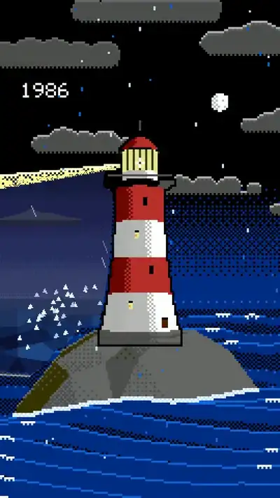</a><br><a href="https://www.sandbase.ai/lab/ai-videos/fable-5-2/2120260208245043663?lang=zh-CN&utm_source=github&utm_medium=readme&utm_campaign=awesome-fable-5-2&utm_content=card"><b>计算机图形学发展历史动画</b></a><br><sub><a href="https://x.com/aollivier82/status/2120260208245043663">@aollivier82</a> · 0:28 · <a href="https://www.sandbase.ai/lab/ai-videos/fable-5-2/2120260208245043663?lang=zh-CN&utm_source=github&utm_medium=readme&utm_campaign=awesome-fable-5-2&utm_content=card">提示词</a></sub></td></tr>
<tr><td width="33%" valign="top"><a href="https://www.sandbase.ai/lab/media/x/fable-5-2/2119868968307695818/video.mp4"></a><br><a href="https://www.sandbase.ai/lab/ai-videos/fable-5-2/2119868968307695818?lang=zh-CN&utm_source=github&utm_medium=readme&utm_campaign=awesome-fable-5-2&utm_content=card"><b>浏览器中可游玩的梦幻乘船游戏演示</b></a><br><sub><a href="https://x.com/kevin_t_ngo/status/2119868968307695818">@kevin_t_ngo</a> · 0:57</sub></td><td width="33%" valign="top"><a href="https://www.sandbase.ai/lab/media/x/fable-5-2/2120253236309569696/video.mp4"></a><br><a href="https://www.sandbase.ai/lab/ai-videos/fable-5-2/2120253236309569696?lang=zh-CN&utm_source=github&utm_medium=readme&utm_campaign=awesome-fable-5-2&utm_content=card"><b>基于三维代码构建的开放世界游戏演示</b></a><br><sub><a href="https://x.com/M__Houser/status/2120253236309569696">@M__Houser</a> · 1:56</sub></td><td width="33%" valign="top"><a href="https://www.sandbase.ai/lab/media/x/fable-5-2/2120947265007440052/video.mp4"></a><br><a href="https://www.sandbase.ai/lab/ai-videos/fable-5-2/2120947265007440052?lang=zh-CN&utm_source=github&utm_medium=readme&utm_campaign=awesome-fable-5-2&utm_content=card"><b>Atlas与Three.js三维场景演示</b></a><br><sub><a href="https://x.com/XRarchitect/status/2120947265007440052">@XRarchitect</a> · 0:21</sub></td></tr>
<tr><td width="33%" valign="top"><a href="https://www.sandbase.ai/lab/media/x/fable-5-2/2119998815856218494/video.mp4"></a><br><a href="https://www.sandbase.ai/lab/ai-videos/fable-5-2/2119998815856218494?lang=zh-CN&utm_source=github&utm_medium=readme&utm_campaign=awesome-fable-5-2&utm_content=card"><b>面向剪辑师制作的视频信息</b></a><br><sub><a href="https://x.com/ChrisGPT/status/2119998815856218494">@ChrisGPT</a> · 0:44</sub></td><td width="33%" valign="top"><a href="https://www.sandbase.ai/lab/media/x/fable-5-2/2121799455041011723/video.mp4"></a><br><a href="https://www.sandbase.ai/lab/ai-videos/fable-5-2/2121799455041011723?lang=zh-CN&utm_source=github&utm_medium=readme&utm_campaign=awesome-fable-5-2&utm_content=card"><b>基于K线指标的AI自动交易决策系统</b></a><br><sub><a href="https://x.com/carm1nee/status/2121799455041011723">@carm1nee</a> · 1:00</sub></td></tr>
</table>

<a id="3d-scene"></a>

## 3D 场景

<table>
<tr><td width="33%" valign="top"><a href="https://www.sandbase.ai/lab/media/x/fable-5-2/2119870965106483384/video.mp4"></a><br><a href="https://www.sandbase.ai/lab/ai-videos/fable-5-2/2119870965106483384?lang=zh-CN&utm_source=github&utm_medium=readme&utm_campaign=awesome-fable-5-2&utm_content=card"><b>通过单次提示词构建的体素引擎演示</b></a><br><sub><a href="https://x.com/mattshumer_/status/2119870965106483384">@mattshumer_</a> · 0:59</sub></td><td width="33%" valign="top"><a href="https://www.sandbase.ai/lab/media/x/fable-5-2/2119873980786237842/video.mp4"></a><br><a href="https://www.sandbase.ai/lab/ai-videos/fable-5-2/2119873980786237842?lang=zh-CN&utm_source=github&utm_medium=readme&utm_campaign=awesome-fable-5-2&utm_content=card"><b>Claude Fable 5.2制作的3D动画展示</b></a><br><sub><a href="https://x.com/hello_amani/status/2119873980786237842">@hello_amani</a> · 0:36</sub></td><td width="33%" valign="top"><a href="https://www.sandbase.ai/lab/media/x/fable-5-2/2119876626179870838/video.mp4"></a><br><a href="https://www.sandbase.ai/lab/ai-videos/fable-5-2/2119876626179870838?lang=zh-CN&utm_source=github&utm_medium=readme&utm_campaign=awesome-fable-5-2&utm_content=card"><b>通过Python脚本控制Blender制作的完整动画</b></a><br><sub><a href="https://x.com/alexmichael/status/2119876626179870838">@alexmichael</a> · 0:18</sub></td></tr>
<tr><td width="33%" valign="top"><a href="https://www.sandbase.ai/lab/media/x/fable-5-2/2119879273196761464/video.mp4"></a><br><a href="https://www.sandbase.ai/lab/ai-videos/fable-5-2/2119879273196761464?lang=zh-CN&utm_source=github&utm_medium=readme&utm_campaign=awesome-fable-5-2&utm_content=card"><b>利用定制编译器将路径追踪器移植到WebGPU</b></a><br><sub><a href="https://x.com/aidanshandle/status/2119879273196761464">@aidanshandle</a> · 1:36</sub></td><td width="33%" valign="top"><a href="https://www.sandbase.ai/lab/media/x/fable-5-2/2119886560992854431/video.mp4"></a><br><a href="https://www.sandbase.ai/lab/ai-videos/fable-5-2/2119886560992854431?lang=zh-CN&utm_source=github&utm_medium=readme&utm_campaign=awesome-fable-5-2&utm_content=card"><b>秋季伏见稻荷大社旅游宣传短片</b></a><br><sub><a href="https://x.com/petergyang/status/2119886560992854431">@petergyang</a> · 0:20</sub></td><td width="33%" valign="top"><a href="https://www.sandbase.ai/lab/media/x/fable-5-2/2119889741600424363/video.mp4"></a><br><a href="https://www.sandbase.ai/lab/ai-videos/fable-5-2/2119889741600424363?lang=zh-CN&utm_source=github&utm_medium=readme&utm_campaign=awesome-fable-5-2&utm_content=card"><b>月球距离地球仅十英尺的模拟短片</b></a><br><sub><a href="https://x.com/ashen_one/status/2119889741600424363">@ashen_one</a> · 1:00</sub></td></tr>
</table>

<details>
<summary><b>展开全部 126 条</b></summary>

<table>
<tr><td width="33%" valign="top"><a href="https://www.sandbase.ai/lab/media/x/fable-5-2/2119890973560054072/video.mp4">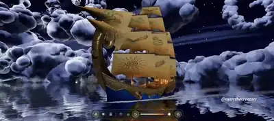</a><br><a href="https://www.sandbase.ai/lab/ai-videos/fable-5-2/2119890973560054072?lang=zh-CN&utm_source=github&utm_medium=readme&utm_campaign=awesome-fable-5-2&utm_content=card"><b>用Three.js纯代码构建的3D帆船</b></a><br><sub><a href="https://x.com/marcthecreatorr/status/2119890973560054072">@marcthecreatorr</a> · 0:53</sub></td><td width="33%" valign="top"><a href="https://www.sandbase.ai/lab/media/x/fable-5-2/2119894130943807746/video.mp4"></a><br><a href="https://www.sandbase.ai/lab/ai-videos/fable-5-2/2119894130943807746?lang=zh-CN&utm_source=github&utm_medium=readme&utm_campaign=awesome-fable-5-2&utm_content=card"><b>3D水上飞机渲染场景</b></a><br><sub><a href="https://x.com/LuminaBench/status/2119894130943807746">@LuminaBench</a> · 0:40</sub></td><td width="33%" valign="top"><a href="https://www.sandbase.ai/lab/media/x/fable-5-2/2119900528197218472/video.mp4"></a><br><a href="https://www.sandbase.ai/lab/ai-videos/fable-5-2/2119900528197218472?lang=zh-CN&utm_source=github&utm_medium=readme&utm_campaign=awesome-fable-5-2&utm_content=card"><b>使用 Three.js 纯代码渲染的动漫短片</b></a><br><sub><a href="https://x.com/noisyb0y1/status/2119900528197218472">@noisyb0y1</a> · 1:07</sub></td></tr>
<tr><td width="33%" valign="top"><a href="https://www.sandbase.ai/lab/media/x/fable-5-2/2119901747930186234/video.mp4"></a><br><a href="https://www.sandbase.ai/lab/ai-videos/fable-5-2/2119901747930186234?lang=zh-CN&utm_source=github&utm_medium=readme&utm_campaign=awesome-fable-5-2&utm_content=card"><b>使用Bryce渲染引擎的3D视频测试</b></a><br><sub><a href="https://x.com/pleometric/status/2119901747930186234">@pleometric</a> · 0:15</sub></td><td width="33%" valign="top"><a href="https://www.sandbase.ai/lab/media/x/fable-5-2/2119901782482543073/video.mp4"></a><br><a href="https://www.sandbase.ai/lab/ai-videos/fable-5-2/2119901782482543073?lang=zh-CN&utm_source=github&utm_medium=readme&utm_campaign=awesome-fable-5-2&utm_content=card"><b>蒸汽机车变身机器人的动画短片</b></a><br><sub><a href="https://x.com/0kncn/status/2119901782482543073">@0kncn</a> · 1:30 · <a href="https://www.sandbase.ai/lab/ai-videos/fable-5-2/2119901782482543073?lang=zh-CN&utm_source=github&utm_medium=readme&utm_campaign=awesome-fable-5-2&utm_content=card">提示词</a></sub></td><td width="33%" valign="top"><a href="https://www.sandbase.ai/lab/media/x/fable-5-2/2119902109709537708/video.mp4"></a><br><a href="https://www.sandbase.ai/lab/ai-videos/fable-5-2/2119902109709537708?lang=zh-CN&utm_source=github&utm_medium=readme&utm_campaign=awesome-fable-5-2&utm_content=card"><b>Blender中生成并渲染的完整3D房间动画</b></a><br><sub><a href="https://x.com/rileybrown/status/2119902109709537708">@rileybrown</a> · 0:59</sub></td></tr>
<tr><td width="33%" valign="top"><a href="https://www.sandbase.ai/lab/media/x/fable-5-2/2119905661505122575/video.mp4"></a><br><a href="https://www.sandbase.ai/lab/ai-videos/fable-5-2/2119905661505122575?lang=zh-CN&utm_source=github&utm_medium=readme&utm_campaign=awesome-fable-5-2&utm_content=card"><b>在大海中航行的3D海盗船</b></a><br><sub><a href="https://x.com/notjazii/status/2119905661505122575">@notjazii</a> · 0:50 · <a href="https://www.sandbase.ai/lab/ai-videos/fable-5-2/2119905661505122575?lang=zh-CN&utm_source=github&utm_medium=readme&utm_campaign=awesome-fable-5-2&utm_content=card">提示词</a></sub></td><td width="33%" valign="top"><a href="https://www.sandbase.ai/lab/media/x/fable-5-2/2119914308603953485/video.mp4"></a><br><a href="https://www.sandbase.ai/lab/ai-videos/fable-5-2/2119914308603953485?lang=zh-CN&utm_source=github&utm_medium=readme&utm_campaign=awesome-fable-5-2&utm_content=card"><b>Fable 5.2生成的体素模拟测试</b></a><br><sub><a href="https://x.com/Avenoxai/status/2119914308603953485">@Avenoxai</a> · 1:12</sub></td><td width="33%" valign="top"><a href="https://www.sandbase.ai/lab/media/x/fable-5-2/2119930300990177509/video.mp4">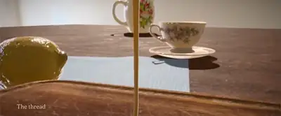</a><br><a href="https://www.sandbase.ai/lab/ai-videos/fable-5-2/2119930300990177509?lang=zh-CN&utm_source=github&utm_medium=readme&utm_campaign=awesome-fable-5-2&utm_content=card"><b>WebGL中的逼真蜂蜜物理模拟</b></a><br><sub><a href="https://x.com/deedydas/status/2119930300990177509">@deedydas</a> · 0:51 · <a href="https://www.sandbase.ai/lab/ai-videos/fable-5-2/2119930300990177509?lang=zh-CN&utm_source=github&utm_medium=readme&utm_campaign=awesome-fable-5-2&utm_content=card">提示词</a></sub></td></tr>
<tr><td width="33%" valign="top"><a href="https://www.sandbase.ai/lab/media/x/fable-5-2/2119938067758772403/video.mp4"></a><br><a href="https://www.sandbase.ai/lab/ai-videos/fable-5-2/2119938067758772403?lang=zh-CN&utm_source=github&utm_medium=readme&utm_campaign=awesome-fable-5-2&utm_content=card"><b>基于地图数据生成的英迪拉纳加尔街区模型</b></a><br><sub><a href="https://x.com/anshu4321/status/2119938067758772403">@anshu4321</a> · 0:35</sub></td><td width="33%" valign="top"><a href="https://www.sandbase.ai/lab/media/x/fable-5-2/2119939061049889130/video.mp4"></a><br><a href="https://www.sandbase.ai/lab/ai-videos/fable-5-2/2119939061049889130?lang=zh-CN&utm_source=github&utm_medium=readme&utm_campaign=awesome-fable-5-2&utm_content=card"><b>视频转3D动画展示</b></a><br><sub><a href="https://x.com/KHvostikk/status/2119939061049889130">@KHvostikk</a> · 0:10</sub></td><td width="33%" valign="top"><a href="https://www.sandbase.ai/lab/media/x/fable-5-2/2119944847255896490/video.mp4">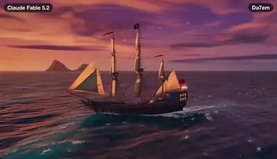</a><br><a href="https://www.sandbase.ai/lab/ai-videos/fable-5-2/2119944847255896490?lang=zh-CN&utm_source=github&utm_medium=readme&utm_campaign=awesome-fable-5-2&utm_content=card"><b>使用Devin生成的逼真3D场景</b></a><br><sub><a href="https://x.com/Da7_Tech/status/2119944847255896490">@Da7_Tech</a> · 1:05</sub></td></tr>
<tr><td width="33%" valign="top"><a href="https://www.sandbase.ai/lab/media/x/fable-5-2/2119946891106394518/video.mp4"></a><br><a href="https://www.sandbase.ai/lab/ai-videos/fable-5-2/2119946891106394518?lang=zh-CN&utm_source=github&utm_medium=readme&utm_campaign=awesome-fable-5-2&utm_content=card"><b>使用 Three.js 测试概念视频游戏机</b></a><br><sub><a href="https://x.com/techartist_/status/2119946891106394518">@techartist_</a> · 0:20</sub></td><td width="33%" valign="top"><a href="https://www.sandbase.ai/lab/media/x/fable-5-2/2119960596951236675/video.mp4"></a><br><a href="https://www.sandbase.ai/lab/ai-videos/fable-5-2/2119960596951236675?lang=zh-CN&utm_source=github&utm_medium=readme&utm_campaign=awesome-fable-5-2&utm_content=card"><b>空中漂浮的1886年纽约城3D场景</b></a><br><sub><a href="https://x.com/semichenkko/status/2119960596951236675">@semichenkko</a> · 0:10</sub></td><td width="33%" valign="top"><a href="https://www.sandbase.ai/lab/media/x/fable-5-2/2119966147328299284/video.mp4"></a><br><a href="https://www.sandbase.ai/lab/ai-videos/fable-5-2/2119966147328299284?lang=zh-CN&utm_source=github&utm_medium=readme&utm_campaign=awesome-fable-5-2&utm_content=card"><b>Blender渲染的布加迪Tourbillon电影感动画</b></a><br><sub><a href="https://x.com/xikhar/status/2119966147328299284">@xikhar</a> · 0:34</sub></td></tr>
<tr><td width="33%" valign="top"><a href="https://www.sandbase.ai/lab/media/x/fable-5-2/2119969928304357507/video.mp4">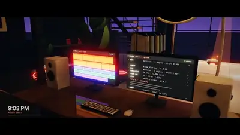</a><br><a href="https://www.sandbase.ai/lab/ai-videos/fable-5-2/2119969928304357507?lang=zh-CN&utm_source=github&utm_medium=readme&utm_campaign=awesome-fable-5-2&utm_content=card"><b>通过上传照片生成的个人工作室场景</b></a><br><sub><a href="https://x.com/rpnickson/status/2119969928304357507">@rpnickson</a> · 0:30</sub></td><td width="33%" valign="top"><a href="https://www.sandbase.ai/lab/media/x/fable-5-2/2119974354260013293/video.mp4"></a><br><a href="https://www.sandbase.ai/lab/ai-videos/fable-5-2/2119974354260013293?lang=zh-CN&utm_source=github&utm_medium=readme&utm_campaign=awesome-fable-5-2&utm_content=card"><b>科学历史的电影感三维探索之旅</b></a><br><sub><a href="https://x.com/DeryaTR_/status/2119974354260013293">@DeryaTR_</a> · 4:56</sub></td><td width="33%" valign="top"><a href="https://www.sandbase.ai/lab/media/x/fable-5-2/2119995965776200047/video.mp4">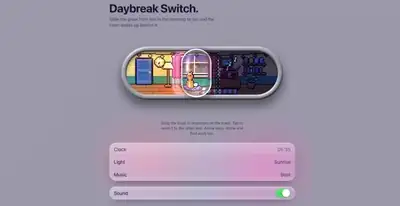</a><br><a href="https://www.sandbase.ai/lab/ai-videos/fable-5-2/2119995965776200047?lang=zh-CN&utm_source=github&utm_medium=readme&utm_campaign=awesome-fable-5-2&utm_content=card"><b>包含小猫和小狗的互动灯开关</b></a><br><sub><a href="https://x.com/justkarangupta/status/2119995965776200047">@justkarangupta</a> · 0:15</sub></td></tr>
<tr><td width="33%" valign="top"><a href="https://www.sandbase.ai/lab/media/x/fable-5-2/2120001344237097184/video.mp4">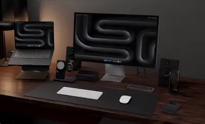</a><br><a href="https://www.sandbase.ai/lab/ai-videos/fable-5-2/2120001344237097184?lang=zh-CN&utm_source=github&utm_medium=readme&utm_campaign=awesome-fable-5-2&utm_content=card"><b>Ultramock 定制三维模型场景演示</b></a><br><sub><a href="https://x.com/joshmillgate/status/2120001344237097184">@joshmillgate</a> · 0:25</sub></td><td width="33%" valign="top"><a href="https://www.sandbase.ai/lab/media/x/fable-5-2/2120039417981333599/video.mp4"></a><br><a href="https://www.sandbase.ai/lab/ai-videos/fable-5-2/2120039417981333599?lang=zh-CN&utm_source=github&utm_medium=readme&utm_campaign=awesome-fable-5-2&utm_content=card"><b>Blender中海蛇缠绕船只的动画</b></a><br><sub><a href="https://x.com/Stefan_3D_AI/status/2120039417981333599">@Stefan_3D_AI</a> · 0:32 · <a href="https://www.sandbase.ai/lab/ai-videos/fable-5-2/2120039417981333599?lang=zh-CN&utm_source=github&utm_medium=readme&utm_campaign=awesome-fable-5-2&utm_content=card">提示词</a></sub></td><td width="33%" valign="top"><a href="https://www.sandbase.ai/lab/media/x/fable-5-2/2120044656776061144/video.mp4"></a><br><a href="https://www.sandbase.ai/lab/ai-videos/fable-5-2/2120044656776061144?lang=zh-CN&utm_source=github&utm_medium=readme&utm_campaign=awesome-fable-5-2&utm_content=card"><b>纯代码生成的3D诅咒之剑场景</b></a><br><sub><a href="https://x.com/pankajkumar_dev/status/2120044656776061144">@pankajkumar_dev</a> · 0:36</sub></td></tr>
<tr><td width="33%" valign="top"><a href="https://www.sandbase.ai/lab/media/x/fable-5-2/2120046536457654495/video.mp4">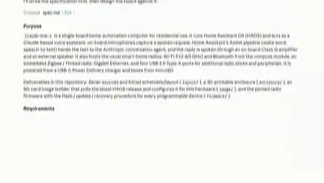</a><br><a href="https://www.sandbase.ai/lab/ai-videos/fable-5-2/2120046536457654495?lang=zh-CN&utm_source=github&utm_medium=readme&utm_campaign=awesome-fable-5-2&utm_content=card"><b>AI设计的全功能语音助理设备</b></a><br><sub><a href="https://x.com/dr_l_alexandre/status/2120046536457654495">@dr_l_alexandre</a> · 0:48</sub></td><td width="33%" valign="top"><a href="https://www.sandbase.ai/lab/media/x/fable-5-2/2120079288372494782/video.mp4"></a><br><a href="https://www.sandbase.ai/lab/ai-videos/fable-5-2/2120079288372494782?lang=zh-CN&utm_source=github&utm_medium=readme&utm_campaign=awesome-fable-5-2&utm_content=card"><b>板球的3D渲染效果</b></a><br><sub><a href="https://x.com/deedydas/status/2120079288372494782">@deedydas</a> · 0:18</sub></td><td width="33%" valign="top"><a href="https://www.sandbase.ai/lab/media/x/fable-5-2/2120091403447578814/video.mp4"></a><br><a href="https://www.sandbase.ai/lab/ai-videos/fable-5-2/2120091403447578814?lang=zh-CN&utm_source=github&utm_medium=readme&utm_campaign=awesome-fable-5-2&utm_content=card"><b>Three.js制作的人物腿部模型测试</b></a><br><sub><a href="https://x.com/bei351009016/status/2120091403447578814">@bei351009016</a> · 0:09</sub></td></tr>
<tr><td width="33%" valign="top"><a href="https://www.sandbase.ai/lab/media/x/fable-5-2/2120111159726727321/video.mp4"></a><br><a href="https://www.sandbase.ai/lab/ai-videos/fable-5-2/2120111159726727321?lang=zh-CN&utm_source=github&utm_medium=readme&utm_campaign=awesome-fable-5-2&utm_content=card"><b>在Three.js中重现莫妮卡公寓</b></a><br><sub><a href="https://x.com/chetaslua/status/2120111159726727321">@chetaslua</a> · 0:32</sub></td><td width="33%" valign="top"><a href="https://www.sandbase.ai/lab/media/x/fable-5-2/2120113578531234172/video.mp4"></a><br><a href="https://www.sandbase.ai/lab/ai-videos/fable-5-2/2120113578531234172?lang=zh-CN&utm_source=github&utm_medium=readme&utm_campaign=awesome-fable-5-2&utm_content=card"><b>通过MCP在Blender中生成的3D动画</b></a><br><sub><a href="https://x.com/maxt3chno/status/2120113578531234172">@maxt3chno</a> · 0:16</sub></td><td width="33%" valign="top"><a href="https://www.sandbase.ai/lab/media/x/fable-5-2/2120162023770054791/video.mp4"></a><br><a href="https://www.sandbase.ai/lab/ai-videos/fable-5-2/2120162023770054791?lang=zh-CN&utm_source=github&utm_medium=readme&utm_campaign=awesome-fable-5-2&utm_content=card"><b>视频转3D动画生成测试</b></a><br><sub><a href="https://x.com/KHvostikk/status/2120162023770054791">@KHvostikk</a> · 0:16</sub></td></tr>
<tr><td width="33%" valign="top"><a href="https://www.sandbase.ai/lab/media/x/fable-5-2/2120188343870964113/video.mp4"></a><br><a href="https://www.sandbase.ai/lab/ai-videos/fable-5-2/2120188343870964113?lang=zh-CN&utm_source=github&utm_medium=readme&utm_campaign=awesome-fable-5-2&utm_content=card"><b>托斯卡纳废墟修复视觉效果视频</b></a><br><sub><a href="https://x.com/TimurNegru/status/2120188343870964113">@TimurNegru</a> · 0:34</sub></td><td width="33%" valign="top"><a href="https://www.sandbase.ai/lab/media/x/fable-5-2/2120199783730299278/video.mp4"></a><br><a href="https://www.sandbase.ai/lab/ai-videos/fable-5-2/2120199783730299278?lang=zh-CN&utm_source=github&utm_medium=readme&utm_campaign=awesome-fable-5-2&utm_content=card"><b>用 Fable 和 Opus 制作的 Three.js 场景</b></a><br><sub><a href="https://x.com/sarlloc/status/2120199783730299278">@sarlloc</a> · 0:16</sub></td><td width="33%" valign="top"><a href="https://www.sandbase.ai/lab/media/x/fable-5-2/2120224530367119758/video.mp4"></a><br><a href="https://www.sandbase.ai/lab/ai-videos/fable-5-2/2120224530367119758?lang=zh-CN&utm_source=github&utm_medium=readme&utm_campaign=awesome-fable-5-2&utm_content=card"><b>高细节3D手臂绑定与动画演示</b></a><br><sub><a href="https://x.com/apekshik/status/2120224530367119758">@apekshik</a> · 0:37</sub></td></tr>
<tr><td width="33%" valign="top"><a href="https://www.sandbase.ai/lab/media/x/fable-5-2/2120239401821487149/video.mp4"></a><br><a href="https://www.sandbase.ai/lab/ai-videos/fable-5-2/2120239401821487149?lang=zh-CN&utm_source=github&utm_medium=readme&utm_campaign=awesome-fable-5-2&utm_content=card"><b>使用Blender与Fable 5.2制作的动画</b></a><br><sub><a href="https://x.com/aecyydesign/status/2120239401821487149">@aecyydesign</a> · 0:10</sub></td><td width="33%" valign="top"><a href="https://www.sandbase.ai/lab/media/x/fable-5-2/2120247208918266080/video.mp4"></a><br><a href="https://www.sandbase.ai/lab/ai-videos/fable-5-2/2120247208918266080?lang=zh-CN&utm_source=github&utm_medium=readme&utm_campaign=awesome-fable-5-2&utm_content=card"><b>指环王风格的河流物理模拟 3D 场景</b></a><br><sub><a href="https://x.com/AymericRoucher/status/2120247208918266080">@AymericRoucher</a> · 0:08</sub></td><td width="33%" valign="top"><a href="https://www.sandbase.ai/lab/media/x/fable-5-2/2120248774861689199/video.mp4"></a><br><a href="https://www.sandbase.ai/lab/ai-videos/fable-5-2/2120248774861689199?lang=zh-CN&utm_source=github&utm_medium=readme&utm_campaign=awesome-fable-5-2&utm_content=card"><b>在 Three.js 中运行的四元素基准场景</b></a><br><sub><a href="https://x.com/orcdev/status/2120248774861689199">@orcdev</a> · 0:29</sub></td></tr>
<tr><td width="33%" valign="top"><a href="https://www.sandbase.ai/lab/media/x/fable-5-2/2120254108104007712/video.mp4"></a><br><a href="https://www.sandbase.ai/lab/ai-videos/fable-5-2/2120254108104007712?lang=zh-CN&utm_source=github&utm_medium=readme&utm_campaign=awesome-fable-5-2&utm_content=card"><b>Three.js中的龙巢3D场景</b></a><br><sub><a href="https://x.com/scottstts/status/2120254108104007712">@scottstts</a> · 1:00</sub></td><td width="33%" valign="top"><a href="https://www.sandbase.ai/lab/media/x/fable-5-2/2120305718939021566/video.mp4"></a><br><a href="https://www.sandbase.ai/lab/ai-videos/fable-5-2/2120305718939021566?lang=zh-CN&utm_source=github&utm_medium=readme&utm_campaign=awesome-fable-5-2&utm_content=card"><b>Blender中3D游戏角色动画工作流</b></a><br><sub><a href="https://x.com/luccacerf/status/2120305718939021566">@luccacerf</a> · 0:25</sub></td><td width="33%" valign="top"><a href="https://www.sandbase.ai/lab/media/x/fable-5-2/2120316203738829180/video.mp4"></a><br><a href="https://www.sandbase.ai/lab/ai-videos/fable-5-2/2120316203738829180?lang=zh-CN&utm_source=github&utm_medium=readme&utm_campaign=awesome-fable-5-2&utm_content=card"><b>在Blender中重现Three.js公寓场景</b></a><br><sub><a href="https://x.com/MengTo/status/2120316203738829180">@MengTo</a> · 0:52</sub></td></tr>
<tr><td width="33%" valign="top"><a href="https://www.sandbase.ai/lab/media/x/fable-5-2/2120518714743308542/video.mp4"></a><br><a href="https://www.sandbase.ai/lab/ai-videos/fable-5-2/2120518714743308542?lang=zh-CN&utm_source=github&utm_medium=readme&utm_campaign=awesome-fable-5-2&utm_content=card"><b>PS5手柄动态拆解演示</b></a><br><sub><a href="https://x.com/Nyxera0x/status/2120518714743308542">@Nyxera0x</a> · 0:24</sub></td><td width="33%" valign="top"><a href="https://www.sandbase.ai/lab/media/x/fable-5-2/2120548065044234504/video.mp4">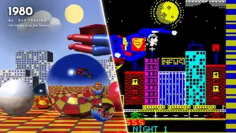</a><br><a href="https://www.sandbase.ai/lab/ai-videos/fable-5-2/2120548065044234504?lang=zh-CN&utm_source=github&utm_medium=readme&utm_campaign=awesome-fable-5-2&utm_content=card"><b>纯JavaScript展现超人飞越计算机图形历史</b></a><br><sub><a href="https://x.com/chetaslua/status/2120548065044234504">@chetaslua</a> · 0:40</sub></td><td width="33%" valign="top"><a href="https://www.sandbase.ai/lab/media/x/fable-5-2/2120636604624560229/video.mp4"></a><br><a href="https://www.sandbase.ai/lab/ai-videos/fable-5-2/2120636604624560229?lang=zh-CN&utm_source=github&utm_medium=readme&utm_campaign=awesome-fable-5-2&utm_content=card"><b>程序化动画的双足机器人生物</b></a><br><sub><a href="https://x.com/pingouh/status/2120636604624560229">@pingouh</a> · 1:12</sub></td></tr>
<tr><td width="33%" valign="top"><a href="https://www.sandbase.ai/lab/media/x/fable-5-2/2120648796334178374/video.mp4"></a><br><a href="https://www.sandbase.ai/lab/ai-videos/fable-5-2/2120648796334178374?lang=zh-CN&utm_source=github&utm_medium=readme&utm_campaign=awesome-fable-5-2&utm_content=card"><b>身披粒子壳螃蟹的3D动画短片</b></a><br><sub><a href="https://x.com/JacobMolBio/status/2120648796334178374">@JacobMolBio</a> · 1:25</sub></td><td width="33%" valign="top"><a href="https://www.sandbase.ai/lab/media/x/fable-5-2/2120680918914601165/video.mp4"></a><br><a href="https://www.sandbase.ai/lab/ai-videos/fable-5-2/2120680918914601165?lang=zh-CN&utm_source=github&utm_medium=readme&utm_campaign=awesome-fable-5-2&utm_content=card"><b>单提示词生成的3D房屋</b></a><br><sub><a href="https://x.com/calebfahlgren/status/2120680918914601165">@calebfahlgren</a> · 0:44 · <a href="https://www.sandbase.ai/lab/ai-videos/fable-5-2/2120680918914601165?lang=zh-CN&utm_source=github&utm_medium=readme&utm_campaign=awesome-fable-5-2&utm_content=card">提示词</a></sub></td><td width="33%" valign="top"><a href="https://www.sandbase.ai/lab/media/x/fable-5-2/2120753459498549757/video.mp4"></a><br><a href="https://www.sandbase.ai/lab/ai-videos/fable-5-2/2120753459498549757?lang=zh-CN&utm_source=github&utm_medium=readme&utm_campaign=awesome-fable-5-2&utm_content=card"><b>GTA 6概念城市驾驶场景</b></a><br><sub><a href="https://x.com/polinaaAi/status/2120753459498549757">@polinaaAi</a> · 0:46</sub></td></tr>
<tr><td width="33%" valign="top"><a href="https://www.sandbase.ai/lab/media/x/fable-5-2/2120767818157420773/video.mp4">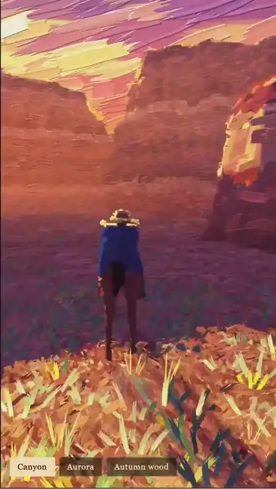</a><br><a href="https://www.sandbase.ai/lab/ai-videos/fable-5-2/2120767818157420773?lang=zh-CN&utm_source=github&utm_medium=readme&utm_campaign=awesome-fable-5-2&utm_content=card"><b>角色骑马穿过峡谷前往海滩</b></a><br><sub><a href="https://x.com/venturetwins/status/2120767818157420773">@venturetwins</a> · 0:36</sub></td><td width="33%" valign="top"><a href="https://www.sandbase.ai/lab/media/x/fable-5-2/2120813043101946324/video.mp4">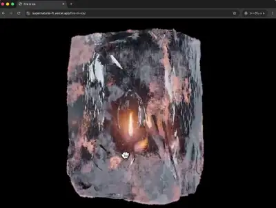</a><br><a href="https://www.sandbase.ai/lab/ai-videos/fable-5-2/2120813043101946324?lang=zh-CN&utm_source=github&utm_medium=readme&utm_campaign=awesome-fable-5-2&utm_content=card"><b>WebGPU渲染的冰中燃烧火焰</b></a><br><sub><a href="https://x.com/tkm_hmng8/status/2120813043101946324">@tkm_hmng8</a> · 0:19</sub></td><td width="33%" valign="top"><a href="https://www.sandbase.ai/lab/media/x/fable-5-2/2120872262937305248/video.mp4">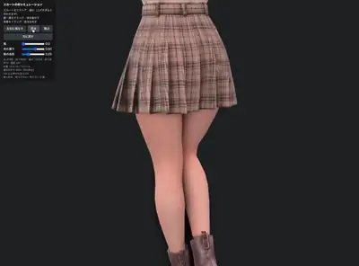</a><br><a href="https://www.sandbase.ai/lab/ai-videos/fable-5-2/2120872262937305248?lang=zh-CN&utm_source=github&utm_medium=readme&utm_campaign=awesome-fable-5-2&utm_content=card"><b>三维角色的交互式布料物理模拟</b></a><br><sub><a href="https://x.com/hakimieiqbal/status/2120872262937305248">@hakimieiqbal</a> · 0:16</sub></td></tr>
<tr><td width="33%" valign="top"><a href="https://www.sandbase.ai/lab/media/x/fable-5-2/2120939600504074444/video.mp4"></a><br><a href="https://www.sandbase.ai/lab/ai-videos/fable-5-2/2120939600504074444?lang=zh-CN&utm_source=github&utm_medium=readme&utm_campaign=awesome-fable-5-2&utm_content=card"><b>基于户型图生成的3D地产漫游</b></a><br><sub><a href="https://x.com/everestchris6/status/2120939600504074444">@everestchris6</a> · 0:16</sub></td><td width="33%" valign="top"><a href="https://www.sandbase.ai/lab/media/x/fable-5-2/2120947265007440052/video.mp4"></a><br><a href="https://www.sandbase.ai/lab/ai-videos/fable-5-2/2120947265007440052?lang=zh-CN&utm_source=github&utm_medium=readme&utm_campaign=awesome-fable-5-2&utm_content=card"><b>Atlas与Three.js三维场景演示</b></a><br><sub><a href="https://x.com/XRarchitect/status/2120947265007440052">@XRarchitect</a> · 0:21</sub></td><td width="33%" valign="top"><a href="https://www.sandbase.ai/lab/media/x/fable-5-2/2121001440470577157/video.mp4"></a><br><a href="https://www.sandbase.ai/lab/ai-videos/fable-5-2/2121001440470577157?lang=zh-CN&utm_source=github&utm_medium=readme&utm_campaign=awesome-fable-5-2&utm_content=card"><b>Three.js代码渲染的动画短片</b></a><br><sub><a href="https://x.com/0xMovez/status/2121001440470577157">@0xMovez</a> · 1:41 · <a href="https://www.sandbase.ai/lab/ai-videos/fable-5-2/2121001440470577157?lang=zh-CN&utm_source=github&utm_medium=readme&utm_campaign=awesome-fable-5-2&utm_content=card">提示词</a></sub></td></tr>
<tr><td width="33%" valign="top"><a href="https://www.sandbase.ai/lab/media/x/fable-5-2/2121009941930705224/video.mp4"></a><br><a href="https://www.sandbase.ai/lab/ai-videos/fable-5-2/2121009941930705224?lang=zh-CN&utm_source=github&utm_medium=readme&utm_campaign=awesome-fable-5-2&utm_content=card"><b>应用迪士尼动画法则召唤骷髅的死灵法师</b></a><br><sub><a href="https://x.com/luccacerf/status/2121009941930705224">@luccacerf</a> · 0:35 · <a href="https://www.sandbase.ai/lab/ai-videos/fable-5-2/2121009941930705224?lang=zh-CN&utm_source=github&utm_medium=readme&utm_campaign=awesome-fable-5-2&utm_content=card">提示词</a></sub></td><td width="33%" valign="top"><a href="https://www.sandbase.ai/lab/media/x/fable-5-2/2121047997584752643/video.mp4">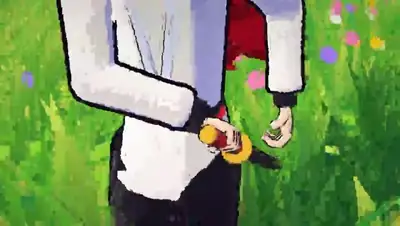</a><br><a href="https://www.sandbase.ai/lab/ai-videos/fable-5-2/2121047997584752643?lang=zh-CN&utm_source=github&utm_medium=readme&utm_campaign=awesome-fable-5-2&utm_content=card"><b>Three.js代码渲染的电影感斩击动作片</b></a><br><sub><a href="https://x.com/N01ennn/status/2121047997584752643">@N01ennn</a> · 0:24 · <a href="https://www.sandbase.ai/lab/ai-videos/fable-5-2/2121047997584752643?lang=zh-CN&utm_source=github&utm_medium=readme&utm_campaign=awesome-fable-5-2&utm_content=card">提示词</a></sub></td><td width="33%" valign="top"><a href="https://www.sandbase.ai/lab/media/x/fable-5-2/2121176151234330707/video.mp4"></a><br><a href="https://www.sandbase.ai/lab/ai-videos/fable-5-2/2121176151234330707?lang=zh-CN&utm_source=github&utm_medium=readme&utm_campaign=awesome-fable-5-2&utm_content=card"><b>无需外部素材制作的Three.js场景</b></a><br><sub><a href="https://x.com/chetaslua/status/2121176151234330707">@chetaslua</a> · 1:25</sub></td></tr>
<tr><td width="33%" valign="top"><a href="https://www.sandbase.ai/lab/media/x/fable-5-2/2121212179685007524/video.mp4">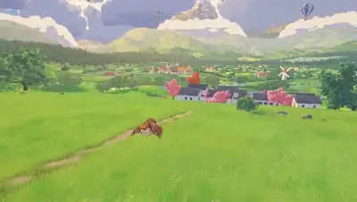</a><br><a href="https://www.sandbase.ai/lab/ai-videos/fable-5-2/2121212179685007524?lang=zh-CN&utm_source=github&utm_medium=readme&utm_campaign=awesome-fable-5-2&utm_content=card"><b>单次生成的Three.js三维场景</b></a><br><sub><a href="https://x.com/anvithbuilds/status/2121212179685007524">@anvithbuilds</a> · 1:00</sub></td><td width="33%" valign="top"><a href="https://www.sandbase.ai/lab/media/x/fable-5-2/2121216070375612527/video.mp4">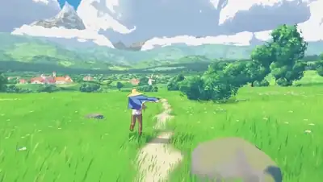</a><br><a href="https://www.sandbase.ai/lab/ai-videos/fable-5-2/2121216070375612527?lang=zh-CN&utm_source=github&utm_medium=readme&utm_campaign=awesome-fable-5-2&utm_content=card"><b>Three.js与Blender制作的手绘风山谷</b></a><br><sub><a href="https://x.com/rewind02/status/2121216070375612527">@rewind02</a> · 0:23</sub></td><td width="33%" valign="top"><a href="https://www.sandbase.ai/lab/media/x/fable-5-2/2121265583144730643/video.mp4"></a><br><a href="https://www.sandbase.ai/lab/ai-videos/fable-5-2/2121265583144730643?lang=zh-CN&utm_source=github&utm_medium=readme&utm_campaign=awesome-fable-5-2&utm_content=card"><b>Tripo生成的奇幻村庄动画场景</b></a><br><sub><a href="https://x.com/marcusyul/status/2121265583144730643">@marcusyul</a> · 0:29</sub></td></tr>
<tr><td width="33%" valign="top"><a href="https://www.sandbase.ai/lab/media/x/fable-5-2/2121307000755855480/video.mp4"></a><br><a href="https://www.sandbase.ai/lab/ai-videos/fable-5-2/2121307000755855480?lang=zh-CN&utm_source=github&utm_medium=readme&utm_campaign=awesome-fable-5-2&utm_content=card"><b>Three.js渲染的中国风3D场景</b></a><br><sub><a href="https://x.com/Dav338876/status/2121307000755855480">@Dav338876</a> · 2:00</sub></td><td width="33%" valign="top"><a href="https://www.sandbase.ai/lab/media/x/fable-5-2/2121333521663017401/video.mp4"></a><br><a href="https://www.sandbase.ai/lab/ai-videos/fable-5-2/2121333521663017401?lang=zh-CN&utm_source=github&utm_medium=readme&utm_campaign=awesome-fable-5-2&utm_content=card"><b>Vork渲染的角色跑步学习动画</b></a><br><sub><a href="https://x.com/ravisparikh/status/2121333521663017401">@ravisparikh</a> · 0:30</sub></td><td width="33%" valign="top"><a href="https://www.sandbase.ai/lab/media/x/fable-5-2/2121336108370014266/video.mp4"></a><br><a href="https://www.sandbase.ai/lab/ai-videos/fable-5-2/2121336108370014266?lang=zh-CN&utm_source=github&utm_medium=readme&utm_campaign=awesome-fable-5-2&utm_content=card"><b>Atlas与Fable及Three.js实验</b></a><br><sub><a href="https://x.com/XRarchitect/status/2121336108370014266">@XRarchitect</a> · 0:26</sub></td></tr>
<tr><td width="33%" valign="top"><a href="https://www.sandbase.ai/lab/media/x/fable-5-2/2121343522318274958/video.mp4"></a><br><a href="https://www.sandbase.ai/lab/ai-videos/fable-5-2/2121343522318274958?lang=zh-CN&utm_source=github&utm_medium=readme&utm_campaign=awesome-fable-5-2&utm_content=card"><b>纸板小镇中的发条牛仔玩具动画</b></a><br><sub><a href="https://x.com/ChrisGPT/status/2121343522318274958">@ChrisGPT</a> · 0:10</sub></td><td width="33%" valign="top"><a href="https://www.sandbase.ai/lab/media/x/fable-5-2/2121525925900947923/video.mp4"></a><br><a href="https://www.sandbase.ai/lab/ai-videos/fable-5-2/2121525925900947923?lang=zh-CN&utm_source=github&utm_medium=readme&utm_campaign=awesome-fable-5-2&utm_content=card"><b>骑龙飞越彩绘山谷</b></a><br><sub><a href="https://x.com/anvithbuilds/status/2121525925900947923">@anvithbuilds</a> · 0:50</sub></td><td width="33%" valign="top"><a href="https://www.sandbase.ai/lab/media/x/fable-5-2/2121561217797951859/video.mp4">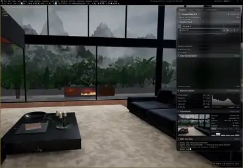</a><br><a href="https://www.sandbase.ai/lab/ai-videos/fable-5-2/2121561217797951859?lang=zh-CN&utm_source=github&utm_medium=readme&utm_campaign=awesome-fable-5-2&utm_content=card"><b>自动生成的3D客厅布局与漫游展示</b></a><br><sub><a href="https://x.com/0xWast3/status/2121561217797951859">@0xWast3</a> · 0:30</sub></td></tr>
<tr><td width="33%" valign="top"><a href="https://www.sandbase.ai/lab/media/x/fable-5-2/2121579587222016201/video.mp4">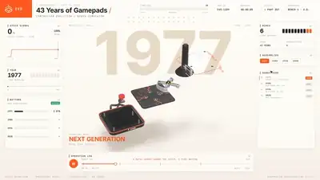</a><br><a href="https://www.sandbase.ai/lab/ai-videos/fable-5-2/2121579587222016201?lang=zh-CN&utm_source=github&utm_medium=readme&utm_campaign=awesome-fable-5-2&utm_content=card"><b>Three.js呈现四十三年游戏手柄演化</b></a><br><sub><a href="https://x.com/elvar_official/status/2121579587222016201">@elvar_official</a> · 0:27</sub></td><td width="33%" valign="top"><a href="https://www.sandbase.ai/lab/media/x/fable-5-2/2121603388009775599/video.mp4"></a><br><a href="https://www.sandbase.ai/lab/ai-videos/fable-5-2/2121603388009775599?lang=zh-CN&utm_source=github&utm_medium=readme&utm_campaign=awesome-fable-5-2&utm_content=card"><b>在Blender中从零构建的3D眼镜蛇GT-500</b></a><br><sub><a href="https://x.com/maxt3chno/status/2121603388009775599">@maxt3chno</a> · 0:26</sub></td><td width="33%" valign="top"><a href="https://www.sandbase.ai/lab/media/x/seedance-2-5/2121610443714343220/video.mp4"></a><br><a href="https://www.sandbase.ai/lab/ai-videos/fable-5-2/2121610443714343220?lang=zh-CN&utm_source=github&utm_medium=readme&utm_campaign=awesome-fable-5-2&utm_content=card"><b>单镜头夜景及皮肤特写变焦</b></a><br><sub><a href="https://x.com/socialwithaayan/status/2121610443714343220">@socialwithaayan</a> · 0:16 · <a href="https://www.sandbase.ai/lab/ai-videos/fable-5-2/2121610443714343220?lang=zh-CN&utm_source=github&utm_medium=readme&utm_campaign=awesome-fable-5-2&utm_content=card">提示词</a></sub></td></tr>
<tr><td width="33%" valign="top"><a href="https://www.sandbase.ai/lab/media/x/fable-5-2/2121614786245104107/video.mp4">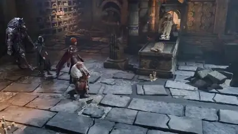</a><br><a href="https://www.sandbase.ai/lab/ai-videos/fable-5-2/2121614786245104107?lang=zh-CN&utm_source=github&utm_medium=readme&utm_campaign=awesome-fable-5-2&utm_content=card"><b>在Blender中复刻Three.js游戏预告片</b></a><br><sub><a href="https://x.com/MengTo/status/2121614786245104107">@MengTo</a> · 0:57</sub></td><td width="33%" valign="top"><a href="https://www.sandbase.ai/lab/media/x/fable-5-2/2121617707061727643/video.mp4"></a><br><a href="https://www.sandbase.ai/lab/ai-videos/fable-5-2/2121617707061727643?lang=zh-CN&utm_source=github&utm_medium=readme&utm_campaign=awesome-fable-5-2&utm_content=card"><b>脚踩轮滑鞋的3D小浣熊动画</b></a><br><sub><a href="https://x.com/Lummox_eth/status/2121617707061727643">@Lummox_eth</a> · 0:10</sub></td><td width="33%" valign="top"><a href="https://www.sandbase.ai/lab/media/x/fable-5-2/2121623397767778549/video.mp4"></a><br><a href="https://www.sandbase.ai/lab/ai-videos/fable-5-2/2121623397767778549?lang=zh-CN&utm_source=github&utm_medium=readme&utm_campaign=awesome-fable-5-2&utm_content=card"><b>97KB代码生成的交互式WebGPU海洋</b></a><br><sub><a href="https://x.com/VaibhavSisinty/status/2121623397767778549">@VaibhavSisinty</a> · 1:50</sub></td></tr>
<tr><td width="33%" valign="top"><a href="https://www.sandbase.ai/lab/media/x/fable-5-2/2121626206613491787/video.mp4"></a><br><a href="https://www.sandbase.ai/lab/ai-videos/fable-5-2/2121626206613491787?lang=zh-CN&utm_source=github&utm_medium=readme&utm_campaign=awesome-fable-5-2&utm_content=card"><b>Three.js程序化生成的象牙王国3D场景</b></a><br><sub><a href="https://x.com/scottstts/status/2121626206613491787">@scottstts</a> · 2:00</sub></td><td width="33%" valign="top"><a href="https://www.sandbase.ai/lab/media/x/fable-5-2/2121641934884057288/video.mp4"></a><br><a href="https://www.sandbase.ai/lab/ai-videos/fable-5-2/2121641934884057288?lang=zh-CN&utm_source=github&utm_medium=readme&utm_campaign=awesome-fable-5-2&utm_content=card"><b>贯穿英伟达GPU 26年演变的一镜到底3D场景</b></a><br><sub><a href="https://x.com/0x_fokki/status/2121641934884057288">@0x_fokki</a> · 0:31</sub></td><td width="33%" valign="top"><a href="https://www.sandbase.ai/lab/media/x/fable-5-2/2121642720045261185/video.mp4">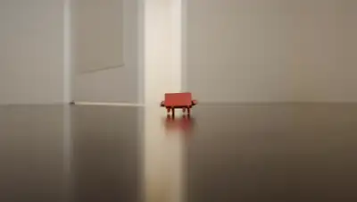</a><br><a href="https://www.sandbase.ai/lab/ai-videos/fable-5-2/2121642720045261185?lang=zh-CN&utm_source=github&utm_medium=readme&utm_campaign=awesome-fable-5-2&utm_content=card"><b>通过Python代码生成的Blender动画短片</b></a><br><sub><a href="https://x.com/rileybrown/status/2121642720045261185">@rileybrown</a> · 2:19</sub></td></tr>
<tr><td width="33%" valign="top"><a href="https://www.sandbase.ai/lab/media/x/fable-5-2/2121673597152362755/video.mp4"></a><br><a href="https://www.sandbase.ai/lab/ai-videos/fable-5-2/2121673597152362755?lang=zh-CN&utm_source=github&utm_medium=readme&utm_campaign=awesome-fable-5-2&utm_content=card"><b>单HTML文件实现的完整水下世界场景</b></a><br><sub><a href="https://x.com/Octoberry/status/2121673597152362755">@Octoberry</a> · 1:50</sub></td><td width="33%" valign="top"><a href="https://www.sandbase.ai/lab/media/x/fable-5-2/2121720293324423508/video.mp4"></a><br><a href="https://www.sandbase.ai/lab/ai-videos/fable-5-2/2121720293324423508?lang=zh-CN&utm_source=github&utm_medium=readme&utm_campaign=awesome-fable-5-2&utm_content=card"><b>GTA 6概念自驾场景演示</b></a><br><sub><a href="https://x.com/0xKenny1st/status/2121720293324423508">@0xKenny1st</a> · 2:52</sub></td><td width="33%" valign="top"><a href="https://www.sandbase.ai/lab/media/x/fable-5-2/2121721290687983906/video.mp4"></a><br><a href="https://www.sandbase.ai/lab/ai-videos/fable-5-2/2121721290687983906?lang=zh-CN&utm_source=github&utm_medium=readme&utm_campaign=awesome-fable-5-2&utm_content=card"><b>Three.js纯代码渲染的电影级打斗场景</b></a><br><sub><a href="https://x.com/0xMovez/status/2121721290687983906">@0xMovez</a> · 1:30 · <a href="https://www.sandbase.ai/lab/ai-videos/fable-5-2/2121721290687983906?lang=zh-CN&utm_source=github&utm_medium=readme&utm_campaign=awesome-fable-5-2&utm_content=card">提示词</a></sub></td></tr>
<tr><td width="33%" valign="top"><a href="https://www.sandbase.ai/lab/media/x/fable-5-2/2121724395354018201/video.mp4"></a><br><a href="https://www.sandbase.ai/lab/ai-videos/fable-5-2/2121724395354018201?lang=zh-CN&utm_source=github&utm_medium=readme&utm_campaign=awesome-fable-5-2&utm_content=card"><b>Blender中的动作捕捉建模与绑定</b></a><br><sub><a href="https://x.com/seiiiiiiiiiiru/status/2121724395354018201">@seiiiiiiiiiiru</a> · 0:15</sub></td><td width="33%" valign="top"><a href="https://www.sandbase.ai/lab/media/x/fable-5-2/2121737343287828694/video.mp4"></a><br><a href="https://www.sandbase.ai/lab/ai-videos/fable-5-2/2121737343287828694?lang=zh-CN&utm_source=github&utm_medium=readme&utm_campaign=awesome-fable-5-2&utm_content=card"><b>纯代码在Three.js中构建的微型城市</b></a><br><sub><a href="https://x.com/LexnLin/status/2121737343287828694">@LexnLin</a> · 1:00</sub></td><td width="33%" valign="top"><a href="https://www.sandbase.ai/lab/media/x/fable-5-2/2121802871050318305/video.mp4"></a><br><a href="https://www.sandbase.ai/lab/ai-videos/fable-5-2/2121802871050318305?lang=zh-CN&utm_source=github&utm_medium=readme&utm_campaign=awesome-fable-5-2&utm_content=card"><b>将一张京都照片转换为互动3D场景</b></a><br><sub><a href="https://x.com/29meat_ai/status/2121802871050318305">@29meat_ai</a> · 0:22</sub></td></tr>
<tr><td width="33%" valign="top"><a href="https://www.sandbase.ai/lab/media/x/fable-5-2/2121922699962224967/video.mp4"></a><br><a href="https://www.sandbase.ai/lab/ai-videos/fable-5-2/2121922699962224967?lang=zh-CN&utm_source=github&utm_medium=readme&utm_campaign=awesome-fable-5-2&utm_content=card"><b>使用 3ds Max 进行室内设计平面图渲染</b></a><br><sub><a href="https://x.com/0xWast3/status/2121922699962224967">@0xWast3</a> · 0:29</sub></td><td width="33%" valign="top"><a href="https://www.sandbase.ai/lab/media/x/fable-5-2/2121961164233933129/video.mp4">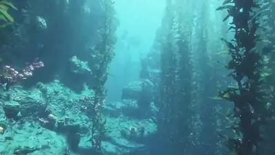</a><br><a href="https://www.sandbase.ai/lab/ai-videos/fable-5-2/2121961164233933129?lang=zh-CN&utm_source=github&utm_medium=readme&utm_campaign=awesome-fable-5-2&utm_content=card"><b>单个HTML文件构建的可畅游水下世界</b></a><br><sub><a href="https://x.com/kimmonismus/status/2121961164233933129">@kimmonismus</a> · 1:50</sub></td><td width="33%" valign="top"><a href="https://www.sandbase.ai/lab/media/x/fable-5-2/2121996663996707139/video.mp4">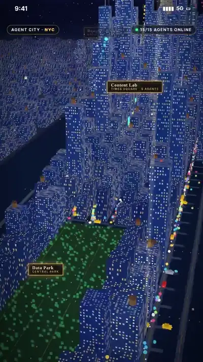</a><br><a href="https://www.sandbase.ai/lab/ai-videos/fable-5-2/2121996663996707139?lang=zh-CN&utm_source=github&utm_medium=readme&utm_campaign=awesome-fable-5-2&utm_content=card"><b>AI智能体驱动的虚拟纽约城市</b></a><br><sub><a href="https://x.com/DN_degen/status/2121996663996707139">@DN_degen</a> · 0:30</sub></td></tr>
<tr><td width="33%" valign="top"><a href="https://www.sandbase.ai/lab/media/x/fable-5-2/2122011748752318857/video.mp4"></a><br><a href="https://www.sandbase.ai/lab/ai-videos/fable-5-2/2122011748752318857?lang=zh-CN&utm_source=github&utm_medium=readme&utm_campaign=awesome-fable-5-2&utm_content=card"><b>无需游戏引擎在浏览器运行的水下世界</b></a><br><sub><a href="https://x.com/Pirat_Nation/status/2122011748752318857">@Pirat_Nation</a> · 0:59</sub></td><td width="33%" valign="top"><a href="https://www.sandbase.ai/lab/media/x/fable-5-2/2122065184743153882/video.mp4"></a><br><a href="https://www.sandbase.ai/lab/ai-videos/fable-5-2/2122065184743153882?lang=zh-CN&utm_source=github&utm_medium=readme&utm_campaign=awesome-fable-5-2&utm_content=card"><b>Blender中自动生成的提灯蜘蛛动画</b></a><br><sub><a href="https://x.com/aGim_asf/status/2122065184743153882">@aGim_asf</a> · 1:03</sub></td><td width="33%" valign="top"><a href="https://www.sandbase.ai/lab/media/x/fable-5-2/2122081824159547833/video.mp4">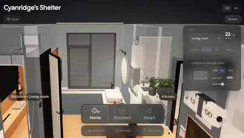</a><br><a href="https://www.sandbase.ai/lab/ai-videos/fable-5-2/2122081824159547833?lang=zh-CN&utm_source=github&utm_medium=readme&utm_campaign=awesome-fable-5-2&utm_content=card"><b>利用Blender与AI构建的完整3D公寓</b></a><br><sub><a href="https://x.com/noisyb0y1/status/2122081824159547833">@noisyb0y1</a> · 0:56</sub></td></tr>
<tr><td width="33%" valign="top"><a href="https://www.sandbase.ai/lab/media/x/fable-5-2/2122274109795054036/video.mp4"></a><br><a href="https://www.sandbase.ai/lab/ai-videos/fable-5-2/2122274109795054036?lang=zh-CN&utm_source=github&utm_medium=readme&utm_campaign=awesome-fable-5-2&utm_content=card"><b>使用Three.js代码生成的美学3D场景</b></a><br><sub><a href="https://x.com/ky__zo/status/2122274109795054036">@ky__zo</a> · 0:28 · <a href="https://www.sandbase.ai/lab/ai-videos/fable-5-2/2122274109795054036?lang=zh-CN&utm_source=github&utm_medium=readme&utm_campaign=awesome-fable-5-2&utm_content=card">提示词</a></sub></td><td width="33%" valign="top"><a href="https://www.sandbase.ai/lab/media/x/fable-5-2/2122276006690013225/video.mp4"></a><br><a href="https://www.sandbase.ai/lab/ai-videos/fable-5-2/2122276006690013225?lang=zh-CN&utm_source=github&utm_medium=readme&utm_campaign=awesome-fable-5-2&utm_content=card"><b>Three.js构建的可交互3D沙丘地图</b></a><br><sub><a href="https://x.com/chetanankola/status/2122276006690013225">@chetanankola</a> · 0:35</sub></td><td width="33%" valign="top"><a href="https://www.sandbase.ai/lab/media/x/fable-5-2/2122298882050687171/video.mp4"></a><br><a href="https://www.sandbase.ai/lab/ai-videos/fable-5-2/2122298882050687171?lang=zh-CN&utm_source=github&utm_medium=readme&utm_campaign=awesome-fable-5-2&utm_content=card"><b>利用Tripo代理构建中世纪世界场景</b></a><br><sub><a href="https://x.com/alex_prompter/status/2122298882050687171">@alex_prompter</a> · 2:00</sub></td></tr>
<tr><td width="33%" valign="top"><a href="https://www.sandbase.ai/lab/media/x/fable-5-2/2122324810223304734/video.mp4"></a><br><a href="https://www.sandbase.ai/lab/ai-videos/fable-5-2/2122324810223304734?lang=zh-CN&utm_source=github&utm_medium=readme&utm_campaign=awesome-fable-5-2&utm_content=card"><b>将3D场景转换为WebXR体验</b></a><br><sub><a href="https://x.com/RyanSael/status/2122324810223304734">@RyanSael</a> · 0:35</sub></td><td width="33%" valign="top"><a href="https://www.sandbase.ai/lab/media/x/fable-5-2/2122354002373619755/video.mp4"></a><br><a href="https://www.sandbase.ai/lab/ai-videos/fable-5-2/2122354002373619755?lang=zh-CN&utm_source=github&utm_medium=readme&utm_campaign=awesome-fable-5-2&utm_content=card"><b>海滩上骑自行车的鹈鹕</b></a><br><sub><a href="https://x.com/Yuziyyaa/status/2122354002373619755">@Yuziyyaa</a> · 0:10</sub></td><td width="33%" valign="top"><a href="https://www.sandbase.ai/lab/media/x/fable-5-2/2122361634190696575/video.mp4"></a><br><a href="https://www.sandbase.ai/lab/ai-videos/fable-5-2/2122361634190696575?lang=zh-CN&utm_source=github&utm_medium=readme&utm_campaign=awesome-fable-5-2&utm_content=card"><b>使用街景 API 生成的阿姆斯特丹 3D 场景</b></a><br><sub><a href="https://x.com/nickvernij/status/2122361634190696575">@nickvernij</a> · 0:15</sub></td></tr>
<tr><td width="33%" valign="top"><a href="https://www.sandbase.ai/lab/media/x/fable-5-2/2122363445286728159/video.mp4"></a><br><a href="https://www.sandbase.ai/lab/ai-videos/fable-5-2/2122363445286728159?lang=zh-CN&utm_source=github&utm_medium=readme&utm_campaign=awesome-fable-5-2&utm_content=card"><b>苹果电脑产品线的动画时间轴展示</b></a><br><sub><a href="https://x.com/elvar_official/status/2122363445286728159">@elvar_official</a> · 0:30</sub></td><td width="33%" valign="top"><a href="https://www.sandbase.ai/lab/media/x/fable-5-2/2122408638950371579/video.mp4">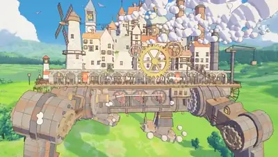</a><br><a href="https://www.sandbase.ai/lab/ai-videos/fable-5-2/2122408638950371579?lang=zh-CN&utm_source=github&utm_medium=readme&utm_campaign=awesome-fable-5-2&utm_content=card"><b>基于 Three.js 生成的 3D 场景</b></a><br><sub><a href="https://x.com/anvithbuilds/status/2122408638950371579">@anvithbuilds</a> · 0:52</sub></td><td width="33%" valign="top"><a href="https://www.sandbase.ai/lab/media/x/fable-5-2/2122435820317487543/video.mp4"></a><br><a href="https://www.sandbase.ai/lab/ai-videos/fable-5-2/2122435820317487543?lang=zh-CN&utm_source=github&utm_medium=readme&utm_campaign=awesome-fable-5-2&utm_content=card"><b>手机上展示的公寓3D全息模型</b></a><br><sub><a href="https://x.com/noisyb0y1/status/2122435820317487543">@noisyb0y1</a> · 0:19</sub></td></tr>
<tr><td width="33%" valign="top"><a href="https://www.sandbase.ai/lab/media/x/fable-5-2/2122464338439241910/video.mp4">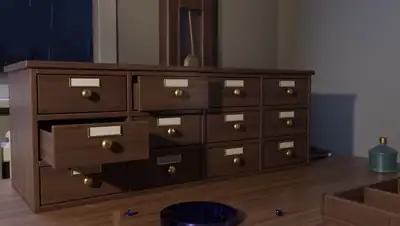</a><br><a href="https://www.sandbase.ai/lab/ai-videos/fable-5-2/2122464338439241910?lang=zh-CN&utm_source=github&utm_medium=readme&utm_campaign=awesome-fable-5-2&utm_content=card"><b>发条小机器人找回心脏的动画</b></a><br><sub><a href="https://x.com/xinxuai/status/2122464338439241910">@xinxuai</a> · 0:48</sub></td><td width="33%" valign="top"><a href="https://www.sandbase.ai/lab/media/x/fable-5-2/2122646451939586084/video.mp4"></a><br><a href="https://www.sandbase.ai/lab/ai-videos/fable-5-2/2122646451939586084?lang=zh-CN&utm_source=github&utm_medium=readme&utm_campaign=awesome-fable-5-2&utm_content=card"><b>Three.js 一次性生成的视频</b></a><br><sub><a href="https://x.com/meishengsimon/status/2122646451939586084">@meishengsimon</a> · 0:24</sub></td><td width="33%" valign="top"><a href="https://www.sandbase.ai/lab/media/x/fable-5-2/2122647483281015155/video.mp4">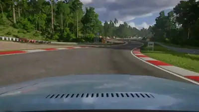</a><br><a href="https://www.sandbase.ai/lab/ai-videos/fable-5-2/2122647483281015155?lang=zh-CN&utm_source=github&utm_medium=readme&utm_campaign=awesome-fable-5-2&utm_content=card"><b>浏览器中纯代码生成的赛车与赛道</b></a><br><sub><a href="https://x.com/ViktorKav/status/2122647483281015155">@ViktorKav</a> · 1:00</sub></td></tr>
<tr><td width="33%" valign="top"><a href="https://www.sandbase.ai/lab/media/x/opus-5-5/2122682962647122403/video.mp4">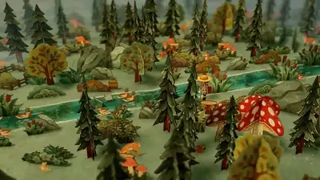</a><br><a href="https://www.sandbase.ai/lab/ai-videos/fable-5-2/2122682962647122403?lang=zh-CN&utm_source=github&utm_medium=readme&utm_campaign=awesome-fable-5-2&utm_content=card"><b>Three.js构建的无尽剪纸风格世界</b></a><br><sub><a href="https://x.com/xikhar/status/2122682962647122403">@xikhar</a> · <a href="https://www.sandbase.ai/lab/ai-videos/fable-5-2/2122682962647122403?lang=zh-CN&utm_source=github&utm_medium=readme&utm_campaign=awesome-fable-5-2&utm_content=card">提示词</a></sub></td><td width="33%" valign="top"><a href="https://www.sandbase.ai/lab/media/x/fable-5-2/2122702891819377117/video.mp4">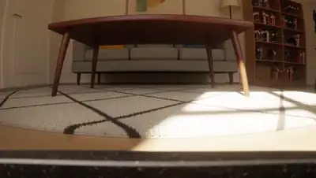</a><br><a href="https://www.sandbase.ai/lab/ai-videos/fable-5-2/2122702891819377117?lang=zh-CN&utm_source=github&utm_medium=readme&utm_campaign=awesome-fable-5-2&utm_content=card"><b>纯代码生成的逼真室内场景</b></a><br><sub><a href="https://x.com/moritzkremb/status/2122702891819377117">@moritzkremb</a></sub></td><td width="33%" valign="top"><a href="https://www.sandbase.ai/lab/media/x/fable-5-2/2122717552535085195/video.mp4">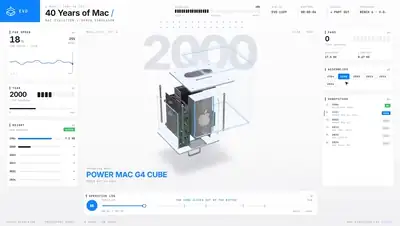</a><br><a href="https://www.sandbase.ai/lab/ai-videos/fable-5-2/2122717552535085195?lang=zh-CN&utm_source=github&utm_medium=readme&utm_campaign=awesome-fable-5-2&utm_content=card"><b>Mac四十年演变的交互式3D模拟器</b></a><br><sub><a href="https://x.com/0xKapri/status/2122717552535085195">@0xKapri</a> · 0:30</sub></td></tr>
<tr><td width="33%" valign="top"><a href="https://www.sandbase.ai/lab/media/x/fable-5-2/2122748346322362690/video.mp4">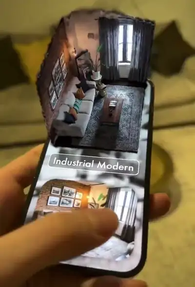</a><br><a href="https://www.sandbase.ai/lab/ai-videos/fable-5-2/2122748346322362690?lang=zh-CN&utm_source=github&utm_medium=readme&utm_campaign=awesome-fable-5-2&utm_content=card"><b>在手机上查看的公寓3D全息图</b></a><br><sub><a href="https://x.com/HeLi8866/status/2122748346322362690">@HeLi8866</a> · 0:19</sub></td><td width="33%" valign="top"><a href="https://www.sandbase.ai/lab/media/x/fable-5-2/2122782331907735555/video.mp4">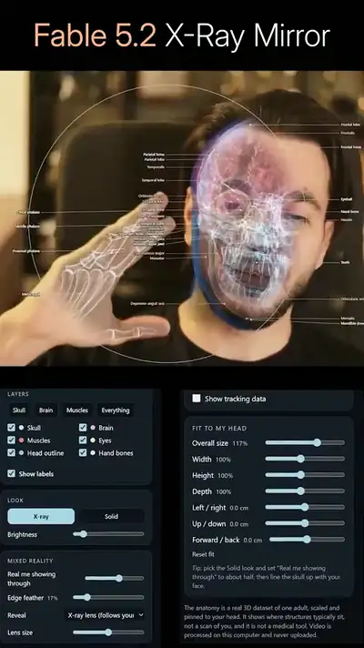</a><br><a href="https://www.sandbase.ai/lab/ai-videos/fable-5-2/2122782331907735555?lang=zh-CN&utm_source=github&utm_medium=readme&utm_campaign=awesome-fable-5-2&utm_content=card"><b>实时摄像头解剖透视镜像追踪演示</b></a><br><sub><a href="https://x.com/Damir_Akaza/status/2122782331907735555">@Damir_Akaza</a></sub></td><td width="33%" valign="top"><a href="https://www.sandbase.ai/lab/media/x/fable-5-2/2122793952721990012/video.mp4">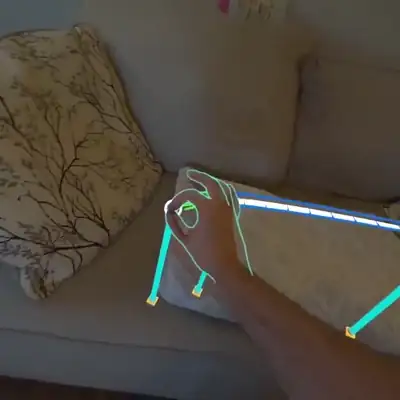</a><br><a href="https://www.sandbase.ai/lab/ai-videos/fable-5-2/2122793952721990012?lang=zh-CN&utm_source=github&utm_medium=readme&utm_campaign=awesome-fable-5-2&utm_content=card"><b>在客厅构建的交互式3D过山车</b></a><br><sub><a href="https://x.com/noisyb0y1/status/2122793952721990012">@noisyb0y1</a></sub></td></tr>
<tr><td width="33%" valign="top"><a href="https://www.sandbase.ai/lab/media/x/fable-5-2/2122805963115958470/video.mp4">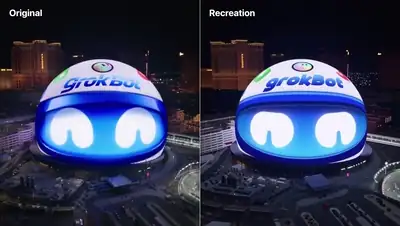</a><br><a href="https://www.sandbase.ai/lab/ai-videos/fable-5-2/2122805963115958470?lang=zh-CN&utm_source=github&utm_medium=readme&utm_campaign=awesome-fable-5-2&utm_content=card"><b>Sphere 巨球上的 Grok 交互式 3D 动画</b></a><br><sub><a href="https://x.com/JackyZhong0124/status/2122805963115958470">@JackyZhong0124</a> · 1:00 · <a href="https://www.sandbase.ai/lab/ai-videos/fable-5-2/2122805963115958470?lang=zh-CN&utm_source=github&utm_medium=readme&utm_campaign=awesome-fable-5-2&utm_content=card">提示词</a></sub></td><td width="33%" valign="top"><a href="https://www.sandbase.ai/lab/media/x/fable-5-2/2122993773722608099/video.mp4">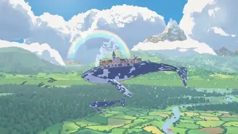</a><br><a href="https://www.sandbase.ai/lab/ai-videos/fable-5-2/2122993773722608099?lang=zh-CN&utm_source=github&utm_medium=readme&utm_campaign=awesome-fable-5-2&utm_content=card"><b>使用 Three.js 生成的 3D 场景</b></a><br><sub><a href="https://x.com/anvithbuilds/status/2122993773722608099">@anvithbuilds</a></sub></td><td width="33%" valign="top"><a href="https://www.sandbase.ai/lab/media/x/fable-5-2/2123037730233897060/video.mp4"></a><br><a href="https://www.sandbase.ai/lab/ai-videos/fable-5-2/2123037730233897060?lang=zh-CN&utm_source=github&utm_medium=readme&utm_campaign=awesome-fable-5-2&utm_content=card"><b>单镜头连续运行的机场模拟场景</b></a><br><sub><a href="https://x.com/elvar_official/status/2123037730233897060">@elvar_official</a> · 0:50 · <a href="https://www.sandbase.ai/lab/ai-videos/fable-5-2/2123037730233897060?lang=zh-CN&utm_source=github&utm_medium=readme&utm_campaign=awesome-fable-5-2&utm_content=card">提示词</a></sub></td></tr>
<tr><td width="33%" valign="top"><a href="https://www.sandbase.ai/lab/media/x/fable-5-2/2123360069513302141/video.mp4">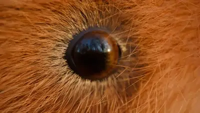</a><br><a href="https://www.sandbase.ai/lab/ai-videos/fable-5-2/2123360069513302141?lang=zh-CN&utm_source=github&utm_medium=readme&utm_campaign=awesome-fable-5-2&utm_content=card"><b>Blender代码渲染的松鼠第一视角动画</b></a><br><sub><a href="https://x.com/DanielZambrini/status/2123360069513302141">@DanielZambrini</a></sub></td><td width="33%" valign="top"><a href="https://www.sandbase.ai/lab/media/x/fable-5-2/2123396119745212693/video.mp4">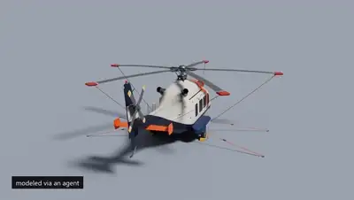</a><br><a href="https://www.sandbase.ai/lab/ai-videos/fable-5-2/2123396119745212693?lang=zh-CN&utm_source=github&utm_medium=readme&utm_campaign=awesome-fable-5-2&utm_content=card"><b>使用Blender脚本生成的机械3D模型</b></a><br><sub><a href="https://x.com/ClaudeCode_love/status/2123396119745212693">@ClaudeCode_love</a></sub></td><td width="33%" valign="top"><a href="https://www.sandbase.ai/lab/media/x/fable-5-2/2123477801181303194/video.mp4"></a><br><a href="https://www.sandbase.ai/lab/ai-videos/fable-5-2/2123477801181303194?lang=zh-CN&utm_source=github&utm_medium=readme&utm_campaign=awesome-fable-5-2&utm_content=card"><b>完全通过代码生成的短片</b></a><br><sub><a href="https://x.com/BubbleBrain/status/2123477801181303194">@BubbleBrain</a></sub></td></tr>
<tr><td width="33%" valign="top"><a href="https://www.sandbase.ai/lab/media/x/fable-5-2/2123538258265075804/video.mp4">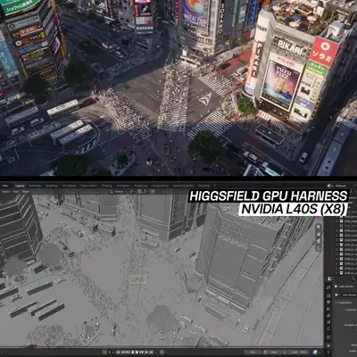</a><br><a href="https://www.sandbase.ai/lab/ai-videos/fable-5-2/2123538258265075804?lang=zh-CN&utm_source=github&utm_medium=readme&utm_campaign=awesome-fable-5-2&utm_content=card"><b>带有NPC模拟的涉谷3D场景重现</b></a><br><sub><a href="https://x.com/mattshumer_/status/2123538258265075804">@mattshumer_</a></sub></td><td width="33%" valign="top"><a href="https://www.sandbase.ai/lab/media/x/fable-5-2/2124072676818084317/video.mp4">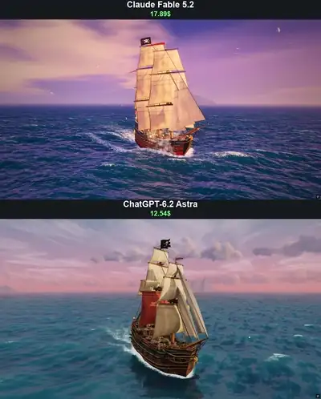</a><br><a href="https://www.sandbase.ai/lab/ai-videos/fable-5-2/2124072676818084317?lang=zh-CN&utm_source=github&utm_medium=readme&utm_campaign=awesome-fable-5-2&utm_content=card"><b>在 Three.js 中航行的船只与海洋场景</b></a><br><sub><a href="https://x.com/vib3coded/status/2124072676818084317">@vib3coded</a></sub></td><td width="33%" valign="top"><a href="https://www.sandbase.ai/lab/media/x/fable-5-2/2124456662874648732/video.mp4"></a><br><a href="https://www.sandbase.ai/lab/ai-videos/fable-5-2/2124456662874648732?lang=zh-CN&utm_source=github&utm_medium=readme&utm_campaign=awesome-fable-5-2&utm_content=card"><b>基于建筑图纸生成的写实3D看房漫游</b></a><br><sub><a href="https://x.com/luqman_talks/status/2124456662874648732">@luqman_talks</a></sub></td></tr>
<tr><td width="33%" valign="top"><a href="https://www.sandbase.ai/lab/media/x/fable-5-2/2124583559256313944/video.mp4"></a><br><a href="https://www.sandbase.ai/lab/ai-videos/fable-5-2/2124583559256313944?lang=zh-CN&utm_source=github&utm_medium=readme&utm_campaign=awesome-fable-5-2&utm_content=card"><b>Blender程序化生成的蜂鸟视角动画</b></a><br><sub><a href="https://x.com/DanielZambrini/status/2124583559256313944">@DanielZambrini</a></sub></td><td width="33%" valign="top"><a href="https://www.sandbase.ai/lab/media/x/fable-5-2/2124646782433124652/video.mp4">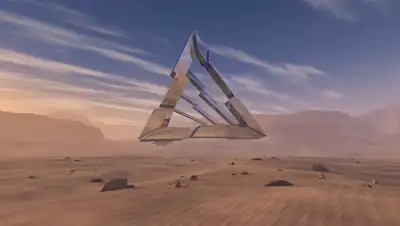</a><br><a href="https://www.sandbase.ai/lab/ai-videos/fable-5-2/2124646782433124652?lang=zh-CN&utm_source=github&utm_medium=readme&utm_campaign=awesome-fable-5-2&utm_content=card"><b>使用 WebGL 着色器创建的 3D 场景</b></a><br><sub><a href="https://x.com/kloss_xyz/status/2124646782433124652">@kloss_xyz</a> · <a href="https://www.sandbase.ai/lab/ai-videos/fable-5-2/2124646782433124652?lang=zh-CN&utm_source=github&utm_medium=readme&utm_campaign=awesome-fable-5-2&utm_content=card">提示词</a></sub></td><td width="33%" valign="top"><a href="https://www.sandbase.ai/lab/media/x/fable-5-2/2124978516596822261/video.mp4">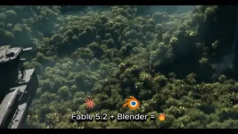</a><br><a href="https://www.sandbase.ai/lab/ai-videos/fable-5-2/2124978516596822261?lang=zh-CN&utm_source=github&utm_medium=readme&utm_campaign=awesome-fable-5-2&utm_content=card"><b>飞越外星丛林行星的星际飞船</b></a><br><sub><a href="https://x.com/0xKenny1st/status/2124978516596822261">@0xKenny1st</a></sub></td></tr>
<tr><td width="33%" valign="top"><a href="https://www.sandbase.ai/lab/media/x/fable-5-2/2125114693505400843/video.mp4">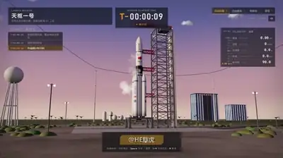</a><br><a href="https://www.sandbase.ai/lab/ai-videos/fable-5-2/2125114693505400843?lang=zh-CN&utm_source=github&utm_medium=readme&utm_campaign=awesome-fable-5-2&utm_content=card"><b>Three.js 地面站火箭发射场景</b></a><br><sub><a href="https://x.com/heRiverYY/status/2125114693505400843">@heRiverYY</a> · <a href="https://www.sandbase.ai/lab/ai-videos/fable-5-2/2125114693505400843?lang=zh-CN&utm_source=github&utm_medium=readme&utm_campaign=awesome-fable-5-2&utm_content=card">提示词</a></sub></td><td width="33%" valign="top"><a href="https://www.sandbase.ai/lab/media/x/fable-5-2/2125190307129983265/video.mp4">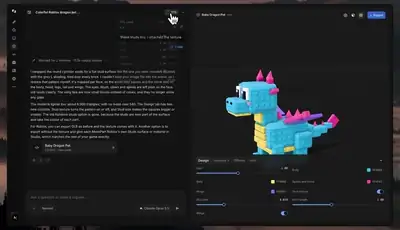</a><br><a href="https://www.sandbase.ai/lab/ai-videos/fable-5-2/2125190307129983265?lang=zh-CN&utm_source=github&utm_medium=readme&utm_campaign=awesome-fable-5-2&utm_content=card"><b>自动化3D角色绑定流程</b></a><br><sub><a href="https://x.com/zer0point_eth/status/2125190307129983265">@zer0point_eth</a> · <a href="https://www.sandbase.ai/lab/ai-videos/fable-5-2/2125190307129983265?lang=zh-CN&utm_source=github&utm_medium=readme&utm_campaign=awesome-fable-5-2&utm_content=card">提示词</a></sub></td><td width="33%" valign="top"><a href="https://www.sandbase.ai/lab/media/x/fable-5-2/2125200400638685608/video.mp4"></a><br><a href="https://www.sandbase.ai/lab/ai-videos/fable-5-2/2125200400638685608?lang=zh-CN&utm_source=github&utm_medium=readme&utm_campaign=awesome-fable-5-2&utm_content=card"><b>螃蟹视角下的水下场景</b></a><br><sub><a href="https://x.com/DanielZambrini/status/2125200400638685608">@DanielZambrini</a> · <a href="https://www.sandbase.ai/lab/ai-videos/fable-5-2/2125200400638685608?lang=zh-CN&utm_source=github&utm_medium=readme&utm_campaign=awesome-fable-5-2&utm_content=card">提示词</a></sub></td></tr>
<tr><td width="33%" valign="top"><a href="https://www.sandbase.ai/lab/media/x/fable-5-2/2125246700553920656/video.mp4">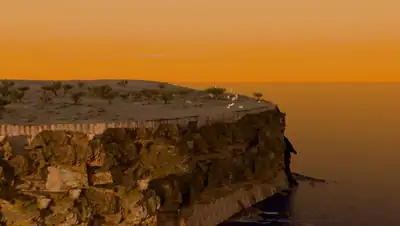</a><br><a href="https://www.sandbase.ai/lab/ai-videos/fable-5-2/2125246700553920656?lang=zh-CN&utm_source=github&utm_medium=readme&utm_campaign=awesome-fable-5-2&utm_content=card"><b>将图片转换为3D建筑模型</b></a><br><sub><a href="https://x.com/elvar_official/status/2125246700553920656">@elvar_official</a></sub></td><td width="33%" valign="top"><a href="https://www.sandbase.ai/lab/media/x/fable-5-2/2125250192773390610/video.mp4"></a><br><a href="https://www.sandbase.ai/lab/ai-videos/fable-5-2/2125250192773390610?lang=zh-CN&utm_source=github&utm_medium=readme&utm_campaign=awesome-fable-5-2&utm_content=card"><b>在虚幻引擎中渲染的房屋场景</b></a><br><sub><a href="https://x.com/hectorVFX/status/2125250192773390610">@hectorVFX</a></sub></td><td width="33%" valign="top"><a href="https://www.sandbase.ai/lab/media/x/fable-5-2/2125286671016968556/video.mp4">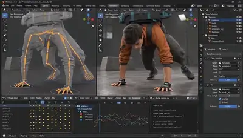</a><br><a href="https://www.sandbase.ai/lab/ai-videos/fable-5-2/2125286671016968556?lang=zh-CN&utm_source=github&utm_medium=readme&utm_campaign=awesome-fable-5-2&utm_content=card"><b>工作区双重视角下的跑酷角色动画</b></a><br><sub><a href="https://x.com/Lummox_eth/status/2125286671016968556">@Lummox_eth</a></sub></td></tr>
<tr><td width="33%" valign="top"><a href="https://www.sandbase.ai/lab/media/x/fable-5-2/2125338221378773417/video.mp4">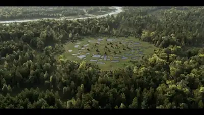</a><br><a href="https://www.sandbase.ai/lab/ai-videos/fable-5-2/2125338221378773417?lang=zh-CN&utm_source=github&utm_medium=readme&utm_campaign=awesome-fable-5-2&utm_content=card"><b>Blender生成的古村落3D场景</b></a><br><sub><a href="https://x.com/0xKenny1st/status/2125338221378773417">@0xKenny1st</a> · <a href="https://www.sandbase.ai/lab/ai-videos/fable-5-2/2125338221378773417?lang=zh-CN&utm_source=github&utm_medium=readme&utm_campaign=awesome-fable-5-2&utm_content=card">提示词</a></sub></td><td width="33%" valign="top"><a href="https://www.sandbase.ai/lab/media/x/fable-5-2/2125604102881050990/video.mp4">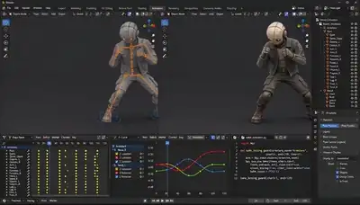</a><br><a href="https://www.sandbase.ai/lab/ai-videos/fable-5-2/2125604102881050990?lang=zh-CN&utm_source=github&utm_medium=readme&utm_campaign=awesome-fable-5-2&utm_content=card"><b>机器人线框与材质同步角色动画</b></a><br><sub><a href="https://x.com/Lummox_eth/status/2125604102881050990">@Lummox_eth</a></sub></td><td width="33%" valign="top"><a href="https://www.sandbase.ai/lab/media/x/fable-5-2/2125627355301560355/video.mp4">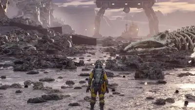</a><br><a href="https://www.sandbase.ai/lab/ai-videos/fable-5-2/2125627355301560355?lang=zh-CN&utm_source=github&utm_medium=readme&utm_campaign=awesome-fable-5-2&utm_content=card"><b>使用Unreal和Blender构建的3D场景</b></a><br><sub><a href="https://x.com/dhruvalgolakiya/status/2125627355301560355">@dhruvalgolakiya</a></sub></td></tr>
</table>

</details>

<a id="motion-graphics"></a>

## 动效

<table>
<tr><td width="33%" valign="top"><a href="https://www.sandbase.ai/lab/media/x/fable-5-2/2119875516216070289/video.mp4"></a><br><a href="https://www.sandbase.ai/lab/ai-videos/fable-5-2/2119875516216070289?lang=zh-CN&utm_source=github&utm_medium=readme&utm_campaign=awesome-fable-5-2&utm_content=card"><b>Fable 5.2 单次生成的作品</b></a><br><sub><a href="https://x.com/devsvn2/status/2119875516216070289">@devsvn2</a> · 0:35</sub></td><td width="33%" valign="top"><a href="https://www.sandbase.ai/lab/media/x/fable-5-2/2119879605607862329/video.mp4"></a><br><a href="https://www.sandbase.ai/lab/ai-videos/fable-5-2/2119879605607862329?lang=zh-CN&utm_source=github&utm_medium=readme&utm_campaign=awesome-fable-5-2&utm_content=card"><b>Fable动画生成测试效果</b></a><br><sub><a href="https://x.com/pleometric/status/2119879605607862329">@pleometric</a> · 0:50</sub></td><td width="33%" valign="top"><a href="https://www.sandbase.ai/lab/media/x/fable-5-2/2119879667457073355/video.mp4">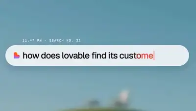</a><br><a href="https://www.sandbase.ai/lab/ai-videos/fable-5-2/2119879667457073355?lang=zh-CN&utm_source=github&utm_medium=readme&utm_campaign=awesome-fable-5-2&utm_content=card"><b>使用Fable 5.2制作的动态设计</b></a><br><sub><a href="https://x.com/Gregoirechp/status/2119879667457073355">@Gregoirechp</a> · 0:40</sub></td></tr>
<tr><td width="33%" valign="top"><a href="https://www.sandbase.ai/lab/media/x/fable-5-2/2119884041331892403/video.mp4"></a><br><a href="https://www.sandbase.ai/lab/ai-videos/fable-5-2/2119884041331892403?lang=zh-CN&utm_source=github&utm_medium=readme&utm_campaign=awesome-fable-5-2&utm_content=card"><b>单次提示直接生成的完整视频展示</b></a><br><sub><a href="https://x.com/mattshumer_/status/2119884041331892403">@mattshumer_</a> · 4:44</sub></td><td width="33%" valign="top"><a href="https://www.sandbase.ai/lab/media/x/fable-5-2/2119885430627913784/video.mp4">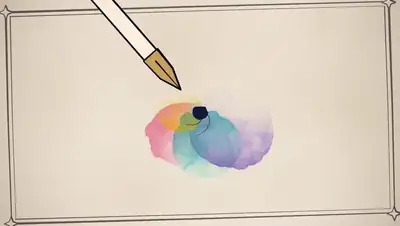</a><br><a href="https://www.sandbase.ai/lab/ai-videos/fable-5-2/2119885430627913784?lang=zh-CN&utm_source=github&utm_medium=readme&utm_campaign=awesome-fable-5-2&utm_content=card"><b>Clawd 发布 Claude Fable 5.2 的动画视频</b></a><br><sub><a href="https://x.com/other__reality/status/2119885430627913784">@other__reality</a> · 0:26 · <a href="https://www.sandbase.ai/lab/ai-videos/fable-5-2/2119885430627913784?lang=zh-CN&utm_source=github&utm_medium=readme&utm_campaign=awesome-fable-5-2&utm_content=card">提示词</a></sub></td><td width="33%" valign="top"><a href="https://www.sandbase.ai/lab/media/x/fable-5-2/2119893834276507954/video.mp4"></a><br><a href="https://www.sandbase.ai/lab/ai-videos/fable-5-2/2119893834276507954?lang=zh-CN&utm_source=github&utm_medium=readme&utm_campaign=awesome-fable-5-2&utm_content=card"><b>火柴人格斗动作动画测试</b></a><br><sub><a href="https://x.com/DanielZambrini/status/2119893834276507954">@DanielZambrini</a> · 0:15</sub></td></tr>
</table>

<details>
<summary><b>展开全部 66 条</b></summary>

<table>
<tr><td width="33%" valign="top"><a href="https://www.sandbase.ai/lab/media/x/fable-5-2/2119902302001635455/video.mp4"></a><br><a href="https://www.sandbase.ai/lab/ai-videos/fable-5-2/2119902302001635455?lang=zh-CN&utm_source=github&utm_medium=readme&utm_campaign=awesome-fable-5-2&utm_content=card"><b>由代码生成的动态图形动画</b></a><br><sub><a href="https://x.com/eluchocha/status/2119902302001635455">@eluchocha</a> · 0:38</sub></td><td width="33%" valign="top"><a href="https://www.sandbase.ai/lab/media/x/fable-5-2/2119906384397603138/video.mp4"></a><br><a href="https://www.sandbase.ai/lab/ai-videos/fable-5-2/2119906384397603138?lang=zh-CN&utm_source=github&utm_medium=readme&utm_campaign=awesome-fable-5-2&utm_content=card"><b>克隆声音与虚拟数字人视频展示</b></a><br><sub><a href="https://x.com/dorukyalcinsoy/status/2119906384397603138">@dorukyalcinsoy</a> · 4:44</sub></td><td width="33%" valign="top"><a href="https://www.sandbase.ai/lab/media/x/fable-5-2/2119907891419480107/video.mp4"></a><br><a href="https://www.sandbase.ai/lab/ai-videos/fable-5-2/2119907891419480107?lang=zh-CN&utm_source=github&utm_medium=readme&utm_campaign=awesome-fable-5-2&utm_content=card"><b>巴赫风格管风琴赋格曲创作</b></a><br><sub><a href="https://x.com/aug5thmusic/status/2119907891419480107">@aug5thmusic</a> · 2:05 · <a href="https://www.sandbase.ai/lab/ai-videos/fable-5-2/2119907891419480107?lang=zh-CN&utm_source=github&utm_medium=readme&utm_campaign=awesome-fable-5-2&utm_content=card">提示词</a></sub></td></tr>
<tr><td width="33%" valign="top"><a href="https://www.sandbase.ai/lab/media/x/fable-5-2/2119907987477422453/video.mp4"></a><br><a href="https://www.sandbase.ai/lab/ai-videos/fable-5-2/2119907987477422453?lang=zh-CN&utm_source=github&utm_medium=readme&utm_campaign=awesome-fable-5-2&utm_content=card"><b>通过一段提示词设计的三个电子设备</b></a><br><sub><a href="https://x.com/kanavtwt/status/2119907987477422453">@kanavtwt</a> · 0:12</sub></td><td width="33%" valign="top"><a href="https://www.sandbase.ai/lab/media/x/fable-5-2/2119911161386934330/video.mp4"></a><br><a href="https://www.sandbase.ai/lab/ai-videos/fable-5-2/2119911161386934330?lang=zh-CN&utm_source=github&utm_medium=readme&utm_campaign=awesome-fable-5-2&utm_content=card"><b>使用Fable制作的音乐视频</b></a><br><sub><a href="https://x.com/WesRoth/status/2119911161386934330">@WesRoth</a> · 0:37</sub></td><td width="33%" valign="top"><a href="https://www.sandbase.ai/lab/media/x/fable-5-2/2119920990893244510/video.mp4"></a><br><a href="https://www.sandbase.ai/lab/ai-videos/fable-5-2/2119920990893244510?lang=zh-CN&utm_source=github&utm_medium=readme&utm_campaign=awesome-fable-5-2&utm_content=card"><b>由Fable 5.2生成的唯美视频</b></a><br><sub><a href="https://x.com/aollivier82/status/2119920990893244510">@aollivier82</a> · 0:48 · <a href="https://www.sandbase.ai/lab/ai-videos/fable-5-2/2119920990893244510?lang=zh-CN&utm_source=github&utm_medium=readme&utm_campaign=awesome-fable-5-2&utm_content=card">提示词</a></sub></td></tr>
<tr><td width="33%" valign="top"><a href="https://www.sandbase.ai/lab/media/x/fable-5-2/2119925067207647695/video.mp4"></a><br><a href="https://www.sandbase.ai/lab/ai-videos/fable-5-2/2119925067207647695?lang=zh-CN&utm_source=github&utm_medium=readme&utm_campaign=awesome-fable-5-2&utm_content=card"><b>纯SVG动画奔腾的马</b></a><br><sub><a href="https://x.com/eyadnour/status/2119925067207647695">@eyadnour</a> · 0:26</sub></td><td width="33%" valign="top"><a href="https://www.sandbase.ai/lab/media/x/fable-5-2/2119931563760632311/video.mp4"></a><br><a href="https://www.sandbase.ai/lab/ai-videos/fable-5-2/2119931563760632311?lang=zh-CN&utm_source=github&utm_medium=readme&utm_campaign=awesome-fable-5-2&utm_content=card"><b>使用 Fable 5.2 单次生成的项目</b></a><br><sub><a href="https://x.com/saimagnate/status/2119931563760632311">@saimagnate</a> · 0:34</sub></td><td width="33%" valign="top"><a href="https://www.sandbase.ai/lab/media/x/fable-5-2/2119936176714875126/video.mp4"></a><br><a href="https://www.sandbase.ai/lab/ai-videos/fable-5-2/2119936176714875126?lang=zh-CN&utm_source=github&utm_medium=readme&utm_campaign=awesome-fable-5-2&utm_content=card"><b>Fable单次生成的动态图形视频</b></a><br><sub><a href="https://x.com/moritzkremb/status/2119936176714875126">@moritzkremb</a> · 1:04 · <a href="https://www.sandbase.ai/lab/ai-videos/fable-5-2/2119936176714875126?lang=zh-CN&utm_source=github&utm_medium=readme&utm_campaign=awesome-fable-5-2&utm_content=card">提示词</a></sub></td></tr>
<tr><td width="33%" valign="top"><a href="https://www.sandbase.ai/lab/media/x/fable-5-2/2119953913160093817/video.mp4"></a><br><a href="https://www.sandbase.ai/lab/ai-videos/fable-5-2/2119953913160093817?lang=zh-CN&utm_source=github&utm_medium=readme&utm_campaign=awesome-fable-5-2&utm_content=card"><b>Fable 5.2 单次提示词生成展示</b></a><br><sub><a href="https://x.com/WesRoth/status/2119953913160093817">@WesRoth</a> · 2:27</sub></td><td width="33%" valign="top"><a href="https://www.sandbase.ai/lab/media/x/fable-5-2/2119973951027724385/video.mp4"></a><br><a href="https://www.sandbase.ai/lab/ai-videos/fable-5-2/2119973951027724385?lang=zh-CN&utm_source=github&utm_medium=readme&utm_campaign=awesome-fable-5-2&utm_content=card"><b>Fable 5.2 视频编辑元演示视频</b></a><br><sub><a href="https://x.com/rileybrown/status/2119973951027724385">@rileybrown</a> · 2:01</sub></td><td width="33%" valign="top"><a href="https://www.sandbase.ai/lab/media/x/fable-5-2/2119981510199808368/video.mp4"></a><br><a href="https://www.sandbase.ai/lab/ai-videos/fable-5-2/2119981510199808368?lang=zh-CN&utm_source=github&utm_medium=readme&utm_campaign=awesome-fable-5-2&utm_content=card"><b>纯代码绘制并添加动效的插画</b></a><br><sub><a href="https://x.com/chetaslua/status/2119981510199808368">@chetaslua</a> · 0:11</sub></td></tr>
<tr><td width="33%" valign="top"><a href="https://www.sandbase.ai/lab/media/x/fable-5-2/2119998815856218494/video.mp4"></a><br><a href="https://www.sandbase.ai/lab/ai-videos/fable-5-2/2119998815856218494?lang=zh-CN&utm_source=github&utm_medium=readme&utm_campaign=awesome-fable-5-2&utm_content=card"><b>面向剪辑师制作的视频信息</b></a><br><sub><a href="https://x.com/ChrisGPT/status/2119998815856218494">@ChrisGPT</a> · 0:44</sub></td><td width="33%" valign="top"><a href="https://www.sandbase.ai/lab/media/x/fable-5-2/2120010995309457643/video.mp4"></a><br><a href="https://www.sandbase.ai/lab/ai-videos/fable-5-2/2120010995309457643?lang=zh-CN&utm_source=github&utm_medium=readme&utm_campaign=awesome-fable-5-2&utm_content=card"><b>Fable 5.2 构想生成的梦想视频</b></a><br><sub><a href="https://x.com/anabology/status/2120010995309457643">@anabology</a> · 4:04</sub></td><td width="33%" valign="top"><a href="https://www.sandbase.ai/lab/media/x/fable-5-2/2120015818696392844/video.mp4"></a><br><a href="https://www.sandbase.ai/lab/ai-videos/fable-5-2/2120015818696392844?lang=zh-CN&utm_source=github&utm_medium=readme&utm_campaign=awesome-fable-5-2&utm_content=card"><b>Fable 5.2 设计的电子设备</b></a><br><sub><a href="https://x.com/zoedotai/status/2120015818696392844">@zoedotai</a> · 0:05</sub></td></tr>
<tr><td width="33%" valign="top"><a href="https://www.sandbase.ai/lab/media/x/fable-5-2/2120083276916224014/video.mp4"></a><br><a href="https://www.sandbase.ai/lab/ai-videos/fable-5-2/2120083276916224014?lang=zh-CN&utm_source=github&utm_medium=readme&utm_campaign=awesome-fable-5-2&utm_content=card"><b>纪念穆斯塔法·凯末尔·阿塔图尔克的致敬视频</b></a><br><sub><a href="https://x.com/DeryaTR_/status/2120083276916224014">@DeryaTR_</a> · 3:57</sub></td><td width="33%" valign="top"><a href="https://www.sandbase.ai/lab/media/x/fable-5-2/2120090542419984686/video.mp4"></a><br><a href="https://www.sandbase.ai/lab/ai-videos/fable-5-2/2120090542419984686?lang=zh-CN&utm_source=github&utm_medium=readme&utm_campaign=awesome-fable-5-2&utm_content=card"><b>用Claude绘制并动画的世界七大奇迹</b></a><br><sub><a href="https://x.com/devteamdrew/status/2120090542419984686">@devteamdrew</a> · 0:10</sub></td><td width="33%" valign="top"><a href="https://www.sandbase.ai/lab/media/x/fable-5-2/2120151937995649231/video.mp4"></a><br><a href="https://www.sandbase.ai/lab/ai-videos/fable-5-2/2120151937995649231?lang=zh-CN&utm_source=github&utm_medium=readme&utm_campaign=awesome-fable-5-2&utm_content=card"><b>Fable 5.2制作的完整动效设计合集</b></a><br><sub><a href="https://x.com/cryptowluha/status/2120151937995649231">@cryptowluha</a> · 0:35</sub></td></tr>
<tr><td width="33%" valign="top"><a href="https://www.sandbase.ai/lab/media/x/fable-5-2/2120167637133238295/video.mp4"></a><br><a href="https://www.sandbase.ai/lab/ai-videos/fable-5-2/2120167637133238295?lang=zh-CN&utm_source=github&utm_medium=readme&utm_campaign=awesome-fable-5-2&utm_content=card"><b>Claude标志动效</b></a><br><sub><a href="https://x.com/LexnLin/status/2120167637133238295">@LexnLin</a> · 0:30</sub></td><td width="33%" valign="top"><a href="https://www.sandbase.ai/lab/media/x/fable-5-2/2120177103584858570/video.mp4"></a><br><a href="https://www.sandbase.ai/lab/ai-videos/fable-5-2/2120177103584858570?lang=zh-CN&utm_source=github&utm_medium=readme&utm_campaign=awesome-fable-5-2&utm_content=card"><b>骑自行车的鹈鹕SVG动画</b></a><br><sub><a href="https://x.com/TokenGremlin/status/2120177103584858570">@TokenGremlin</a> · 0:19</sub></td><td width="33%" valign="top"><a href="https://www.sandbase.ai/lab/media/x/fable-5-2/2120198834559271314/video.mp4"></a><br><a href="https://www.sandbase.ai/lab/ai-videos/fable-5-2/2120198834559271314?lang=zh-CN&utm_source=github&utm_medium=readme&utm_campaign=awesome-fable-5-2&utm_content=card"><b>关于生命的意义的短片</b></a><br><sub><a href="https://x.com/Av1dlive/status/2120198834559271314">@Av1dlive</a> · 4:13</sub></td></tr>
<tr><td width="33%" valign="top"><a href="https://www.sandbase.ai/lab/media/x/fable-5-2/2120210882382971263/video.mp4"></a><br><a href="https://www.sandbase.ai/lab/ai-videos/fable-5-2/2120210882382971263?lang=zh-CN&utm_source=github&utm_medium=readme&utm_campaign=awesome-fable-5-2&utm_content=card"><b>动态动态图形作品集展示</b></a><br><sub><a href="https://x.com/MatinSenPai/status/2120210882382971263">@MatinSenPai</a> · 0:15 · <a href="https://www.sandbase.ai/lab/ai-videos/fable-5-2/2120210882382971263?lang=zh-CN&utm_source=github&utm_medium=readme&utm_campaign=awesome-fable-5-2&utm_content=card">提示词</a></sub></td><td width="33%" valign="top"><a href="https://www.sandbase.ai/lab/media/x/fable-5-2/2120211050595340766/video.mp4"></a><br><a href="https://www.sandbase.ai/lab/ai-videos/fable-5-2/2120211050595340766?lang=zh-CN&utm_source=github&utm_medium=readme&utm_campaign=awesome-fable-5-2&utm_content=card"><b>使用 Fable 5.2 制作的视频</b></a><br><sub><a href="https://x.com/skpnky/status/2120211050595340766">@skpnky</a> · 1:05</sub></td><td width="33%" valign="top"><a href="https://www.sandbase.ai/lab/media/x/opus-5-5/2120248196584648758/video.mp4"></a><br><a href="https://www.sandbase.ai/lab/ai-videos/fable-5-2/2120248196584648758?lang=zh-CN&utm_source=github&utm_medium=readme&utm_campaign=awesome-fable-5-2&utm_content=card"><b>通过AI提示词指导的电影视效流程</b></a><br><sub><a href="https://x.com/AlexPi194641/status/2120248196584648758">@AlexPi194641</a> · 0:28</sub></td></tr>
<tr><td width="33%" valign="top"><a href="https://www.sandbase.ai/lab/media/x/fable-5-2/2120279835020804164/video.mp4">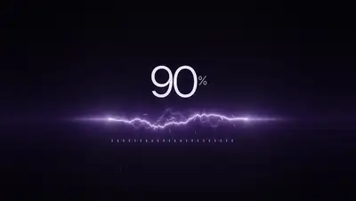</a><br><a href="https://www.sandbase.ai/lab/ai-videos/fable-5-2/2120279835020804164?lang=zh-CN&utm_source=github&utm_medium=readme&utm_campaign=awesome-fable-5-2&utm_content=card"><b>使用 Fable 5.2 制作的加载动画</b></a><br><sub><a href="https://x.com/seanaiux/status/2120279835020804164">@seanaiux</a> · 0:12 · <a href="https://www.sandbase.ai/lab/ai-videos/fable-5-2/2120279835020804164?lang=zh-CN&utm_source=github&utm_medium=readme&utm_campaign=awesome-fable-5-2&utm_content=card">提示词</a></sub></td><td width="33%" valign="top"><a href="https://www.sandbase.ai/lab/media/x/fable-5-2/2120286741248741694/video.mp4"></a><br><a href="https://www.sandbase.ai/lab/ai-videos/fable-5-2/2120286741248741694?lang=zh-CN&utm_source=github&utm_medium=readme&utm_campaign=awesome-fable-5-2&utm_content=card"><b>使用 Fable 和 Higgsfield 制作的皮克斯风格动画</b></a><br><sub><a href="https://x.com/pounddz/status/2120286741248741694">@pounddz</a> · 3:29</sub></td><td width="33%" valign="top"><a href="https://www.sandbase.ai/lab/media/x/fable-5-2/2120372319608508871/video.mp4"></a><br><a href="https://www.sandbase.ai/lab/ai-videos/fable-5-2/2120372319608508871?lang=zh-CN&utm_source=github&utm_medium=readme&utm_campaign=awesome-fable-5-2&utm_content=card"><b>使用LottieFiles MCP制作的可编辑动态圣诞插图</b></a><br><sub><a href="https://x.com/robrtcode/status/2120372319608508871">@robrtcode</a> · 0:04</sub></td></tr>
<tr><td width="33%" valign="top"><a href="https://www.sandbase.ai/lab/media/x/fable-5-2/2120475568915529978/video.mp4"></a><br><a href="https://www.sandbase.ai/lab/ai-videos/fable-5-2/2120475568915529978?lang=zh-CN&utm_source=github&utm_medium=readme&utm_campaign=awesome-fable-5-2&utm_content=card"><b>使用Claude Fable 5.2的电影导演测试</b></a><br><sub><a href="https://x.com/EHuanglu/status/2120475568915529978">@EHuanglu</a> · 1:08</sub></td><td width="33%" valign="top"><a href="https://www.sandbase.ai/lab/media/x/fable-5-2/2120486254852608470/video.mp4"></a><br><a href="https://www.sandbase.ai/lab/ai-videos/fable-5-2/2120486254852608470?lang=zh-CN&utm_source=github&utm_medium=readme&utm_campaign=awesome-fable-5-2&utm_content=card"><b>Fable 5.2动态设计演示</b></a><br><sub><a href="https://x.com/DaveJ/status/2120486254852608470">@DaveJ</a> · 0:25</sub></td><td width="33%" valign="top"><a href="https://www.sandbase.ai/lab/media/x/fable-5-2/2120610888797364383/video.mp4"></a><br><a href="https://www.sandbase.ai/lab/ai-videos/fable-5-2/2120610888797364383?lang=zh-CN&utm_source=github&utm_medium=readme&utm_campaign=awesome-fable-5-2&utm_content=card"><b>Claude 生成的像素风动画</b></a><br><sub><a href="https://x.com/aGim_asf/status/2120610888797364383">@aGim_asf</a> · 0:04</sub></td></tr>
<tr><td width="33%" valign="top"><a href="https://www.sandbase.ai/lab/media/x/fable-5-2/2120682766853677558/video.mp4"></a><br><a href="https://www.sandbase.ai/lab/ai-videos/fable-5-2/2120682766853677558?lang=zh-CN&utm_source=github&utm_medium=readme&utm_campaign=awesome-fable-5-2&utm_content=card"><b>使用AI工具制作的动态图形练习</b></a><br><sub><a href="https://x.com/gane0wav/status/2120682766853677558">@gane0wav</a> · 0:17</sub></td><td width="33%" valign="top"><a href="https://www.sandbase.ai/lab/media/x/fable-5-2/2120824741003182236/video.mp4">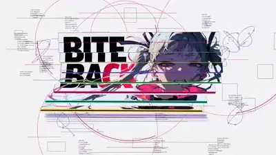</a><br><a href="https://www.sandbase.ai/lab/ai-videos/fable-5-2/2120824741003182236?lang=zh-CN&utm_source=github&utm_medium=readme&utm_campaign=awesome-fable-5-2&utm_content=card"><b>3D卡片动态图形设计研究</b></a><br><sub><a href="https://x.com/gane0wav/status/2120824741003182236">@gane0wav</a> · 0:20</sub></td><td width="33%" valign="top"><a href="https://www.sandbase.ai/lab/media/x/fable-5-2/2120843546177774073/video.mp4"></a><br><a href="https://www.sandbase.ai/lab/ai-videos/fable-5-2/2120843546177774073?lang=zh-CN&utm_source=github&utm_medium=readme&utm_campaign=awesome-fable-5-2&utm_content=card"><b>通过简单提示词生成的AI视频</b></a><br><sub><a href="https://x.com/kepochnik/status/2120843546177774073">@kepochnik</a> · 0:21</sub></td></tr>
<tr><td width="33%" valign="top"><a href="https://www.sandbase.ai/lab/media/x/fable-5-2/2120855435230187993/video.mp4"></a><br><a href="https://www.sandbase.ai/lab/ai-videos/fable-5-2/2120855435230187993?lang=zh-CN&utm_source=github&utm_medium=readme&utm_campaign=awesome-fable-5-2&utm_content=card"><b>使用AI创建的动态视觉效果</b></a><br><sub><a href="https://x.com/csaba_kissi/status/2120855435230187993">@csaba_kissi</a> · 0:25</sub></td><td width="33%" valign="top"><a href="https://www.sandbase.ai/lab/media/x/fable-5-2/2120863770486710542/video.mp4"></a><br><a href="https://www.sandbase.ai/lab/ai-videos/fable-5-2/2120863770486710542?lang=zh-CN&utm_source=github&utm_medium=readme&utm_campaign=awesome-fable-5-2&utm_content=card"><b>使用 Fable 与 Seedance 制作的视频</b></a><br><sub><a href="https://x.com/abxxai/status/2120863770486710542">@abxxai</a> · 0:18 · <a href="https://www.sandbase.ai/lab/ai-videos/fable-5-2/2120863770486710542?lang=zh-CN&utm_source=github&utm_medium=readme&utm_campaign=awesome-fable-5-2&utm_content=card">提示词</a></sub></td><td width="33%" valign="top"><a href="https://www.sandbase.ai/lab/media/x/fable-5-2/2120908609143873884/video.mp4"></a><br><a href="https://www.sandbase.ai/lab/ai-videos/fable-5-2/2120908609143873884?lang=zh-CN&utm_source=github&utm_medium=readme&utm_campaign=awesome-fable-5-2&utm_content=card"><b>Gamdom动态图形广告动画</b></a><br><sub><a href="https://x.com/johncodunayo/status/2120908609143873884">@johncodunayo</a> · 1:04</sub></td></tr>
<tr><td width="33%" valign="top"><a href="https://www.sandbase.ai/lab/media/x/fable-5-2/2120961143913230460/video.mp4"></a><br><a href="https://www.sandbase.ai/lab/ai-videos/fable-5-2/2120961143913230460?lang=zh-CN&utm_source=github&utm_medium=readme&utm_campaign=awesome-fable-5-2&utm_content=card"><b>根据剧本自动生成的电影预告片</b></a><br><sub><a href="https://x.com/maxescu/status/2120961143913230460">@maxescu</a> · 3:11</sub></td><td width="33%" valign="top"><a href="https://www.sandbase.ai/lab/media/x/fable-5-2/2120993184561995884/video.mp4"></a><br><a href="https://www.sandbase.ai/lab/ai-videos/fable-5-2/2120993184561995884?lang=zh-CN&utm_source=github&utm_medium=readme&utm_campaign=awesome-fable-5-2&utm_content=card"><b>完全使用HTML Canvas代码绘制的机器人动画</b></a><br><sub><a href="https://x.com/finnardley/status/2120993184561995884">@finnardley</a> · 0:14</sub></td><td width="33%" valign="top"><a href="https://www.sandbase.ai/lab/media/x/fable-5-2/2121212540415885509/video.mp4"></a><br><a href="https://www.sandbase.ai/lab/ai-videos/fable-5-2/2121212540415885509?lang=zh-CN&utm_source=github&utm_medium=readme&utm_campaign=awesome-fable-5-2&utm_content=card"><b>开源库代码生成的动态图形特效合集</b></a><br><sub><a href="https://x.com/m4lkxx/status/2121212540415885509">@m4lkxx</a> · 0:18</sub></td></tr>
<tr><td width="33%" valign="top"><a href="https://www.sandbase.ai/lab/media/x/fable-5-2/2121581514622177348/video.mp4"></a><br><a href="https://www.sandbase.ai/lab/ai-videos/fable-5-2/2121581514622177348?lang=zh-CN&utm_source=github&utm_medium=readme&utm_campaign=awesome-fable-5-2&utm_content=card"><b>基于Fable的动态工作室动画工具集</b></a><br><sub><a href="https://x.com/0xnicc0/status/2121581514622177348">@0xnicc0</a> · 0:34</sub></td><td width="33%" valign="top"><a href="https://www.sandbase.ai/lab/media/x/fable-5-2/2121584155418845290/video.mp4"></a><br><a href="https://www.sandbase.ai/lab/ai-videos/fable-5-2/2121584155418845290?lang=zh-CN&utm_source=github&utm_medium=readme&utm_campaign=awesome-fable-5-2&utm_content=card"><b>多工具协同的多智能体自动动画系统</b></a><br><sub><a href="https://x.com/0xsoul/status/2121584155418845290">@0xsoul</a> · 0:33</sub></td><td width="33%" valign="top"><a href="https://www.sandbase.ai/lab/media/x/fable-5-2/2121627112981569577/video.mp4"></a><br><a href="https://www.sandbase.ai/lab/ai-videos/fable-5-2/2121627112981569577?lang=zh-CN&utm_source=github&utm_medium=readme&utm_campaign=awesome-fable-5-2&utm_content=card"><b>分镜故事板转迪士尼风格动画</b></a><br><sub><a href="https://x.com/EHuanglu/status/2121627112981569577">@EHuanglu</a> · 1:26</sub></td></tr>
<tr><td width="33%" valign="top"><a href="https://www.sandbase.ai/lab/media/x/opus-5-5/2121635642836918385/video.mp4"></a><br><a href="https://www.sandbase.ai/lab/ai-videos/fable-5-2/2121635642836918385?lang=zh-CN&utm_source=github&utm_medium=readme&utm_campaign=awesome-fable-5-2&utm_content=card"><b>AI模型生成的时装秀音乐视频</b></a><br><sub><a href="https://x.com/AstrablueAI/status/2121635642836918385">@AstrablueAI</a> · 3:58</sub></td><td width="33%" valign="top"><a href="https://www.sandbase.ai/lab/media/x/fable-5-2/2121667594289565871/video.mp4"></a><br><a href="https://www.sandbase.ai/lab/ai-videos/fable-5-2/2121667594289565871?lang=zh-CN&utm_source=github&utm_medium=readme&utm_campaign=awesome-fable-5-2&utm_content=card"><b>将图片转换为交互式动态像素艺术</b></a><br><sub><a href="https://x.com/aimikoda/status/2121667594289565871">@aimikoda</a> · 0:10 · <a href="https://www.sandbase.ai/lab/ai-videos/fable-5-2/2121667594289565871?lang=zh-CN&utm_source=github&utm_medium=readme&utm_campaign=awesome-fable-5-2&utm_content=card">提示词</a></sub></td><td width="33%" valign="top"><a href="https://www.sandbase.ai/lab/media/x/fable-5-2/2121712808308183548/video.mp4"></a><br><a href="https://www.sandbase.ai/lab/ai-videos/fable-5-2/2121712808308183548?lang=zh-CN&utm_source=github&utm_medium=readme&utm_campaign=awesome-fable-5-2&utm_content=card"><b>音乐视频视觉特效制作流程</b></a><br><sub><a href="https://x.com/mika_systems/status/2121712808308183548">@mika_systems</a> · 0:26</sub></td></tr>
<tr><td width="33%" valign="top"><a href="https://www.sandbase.ai/lab/media/x/fable-5-2/2121752688048377902/video.mp4"></a><br><a href="https://www.sandbase.ai/lab/ai-videos/fable-5-2/2121752688048377902?lang=zh-CN&utm_source=github&utm_medium=readme&utm_campaign=awesome-fable-5-2&utm_content=card"><b>使用Claude Fable代码生成的视频测试</b></a><br><sub><a href="https://x.com/alexcooldev/status/2121752688048377902">@alexcooldev</a> · 0:48</sub></td><td width="33%" valign="top"><a href="https://www.sandbase.ai/lab/media/x/fable-5-2/2121800440639811713/video.mp4"></a><br><a href="https://www.sandbase.ai/lab/ai-videos/fable-5-2/2121800440639811713?lang=zh-CN&utm_source=github&utm_medium=readme&utm_campaign=awesome-fable-5-2&utm_content=card"><b>单HTML文件暴风雨代码动画与合成音效</b></a><br><sub><a href="https://x.com/cyrilXBT/status/2121800440639811713">@cyrilXBT</a> · 1:00 · <a href="https://www.sandbase.ai/lab/ai-videos/fable-5-2/2121800440639811713?lang=zh-CN&utm_source=github&utm_medium=readme&utm_campaign=awesome-fable-5-2&utm_content=card">提示词</a></sub></td><td width="33%" valign="top"><a href="https://www.sandbase.ai/lab/media/x/fable-5-2/2121941080010592499/video.mp4"></a><br><a href="https://www.sandbase.ai/lab/ai-videos/fable-5-2/2121941080010592499?lang=zh-CN&utm_source=github&utm_medium=readme&utm_campaign=awesome-fable-5-2&utm_content=card"><b>释放火球法术的像素风蜥蜴人法师</b></a><br><sub><a href="https://x.com/zer0point_eth/status/2121941080010592499">@zer0point_eth</a> · 0:04 · <a href="https://www.sandbase.ai/lab/ai-videos/fable-5-2/2121941080010592499?lang=zh-CN&utm_source=github&utm_medium=readme&utm_campaign=awesome-fable-5-2&utm_content=card">提示词</a></sub></td></tr>
<tr><td width="33%" valign="top"><a href="https://www.sandbase.ai/lab/media/x/fable-5-2/2122008363990991018/video.mp4"></a><br><a href="https://www.sandbase.ai/lab/ai-videos/fable-5-2/2122008363990991018?lang=zh-CN&utm_source=github&utm_medium=readme&utm_campaign=awesome-fable-5-2&utm_content=card"><b>一款情侣APP的叙事视频</b></a><br><sub><a href="https://x.com/jackfriks/status/2122008363990991018">@jackfriks</a> · 0:52</sub></td><td width="33%" valign="top"><a href="https://www.sandbase.ai/lab/media/x/fable-5-2/2122101050253447300/video.mp4"></a><br><a href="https://www.sandbase.ai/lab/ai-videos/fable-5-2/2122101050253447300?lang=zh-CN&utm_source=github&utm_medium=readme&utm_campaign=awesome-fable-5-2&utm_content=card"><b>使用代码驱动的运动设计制作产品展示视频</b></a><br><sub><a href="https://x.com/0xMovez/status/2122101050253447300">@0xMovez</a> · 0:19</sub></td><td width="33%" valign="top"><a href="https://www.sandbase.ai/lab/media/x/fable-5-2/2122150432986509631/video.mp4"></a><br><a href="https://www.sandbase.ai/lab/ai-videos/fable-5-2/2122150432986509631?lang=zh-CN&utm_source=github&utm_medium=readme&utm_campaign=awesome-fable-5-2&utm_content=card"><b>用于APP营销的叙事风格动态视频</b></a><br><sub><a href="https://x.com/alexcooldev/status/2122150432986509631">@alexcooldev</a> · 1:48</sub></td></tr>
<tr><td width="33%" valign="top"><a href="https://www.sandbase.ai/lab/media/x/fable-5-2/2122313967473434639/video.mp4"></a><br><a href="https://www.sandbase.ai/lab/ai-videos/fable-5-2/2122313967473434639?lang=zh-CN&utm_source=github&utm_medium=readme&utm_campaign=awesome-fable-5-2&utm_content=card"><b>从小猫视角看到的世界</b></a><br><sub><a href="https://x.com/BubbleBrain/status/2122313967473434639">@BubbleBrain</a> · 1:50</sub></td><td width="33%" valign="top"><a href="https://www.sandbase.ai/lab/media/x/fable-5-2/2122460118944018716/video.mp4"></a><br><a href="https://www.sandbase.ai/lab/ai-videos/fable-5-2/2122460118944018716?lang=zh-CN&utm_source=github&utm_medium=readme&utm_campaign=awesome-fable-5-2&utm_content=card"><b>由AI智能体全自动剪辑的社媒短视频</b></a><br><sub><a href="https://x.com/andreysuperior/status/2122460118944018716">@andreysuperior</a> · 0:29</sub></td><td width="33%" valign="top"><a href="https://www.sandbase.ai/lab/media/x/seedance-2-5/2122916879824306422/video.mp4"></a><br><a href="https://www.sandbase.ai/lab/ai-videos/fable-5-2/2122916879824306422?lang=zh-CN&utm_source=github&utm_medium=readme&utm_campaign=awesome-fable-5-2&utm_content=card"><b>使用 Fable 与 Seedance 生成的视频</b></a><br><sub><a href="https://x.com/Viniai_/status/2122916879824306422">@Viniai_</a> · <a href="https://www.sandbase.ai/lab/ai-videos/fable-5-2/2122916879824306422?lang=zh-CN&utm_source=github&utm_medium=readme&utm_campaign=awesome-fable-5-2&utm_content=card">提示词</a></sub></td></tr>
<tr><td width="33%" valign="top"><a href="https://www.sandbase.ai/lab/media/x/fable-5-2/2124867289266917718/video.mp4"></a><br><a href="https://www.sandbase.ai/lab/ai-videos/fable-5-2/2124867289266917718?lang=zh-CN&utm_source=github&utm_medium=readme&utm_campaign=awesome-fable-5-2&utm_content=card"><b>由 AI 生成故事的手绘风格动画</b></a><br><sub><a href="https://x.com/prasenx/status/2124867289266917718">@prasenx</a></sub></td><td width="33%" valign="top"><a href="https://www.sandbase.ai/lab/media/x/fable-5-2/2125229525856633000/video.mp4"></a><br><a href="https://www.sandbase.ai/lab/ai-videos/fable-5-2/2125229525856633000?lang=zh-CN&utm_source=github&utm_medium=readme&utm_campaign=awesome-fable-5-2&utm_content=card"><b>纸偶定格动画效果演示</b></a><br><sub><a href="https://x.com/abxxai/status/2125229525856633000">@abxxai</a> · <a href="https://www.sandbase.ai/lab/ai-videos/fable-5-2/2125229525856633000?lang=zh-CN&utm_source=github&utm_medium=readme&utm_campaign=awesome-fable-5-2&utm_content=card">提示词</a></sub></td><td width="33%" valign="top"><a href="https://www.sandbase.ai/lab/media/x/fable-5-2/2125288449788019168/video.mp4"></a><br><a href="https://www.sandbase.ai/lab/ai-videos/fable-5-2/2125288449788019168?lang=zh-CN&utm_source=github&utm_medium=readme&utm_campaign=awesome-fable-5-2&utm_content=card"><b>用代码绘制的东京主题动画</b></a><br><sub><a href="https://x.com/kevin_t_ngo/status/2125288449788019168">@kevin_t_ngo</a></sub></td></tr>
<tr><td width="33%" valign="top"><a href="https://www.sandbase.ai/lab/media/x/fable-5-2/2125298607557685750/video.mp4"></a><br><a href="https://www.sandbase.ai/lab/ai-videos/fable-5-2/2125298607557685750?lang=zh-CN&utm_source=github&utm_medium=readme&utm_campaign=awesome-fable-5-2&utm_content=card"><b>使用 Fable 5.2 生成的动画测试</b></a><br><sub><a href="https://x.com/pradeepXkapoor/status/2125298607557685750">@pradeepXkapoor</a> · <a href="https://www.sandbase.ai/lab/ai-videos/fable-5-2/2125298607557685750?lang=zh-CN&utm_source=github&utm_medium=readme&utm_campaign=awesome-fable-5-2&utm_content=card">提示词</a></sub></td><td width="33%" valign="top"><a href="https://www.sandbase.ai/lab/media/x/fable-5-2/2125299664929087692/video.mp4"></a><br><a href="https://www.sandbase.ai/lab/ai-videos/fable-5-2/2125299664929087692?lang=zh-CN&utm_source=github&utm_medium=readme&utm_campaign=awesome-fable-5-2&utm_content=card"><b>为原创文本制作的创意动画短片</b></a><br><sub><a href="https://x.com/tessera_antra/status/2125299664929087692">@tessera_antra</a></sub></td><td width="33%" valign="top"><a href="https://www.sandbase.ai/lab/media/x/fable-5-2/2125633124004667412/video.mp4"></a><br><a href="https://www.sandbase.ai/lab/ai-videos/fable-5-2/2125633124004667412?lang=zh-CN&utm_source=github&utm_medium=readme&utm_campaign=awesome-fable-5-2&utm_content=card"><b>使用生成式AI制作的电影短片</b></a><br><sub><a href="https://x.com/socialwithaayan/status/2125633124004667412">@socialwithaayan</a> · <a href="https://www.sandbase.ai/lab/ai-videos/fable-5-2/2125633124004667412?lang=zh-CN&utm_source=github&utm_medium=readme&utm_campaign=awesome-fable-5-2&utm_content=card">提示词</a></sub></td></tr>
</table>

</details>

<a id="game"></a>

## 游戏

<table>
<tr><td width="33%" valign="top"><a href="https://www.sandbase.ai/lab/media/x/fable-5-2/2119867743965163994/video.mp4"></a><br><a href="https://www.sandbase.ai/lab/ai-videos/fable-5-2/2119867743965163994?lang=zh-CN&utm_source=github&utm_medium=readme&utm_campaign=awesome-fable-5-2&utm_content=card"><b>使用 Fable 5.2 制作的骑龙模拟器</b></a><br><sub><a href="https://x.com/ForwardEditor/status/2119867743965163994">@ForwardEditor</a> · 0:38</sub></td><td width="33%" valign="top"><a href="https://www.sandbase.ai/lab/media/x/fable-5-2/2119868968307695818/video.mp4"></a><br><a href="https://www.sandbase.ai/lab/ai-videos/fable-5-2/2119868968307695818?lang=zh-CN&utm_source=github&utm_medium=readme&utm_campaign=awesome-fable-5-2&utm_content=card"><b>浏览器中可游玩的梦幻乘船游戏演示</b></a><br><sub><a href="https://x.com/kevin_t_ngo/status/2119868968307695818">@kevin_t_ngo</a> · 0:57</sub></td><td width="33%" valign="top"><a href="https://www.sandbase.ai/lab/media/x/fable-5-2/2119869170871652487/video.mp4"></a><br><a href="https://www.sandbase.ai/lab/ai-videos/fable-5-2/2119869170871652487?lang=zh-CN&utm_source=github&utm_medium=readme&utm_campaign=awesome-fable-5-2&utm_content=card"><b>在康威生命游戏中运行的代码编译器</b></a><br><sub><a href="https://x.com/maxleiter/status/2119869170871652487">@maxleiter</a> · 1:01</sub></td></tr>
<tr><td width="33%" valign="top"><a href="https://www.sandbase.ai/lab/media/x/fable-5-2/2119871207206158459/video.mp4"></a><br><a href="https://www.sandbase.ai/lab/ai-videos/fable-5-2/2119871207206158459?lang=zh-CN&utm_source=github&utm_medium=readme&utm_campaign=awesome-fable-5-2&utm_content=card"><b>使用模型生成的战争机器游戏复刻演示</b></a><br><sub><a href="https://x.com/MatthewBerman/status/2119871207206158459">@MatthewBerman</a> · 1:08</sub></td><td width="33%" valign="top"><a href="https://www.sandbase.ai/lab/media/x/fable-5-2/2119876449494540554/video.mp4"></a><br><a href="https://www.sandbase.ai/lab/ai-videos/fable-5-2/2119876449494540554?lang=zh-CN&utm_source=github&utm_medium=readme&utm_campaign=awesome-fable-5-2&utm_content=card"><b>反转版史酷比恶搞游戏预告片</b></a><br><sub><a href="https://x.com/emollick/status/2119876449494540554">@emollick</a> · 1:00</sub></td><td width="33%" valign="top"><a href="https://www.sandbase.ai/lab/media/x/fable-5-2/2119877065701036047/video.mp4"></a><br><a href="https://www.sandbase.ai/lab/ai-videos/fable-5-2/2119877065701036047?lang=zh-CN&utm_source=github&utm_medium=readme&utm_campaign=awesome-fable-5-2&utm_content=card"><b>实时天气模拟的镜像地球沙盒游戏</b></a><br><sub><a href="https://x.com/mattshumer_/status/2119877065701036047">@mattshumer_</a> · 0:57</sub></td></tr>
</table>

<details>
<summary><b>展开全部 77 条</b></summary>

<table>
<tr><td width="33%" valign="top"><a href="https://www.sandbase.ai/lab/media/x/fable-5-2/2119884264019779900/video.mp4"></a><br><a href="https://www.sandbase.ai/lab/ai-videos/fable-5-2/2119884264019779900?lang=zh-CN&utm_source=github&utm_medium=readme&utm_campaign=awesome-fable-5-2&utm_content=card"><b>Fable 5.2 制作的可玩游戏机制演示</b></a><br><sub><a href="https://x.com/petergostev/status/2119884264019779900">@petergostev</a> · 2:24</sub></td><td width="33%" valign="top"><a href="https://www.sandbase.ai/lab/media/x/fable-5-2/2119897650963075569/video.mp4"></a><br><a href="https://www.sandbase.ai/lab/ai-videos/fable-5-2/2119897650963075569?lang=zh-CN&utm_source=github&utm_medium=readme&utm_campaign=awesome-fable-5-2&utm_content=card"><b>AI制作的第一人称射击游戏克隆</b></a><br><sub><a href="https://x.com/badboyfoxy/status/2119897650963075569">@badboyfoxy</a> · 0:49</sub></td><td width="33%" valign="top"><a href="https://www.sandbase.ai/lab/media/x/fable-5-2/2119899511317225567/video.mp4"></a><br><a href="https://www.sandbase.ai/lab/ai-videos/fable-5-2/2119899511317225567?lang=zh-CN&utm_source=github&utm_medium=readme&utm_campaign=awesome-fable-5-2&utm_content=card"><b>在 Three.js 中复刻的我的世界演示</b></a><br><sub><a href="https://x.com/teortaxesTex/status/2119899511317225567">@teortaxesTex</a> · 2:00</sub></td></tr>
<tr><td width="33%" valign="top"><a href="https://www.sandbase.ai/lab/media/x/fable-5-2/2119901658394358005/video.mp4"></a><br><a href="https://www.sandbase.ai/lab/ai-videos/fable-5-2/2119901658394358005?lang=zh-CN&utm_source=github&utm_medium=readme&utm_campaign=awesome-fable-5-2&utm_content=card"><b>基于浏览器的 3D 卡丁车赛车游戏</b></a><br><sub><a href="https://x.com/petergyang/status/2119901658394358005">@petergyang</a> · 0:20</sub></td><td width="33%" valign="top"><a href="https://www.sandbase.ai/lab/media/x/fable-5-2/2119910195325481026/video.mp4"></a><br><a href="https://www.sandbase.ai/lab/ai-videos/fable-5-2/2119910195325481026?lang=zh-CN&utm_source=github&utm_medium=readme&utm_campaign=awesome-fable-5-2&utm_content=card"><b>开放世界城市动作游戏原型演示</b></a><br><sub><a href="https://x.com/ericmaskfr/status/2119910195325481026">@ericmaskfr</a> · 2:15</sub></td><td width="33%" valign="top"><a href="https://www.sandbase.ai/lab/media/x/fable-5-2/2119917699128086532/video.mp4"></a><br><a href="https://www.sandbase.ai/lab/ai-videos/fable-5-2/2119917699128086532?lang=zh-CN&utm_source=github&utm_medium=readme&utm_campaign=awesome-fable-5-2&utm_content=card"><b>以60帧运行GreenHat-Kid V2效果</b></a><br><sub><a href="https://x.com/Motion_Viz/status/2119917699128086532">@Motion_Viz</a> · 0:20 · <a href="https://www.sandbase.ai/lab/ai-videos/fable-5-2/2119917699128086532?lang=zh-CN&utm_source=github&utm_medium=readme&utm_campaign=awesome-fable-5-2&utm_content=card">提示词</a></sub></td></tr>
<tr><td width="33%" valign="top"><a href="https://www.sandbase.ai/lab/media/x/fable-5-2/2119925633564463609/video.mp4"></a><br><a href="https://www.sandbase.ai/lab/ai-videos/fable-5-2/2119925633564463609?lang=zh-CN&utm_source=github&utm_medium=readme&utm_campaign=awesome-fable-5-2&utm_content=card"><b>通过单次提示从零生成的完整游戏</b></a><br><sub><a href="https://x.com/felixrieseberg/status/2119925633564463609">@felixrieseberg</a> · 1:12</sub></td><td width="33%" valign="top"><a href="https://www.sandbase.ai/lab/media/x/fable-5-2/2119928342115676576/video.mp4"></a><br><a href="https://www.sandbase.ai/lab/ai-videos/fable-5-2/2119928342115676576?lang=zh-CN&utm_source=github&utm_medium=readme&utm_campaign=awesome-fable-5-2&utm_content=card"><b>机械臂下西洋跳棋演示</b></a><br><sub><a href="https://x.com/karolina_dubiel/status/2119928342115676576">@karolina_dubiel</a> · 0:38</sub></td><td width="33%" valign="top"><a href="https://www.sandbase.ai/lab/media/x/fable-5-2/2119931740940640542/video.mp4"></a><br><a href="https://www.sandbase.ai/lab/ai-videos/fable-5-2/2119931740940640542?lang=zh-CN&utm_source=github&utm_medium=readme&utm_campaign=awesome-fable-5-2&utm_content=card"><b>纯代码生成的MMO游戏世界</b></a><br><sub><a href="https://x.com/Izkimar/status/2119931740940640542">@Izkimar</a> · 1:36</sub></td></tr>
<tr><td width="33%" valign="top"><a href="https://www.sandbase.ai/lab/media/x/fable-5-2/2119935331499925557/video.mp4"></a><br><a href="https://www.sandbase.ai/lab/ai-videos/fable-5-2/2119935331499925557?lang=zh-CN&utm_source=github&utm_medium=readme&utm_campaign=awesome-fable-5-2&utm_content=card"><b>包含传送门机制的竞技场第一人称射击游戏</b></a><br><sub><a href="https://x.com/_sholtodouglas/status/2119935331499925557">@_sholtodouglas</a> · 1:11</sub></td><td width="33%" valign="top"><a href="https://www.sandbase.ai/lab/media/x/fable-5-2/2119937977426338283/video.mp4"></a><br><a href="https://www.sandbase.ai/lab/ai-videos/fable-5-2/2119937977426338283?lang=zh-CN&utm_source=github&utm_medium=readme&utm_campaign=awesome-fable-5-2&utm_content=card"><b>完全由代码生成的独立游戏</b></a><br><sub><a href="https://x.com/AmirMushich/status/2119937977426338283">@AmirMushich</a> · 0:22</sub></td><td width="33%" valign="top"><a href="https://www.sandbase.ai/lab/media/x/fable-5-2/2119969113762082931/video.mp4"></a><br><a href="https://www.sandbase.ai/lab/ai-videos/fable-5-2/2119969113762082931?lang=zh-CN&utm_source=github&utm_medium=readme&utm_campaign=awesome-fable-5-2&utm_content=card"><b>用Fable 5.2制作的剑斗游戏</b></a><br><sub><a href="https://x.com/EvanMilenko/status/2119969113762082931">@EvanMilenko</a> · 0:31</sub></td></tr>
<tr><td width="33%" valign="top"><a href="https://www.sandbase.ai/lab/media/x/fable-5-2/2119973274402668852/video.mp4"></a><br><a href="https://www.sandbase.ai/lab/ai-videos/fable-5-2/2119973274402668852?lang=zh-CN&utm_source=github&utm_medium=readme&utm_campaign=awesome-fable-5-2&utm_content=card"><b>使用 Fable 渲染器构建的 Bryceball 游戏</b></a><br><sub><a href="https://x.com/pleometric/status/2119973274402668852">@pleometric</a> · 1:19</sub></td><td width="33%" valign="top"><a href="https://www.sandbase.ai/lab/media/x/fable-5-2/2119979537320534135/video.mp4"></a><br><a href="https://www.sandbase.ai/lab/ai-videos/fable-5-2/2119979537320534135?lang=zh-CN&utm_source=github&utm_medium=readme&utm_campaign=awesome-fable-5-2&utm_content=card"><b>热带岛屿第一人称射击游戏演示</b></a><br><sub><a href="https://x.com/imantiai/status/2119979537320534135">@imantiai</a> · 0:31 · <a href="https://www.sandbase.ai/lab/ai-videos/fable-5-2/2119979537320534135?lang=zh-CN&utm_source=github&utm_medium=readme&utm_campaign=awesome-fable-5-2&utm_content=card">提示词</a></sub></td><td width="33%" valign="top"><a href="https://www.sandbase.ai/lab/media/x/fable-5-2/2119980595279212916/video.mp4"></a><br><a href="https://www.sandbase.ai/lab/ai-videos/fable-5-2/2119980595279212916?lang=zh-CN&utm_source=github&utm_medium=readme&utm_campaign=awesome-fable-5-2&utm_content=card"><b>单条提示词生成的完整 Roblox 游戏</b></a><br><sub><a href="https://x.com/ab_surf/status/2119980595279212916">@ab_surf</a> · 0:37</sub></td></tr>
<tr><td width="33%" valign="top"><a href="https://www.sandbase.ai/lab/media/x/fable-5-2/2120010028073771323/video.mp4"></a><br><a href="https://www.sandbase.ai/lab/ai-videos/fable-5-2/2120010028073771323?lang=zh-CN&utm_source=github&utm_medium=readme&utm_campaign=awesome-fable-5-2&utm_content=card"><b>带有 AI 配音和音效的互动游戏</b></a><br><sub><a href="https://x.com/mrdejie/status/2120010028073771323">@mrdejie</a> · 1:14</sub></td><td width="33%" valign="top"><a href="https://www.sandbase.ai/lab/media/x/fable-5-2/2120109725740159390/video.mp4"></a><br><a href="https://www.sandbase.ai/lab/ai-videos/fable-5-2/2120109725740159390?lang=zh-CN&utm_source=github&utm_medium=readme&utm_campaign=awesome-fable-5-2&utm_content=card"><b>在虚幻引擎中生成的恐怖游戏</b></a><br><sub><a href="https://x.com/_MaxBlade/status/2120109725740159390">@_MaxBlade</a> · 2:01</sub></td><td width="33%" valign="top"><a href="https://www.sandbase.ai/lab/media/x/fable-5-2/2120123820833116194/video.mp4"></a><br><a href="https://www.sandbase.ai/lab/ai-videos/fable-5-2/2120123820833116194?lang=zh-CN&utm_source=github&utm_medium=readme&utm_campaign=awesome-fable-5-2&utm_content=card"><b>使用Fable构建的可玩3D游戏</b></a><br><sub><a href="https://x.com/the_futureAI/status/2120123820833116194">@the_futureAI</a> · 0:22</sub></td></tr>
<tr><td width="33%" valign="top"><a href="https://www.sandbase.ai/lab/media/x/fable-5-2/2120132270249947466/video.mp4"></a><br><a href="https://www.sandbase.ai/lab/ai-videos/fable-5-2/2120132270249947466?lang=zh-CN&utm_source=github&utm_medium=readme&utm_campaign=awesome-fable-5-2&utm_content=card"><b>草地与花朵自然游戏场景</b></a><br><sub><a href="https://x.com/polinaaAi/status/2120132270249947466">@polinaaAi</a> · 0:32</sub></td><td width="33%" valign="top"><a href="https://www.sandbase.ai/lab/media/x/fable-5-2/2120154573356793883/video.mp4"></a><br><a href="https://www.sandbase.ai/lab/ai-videos/fable-5-2/2120154573356793883?lang=zh-CN&utm_source=github&utm_medium=readme&utm_campaign=awesome-fable-5-2&utm_content=card"><b>在虚幻引擎中制作的匹克球游戏</b></a><br><sub><a href="https://x.com/chongdashu/status/2120154573356793883">@chongdashu</a> · 0:49</sub></td><td width="33%" valign="top"><a href="https://www.sandbase.ai/lab/media/x/fable-5-2/2120192761542615271/video.mp4"></a><br><a href="https://www.sandbase.ai/lab/ai-videos/fable-5-2/2120192761542615271?lang=zh-CN&utm_source=github&utm_medium=readme&utm_campaign=awesome-fable-5-2&utm_content=card"><b>使用 Fable 5.2 生成的完整游戏</b></a><br><sub><a href="https://x.com/loktar00/status/2120192761542615271">@loktar00</a> · 1:08</sub></td></tr>
<tr><td width="33%" valign="top"><a href="https://www.sandbase.ai/lab/media/x/fable-5-2/2120248525254742318/video.mp4"></a><br><a href="https://www.sandbase.ai/lab/ai-videos/fable-5-2/2120248525254742318?lang=zh-CN&utm_source=github&utm_medium=readme&utm_campaign=awesome-fable-5-2&utm_content=card"><b>奇幻运输模拟游戏 Dread &amp; District 演示</b></a><br><sub><a href="https://x.com/emollick/status/2120248525254742318">@emollick</a> · 0:19</sub></td><td width="33%" valign="top"><a href="https://www.sandbase.ai/lab/media/x/fable-5-2/2120253236309569696/video.mp4"></a><br><a href="https://www.sandbase.ai/lab/ai-videos/fable-5-2/2120253236309569696?lang=zh-CN&utm_source=github&utm_medium=readme&utm_campaign=awesome-fable-5-2&utm_content=card"><b>基于三维代码构建的开放世界游戏演示</b></a><br><sub><a href="https://x.com/M__Houser/status/2120253236309569696">@M__Houser</a> · 1:56</sub></td><td width="33%" valign="top"><a href="https://www.sandbase.ai/lab/media/x/fable-5-2/2120255060957659498/video.mp4"></a><br><a href="https://www.sandbase.ai/lab/ai-videos/fable-5-2/2120255060957659498?lang=zh-CN&utm_source=github&utm_medium=readme&utm_campaign=awesome-fable-5-2&utm_content=card"><b>用 Fable 5.2 制作的游戏挑战演示</b></a><br><sub><a href="https://x.com/Grummz/status/2120255060957659498">@Grummz</a> · 0:40</sub></td></tr>
<tr><td width="33%" valign="top"><a href="https://www.sandbase.ai/lab/media/x/fable-5-2/2120284261089673376/video.mp4"></a><br><a href="https://www.sandbase.ai/lab/ai-videos/fable-5-2/2120284261089673376?lang=zh-CN&utm_source=github&utm_medium=readme&utm_campaign=awesome-fable-5-2&utm_content=card"><b>梵高骑行穿越星夜的游戏</b></a><br><sub><a href="https://x.com/ebbyamir/status/2120284261089673376">@ebbyamir</a> · 0:53</sub></td><td width="33%" valign="top"><a href="https://www.sandbase.ai/lab/media/x/fable-5-2/2120306434575392793/video.mp4"></a><br><a href="https://www.sandbase.ai/lab/ai-videos/fable-5-2/2120306434575392793?lang=zh-CN&utm_source=github&utm_medium=readme&utm_campaign=awesome-fable-5-2&utm_content=card"><b>使用Three.js构建的第一人称射击游戏</b></a><br><sub><a href="https://x.com/JaydenDavisNC/status/2120306434575392793">@JaydenDavisNC</a> · 3:46</sub></td><td width="33%" valign="top"><a href="https://www.sandbase.ai/lab/media/x/fable-5-2/2120341251178594532/video.mp4"></a><br><a href="https://www.sandbase.ai/lab/ai-videos/fable-5-2/2120341251178594532?lang=zh-CN&utm_source=github&utm_medium=readme&utm_campaign=awesome-fable-5-2&utm_content=card"><b>用Fable制作的手绘风格网页游戏</b></a><br><sub><a href="https://x.com/BlendiByl/status/2120341251178594532">@BlendiByl</a> · 0:16</sub></td></tr>
<tr><td width="33%" valign="top"><a href="https://www.sandbase.ai/lab/media/x/fable-5-2/2120350817790112023/video.mp4"></a><br><a href="https://www.sandbase.ai/lab/ai-videos/fable-5-2/2120350817790112023?lang=zh-CN&utm_source=github&utm_medium=readme&utm_campaign=awesome-fable-5-2&utm_content=card"><b>GTA风格班加罗尔游戏开发进展</b></a><br><sub><a href="https://x.com/shettyprajwal_/status/2120350817790112023">@shettyprajwal_</a> · 4:15</sub></td><td width="33%" valign="top"><a href="https://www.sandbase.ai/lab/media/x/fable-5-2/2120448447166001569/video.mp4"></a><br><a href="https://www.sandbase.ai/lab/ai-videos/fable-5-2/2120448447166001569?lang=zh-CN&utm_source=github&utm_medium=readme&utm_campaign=awesome-fable-5-2&utm_content=card"><b>使用AI和Three.js制作的开放世界RPG</b></a><br><sub><a href="https://x.com/FinanceYF5/status/2120448447166001569">@FinanceYF5</a> · 1:56</sub></td><td width="33%" valign="top"><a href="https://www.sandbase.ai/lab/media/x/fable-5-2/2120494277528580110/video.mp4"></a><br><a href="https://www.sandbase.ai/lab/ai-videos/fable-5-2/2120494277528580110?lang=zh-CN&utm_source=github&utm_medium=readme&utm_campaign=awesome-fable-5-2&utm_content=card"><b>纯代码生成的网页奇幻航海游戏</b></a><br><sub><a href="https://x.com/flxrnc/status/2120494277528580110">@flxrnc</a> · 0:45 · <a href="https://www.sandbase.ai/lab/ai-videos/fable-5-2/2120494277528580110?lang=zh-CN&utm_source=github&utm_medium=readme&utm_campaign=awesome-fable-5-2&utm_content=card">提示词</a></sub></td></tr>
<tr><td width="33%" valign="top"><a href="https://www.sandbase.ai/lab/media/x/fable-5-2/2120514197674975640/video.mp4"></a><br><a href="https://www.sandbase.ai/lab/ai-videos/fable-5-2/2120514197674975640?lang=zh-CN&utm_source=github&utm_medium=readme&utm_campaign=awesome-fable-5-2&utm_content=card"><b>秋季森林绘画风格3D网页漫游</b></a><br><sub><a href="https://x.com/sorenxet/status/2120514197674975640">@sorenxet</a> · 0:16</sub></td><td width="33%" valign="top"><a href="https://www.sandbase.ai/lab/media/x/fable-5-2/2120582812793475290/video.mp4"></a><br><a href="https://www.sandbase.ai/lab/ai-videos/fable-5-2/2120582812793475290?lang=zh-CN&utm_source=github&utm_medium=readme&utm_campaign=awesome-fable-5-2&utm_content=card"><b>单HTML文件纯代码构建的3D农场游戏</b></a><br><sub><a href="https://x.com/rewind02/status/2120582812793475290">@rewind02</a> · 2:04 · <a href="https://www.sandbase.ai/lab/ai-videos/fable-5-2/2120582812793475290?lang=zh-CN&utm_source=github&utm_medium=readme&utm_campaign=awesome-fable-5-2&utm_content=card">提示词</a></sub></td><td width="33%" valign="top"><a href="https://www.sandbase.ai/lab/media/x/fable-5-2/2120599812512833557/video.mp4"></a><br><a href="https://www.sandbase.ai/lab/ai-videos/fable-5-2/2120599812512833557?lang=zh-CN&utm_source=github&utm_medium=readme&utm_campaign=awesome-fable-5-2&utm_content=card"><b>Three.js与WebGPU纯代码生成的试玩游戏</b></a><br><sub><a href="https://x.com/Andrew_Blumson/status/2120599812512833557">@Andrew_Blumson</a> · 1:32</sub></td></tr>
<tr><td width="33%" valign="top"><a href="https://www.sandbase.ai/lab/media/x/fable-5-2/2120623841059738078/video.mp4"></a><br><a href="https://www.sandbase.ai/lab/ai-videos/fable-5-2/2120623841059738078?lang=zh-CN&utm_source=github&utm_medium=readme&utm_campaign=awesome-fable-5-2&utm_content=card"><b>基于Three.js构建的开放世界角色扮演游戏</b></a><br><sub><a href="https://x.com/sorenxet/status/2120623841059738078">@sorenxet</a> · 1:56</sub></td><td width="33%" valign="top"><a href="https://www.sandbase.ai/lab/media/x/fable-5-2/2120694045299327187/video.mp4"></a><br><a href="https://www.sandbase.ai/lab/ai-videos/fable-5-2/2120694045299327187?lang=zh-CN&utm_source=github&utm_medium=readme&utm_campaign=awesome-fable-5-2&utm_content=card"><b>整合在单HTML文件中的3D动作游戏</b></a><br><sub><a href="https://x.com/op7418/status/2120694045299327187">@op7418</a> · 1:06</sub></td><td width="33%" valign="top"><a href="https://www.sandbase.ai/lab/media/x/fable-5-2/2120746541636047347/video.mp4"></a><br><a href="https://www.sandbase.ai/lab/ai-videos/fable-5-2/2120746541636047347?lang=zh-CN&utm_source=github&utm_medium=readme&utm_campaign=awesome-fable-5-2&utm_content=card"><b>拼布定格动画风格游戏切片</b></a><br><sub><a href="https://x.com/BlendiByl/status/2120746541636047347">@BlendiByl</a> · 0:27</sub></td></tr>
<tr><td width="33%" valign="top"><a href="https://www.sandbase.ai/lab/media/x/fable-5-2/2120905457380507991/video.mp4"></a><br><a href="https://www.sandbase.ai/lab/ai-videos/fable-5-2/2120905457380507991?lang=zh-CN&utm_source=github&utm_medium=readme&utm_campaign=awesome-fable-5-2&utm_content=card"><b>基于WebGL切片堆叠技术的恐龙追逐游戏</b></a><br><sub><a href="https://x.com/loktar00/status/2120905457380507991">@loktar00</a> · 1:09</sub></td><td width="33%" valign="top"><a href="https://www.sandbase.ai/lab/media/x/fable-5-2/2120951186274587095/video.mp4"></a><br><a href="https://www.sandbase.ai/lab/ai-videos/fable-5-2/2120951186274587095?lang=zh-CN&utm_source=github&utm_medium=readme&utm_campaign=awesome-fable-5-2&utm_content=card"><b>Three.js地下车库漂移场景</b></a><br><sub><a href="https://x.com/mindblown_ai/status/2120951186274587095">@mindblown_ai</a> · 0:56</sub></td><td width="33%" valign="top"><a href="https://www.sandbase.ai/lab/media/x/fable-5-2/2121139143615074501/video.mp4"></a><br><a href="https://www.sandbase.ai/lab/ai-videos/fable-5-2/2121139143615074501?lang=zh-CN&utm_source=github&utm_medium=readme&utm_campaign=awesome-fable-5-2&utm_content=card"><b>Three.js制作的日系第一人称射击游戏</b></a><br><sub><a href="https://x.com/MengTo/status/2121139143615074501">@MengTo</a> · 0:52</sub></td></tr>
<tr><td width="33%" valign="top"><a href="https://www.sandbase.ai/lab/media/x/fable-5-2/2121253191748669705/video.mp4"></a><br><a href="https://www.sandbase.ai/lab/ai-videos/fable-5-2/2121253191748669705?lang=zh-CN&utm_source=github&utm_medium=readme&utm_campaign=awesome-fable-5-2&utm_content=card"><b>纯代码生成的开放世界RPG游戏演示</b></a><br><sub><a href="https://x.com/LexnLin/status/2121253191748669705">@LexnLin</a> · 1:20</sub></td><td width="33%" valign="top"><a href="https://www.sandbase.ai/lab/media/x/fable-5-2/2121296570872107145/video.mp4"></a><br><a href="https://www.sandbase.ai/lab/ai-videos/fable-5-2/2121296570872107145?lang=zh-CN&utm_source=github&utm_medium=readme&utm_campaign=awesome-fable-5-2&utm_content=card"><b>用代码模型构建的 Three.js 游艇模拟器</b></a><br><sub><a href="https://x.com/maxt3chno/status/2121296570872107145">@maxt3chno</a> · 1:36</sub></td><td width="33%" valign="top"><a href="https://www.sandbase.ai/lab/media/x/fable-5-2/2121302457062162761/video.mp4"></a><br><a href="https://www.sandbase.ai/lab/ai-videos/fable-5-2/2121302457062162761?lang=zh-CN&utm_source=github&utm_medium=readme&utm_campaign=awesome-fable-5-2&utm_content=card"><b>使用 Fable 5.2 创作的物理赛车游戏</b></a><br><sub><a href="https://x.com/softdrinktv/status/2121302457062162761">@softdrinktv</a> · 3:50</sub></td></tr>
<tr><td width="33%" valign="top"><a href="https://www.sandbase.ai/lab/media/x/fable-5-2/2121575140307706285/video.mp4"></a><br><a href="https://www.sandbase.ai/lab/ai-videos/fable-5-2/2121575140307706285?lang=zh-CN&utm_source=github&utm_medium=readme&utm_campaign=awesome-fable-5-2&utm_content=card"><b>Three.js可探索的油画风格世界</b></a><br><sub><a href="https://x.com/rewind02/status/2121575140307706285">@rewind02</a> · 0:16</sub></td><td width="33%" valign="top"><a href="https://www.sandbase.ai/lab/media/x/fable-5-2/2121594536153718972/video.mp4"></a><br><a href="https://www.sandbase.ai/lab/ai-videos/fable-5-2/2121594536153718972?lang=zh-CN&utm_source=github&utm_medium=readme&utm_campaign=awesome-fable-5-2&utm_content=card"><b>纯代码构建的浏览器巫师沙盒游戏</b></a><br><sub><a href="https://x.com/BlendiByl/status/2121594536153718972">@BlendiByl</a> · 0:55</sub></td><td width="33%" valign="top"><a href="https://www.sandbase.ai/lab/media/x/fable-5-2/2121607945574084984/video.mp4"></a><br><a href="https://www.sandbase.ai/lab/ai-videos/fable-5-2/2121607945574084984?lang=zh-CN&utm_source=github&utm_medium=readme&utm_campaign=awesome-fable-5-2&utm_content=card"><b>Fable 5.2在虚幻引擎中制作的游戏画面演示</b></a><br><sub><a href="https://x.com/RezAIT00/status/2121607945574084984">@RezAIT00</a> · 1:06</sub></td></tr>
<tr><td width="33%" valign="top"><a href="https://www.sandbase.ai/lab/media/x/fable-5-2/2121633372644491601/video.mp4"></a><br><a href="https://www.sandbase.ai/lab/ai-videos/fable-5-2/2121633372644491601?lang=zh-CN&utm_source=github&utm_medium=readme&utm_campaign=awesome-fable-5-2&utm_content=card"><b>利用AI生成的CS2作弊功能演示</b></a><br><sub><a href="https://x.com/cazzwastaken/status/2121633372644491601">@cazzwastaken</a> · 0:10</sub></td><td width="33%" valign="top"><a href="https://www.sandbase.ai/lab/media/x/fable-5-2/2121872293878227086/video.mp4"></a><br><a href="https://www.sandbase.ai/lab/ai-videos/fable-5-2/2121872293878227086?lang=zh-CN&utm_source=github&utm_medium=readme&utm_campaign=awesome-fable-5-2&utm_content=card"><b>浏览器可玩类魂Boss战游戏</b></a><br><sub><a href="https://x.com/nehulbuilds/status/2121872293878227086">@nehulbuilds</a> · 2:18</sub></td><td width="33%" valign="top"><a href="https://www.sandbase.ai/lab/media/x/opus-5-5/2121896633848017145/video.mp4"></a><br><a href="https://www.sandbase.ai/lab/ai-videos/fable-5-2/2121896633848017145?lang=zh-CN&utm_source=github&utm_medium=readme&utm_campaign=awesome-fable-5-2&utm_content=card"><b>用Three.js在浏览器制作的类黑魂游戏</b></a><br><sub><a href="https://x.com/MengTo/status/2121896633848017145">@MengTo</a> · 1:39 · <a href="https://www.sandbase.ai/lab/ai-videos/fable-5-2/2121896633848017145?lang=zh-CN&utm_source=github&utm_medium=readme&utm_campaign=awesome-fable-5-2&utm_content=card">提示词</a></sub></td></tr>
<tr><td width="33%" valign="top"><a href="https://www.sandbase.ai/lab/media/x/fable-5-2/2121931382255755691/video.mp4"></a><br><a href="https://www.sandbase.ai/lab/ai-videos/fable-5-2/2121931382255755691?lang=zh-CN&utm_source=github&utm_medium=readme&utm_campaign=awesome-fable-5-2&utm_content=card"><b>使用 Fable 制作的游戏项目中的城市漫游</b></a><br><sub><a href="https://x.com/seftsaint/status/2121931382255755691">@seftsaint</a> · 0:23</sub></td><td width="33%" valign="top"><a href="https://www.sandbase.ai/lab/media/x/opus-5-5/2121938110762103246/video.mp4"></a><br><a href="https://www.sandbase.ai/lab/ai-videos/fable-5-2/2121938110762103246?lang=zh-CN&utm_source=github&utm_medium=readme&utm_campaign=awesome-fable-5-2&utm_content=card"><b>用Rust构建的开放世界飞行模拟器</b></a><br><sub><a href="https://x.com/hakimieiqbal/status/2121938110762103246">@hakimieiqbal</a> · 1:14</sub></td><td width="33%" valign="top"><a href="https://www.sandbase.ai/lab/media/x/fable-5-2/2122013352755126431/video.mp4"></a><br><a href="https://www.sandbase.ai/lab/ai-videos/fable-5-2/2122013352755126431?lang=zh-CN&utm_source=github&utm_medium=readme&utm_campaign=awesome-fable-5-2&utm_content=card"><b>手绘风2D童话故事游戏</b></a><br><sub><a href="https://x.com/Rubzem/status/2122013352755126431">@Rubzem</a> · 2:17</sub></td></tr>
<tr><td width="33%" valign="top"><a href="https://www.sandbase.ai/lab/media/x/fable-5-2/2122150154316988471/video.mp4"></a><br><a href="https://www.sandbase.ai/lab/ai-videos/fable-5-2/2122150154316988471?lang=zh-CN&utm_source=github&utm_medium=readme&utm_campaign=awesome-fable-5-2&utm_content=card"><b>AI游戏创作大赛作品制作幕后</b></a><br><sub><a href="https://x.com/chongdashu/status/2122150154316988471">@chongdashu</a> · 1:24</sub></td><td width="33%" valign="top"><a href="https://www.sandbase.ai/lab/media/x/fable-5-2/2122338465648103676/video.mp4"></a><br><a href="https://www.sandbase.ai/lab/ai-videos/fable-5-2/2122338465648103676?lang=zh-CN&utm_source=github&utm_medium=readme&utm_campaign=awesome-fable-5-2&utm_content=card"><b>1986霓虹迈阿密开放世界驾驶游戏</b></a><br><sub><a href="https://x.com/AravSrinivas/status/2122338465648103676">@AravSrinivas</a> · 0:40</sub></td><td width="33%" valign="top"><a href="https://www.sandbase.ai/lab/media/x/fable-5-2/2122380646748442963/video.mp4"></a><br><a href="https://www.sandbase.ai/lab/ai-videos/fable-5-2/2122380646748442963?lang=zh-CN&utm_source=github&utm_medium=readme&utm_campaign=awesome-fable-5-2&utm_content=card"><b>单文件HTML中的可飞行奇幻世界</b></a><br><sub><a href="https://x.com/moritzkremb/status/2122380646748442963">@moritzkremb</a> · 0:47</sub></td></tr>
<tr><td width="33%" valign="top"><a href="https://www.sandbase.ai/lab/media/x/fable-5-2/2122472401124401585/video.mp4"></a><br><a href="https://www.sandbase.ai/lab/ai-videos/fable-5-2/2122472401124401585?lang=zh-CN&utm_source=github&utm_medium=readme&utm_campaign=awesome-fable-5-2&utm_content=card"><b>像素风战斗机游戏</b></a><br><sub><a href="https://x.com/vib3coded/status/2122472401124401585">@vib3coded</a></sub></td><td width="33%" valign="top"><a href="https://www.sandbase.ai/lab/media/x/fable-5-2/2122600634004472309/video.mp4"></a><br><a href="https://www.sandbase.ai/lab/ai-videos/fable-5-2/2122600634004472309?lang=zh-CN&utm_source=github&utm_medium=readme&utm_campaign=awesome-fable-5-2&utm_content=card"><b>包含森林跑酷与飞龙的可玩3D游戏</b></a><br><sub><a href="https://x.com/theozguratillay/status/2122600634004472309">@theozguratillay</a></sub></td><td width="33%" valign="top"><a href="https://www.sandbase.ai/lab/media/x/fable-5-2/2122640890309050820/video.mp4"></a><br><a href="https://www.sandbase.ai/lab/ai-videos/fable-5-2/2122640890309050820?lang=zh-CN&utm_source=github&utm_medium=readme&utm_campaign=awesome-fable-5-2&utm_content=card"><b>沿海城市上空的像素风直升机游戏</b></a><br><sub><a href="https://x.com/vib3coded/status/2122640890309050820">@vib3coded</a></sub></td></tr>
<tr><td width="33%" valign="top"><a href="https://www.sandbase.ai/lab/media/x/fable-5-2/2122658959022502304/video.mp4"></a><br><a href="https://www.sandbase.ai/lab/ai-videos/fable-5-2/2122658959022502304?lang=zh-CN&utm_source=github&utm_medium=readme&utm_campaign=awesome-fable-5-2&utm_content=card"><b>沙漠沙丘中的机械鸸鹋游戏演示</b></a><br><sub><a href="https://x.com/rewind02/status/2122658959022502304">@rewind02</a> · 1:04</sub></td><td width="33%" valign="top"><a href="https://www.sandbase.ai/lab/media/x/fable-5-2/2122673770607591855/video.mp4"></a><br><a href="https://www.sandbase.ai/lab/ai-videos/fable-5-2/2122673770607591855?lang=zh-CN&utm_source=github&utm_medium=readme&utm_campaign=awesome-fable-5-2&utm_content=card"><b>微型太阳系太空飞行探索游戏</b></a><br><sub><a href="https://x.com/BlendiByl/status/2122673770607591855">@BlendiByl</a></sub></td><td width="33%" valign="top"><a href="https://www.sandbase.ai/lab/media/x/fable-5-2/2122695064304435566/video.mp4"></a><br><a href="https://www.sandbase.ai/lab/ai-videos/fable-5-2/2122695064304435566?lang=zh-CN&utm_source=github&utm_medium=readme&utm_campaign=awesome-fable-5-2&utm_content=card"><b>用Claude构建的3D岛屿游戏</b></a><br><sub><a href="https://x.com/0xShoopy/status/2122695064304435566">@0xShoopy</a> · <a href="https://www.sandbase.ai/lab/ai-videos/fable-5-2/2122695064304435566?lang=zh-CN&utm_source=github&utm_medium=readme&utm_campaign=awesome-fable-5-2&utm_content=card">提示词</a></sub></td></tr>
<tr><td width="33%" valign="top"><a href="https://www.sandbase.ai/lab/media/x/fable-5-2/2122724998846775553/video.mp4"></a><br><a href="https://www.sandbase.ai/lab/ai-videos/fable-5-2/2122724998846775553?lang=zh-CN&utm_source=github&utm_medium=readme&utm_campaign=awesome-fable-5-2&utm_content=card"><b>使用AI完全从零制作的开放世界游戏</b></a><br><sub><a href="https://x.com/M__Houser/status/2122724998846775553">@M__Houser</a> · 2:38</sub></td><td width="33%" valign="top"><a href="https://www.sandbase.ai/lab/media/x/fable-5-2/2122815191431930197/video.mp4"></a><br><a href="https://www.sandbase.ai/lab/ai-videos/fable-5-2/2122815191431930197?lang=zh-CN&utm_source=github&utm_medium=readme&utm_campaign=awesome-fable-5-2&utm_content=card"><b>一个小型交互式网页游戏演示</b></a><br><sub><a href="https://x.com/KaladinOG/status/2122815191431930197">@KaladinOG</a> · 0:22</sub></td><td width="33%" valign="top"><a href="https://www.sandbase.ai/lab/media/x/fable-5-2/2122866766590173419/video.mp4"></a><br><a href="https://www.sandbase.ai/lab/ai-videos/fable-5-2/2122866766590173419?lang=zh-CN&utm_source=github&utm_medium=readme&utm_campaign=awesome-fable-5-2&utm_content=card"><b>引擎内实时渲染的水下生存游戏</b></a><br><sub><a href="https://x.com/ChrisGPT/status/2122866766590173419">@ChrisGPT</a> · 1:28</sub></td></tr>
<tr><td width="33%" valign="top"><a href="https://www.sandbase.ai/lab/media/x/fable-5-2/2123037856398733438/video.mp4"></a><br><a href="https://www.sandbase.ai/lab/ai-videos/fable-5-2/2123037856398733438?lang=zh-CN&utm_source=github&utm_medium=readme&utm_campaign=awesome-fable-5-2&utm_content=card"><b>基于Three.js的速降山地自行车游戏</b></a><br><sub><a href="https://x.com/BananaOfMercy/status/2123037856398733438">@BananaOfMercy</a> · 0:18</sub></td><td width="33%" valign="top"><a href="https://www.sandbase.ai/lab/media/x/fable-5-2/2124895121414164540/video.mp4"></a><br><a href="https://www.sandbase.ai/lab/ai-videos/fable-5-2/2124895121414164540?lang=zh-CN&utm_source=github&utm_medium=readme&utm_campaign=awesome-fable-5-2&utm_content=card"><b>带有怪物与屏障的奇幻游戏世界开发进展</b></a><br><sub><a href="https://x.com/notjazii/status/2124895121414164540">@notjazii</a></sub></td><td width="33%" valign="top"><a href="https://www.sandbase.ai/lab/media/x/fable-5-2/2125119969109418333/video.mp4"></a><br><a href="https://www.sandbase.ai/lab/ai-videos/fable-5-2/2125119969109418333?lang=zh-CN&utm_source=github&utm_medium=readme&utm_campaign=awesome-fable-5-2&utm_content=card"><b>单HTML文件生成的浏览器塔防游戏</b></a><br><sub><a href="https://x.com/kevin_t_ngo/status/2125119969109418333">@kevin_t_ngo</a></sub></td></tr>
<tr><td width="33%" valign="top"><a href="https://www.sandbase.ai/lab/media/x/fable-5-2/2125285614782169475/video.mp4"></a><br><a href="https://www.sandbase.ai/lab/ai-videos/fable-5-2/2125285614782169475?lang=zh-CN&utm_source=github&utm_medium=readme&utm_campaign=awesome-fable-5-2&utm_content=card"><b>生成ControlNet视频的可玩布娃娃应用</b></a><br><sub><a href="https://x.com/ingi_erlingsson/status/2125285614782169475">@ingi_erlingsson</a></sub></td><td width="33%" valign="top"><a href="https://www.sandbase.ai/lab/media/x/fable-5-2/2125304202587234481/video.mp4"></a><br><a href="https://www.sandbase.ai/lab/ai-videos/fable-5-2/2125304202587234481?lang=zh-CN&utm_source=github&utm_medium=readme&utm_campaign=awesome-fable-5-2&utm_content=card"><b>手绘风二维绘本冒险游戏</b></a><br><sub><a href="https://x.com/Rubzem/status/2125304202587234481">@Rubzem</a></sub></td><td width="33%" valign="top"><a href="https://www.sandbase.ai/lab/media/x/fable-5-2/2125321244686029289/video.mp4"></a><br><a href="https://www.sandbase.ai/lab/ai-videos/fable-5-2/2125321244686029289?lang=zh-CN&utm_source=github&utm_medium=readme&utm_campaign=awesome-fable-5-2&utm_content=card"><b>在浏览器中可玩的程序化开放世界 RPG</b></a><br><sub><a href="https://x.com/kevin_t_ngo/status/2125321244686029289">@kevin_t_ngo</a></sub></td></tr>
<tr><td width="33%" valign="top"><a href="https://www.sandbase.ai/lab/media/x/fable-5-2/2125321545665192054/video.mp4"></a><br><a href="https://www.sandbase.ai/lab/ai-videos/fable-5-2/2125321545665192054?lang=zh-CN&utm_source=github&utm_medium=readme&utm_campaign=awesome-fable-5-2&utm_content=card"><b>受Townscaper启发的网页沙盒城市建造游戏</b></a><br><sub><a href="https://x.com/sprezzyyy/status/2125321545665192054">@sprezzyyy</a></sub></td><td width="33%" valign="top"><a href="https://www.sandbase.ai/lab/media/x/fable-5-2/2125773595288977575/video.mp4"></a><br><a href="https://www.sandbase.ai/lab/ai-videos/fable-5-2/2125773595288977575?lang=zh-CN&utm_source=github&utm_medium=readme&utm_campaign=awesome-fable-5-2&utm_content=card"><b>通过提示词生成的3A游戏演示</b></a><br><sub><a href="https://x.com/xikhar/status/2125773595288977575">@xikhar</a></sub></td></tr>
</table>

</details>

<a id="ui-demo"></a>

## 产品界面

<table>
<tr><td width="33%" valign="top"><a href="https://www.sandbase.ai/lab/media/x/fable-5-2/2119905651359142132/video.mp4"></a><br><a href="https://www.sandbase.ai/lab/ai-videos/fable-5-2/2119905651359142132?lang=zh-CN&utm_source=github&utm_medium=readme&utm_campaign=awesome-fable-5-2&utm_content=card"><b>全功能交互式虚拟打字机界面</b></a><br><sub><a href="https://x.com/clairevo/status/2119905651359142132">@clairevo</a> · 0:50</sub></td><td width="33%" valign="top"><a href="https://www.sandbase.ai/lab/media/x/fable-5-2/2120202746121085321/video.mp4"></a><br><a href="https://www.sandbase.ai/lab/ai-videos/fable-5-2/2120202746121085321?lang=zh-CN&utm_source=github&utm_medium=readme&utm_campaign=awesome-fable-5-2&utm_content=card"><b>实时追踪头部的网页端人体解剖透视镜像</b></a><br><sub><a href="https://x.com/HashemGhaili/status/2120202746121085321">@HashemGhaili</a> · 3:22</sub></td><td width="33%" valign="top"><a href="https://www.sandbase.ai/lab/media/x/fable-5-2/2120477064772104593/video.mp4"></a><br><a href="https://www.sandbase.ai/lab/ai-videos/fable-5-2/2120477064772104593?lang=zh-CN&utm_source=github&utm_medium=readme&utm_campaign=awesome-fable-5-2&utm_content=card"><b>以120fps运行的便当盒式动态UI卡片</b></a><br><sub><a href="https://x.com/adrien_ninet/status/2120477064772104593">@adrien_ninet</a> · 0:24</sub></td></tr>
<tr><td width="33%" valign="top"><a href="https://www.sandbase.ai/lab/media/x/fable-5-2/2120554414171963827/video.mp4"></a><br><a href="https://www.sandbase.ai/lab/ai-videos/fable-5-2/2120554414171963827?lang=zh-CN&utm_source=github&utm_medium=readme&utm_campaign=awesome-fable-5-2&utm_content=card"><b>健身应用灵动岛与小组件动效设计</b></a><br><sub><a href="https://x.com/PrajwalTomar_/status/2120554414171963827">@PrajwalTomar_</a> · 0:13</sub></td><td width="33%" valign="top"><a href="https://www.sandbase.ai/lab/media/x/fable-5-2/2120912001186799646/video.mp4"></a><br><a href="https://www.sandbase.ai/lab/ai-videos/fable-5-2/2120912001186799646?lang=zh-CN&utm_source=github&utm_medium=readme&utm_campaign=awesome-fable-5-2&utm_content=card"><b>AI智能体自动化加密货币交易演示</b></a><br><sub><a href="https://x.com/alpha404ai/status/2120912001186799646">@alpha404ai</a> · 0:24</sub></td><td width="33%" valign="top"><a href="https://www.sandbase.ai/lab/media/x/fable-5-2/2121007633616253142/video.mp4"></a><br><a href="https://www.sandbase.ai/lab/ai-videos/fable-5-2/2121007633616253142?lang=zh-CN&utm_source=github&utm_medium=readme&utm_campaign=awesome-fable-5-2&utm_content=card"><b>利用AI压力测试预订应用系统</b></a><br><sub><a href="https://x.com/Argona0x/status/2121007633616253142">@Argona0x</a> · 0:15</sub></td></tr>
</table>

<details>
<summary><b>展开全部 25 条</b></summary>

<table>
<tr><td width="33%" valign="top"><a href="https://www.sandbase.ai/lab/media/x/fable-5-2/2121314728626524580/video.mp4"></a><br><a href="https://www.sandbase.ai/lab/ai-videos/fable-5-2/2121314728626524580?lang=zh-CN&utm_source=github&utm_medium=readme&utm_campaign=awesome-fable-5-2&utm_content=card"><b>交易机器人性能看板与杠杆测试演示</b></a><br><sub><a href="https://x.com/0xGull/status/2121314728626524580">@0xGull</a> · 0:30</sub></td><td width="33%" valign="top"><a href="https://www.sandbase.ai/lab/media/x/fable-5-2/2121495596083408976/video.mp4"></a><br><a href="https://www.sandbase.ai/lab/ai-videos/fable-5-2/2121495596083408976?lang=zh-CN&utm_source=github&utm_medium=readme&utm_campaign=awesome-fable-5-2&utm_content=card"><b>协调一千个编码智能体的开发框架演示</b></a><br><sub><a href="https://x.com/Mr_Buzzoni/status/2121495596083408976">@Mr_Buzzoni</a> · 0:25</sub></td><td width="33%" valign="top"><a href="https://www.sandbase.ai/lab/media/x/fable-5-2/2121551723416179188/video.mp4"></a><br><a href="https://www.sandbase.ai/lab/ai-videos/fable-5-2/2121551723416179188?lang=zh-CN&utm_source=github&utm_medium=readme&utm_campaign=awesome-fable-5-2&utm_content=card"><b>AI智能体集群自主剪辑视频</b></a><br><sub><a href="https://x.com/falconhere1/status/2121551723416179188">@falconhere1</a> · 0:19</sub></td></tr>
<tr><td width="33%" valign="top"><a href="https://www.sandbase.ai/lab/media/x/fable-5-2/2121553740574400698/video.mp4"></a><br><a href="https://www.sandbase.ai/lab/ai-videos/fable-5-2/2121553740574400698?lang=zh-CN&utm_source=github&utm_medium=readme&utm_campaign=awesome-fable-5-2&utm_content=card"><b>自动化量化交易系统工作流展示</b></a><br><sub><a href="https://x.com/RetroChainer/status/2121553740574400698">@RetroChainer</a> · 0:15</sub></td><td width="33%" valign="top"><a href="https://www.sandbase.ai/lab/media/x/fable-5-2/2121604064786141489/video.mp4"></a><br><a href="https://www.sandbase.ai/lab/ai-videos/fable-5-2/2121604064786141489?lang=zh-CN&utm_source=github&utm_medium=readme&utm_campaign=awesome-fable-5-2&utm_content=card"><b>多个AI智能体协同配置并发布Meta广告系列</b></a><br><sub><a href="https://x.com/0xAIGOAT/status/2121604064786141489">@0xAIGOAT</a> · 0:24</sub></td><td width="33%" valign="top"><a href="https://www.sandbase.ai/lab/media/x/fable-5-2/2121744606543118474/video.mp4"></a><br><a href="https://www.sandbase.ai/lab/ai-videos/fable-5-2/2121744606543118474?lang=zh-CN&utm_source=github&utm_medium=readme&utm_campaign=awesome-fable-5-2&utm_content=card"><b>Claude Code自动剪辑视频的时间线演示</b></a><br><sub><a href="https://x.com/adamgrag/status/2121744606543118474">@adamgrag</a> · 0:18</sub></td></tr>
<tr><td width="33%" valign="top"><a href="https://www.sandbase.ai/lab/media/x/fable-5-2/2121749277076508978/video.mp4"></a><br><a href="https://www.sandbase.ai/lab/ai-videos/fable-5-2/2121749277076508978?lang=zh-CN&utm_source=github&utm_medium=readme&utm_campaign=awesome-fable-5-2&utm_content=card"><b>iPhone隐藏文件扫描脚本优化</b></a><br><sub><a href="https://x.com/Supriik_/status/2121749277076508978">@Supriik_</a> · 0:18 · <a href="https://www.sandbase.ai/lab/ai-videos/fable-5-2/2121749277076508978?lang=zh-CN&utm_source=github&utm_medium=readme&utm_campaign=awesome-fable-5-2&utm_content=card">提示词</a></sub></td><td width="33%" valign="top"><a href="https://www.sandbase.ai/lab/media/x/fable-5-2/2121785259024867827/video.mp4"></a><br><a href="https://www.sandbase.ai/lab/ai-videos/fable-5-2/2121785259024867827?lang=zh-CN&utm_source=github&utm_medium=readme&utm_campaign=awesome-fable-5-2&utm_content=card"><b>Claude Code自动化视频剪辑可视化展示</b></a><br><sub><a href="https://x.com/0xAIGOAT/status/2121785259024867827">@0xAIGOAT</a> · 0:18</sub></td><td width="33%" valign="top"><a href="https://www.sandbase.ai/lab/media/x/fable-5-2/2121894726349795368/video.mp4"></a><br><a href="https://www.sandbase.ai/lab/ai-videos/fable-5-2/2121894726349795368?lang=zh-CN&utm_source=github&utm_medium=readme&utm_campaign=awesome-fable-5-2&utm_content=card"><b>完整复刻Lexware Office软件界面</b></a><br><sub><a href="https://x.com/derleomartin/status/2121894726349795368">@derleomartin</a> · 1:01</sub></td></tr>
<tr><td width="33%" valign="top"><a href="https://www.sandbase.ai/lab/media/x/fable-5-2/2121977285221720283/video.mp4"></a><br><a href="https://www.sandbase.ai/lab/ai-videos/fable-5-2/2121977285221720283?lang=zh-CN&utm_source=github&utm_medium=readme&utm_campaign=awesome-fable-5-2&utm_content=card"><b>从零重建推特界面与信息流</b></a><br><sub><a href="https://x.com/leopardracer/status/2121977285221720283">@leopardracer</a> · 0:24 · <a href="https://www.sandbase.ai/lab/ai-videos/fable-5-2/2121977285221720283?lang=zh-CN&utm_source=github&utm_medium=readme&utm_campaign=awesome-fable-5-2&utm_content=card">提示词</a></sub></td><td width="33%" valign="top"><a href="https://www.sandbase.ai/lab/media/x/fable-5-2/2122039842292806135/video.mp4"></a><br><a href="https://www.sandbase.ai/lab/ai-videos/fable-5-2/2122039842292806135?lang=zh-CN&utm_source=github&utm_medium=readme&utm_campaign=awesome-fable-5-2&utm_content=card"><b>多模型协同构建的ETH交易工作台</b></a><br><sub><a href="https://x.com/RetroChainer/status/2122039842292806135">@RetroChainer</a> · 0:15</sub></td><td width="33%" valign="top"><a href="https://www.sandbase.ai/lab/media/x/fable-5-2/2122058121254416859/video.mp4"></a><br><a href="https://www.sandbase.ai/lab/ai-videos/fable-5-2/2122058121254416859?lang=zh-CN&utm_source=github&utm_medium=readme&utm_campaign=awesome-fable-5-2&utm_content=card"><b>多智能体系统全自动运营Shopify网店</b></a><br><sub><a href="https://x.com/N01ennn/status/2122058121254416859">@N01ennn</a> · 0:18</sub></td></tr>
<tr><td width="33%" valign="top"><a href="https://www.sandbase.ai/lab/media/x/fable-5-2/2122324417644503286/video.mp4"></a><br><a href="https://www.sandbase.ai/lab/ai-videos/fable-5-2/2122324417644503286?lang=zh-CN&utm_source=github&utm_medium=readme&utm_campaign=awesome-fable-5-2&utm_content=card"><b>自动配置Meta广告的AI智能体</b></a><br><sub><a href="https://x.com/Yumzlef/status/2122324417644503286">@Yumzlef</a> · 0:20</sub></td><td width="33%" valign="top"><a href="https://www.sandbase.ai/lab/media/x/fable-5-2/2122538394710687871/video.mp4"></a><br><a href="https://www.sandbase.ai/lab/ai-videos/fable-5-2/2122538394710687871?lang=zh-CN&utm_source=github&utm_medium=readme&utm_campaign=awesome-fable-5-2&utm_content=card"><b>使用录制的人声音符片段演奏音乐</b></a><br><sub><a href="https://x.com/aj_dev_smith/status/2122538394710687871">@aj_dev_smith</a> · 1:37</sub></td><td width="33%" valign="top"><a href="https://www.sandbase.ai/lab/media/x/fable-5-2/2122714351769412056/video.mp4"></a><br><a href="https://www.sandbase.ai/lab/ai-videos/fable-5-2/2122714351769412056?lang=zh-CN&utm_source=github&utm_medium=readme&utm_campaign=awesome-fable-5-2&utm_content=card"><b>基于Fable 5.2构建的浏览器动效工具</b></a><br><sub><a href="https://x.com/Y0urDumble/status/2122714351769412056">@Y0urDumble</a> · 0:20</sub></td></tr>
<tr><td width="33%" valign="top"><a href="https://www.sandbase.ai/lab/media/x/fable-5-2/2122800630268080599/video.mp4"></a><br><a href="https://www.sandbase.ai/lab/ai-videos/fable-5-2/2122800630268080599?lang=zh-CN&utm_source=github&utm_medium=readme&utm_campaign=awesome-fable-5-2&utm_content=card"><b>使用AI自动化审查法律合同</b></a><br><sub><a href="https://x.com/mika_systems/status/2122800630268080599">@mika_systems</a> · 0:26</sub></td><td width="33%" valign="top"><a href="https://www.sandbase.ai/lab/media/x/fable-5-2/2125288177183441032/video.mp4"></a><br><a href="https://www.sandbase.ai/lab/ai-videos/fable-5-2/2125288177183441032?lang=zh-CN&utm_source=github&utm_medium=readme&utm_campaign=awesome-fable-5-2&utm_content=card"><b>集成TradingView的AI交易环境设置</b></a><br><sub><a href="https://x.com/foodloss_otoko/status/2125288177183441032">@foodloss_otoko</a></sub></td><td width="33%" valign="top"><a href="https://www.sandbase.ai/lab/media/x/fable-5-2/2125598244118106609/video.mp4"></a><br><a href="https://www.sandbase.ai/lab/ai-videos/fable-5-2/2125598244118106609?lang=zh-CN&utm_source=github&utm_medium=readme&utm_campaign=awesome-fable-5-2&utm_content=card"><b>AI辅助界面设计组件</b></a><br><sub><a href="https://x.com/0xAlhimik/status/2125598244118106609">@0xAlhimik</a></sub></td></tr>
<tr><td width="33%" valign="top"><a href="https://www.sandbase.ai/lab/media/x/fable-5-2/2125651154843422944/video.mp4"></a><br><a href="https://www.sandbase.ai/lab/ai-videos/fable-5-2/2125651154843422944?lang=zh-CN&utm_source=github&utm_medium=readme&utm_campaign=awesome-fable-5-2&utm_content=card"><b>在时间线上自动生成与剪辑的视频演示</b></a><br><sub><a href="https://x.com/fayzonnn/status/2125651154843422944">@fayzonnn</a></sub></td></tr>
</table>

</details>

<a id="particles"></a>

## 粒子与形状

<table>
<tr><td width="33%" valign="top"><a href="https://www.sandbase.ai/lab/media/x/fable-5-2/2120331599283954137/video.mp4"></a><br><a href="https://www.sandbase.ai/lab/ai-videos/fable-5-2/2120331599283954137?lang=zh-CN&utm_source=github&utm_medium=readme&utm_campaign=awesome-fable-5-2&utm_content=card"><b>黄昏湖景延时绘画创作过程</b></a><br><sub><a href="https://x.com/venturetwins/status/2120331599283954137">@venturetwins</a> · 0:46</sub></td><td width="33%" valign="top"><a href="https://www.sandbase.ai/lab/media/x/fable-5-2/2120752985949057215/video.mp4"></a><br><a href="https://www.sandbase.ai/lab/ai-videos/fable-5-2/2120752985949057215?lang=zh-CN&utm_source=github&utm_medium=readme&utm_campaign=awesome-fable-5-2&utm_content=card"><b>Three.js中百万级纳米机器人变换形态</b></a><br><sub><a href="https://x.com/chrisjdimarco/status/2120752985949057215">@chrisjdimarco</a> · 1:31</sub></td><td width="33%" valign="top"><a href="https://www.sandbase.ai/lab/media/x/fable-5-2/2121590104456388831/video.mp4"></a><br><a href="https://www.sandbase.ai/lab/ai-videos/fable-5-2/2121590104456388831?lang=zh-CN&utm_source=github&utm_medium=readme&utm_campaign=awesome-fable-5-2&utm_content=card"><b>百万纳米机器人群GPU粒子模拟</b></a><br><sub><a href="https://x.com/SilenceCaPrompt/status/2121590104456388831">@SilenceCaPrompt</a> · 1:31</sub></td></tr>
<tr><td width="33%" valign="top"><a href="https://www.sandbase.ai/lab/media/x/fable-5-2/2122107571821785593/video.mp4"></a><br><a href="https://www.sandbase.ai/lab/ai-videos/fable-5-2/2122107571821785593?lang=zh-CN&utm_source=github&utm_medium=readme&utm_campaign=awesome-fable-5-2&utm_content=card"><b>纯代码渲染的动漫风樱花风暴</b></a><br><sub><a href="https://x.com/ravisparikh/status/2122107571821785593">@ravisparikh</a> · 0:16</sub></td></tr>
</table>

<a id="data-viz"></a>

## 图表图解

<table>
<tr><td width="33%" valign="top"><a href="https://www.sandbase.ai/lab/media/x/fable-5-2/2120074508501475738/video.mp4"></a><br><a href="https://www.sandbase.ai/lab/ai-videos/fable-5-2/2120074508501475738?lang=zh-CN&utm_source=github&utm_medium=readme&utm_campaign=awesome-fable-5-2&utm_content=card"><b>从代码模拟生成的 CPU 设计</b></a><br><sub><a href="https://x.com/irinatoxi/status/2120074508501475738">@irinatoxi</a> · 1:05</sub></td><td width="33%" valign="top"><a href="https://www.sandbase.ai/lab/media/x/fable-5-2/2120690015051067714/video.mp4"></a><br><a href="https://www.sandbase.ai/lab/ai-videos/fable-5-2/2120690015051067714?lang=zh-CN&utm_source=github&utm_medium=readme&utm_campaign=awesome-fable-5-2&utm_content=card"><b>带有三维图表与策略数据的交易终端</b></a><br><sub><a href="https://x.com/ludoonchart/status/2120690015051067714">@ludoonchart</a> · 0:32</sub></td><td width="33%" valign="top"><a href="https://www.sandbase.ai/lab/media/x/fable-5-2/2121702878322577466/video.mp4"></a><br><a href="https://www.sandbase.ai/lab/ai-videos/fable-5-2/2121702878322577466?lang=zh-CN&utm_source=github&utm_medium=readme&utm_campaign=awesome-fable-5-2&utm_content=card"><b>在多图表上回测策略的交易终端界面</b></a><br><sub><a href="https://x.com/ludoonchart/status/2121702878322577466">@ludoonchart</a> · 1:08</sub></td></tr>
<tr><td width="33%" valign="top"><a href="https://www.sandbase.ai/lab/media/x/fable-5-2/2121799455041011723/video.mp4"></a><br><a href="https://www.sandbase.ai/lab/ai-videos/fable-5-2/2121799455041011723?lang=zh-CN&utm_source=github&utm_medium=readme&utm_campaign=awesome-fable-5-2&utm_content=card"><b>基于K线指标的AI自动交易决策系统</b></a><br><sub><a href="https://x.com/carm1nee/status/2121799455041011723">@carm1nee</a> · 1:00</sub></td><td width="33%" valign="top"><a href="https://www.sandbase.ai/lab/media/x/fable-5-2/2122179535256817867/video.mp4"></a><br><a href="https://www.sandbase.ai/lab/ai-videos/fable-5-2/2122179535256817867?lang=zh-CN&utm_source=github&utm_medium=readme&utm_campaign=awesome-fable-5-2&utm_content=card"><b>基于指标数据的AI智能体交易分析</b></a><br><sub><a href="https://x.com/carm1nee/status/2122179535256817867">@carm1nee</a> · 1:00</sub></td><td width="33%" valign="top"><a href="https://www.sandbase.ai/lab/media/x/fable-5-2/2122510946341986367/video.mp4"></a><br><a href="https://www.sandbase.ai/lab/ai-videos/fable-5-2/2122510946341986367?lang=zh-CN&utm_source=github&utm_medium=readme&utm_campaign=awesome-fable-5-2&utm_content=card"><b>TradingView上的加密货币自动交易分析</b></a><br><sub><a href="https://x.com/carm1nee/status/2122510946341986367">@carm1nee</a></sub></td></tr>
</table>

<details>
<summary><b>展开全部 9 条</b></summary>

<table>
<tr><td width="33%" valign="top"><a href="https://www.sandbase.ai/lab/media/x/fable-5-2/2122690202749579631/video.mp4"></a><br><a href="https://www.sandbase.ai/lab/ai-videos/fable-5-2/2122690202749579631?lang=zh-CN&utm_source=github&utm_medium=readme&utm_campaign=awesome-fable-5-2&utm_content=card"><b>基于金融图表的自动化交易分析</b></a><br><sub><a href="https://x.com/immortalhowwl/status/2122690202749579631">@immortalhowwl</a></sub></td><td width="33%" valign="top"><a href="https://www.sandbase.ai/lab/media/x/fable-5-2/2122793809985855697/video.mp4"></a><br><a href="https://www.sandbase.ai/lab/ai-videos/fable-5-2/2122793809985855697?lang=zh-CN&utm_source=github&utm_medium=readme&utm_campaign=awesome-fable-5-2&utm_content=card"><b>交易法则与随机模拟对比的数据可视化</b></a><br><sub><a href="https://x.com/ludoonchart/status/2122793809985855697">@ludoonchart</a> · 0:51</sub></td><td width="33%" valign="top"><a href="https://www.sandbase.ai/lab/media/x/fable-5-2/2125655219480539289/video.mp4"></a><br><a href="https://www.sandbase.ai/lab/ai-videos/fable-5-2/2125655219480539289?lang=zh-CN&utm_source=github&utm_medium=readme&utm_campaign=awesome-fable-5-2&utm_content=card"><b>游戏移植项目代码提交频率变化图表</b></a><br><sub><a href="https://x.com/TarasOnChain/status/2125655219480539289">@TarasOnChain</a></sub></td></tr>
</table>

</details>

<a id="kinetic-type"></a>

## 文字动效

<table>
<tr><td width="33%" valign="top"><a href="https://www.sandbase.ai/lab/media/x/fable-5-2/2121362621274177726/video.mp4"></a><br><a href="https://www.sandbase.ai/lab/ai-videos/fable-5-2/2121362621274177726?lang=zh-CN&utm_source=github&utm_medium=readme&utm_campaign=awesome-fable-5-2&utm_content=card"><b>带有像素艺术效果的动漫OP音乐视频</b></a><br><sub><a href="https://x.com/aimikoda/status/2121362621274177726">@aimikoda</a> · 0:40 · <a href="https://www.sandbase.ai/lab/ai-videos/fable-5-2/2121362621274177726?lang=zh-CN&utm_source=github&utm_medium=readme&utm_campaign=awesome-fable-5-2&utm_content=card">提示词</a></sub></td></tr>
</table>

<a id="explainer"></a>

## 讲解

<table>
<tr><td width="33%" valign="top"><a href="https://www.sandbase.ai/lab/media/x/fable-5-2/2119870838606381391/video.mp4"></a><br><a href="https://www.sandbase.ai/lab/ai-videos/fable-5-2/2119870838606381391?lang=zh-CN&utm_source=github&utm_medium=readme&utm_campaign=awesome-fable-5-2&utm_content=card"><b>展示动作融合过渡的机器人动画</b></a><br><sub><a href="https://x.com/dfeinition/status/2119870838606381391">@dfeinition</a> · 1:00</sub></td><td width="33%" valign="top"><a href="https://www.sandbase.ai/lab/media/x/fable-5-2/2119919466163093768/video.mp4"></a><br><a href="https://www.sandbase.ai/lab/ai-videos/fable-5-2/2119919466163093768?lang=zh-CN&utm_source=github&utm_medium=readme&utm_campaign=awesome-fable-5-2&utm_content=card"><b>Convex动态图形概念解说视频</b></a><br><sub><a href="https://x.com/Rasmic/status/2119919466163093768">@Rasmic</a> · 4:08</sub></td><td width="33%" valign="top"><a href="https://www.sandbase.ai/lab/media/x/fable-5-2/2119919644836347926/video.mp4"></a><br><a href="https://www.sandbase.ai/lab/ai-videos/fable-5-2/2119919644836347926?lang=zh-CN&utm_source=github&utm_medium=readme&utm_campaign=awesome-fable-5-2&utm_content=card"><b>贝多芬风格钢琴奏鸣曲乐谱与演奏</b></a><br><sub><a href="https://x.com/imjustnewatai/status/2119919644836347926">@imjustnewatai</a> · 2:51</sub></td></tr>
<tr><td width="33%" valign="top"><a href="https://www.sandbase.ai/lab/media/x/fable-5-2/2119941967136379334/video.mp4"></a><br><a href="https://www.sandbase.ai/lab/ai-videos/fable-5-2/2119941967136379334?lang=zh-CN&utm_source=github&utm_medium=readme&utm_campaign=awesome-fable-5-2&utm_content=card"><b>Three.js构建的可拆解核反应堆演示</b></a><br><sub><a href="https://x.com/konstantinsaifo/status/2119941967136379334">@konstantinsaifo</a> · 0:36</sub></td><td width="33%" valign="top"><a href="https://www.sandbase.ai/lab/media/x/fable-5-2/2119946022767980985/video.mp4"></a><br><a href="https://www.sandbase.ai/lab/ai-videos/fable-5-2/2119946022767980985?lang=zh-CN&utm_source=github&utm_medium=readme&utm_campaign=awesome-fable-5-2&utm_content=card"><b>AI生成的书写历史演示</b></a><br><sub><a href="https://x.com/rileybrown/status/2119946022767980985">@rileybrown</a> · 1:36 · <a href="https://www.sandbase.ai/lab/ai-videos/fable-5-2/2119946022767980985?lang=zh-CN&utm_source=github&utm_medium=readme&utm_campaign=awesome-fable-5-2&utm_content=card">提示词</a></sub></td><td width="33%" valign="top"><a href="https://www.sandbase.ai/lab/media/x/fable-5-2/2119949792314859692/video.mp4"></a><br><a href="https://www.sandbase.ai/lab/ai-videos/fable-5-2/2119949792314859692?lang=zh-CN&utm_source=github&utm_medium=readme&utm_campaign=awesome-fable-5-2&utm_content=card"><b>如果月亮消失了科普动效视频</b></a><br><sub><a href="https://x.com/AhmedMadkhli/status/2119949792314859692">@AhmedMadkhli</a> · 0:30 · <a href="https://www.sandbase.ai/lab/ai-videos/fable-5-2/2119949792314859692?lang=zh-CN&utm_source=github&utm_medium=readme&utm_campaign=awesome-fable-5-2&utm_content=card">提示词</a></sub></td></tr>
</table>

<details>
<summary><b>展开全部 29 条</b></summary>

<table>
<tr><td width="33%" valign="top"><a href="https://www.sandbase.ai/lab/media/x/fable-5-2/2120050837347258451/video.mp4"></a><br><a href="https://www.sandbase.ai/lab/ai-videos/fable-5-2/2120050837347258451?lang=zh-CN&utm_source=github&utm_medium=readme&utm_campaign=awesome-fable-5-2&utm_content=card"><b>儿童英语启蒙动画生成技能演示</b></a><br><sub><a href="https://x.com/linxiaobei888/status/2120050837347258451">@linxiaobei888</a> · 2:19</sub></td><td width="33%" valign="top"><a href="https://www.sandbase.ai/lab/media/x/fable-5-2/2120088745139638375/video.mp4"></a><br><a href="https://www.sandbase.ai/lab/ai-videos/fable-5-2/2120088745139638375?lang=zh-CN&utm_source=github&utm_medium=readme&utm_campaign=awesome-fable-5-2&utm_content=card"><b>用3D动画解释芝诺悖论</b></a><br><sub><a href="https://x.com/anxuanng/status/2120088745139638375">@anxuanng</a> · 0:44</sub></td><td width="33%" valign="top"><a href="https://www.sandbase.ai/lab/media/x/fable-5-2/2120260208245043663/video.mp4"></a><br><a href="https://www.sandbase.ai/lab/ai-videos/fable-5-2/2120260208245043663?lang=zh-CN&utm_source=github&utm_medium=readme&utm_campaign=awesome-fable-5-2&utm_content=card"><b>计算机图形学发展历史动画</b></a><br><sub><a href="https://x.com/aollivier82/status/2120260208245043663">@aollivier82</a> · 0:28 · <a href="https://www.sandbase.ai/lab/ai-videos/fable-5-2/2120260208245043663?lang=zh-CN&utm_source=github&utm_medium=readme&utm_campaign=awesome-fable-5-2&utm_content=card">提示词</a></sub></td></tr>
<tr><td width="33%" valign="top"><a href="https://www.sandbase.ai/lab/media/x/fable-5-2/2120269096574939254/video.mp4"></a><br><a href="https://www.sandbase.ai/lab/ai-videos/fable-5-2/2120269096574939254?lang=zh-CN&utm_source=github&utm_medium=readme&utm_campaign=awesome-fable-5-2&utm_content=card"><b>Vox 风格的加密货币黑客攻击纪录片</b></a><br><sub><a href="https://x.com/naometzger/status/2120269096574939254">@naometzger</a> · 0:50 · <a href="https://www.sandbase.ai/lab/ai-videos/fable-5-2/2120269096574939254?lang=zh-CN&utm_source=github&utm_medium=readme&utm_campaign=awesome-fable-5-2&utm_content=card">提示词</a></sub></td><td width="33%" valign="top"><a href="https://www.sandbase.ai/lab/media/x/fable-5-2/2120282354984112160/video.mp4"></a><br><a href="https://www.sandbase.ai/lab/ai-videos/fable-5-2/2120282354984112160?lang=zh-CN&utm_source=github&utm_medium=readme&utm_campaign=awesome-fable-5-2&utm_content=card"><b>使用 Claude Fable 5.2 分析个人工作效率</b></a><br><sub><a href="https://x.com/defileo/status/2120282354984112160">@defileo</a> · 0:24</sub></td><td width="33%" valign="top"><a href="https://www.sandbase.ai/lab/media/x/fable-5-2/2120455512588210568/video.mp4"></a><br><a href="https://www.sandbase.ai/lab/ai-videos/fable-5-2/2120455512588210568?lang=zh-CN&utm_source=github&utm_medium=readme&utm_campaign=awesome-fable-5-2&utm_content=card"><b>面向FPGA硬件综合布线的CPU</b></a><br><sub><a href="https://x.com/irinatoxi/status/2120455512588210568">@irinatoxi</a> · 1:03</sub></td></tr>
<tr><td width="33%" valign="top"><a href="https://www.sandbase.ai/lab/media/x/fable-5-2/2120526727541645709/video.mp4"></a><br><a href="https://www.sandbase.ai/lab/ai-videos/fable-5-2/2120526727541645709?lang=zh-CN&utm_source=github&utm_medium=readme&utm_campaign=awesome-fable-5-2&utm_content=card"><b>Fable 5.2写真人像提示词技巧</b></a><br><sub><a href="https://x.com/AYi_AInotes/status/2120526727541645709">@AYi_AInotes</a> · 0:15 · <a href="https://www.sandbase.ai/lab/ai-videos/fable-5-2/2120526727541645709?lang=zh-CN&utm_source=github&utm_medium=readme&utm_campaign=awesome-fable-5-2&utm_content=card">提示词</a></sub></td><td width="33%" valign="top"><a href="https://www.sandbase.ai/lab/media/x/fable-5-2/2120563174277857512/video.mp4"></a><br><a href="https://www.sandbase.ai/lab/ai-videos/fable-5-2/2120563174277857512?lang=zh-CN&utm_source=github&utm_medium=readme&utm_campaign=awesome-fable-5-2&utm_content=card"><b>声音量子跃迁概念演示动画</b></a><br><sub><a href="https://x.com/Amir_Safavi_N/status/2120563174277857512">@Amir_Safavi_N</a> · 0:30</sub></td><td width="33%" valign="top"><a href="https://www.sandbase.ai/lab/media/x/fable-5-2/2120809570344050705/video.mp4"></a><br><a href="https://www.sandbase.ai/lab/ai-videos/fable-5-2/2120809570344050705?lang=zh-CN&utm_source=github&utm_medium=readme&utm_campaign=awesome-fable-5-2&utm_content=card"><b>Three.js笔触着色器解析</b></a><br><sub><a href="https://x.com/mxvdl/status/2120809570344050705">@mxvdl</a> · 1:40</sub></td></tr>
<tr><td width="33%" valign="top"><a href="https://www.sandbase.ai/lab/media/x/fable-5-2/2120874727073861857/video.mp4"></a><br><a href="https://www.sandbase.ai/lab/ai-videos/fable-5-2/2120874727073861857?lang=zh-CN&utm_source=github&utm_medium=readme&utm_campaign=awesome-fable-5-2&utm_content=card"><b>利用 AI 模型制作 Roblox 动画的工作流</b></a><br><sub><a href="https://x.com/sleepclip/status/2120874727073861857">@sleepclip</a> · 2:12 · <a href="https://www.sandbase.ai/lab/ai-videos/fable-5-2/2120874727073861857?lang=zh-CN&utm_source=github&utm_medium=readme&utm_campaign=awesome-fable-5-2&utm_content=card">提示词</a></sub></td><td width="33%" valign="top"><a href="https://www.sandbase.ai/lab/media/x/fable-5-2/2121017995707445282/video.mp4"></a><br><a href="https://www.sandbase.ai/lab/ai-videos/fable-5-2/2121017995707445282?lang=zh-CN&utm_source=github&utm_medium=readme&utm_campaign=awesome-fable-5-2&utm_content=card"><b>游戏纪录片视频剪辑提示词演示</b></a><br><sub><a href="https://x.com/fuckscales/status/2121017995707445282">@fuckscales</a> · 1:14 · <a href="https://www.sandbase.ai/lab/ai-videos/fable-5-2/2121017995707445282?lang=zh-CN&utm_source=github&utm_medium=readme&utm_campaign=awesome-fable-5-2&utm_content=card">提示词</a></sub></td><td width="33%" valign="top"><a href="https://www.sandbase.ai/lab/media/x/fable-5-2/2121583598998262156/video.mp4"></a><br><a href="https://www.sandbase.ai/lab/ai-videos/fable-5-2/2121583598998262156?lang=zh-CN&utm_source=github&utm_medium=readme&utm_campaign=awesome-fable-5-2&utm_content=card"><b>利用系统提示词处理复杂编程任务</b></a><br><sub><a href="https://x.com/monokern/status/2121583598998262156">@monokern</a> · 0:20 · <a href="https://www.sandbase.ai/lab/ai-videos/fable-5-2/2121583598998262156?lang=zh-CN&utm_source=github&utm_medium=readme&utm_campaign=awesome-fable-5-2&utm_content=card">提示词</a></sub></td></tr>
<tr><td width="33%" valign="top"><a href="https://www.sandbase.ai/lab/media/x/fable-5-2/2121720755192799480/video.mp4"></a><br><a href="https://www.sandbase.ai/lab/ai-videos/fable-5-2/2121720755192799480?lang=zh-CN&utm_source=github&utm_medium=readme&utm_campaign=awesome-fable-5-2&utm_content=card"><b>Claude Code多模型智能体协同工作流教程</b></a><br><sub><a href="https://x.com/thedelost/status/2121720755192799480">@thedelost</a> · 0:25</sub></td><td width="33%" valign="top"><a href="https://www.sandbase.ai/lab/media/x/fable-5-2/2121922159035773133/video.mp4"></a><br><a href="https://www.sandbase.ai/lab/ai-videos/fable-5-2/2121922159035773133?lang=zh-CN&utm_source=github&utm_medium=readme&utm_campaign=awesome-fable-5-2&utm_content=card"><b>使用YOLO和旧手机搭建实时目标追踪相机</b></a><br><sub><a href="https://x.com/zodchiii/status/2121922159035773133">@zodchiii</a> · 0:12</sub></td><td width="33%" valign="top"><a href="https://www.sandbase.ai/lab/media/x/fable-5-2/2122012974248603907/video.mp4"></a><br><a href="https://www.sandbase.ai/lab/ai-videos/fable-5-2/2122012974248603907?lang=zh-CN&utm_source=github&utm_medium=readme&utm_campaign=awesome-fable-5-2&utm_content=card"><b>AI智能体检测隐藏恶意代码</b></a><br><sub><a href="https://x.com/0xHunterOFC/status/2122012974248603907">@0xHunterOFC</a> · 0:33</sub></td></tr>
<tr><td width="33%" valign="top"><a href="https://www.sandbase.ai/lab/media/x/fable-5-2/2122063438222663798/video.mp4"></a><br><a href="https://www.sandbase.ai/lab/ai-videos/fable-5-2/2122063438222663798?lang=zh-CN&utm_source=github&utm_medium=readme&utm_campaign=awesome-fable-5-2&utm_content=card"><b>复刻AI网红视频的工作流</b></a><br><sub><a href="https://x.com/simonecanciello/status/2122063438222663798">@simonecanciello</a> · 0:10 · <a href="https://www.sandbase.ai/lab/ai-videos/fable-5-2/2122063438222663798?lang=zh-CN&utm_source=github&utm_medium=readme&utm_campaign=awesome-fable-5-2&utm_content=card">提示词</a></sub></td><td width="33%" valign="top"><a href="https://www.sandbase.ai/lab/media/x/fable-5-2/2122073554946564514/video.mp4"></a><br><a href="https://www.sandbase.ai/lab/ai-videos/fable-5-2/2122073554946564514?lang=zh-CN&utm_source=github&utm_medium=readme&utm_campaign=awesome-fable-5-2&utm_content=card"><b>使用 Fable 5.2 的动画制作流程</b></a><br><sub><a href="https://x.com/mika_systems/status/2122073554946564514">@mika_systems</a> · 0:26 · <a href="https://www.sandbase.ai/lab/ai-videos/fable-5-2/2122073554946564514?lang=zh-CN&utm_source=github&utm_medium=readme&utm_campaign=awesome-fable-5-2&utm_content=card">提示词</a></sub></td><td width="33%" valign="top"><a href="https://www.sandbase.ai/lab/media/x/fable-5-2/2122121218304213136/video.mp4"></a><br><a href="https://www.sandbase.ai/lab/ai-videos/fable-5-2/2122121218304213136?lang=zh-CN&utm_source=github&utm_medium=readme&utm_campaign=awesome-fable-5-2&utm_content=card"><b>使用Claude Code进行自动视频剪辑</b></a><br><sub><a href="https://x.com/RoundtableSpace/status/2122121218304213136">@RoundtableSpace</a> · 0:18</sub></td></tr>
<tr><td width="33%" valign="top"><a href="https://www.sandbase.ai/lab/media/x/fable-5-2/2122418093049643146/video.mp4"></a><br><a href="https://www.sandbase.ai/lab/ai-videos/fable-5-2/2122418093049643146?lang=zh-CN&utm_source=github&utm_medium=readme&utm_campaign=awesome-fable-5-2&utm_content=card"><b>使用Fable 5.2自动化视频剪辑</b></a><br><sub><a href="https://x.com/Damir_Akaza/status/2122418093049643146">@Damir_Akaza</a> · 0:17 · <a href="https://www.sandbase.ai/lab/ai-videos/fable-5-2/2122418093049643146?lang=zh-CN&utm_source=github&utm_medium=readme&utm_campaign=awesome-fable-5-2&utm_content=card">提示词</a></sub></td><td width="33%" valign="top"><a href="https://www.sandbase.ai/lab/media/x/fable-5-2/2122907969637761190/video.mp4"></a><br><a href="https://www.sandbase.ai/lab/ai-videos/fable-5-2/2122907969637761190?lang=zh-CN&utm_source=github&utm_medium=readme&utm_campaign=awesome-fable-5-2&utm_content=card"><b>蜜蜂采蜜的微距野生动物纪录片</b></a><br><sub><a href="https://x.com/BubbleBrain/status/2122907969637761190">@BubbleBrain</a> · 1:15</sub></td><td width="33%" valign="top"><a href="https://www.sandbase.ai/lab/media/x/fable-5-2/2124827825756680525/video.mp4"></a><br><a href="https://www.sandbase.ai/lab/ai-videos/fable-5-2/2124827825756680525?lang=zh-CN&utm_source=github&utm_medium=readme&utm_campaign=awesome-fable-5-2&utm_content=card"><b>使用Blender进行无标记动作捕捉工作流</b></a><br><sub><a href="https://x.com/zer0point_eth/status/2124827825756680525">@zer0point_eth</a></sub></td></tr>
<tr><td width="33%" valign="top"><a href="https://www.sandbase.ai/lab/media/x/fable-5-2/2125193256518529409/video.mp4"></a><br><a href="https://www.sandbase.ai/lab/ai-videos/fable-5-2/2125193256518529409?lang=zh-CN&utm_source=github&utm_medium=readme&utm_campaign=awesome-fable-5-2&utm_content=card"><b>配置Claude作为智能助手</b></a><br><sub><a href="https://x.com/soniacuts/status/2125193256518529409">@soniacuts</a> · <a href="https://www.sandbase.ai/lab/ai-videos/fable-5-2/2125193256518529409?lang=zh-CN&utm_source=github&utm_medium=readme&utm_campaign=awesome-fable-5-2&utm_content=card">提示词</a></sub></td><td width="33%" valign="top"><a href="https://www.sandbase.ai/lab/media/x/fable-5-2/2125280167572677110/video.mp4"></a><br><a href="https://www.sandbase.ai/lab/ai-videos/fable-5-2/2125280167572677110?lang=zh-CN&utm_source=github&utm_medium=readme&utm_campaign=awesome-fable-5-2&utm_content=card"><b>自动化对冲基金交易系统设置</b></a><br><sub><a href="https://x.com/velesxbt/status/2125280167572677110">@velesxbt</a> · <a href="https://www.sandbase.ai/lab/ai-videos/fable-5-2/2125280167572677110?lang=zh-CN&utm_source=github&utm_medium=readme&utm_campaign=awesome-fable-5-2&utm_content=card">提示词</a></sub></td></tr>
</table>

</details>

<a id="launch-film"></a>

## 发布片

<table>
<tr><td width="33%" valign="top"><a href="https://www.sandbase.ai/lab/media/x/fable-5-2/2119896886345695521/video.mp4"></a><br><a href="https://www.sandbase.ai/lab/ai-videos/fable-5-2/2119896886345695521?lang=zh-CN&utm_source=github&utm_medium=readme&utm_campaign=awesome-fable-5-2&utm_content=card"><b>纯Python代码生成的模型发布宣传片</b></a><br><sub><a href="https://x.com/furkancavlakcom/status/2119896886345695521">@furkancavlakcom</a> · 1:14 · <a href="https://www.sandbase.ai/lab/ai-videos/fable-5-2/2119896886345695521?lang=zh-CN&utm_source=github&utm_medium=readme&utm_campaign=awesome-fable-5-2&utm_content=card">提示词</a></sub></td><td width="33%" valign="top"><a href="https://www.sandbase.ai/lab/media/x/fable-5-2/2120040640423850168/video.mp4"></a><br><a href="https://www.sandbase.ai/lab/ai-videos/fable-5-2/2120040640423850168?lang=zh-CN&utm_source=github&utm_medium=readme&utm_campaign=awesome-fable-5-2&utm_content=card"><b>BlewUp产品发布视频</b></a><br><sub><a href="https://x.com/wangray/status/2120040640423850168">@wangray</a> · 0:19 · <a href="https://www.sandbase.ai/lab/ai-videos/fable-5-2/2120040640423850168?lang=zh-CN&utm_source=github&utm_medium=readme&utm_campaign=awesome-fable-5-2&utm_content=card">提示词</a></sub></td><td width="33%" valign="top"><a href="https://www.sandbase.ai/lab/media/x/fable-5-2/2120095684737347726/video.mp4"></a><br><a href="https://www.sandbase.ai/lab/ai-videos/fable-5-2/2120095684737347726?lang=zh-CN&utm_source=github&utm_medium=readme&utm_campaign=awesome-fable-5-2&utm_content=card"><b>使用 Blender 制作的品牌宣传片</b></a><br><sub><a href="https://x.com/EnterProAI/status/2120095684737347726">@EnterProAI</a> · 1:00</sub></td></tr>
<tr><td width="33%" valign="top"><a href="https://www.sandbase.ai/lab/media/x/fable-5-2/2120271771483979833/video.mp4"></a><br><a href="https://www.sandbase.ai/lab/ai-videos/fable-5-2/2120271771483979833?lang=zh-CN&utm_source=github&utm_medium=readme&utm_campaign=awesome-fable-5-2&utm_content=card"><b>使用 Fable 制作的45秒商业发布片</b></a><br><sub><a href="https://x.com/mika_systems/status/2120271771483979833">@mika_systems</a> · 0:26</sub></td><td width="33%" valign="top"><a href="https://www.sandbase.ai/lab/media/x/fable-5-2/2120931505375428895/video.mp4"></a><br><a href="https://www.sandbase.ai/lab/ai-videos/fable-5-2/2120931505375428895?lang=zh-CN&utm_source=github&utm_medium=readme&utm_campaign=awesome-fable-5-2&utm_content=card"><b>Horizon Trade交易平台发布短片</b></a><br><sub><a href="https://x.com/TheKathAI/status/2120931505375428895">@TheKathAI</a> · 0:44</sub></td><td width="33%" valign="top"><a href="https://www.sandbase.ai/lab/media/x/fable-5-2/2121256140835045823/video.mp4"></a><br><a href="https://www.sandbase.ai/lab/ai-videos/fable-5-2/2121256140835045823?lang=zh-CN&utm_source=github&utm_medium=readme&utm_campaign=awesome-fable-5-2&utm_content=card"><b>使用Fable 5.2制作的客户发布视频</b></a><br><sub><a href="https://x.com/ridark_eth/status/2121256140835045823">@ridark_eth</a> · 0:26</sub></td></tr>
</table>

<details>
<summary><b>展开全部 8 条</b></summary>

<table>
<tr><td width="33%" valign="top"><a href="https://www.sandbase.ai/lab/media/x/fable-5-2/2121395037565337862/video.mp4"></a><br><a href="https://www.sandbase.ai/lab/ai-videos/fable-5-2/2121395037565337862?lang=zh-CN&utm_source=github&utm_medium=readme&utm_campaign=awesome-fable-5-2&utm_content=card"><b>Opus 5.6发布宣传片</b></a><br><sub><a href="https://x.com/LexnLin/status/2121395037565337862">@LexnLin</a> · 0:20</sub></td><td width="33%" valign="top"><a href="https://www.sandbase.ai/lab/media/x/fable-5-2/2122386078422241743/video.mp4"></a><br><a href="https://www.sandbase.ai/lab/ai-videos/fable-5-2/2122386078422241743?lang=zh-CN&utm_source=github&utm_medium=readme&utm_campaign=awesome-fable-5-2&utm_content=card"><b>由AI生成的计算机硬件组装演示影片</b></a><br><sub><a href="https://x.com/Nyxera0x/status/2122386078422241743">@Nyxera0x</a> · 0:34</sub></td></tr>
</table>

</details>

<a id="comparison"></a>

## 测试对比

<table>
<tr><td width="33%" valign="top"><a href="https://www.sandbase.ai/lab/media/x/fable-5-2/2119877811951243616/video.mp4"></a><br><a href="https://www.sandbase.ai/lab/ai-videos/fable-5-2/2119877811951243616?lang=zh-CN&utm_source=github&utm_medium=readme&utm_campaign=awesome-fable-5-2&utm_content=card"><b>对比重构太阳视频的模型表现</b></a><br><sub><a href="https://x.com/ITangieff/status/2119877811951243616">@ITangieff</a> · 0:20</sub></td><td width="33%" valign="top"><a href="https://www.sandbase.ai/lab/media/x/fable-5-2/2119896220814762218/video.mp4"></a><br><a href="https://www.sandbase.ai/lab/ai-videos/fable-5-2/2119896220814762218?lang=zh-CN&utm_source=github&utm_medium=readme&utm_campaign=awesome-fable-5-2&utm_content=card"><b>两代模型生成应用界面的效果对比</b></a><br><sub><a href="https://x.com/RuslanKyrch/status/2119896220814762218">@RuslanKyrch</a> · 0:20</sub></td><td width="33%" valign="top"><a href="https://www.sandbase.ai/lab/media/x/fable-5-2/2119898145777983634/video.mp4"></a><br><a href="https://www.sandbase.ai/lab/ai-videos/fable-5-2/2119898145777983634?lang=zh-CN&utm_source=github&utm_medium=readme&utm_campaign=awesome-fable-5-2&utm_content=card"><b>Opus 5.5 与 Fable 5.2 生成对比</b></a><br><sub><a href="https://x.com/developedbyed/status/2119898145777983634">@developedbyed</a> · 0:12</sub></td></tr>
<tr><td width="33%" valign="top"><a href="https://www.sandbase.ai/lab/media/x/fable-5-2/2119902204320780676/video.mp4"></a><br><a href="https://www.sandbase.ai/lab/ai-videos/fable-5-2/2119902204320780676?lang=zh-CN&utm_source=github&utm_medium=readme&utm_campaign=awesome-fable-5-2&utm_content=card"><b>火箭发射场景对比测试</b></a><br><sub><a href="https://x.com/Bhavani_00007/status/2119902204320780676">@Bhavani_00007</a> · 0:25</sub></td><td width="33%" valign="top"><a href="https://www.sandbase.ai/lab/media/x/fable-5-2/2119904748900167836/video.mp4"></a><br><a href="https://www.sandbase.ai/lab/ai-videos/fable-5-2/2119904748900167836?lang=zh-CN&utm_source=github&utm_medium=readme&utm_campaign=awesome-fable-5-2&utm_content=card"><b>可编辑视频反求效果对比</b></a><br><sub><a href="https://x.com/Miguel07Code/status/2119904748900167836">@Miguel07Code</a> · 0:16</sub></td><td width="33%" valign="top"><a href="https://www.sandbase.ai/lab/media/x/fable-5-2/2119907318729245180/video.mp4"></a><br><a href="https://www.sandbase.ai/lab/ai-videos/fable-5-2/2119907318729245180?lang=zh-CN&utm_source=github&utm_medium=readme&utm_campaign=awesome-fable-5-2&utm_content=card"><b>冰之大教堂提示词下的双模型生成效果对比</b></a><br><sub><a href="https://x.com/EnvolDev/status/2119907318729245180">@EnvolDev</a> · 0:25 · <a href="https://www.sandbase.ai/lab/ai-videos/fable-5-2/2119907318729245180?lang=zh-CN&utm_source=github&utm_medium=readme&utm_campaign=awesome-fable-5-2&utm_content=card">提示词</a></sub></td></tr>
</table>

<details>
<summary><b>展开全部 55 条</b></summary>

<table>
<tr><td width="33%" valign="top"><a href="https://www.sandbase.ai/lab/media/x/fable-5-2/2119915121698840587/video.mp4"></a><br><a href="https://www.sandbase.ai/lab/ai-videos/fable-5-2/2119915121698840587?lang=zh-CN&utm_source=github&utm_medium=readme&utm_campaign=awesome-fable-5-2&utm_content=card"><b>不同推理算力下的冰山渲染对比</b></a><br><sub><a href="https://x.com/0xRhinoX/status/2119915121698840587">@0xRhinoX</a> · 0:25</sub></td><td width="33%" valign="top"><a href="https://www.sandbase.ai/lab/media/x/fable-5-2/2119916096098582566/video.mp4"></a><br><a href="https://www.sandbase.ai/lab/ai-videos/fable-5-2/2119916096098582566?lang=zh-CN&utm_source=github&utm_medium=readme&utm_campaign=awesome-fable-5-2&utm_content=card"><b>Blender中绑定游戏角色的模型对比</b></a><br><sub><a href="https://x.com/0xKense1/status/2119916096098582566">@0xKense1</a> · 0:28</sub></td><td width="33%" valign="top"><a href="https://www.sandbase.ai/lab/media/x/fable-5-2/2119927838321328577/video.mp4"></a><br><a href="https://www.sandbase.ai/lab/ai-videos/fable-5-2/2119927838321328577?lang=zh-CN&utm_source=github&utm_medium=readme&utm_campaign=awesome-fable-5-2&utm_content=card"><b>Chrome小恐龙游戏重制基准对比</b></a><br><sub><a href="https://x.com/noclipepe/status/2119927838321328577">@noclipepe</a> · 0:27</sub></td></tr>
<tr><td width="33%" valign="top"><a href="https://www.sandbase.ai/lab/media/x/fable-5-2/2119945841997672698/video.mp4"></a><br><a href="https://www.sandbase.ai/lab/ai-videos/fable-5-2/2119945841997672698?lang=zh-CN&utm_source=github&utm_medium=readme&utm_campaign=awesome-fable-5-2&utm_content=card"><b>Fable 与 Gemini 绘画生成效果对比</b></a><br><sub><a href="https://x.com/kickingkeys/status/2119945841997672698">@kickingkeys</a> · 0:23</sub></td><td width="33%" valign="top"><a href="https://www.sandbase.ai/lab/media/x/fable-5-2/2119955647542542439/video.mp4"></a><br><a href="https://www.sandbase.ai/lab/ai-videos/fable-5-2/2119955647542542439?lang=zh-CN&utm_source=github&utm_medium=readme&utm_campaign=awesome-fable-5-2&utm_content=card"><b>两个Claude模型渲染的玻璃泳池对比</b></a><br><sub><a href="https://x.com/MrTacticalX/status/2119955647542542439">@MrTacticalX</a> · 0:30</sub></td><td width="33%" valign="top"><a href="https://www.sandbase.ai/lab/media/x/fable-5-2/2119980613369319706/video.mp4"></a><br><a href="https://www.sandbase.ai/lab/ai-videos/fable-5-2/2119980613369319706?lang=zh-CN&utm_source=github&utm_medium=readme&utm_campaign=awesome-fable-5-2&utm_content=card"><b>DeepSeek 与 Fable 的同提示词生成对比</b></a><br><sub><a href="https://x.com/loktar00/status/2119980613369319706">@loktar00</a> · 0:30</sub></td></tr>
<tr><td width="33%" valign="top"><a href="https://www.sandbase.ai/lab/media/x/fable-5-2/2119991792053387264/video.mp4"></a><br><a href="https://www.sandbase.ai/lab/ai-videos/fable-5-2/2119991792053387264?lang=zh-CN&utm_source=github&utm_medium=readme&utm_campaign=awesome-fable-5-2&utm_content=card"><b>Fable 与 Opus 3D 视频生成对比</b></a><br><sub><a href="https://x.com/getviewgum/status/2119991792053387264">@getviewgum</a> · 0:47</sub></td><td width="33%" valign="top"><a href="https://www.sandbase.ai/lab/media/x/fable-5-2/2120036544257888471/video.mp4"></a><br><a href="https://www.sandbase.ai/lab/ai-videos/fable-5-2/2120036544257888471?lang=zh-CN&utm_source=github&utm_medium=readme&utm_campaign=awesome-fable-5-2&utm_content=card"><b>Blender CG转Three.js对比效果</b></a><br><sub><a href="https://x.com/takuchang_n/status/2120036544257888471">@takuchang_n</a> · 0:28</sub></td><td width="33%" valign="top"><a href="https://www.sandbase.ai/lab/media/x/fable-5-2/2120041169719894165/video.mp4"></a><br><a href="https://www.sandbase.ai/lab/ai-videos/fable-5-2/2120041169719894165?lang=zh-CN&utm_source=github&utm_medium=readme&utm_campaign=awesome-fable-5-2&utm_content=card"><b>Fable与Opus程序化城堡效果对比</b></a><br><sub><a href="https://x.com/Stefan_3D_AI/status/2120041169719894165">@Stefan_3D_AI</a> · 0:31</sub></td></tr>
<tr><td width="33%" valign="top"><a href="https://www.sandbase.ai/lab/media/x/fable-5-2/2120089548067918198/video.mp4"></a><br><a href="https://www.sandbase.ai/lab/ai-videos/fable-5-2/2120089548067918198?lang=zh-CN&utm_source=github&utm_medium=readme&utm_campaign=awesome-fable-5-2&utm_content=card"><b>使用 Fable 的提示词测试对比</b></a><br><sub><a href="https://x.com/notjazii/status/2120089548067918198">@notjazii</a> · 1:03</sub></td><td width="33%" valign="top"><a href="https://www.sandbase.ai/lab/media/x/fable-5-2/2120105823737397644/video.mp4"></a><br><a href="https://www.sandbase.ai/lab/ai-videos/fable-5-2/2120105823737397644?lang=zh-CN&utm_source=github&utm_medium=readme&utm_campaign=awesome-fable-5-2&utm_content=card"><b>Claude模型在魔方机器人搭建任务中的对比</b></a><br><sub><a href="https://x.com/charliejhills/status/2120105823737397644">@charliejhills</a> · 0:11</sub></td><td width="33%" valign="top"><a href="https://www.sandbase.ai/lab/media/x/fable-5-2/2120112222227648957/video.mp4"></a><br><a href="https://www.sandbase.ai/lab/ai-videos/fable-5-2/2120112222227648957?lang=zh-CN&utm_source=github&utm_medium=readme&utm_campaign=awesome-fable-5-2&utm_content=card"><b>从地毯中爬出的狮子模型对比</b></a><br><sub><a href="https://x.com/kinderlayer/status/2120112222227648957">@kinderlayer</a> · 0:30 · <a href="https://www.sandbase.ai/lab/ai-videos/fable-5-2/2120112222227648957?lang=zh-CN&utm_source=github&utm_medium=readme&utm_campaign=awesome-fable-5-2&utm_content=card">提示词</a></sub></td></tr>
<tr><td width="33%" valign="top"><a href="https://www.sandbase.ai/lab/media/x/fable-5-2/2120112986472014219/video.mp4"></a><br><a href="https://www.sandbase.ai/lab/ai-videos/fable-5-2/2120112986472014219?lang=zh-CN&utm_source=github&utm_medium=readme&utm_campaign=awesome-fable-5-2&utm_content=card"><b>四款AI模型构建90年代街机格斗游戏</b></a><br><sub><a href="https://x.com/runable_hq/status/2120112986472014219">@runable_hq</a> · 0:15</sub></td><td width="33%" valign="top"><a href="https://www.sandbase.ai/lab/media/x/fable-5-2/2120124748159996152/video.mp4"></a><br><a href="https://www.sandbase.ai/lab/ai-videos/fable-5-2/2120124748159996152?lang=zh-CN&utm_source=github&utm_medium=readme&utm_campaign=awesome-fable-5-2&utm_content=card"><b>用提示词复刻Zack D. Films风格3D短片</b></a><br><sub><a href="https://x.com/theoardley/status/2120124748159996152">@theoardley</a> · 0:56 · <a href="https://www.sandbase.ai/lab/ai-videos/fable-5-2/2120124748159996152?lang=zh-CN&utm_source=github&utm_medium=readme&utm_campaign=awesome-fable-5-2&utm_content=card">提示词</a></sub></td><td width="33%" valign="top"><a href="https://www.sandbase.ai/lab/media/x/fable-5-2/2120151349924938083/video.mp4"></a><br><a href="https://www.sandbase.ai/lab/ai-videos/fable-5-2/2120151349924938083?lang=zh-CN&utm_source=github&utm_medium=readme&utm_campaign=awesome-fable-5-2&utm_content=card"><b>鹈鹕骑自行车穿越五季的SVG动画对比</b></a><br><sub><a href="https://x.com/marcthecreatorr/status/2120151349924938083">@marcthecreatorr</a> · 0:45 · <a href="https://www.sandbase.ai/lab/ai-videos/fable-5-2/2120151349924938083?lang=zh-CN&utm_source=github&utm_medium=readme&utm_campaign=awesome-fable-5-2&utm_content=card">提示词</a></sub></td></tr>
<tr><td width="33%" valign="top"><a href="https://www.sandbase.ai/lab/media/x/fable-5-2/2120156952944619916/video.mp4"></a><br><a href="https://www.sandbase.ai/lab/ai-videos/fable-5-2/2120156952944619916?lang=zh-CN&utm_source=github&utm_medium=readme&utm_campaign=awesome-fable-5-2&utm_content=card"><b>Claude Fable 5.2与Opus 5.5构建对比测试</b></a><br><sub><a href="https://x.com/charliejhills/status/2120156952944619916">@charliejhills</a> · 0:42</sub></td><td width="33%" valign="top"><a href="https://www.sandbase.ai/lab/media/x/fable-5-2/2120157341102276769/video.mp4"></a><br><a href="https://www.sandbase.ai/lab/ai-videos/fable-5-2/2120157341102276769?lang=zh-CN&utm_source=github&utm_medium=readme&utm_campaign=awesome-fable-5-2&utm_content=card"><b>多模型构建3D AK-47效果对比</b></a><br><sub><a href="https://x.com/luckeyfaraday/status/2120157341102276769">@luckeyfaraday</a> · 0:21</sub></td><td width="33%" valign="top"><a href="https://www.sandbase.ai/lab/media/x/fable-5-2/2120170486353047588/video.mp4"></a><br><a href="https://www.sandbase.ai/lab/ai-videos/fable-5-2/2120170486353047588?lang=zh-CN&utm_source=github&utm_medium=readme&utm_campaign=awesome-fable-5-2&utm_content=card"><b>四款大模型恐龙越障任务对比</b></a><br><sub><a href="https://x.com/ridark_eth/status/2120170486353047588">@ridark_eth</a> · 0:27</sub></td></tr>
<tr><td width="33%" valign="top"><a href="https://www.sandbase.ai/lab/media/x/fable-5-2/2120194785256542606/video.mp4"></a><br><a href="https://www.sandbase.ai/lab/ai-videos/fable-5-2/2120194785256542606?lang=zh-CN&utm_source=github&utm_medium=readme&utm_campaign=awesome-fable-5-2&utm_content=card"><b>废弃机器人动画多模型对比</b></a><br><sub><a href="https://x.com/Smlay_ero/status/2120194785256542606">@Smlay_ero</a> · 0:42</sub></td><td width="33%" valign="top"><a href="https://www.sandbase.ai/lab/media/x/fable-5-2/2120204803771183140/video.mp4"></a><br><a href="https://www.sandbase.ai/lab/ai-videos/fable-5-2/2120204803771183140?lang=zh-CN&utm_source=github&utm_medium=readme&utm_campaign=awesome-fable-5-2&utm_content=card"><b>多模型火箭发射场景对比</b></a><br><sub><a href="https://x.com/Bhavani_00007/status/2120204803771183140">@Bhavani_00007</a> · 0:25</sub></td><td width="33%" valign="top"><a href="https://www.sandbase.ai/lab/media/x/fable-5-2/2120222728707776595/video.mp4"></a><br><a href="https://www.sandbase.ai/lab/ai-videos/fable-5-2/2120222728707776595?lang=zh-CN&utm_source=github&utm_medium=readme&utm_campaign=awesome-fable-5-2&utm_content=card"><b>雪林中的蒸汽火车模型对比</b></a><br><sub><a href="https://x.com/Lummox_eth/status/2120222728707776595">@Lummox_eth</a> · 0:10</sub></td></tr>
<tr><td width="33%" valign="top"><a href="https://www.sandbase.ai/lab/media/x/fable-5-2/2120500496850997258/video.mp4"></a><br><a href="https://www.sandbase.ai/lab/ai-videos/fable-5-2/2120500496850997258?lang=zh-CN&utm_source=github&utm_medium=readme&utm_campaign=awesome-fable-5-2&utm_content=card"><b>Three.js水豚场景生成对比</b></a><br><sub><a href="https://x.com/anstapnever/status/2120500496850997258">@anstapnever</a> · 0:24</sub></td><td width="33%" valign="top"><a href="https://www.sandbase.ai/lab/media/x/fable-5-2/2120629372763984051/video.mp4"></a><br><a href="https://www.sandbase.ai/lab/ai-videos/fable-5-2/2120629372763984051?lang=zh-CN&utm_source=github&utm_medium=readme&utm_campaign=awesome-fable-5-2&utm_content=card"><b>Fable 5.2与Opus 5.5的UI/UX对比</b></a><br><sub><a href="https://x.com/N01ennn/status/2120629372763984051">@N01ennn</a> · 0:21</sub></td><td width="33%" valign="top"><a href="https://www.sandbase.ai/lab/media/x/fable-5-2/2120862767452414226/video.mp4"></a><br><a href="https://www.sandbase.ai/lab/ai-videos/fable-5-2/2120862767452414226?lang=zh-CN&utm_source=github&utm_medium=readme&utm_campaign=awesome-fable-5-2&utm_content=card"><b>火焰与阴影场景逼真度效果对比</b></a><br><sub><a href="https://x.com/rubenssoto_ai/status/2120862767452414226">@rubenssoto_ai</a> · 0:30</sub></td></tr>
<tr><td width="33%" valign="top"><a href="https://www.sandbase.ai/lab/media/x/gemini-4-argon/2120890033833922611/video.mp4"></a><br><a href="https://www.sandbase.ai/lab/ai-videos/fable-5-2/2120890033833922611?lang=zh-CN&utm_source=github&utm_medium=readme&utm_campaign=awesome-fable-5-2&utm_content=card"><b>两款AI模型生成的眼镜蛇对比</b></a><br><sub><a href="https://x.com/kinderlayer/status/2120890033833922611">@kinderlayer</a> · 0:30 · <a href="https://www.sandbase.ai/lab/ai-videos/fable-5-2/2120890033833922611?lang=zh-CN&utm_source=github&utm_medium=readme&utm_campaign=awesome-fable-5-2&utm_content=card">提示词</a></sub></td><td width="33%" valign="top"><a href="https://www.sandbase.ai/lab/media/x/fable-5-2/2121310830327398690/video.mp4"></a><br><a href="https://www.sandbase.ai/lab/ai-videos/fable-5-2/2121310830327398690?lang=zh-CN&utm_source=github&utm_medium=readme&utm_campaign=awesome-fable-5-2&utm_content=card"><b>中世纪攻城战场景多模型生成对比</b></a><br><sub><a href="https://x.com/0xmurasame/status/2121310830327398690">@0xmurasame</a> · 0:10</sub></td><td width="33%" valign="top"><a href="https://www.sandbase.ai/lab/media/x/gemini-4-carbon/2121565599629271069/video.mp4"></a><br><a href="https://www.sandbase.ai/lab/ai-videos/fable-5-2/2121565599629271069?lang=zh-CN&utm_source=github&utm_medium=readme&utm_campaign=awesome-fable-5-2&utm_content=card"><b>四款模型生成单缸发动机剖面运转对比</b></a><br><sub><a href="https://x.com/kinderlayer/status/2121565599629271069">@kinderlayer</a> · 0:12</sub></td></tr>
<tr><td width="33%" valign="top"><a href="https://www.sandbase.ai/lab/media/x/fable-5-2/2121650902427713796/video.mp4"></a><br><a href="https://www.sandbase.ai/lab/ai-videos/fable-5-2/2121650902427713796?lang=zh-CN&utm_source=github&utm_medium=readme&utm_campaign=awesome-fable-5-2&utm_content=card"><b>Grok与Fable交易机器人实盘对比</b></a><br><sub><a href="https://x.com/0xGull/status/2121650902427713796">@0xGull</a> · 0:30</sub></td><td width="33%" valign="top"><a href="https://www.sandbase.ai/lab/media/x/gemini-4-carbon/2121664345818235177/video.mp4"></a><br><a href="https://www.sandbase.ai/lab/ai-videos/fable-5-2/2121664345818235177?lang=zh-CN&utm_source=github&utm_medium=readme&utm_campaign=awesome-fable-5-2&utm_content=card"><b>沙漠中奔马动画多模型对比</b></a><br><sub><a href="https://x.com/Marlenuii/status/2121664345818235177">@Marlenuii</a> · 0:19</sub></td><td width="33%" valign="top"><a href="https://www.sandbase.ai/lab/media/x/fable-5-2/2121714155757441227/video.mp4"></a><br><a href="https://www.sandbase.ai/lab/ai-videos/fable-5-2/2121714155757441227?lang=zh-CN&utm_source=github&utm_medium=readme&utm_campaign=awesome-fable-5-2&utm_content=card"><b>Three.js与Blender水模拟对比</b></a><br><sub><a href="https://x.com/maxt3chno/status/2121714155757441227">@maxt3chno</a> · 0:52</sub></td></tr>
<tr><td width="33%" valign="top"><a href="https://www.sandbase.ai/lab/media/x/fable-5-2/2121842059778605440/video.mp4"></a><br><a href="https://www.sandbase.ai/lab/ai-videos/fable-5-2/2121842059778605440?lang=zh-CN&utm_source=github&utm_medium=readme&utm_campaign=awesome-fable-5-2&utm_content=card"><b>在Fable中对比3D网格与高斯泼溅渲染</b></a><br><sub><a href="https://x.com/nan_in_space/status/2121842059778605440">@nan_in_space</a> · 0:58</sub></td><td width="33%" valign="top"><a href="https://www.sandbase.ai/lab/media/x/fable-5-2/2121989497252438473/video.mp4"></a><br><a href="https://www.sandbase.ai/lab/ai-videos/fable-5-2/2121989497252438473?lang=zh-CN&utm_source=github&utm_medium=readme&utm_campaign=awesome-fable-5-2&utm_content=card"><b>虚幻引擎中类人蠕虫群模拟效果对比</b></a><br><sub><a href="https://x.com/AiBattle_/status/2121989497252438473">@AiBattle_</a> · 0:26 · <a href="https://www.sandbase.ai/lab/ai-videos/fable-5-2/2121989497252438473?lang=zh-CN&utm_source=github&utm_medium=readme&utm_campaign=awesome-fable-5-2&utm_content=card">提示词</a></sub></td><td width="33%" valign="top"><a href="https://www.sandbase.ai/lab/media/x/gemini-4-argon/2122072152686121146/video.mp4"></a><br><a href="https://www.sandbase.ai/lab/ai-videos/fable-5-2/2122072152686121146?lang=zh-CN&utm_source=github&utm_medium=readme&utm_campaign=awesome-fable-5-2&utm_content=card"><b>四款AI模型同提示词效果对比</b></a><br><sub><a href="https://x.com/jony_palino/status/2122072152686121146">@jony_palino</a> · 0:17</sub></td></tr>
<tr><td width="33%" valign="top"><a href="https://www.sandbase.ai/lab/media/x/kimi-k3-1/2122091376011854236/video.mp4"></a><br><a href="https://www.sandbase.ai/lab/ai-videos/fable-5-2/2122091376011854236?lang=zh-CN&utm_source=github&utm_medium=readme&utm_campaign=awesome-fable-5-2&utm_content=card"><b>北极破冰船场景生成效果对比</b></a><br><sub><a href="https://x.com/0xmurasame/status/2122091376011854236">@0xmurasame</a> · 0:10</sub></td><td width="33%" valign="top"><a href="https://www.sandbase.ai/lab/media/x/fable-5-2/2122290663643353165/video.mp4"></a><br><a href="https://www.sandbase.ai/lab/ai-videos/fable-5-2/2122290663643353165?lang=zh-CN&utm_source=github&utm_medium=readme&utm_campaign=awesome-fable-5-2&utm_content=card"><b>两款模型生成的冰雕大象3D渲染对比</b></a><br><sub><a href="https://x.com/kinderlayer/status/2122290663643353165">@kinderlayer</a> · 0:30</sub></td><td width="33%" valign="top"><a href="https://www.sandbase.ai/lab/media/x/opus-5-5/2122415600802627683/video.mp4"></a><br><a href="https://www.sandbase.ai/lab/ai-videos/fable-5-2/2122415600802627683?lang=zh-CN&utm_source=github&utm_medium=readme&utm_campaign=awesome-fable-5-2&utm_content=card"><b>对比 Claude 模型生成的自动动画广告</b></a><br><sub><a href="https://x.com/maxxmalist/status/2122415600802627683">@maxxmalist</a> · 0:59</sub></td></tr>
<tr><td width="33%" valign="top"><a href="https://www.sandbase.ai/lab/media/x/fable-5-2/2122435713597898755/video.mp4"></a><br><a href="https://www.sandbase.ai/lab/ai-videos/fable-5-2/2122435713597898755?lang=zh-CN&utm_source=github&utm_medium=readme&utm_campaign=awesome-fable-5-2&utm_content=card"><b>3D产品工作室生成效果对比</b></a><br><sub><a href="https://x.com/choopyplug1/status/2122435713597898755">@choopyplug1</a> · 0:22 · <a href="https://www.sandbase.ai/lab/ai-videos/fable-5-2/2122435713597898755?lang=zh-CN&utm_source=github&utm_medium=readme&utm_campaign=awesome-fable-5-2&utm_content=card">提示词</a></sub></td><td width="33%" valign="top"><a href="https://www.sandbase.ai/lab/media/x/gemini-4-carbon/2122440859891409372/video.mp4"></a><br><a href="https://www.sandbase.ai/lab/ai-videos/fable-5-2/2122440859891409372?lang=zh-CN&utm_source=github&utm_medium=readme&utm_campaign=awesome-fable-5-2&utm_content=card"><b>四种模型生成的马在水中奔跑对比</b></a><br><sub><a href="https://x.com/SamgreyAi/status/2122440859891409372">@SamgreyAi</a> · 0:12 · <a href="https://www.sandbase.ai/lab/ai-videos/fable-5-2/2122440859891409372?lang=zh-CN&utm_source=github&utm_medium=readme&utm_campaign=awesome-fable-5-2&utm_content=card">提示词</a></sub></td><td width="33%" valign="top"><a href="https://www.sandbase.ai/lab/media/x/fable-5-2/2122740421256474787/video.mp4"></a><br><a href="https://www.sandbase.ai/lab/ai-videos/fable-5-2/2122740421256474787?lang=zh-CN&utm_source=github&utm_medium=readme&utm_campaign=awesome-fable-5-2&utm_content=card"><b>运木卡车山地场景模型对比</b></a><br><sub><a href="https://x.com/0xmurasame/status/2122740421256474787">@0xmurasame</a></sub></td></tr>
<tr><td width="33%" valign="top"><a href="https://www.sandbase.ai/lab/media/x/fable-5-2/2122773694783349144/video.mp4"></a><br><a href="https://www.sandbase.ai/lab/ai-videos/fable-5-2/2122773694783349144?lang=zh-CN&utm_source=github&utm_medium=readme&utm_campaign=awesome-fable-5-2&utm_content=card"><b>冰雪大教堂生成效果对比</b></a><br><sub><a href="https://x.com/EnvolDev/status/2122773694783349144">@EnvolDev</a> · 0:25 · <a href="https://www.sandbase.ai/lab/ai-videos/fable-5-2/2122773694783349144?lang=zh-CN&utm_source=github&utm_medium=readme&utm_campaign=awesome-fable-5-2&utm_content=card">提示词</a></sub></td><td width="33%" valign="top"><a href="https://www.sandbase.ai/lab/media/x/opus-5-5/2122803967272866254/video.mp4"></a><br><a href="https://www.sandbase.ai/lab/ai-videos/fable-5-2/2122803967272866254?lang=zh-CN&utm_source=github&utm_medium=readme&utm_campaign=awesome-fable-5-2&utm_content=card"><b>多款 AI 模型的飞机生成效果对比</b></a><br><sub><a href="https://x.com/EnvolDev/status/2122803967272866254">@EnvolDev</a> · 0:25</sub></td><td width="33%" valign="top"><a href="https://www.sandbase.ai/lab/media/x/fable-5-2/2122815524124152216/video.mp4"></a><br><a href="https://www.sandbase.ai/lab/ai-videos/fable-5-2/2122815524124152216?lang=zh-CN&utm_source=github&utm_medium=readme&utm_campaign=awesome-fable-5-2&utm_content=card"><b>Blender 3D 模型动画生成对比</b></a><br><sub><a href="https://x.com/AmirMushich/status/2122815524124152216">@AmirMushich</a> · 0:12</sub></td></tr>
<tr><td width="33%" valign="top"><a href="https://www.sandbase.ai/lab/media/x/fable-5-2/2122837291874070590/video.mp4"></a><br><a href="https://www.sandbase.ai/lab/ai-videos/fable-5-2/2122837291874070590?lang=zh-CN&utm_source=github&utm_medium=readme&utm_campaign=awesome-fable-5-2&utm_content=card"><b>Blender 牛仔玩具动画生成对比</b></a><br><sub><a href="https://x.com/ChrisGPT/status/2122837291874070590">@ChrisGPT</a> · 0:10</sub></td><td width="33%" valign="top"><a href="https://www.sandbase.ai/lab/media/x/fable-5-2/2122862040326807696/video.mp4"></a><br><a href="https://www.sandbase.ai/lab/ai-videos/fable-5-2/2122862040326807696?lang=zh-CN&utm_source=github&utm_medium=readme&utm_campaign=awesome-fable-5-2&utm_content=card"><b>Three.js 场景生成效果对比</b></a><br><sub><a href="https://x.com/dom_scholz/status/2122862040326807696">@dom_scholz</a> · 0:40</sub></td><td width="33%" valign="top"><a href="https://www.sandbase.ai/lab/media/x/fable-5-2/2124585541328896367/video.mp4"></a><br><a href="https://www.sandbase.ai/lab/ai-videos/fable-5-2/2124585541328896367?lang=zh-CN&utm_source=github&utm_medium=readme&utm_campaign=awesome-fable-5-2&utm_content=card"><b>对比两个模型重建Windows XP系统</b></a><br><sub><a href="https://x.com/0xRhinoX/status/2124585541328896367">@0xRhinoX</a></sub></td></tr>
<tr><td width="33%" valign="top"><a href="https://www.sandbase.ai/lab/media/x/fable-5-2/2124997465892106525/video.mp4"></a><br><a href="https://www.sandbase.ai/lab/ai-videos/fable-5-2/2124997465892106525?lang=zh-CN&utm_source=github&utm_medium=readme&utm_campaign=awesome-fable-5-2&utm_content=card"><b>四大前沿模型复现网页组件代码对比</b></a><br><sub><a href="https://x.com/liambraus/status/2124997465892106525">@liambraus</a></sub></td><td width="33%" valign="top"><a href="https://www.sandbase.ai/lab/media/x/gpt-6-2-sol/2125270367187169782/video.mp4"></a><br><a href="https://www.sandbase.ai/lab/ai-videos/fable-5-2/2125270367187169782?lang=zh-CN&utm_source=github&utm_medium=readme&utm_campaign=awesome-fable-5-2&utm_content=card"><b>Three.js中冲浪场景生成的模型对比</b></a><br><sub><a href="https://x.com/EnvolDev/status/2125270367187169782">@EnvolDev</a></sub></td><td width="33%" valign="top"><a href="https://www.sandbase.ai/lab/media/x/fable-5-2/2125306971083755750/video.mp4"></a><br><a href="https://www.sandbase.ai/lab/ai-videos/fable-5-2/2125306971083755750?lang=zh-CN&utm_source=github&utm_medium=readme&utm_campaign=awesome-fable-5-2&utm_content=card"><b>不同视频生成工作流的效果对比</b></a><br><sub><a href="https://x.com/naometzger/status/2125306971083755750">@naometzger</a></sub></td></tr>
<tr><td width="33%" valign="top"><a href="https://www.sandbase.ai/lab/media/x/gemini-4-argon/2125635764029370722/video.mp4"></a><br><a href="https://www.sandbase.ai/lab/ai-videos/fable-5-2/2125635764029370722?lang=zh-CN&utm_source=github&utm_medium=readme&utm_campaign=awesome-fable-5-2&utm_content=card"><b>机械手 3D 建模与动画多模型对比</b></a><br><sub><a href="https://x.com/AmirMushich/status/2125635764029370722">@AmirMushich</a></sub></td></tr>
</table>

</details>

**[在 SandBase Lab 查看全部 400 条 →](https://www.sandbase.ai/lab/ai-videos/fable-5-2?lang=zh-CN&utm_source=github&utm_medium=readme&utm_campaign=awesome-fable-5-2&utm_content=section)**

<a id="recreate"></a>

## 用 Claude Fable 5.2 复刻视频

[SandBase Lab](https://www.sandbase.ai/lab/ai-videos/fable-5-2?lang=zh-CN&utm_source=github&utm_medium=readme&utm_campaign=awesome-fable-5-2&utm_content=recreate) 的每个视频页都有 **复刻** 按钮：在 Lab 文本竞技场把帖子内容发给 Fable 5.2，返回可在浏览器直接播放的代码。

用 API 的话，Claude Fable 5.2 在 SandBase 上的模型 ID 是 `anthropic/claude-fable-5.2`（兼容 OpenAI），自 2026 年 11 月 9 日发布起就是它。把提示词写进 `prompt.txt`，在 [控制台](https://www.sandbase.ai/console/keys?utm_source=github&utm_medium=readme&utm_campaign=awesome-fable-5-2) 创建 Key，然后运行：

```bash
jq -n --rawfile prompt prompt.txt \
  '{model: "anthropic/claude-fable-5.2", max_tokens: 128000, messages: [{role: "user", content: $prompt}]}' |
curl -sS --max-time 900 https://api.sandbase.ai/v1/chat/completions \
  -H "Authorization: Bearer $SANDBASE_API_KEY" \
  -H "Content-Type: application/json" \
  -d @- | jq -r '.choices[0].message.content' | sed '/^```/d' > fable.html
```

用浏览器打开 `fable.html`，或在 [SandBase Sandbox](https://www.sandbase.ai/landing/sandbox?utm_source=github&utm_medium=readme&utm_campaign=awesome-fable-5-2) 中运行，让生成的代码保持隔离。推理 token 也占用 `max_tokens`，所以上面的示例给到模型完整的 128,000 token 输出上限——额度太小会截断页面，推理 token 照样计费。完整步骤见 [教程](docs/zh-CN/tutorial.md)，价格见 [模型页](https://www.sandbase.ai/model/anthropic/claude-fable-5.2?utm_source=github&utm_medium=readme&utm_campaign=awesome-fable-5-2)。

<a id="faq"></a>

## 常见问题

### Claude Fable 5.2 是什么？

Claude Fable 5.2 是 Anthropic 最新的 Claude 5 系列模型，2026 年 11 月 9 日发布——Anthropic 称它是其面向高要求技术工作最强的模型，编码、推理和视觉都超过 Fable 5.1。在 SandBase 上它是 `anthropic/claude-fable-5.2`：上下文窗口 100 万 token，最多输出 128,000 token，价格为每百万输入 token $8、每百万输出 token $40。来源：`sandbase inspect anthropic/claude-fable-5.2` 和 [发布博文](https://blog.sandbase.ai/zh-CN/claude-fable-5-2-release-whats-new-2026/?utm_source=github&utm_medium=readme&utm_campaign=awesome-fable-5-2&utm_content=reading)。

### 这些 Fable 5.2 视频是怎么做出来的？

模型并不直接渲染视频。它写出一个网页（用 Three.js、WebGL、Canvas 或 SVG 的 HTML），作者再把页面播放过程录下来。发布周的很多作品出自 Claude Code 驱动 Blender 或无头浏览器，推理强度 medium 到 max 不等——作者报告的运行时长从十分钟到三小时。见 [教程](docs/zh-CN/tutorial.md)。

### 在哪里找到视频的提示词？

标有 **提示词** 的视频，其 Lab 页面上有作者的提示词。[提示词索引](docs/zh-CN/prompts.md) 列出了全部。

### 怎么写好 Fable 5.2 提示词？

指定输出一个独立的 HTML 文件，并说明用哪个渲染方式（Three.js、WebGL、Canvas 或 SVG）；描述场景、交互操作，以及录屏需要捕捉的状态；禁止外部素材，并让它自测页面。`max_tokens` 要给足：长页面和隐藏推理 token 共用这个额度。详细写法和模板见 [提示词写法](docs/zh-CN/prompt-guide.md)。

### 怎么调用 Fable 5.2 API？

在 SandBase 上模型 ID 是 `anthropic/claude-fable-5.2`，使用兼容 OpenAI 的 `/v1/chat/completions` 接口，一个 Key 调用所有模型；`reasoning_effort` 可选 `low`、`medium`、`high`、`xhigh`、`max`。见 [复刻](#recreate) 和 [模型页](https://www.sandbase.ai/model/anthropic/claude-fable-5.2?utm_source=github&utm_medium=readme&utm_campaign=awesome-fable-5-2)。

### Claude Fable 5.2 比 Claude Opus 5.5、GPT-6 Astra 或 Gemini 4 Argon 更强吗？

发布周里创作者几乎只拿它和 Opus 5.5 对比，效果评价偏向 Fable：冰教堂场景被称"巨大飞跃"，程序化城堡的细节"明显可见"，一条一次生成的动效视频被认为超过 Opus 的任何输出。代价是价格：同类场景 Fable 计费 $32.9–$81.10，Opus 为 $19.1–$45.97；一次角色绑骨对比中 Fable 花费 4 倍且更慢。目前没有实测结论：Lab [Evals 榜单](https://www.sandbase.ai/leaderboards?lang=zh-CN&utm_source=github&utm_medium=readme&utm_campaign=awesome-fable-5-2)（Artificial Analysis 数据，2026-11-09 快照）还没有 Fable 5.2 这一行，[Pelican Test](https://www.sandbase.ai/arena/pelican-test?lang=zh-CN&utm_source=github&utm_medium=readme&utm_campaign=awesome-fable-5-2) 同样没有。详见 [模型对比](docs/zh-CN/model-comparison.md)。

### 做一个视频要花多少钱？

发布周的创作者报告从约 $0.60 的 API token（一次角色绑骨清理）、$11（一条动效作品集）到单个 3D 场景的 $23–$35 不等，最高有冰教堂的 $81.10 和百万 token 海蛇 Blender 场景的约 $89.7——画质和账单都随推理强度与场景复杂度上升。SandBase 标价为每百万输入 token $8、每百万输出 token $40，推理 token 按输出计费。

### 可以转用这些视频吗？

默认不可以，视频归作者所有。见 [MEDIA-RIGHTS](MEDIA-RIGHTS.md)。

<a id="reading"></a>

## 延伸阅读

SandBase 博客上关于这个模型的文章：

- [Claude Fable 5.2 发布：$8/$40、Fast 模式与切换建议](https://blog.sandbase.ai/zh-CN/claude-fable-5-2-release-whats-new-2026/?utm_source=github&utm_medium=readme&utm_campaign=awesome-fable-5-2&utm_content=reading)
- [Fable 5.2 的 Agentic 编码：Effort、Fast 模式与使用建议](https://blog.sandbase.ai/zh-CN/claude-fable-5-2-agentic-coding-try-today-2026/?utm_source=github&utm_medium=readme&utm_campaign=awesome-fable-5-2&utm_content=reading)
- [Fable 5.2 对比 Opus 5.5 与 GPT-6 Astra：成本与路由](https://blog.sandbase.ai/zh-CN/claude-fable-5-2-vs-opus-5-5-gpt-6-astra-2026/?utm_source=github&utm_medium=readme&utm_campaign=awesome-fable-5-2&utm_content=reading)

<a id="contribute"></a>

## 推荐作品

发现了应该收录的 Claude Fable 5.2 作品？附上 X 原帖 [提交给我们](https://github.com/sandbase-lab/awesome-fable-5-2/issues/new?template=submit-video.yml)。通过后会先加入 SandBase Lab，下一次每日同步时出现在这里。觉得有用的话，点个 ⭐ 能让更多人看到。

## 致谢与权利

所有视频、提示词和帖子归作者所有。每张卡片都注明作者并链接原帖。MIT 许可证只覆盖本仓库的脚本。更正署名或下架视频请见 [MEDIA-RIGHTS](MEDIA-RIGHTS.md)。

与 Anthropic 无隶属或背书关系。

---

由 [SandBase Lab](https://www.sandbase.ai/lab/?lang=zh-CN&utm_source=github&utm_medium=readme&utm_campaign=awesome-fable-5-2) 维护 · [全部 AI 视频合集](https://www.sandbase.ai/lab/ai-videos?lang=zh-CN&utm_source=github&utm_medium=readme&utm_campaign=awesome-fable-5-2)
