# Awesome Claude Fable 5.2

[English](README.md) · 简体中文

[](https://awesome.re) [](#contents) [](docs/zh-CN/prompts.md) [](https://github.com/sandbase-lab/awesome-fable-5-2/actions/workflows/sync.yml) [](https://www.sandbase.ai/model/anthropic/claude-fable-5.2?utm_source=github&utm_medium=readme&utm_campaign=awesome-fable-5-2)

[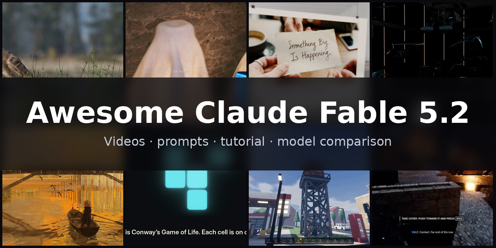](https://www.sandbase.ai/lab/ai-videos/fable-5-2?lang=zh-CN&utm_source=github&utm_medium=readme&utm_campaign=awesome-fable-5-2&utm_content=banner)

精选 **Claude Fable 5.2 案例**合集：用 Anthropic 最新的 Claude 5 模型 Fable 5.2（2026 年 11 月 9 日发布）做出的视频、提示词和演示。一个提示词生成的 Three.js 与 WebGL 场景、Canvas 动画、动效、讲解短片和可在浏览器里玩的游戏，大多是模型写成的单文件网页，均注明作者并链接原帖。

共 **400 条视频**，来自 **324 位创作者** · **60 条**附作者提示词 · 每天从 [SandBase Lab](https://www.sandbase.ai/lab/ai-videos/fable-5-2?lang=zh-CN&utm_source=github&utm_medium=readme&utm_campaign=awesome-fable-5-2&utm_content=stats) 同步

## 从这里开始

| 我想… | 去这里 |
|---|---|
| 看视频 | 在下方 [按分类浏览](#contents)，或 [在 SandBase Lab 大屏播放](https://www.sandbase.ai/lab/ai-videos/fable-5-2?lang=zh-CN&utm_source=github&utm_medium=readme&utm_campaign=awesome-fable-5-2&utm_content=quickstart) |
| 复制提示词 | [提示词索引](docs/zh-CN/prompts.md)：所有附带提示词的视频 |
| 自己写提示词 | [提示词写法](docs/zh-CN/prompt-guide.md)：7 条写法和一个填空模板 |
| 做一个视频 | [教程](docs/zh-CN/tutorial.md)：提示词 → HTML → MP4，含 API、CLI 调用和录屏脚本 |
| 选模型 | [Claude Fable 5.2 对比 Claude Opus 5.5、GPT-6 Astra 和 Gemini 4 Argon](docs/zh-CN/model-comparison.md) |
| 马上试试 | [在 Lab 竞技场运行 Claude Fable 5.2](https://www.sandbase.ai/arena/text?models=anthropic%2Fclaude-fable-5.2&lang=zh-CN&utm_source=github&utm_medium=readme&utm_campaign=awesome-fable-5-2&utm_content=quickstart)，和其他模型并排对比 |

<a id="contents"></a>

## 目录

- [精选](#featured) (8)
- [3D 场景](#3d-scene) (97)
- [动效](#motion-graphics) (86)
- [游戏](#game) (74)
- [产品界面](#ui-demo) (17)
- [粒子与形状](#particles) (4)
- [图表图解](#data-viz) (1)
- [讲解](#explainer) (27)
- [发布片](#launch-film) (16)
- [测试对比](#comparison) (78)
- [用 Claude Fable 5.2 复刻视频](#recreate)
- [常见问题](#faq)
- [延伸阅读](#reading)
- [推荐作品](#contribute)

点击预览图播放视频；点击标题前往 SandBase Lab 查看原帖、提示词，并一键 **复刻**；**@作者** 链接到 X 原帖。

<a id="featured"></a>

## 精选

<table>
<tr><td width="33%" valign="top"><a href="https://www.sandbase.ai/lab/media/x/fable-5-2/2120192761542615271/video.mp4">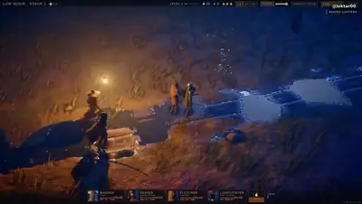</a><br><a href="https://www.sandbase.ai/lab/ai-videos/fable-5-2/2120192761542615271?lang=zh-CN&utm_source=github&utm_medium=readme&utm_campaign=awesome-fable-5-2&utm_content=card"><b>使用 Fable 5.2 生成的完整游戏</b></a><br><sub><a href="https://x.com/loktar00/status/2120192761542615271">@loktar00</a> · 1:08</sub></td><td width="33%" valign="top"><a href="https://www.sandbase.ai/lab/media/x/fable-5-2/2119876626179870838/video.mp4"></a><br><a href="https://www.sandbase.ai/lab/ai-videos/fable-5-2/2119876626179870838?lang=zh-CN&utm_source=github&utm_medium=readme&utm_campaign=awesome-fable-5-2&utm_content=card"><b>通过Python脚本控制Blender制作的完整动画</b></a><br><sub><a href="https://x.com/alexmichael/status/2119876626179870838">@alexmichael</a> · 0:18</sub></td><td width="33%" valign="top"><a href="https://www.sandbase.ai/lab/media/x/fable-5-2/2120109725740159390/video.mp4"></a><br><a href="https://www.sandbase.ai/lab/ai-videos/fable-5-2/2120109725740159390?lang=zh-CN&utm_source=github&utm_medium=readme&utm_campaign=awesome-fable-5-2&utm_content=card"><b>在虚幻引擎中生成的恐怖游戏</b></a><br><sub><a href="https://x.com/_MaxBlade/status/2120109725740159390">@_MaxBlade</a> · 2:01</sub></td></tr>
<tr><td width="33%" valign="top"><a href="https://www.sandbase.ai/lab/media/x/fable-5-2/2119884041331892403/video.mp4"></a><br><a href="https://www.sandbase.ai/lab/ai-videos/fable-5-2/2119884041331892403?lang=zh-CN&utm_source=github&utm_medium=readme&utm_campaign=awesome-fable-5-2&utm_content=card"><b>单次提示直接生成的完整视频展示</b></a><br><sub><a href="https://x.com/mattshumer_/status/2119884041331892403">@mattshumer_</a> · 4:44</sub></td><td width="33%" valign="top"><a href="https://www.sandbase.ai/lab/media/x/fable-5-2/2119966147328299284/video.mp4">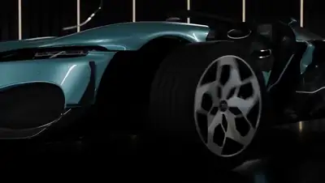</a><br><a href="https://www.sandbase.ai/lab/ai-videos/fable-5-2/2119966147328299284?lang=zh-CN&utm_source=github&utm_medium=readme&utm_campaign=awesome-fable-5-2&utm_content=card"><b>Blender渲染的布加迪Tourbillon电影感动画</b></a><br><sub><a href="https://x.com/xikhar/status/2119966147328299284">@xikhar</a> · 0:34</sub></td><td width="33%" valign="top"><a href="https://www.sandbase.ai/lab/media/x/fable-5-2/2120202746121085321/video.mp4">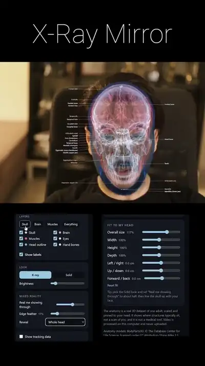</a><br><a href="https://www.sandbase.ai/lab/ai-videos/fable-5-2/2120202746121085321?lang=zh-CN&utm_source=github&utm_medium=readme&utm_campaign=awesome-fable-5-2&utm_content=card"><b>实时追踪头部的网页端人体解剖透视镜像</b></a><br><sub><a href="https://x.com/HashemGhaili/status/2120202746121085321">@HashemGhaili</a> · 3:22</sub></td></tr>
<tr><td width="33%" valign="top"><a href="https://www.sandbase.ai/lab/media/x/fable-5-2/2119875516216070289/video.mp4">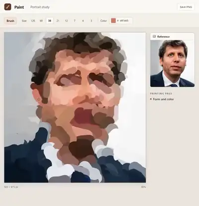</a><br><a href="https://www.sandbase.ai/lab/ai-videos/fable-5-2/2119875516216070289?lang=zh-CN&utm_source=github&utm_medium=readme&utm_campaign=awesome-fable-5-2&utm_content=card"><b>Fable 5.2 单次生成的作品</b></a><br><sub><a href="https://x.com/devsvn2/status/2119875516216070289">@devsvn2</a> · 0:35</sub></td><td width="33%" valign="top"><a href="https://www.sandbase.ai/lab/media/x/fable-5-2/2119919644836347926/video.mp4"></a><br><a href="https://www.sandbase.ai/lab/ai-videos/fable-5-2/2119919644836347926?lang=zh-CN&utm_source=github&utm_medium=readme&utm_campaign=awesome-fable-5-2&utm_content=card"><b>贝多芬风格钢琴奏鸣曲乐谱与演奏</b></a><br><sub><a href="https://x.com/imjustnewatai/status/2119919644836347926">@imjustnewatai</a> · 2:51</sub></td></tr>
</table>

<a id="3d-scene"></a>

## 3D 场景

<table>
<tr><td width="33%" valign="top"><a href="https://www.sandbase.ai/lab/media/x/fable-5-2/2119870965106483384/video.mp4"></a><br><a href="https://www.sandbase.ai/lab/ai-videos/fable-5-2/2119870965106483384?lang=zh-CN&utm_source=github&utm_medium=readme&utm_campaign=awesome-fable-5-2&utm_content=card"><b>通过单次提示词构建的体素引擎演示</b></a><br><sub><a href="https://x.com/mattshumer_/status/2119870965106483384">@mattshumer_</a> · 0:59</sub></td><td width="33%" valign="top"><a href="https://www.sandbase.ai/lab/media/x/fable-5-2/2119871565311660260/video.mp4">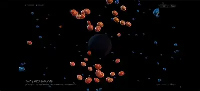</a><br><a href="https://www.sandbase.ai/lab/ai-videos/fable-5-2/2119871565311660260?lang=zh-CN&utm_source=github&utm_medium=readme&utm_campaign=awesome-fable-5-2&utm_content=card"><b>用 HTML 组装病毒衣壳三维结构</b></a><br><sub><a href="https://x.com/TekonBurns/status/2119871565311660260">@TekonBurns</a> · 0:15</sub></td><td width="33%" valign="top"><a href="https://www.sandbase.ai/lab/media/x/fable-5-2/2119871817561346319/video.mp4"></a><br><a href="https://www.sandbase.ai/lab/ai-videos/fable-5-2/2119871817561346319?lang=zh-CN&utm_source=github&utm_medium=readme&utm_campaign=awesome-fable-5-2&utm_content=card"><b>复仇者联盟纽约之战3D场景重现</b></a><br><sub><a href="https://x.com/hammer_mt/status/2119871817561346319">@hammer_mt</a> · 1:08</sub></td></tr>
<tr><td width="33%" valign="top"><a href="https://www.sandbase.ai/lab/media/x/fable-5-2/2119873980786237842/video.mp4">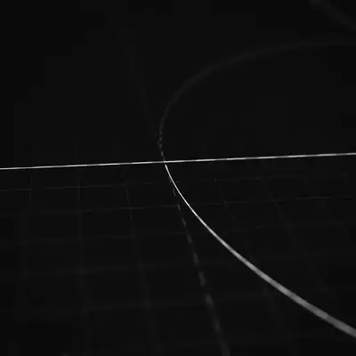</a><br><a href="https://www.sandbase.ai/lab/ai-videos/fable-5-2/2119873980786237842?lang=zh-CN&utm_source=github&utm_medium=readme&utm_campaign=awesome-fable-5-2&utm_content=card"><b>Claude Fable 5.2制作的3D动画展示</b></a><br><sub><a href="https://x.com/hello_amani/status/2119873980786237842">@hello_amani</a> · 0:36</sub></td><td width="33%" valign="top"><a href="https://www.sandbase.ai/lab/media/x/fable-5-2/2119876626179870838/video.mp4"></a><br><a href="https://www.sandbase.ai/lab/ai-videos/fable-5-2/2119876626179870838?lang=zh-CN&utm_source=github&utm_medium=readme&utm_campaign=awesome-fable-5-2&utm_content=card"><b>通过Python脚本控制Blender制作的完整动画</b></a><br><sub><a href="https://x.com/alexmichael/status/2119876626179870838">@alexmichael</a> · 0:18</sub></td><td width="33%" valign="top"><a href="https://www.sandbase.ai/lab/media/x/fable-5-2/2119879273196761464/video.mp4">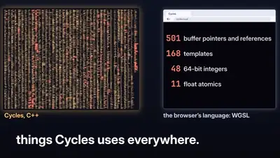</a><br><a href="https://www.sandbase.ai/lab/ai-videos/fable-5-2/2119879273196761464?lang=zh-CN&utm_source=github&utm_medium=readme&utm_campaign=awesome-fable-5-2&utm_content=card"><b>利用定制编译器将路径追踪器移植到WebGPU</b></a><br><sub><a href="https://x.com/aidanshandle/status/2119879273196761464">@aidanshandle</a> · 1:36</sub></td></tr>
</table>

<details>
<summary><b>展开全部 97 条</b></summary>

<table>
<tr><td width="33%" valign="top"><a href="https://www.sandbase.ai/lab/media/x/fable-5-2/2119884295179538680/video.mp4">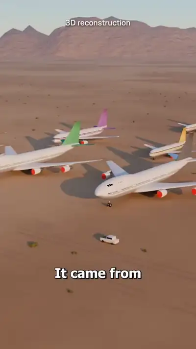</a><br><a href="https://www.sandbase.ai/lab/ai-videos/fable-5-2/2119884295179538680?lang=zh-CN&utm_source=github&utm_medium=readme&utm_campaign=awesome-fable-5-2&utm_content=card"><b>Claude Fable驱动的3D Blender工作流</b></a><br><sub><a href="https://x.com/charan_kilari/status/2119884295179538680">@charan_kilari</a> · 0:25</sub></td><td width="33%" valign="top"><a href="https://www.sandbase.ai/lab/media/x/fable-5-2/2119886560992854431/video.mp4"></a><br><a href="https://www.sandbase.ai/lab/ai-videos/fable-5-2/2119886560992854431?lang=zh-CN&utm_source=github&utm_medium=readme&utm_campaign=awesome-fable-5-2&utm_content=card"><b>秋季伏见稻荷大社旅游宣传短片</b></a><br><sub><a href="https://x.com/petergyang/status/2119886560992854431">@petergyang</a> · 0:20</sub></td><td width="33%" valign="top"><a href="https://www.sandbase.ai/lab/media/x/fable-5-2/2119889741600424363/video.mp4"></a><br><a href="https://www.sandbase.ai/lab/ai-videos/fable-5-2/2119889741600424363?lang=zh-CN&utm_source=github&utm_medium=readme&utm_campaign=awesome-fable-5-2&utm_content=card"><b>月球距离地球仅十英尺的模拟短片</b></a><br><sub><a href="https://x.com/ashen_one/status/2119889741600424363">@ashen_one</a> · 1:00</sub></td></tr>
<tr><td width="33%" valign="top"><a href="https://www.sandbase.ai/lab/media/x/fable-5-2/2119890973560054072/video.mp4"></a><br><a href="https://www.sandbase.ai/lab/ai-videos/fable-5-2/2119890973560054072?lang=zh-CN&utm_source=github&utm_medium=readme&utm_campaign=awesome-fable-5-2&utm_content=card"><b>用Three.js纯代码构建的3D帆船</b></a><br><sub><a href="https://x.com/marcthecreatorr/status/2119890973560054072">@marcthecreatorr</a> · 0:53</sub></td><td width="33%" valign="top"><a href="https://www.sandbase.ai/lab/media/x/fable-5-2/2119894130943807746/video.mp4">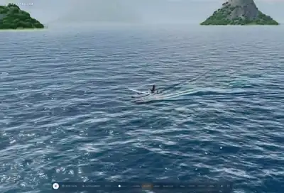</a><br><a href="https://www.sandbase.ai/lab/ai-videos/fable-5-2/2119894130943807746?lang=zh-CN&utm_source=github&utm_medium=readme&utm_campaign=awesome-fable-5-2&utm_content=card"><b>3D水上飞机渲染场景</b></a><br><sub><a href="https://x.com/LuminaBench/status/2119894130943807746">@LuminaBench</a> · 0:40</sub></td><td width="33%" valign="top"><a href="https://www.sandbase.ai/lab/media/x/fable-5-2/2119897840965001317/video.mp4">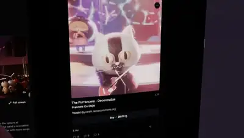</a><br><a href="https://www.sandbase.ai/lab/ai-videos/fable-5-2/2119897840965001317?lang=zh-CN&utm_source=github&utm_medium=readme&utm_campaign=awesome-fable-5-2&utm_content=card"><b>使用 Three.js 制作的短片探索</b></a><br><sub><a href="https://x.com/YinYangYoeshi/status/2119897840965001317">@YinYangYoeshi</a> · 1:42</sub></td></tr>
<tr><td width="33%" valign="top"><a href="https://www.sandbase.ai/lab/media/x/fable-5-2/2119900528197218472/video.mp4">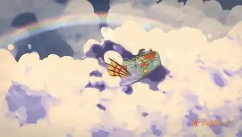</a><br><a href="https://www.sandbase.ai/lab/ai-videos/fable-5-2/2119900528197218472?lang=zh-CN&utm_source=github&utm_medium=readme&utm_campaign=awesome-fable-5-2&utm_content=card"><b>使用 Three.js 纯代码渲染的动漫短片</b></a><br><sub><a href="https://x.com/noisyb0y1/status/2119900528197218472">@noisyb0y1</a> · 1:07</sub></td><td width="33%" valign="top"><a href="https://www.sandbase.ai/lab/media/x/fable-5-2/2119900775727902732/video.mp4"></a><br><a href="https://www.sandbase.ai/lab/ai-videos/fable-5-2/2119900775727902732?lang=zh-CN&utm_source=github&utm_medium=readme&utm_campaign=awesome-fable-5-2&utm_content=card"><b>历史还原的耶路撒冷沉浸式 3D 模型</b></a><br><sub><a href="https://x.com/kplikethebird/status/2119900775727902732">@kplikethebird</a> · 0:30 · <a href="https://www.sandbase.ai/lab/ai-videos/fable-5-2/2119900775727902732?lang=zh-CN&utm_source=github&utm_medium=readme&utm_campaign=awesome-fable-5-2&utm_content=card">提示词</a></sub></td><td width="33%" valign="top"><a href="https://www.sandbase.ai/lab/media/x/fable-5-2/2119901747930186234/video.mp4"></a><br><a href="https://www.sandbase.ai/lab/ai-videos/fable-5-2/2119901747930186234?lang=zh-CN&utm_source=github&utm_medium=readme&utm_campaign=awesome-fable-5-2&utm_content=card"><b>使用Bryce渲染引擎的3D视频测试</b></a><br><sub><a href="https://x.com/pleometric/status/2119901747930186234">@pleometric</a> · 0:15</sub></td></tr>
<tr><td width="33%" valign="top"><a href="https://www.sandbase.ai/lab/media/x/fable-5-2/2119901782482543073/video.mp4"></a><br><a href="https://www.sandbase.ai/lab/ai-videos/fable-5-2/2119901782482543073?lang=zh-CN&utm_source=github&utm_medium=readme&utm_campaign=awesome-fable-5-2&utm_content=card"><b>蒸汽机车变身机器人的动画短片</b></a><br><sub><a href="https://x.com/0kncn/status/2119901782482543073">@0kncn</a> · 1:30 · <a href="https://www.sandbase.ai/lab/ai-videos/fable-5-2/2119901782482543073?lang=zh-CN&utm_source=github&utm_medium=readme&utm_campaign=awesome-fable-5-2&utm_content=card">提示词</a></sub></td><td width="33%" valign="top"><a href="https://www.sandbase.ai/lab/media/x/fable-5-2/2119902109709537708/video.mp4"></a><br><a href="https://www.sandbase.ai/lab/ai-videos/fable-5-2/2119902109709537708?lang=zh-CN&utm_source=github&utm_medium=readme&utm_campaign=awesome-fable-5-2&utm_content=card"><b>Blender中生成并渲染的完整3D房间动画</b></a><br><sub><a href="https://x.com/rileybrown/status/2119902109709537708">@rileybrown</a> · 0:59</sub></td><td width="33%" valign="top"><a href="https://www.sandbase.ai/lab/media/x/fable-5-2/2119905661505122575/video.mp4"></a><br><a href="https://www.sandbase.ai/lab/ai-videos/fable-5-2/2119905661505122575?lang=zh-CN&utm_source=github&utm_medium=readme&utm_campaign=awesome-fable-5-2&utm_content=card"><b>在大海中航行的3D海盗船</b></a><br><sub><a href="https://x.com/notjazii/status/2119905661505122575">@notjazii</a> · 0:50 · <a href="https://www.sandbase.ai/lab/ai-videos/fable-5-2/2119905661505122575?lang=zh-CN&utm_source=github&utm_medium=readme&utm_campaign=awesome-fable-5-2&utm_content=card">提示词</a></sub></td></tr>
<tr><td width="33%" valign="top"><a href="https://www.sandbase.ai/lab/media/x/fable-5-2/2119909780269785332/video.mp4">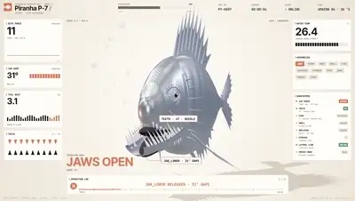</a><br><a href="https://www.sandbase.ai/lab/ai-videos/fable-5-2/2119909780269785332?lang=zh-CN&utm_source=github&utm_medium=readme&utm_campaign=awesome-fable-5-2&utm_content=card"><b>纯代码构建的可解构3D水虎鱼</b></a><br><sub><a href="https://x.com/Scratcherrrr/status/2119909780269785332">@Scratcherrrr</a> · 0:20</sub></td><td width="33%" valign="top"><a href="https://www.sandbase.ai/lab/media/x/fable-5-2/2119910613828980846/video.mp4">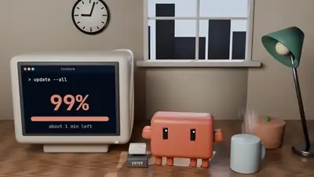</a><br><a href="https://www.sandbase.ai/lab/ai-videos/fable-5-2/2119910613828980846?lang=zh-CN&utm_source=github&utm_medium=readme&utm_campaign=awesome-fable-5-2&utm_content=card"><b>Blender 中制作的 3D 动画短片</b></a><br><sub><a href="https://x.com/kloss_xyz/status/2119910613828980846">@kloss_xyz</a> · 0:16</sub></td><td width="33%" valign="top"><a href="https://www.sandbase.ai/lab/media/x/fable-5-2/2119911343633682916/video.mp4">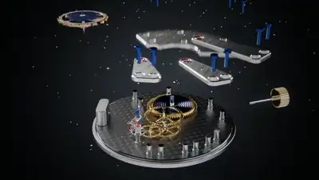</a><br><a href="https://www.sandbase.ai/lab/ai-videos/fable-5-2/2119911343633682916?lang=zh-CN&utm_source=github&utm_medium=readme&utm_campaign=awesome-fable-5-2&utm_content=card"><b>纯代码构建的机械手表机芯运转动画</b></a><br><sub><a href="https://x.com/techfren/status/2119911343633682916">@techfren</a> · 0:42 · <a href="https://www.sandbase.ai/lab/ai-videos/fable-5-2/2119911343633682916?lang=zh-CN&utm_source=github&utm_medium=readme&utm_campaign=awesome-fable-5-2&utm_content=card">提示词</a></sub></td></tr>
<tr><td width="33%" valign="top"><a href="https://www.sandbase.ai/lab/media/x/fable-5-2/2119913237315477587/video.mp4">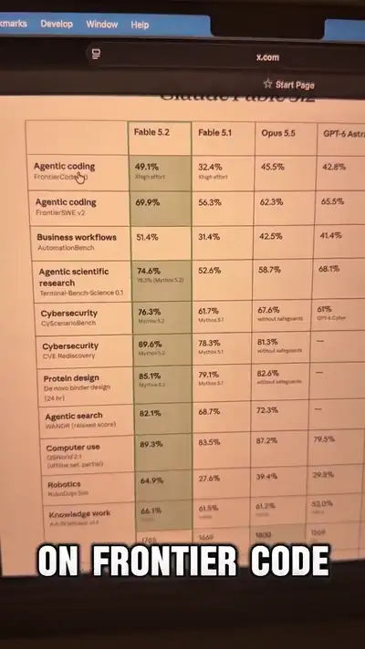</a><br><a href="https://www.sandbase.ai/lab/ai-videos/fable-5-2/2119913237315477587?lang=zh-CN&utm_source=github&utm_medium=readme&utm_campaign=awesome-fable-5-2&utm_content=card"><b>日式浮岛演示与基准测试</b></a><br><sub><a href="https://x.com/ziwenxu_/status/2119913237315477587">@ziwenxu_</a> · 0:58</sub></td><td width="33%" valign="top"><a href="https://www.sandbase.ai/lab/media/x/fable-5-2/2119914308603953485/video.mp4">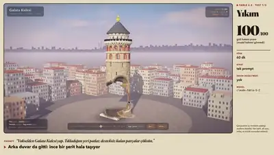</a><br><a href="https://www.sandbase.ai/lab/ai-videos/fable-5-2/2119914308603953485?lang=zh-CN&utm_source=github&utm_medium=readme&utm_campaign=awesome-fable-5-2&utm_content=card"><b>Fable 5.2生成的体素模拟测试</b></a><br><sub><a href="https://x.com/Avenoxai/status/2119914308603953485">@Avenoxai</a> · 1:12</sub></td><td width="33%" valign="top"><a href="https://www.sandbase.ai/lab/media/x/fable-5-2/2119917375080521921/video.mp4">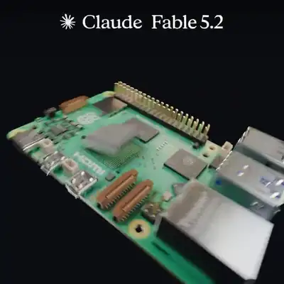</a><br><a href="https://www.sandbase.ai/lab/ai-videos/fable-5-2/2119917375080521921?lang=zh-CN&utm_source=github&utm_medium=readme&utm_campaign=awesome-fable-5-2&utm_content=card"><b>树莓派5动态展示</b></a><br><sub><a href="https://x.com/sparklabhq/status/2119917375080521921">@sparklabhq</a> · 0:06 · <a href="https://www.sandbase.ai/lab/ai-videos/fable-5-2/2119917375080521921?lang=zh-CN&utm_source=github&utm_medium=readme&utm_campaign=awesome-fable-5-2&utm_content=card">提示词</a></sub></td></tr>
<tr><td width="33%" valign="top"><a href="https://www.sandbase.ai/lab/media/x/fable-5-2/2119919359724306550/video.mp4">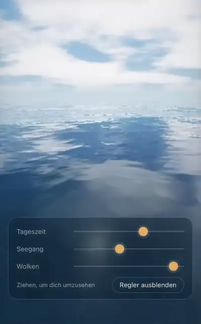</a><br><a href="https://www.sandbase.ai/lab/ai-videos/fable-5-2/2119919359724306550?lang=zh-CN&utm_source=github&utm_medium=readme&utm_campaign=awesome-fable-5-2&utm_content=card"><b>包含日出云朵与月夜的实时海洋场景</b></a><br><sub><a href="https://x.com/lenny_enderle/status/2119919359724306550">@lenny_enderle</a> · 1:07</sub></td><td width="33%" valign="top"><a href="https://www.sandbase.ai/lab/media/x/fable-5-2/2119930300990177509/video.mp4"></a><br><a href="https://www.sandbase.ai/lab/ai-videos/fable-5-2/2119930300990177509?lang=zh-CN&utm_source=github&utm_medium=readme&utm_campaign=awesome-fable-5-2&utm_content=card"><b>WebGL中的逼真蜂蜜物理模拟</b></a><br><sub><a href="https://x.com/deedydas/status/2119930300990177509">@deedydas</a> · 0:51 · <a href="https://www.sandbase.ai/lab/ai-videos/fable-5-2/2119930300990177509?lang=zh-CN&utm_source=github&utm_medium=readme&utm_campaign=awesome-fable-5-2&utm_content=card">提示词</a></sub></td><td width="33%" valign="top"><a href="https://www.sandbase.ai/lab/media/x/fable-5-2/2119936753892983162/video.mp4"></a><br><a href="https://www.sandbase.ai/lab/ai-videos/fable-5-2/2119936753892983162?lang=zh-CN&utm_source=github&utm_medium=readme&utm_campaign=awesome-fable-5-2&utm_content=card"><b>Three.js制作的杭州西湖场景</b></a><br><sub><a href="https://x.com/ivanfioravanti/status/2119936753892983162">@ivanfioravanti</a> · 0:10</sub></td></tr>
<tr><td width="33%" valign="top"><a href="https://www.sandbase.ai/lab/media/x/fable-5-2/2119938067758772403/video.mp4"></a><br><a href="https://www.sandbase.ai/lab/ai-videos/fable-5-2/2119938067758772403?lang=zh-CN&utm_source=github&utm_medium=readme&utm_campaign=awesome-fable-5-2&utm_content=card"><b>基于地图数据生成的英迪拉纳加尔街区模型</b></a><br><sub><a href="https://x.com/anshu4321/status/2119938067758772403">@anshu4321</a> · 0:35</sub></td><td width="33%" valign="top"><a href="https://www.sandbase.ai/lab/media/x/fable-5-2/2119939061049889130/video.mp4">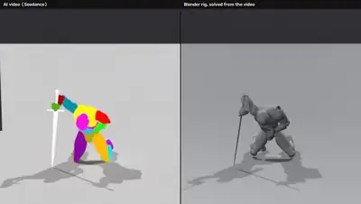</a><br><a href="https://www.sandbase.ai/lab/ai-videos/fable-5-2/2119939061049889130?lang=zh-CN&utm_source=github&utm_medium=readme&utm_campaign=awesome-fable-5-2&utm_content=card"><b>视频转3D动画展示</b></a><br><sub><a href="https://x.com/KHvostikk/status/2119939061049889130">@KHvostikk</a> · 0:10</sub></td><td width="33%" valign="top"><a href="https://www.sandbase.ai/lab/media/x/fable-5-2/2119944847255896490/video.mp4"></a><br><a href="https://www.sandbase.ai/lab/ai-videos/fable-5-2/2119944847255896490?lang=zh-CN&utm_source=github&utm_medium=readme&utm_campaign=awesome-fable-5-2&utm_content=card"><b>使用Devin生成的逼真3D场景</b></a><br><sub><a href="https://x.com/Da7_Tech/status/2119944847255896490">@Da7_Tech</a> · 1:05</sub></td></tr>
<tr><td width="33%" valign="top"><a href="https://www.sandbase.ai/lab/media/x/fable-5-2/2119946891106394518/video.mp4">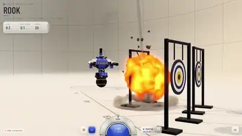</a><br><a href="https://www.sandbase.ai/lab/ai-videos/fable-5-2/2119946891106394518?lang=zh-CN&utm_source=github&utm_medium=readme&utm_campaign=awesome-fable-5-2&utm_content=card"><b>使用 Three.js 测试概念视频游戏机</b></a><br><sub><a href="https://x.com/techartist_/status/2119946891106394518">@techartist_</a> · 0:20</sub></td><td width="33%" valign="top"><a href="https://www.sandbase.ai/lab/media/x/fable-5-2/2119947402107089168/video.mp4"></a><br><a href="https://www.sandbase.ai/lab/ai-videos/fable-5-2/2119947402107089168?lang=zh-CN&utm_source=github&utm_medium=readme&utm_campaign=awesome-fable-5-2&utm_content=card"><b>桌面整理机器人与大肥鱼互动演示</b></a><br><sub><a href="https://x.com/berryxia/status/2119947402107089168">@berryxia</a> · 1:26</sub></td><td width="33%" valign="top"><a href="https://www.sandbase.ai/lab/media/x/fable-5-2/2119960596951236675/video.mp4">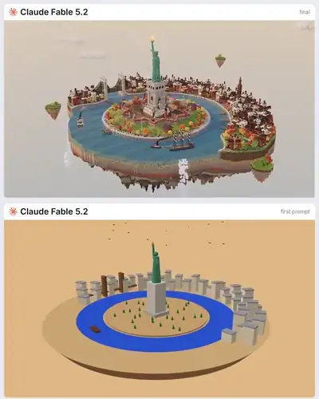</a><br><a href="https://www.sandbase.ai/lab/ai-videos/fable-5-2/2119960596951236675?lang=zh-CN&utm_source=github&utm_medium=readme&utm_campaign=awesome-fable-5-2&utm_content=card"><b>空中漂浮的1886年纽约城3D场景</b></a><br><sub><a href="https://x.com/semichenkko/status/2119960596951236675">@semichenkko</a> · 0:10</sub></td></tr>
<tr><td width="33%" valign="top"><a href="https://www.sandbase.ai/lab/media/x/fable-5-2/2119966147328299284/video.mp4"></a><br><a href="https://www.sandbase.ai/lab/ai-videos/fable-5-2/2119966147328299284?lang=zh-CN&utm_source=github&utm_medium=readme&utm_campaign=awesome-fable-5-2&utm_content=card"><b>Blender渲染的布加迪Tourbillon电影感动画</b></a><br><sub><a href="https://x.com/xikhar/status/2119966147328299284">@xikhar</a> · 0:34</sub></td><td width="33%" valign="top"><a href="https://www.sandbase.ai/lab/media/x/fable-5-2/2119969928304357507/video.mp4"></a><br><a href="https://www.sandbase.ai/lab/ai-videos/fable-5-2/2119969928304357507?lang=zh-CN&utm_source=github&utm_medium=readme&utm_campaign=awesome-fable-5-2&utm_content=card"><b>通过上传照片生成的个人工作室场景</b></a><br><sub><a href="https://x.com/rpnickson/status/2119969928304357507">@rpnickson</a> · 0:30</sub></td><td width="33%" valign="top"><a href="https://www.sandbase.ai/lab/media/x/fable-5-2/2119972124211454139/video.mp4">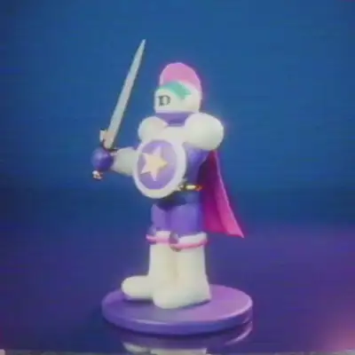</a><br><a href="https://www.sandbase.ai/lab/ai-videos/fable-5-2/2119972124211454139?lang=zh-CN&utm_source=github&utm_medium=readme&utm_campaign=awesome-fable-5-2&utm_content=card"><b>Blender 渲染的 90 年代风格玩具广告</b></a><br><sub><a href="https://x.com/kevin_t_ngo/status/2119972124211454139">@kevin_t_ngo</a> · 1:05</sub></td></tr>
<tr><td width="33%" valign="top"><a href="https://www.sandbase.ai/lab/media/x/fable-5-2/2119974354260013293/video.mp4">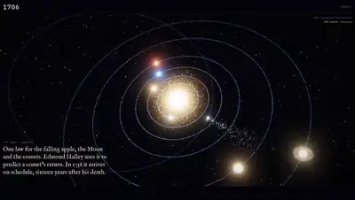</a><br><a href="https://www.sandbase.ai/lab/ai-videos/fable-5-2/2119974354260013293?lang=zh-CN&utm_source=github&utm_medium=readme&utm_campaign=awesome-fable-5-2&utm_content=card"><b>科学历史的电影感三维探索之旅</b></a><br><sub><a href="https://x.com/DeryaTR_/status/2119974354260013293">@DeryaTR_</a> · 4:56</sub></td><td width="33%" valign="top"><a href="https://www.sandbase.ai/lab/media/x/fable-5-2/2119995965776200047/video.mp4"></a><br><a href="https://www.sandbase.ai/lab/ai-videos/fable-5-2/2119995965776200047?lang=zh-CN&utm_source=github&utm_medium=readme&utm_campaign=awesome-fable-5-2&utm_content=card"><b>包含小猫和小狗的互动灯开关</b></a><br><sub><a href="https://x.com/justkarangupta/status/2119995965776200047">@justkarangupta</a> · 0:15</sub></td><td width="33%" valign="top"><a href="https://www.sandbase.ai/lab/media/x/fable-5-2/2120001344237097184/video.mp4"></a><br><a href="https://www.sandbase.ai/lab/ai-videos/fable-5-2/2120001344237097184?lang=zh-CN&utm_source=github&utm_medium=readme&utm_campaign=awesome-fable-5-2&utm_content=card"><b>Ultramock 定制三维模型场景演示</b></a><br><sub><a href="https://x.com/joshmillgate/status/2120001344237097184">@joshmillgate</a> · 0:25</sub></td></tr>
<tr><td width="33%" valign="top"><a href="https://www.sandbase.ai/lab/media/x/fable-5-2/2120022389605929145/video.mp4"></a><br><a href="https://www.sandbase.ai/lab/ai-videos/fable-5-2/2120022389605929145?lang=zh-CN&utm_source=github&utm_medium=readme&utm_campaign=awesome-fable-5-2&utm_content=card"><b>在 Blender 中生成的房间三维动画场景</b></a><br><sub><a href="https://x.com/RoundtableSpace/status/2120022389605929145">@RoundtableSpace</a> · 0:59</sub></td><td width="33%" valign="top"><a href="https://www.sandbase.ai/lab/media/x/fable-5-2/2120025125076844785/video.mp4">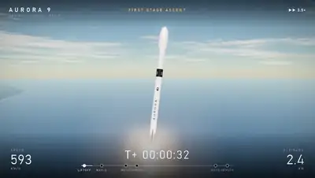</a><br><a href="https://www.sandbase.ai/lab/ai-videos/fable-5-2/2120025125076844785?lang=zh-CN&utm_source=github&utm_medium=readme&utm_campaign=awesome-fable-5-2&utm_content=card"><b>Three.js火箭发射物理模拟</b></a><br><sub><a href="https://x.com/Shannnu_18/status/2120025125076844785">@Shannnu_18</a> · 2:15</sub></td><td width="33%" valign="top"><a href="https://www.sandbase.ai/lab/media/x/fable-5-2/2120028841607590092/video.mp4">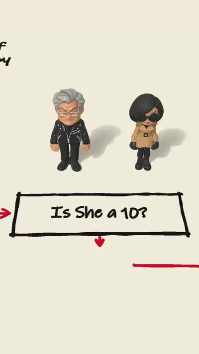</a><br><a href="https://www.sandbase.ai/lab/ai-videos/fable-5-2/2120028841607590092?lang=zh-CN&utm_source=github&utm_medium=readme&utm_campaign=awesome-fable-5-2&utm_content=card"><b>将推文转化为三维动画视频</b></a><br><sub><a href="https://x.com/kelanoo/status/2120028841607590092">@kelanoo</a> · 0:16</sub></td></tr>
<tr><td width="33%" valign="top"><a href="https://www.sandbase.ai/lab/media/x/fable-5-2/2120036883635851769/video.mp4">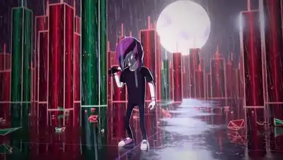</a><br><a href="https://www.sandbase.ai/lab/ai-videos/fable-5-2/2120036883635851769?lang=zh-CN&utm_source=github&utm_medium=readme&utm_campaign=awesome-fable-5-2&utm_content=card"><b>全自动Blender 3D渲染管线与角色循环动画</b></a><br><sub><a href="https://x.com/LordEmo/status/2120036883635851769">@LordEmo</a> · 0:05</sub></td><td width="33%" valign="top"><a href="https://www.sandbase.ai/lab/media/x/fable-5-2/2120039417981333599/video.mp4">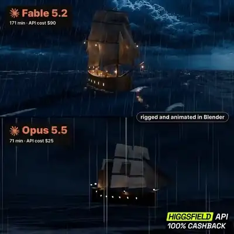</a><br><a href="https://www.sandbase.ai/lab/ai-videos/fable-5-2/2120039417981333599?lang=zh-CN&utm_source=github&utm_medium=readme&utm_campaign=awesome-fable-5-2&utm_content=card"><b>Blender中海蛇缠绕船只的动画</b></a><br><sub><a href="https://x.com/Stefan_3D_AI/status/2120039417981333599">@Stefan_3D_AI</a> · 0:32 · <a href="https://www.sandbase.ai/lab/ai-videos/fable-5-2/2120039417981333599?lang=zh-CN&utm_source=github&utm_medium=readme&utm_campaign=awesome-fable-5-2&utm_content=card">提示词</a></sub></td><td width="33%" valign="top"><a href="https://www.sandbase.ai/lab/media/x/fable-5-2/2120044656776061144/video.mp4">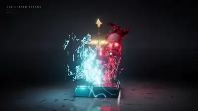</a><br><a href="https://www.sandbase.ai/lab/ai-videos/fable-5-2/2120044656776061144?lang=zh-CN&utm_source=github&utm_medium=readme&utm_campaign=awesome-fable-5-2&utm_content=card"><b>纯代码生成的3D诅咒之剑场景</b></a><br><sub><a href="https://x.com/pankajkumar_dev/status/2120044656776061144">@pankajkumar_dev</a> · 0:36</sub></td></tr>
<tr><td width="33%" valign="top"><a href="https://www.sandbase.ai/lab/media/x/fable-5-2/2120046536457654495/video.mp4"></a><br><a href="https://www.sandbase.ai/lab/ai-videos/fable-5-2/2120046536457654495?lang=zh-CN&utm_source=github&utm_medium=readme&utm_campaign=awesome-fable-5-2&utm_content=card"><b>AI设计的全功能语音助理设备</b></a><br><sub><a href="https://x.com/dr_l_alexandre/status/2120046536457654495">@dr_l_alexandre</a> · 0:48</sub></td><td width="33%" valign="top"><a href="https://www.sandbase.ai/lab/media/x/fable-5-2/2120056264751227079/video.mp4">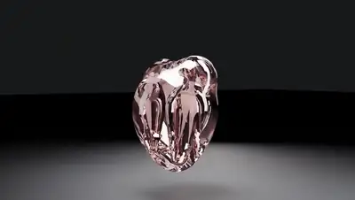</a><br><a href="https://www.sandbase.ai/lab/ai-videos/fable-5-2/2120056264751227079?lang=zh-CN&utm_source=github&utm_medium=readme&utm_campaign=awesome-fable-5-2&utm_content=card"><b>Blender中生成的玻璃心脏动画</b></a><br><sub><a href="https://x.com/0kncn/status/2120056264751227079">@0kncn</a> · 0:29</sub></td><td width="33%" valign="top"><a href="https://www.sandbase.ai/lab/media/x/fable-5-2/2120056914054942793/video.mp4">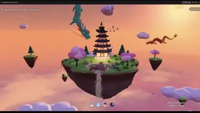</a><br><a href="https://www.sandbase.ai/lab/ai-videos/fable-5-2/2120056914054942793?lang=zh-CN&utm_source=github&utm_medium=readme&utm_campaign=awesome-fable-5-2&utm_content=card"><b>包含骑龙第一人称视角的宝塔浮岛</b></a><br><sub><a href="https://x.com/ItsmeAjayKV/status/2120056914054942793">@ItsmeAjayKV</a> · 2:25 · <a href="https://www.sandbase.ai/lab/ai-videos/fable-5-2/2120056914054942793?lang=zh-CN&utm_source=github&utm_medium=readme&utm_campaign=awesome-fable-5-2&utm_content=card">提示词</a></sub></td></tr>
<tr><td width="33%" valign="top"><a href="https://www.sandbase.ai/lab/media/x/fable-5-2/2120074876039917971/video.mp4">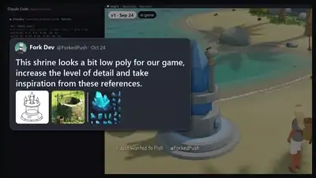</a><br><a href="https://www.sandbase.ai/lab/ai-videos/fable-5-2/2120074876039917971?lang=zh-CN&utm_source=github&utm_medium=readme&utm_campaign=awesome-fable-5-2&utm_content=card"><b>为游戏制作风格化神社的过程</b></a><br><sub><a href="https://x.com/ForkedPush/status/2120074876039917971">@ForkedPush</a> · 0:32</sub></td><td width="33%" valign="top"><a href="https://www.sandbase.ai/lab/media/x/fable-5-2/2120075740222005569/video.mp4"></a><br><a href="https://www.sandbase.ai/lab/ai-videos/fable-5-2/2120075740222005569?lang=zh-CN&utm_source=github&utm_medium=readme&utm_campaign=awesome-fable-5-2&utm_content=card"><b>Three.js纯代码实时生成的唐人街场景</b></a><br><sub><a href="https://x.com/RJasonHA/status/2120075740222005569">@RJasonHA</a> · 1:14</sub></td><td width="33%" valign="top"><a href="https://www.sandbase.ai/lab/media/x/fable-5-2/2120077700866187579/video.mp4">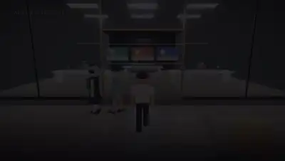</a><br><a href="https://www.sandbase.ai/lab/ai-videos/fable-5-2/2120077700866187579?lang=zh-CN&utm_source=github&utm_medium=readme&utm_campaign=awesome-fable-5-2&utm_content=card"><b>可漫步探索的3D虚拟购物中心</b></a><br><sub><a href="https://x.com/iksly2/status/2120077700866187579">@iksly2</a> · 1:00</sub></td></tr>
<tr><td width="33%" valign="top"><a href="https://www.sandbase.ai/lab/media/x/fable-5-2/2120079029386588503/video.mp4"></a><br><a href="https://www.sandbase.ai/lab/ai-videos/fable-5-2/2120079029386588503?lang=zh-CN&utm_source=github&utm_medium=readme&utm_campaign=awesome-fable-5-2&utm_content=card"><b>Three.js制作的水上灯笼3D场景</b></a><br><sub><a href="https://x.com/seiiiiiiiiiiru/status/2120079029386588503">@seiiiiiiiiiiru</a> · 0:30</sub></td><td width="33%" valign="top"><a href="https://www.sandbase.ai/lab/media/x/fable-5-2/2120079288372494782/video.mp4">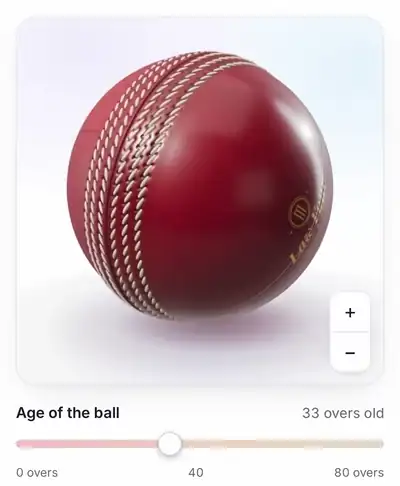</a><br><a href="https://www.sandbase.ai/lab/ai-videos/fable-5-2/2120079288372494782?lang=zh-CN&utm_source=github&utm_medium=readme&utm_campaign=awesome-fable-5-2&utm_content=card"><b>板球的3D渲染效果</b></a><br><sub><a href="https://x.com/deedydas/status/2120079288372494782">@deedydas</a> · 0:18</sub></td><td width="33%" valign="top"><a href="https://www.sandbase.ai/lab/media/x/fable-5-2/2120091403447578814/video.mp4">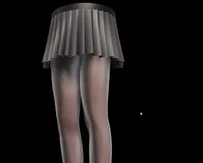</a><br><a href="https://www.sandbase.ai/lab/ai-videos/fable-5-2/2120091403447578814?lang=zh-CN&utm_source=github&utm_medium=readme&utm_campaign=awesome-fable-5-2&utm_content=card"><b>Three.js制作的人物腿部模型测试</b></a><br><sub><a href="https://x.com/bei351009016/status/2120091403447578814">@bei351009016</a> · 0:09</sub></td></tr>
<tr><td width="33%" valign="top"><a href="https://www.sandbase.ai/lab/media/x/fable-5-2/2120097749177606559/video.mp4">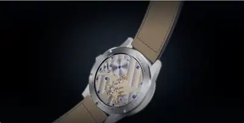</a><br><a href="https://www.sandbase.ai/lab/ai-videos/fable-5-2/2120097749177606559?lang=zh-CN&utm_source=github&utm_medium=readme&utm_campaign=awesome-fable-5-2&utm_content=card"><b>纯代码生成的Three.js与WebGPU三维场景</b></a><br><sub><a href="https://x.com/Andrew_Blumson/status/2120097749177606559">@Andrew_Blumson</a> · 1:12</sub></td><td width="33%" valign="top"><a href="https://www.sandbase.ai/lab/media/x/fable-5-2/2120101582444597446/video.mp4">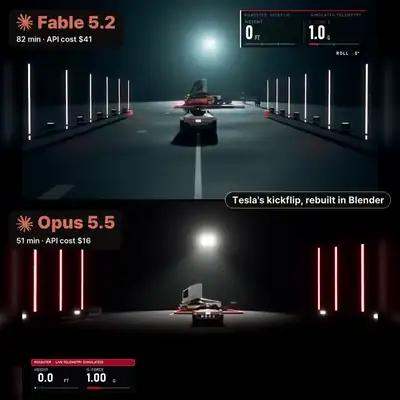</a><br><a href="https://www.sandbase.ai/lab/ai-videos/fable-5-2/2120101582444597446?lang=zh-CN&utm_source=github&utm_medium=readme&utm_campaign=awesome-fable-5-2&utm_content=card"><b>Blender中程序化重现特斯拉Roadster翻板特技</b></a><br><sub><a href="https://x.com/Stefan_3D_AI/status/2120101582444597446">@Stefan_3D_AI</a> · 0:18 · <a href="https://www.sandbase.ai/lab/ai-videos/fable-5-2/2120101582444597446?lang=zh-CN&utm_source=github&utm_medium=readme&utm_campaign=awesome-fable-5-2&utm_content=card">提示词</a></sub></td><td width="33%" valign="top"><a href="https://www.sandbase.ai/lab/media/x/fable-5-2/2120110605541441880/video.mp4">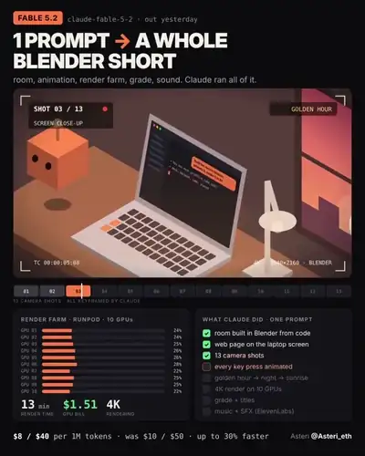</a><br><a href="https://www.sandbase.ai/lab/ai-videos/fable-5-2/2120110605541441880?lang=zh-CN&utm_source=github&utm_medium=readme&utm_campaign=awesome-fable-5-2&utm_content=card"><b>通过代码在Blender中生成的动画短片</b></a><br><sub><a href="https://x.com/Asteri_eth/status/2120110605541441880">@Asteri_eth</a> · 0:26</sub></td></tr>
<tr><td width="33%" valign="top"><a href="https://www.sandbase.ai/lab/media/x/fable-5-2/2120110927773151312/video.mp4">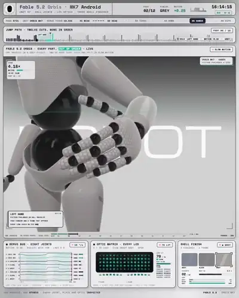</a><br><a href="https://www.sandbase.ai/lab/ai-videos/fable-5-2/2120110927773151312?lang=zh-CN&utm_source=github&utm_medium=readme&utm_campaign=awesome-fable-5-2&utm_content=card"><b>Blender中的自动化机器人构建流程</b></a><br><sub><a href="https://x.com/0xWast3/status/2120110927773151312">@0xWast3</a> · 0:38</sub></td><td width="33%" valign="top"><a href="https://www.sandbase.ai/lab/media/x/fable-5-2/2120111159726727321/video.mp4">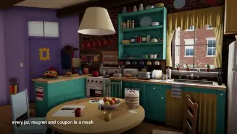</a><br><a href="https://www.sandbase.ai/lab/ai-videos/fable-5-2/2120111159726727321?lang=zh-CN&utm_source=github&utm_medium=readme&utm_campaign=awesome-fable-5-2&utm_content=card"><b>在Three.js中重现莫妮卡公寓</b></a><br><sub><a href="https://x.com/chetaslua/status/2120111159726727321">@chetaslua</a> · 0:32</sub></td><td width="33%" valign="top"><a href="https://www.sandbase.ai/lab/media/x/fable-5-2/2120113578531234172/video.mp4">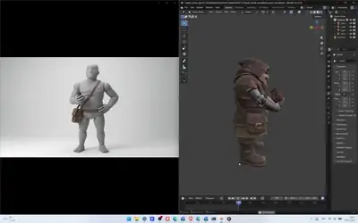</a><br><a href="https://www.sandbase.ai/lab/ai-videos/fable-5-2/2120113578531234172?lang=zh-CN&utm_source=github&utm_medium=readme&utm_campaign=awesome-fable-5-2&utm_content=card"><b>通过MCP在Blender中生成的3D动画</b></a><br><sub><a href="https://x.com/maxt3chno/status/2120113578531234172">@maxt3chno</a> · 0:16</sub></td></tr>
<tr><td width="33%" valign="top"><a href="https://www.sandbase.ai/lab/media/x/fable-5-2/2120124319187734646/video.mp4">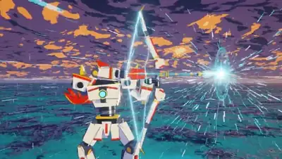</a><br><a href="https://www.sandbase.ai/lab/ai-videos/fable-5-2/2120124319187734646?lang=zh-CN&utm_source=github&utm_medium=readme&utm_campaign=awesome-fable-5-2&utm_content=card"><b>穿透海洋射箭的机器人弓箭手动画短片</b></a><br><sub><a href="https://x.com/camperaigg/status/2120124319187734646">@camperaigg</a> · 0:30 · <a href="https://www.sandbase.ai/lab/ai-videos/fable-5-2/2120124319187734646?lang=zh-CN&utm_source=github&utm_medium=readme&utm_campaign=awesome-fable-5-2&utm_content=card">提示词</a></sub></td><td width="33%" valign="top"><a href="https://www.sandbase.ai/lab/media/x/fable-5-2/2120124988711662000/video.mp4">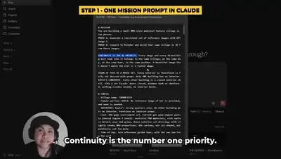</a><br><a href="https://www.sandbase.ai/lab/ai-videos/fable-5-2/2120124988711662000?lang=zh-CN&utm_source=github&utm_medium=readme&utm_campaign=awesome-fable-5-2&utm_content=card"><b>在Blender中由AI生成的完整中世纪村庄3D场景</b></a><br><sub><a href="https://x.com/JSFILMZ0412/status/2120124988711662000">@JSFILMZ0412</a> · 1:00</sub></td><td width="33%" valign="top"><a href="https://www.sandbase.ai/lab/media/x/fable-5-2/2120130449091821656/video.mp4"></a><br><a href="https://www.sandbase.ai/lab/ai-videos/fable-5-2/2120130449091821656?lang=zh-CN&utm_source=github&utm_medium=readme&utm_campaign=awesome-fable-5-2&utm_content=card"><b>纯代码复刻的3D动画</b></a><br><sub><a href="https://x.com/Papaocus/status/2120130449091821656">@Papaocus</a> · 0:12</sub></td></tr>
<tr><td width="33%" valign="top"><a href="https://www.sandbase.ai/lab/media/x/fable-5-2/2120135236868575567/video.mp4">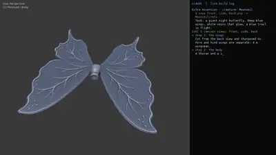</a><br><a href="https://www.sandbase.ai/lab/ai-videos/fable-5-2/2120135236868575567?lang=zh-CN&utm_source=github&utm_medium=readme&utm_campaign=awesome-fable-5-2&utm_content=card"><b>巨型夜蝶Moonveil三维生物动画</b></a><br><sub><a href="https://x.com/theparuchh/status/2120135236868575567">@theparuchh</a> · 0:41</sub></td><td width="33%" valign="top"><a href="https://www.sandbase.ai/lab/media/x/fable-5-2/2120139661863530865/video.mp4">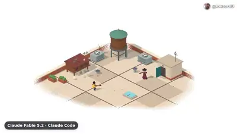</a><br><a href="https://www.sandbase.ai/lab/ai-videos/fable-5-2/2120139661863530865?lang=zh-CN&utm_source=github&utm_medium=readme&utm_campaign=awesome-fable-5-2&utm_content=card"><b>黑客帝国电影场景重现</b></a><br><sub><a href="https://x.com/loktar00/status/2120139661863530865">@loktar00</a> · 0:26</sub></td><td width="33%" valign="top"><a href="https://www.sandbase.ai/lab/media/x/fable-5-2/2120162023770054791/video.mp4">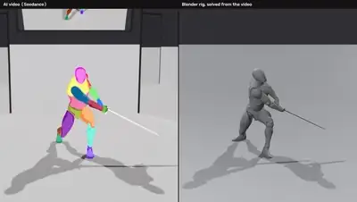</a><br><a href="https://www.sandbase.ai/lab/ai-videos/fable-5-2/2120162023770054791?lang=zh-CN&utm_source=github&utm_medium=readme&utm_campaign=awesome-fable-5-2&utm_content=card"><b>视频转3D动画生成测试</b></a><br><sub><a href="https://x.com/KHvostikk/status/2120162023770054791">@KHvostikk</a> · 0:16</sub></td></tr>
<tr><td width="33%" valign="top"><a href="https://www.sandbase.ai/lab/media/x/fable-5-2/2120172009972003115/video.mp4">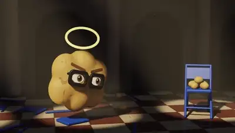</a><br><a href="https://www.sandbase.ai/lab/ai-videos/fable-5-2/2120172009972003115?lang=zh-CN&utm_source=github&utm_medium=readme&utm_campaign=awesome-fable-5-2&utm_content=card"><b>土豆砸碎蓝色椅子的循环动画</b></a><br><sub><a href="https://x.com/argofowl/status/2120172009972003115">@argofowl</a> · 0:12</sub></td><td width="33%" valign="top"><a href="https://www.sandbase.ai/lab/media/x/fable-5-2/2120188343870964113/video.mp4">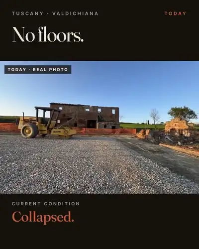</a><br><a href="https://www.sandbase.ai/lab/ai-videos/fable-5-2/2120188343870964113?lang=zh-CN&utm_source=github&utm_medium=readme&utm_campaign=awesome-fable-5-2&utm_content=card"><b>托斯卡纳废墟修复视觉效果视频</b></a><br><sub><a href="https://x.com/TimurNegru/status/2120188343870964113">@TimurNegru</a> · 0:34</sub></td><td width="33%" valign="top"><a href="https://www.sandbase.ai/lab/media/x/fable-5-2/2120198663062622581/video.mp4">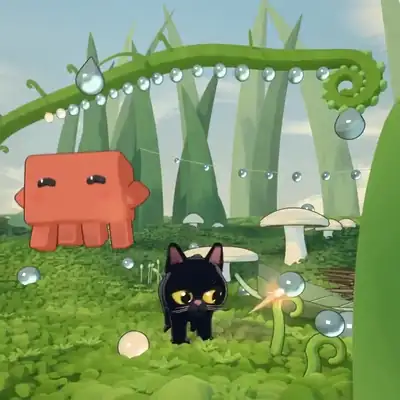</a><br><a href="https://www.sandbase.ai/lab/ai-videos/fable-5-2/2120198663062622581?lang=zh-CN&utm_source=github&utm_medium=readme&utm_campaign=awesome-fable-5-2&utm_content=card"><b>用Python和Blender代码生成的音乐视频</b></a><br><sub><a href="https://x.com/kevin_t_ngo/status/2120198663062622581">@kevin_t_ngo</a> · 1:17</sub></td></tr>
<tr><td width="33%" valign="top"><a href="https://www.sandbase.ai/lab/media/x/fable-5-2/2120199783730299278/video.mp4">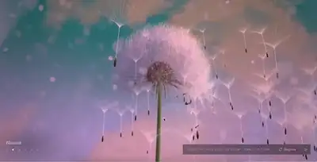</a><br><a href="https://www.sandbase.ai/lab/ai-videos/fable-5-2/2120199783730299278?lang=zh-CN&utm_source=github&utm_medium=readme&utm_campaign=awesome-fable-5-2&utm_content=card"><b>用 Fable 和 Opus 制作的 Three.js 场景</b></a><br><sub><a href="https://x.com/sarlloc/status/2120199783730299278">@sarlloc</a> · 0:16</sub></td><td width="33%" valign="top"><a href="https://www.sandbase.ai/lab/media/x/fable-5-2/2120199808052842714/video.mp4"></a><br><a href="https://www.sandbase.ai/lab/ai-videos/fable-5-2/2120199808052842714?lang=zh-CN&utm_source=github&utm_medium=readme&utm_campaign=awesome-fable-5-2&utm_content=card"><b>陨石第一视角坠落与撞击模拟</b></a><br><sub><a href="https://x.com/camperaigg/status/2120199808052842714">@camperaigg</a> · 0:40</sub></td><td width="33%" valign="top"><a href="https://www.sandbase.ai/lab/media/x/fable-5-2/2120200286753161230/video.mp4"></a><br><a href="https://www.sandbase.ai/lab/ai-videos/fable-5-2/2120200286753161230?lang=zh-CN&utm_source=github&utm_medium=readme&utm_campaign=awesome-fable-5-2&utm_content=card"><b>Fable视频转3D动画生成测试</b></a><br><sub><a href="https://x.com/KHvostikk/status/2120200286753161230">@KHvostikk</a> · 0:08</sub></td></tr>
<tr><td width="33%" valign="top"><a href="https://www.sandbase.ai/lab/media/x/fable-5-2/2120212644280119750/video.mp4"></a><br><a href="https://www.sandbase.ai/lab/ai-videos/fable-5-2/2120212644280119750?lang=zh-CN&utm_source=github&utm_medium=readme&utm_campaign=awesome-fable-5-2&utm_content=card"><b>使用Blender模型的Three.js动画</b></a><br><sub><a href="https://x.com/ZryMiller/status/2120212644280119750">@ZryMiller</a> · 0:45</sub></td><td width="33%" valign="top"><a href="https://www.sandbase.ai/lab/media/x/fable-5-2/2120214767868456979/video.mp4"></a><br><a href="https://www.sandbase.ai/lab/ai-videos/fable-5-2/2120214767868456979?lang=zh-CN&utm_source=github&utm_medium=readme&utm_campaign=awesome-fable-5-2&utm_content=card"><b>Three.js 交互式公寓场景</b></a><br><sub><a href="https://x.com/morsenxxx/status/2120214767868456979">@morsenxxx</a> · 0:58</sub></td><td width="33%" valign="top"><a href="https://www.sandbase.ai/lab/media/x/fable-5-2/2120224530367119758/video.mp4"></a><br><a href="https://www.sandbase.ai/lab/ai-videos/fable-5-2/2120224530367119758?lang=zh-CN&utm_source=github&utm_medium=readme&utm_campaign=awesome-fable-5-2&utm_content=card"><b>高细节3D手臂绑定与动画演示</b></a><br><sub><a href="https://x.com/apekshik/status/2120224530367119758">@apekshik</a> · 0:37</sub></td></tr>
<tr><td width="33%" valign="top"><a href="https://www.sandbase.ai/lab/media/x/fable-5-2/2120239401821487149/video.mp4"></a><br><a href="https://www.sandbase.ai/lab/ai-videos/fable-5-2/2120239401821487149?lang=zh-CN&utm_source=github&utm_medium=readme&utm_campaign=awesome-fable-5-2&utm_content=card"><b>使用Blender与Fable 5.2制作的动画</b></a><br><sub><a href="https://x.com/aecyydesign/status/2120239401821487149">@aecyydesign</a> · 0:10</sub></td><td width="33%" valign="top"><a href="https://www.sandbase.ai/lab/media/x/fable-5-2/2120247208918266080/video.mp4"></a><br><a href="https://www.sandbase.ai/lab/ai-videos/fable-5-2/2120247208918266080?lang=zh-CN&utm_source=github&utm_medium=readme&utm_campaign=awesome-fable-5-2&utm_content=card"><b>指环王风格的河流物理模拟 3D 场景</b></a><br><sub><a href="https://x.com/AymericRoucher/status/2120247208918266080">@AymericRoucher</a> · 0:08</sub></td><td width="33%" valign="top"><a href="https://www.sandbase.ai/lab/media/x/fable-5-2/2120248774861689199/video.mp4"></a><br><a href="https://www.sandbase.ai/lab/ai-videos/fable-5-2/2120248774861689199?lang=zh-CN&utm_source=github&utm_medium=readme&utm_campaign=awesome-fable-5-2&utm_content=card"><b>在 Three.js 中运行的四元素基准场景</b></a><br><sub><a href="https://x.com/orcdev/status/2120248774861689199">@orcdev</a> · 0:29</sub></td></tr>
<tr><td width="33%" valign="top"><a href="https://www.sandbase.ai/lab/media/x/fable-5-2/2120254108104007712/video.mp4"></a><br><a href="https://www.sandbase.ai/lab/ai-videos/fable-5-2/2120254108104007712?lang=zh-CN&utm_source=github&utm_medium=readme&utm_campaign=awesome-fable-5-2&utm_content=card"><b>Three.js中的龙巢3D场景</b></a><br><sub><a href="https://x.com/scottstts/status/2120254108104007712">@scottstts</a> · 1:00</sub></td><td width="33%" valign="top"><a href="https://www.sandbase.ai/lab/media/x/fable-5-2/2120254639278882915/video.mp4"></a><br><a href="https://www.sandbase.ai/lab/ai-videos/fable-5-2/2120254639278882915?lang=zh-CN&utm_source=github&utm_medium=readme&utm_campaign=awesome-fable-5-2&utm_content=card"><b>代码生成的鲁布戈德堡机械珊瑚球循环</b></a><br><sub><a href="https://x.com/0xWroomie/status/2120254639278882915">@0xWroomie</a> · 0:20</sub></td><td width="33%" valign="top"><a href="https://www.sandbase.ai/lab/media/x/fable-5-2/2120263514761912346/video.mp4"></a><br><a href="https://www.sandbase.ai/lab/ai-videos/fable-5-2/2120263514761912346?lang=zh-CN&utm_source=github&utm_medium=readme&utm_campaign=awesome-fable-5-2&utm_content=card"><b>怪兽3D动画测试与技巧分享</b></a><br><sub><a href="https://x.com/maxt3chno/status/2120263514761912346">@maxt3chno</a> · 0:20</sub></td></tr>
<tr><td width="33%" valign="top"><a href="https://www.sandbase.ai/lab/media/x/fable-5-2/2120305718939021566/video.mp4"></a><br><a href="https://www.sandbase.ai/lab/ai-videos/fable-5-2/2120305718939021566?lang=zh-CN&utm_source=github&utm_medium=readme&utm_campaign=awesome-fable-5-2&utm_content=card"><b>Blender中3D游戏角色动画工作流</b></a><br><sub><a href="https://x.com/luccacerf/status/2120305718939021566">@luccacerf</a> · 0:25</sub></td><td width="33%" valign="top"><a href="https://www.sandbase.ai/lab/media/x/fable-5-2/2120316203738829180/video.mp4"></a><br><a href="https://www.sandbase.ai/lab/ai-videos/fable-5-2/2120316203738829180?lang=zh-CN&utm_source=github&utm_medium=readme&utm_campaign=awesome-fable-5-2&utm_content=card"><b>在Blender中重现Three.js公寓场景</b></a><br><sub><a href="https://x.com/MengTo/status/2120316203738829180">@MengTo</a> · 0:52</sub></td><td width="33%" valign="top"><a href="https://www.sandbase.ai/lab/media/x/fable-5-2/2120486699134554373/video.mp4"></a><br><a href="https://www.sandbase.ai/lab/ai-videos/fable-5-2/2120486699134554373?lang=zh-CN&utm_source=github&utm_medium=readme&utm_campaign=awesome-fable-5-2&utm_content=card"><b>置身于楔形龙卷风正中央的模拟场景</b></a><br><sub><a href="https://x.com/camperaigg/status/2120486699134554373">@camperaigg</a> · 0:30 · <a href="https://www.sandbase.ai/lab/ai-videos/fable-5-2/2120486699134554373?lang=zh-CN&utm_source=github&utm_medium=readme&utm_campaign=awesome-fable-5-2&utm_content=card">提示词</a></sub></td></tr>
<tr><td width="33%" valign="top"><a href="https://www.sandbase.ai/lab/media/x/fable-5-2/2120495827777151186/video.mp4"></a><br><a href="https://www.sandbase.ai/lab/ai-videos/fable-5-2/2120495827777151186?lang=zh-CN&utm_source=github&utm_medium=readme&utm_campaign=awesome-fable-5-2&utm_content=card"><b>机械蚁组装机器人的3D场景</b></a><br><sub><a href="https://x.com/HamidoFx1/status/2120495827777151186">@HamidoFx1</a> · 0:20</sub></td><td width="33%" valign="top"><a href="https://www.sandbase.ai/lab/media/x/fable-5-2/2120505286603505858/video.mp4"></a><br><a href="https://www.sandbase.ai/lab/ai-videos/fable-5-2/2120505286603505858?lang=zh-CN&utm_source=github&utm_medium=readme&utm_campaign=awesome-fable-5-2&utm_content=card"><b>巴黎风情街头伴着节奏抛球杂耍</b></a><br><sub><a href="https://x.com/mxvdl/status/2120505286603505858">@mxvdl</a> · 0:53</sub></td><td width="33%" valign="top"><a href="https://www.sandbase.ai/lab/media/x/fable-5-2/2120518714743308542/video.mp4"></a><br><a href="https://www.sandbase.ai/lab/ai-videos/fable-5-2/2120518714743308542?lang=zh-CN&utm_source=github&utm_medium=readme&utm_campaign=awesome-fable-5-2&utm_content=card"><b>PS5手柄动态拆解演示</b></a><br><sub><a href="https://x.com/Nyxera0x/status/2120518714743308542">@Nyxera0x</a> · 0:24</sub></td></tr>
<tr><td width="33%" valign="top"><a href="https://www.sandbase.ai/lab/media/x/fable-5-2/2120534514552221821/video.mp4"></a><br><a href="https://www.sandbase.ai/lab/ai-videos/fable-5-2/2120534514552221821?lang=zh-CN&utm_source=github&utm_medium=readme&utm_campaign=awesome-fable-5-2&utm_content=card"><b>Three.js打造的温馨壁炉模拟器</b></a><br><sub><a href="https://x.com/maxt3chno/status/2120534514552221821">@maxt3chno</a> · 1:17</sub></td><td width="33%" valign="top"><a href="https://www.sandbase.ai/lab/media/x/fable-5-2/2120548065044234504/video.mp4"></a><br><a href="https://www.sandbase.ai/lab/ai-videos/fable-5-2/2120548065044234504?lang=zh-CN&utm_source=github&utm_medium=readme&utm_campaign=awesome-fable-5-2&utm_content=card"><b>纯JavaScript展现超人飞越计算机图形历史</b></a><br><sub><a href="https://x.com/chetaslua/status/2120548065044234504">@chetaslua</a> · 0:40</sub></td><td width="33%" valign="top"><a href="https://www.sandbase.ai/lab/media/x/fable-5-2/2120578546188062737/video.mp4"></a><br><a href="https://www.sandbase.ai/lab/ai-videos/fable-5-2/2120578546188062737?lang=zh-CN&utm_source=github&utm_medium=readme&utm_campaign=awesome-fable-5-2&utm_content=card"><b>Unity 矮人角色三维动画制作</b></a><br><sub><a href="https://x.com/Vexo200/status/2120578546188062737">@Vexo200</a> · 0:25</sub></td></tr>
<tr><td width="33%" valign="top"><a href="https://www.sandbase.ai/lab/media/x/fable-5-2/2120583040686772292/video.mp4"></a><br><a href="https://www.sandbase.ai/lab/ai-videos/fable-5-2/2120583040686772292?lang=zh-CN&utm_source=github&utm_medium=readme&utm_campaign=awesome-fable-5-2&utm_content=card"><b>拍立得相机拍摄与机械结构拆解动画</b></a><br><sub><a href="https://x.com/0xKitsui/status/2120583040686772292">@0xKitsui</a> · 0:24</sub></td><td width="33%" valign="top"><a href="https://www.sandbase.ai/lab/media/x/fable-5-2/2120587748989902982/video.mp4"></a><br><a href="https://www.sandbase.ai/lab/ai-videos/fable-5-2/2120587748989902982?lang=zh-CN&utm_source=github&utm_medium=readme&utm_campaign=awesome-fable-5-2&utm_content=card"><b>基于单张照片生成的星链天线拆解动画</b></a><br><sub><a href="https://x.com/elvar_official/status/2120587748989902982">@elvar_official</a> · 0:24</sub></td><td width="33%" valign="top"><a href="https://www.sandbase.ai/lab/media/x/fable-5-2/2120595096127078727/video.mp4"></a><br><a href="https://www.sandbase.ai/lab/ai-videos/fable-5-2/2120595096127078727?lang=zh-CN&utm_source=github&utm_medium=readme&utm_campaign=awesome-fable-5-2&utm_content=card"><b>从单张照片生成的RTX 5090显卡拆解3D动画</b></a><br><sub><a href="https://x.com/0x_fokki/status/2120595096127078727">@0x_fokki</a> · 0:24</sub></td></tr>
<tr><td width="33%" valign="top"><a href="https://www.sandbase.ai/lab/media/x/fable-5-2/2120596605539594662/video.mp4"></a><br><a href="https://www.sandbase.ai/lab/ai-videos/fable-5-2/2120596605539594662?lang=zh-CN&utm_source=github&utm_medium=readme&utm_campaign=awesome-fable-5-2&utm_content=card"><b>Blender 渲染的赛博朋克游戏世界</b></a><br><sub><a href="https://x.com/Supriik_/status/2120596605539594662">@Supriik_</a> · 1:20</sub></td><td width="33%" valign="top"><a href="https://www.sandbase.ai/lab/media/x/fable-5-2/2120600019879313830/video.mp4"></a><br><a href="https://www.sandbase.ai/lab/ai-videos/fable-5-2/2120600019879313830?lang=zh-CN&utm_source=github&utm_medium=readme&utm_campaign=awesome-fable-5-2&utm_content=card"><b>装满覆盆子果酱的可交互玻璃手提箱</b></a><br><sub><a href="https://x.com/0xWroomie/status/2120600019879313830">@0xWroomie</a> · 1:03</sub></td><td width="33%" valign="top"><a href="https://www.sandbase.ai/lab/media/x/fable-5-2/2120600519957737956/video.mp4"></a><br><a href="https://www.sandbase.ai/lab/ai-videos/fable-5-2/2120600519957737956?lang=zh-CN&utm_source=github&utm_medium=readme&utm_campaign=awesome-fable-5-2&utm_content=card"><b>手绘巴黎街头的花式足球三维场景</b></a><br><sub><a href="https://x.com/N1njaCodex/status/2120600519957737956">@N1njaCodex</a> · 0:25</sub></td></tr>
<tr><td width="33%" valign="top"><a href="https://www.sandbase.ai/lab/media/x/fable-5-2/2120601459385376975/video.mp4"></a><br><a href="https://www.sandbase.ai/lab/ai-videos/fable-5-2/2120601459385376975?lang=zh-CN&utm_source=github&utm_medium=readme&utm_campaign=awesome-fable-5-2&utm_content=card"><b>Blender 自动化三维产品场景渲染</b></a><br><sub><a href="https://x.com/francescoinweb3/status/2120601459385376975">@francescoinweb3</a> · 0:25 · <a href="https://www.sandbase.ai/lab/ai-videos/fable-5-2/2120601459385376975?lang=zh-CN&utm_source=github&utm_medium=readme&utm_campaign=awesome-fable-5-2&utm_content=card">提示词</a></sub></td></tr>
</table>

</details>

<a id="motion-graphics"></a>

## 动效

<table>
<tr><td width="33%" valign="top"><a href="https://www.sandbase.ai/lab/media/x/fable-5-2/2119875516216070289/video.mp4"></a><br><a href="https://www.sandbase.ai/lab/ai-videos/fable-5-2/2119875516216070289?lang=zh-CN&utm_source=github&utm_medium=readme&utm_campaign=awesome-fable-5-2&utm_content=card"><b>Fable 5.2 单次生成的作品</b></a><br><sub><a href="https://x.com/devsvn2/status/2119875516216070289">@devsvn2</a> · 0:35</sub></td><td width="33%" valign="top"><a href="https://www.sandbase.ai/lab/media/x/fable-5-2/2119879605607862329/video.mp4"></a><br><a href="https://www.sandbase.ai/lab/ai-videos/fable-5-2/2119879605607862329?lang=zh-CN&utm_source=github&utm_medium=readme&utm_campaign=awesome-fable-5-2&utm_content=card"><b>Fable动画生成测试效果</b></a><br><sub><a href="https://x.com/pleometric/status/2119879605607862329">@pleometric</a> · 0:50</sub></td><td width="33%" valign="top"><a href="https://www.sandbase.ai/lab/media/x/fable-5-2/2119879667457073355/video.mp4"></a><br><a href="https://www.sandbase.ai/lab/ai-videos/fable-5-2/2119879667457073355?lang=zh-CN&utm_source=github&utm_medium=readme&utm_campaign=awesome-fable-5-2&utm_content=card"><b>使用Fable 5.2制作的动态设计</b></a><br><sub><a href="https://x.com/Gregoirechp/status/2119879667457073355">@Gregoirechp</a> · 0:40</sub></td></tr>
<tr><td width="33%" valign="top"><a href="https://www.sandbase.ai/lab/media/x/fable-5-2/2119884041331892403/video.mp4"></a><br><a href="https://www.sandbase.ai/lab/ai-videos/fable-5-2/2119884041331892403?lang=zh-CN&utm_source=github&utm_medium=readme&utm_campaign=awesome-fable-5-2&utm_content=card"><b>单次提示直接生成的完整视频展示</b></a><br><sub><a href="https://x.com/mattshumer_/status/2119884041331892403">@mattshumer_</a> · 4:44</sub></td><td width="33%" valign="top"><a href="https://www.sandbase.ai/lab/media/x/fable-5-2/2119885430627913784/video.mp4"></a><br><a href="https://www.sandbase.ai/lab/ai-videos/fable-5-2/2119885430627913784?lang=zh-CN&utm_source=github&utm_medium=readme&utm_campaign=awesome-fable-5-2&utm_content=card"><b>Clawd 发布 Claude Fable 5.2 的动画视频</b></a><br><sub><a href="https://x.com/other__reality/status/2119885430627913784">@other__reality</a> · 0:26 · <a href="https://www.sandbase.ai/lab/ai-videos/fable-5-2/2119885430627913784?lang=zh-CN&utm_source=github&utm_medium=readme&utm_campaign=awesome-fable-5-2&utm_content=card">提示词</a></sub></td><td width="33%" valign="top"><a href="https://www.sandbase.ai/lab/media/x/fable-5-2/2119893834276507954/video.mp4"></a><br><a href="https://www.sandbase.ai/lab/ai-videos/fable-5-2/2119893834276507954?lang=zh-CN&utm_source=github&utm_medium=readme&utm_campaign=awesome-fable-5-2&utm_content=card"><b>火柴人格斗动作动画测试</b></a><br><sub><a href="https://x.com/DanielZambrini/status/2119893834276507954">@DanielZambrini</a> · 0:15</sub></td></tr>
</table>

<details>
<summary><b>展开全部 86 条</b></summary>

<table>
<tr><td width="33%" valign="top"><a href="https://www.sandbase.ai/lab/media/x/fable-5-2/2119894821255205099/video.mp4"></a><br><a href="https://www.sandbase.ai/lab/ai-videos/fable-5-2/2119894821255205099?lang=zh-CN&utm_source=github&utm_medium=readme&utm_campaign=awesome-fable-5-2&utm_content=card"><b>Fable 5.2在画布上自由创作动画</b></a><br><sub><a href="https://x.com/amihai/status/2119894821255205099">@amihai</a> · 0:14</sub></td><td width="33%" valign="top"><a href="https://www.sandbase.ai/lab/media/x/fable-5-2/2119902302001635455/video.mp4"></a><br><a href="https://www.sandbase.ai/lab/ai-videos/fable-5-2/2119902302001635455?lang=zh-CN&utm_source=github&utm_medium=readme&utm_campaign=awesome-fable-5-2&utm_content=card"><b>由代码生成的动态图形动画</b></a><br><sub><a href="https://x.com/eluchocha/status/2119902302001635455">@eluchocha</a> · 0:38</sub></td><td width="33%" valign="top"><a href="https://www.sandbase.ai/lab/media/x/fable-5-2/2119903341606314432/video.mp4"></a><br><a href="https://www.sandbase.ai/lab/ai-videos/fable-5-2/2119903341606314432?lang=zh-CN&utm_source=github&utm_medium=readme&utm_campaign=awesome-fable-5-2&utm_content=card"><b>使用 Fable 和 Dreamina 制作的音乐视频</b></a><br><sub><a href="https://x.com/AIandDesign/status/2119903341606314432">@AIandDesign</a> · 3:55</sub></td></tr>
<tr><td width="33%" valign="top"><a href="https://www.sandbase.ai/lab/media/x/fable-5-2/2119903824848761287/video.mp4"></a><br><a href="https://www.sandbase.ai/lab/ai-videos/fable-5-2/2119903824848761287?lang=zh-CN&utm_source=github&utm_medium=readme&utm_campaign=awesome-fable-5-2&utm_content=card"><b>Fable 5.2代码驱动的动态作品集</b></a><br><sub><a href="https://x.com/kaif9998/status/2119903824848761287">@kaif9998</a> · 0:15 · <a href="https://www.sandbase.ai/lab/ai-videos/fable-5-2/2119903824848761287?lang=zh-CN&utm_source=github&utm_medium=readme&utm_campaign=awesome-fable-5-2&utm_content=card">提示词</a></sub></td><td width="33%" valign="top"><a href="https://www.sandbase.ai/lab/media/x/fable-5-2/2119906384397603138/video.mp4"></a><br><a href="https://www.sandbase.ai/lab/ai-videos/fable-5-2/2119906384397603138?lang=zh-CN&utm_source=github&utm_medium=readme&utm_campaign=awesome-fable-5-2&utm_content=card"><b>克隆声音与虚拟数字人视频展示</b></a><br><sub><a href="https://x.com/dorukyalcinsoy/status/2119906384397603138">@dorukyalcinsoy</a> · 4:44</sub></td><td width="33%" valign="top"><a href="https://www.sandbase.ai/lab/media/x/fable-5-2/2119907891419480107/video.mp4"></a><br><a href="https://www.sandbase.ai/lab/ai-videos/fable-5-2/2119907891419480107?lang=zh-CN&utm_source=github&utm_medium=readme&utm_campaign=awesome-fable-5-2&utm_content=card"><b>巴赫风格管风琴赋格曲创作</b></a><br><sub><a href="https://x.com/aug5thmusic/status/2119907891419480107">@aug5thmusic</a> · 2:05 · <a href="https://www.sandbase.ai/lab/ai-videos/fable-5-2/2119907891419480107?lang=zh-CN&utm_source=github&utm_medium=readme&utm_campaign=awesome-fable-5-2&utm_content=card">提示词</a></sub></td></tr>
<tr><td width="33%" valign="top"><a href="https://www.sandbase.ai/lab/media/x/fable-5-2/2119907987477422453/video.mp4"></a><br><a href="https://www.sandbase.ai/lab/ai-videos/fable-5-2/2119907987477422453?lang=zh-CN&utm_source=github&utm_medium=readme&utm_campaign=awesome-fable-5-2&utm_content=card"><b>通过一段提示词设计的三个电子设备</b></a><br><sub><a href="https://x.com/kanavtwt/status/2119907987477422453">@kanavtwt</a> · 0:12</sub></td><td width="33%" valign="top"><a href="https://www.sandbase.ai/lab/media/x/fable-5-2/2119909604431626667/video.mp4"></a><br><a href="https://www.sandbase.ai/lab/ai-videos/fable-5-2/2119909604431626667?lang=zh-CN&utm_source=github&utm_medium=readme&utm_campaign=awesome-fable-5-2&utm_content=card"><b>Fable 网页动效测试</b></a><br><sub><a href="https://x.com/Webilyco/status/2119909604431626667">@Webilyco</a> · 0:21</sub></td><td width="33%" valign="top"><a href="https://www.sandbase.ai/lab/media/x/fable-5-2/2119911161386934330/video.mp4"></a><br><a href="https://www.sandbase.ai/lab/ai-videos/fable-5-2/2119911161386934330?lang=zh-CN&utm_source=github&utm_medium=readme&utm_campaign=awesome-fable-5-2&utm_content=card"><b>使用Fable制作的音乐视频</b></a><br><sub><a href="https://x.com/WesRoth/status/2119911161386934330">@WesRoth</a> · 0:37</sub></td></tr>
<tr><td width="33%" valign="top"><a href="https://www.sandbase.ai/lab/media/x/fable-5-2/2119920990893244510/video.mp4"></a><br><a href="https://www.sandbase.ai/lab/ai-videos/fable-5-2/2119920990893244510?lang=zh-CN&utm_source=github&utm_medium=readme&utm_campaign=awesome-fable-5-2&utm_content=card"><b>由Fable 5.2生成的唯美视频</b></a><br><sub><a href="https://x.com/aollivier82/status/2119920990893244510">@aollivier82</a> · 0:48 · <a href="https://www.sandbase.ai/lab/ai-videos/fable-5-2/2119920990893244510?lang=zh-CN&utm_source=github&utm_medium=readme&utm_campaign=awesome-fable-5-2&utm_content=card">提示词</a></sub></td><td width="33%" valign="top"><a href="https://www.sandbase.ai/lab/media/x/fable-5-2/2119922438498918464/video.mp4"></a><br><a href="https://www.sandbase.ai/lab/ai-videos/fable-5-2/2119922438498918464?lang=zh-CN&utm_source=github&utm_medium=readme&utm_campaign=awesome-fable-5-2&utm_content=card"><b>Fable 自主生成的项目演示</b></a><br><sub><a href="https://x.com/scottstts/status/2119922438498918464">@scottstts</a> · 1:16</sub></td><td width="33%" valign="top"><a href="https://www.sandbase.ai/lab/media/x/fable-5-2/2119923603785617868/video.mp4"></a><br><a href="https://www.sandbase.ai/lab/ai-videos/fable-5-2/2119923603785617868?lang=zh-CN&utm_source=github&utm_medium=readme&utm_campaign=awesome-fable-5-2&utm_content=card"><b>鹈鹕骑自行车的SVG动画测试</b></a><br><sub><a href="https://x.com/GKev1n/status/2119923603785617868">@GKev1n</a> · 0:10</sub></td></tr>
<tr><td width="33%" valign="top"><a href="https://www.sandbase.ai/lab/media/x/fable-5-2/2119925067207647695/video.mp4"></a><br><a href="https://www.sandbase.ai/lab/ai-videos/fable-5-2/2119925067207647695?lang=zh-CN&utm_source=github&utm_medium=readme&utm_campaign=awesome-fable-5-2&utm_content=card"><b>纯SVG动画奔腾的马</b></a><br><sub><a href="https://x.com/eyadnour/status/2119925067207647695">@eyadnour</a> · 0:26</sub></td><td width="33%" valign="top"><a href="https://www.sandbase.ai/lab/media/x/fable-5-2/2119931563760632311/video.mp4"></a><br><a href="https://www.sandbase.ai/lab/ai-videos/fable-5-2/2119931563760632311?lang=zh-CN&utm_source=github&utm_medium=readme&utm_campaign=awesome-fable-5-2&utm_content=card"><b>使用 Fable 5.2 单次生成的项目</b></a><br><sub><a href="https://x.com/saimagnate/status/2119931563760632311">@saimagnate</a> · 0:34</sub></td><td width="33%" valign="top"><a href="https://www.sandbase.ai/lab/media/x/fable-5-2/2119936176714875126/video.mp4"></a><br><a href="https://www.sandbase.ai/lab/ai-videos/fable-5-2/2119936176714875126?lang=zh-CN&utm_source=github&utm_medium=readme&utm_campaign=awesome-fable-5-2&utm_content=card"><b>Fable单次生成的动态图形视频</b></a><br><sub><a href="https://x.com/moritzkremb/status/2119936176714875126">@moritzkremb</a> · 1:04 · <a href="https://www.sandbase.ai/lab/ai-videos/fable-5-2/2119936176714875126?lang=zh-CN&utm_source=github&utm_medium=readme&utm_campaign=awesome-fable-5-2&utm_content=card">提示词</a></sub></td></tr>
<tr><td width="33%" valign="top"><a href="https://www.sandbase.ai/lab/media/x/fable-5-2/2119953913160093817/video.mp4"></a><br><a href="https://www.sandbase.ai/lab/ai-videos/fable-5-2/2119953913160093817?lang=zh-CN&utm_source=github&utm_medium=readme&utm_campaign=awesome-fable-5-2&utm_content=card"><b>Fable 5.2 单次提示词生成展示</b></a><br><sub><a href="https://x.com/WesRoth/status/2119953913160093817">@WesRoth</a> · 2:27</sub></td><td width="33%" valign="top"><a href="https://www.sandbase.ai/lab/media/x/fable-5-2/2119957886453395607/video.mp4"></a><br><a href="https://www.sandbase.ai/lab/ai-videos/fable-5-2/2119957886453395607?lang=zh-CN&utm_source=github&utm_medium=readme&utm_campaign=awesome-fable-5-2&utm_content=card"><b>仅用数条提示词生成的动画短片</b></a><br><sub><a href="https://x.com/NACHOS2D_/status/2119957886453395607">@NACHOS2D_</a> · 1:00</sub></td><td width="33%" valign="top"><a href="https://www.sandbase.ai/lab/media/x/fable-5-2/2119960064458928310/video.mp4"></a><br><a href="https://www.sandbase.ai/lab/ai-videos/fable-5-2/2119960064458928310?lang=zh-CN&utm_source=github&utm_medium=readme&utm_campaign=awesome-fable-5-2&utm_content=card"><b>Fable 5.2动画规划测试</b></a><br><sub><a href="https://x.com/knowixbuilds/status/2119960064458928310">@knowixbuilds</a> · 0:40</sub></td></tr>
<tr><td width="33%" valign="top"><a href="https://www.sandbase.ai/lab/media/x/fable-5-2/2119973951027724385/video.mp4"></a><br><a href="https://www.sandbase.ai/lab/ai-videos/fable-5-2/2119973951027724385?lang=zh-CN&utm_source=github&utm_medium=readme&utm_campaign=awesome-fable-5-2&utm_content=card"><b>Fable 5.2 视频编辑元演示视频</b></a><br><sub><a href="https://x.com/rileybrown/status/2119973951027724385">@rileybrown</a> · 2:01</sub></td><td width="33%" valign="top"><a href="https://www.sandbase.ai/lab/media/x/fable-5-2/2119976665782870202/video.mp4"></a><br><a href="https://www.sandbase.ai/lab/ai-videos/fable-5-2/2119976665782870202?lang=zh-CN&utm_source=github&utm_medium=readme&utm_campaign=awesome-fable-5-2&utm_content=card"><b>受 GTA VI 发售启发的视频</b></a><br><sub><a href="https://x.com/richoffyoutube/status/2119976665782870202">@richoffyoutube</a> · 0:56</sub></td><td width="33%" valign="top"><a href="https://www.sandbase.ai/lab/media/x/fable-5-2/2119981510199808368/video.mp4"></a><br><a href="https://www.sandbase.ai/lab/ai-videos/fable-5-2/2119981510199808368?lang=zh-CN&utm_source=github&utm_medium=readme&utm_campaign=awesome-fable-5-2&utm_content=card"><b>纯代码绘制并添加动效的插画</b></a><br><sub><a href="https://x.com/chetaslua/status/2119981510199808368">@chetaslua</a> · 0:11</sub></td></tr>
<tr><td width="33%" valign="top"><a href="https://www.sandbase.ai/lab/media/x/fable-5-2/2119998815856218494/video.mp4"></a><br><a href="https://www.sandbase.ai/lab/ai-videos/fable-5-2/2119998815856218494?lang=zh-CN&utm_source=github&utm_medium=readme&utm_campaign=awesome-fable-5-2&utm_content=card"><b>面向剪辑师制作的视频信息</b></a><br><sub><a href="https://x.com/ChrisGPT/status/2119998815856218494">@ChrisGPT</a> · 0:44</sub></td><td width="33%" valign="top"><a href="https://www.sandbase.ai/lab/media/x/fable-5-2/2120010995309457643/video.mp4"></a><br><a href="https://www.sandbase.ai/lab/ai-videos/fable-5-2/2120010995309457643?lang=zh-CN&utm_source=github&utm_medium=readme&utm_campaign=awesome-fable-5-2&utm_content=card"><b>Fable 5.2 构想生成的梦想视频</b></a><br><sub><a href="https://x.com/anabology/status/2120010995309457643">@anabology</a> · 4:04</sub></td><td width="33%" valign="top"><a href="https://www.sandbase.ai/lab/media/x/fable-5-2/2120014940350382119/video.mp4"></a><br><a href="https://www.sandbase.ai/lab/ai-videos/fable-5-2/2120014940350382119?lang=zh-CN&utm_source=github&utm_medium=readme&utm_campaign=awesome-fable-5-2&utm_content=card"><b>单次生成的动态视频展示</b></a><br><sub><a href="https://x.com/chhddavid/status/2120014940350382119">@chhddavid</a> · 0:50</sub></td></tr>
<tr><td width="33%" valign="top"><a href="https://www.sandbase.ai/lab/media/x/fable-5-2/2120015818696392844/video.mp4"></a><br><a href="https://www.sandbase.ai/lab/ai-videos/fable-5-2/2120015818696392844?lang=zh-CN&utm_source=github&utm_medium=readme&utm_campaign=awesome-fable-5-2&utm_content=card"><b>Fable 5.2 设计的电子设备</b></a><br><sub><a href="https://x.com/zoedotai/status/2120015818696392844">@zoedotai</a> · 0:05</sub></td><td width="33%" valign="top"><a href="https://www.sandbase.ai/lab/media/x/fable-5-2/2120039308623044626/video.mp4"></a><br><a href="https://www.sandbase.ai/lab/ai-videos/fable-5-2/2120039308623044626?lang=zh-CN&utm_source=github&utm_medium=readme&utm_campaign=awesome-fable-5-2&utm_content=card"><b>使用Fable 5.2复刻Dribbble动效</b></a><br><sub><a href="https://x.com/Thecreativemena/status/2120039308623044626">@Thecreativemena</a> · 0:08</sub></td><td width="33%" valign="top"><a href="https://www.sandbase.ai/lab/media/x/fable-5-2/2120065790003032150/video.mp4"></a><br><a href="https://www.sandbase.ai/lab/ai-videos/fable-5-2/2120065790003032150?lang=zh-CN&utm_source=github&utm_medium=readme&utm_campaign=awesome-fable-5-2&utm_content=card"><b>在Blender中全自动生成的动画音乐短片</b></a><br><sub><a href="https://x.com/kloss_xyz/status/2120065790003032150">@kloss_xyz</a> · 2:33</sub></td></tr>
<tr><td width="33%" valign="top"><a href="https://www.sandbase.ai/lab/media/x/fable-5-2/2120067587606200515/video.mp4"></a><br><a href="https://www.sandbase.ai/lab/ai-videos/fable-5-2/2120067587606200515?lang=zh-CN&utm_source=github&utm_medium=readme&utm_campaign=awesome-fable-5-2&utm_content=card"><b>LilyPond钢琴奏鸣曲音符可视化</b></a><br><sub><a href="https://x.com/Egichzz/status/2120067587606200515">@Egichzz</a> · 1:28</sub></td><td width="33%" valign="top"><a href="https://www.sandbase.ai/lab/media/x/fable-5-2/2120070220924776496/video.mp4"></a><br><a href="https://www.sandbase.ai/lab/ai-videos/fable-5-2/2120070220924776496?lang=zh-CN&utm_source=github&utm_medium=readme&utm_campaign=awesome-fable-5-2&utm_content=card"><b>雨后东京夜空中的纸金鱼游动</b></a><br><sub><a href="https://x.com/KanaWorks_AI/status/2120070220924776496">@KanaWorks_AI</a> · 0:21</sub></td><td width="33%" valign="top"><a href="https://www.sandbase.ai/lab/media/x/fable-5-2/2120070941845967208/video.mp4"></a><br><a href="https://www.sandbase.ai/lab/ai-videos/fable-5-2/2120070941845967208?lang=zh-CN&utm_source=github&utm_medium=readme&utm_campaign=awesome-fable-5-2&utm_content=card"><b>使用 Fable 5.2 制作的动效与设计演示</b></a><br><sub><a href="https://x.com/hello_amani/status/2120070941845967208">@hello_amani</a> · 0:30</sub></td></tr>
<tr><td width="33%" valign="top"><a href="https://www.sandbase.ai/lab/media/x/fable-5-2/2120075777861628189/video.mp4"></a><br><a href="https://www.sandbase.ai/lab/ai-videos/fable-5-2/2120075777861628189?lang=zh-CN&utm_source=github&utm_medium=readme&utm_campaign=awesome-fable-5-2&utm_content=card"><b>为张哲瀚制作的庆祝视频</b></a><br><sub><a href="https://x.com/AmandaCDrama/status/2120075777861628189">@AmandaCDrama</a> · 0:21</sub></td><td width="33%" valign="top"><a href="https://www.sandbase.ai/lab/media/x/fable-5-2/2120083276916224014/video.mp4"></a><br><a href="https://www.sandbase.ai/lab/ai-videos/fable-5-2/2120083276916224014?lang=zh-CN&utm_source=github&utm_medium=readme&utm_campaign=awesome-fable-5-2&utm_content=card"><b>纪念穆斯塔法·凯末尔·阿塔图尔克的致敬视频</b></a><br><sub><a href="https://x.com/DeryaTR_/status/2120083276916224014">@DeryaTR_</a> · 3:57</sub></td><td width="33%" valign="top"><a href="https://www.sandbase.ai/lab/media/x/fable-5-2/2120083973854605676/video.mp4"></a><br><a href="https://www.sandbase.ai/lab/ai-videos/fable-5-2/2120083973854605676?lang=zh-CN&utm_source=github&utm_medium=readme&utm_campaign=awesome-fable-5-2&utm_content=card"><b>Fable 5.2生成的4K超清视频</b></a><br><sub><a href="https://x.com/OjasSharma276/status/2120083973854605676">@OjasSharma276</a> · 2:00</sub></td></tr>
<tr><td width="33%" valign="top"><a href="https://www.sandbase.ai/lab/media/x/fable-5-2/2120090542419984686/video.mp4"></a><br><a href="https://www.sandbase.ai/lab/ai-videos/fable-5-2/2120090542419984686?lang=zh-CN&utm_source=github&utm_medium=readme&utm_campaign=awesome-fable-5-2&utm_content=card"><b>用Claude绘制并动画的世界七大奇迹</b></a><br><sub><a href="https://x.com/devteamdrew/status/2120090542419984686">@devteamdrew</a> · 0:10</sub></td><td width="33%" valign="top"><a href="https://www.sandbase.ai/lab/media/x/fable-5-2/2120091754208633250/video.mp4"></a><br><a href="https://www.sandbase.ai/lab/ai-videos/fable-5-2/2120091754208633250?lang=zh-CN&utm_source=github&utm_medium=readme&utm_campaign=awesome-fable-5-2&utm_content=card"><b>使用 Fable 5.2 生成的动画</b></a><br><sub><a href="https://x.com/OxShamss/status/2120091754208633250">@OxShamss</a> · 1:31</sub></td><td width="33%" valign="top"><a href="https://www.sandbase.ai/lab/media/x/fable-5-2/2120092008333381850/video.mp4"></a><br><a href="https://www.sandbase.ai/lab/ai-videos/fable-5-2/2120092008333381850?lang=zh-CN&utm_source=github&utm_medium=readme&utm_campaign=awesome-fable-5-2&utm_content=card"><b>Fable 5.2 单提示词视频生成展示</b></a><br><sub><a href="https://x.com/yasirahmadnoori/status/2120092008333381850">@yasirahmadnoori</a> · 0:13 · <a href="https://www.sandbase.ai/lab/ai-videos/fable-5-2/2120092008333381850?lang=zh-CN&utm_source=github&utm_medium=readme&utm_campaign=awesome-fable-5-2&utm_content=card">提示词</a></sub></td></tr>
<tr><td width="33%" valign="top"><a href="https://www.sandbase.ai/lab/media/x/fable-5-2/2120100759195000942/video.mp4"></a><br><a href="https://www.sandbase.ai/lab/ai-videos/fable-5-2/2120100759195000942?lang=zh-CN&utm_source=github&utm_medium=readme&utm_campaign=awesome-fable-5-2&utm_content=card"><b>用代码生成的微型短片</b></a><br><sub><a href="https://x.com/argofowl/status/2120100759195000942">@argofowl</a> · 0:16</sub></td><td width="33%" valign="top"><a href="https://www.sandbase.ai/lab/media/x/fable-5-2/2120106024887787991/video.mp4"></a><br><a href="https://www.sandbase.ai/lab/ai-videos/fable-5-2/2120106024887787991?lang=zh-CN&utm_source=github&utm_medium=readme&utm_campaign=awesome-fable-5-2&utm_content=card"><b>通过代码生成的15秒动态图形</b></a><br><sub><a href="https://x.com/Abdullah_Ops1/status/2120106024887787991">@Abdullah_Ops1</a> · 0:15</sub></td><td width="33%" valign="top"><a href="https://www.sandbase.ai/lab/media/x/fable-5-2/2120108736375386620/video.mp4"></a><br><a href="https://www.sandbase.ai/lab/ai-videos/fable-5-2/2120108736375386620?lang=zh-CN&utm_source=github&utm_medium=readme&utm_campaign=awesome-fable-5-2&utm_content=card"><b>孔雀 SVG 动画测试</b></a><br><sub><a href="https://x.com/SahilPanhotra/status/2120108736375386620">@SahilPanhotra</a> · 0:10</sub></td></tr>
<tr><td width="33%" valign="top"><a href="https://www.sandbase.ai/lab/media/x/fable-5-2/2120125155443679249/video.mp4"></a><br><a href="https://www.sandbase.ai/lab/ai-videos/fable-5-2/2120125155443679249?lang=zh-CN&utm_source=github&utm_medium=readme&utm_campaign=awesome-fable-5-2&utm_content=card"><b>Fable 动态图形生成测试</b></a><br><sub><a href="https://x.com/amine_prcs/status/2120125155443679249">@amine_prcs</a> · 0:58</sub></td><td width="33%" valign="top"><a href="https://www.sandbase.ai/lab/media/x/fable-5-2/2120134049503347125/video.mp4"></a><br><a href="https://www.sandbase.ai/lab/ai-videos/fable-5-2/2120134049503347125?lang=zh-CN&utm_source=github&utm_medium=readme&utm_campaign=awesome-fable-5-2&utm_content=card"><b>Fable 5.2生成的动画演示</b></a><br><sub><a href="https://x.com/LuoErik8lrl/status/2120134049503347125">@LuoErik8lrl</a> · 1:00</sub></td><td width="33%" valign="top"><a href="https://www.sandbase.ai/lab/media/x/fable-5-2/2120134440512794822/video.mp4"></a><br><a href="https://www.sandbase.ai/lab/ai-videos/fable-5-2/2120134440512794822?lang=zh-CN&utm_source=github&utm_medium=readme&utm_campaign=awesome-fable-5-2&utm_content=card"><b>网页动画库制作的动效展示</b></a><br><sub><a href="https://x.com/0xnicc0/status/2120134440512794822">@0xnicc0</a> · 0:30</sub></td></tr>
<tr><td width="33%" valign="top"><a href="https://www.sandbase.ai/lab/media/x/fable-5-2/2120137005732336004/video.mp4"></a><br><a href="https://www.sandbase.ai/lab/ai-videos/fable-5-2/2120137005732336004?lang=zh-CN&utm_source=github&utm_medium=readme&utm_campaign=awesome-fable-5-2&utm_content=card"><b>多套开源库生成的动态设计合辑</b></a><br><sub><a href="https://x.com/0xsoul/status/2120137005732336004">@0xsoul</a> · 0:34</sub></td><td width="33%" valign="top"><a href="https://www.sandbase.ai/lab/media/x/fable-5-2/2120142394985267463/video.mp4"></a><br><a href="https://www.sandbase.ai/lab/ai-videos/fable-5-2/2120142394985267463?lang=zh-CN&utm_source=github&utm_medium=readme&utm_campaign=awesome-fable-5-2&utm_content=card"><b>80年代风格CRT着色器Marble标志动画</b></a><br><sub><a href="https://x.com/lionel_mora/status/2120142394985267463">@lionel_mora</a> · 0:12</sub></td><td width="33%" valign="top"><a href="https://www.sandbase.ai/lab/media/x/fable-5-2/2120150756909089244/video.mp4"></a><br><a href="https://www.sandbase.ai/lab/ai-videos/fable-5-2/2120150756909089244?lang=zh-CN&utm_source=github&utm_medium=readme&utm_campaign=awesome-fable-5-2&utm_content=card"><b>通过纯代码生成的泰坦尼克号动画视频</b></a><br><sub><a href="https://x.com/notjazii/status/2120150756909089244">@notjazii</a> · 3:21</sub></td></tr>
<tr><td width="33%" valign="top"><a href="https://www.sandbase.ai/lab/media/x/fable-5-2/2120151937995649231/video.mp4"></a><br><a href="https://www.sandbase.ai/lab/ai-videos/fable-5-2/2120151937995649231?lang=zh-CN&utm_source=github&utm_medium=readme&utm_campaign=awesome-fable-5-2&utm_content=card"><b>Fable 5.2制作的完整动效设计合集</b></a><br><sub><a href="https://x.com/cryptowluha/status/2120151937995649231">@cryptowluha</a> · 0:35</sub></td><td width="33%" valign="top"><a href="https://www.sandbase.ai/lab/media/x/fable-5-2/2120152210881618226/video.mp4"></a><br><a href="https://www.sandbase.ai/lab/ai-videos/fable-5-2/2120152210881618226?lang=zh-CN&utm_source=github&utm_medium=readme&utm_campaign=awesome-fable-5-2&utm_content=card"><b>用Fable 5.2在Rive中复刻吉祥物动画</b></a><br><sub><a href="https://x.com/paulo_kombucha/status/2120152210881618226">@paulo_kombucha</a> · 0:21</sub></td><td width="33%" valign="top"><a href="https://www.sandbase.ai/lab/media/x/fable-5-2/2120155163151532369/video.mp4"></a><br><a href="https://www.sandbase.ai/lab/ai-videos/fable-5-2/2120155163151532369?lang=zh-CN&utm_source=github&utm_medium=readme&utm_campaign=awesome-fable-5-2&utm_content=card"><b>小熊猫与废弃火箭动画短片</b></a><br><sub><a href="https://x.com/jayypatel18/status/2120155163151532369">@jayypatel18</a> · 1:14</sub></td></tr>
<tr><td width="33%" valign="top"><a href="https://www.sandbase.ai/lab/media/x/fable-5-2/2120158769758027923/video.mp4"></a><br><a href="https://www.sandbase.ai/lab/ai-videos/fable-5-2/2120158769758027923?lang=zh-CN&utm_source=github&utm_medium=readme&utm_campaign=awesome-fable-5-2&utm_content=card"><b>全由AI生成的视频演示</b></a><br><sub><a href="https://x.com/kanavtwt/status/2120158769758027923">@kanavtwt</a> · 1:31</sub></td><td width="33%" valign="top"><a href="https://www.sandbase.ai/lab/media/x/fable-5-2/2120159692320362786/video.mp4"></a><br><a href="https://www.sandbase.ai/lab/ai-videos/fable-5-2/2120159692320362786?lang=zh-CN&utm_source=github&utm_medium=readme&utm_campaign=awesome-fable-5-2&utm_content=card"><b>Claude Fable 5.2生成的像素艺术动画</b></a><br><sub><a href="https://x.com/akshdeeps_001/status/2120159692320362786">@akshdeeps_001</a> · 0:07</sub></td><td width="33%" valign="top"><a href="https://www.sandbase.ai/lab/media/x/fable-5-2/2120167637133238295/video.mp4"></a><br><a href="https://www.sandbase.ai/lab/ai-videos/fable-5-2/2120167637133238295?lang=zh-CN&utm_source=github&utm_medium=readme&utm_campaign=awesome-fable-5-2&utm_content=card"><b>Claude标志动效</b></a><br><sub><a href="https://x.com/LexnLin/status/2120167637133238295">@LexnLin</a> · 0:30</sub></td></tr>
<tr><td width="33%" valign="top"><a href="https://www.sandbase.ai/lab/media/x/fable-5-2/2120169469490368893/video.mp4"></a><br><a href="https://www.sandbase.ai/lab/ai-videos/fable-5-2/2120169469490368893?lang=zh-CN&utm_source=github&utm_medium=readme&utm_campaign=awesome-fable-5-2&utm_content=card"><b>纯代码生成的 30 秒动画短片</b></a><br><sub><a href="https://x.com/FornYapayZeka/status/2120169469490368893">@FornYapayZeka</a> · 0:30</sub></td><td width="33%" valign="top"><a href="https://www.sandbase.ai/lab/media/x/fable-5-2/2120177103584858570/video.mp4"></a><br><a href="https://www.sandbase.ai/lab/ai-videos/fable-5-2/2120177103584858570?lang=zh-CN&utm_source=github&utm_medium=readme&utm_campaign=awesome-fable-5-2&utm_content=card"><b>骑自行车的鹈鹕SVG动画</b></a><br><sub><a href="https://x.com/TokenGremlin/status/2120177103584858570">@TokenGremlin</a> · 0:19</sub></td><td width="33%" valign="top"><a href="https://www.sandbase.ai/lab/media/x/fable-5-2/2120177401619747146/video.mp4"></a><br><a href="https://www.sandbase.ai/lab/ai-videos/fable-5-2/2120177401619747146?lang=zh-CN&utm_source=github&utm_medium=readme&utm_campaign=awesome-fable-5-2&utm_content=card"><b>使用 Fable 5.2 制作的动画</b></a><br><sub><a href="https://x.com/oiharshit/status/2120177401619747146">@oiharshit</a> · 0:07 · <a href="https://www.sandbase.ai/lab/ai-videos/fable-5-2/2120177401619747146?lang=zh-CN&utm_source=github&utm_medium=readme&utm_campaign=awesome-fable-5-2&utm_content=card">提示词</a></sub></td></tr>
<tr><td width="33%" valign="top"><a href="https://www.sandbase.ai/lab/media/x/fable-5-2/2120178561973657773/video.mp4"></a><br><a href="https://www.sandbase.ai/lab/ai-videos/fable-5-2/2120178561973657773?lang=zh-CN&utm_source=github&utm_medium=readme&utm_campaign=awesome-fable-5-2&utm_content=card"><b>用 Fable 5.2 单提示词生成的动画</b></a><br><sub><a href="https://x.com/tobiadonadon_/status/2120178561973657773">@tobiadonadon_</a> · 0:18</sub></td><td width="33%" valign="top"><a href="https://www.sandbase.ai/lab/media/x/fable-5-2/2120181596384825581/video.mp4"></a><br><a href="https://www.sandbase.ai/lab/ai-videos/fable-5-2/2120181596384825581?lang=zh-CN&utm_source=github&utm_medium=readme&utm_campaign=awesome-fable-5-2&utm_content=card"><b>完全由代码绘制渲染的动画视频</b></a><br><sub><a href="https://x.com/SamVale29/status/2120181596384825581">@SamVale29</a> · 0:58</sub></td><td width="33%" valign="top"><a href="https://www.sandbase.ai/lab/media/x/fable-5-2/2120198834559271314/video.mp4"></a><br><a href="https://www.sandbase.ai/lab/ai-videos/fable-5-2/2120198834559271314?lang=zh-CN&utm_source=github&utm_medium=readme&utm_campaign=awesome-fable-5-2&utm_content=card"><b>关于生命的意义的短片</b></a><br><sub><a href="https://x.com/Av1dlive/status/2120198834559271314">@Av1dlive</a> · 4:13</sub></td></tr>
<tr><td width="33%" valign="top"><a href="https://www.sandbase.ai/lab/media/x/fable-5-2/2120210882382971263/video.mp4"></a><br><a href="https://www.sandbase.ai/lab/ai-videos/fable-5-2/2120210882382971263?lang=zh-CN&utm_source=github&utm_medium=readme&utm_campaign=awesome-fable-5-2&utm_content=card"><b>动态动态图形作品集展示</b></a><br><sub><a href="https://x.com/MatinSenPai/status/2120210882382971263">@MatinSenPai</a> · 0:15 · <a href="https://www.sandbase.ai/lab/ai-videos/fable-5-2/2120210882382971263?lang=zh-CN&utm_source=github&utm_medium=readme&utm_campaign=awesome-fable-5-2&utm_content=card">提示词</a></sub></td><td width="33%" valign="top"><a href="https://www.sandbase.ai/lab/media/x/fable-5-2/2120211050595340766/video.mp4"></a><br><a href="https://www.sandbase.ai/lab/ai-videos/fable-5-2/2120211050595340766?lang=zh-CN&utm_source=github&utm_medium=readme&utm_campaign=awesome-fable-5-2&utm_content=card"><b>使用 Fable 5.2 制作的视频</b></a><br><sub><a href="https://x.com/skpnky/status/2120211050595340766">@skpnky</a> · 1:05</sub></td><td width="33%" valign="top"><a href="https://www.sandbase.ai/lab/media/x/fable-5-2/2120215638710850033/video.mp4"></a><br><a href="https://www.sandbase.ai/lab/ai-videos/fable-5-2/2120215638710850033?lang=zh-CN&utm_source=github&utm_medium=readme&utm_campaign=awesome-fable-5-2&utm_content=card"><b>一镜到底动作打斗测试短片</b></a><br><sub><a href="https://x.com/EZheng66099/status/2120215638710850033">@EZheng66099</a> · 1:34</sub></td></tr>
<tr><td width="33%" valign="top"><a href="https://www.sandbase.ai/lab/media/x/fable-5-2/2120237379621388499/video.mp4"></a><br><a href="https://www.sandbase.ai/lab/ai-videos/fable-5-2/2120237379621388499?lang=zh-CN&utm_source=github&utm_medium=readme&utm_campaign=awesome-fable-5-2&utm_content=card"><b>自动添加动态图形与字幕的视频剪辑</b></a><br><sub><a href="https://x.com/stevenvan_/status/2120237379621388499">@stevenvan_</a> · 0:45</sub></td><td width="33%" valign="top"><a href="https://www.sandbase.ai/lab/media/x/fable-5-2/2120238479988740542/video.mp4"></a><br><a href="https://www.sandbase.ai/lab/ai-videos/fable-5-2/2120238479988740542?lang=zh-CN&utm_source=github&utm_medium=readme&utm_campaign=awesome-fable-5-2&utm_content=card"><b>纯代码生成的两段视频</b></a><br><sub><a href="https://x.com/LukeTsiaras/status/2120238479988740542">@LukeTsiaras</a> · 0:10 · <a href="https://www.sandbase.ai/lab/ai-videos/fable-5-2/2120238479988740542?lang=zh-CN&utm_source=github&utm_medium=readme&utm_campaign=awesome-fable-5-2&utm_content=card">提示词</a></sub></td><td width="33%" valign="top"><a href="https://www.sandbase.ai/lab/media/x/fable-5-2/2120248502110605646/video.mp4"></a><br><a href="https://www.sandbase.ai/lab/ai-videos/fable-5-2/2120248502110605646?lang=zh-CN&utm_source=github&utm_medium=readme&utm_campaign=awesome-fable-5-2&utm_content=card"><b>对 Claude Fable 5.2 单提示词生成的预期</b></a><br><sub><a href="https://x.com/motionstashco/status/2120248502110605646">@motionstashco</a> · 0:16</sub></td></tr>
<tr><td width="33%" valign="top"><a href="https://www.sandbase.ai/lab/media/x/fable-5-2/2120251042558333349/video.mp4"></a><br><a href="https://www.sandbase.ai/lab/ai-videos/fable-5-2/2120251042558333349?lang=zh-CN&utm_source=github&utm_medium=readme&utm_campaign=awesome-fable-5-2&utm_content=card"><b>纯JavaScript代码生成的动画短片</b></a><br><sub><a href="https://x.com/AIMind_Ai/status/2120251042558333349">@AIMind_Ai</a> · 1:00</sub></td><td width="33%" valign="top"><a href="https://www.sandbase.ai/lab/media/x/fable-5-2/2120253494217306162/video.mp4"></a><br><a href="https://www.sandbase.ai/lab/ai-videos/fable-5-2/2120253494217306162?lang=zh-CN&utm_source=github&utm_medium=readme&utm_campaign=awesome-fable-5-2&utm_content=card"><b>纯代码生成的动态视频</b></a><br><sub><a href="https://x.com/niteshshar1/status/2120253494217306162">@niteshshar1</a> · 4:50</sub></td><td width="33%" valign="top"><a href="https://www.sandbase.ai/lab/media/x/fable-5-2/2120279835020804164/video.mp4"></a><br><a href="https://www.sandbase.ai/lab/ai-videos/fable-5-2/2120279835020804164?lang=zh-CN&utm_source=github&utm_medium=readme&utm_campaign=awesome-fable-5-2&utm_content=card"><b>使用 Fable 5.2 制作的加载动画</b></a><br><sub><a href="https://x.com/seanaiux/status/2120279835020804164">@seanaiux</a> · 0:12 · <a href="https://www.sandbase.ai/lab/ai-videos/fable-5-2/2120279835020804164?lang=zh-CN&utm_source=github&utm_medium=readme&utm_campaign=awesome-fable-5-2&utm_content=card">提示词</a></sub></td></tr>
<tr><td width="33%" valign="top"><a href="https://www.sandbase.ai/lab/media/x/fable-5-2/2120286741248741694/video.mp4"></a><br><a href="https://www.sandbase.ai/lab/ai-videos/fable-5-2/2120286741248741694?lang=zh-CN&utm_source=github&utm_medium=readme&utm_campaign=awesome-fable-5-2&utm_content=card"><b>使用 Fable 和 Higgsfield 制作的皮克斯风格动画</b></a><br><sub><a href="https://x.com/pounddz/status/2120286741248741694">@pounddz</a> · 3:29</sub></td><td width="33%" valign="top"><a href="https://www.sandbase.ai/lab/media/x/fable-5-2/2120349707142860942/video.mp4"></a><br><a href="https://www.sandbase.ai/lab/ai-videos/fable-5-2/2120349707142860942?lang=zh-CN&utm_source=github&utm_medium=readme&utm_campaign=awesome-fable-5-2&utm_content=card"><b>Fable 5.2复刻动态设计</b></a><br><sub><a href="https://x.com/kloss_xyz/status/2120349707142860942">@kloss_xyz</a> · 0:16 · <a href="https://www.sandbase.ai/lab/ai-videos/fable-5-2/2120349707142860942?lang=zh-CN&utm_source=github&utm_medium=readme&utm_campaign=awesome-fable-5-2&utm_content=card">提示词</a></sub></td><td width="33%" valign="top"><a href="https://www.sandbase.ai/lab/media/x/fable-5-2/2120372319608508871/video.mp4"></a><br><a href="https://www.sandbase.ai/lab/ai-videos/fable-5-2/2120372319608508871?lang=zh-CN&utm_source=github&utm_medium=readme&utm_campaign=awesome-fable-5-2&utm_content=card"><b>使用LottieFiles MCP制作的可编辑动态圣诞插图</b></a><br><sub><a href="https://x.com/robrtcode/status/2120372319608508871">@robrtcode</a> · 0:04</sub></td></tr>
<tr><td width="33%" valign="top"><a href="https://www.sandbase.ai/lab/media/x/fable-5-2/2120424277921198298/video.mp4"></a><br><a href="https://www.sandbase.ai/lab/ai-videos/fable-5-2/2120424277921198298?lang=zh-CN&utm_source=github&utm_medium=readme&utm_campaign=awesome-fable-5-2&utm_content=card"><b>沉睡星舰上的困倦机器人动画</b></a><br><sub><a href="https://x.com/ChrisGPT/status/2120424277921198298">@ChrisGPT</a> · 0:45</sub></td><td width="33%" valign="top"><a href="https://www.sandbase.ai/lab/media/x/fable-5-2/2120476014581027154/video.mp4"></a><br><a href="https://www.sandbase.ai/lab/ai-videos/fable-5-2/2120476014581027154?lang=zh-CN&utm_source=github&utm_medium=readme&utm_campaign=awesome-fable-5-2&utm_content=card"><b>动画展示加载进度条的演变历史</b></a><br><sub><a href="https://x.com/noclipepe/status/2120476014581027154">@noclipepe</a> · 0:35</sub></td><td width="33%" valign="top"><a href="https://www.sandbase.ai/lab/media/x/fable-5-2/2120486254852608470/video.mp4"></a><br><a href="https://www.sandbase.ai/lab/ai-videos/fable-5-2/2120486254852608470?lang=zh-CN&utm_source=github&utm_medium=readme&utm_campaign=awesome-fable-5-2&utm_content=card"><b>Fable 5.2动态设计演示</b></a><br><sub><a href="https://x.com/DaveJ/status/2120486254852608470">@DaveJ</a> · 0:25</sub></td></tr>
<tr><td width="33%" valign="top"><a href="https://www.sandbase.ai/lab/media/x/fable-5-2/2120488092096160189/video.mp4"></a><br><a href="https://www.sandbase.ai/lab/ai-videos/fable-5-2/2120488092096160189?lang=zh-CN&utm_source=github&utm_medium=readme&utm_campaign=awesome-fable-5-2&utm_content=card"><b>Fable 5.2 生成的梦想主题视频片段</b></a><br><sub><a href="https://x.com/robertwiblin/status/2120488092096160189">@robertwiblin</a> · 0:45</sub></td><td width="33%" valign="top"><a href="https://www.sandbase.ai/lab/media/x/fable-5-2/2120514632485945595/video.mp4"></a><br><a href="https://www.sandbase.ai/lab/ai-videos/fable-5-2/2120514632485945595?lang=zh-CN&utm_source=github&utm_medium=readme&utm_campaign=awesome-fable-5-2&utm_content=card"><b>火柴人与橡皮擦对决动画细节解析</b></a><br><sub><a href="https://x.com/DanielZambrini/status/2120514632485945595">@DanielZambrini</a> · 0:15</sub></td><td width="33%" valign="top"><a href="https://www.sandbase.ai/lab/media/x/fable-5-2/2120516900430159916/video.mp4"></a><br><a href="https://www.sandbase.ai/lab/ai-videos/fable-5-2/2120516900430159916?lang=zh-CN&utm_source=github&utm_medium=readme&utm_campaign=awesome-fable-5-2&utm_content=card"><b>Fable 5.2 生成的手翻书动画</b></a><br><sub><a href="https://x.com/dingchilling/status/2120516900430159916">@dingchilling</a> · 0:15</sub></td></tr>
<tr><td width="33%" valign="top"><a href="https://www.sandbase.ai/lab/media/x/fable-5-2/2120525979261325637/video.mp4"></a><br><a href="https://www.sandbase.ai/lab/ai-videos/fable-5-2/2120525979261325637?lang=zh-CN&utm_source=github&utm_medium=readme&utm_campaign=awesome-fable-5-2&utm_content=card"><b>AI智能体生成的复古品牌广告</b></a><br><sub><a href="https://x.com/reallynattu/status/2120525979261325637">@reallynattu</a> · 0:30</sub></td><td width="33%" valign="top"><a href="https://www.sandbase.ai/lab/media/x/fable-5-2/2120548102801444974/video.mp4"></a><br><a href="https://www.sandbase.ai/lab/ai-videos/fable-5-2/2120548102801444974?lang=zh-CN&utm_source=github&utm_medium=readme&utm_campaign=awesome-fable-5-2&utm_content=card"><b>纯代码生成的1930年代风格卡通动画</b></a><br><sub><a href="https://x.com/SanChanRun/status/2120548102801444974">@SanChanRun</a> · 1:02</sub></td><td width="33%" valign="top"><a href="https://www.sandbase.ai/lab/media/x/fable-5-2/2120554995128963481/video.mp4"></a><br><a href="https://www.sandbase.ai/lab/ai-videos/fable-5-2/2120554995128963481?lang=zh-CN&utm_source=github&utm_medium=readme&utm_campaign=awesome-fable-5-2&utm_content=card"><b>用JavaScript呈现凤凰生命周期的动态动画</b></a><br><sub><a href="https://x.com/devteamdrew/status/2120554995128963481">@devteamdrew</a> · 0:40</sub></td></tr>
<tr><td width="33%" valign="top"><a href="https://www.sandbase.ai/lab/media/x/fable-5-2/2120557266134814770/video.mp4"></a><br><a href="https://www.sandbase.ai/lab/ai-videos/fable-5-2/2120557266134814770?lang=zh-CN&utm_source=github&utm_medium=readme&utm_campaign=awesome-fable-5-2&utm_content=card"><b>使用 Fable 5.2 制作的视频演示</b></a><br><sub><a href="https://x.com/siyahsancakx/status/2120557266134814770">@siyahsancakx</a> · 0:09</sub></td><td width="33%" valign="top"><a href="https://www.sandbase.ai/lab/media/x/fable-5-2/2120610888797364383/video.mp4"></a><br><a href="https://www.sandbase.ai/lab/ai-videos/fable-5-2/2120610888797364383?lang=zh-CN&utm_source=github&utm_medium=readme&utm_campaign=awesome-fable-5-2&utm_content=card"><b>Claude 生成的像素风动画</b></a><br><sub><a href="https://x.com/aGim_asf/status/2120610888797364383">@aGim_asf</a> · 0:04</sub></td></tr>
</table>

</details>

<a id="game"></a>

## 游戏

<table>
<tr><td width="33%" valign="top"><a href="https://www.sandbase.ai/lab/media/x/fable-5-2/2119867743965163994/video.mp4"></a><br><a href="https://www.sandbase.ai/lab/ai-videos/fable-5-2/2119867743965163994?lang=zh-CN&utm_source=github&utm_medium=readme&utm_campaign=awesome-fable-5-2&utm_content=card"><b>使用 Fable 5.2 制作的骑龙模拟器</b></a><br><sub><a href="https://x.com/ForwardEditor/status/2119867743965163994">@ForwardEditor</a> · 0:38</sub></td><td width="33%" valign="top"><a href="https://www.sandbase.ai/lab/media/x/fable-5-2/2119868968307695818/video.mp4"></a><br><a href="https://www.sandbase.ai/lab/ai-videos/fable-5-2/2119868968307695818?lang=zh-CN&utm_source=github&utm_medium=readme&utm_campaign=awesome-fable-5-2&utm_content=card"><b>浏览器中可游玩的梦幻乘船游戏演示</b></a><br><sub><a href="https://x.com/kevin_t_ngo/status/2119868968307695818">@kevin_t_ngo</a> · 0:57</sub></td><td width="33%" valign="top"><a href="https://www.sandbase.ai/lab/media/x/fable-5-2/2119869170871652487/video.mp4"></a><br><a href="https://www.sandbase.ai/lab/ai-videos/fable-5-2/2119869170871652487?lang=zh-CN&utm_source=github&utm_medium=readme&utm_campaign=awesome-fable-5-2&utm_content=card"><b>在康威生命游戏中运行的代码编译器</b></a><br><sub><a href="https://x.com/maxleiter/status/2119869170871652487">@maxleiter</a> · 1:01</sub></td></tr>
<tr><td width="33%" valign="top"><a href="https://www.sandbase.ai/lab/media/x/fable-5-2/2119871207206158459/video.mp4"></a><br><a href="https://www.sandbase.ai/lab/ai-videos/fable-5-2/2119871207206158459?lang=zh-CN&utm_source=github&utm_medium=readme&utm_campaign=awesome-fable-5-2&utm_content=card"><b>使用模型生成的战争机器游戏复刻演示</b></a><br><sub><a href="https://x.com/MatthewBerman/status/2119871207206158459">@MatthewBerman</a> · 1:08</sub></td><td width="33%" valign="top"><a href="https://www.sandbase.ai/lab/media/x/fable-5-2/2119876449494540554/video.mp4"></a><br><a href="https://www.sandbase.ai/lab/ai-videos/fable-5-2/2119876449494540554?lang=zh-CN&utm_source=github&utm_medium=readme&utm_campaign=awesome-fable-5-2&utm_content=card"><b>反转版史酷比恶搞游戏预告片</b></a><br><sub><a href="https://x.com/emollick/status/2119876449494540554">@emollick</a> · 1:00</sub></td><td width="33%" valign="top"><a href="https://www.sandbase.ai/lab/media/x/fable-5-2/2119877065701036047/video.mp4"></a><br><a href="https://www.sandbase.ai/lab/ai-videos/fable-5-2/2119877065701036047?lang=zh-CN&utm_source=github&utm_medium=readme&utm_campaign=awesome-fable-5-2&utm_content=card"><b>实时天气模拟的镜像地球沙盒游戏</b></a><br><sub><a href="https://x.com/mattshumer_/status/2119877065701036047">@mattshumer_</a> · 0:57</sub></td></tr>
</table>

<details>
<summary><b>展开全部 74 条</b></summary>

<table>
<tr><td width="33%" valign="top"><a href="https://www.sandbase.ai/lab/media/x/fable-5-2/2119877592471760898/video.mp4"></a><br><a href="https://www.sandbase.ai/lab/ai-videos/fable-5-2/2119877592471760898?lang=zh-CN&utm_source=github&utm_medium=readme&utm_campaign=awesome-fable-5-2&utm_content=card"><b>使用 Opus 5.5 编写的手机游戏测试</b></a><br><sub><a href="https://x.com/solotechdev/status/2119877592471760898">@solotechdev</a> · 0:35</sub></td><td width="33%" valign="top"><a href="https://www.sandbase.ai/lab/media/x/fable-5-2/2119884264019779900/video.mp4"></a><br><a href="https://www.sandbase.ai/lab/ai-videos/fable-5-2/2119884264019779900?lang=zh-CN&utm_source=github&utm_medium=readme&utm_campaign=awesome-fable-5-2&utm_content=card"><b>Fable 5.2 制作的可玩游戏机制演示</b></a><br><sub><a href="https://x.com/petergostev/status/2119884264019779900">@petergostev</a> · 2:24</sub></td><td width="33%" valign="top"><a href="https://www.sandbase.ai/lab/media/x/fable-5-2/2119886197648765001/video.mp4"></a><br><a href="https://www.sandbase.ai/lab/ai-videos/fable-5-2/2119886197648765001?lang=zh-CN&utm_source=github&utm_medium=readme&utm_campaign=awesome-fable-5-2&utm_content=card"><b>单次生成的街头霸王2复刻游戏</b></a><br><sub><a href="https://x.com/BertrandDiouly/status/2119886197648765001">@BertrandDiouly</a> · 0:30</sub></td></tr>
<tr><td width="33%" valign="top"><a href="https://www.sandbase.ai/lab/media/x/fable-5-2/2119896842972643570/video.mp4"></a><br><a href="https://www.sandbase.ai/lab/ai-videos/fable-5-2/2119896842972643570?lang=zh-CN&utm_source=github&utm_medium=readme&utm_campaign=awesome-fable-5-2&utm_content=card"><b>后室游戏空间扩展测试</b></a><br><sub><a href="https://x.com/Frank_web33/status/2119896842972643570">@Frank_web33</a> · 1:40</sub></td><td width="33%" valign="top"><a href="https://www.sandbase.ai/lab/media/x/fable-5-2/2119897650963075569/video.mp4"></a><br><a href="https://www.sandbase.ai/lab/ai-videos/fable-5-2/2119897650963075569?lang=zh-CN&utm_source=github&utm_medium=readme&utm_campaign=awesome-fable-5-2&utm_content=card"><b>AI制作的第一人称射击游戏克隆</b></a><br><sub><a href="https://x.com/badboyfoxy/status/2119897650963075569">@badboyfoxy</a> · 0:49</sub></td><td width="33%" valign="top"><a href="https://www.sandbase.ai/lab/media/x/fable-5-2/2119898685710516721/video.mp4"></a><br><a href="https://www.sandbase.ai/lab/ai-videos/fable-5-2/2119898685710516721?lang=zh-CN&utm_source=github&utm_medium=readme&utm_campaign=awesome-fable-5-2&utm_content=card"><b>单次提示词生成的3D弹珠台游戏</b></a><br><sub><a href="https://x.com/ruthheasman/status/2119898685710516721">@ruthheasman</a> · 1:20</sub></td></tr>
<tr><td width="33%" valign="top"><a href="https://www.sandbase.ai/lab/media/x/fable-5-2/2119898886215205358/video.mp4"></a><br><a href="https://www.sandbase.ai/lab/ai-videos/fable-5-2/2119898886215205358?lang=zh-CN&utm_source=github&utm_medium=readme&utm_campaign=awesome-fable-5-2&utm_content=card"><b>根据迷因提示词生成的英雄射击游戏</b></a><br><sub><a href="https://x.com/d0xxed/status/2119898886215205358">@d0xxed</a> · 0:15 · <a href="https://www.sandbase.ai/lab/ai-videos/fable-5-2/2119898886215205358?lang=zh-CN&utm_source=github&utm_medium=readme&utm_campaign=awesome-fable-5-2&utm_content=card">提示词</a></sub></td><td width="33%" valign="top"><a href="https://www.sandbase.ai/lab/media/x/fable-5-2/2119899511317225567/video.mp4"></a><br><a href="https://www.sandbase.ai/lab/ai-videos/fable-5-2/2119899511317225567?lang=zh-CN&utm_source=github&utm_medium=readme&utm_campaign=awesome-fable-5-2&utm_content=card"><b>在 Three.js 中复刻的我的世界演示</b></a><br><sub><a href="https://x.com/teortaxesTex/status/2119899511317225567">@teortaxesTex</a> · 2:00</sub></td><td width="33%" valign="top"><a href="https://www.sandbase.ai/lab/media/x/fable-5-2/2119900487688622171/video.mp4"></a><br><a href="https://www.sandbase.ai/lab/ai-videos/fable-5-2/2119900487688622171?lang=zh-CN&utm_source=github&utm_medium=readme&utm_campaign=awesome-fable-5-2&utm_content=card"><b>在浏览器运行的第一人称射击游戏演示</b></a><br><sub><a href="https://x.com/kevin_t_ngo/status/2119900487688622171">@kevin_t_ngo</a> · 1:00</sub></td></tr>
<tr><td width="33%" valign="top"><a href="https://www.sandbase.ai/lab/media/x/fable-5-2/2119901658394358005/video.mp4"></a><br><a href="https://www.sandbase.ai/lab/ai-videos/fable-5-2/2119901658394358005?lang=zh-CN&utm_source=github&utm_medium=readme&utm_campaign=awesome-fable-5-2&utm_content=card"><b>基于浏览器的 3D 卡丁车赛车游戏</b></a><br><sub><a href="https://x.com/petergyang/status/2119901658394358005">@petergyang</a> · 0:20</sub></td><td width="33%" valign="top"><a href="https://www.sandbase.ai/lab/media/x/fable-5-2/2119902470205997344/video.mp4"></a><br><a href="https://www.sandbase.ai/lab/ai-videos/fable-5-2/2119902470205997344?lang=zh-CN&utm_source=github&utm_medium=readme&utm_campaign=awesome-fable-5-2&utm_content=card"><b>单文件生成的HDR效果Minecraft克隆</b></a><br><sub><a href="https://x.com/RezAIT00/status/2119902470205997344">@RezAIT00</a> · 0:34 · <a href="https://www.sandbase.ai/lab/ai-videos/fable-5-2/2119902470205997344?lang=zh-CN&utm_source=github&utm_medium=readme&utm_campaign=awesome-fable-5-2&utm_content=card">提示词</a></sub></td><td width="33%" valign="top"><a href="https://www.sandbase.ai/lab/media/x/fable-5-2/2119908749796081966/video.mp4"></a><br><a href="https://www.sandbase.ai/lab/ai-videos/fable-5-2/2119908749796081966?lang=zh-CN&utm_source=github&utm_medium=readme&utm_campaign=awesome-fable-5-2&utm_content=card"><b>纯代码重制的现代画质 GTA2 游戏</b></a><br><sub><a href="https://x.com/RisingSunInt_/status/2119908749796081966">@RisingSunInt_</a> · 2:23 · <a href="https://www.sandbase.ai/lab/ai-videos/fable-5-2/2119908749796081966?lang=zh-CN&utm_source=github&utm_medium=readme&utm_campaign=awesome-fable-5-2&utm_content=card">提示词</a></sub></td></tr>
<tr><td width="33%" valign="top"><a href="https://www.sandbase.ai/lab/media/x/fable-5-2/2119910195325481026/video.mp4"></a><br><a href="https://www.sandbase.ai/lab/ai-videos/fable-5-2/2119910195325481026?lang=zh-CN&utm_source=github&utm_medium=readme&utm_campaign=awesome-fable-5-2&utm_content=card"><b>开放世界城市动作游戏原型演示</b></a><br><sub><a href="https://x.com/ericmaskfr/status/2119910195325481026">@ericmaskfr</a> · 2:15</sub></td><td width="33%" valign="top"><a href="https://www.sandbase.ai/lab/media/x/fable-5-2/2119917699128086532/video.mp4"></a><br><a href="https://www.sandbase.ai/lab/ai-videos/fable-5-2/2119917699128086532?lang=zh-CN&utm_source=github&utm_medium=readme&utm_campaign=awesome-fable-5-2&utm_content=card"><b>以60帧运行GreenHat-Kid V2效果</b></a><br><sub><a href="https://x.com/Motion_Viz/status/2119917699128086532">@Motion_Viz</a> · 0:20 · <a href="https://www.sandbase.ai/lab/ai-videos/fable-5-2/2119917699128086532?lang=zh-CN&utm_source=github&utm_medium=readme&utm_campaign=awesome-fable-5-2&utm_content=card">提示词</a></sub></td><td width="33%" valign="top"><a href="https://www.sandbase.ai/lab/media/x/fable-5-2/2119925633564463609/video.mp4"></a><br><a href="https://www.sandbase.ai/lab/ai-videos/fable-5-2/2119925633564463609?lang=zh-CN&utm_source=github&utm_medium=readme&utm_campaign=awesome-fable-5-2&utm_content=card"><b>通过单次提示从零生成的完整游戏</b></a><br><sub><a href="https://x.com/felixrieseberg/status/2119925633564463609">@felixrieseberg</a> · 1:12</sub></td></tr>
<tr><td width="33%" valign="top"><a href="https://www.sandbase.ai/lab/media/x/fable-5-2/2119928342115676576/video.mp4"></a><br><a href="https://www.sandbase.ai/lab/ai-videos/fable-5-2/2119928342115676576?lang=zh-CN&utm_source=github&utm_medium=readme&utm_campaign=awesome-fable-5-2&utm_content=card"><b>机械臂下西洋跳棋演示</b></a><br><sub><a href="https://x.com/karolina_dubiel/status/2119928342115676576">@karolina_dubiel</a> · 0:38</sub></td><td width="33%" valign="top"><a href="https://www.sandbase.ai/lab/media/x/fable-5-2/2119931740940640542/video.mp4"></a><br><a href="https://www.sandbase.ai/lab/ai-videos/fable-5-2/2119931740940640542?lang=zh-CN&utm_source=github&utm_medium=readme&utm_campaign=awesome-fable-5-2&utm_content=card"><b>纯代码生成的MMO游戏世界</b></a><br><sub><a href="https://x.com/Izkimar/status/2119931740940640542">@Izkimar</a> · 1:36</sub></td><td width="33%" valign="top"><a href="https://www.sandbase.ai/lab/media/x/fable-5-2/2119932946346094690/video.mp4"></a><br><a href="https://www.sandbase.ai/lab/ai-videos/fable-5-2/2119932946346094690?lang=zh-CN&utm_source=github&utm_medium=readme&utm_campaign=awesome-fable-5-2&utm_content=card"><b>小飞机飞越里斯本的休闲游戏</b></a><br><sub><a href="https://x.com/goncalo_canhoto/status/2119932946346094690">@goncalo_canhoto</a> · 0:30</sub></td></tr>
<tr><td width="33%" valign="top"><a href="https://www.sandbase.ai/lab/media/x/fable-5-2/2119935331499925557/video.mp4"></a><br><a href="https://www.sandbase.ai/lab/ai-videos/fable-5-2/2119935331499925557?lang=zh-CN&utm_source=github&utm_medium=readme&utm_campaign=awesome-fable-5-2&utm_content=card"><b>包含传送门机制的竞技场第一人称射击游戏</b></a><br><sub><a href="https://x.com/_sholtodouglas/status/2119935331499925557">@_sholtodouglas</a> · 1:11</sub></td><td width="33%" valign="top"><a href="https://www.sandbase.ai/lab/media/x/fable-5-2/2119937977426338283/video.mp4"></a><br><a href="https://www.sandbase.ai/lab/ai-videos/fable-5-2/2119937977426338283?lang=zh-CN&utm_source=github&utm_medium=readme&utm_campaign=awesome-fable-5-2&utm_content=card"><b>完全由代码生成的独立游戏</b></a><br><sub><a href="https://x.com/AmirMushich/status/2119937977426338283">@AmirMushich</a> · 0:22</sub></td><td width="33%" valign="top"><a href="https://www.sandbase.ai/lab/media/x/fable-5-2/2119939793157234728/video.mp4"></a><br><a href="https://www.sandbase.ai/lab/ai-videos/fable-5-2/2119939793157234728?lang=zh-CN&utm_source=github&utm_medium=readme&utm_campaign=awesome-fable-5-2&utm_content=card"><b>使用Fable 5.2从零构建的3A级游戏</b></a><br><sub><a href="https://x.com/cgtwts/status/2119939793157234728">@cgtwts</a> · 0:49</sub></td></tr>
<tr><td width="33%" valign="top"><a href="https://www.sandbase.ai/lab/media/x/fable-5-2/2119942652921790675/video.mp4"></a><br><a href="https://www.sandbase.ai/lab/ai-videos/fable-5-2/2119942652921790675?lang=zh-CN&utm_source=github&utm_medium=readme&utm_campaign=awesome-fable-5-2&utm_content=card"><b>单一提示词构建的Port Mirage游戏</b></a><br><sub><a href="https://x.com/TawohAwa/status/2119942652921790675">@TawohAwa</a> · 2:39 · <a href="https://www.sandbase.ai/lab/ai-videos/fable-5-2/2119942652921790675?lang=zh-CN&utm_source=github&utm_medium=readme&utm_campaign=awesome-fable-5-2&utm_content=card">提示词</a></sub></td><td width="33%" valign="top"><a href="https://www.sandbase.ai/lab/media/x/fable-5-2/2119942742902206940/video.mp4"></a><br><a href="https://www.sandbase.ai/lab/ai-videos/fable-5-2/2119942742902206940?lang=zh-CN&utm_source=github&utm_medium=readme&utm_campaign=awesome-fable-5-2&utm_content=card"><b>Godot引擎制作的多人恐怖游戏</b></a><br><sub><a href="https://x.com/nlethetech/status/2119942742902206940">@nlethetech</a> · 0:28</sub></td><td width="33%" valign="top"><a href="https://www.sandbase.ai/lab/media/x/fable-5-2/2119960306449571926/video.mp4"></a><br><a href="https://www.sandbase.ai/lab/ai-videos/fable-5-2/2119960306449571926?lang=zh-CN&utm_source=github&utm_medium=readme&utm_campaign=awesome-fable-5-2&utm_content=card"><b>通过单次提示词从零生成的完整游戏</b></a><br><sub><a href="https://x.com/_Tony_TT_/status/2119960306449571926">@_Tony_TT_</a> · 0:42</sub></td></tr>
<tr><td width="33%" valign="top"><a href="https://www.sandbase.ai/lab/media/x/fable-5-2/2119962770322202790/video.mp4"></a><br><a href="https://www.sandbase.ai/lab/ai-videos/fable-5-2/2119962770322202790?lang=zh-CN&utm_source=github&utm_medium=readme&utm_campaign=awesome-fable-5-2&utm_content=card"><b>带破坏环境效果的二战射击游戏</b></a><br><sub><a href="https://x.com/Smallzero/status/2119962770322202790">@Smallzero</a> · 0:37</sub></td><td width="33%" valign="top"><a href="https://www.sandbase.ai/lab/media/x/fable-5-2/2119963230403776554/video.mp4"></a><br><a href="https://www.sandbase.ai/lab/ai-videos/fable-5-2/2119963230403776554?lang=zh-CN&utm_source=github&utm_medium=readme&utm_campaign=awesome-fable-5-2&utm_content=card"><b>带与不带AI音频的游戏演示对比</b></a><br><sub><a href="https://x.com/ElevenCreative/status/2119963230403776554">@ElevenCreative</a> · 0:49</sub></td><td width="33%" valign="top"><a href="https://www.sandbase.ai/lab/media/x/fable-5-2/2119969113762082931/video.mp4"></a><br><a href="https://www.sandbase.ai/lab/ai-videos/fable-5-2/2119969113762082931?lang=zh-CN&utm_source=github&utm_medium=readme&utm_campaign=awesome-fable-5-2&utm_content=card"><b>用Fable 5.2制作的剑斗游戏</b></a><br><sub><a href="https://x.com/EvanMilenko/status/2119969113762082931">@EvanMilenko</a> · 0:31</sub></td></tr>
<tr><td width="33%" valign="top"><a href="https://www.sandbase.ai/lab/media/x/fable-5-2/2119973274402668852/video.mp4"></a><br><a href="https://www.sandbase.ai/lab/ai-videos/fable-5-2/2119973274402668852?lang=zh-CN&utm_source=github&utm_medium=readme&utm_campaign=awesome-fable-5-2&utm_content=card"><b>使用 Fable 渲染器构建的 Bryceball 游戏</b></a><br><sub><a href="https://x.com/pleometric/status/2119973274402668852">@pleometric</a> · 1:19</sub></td><td width="33%" valign="top"><a href="https://www.sandbase.ai/lab/media/x/fable-5-2/2119975670650450426/video.mp4"></a><br><a href="https://www.sandbase.ai/lab/ai-videos/fable-5-2/2119975670650450426?lang=zh-CN&utm_source=github&utm_medium=readme&utm_campaign=awesome-fable-5-2&utm_content=card"><b>基于浏览器的 HDR 着色器 Minecraft 克隆游戏</b></a><br><sub><a href="https://x.com/intheworldofai/status/2119975670650450426">@intheworldofai</a> · 3:03</sub></td><td width="33%" valign="top"><a href="https://www.sandbase.ai/lab/media/x/fable-5-2/2119979537320534135/video.mp4"></a><br><a href="https://www.sandbase.ai/lab/ai-videos/fable-5-2/2119979537320534135?lang=zh-CN&utm_source=github&utm_medium=readme&utm_campaign=awesome-fable-5-2&utm_content=card"><b>热带岛屿第一人称射击游戏演示</b></a><br><sub><a href="https://x.com/imantiai/status/2119979537320534135">@imantiai</a> · 0:31 · <a href="https://www.sandbase.ai/lab/ai-videos/fable-5-2/2119979537320534135?lang=zh-CN&utm_source=github&utm_medium=readme&utm_campaign=awesome-fable-5-2&utm_content=card">提示词</a></sub></td></tr>
<tr><td width="33%" valign="top"><a href="https://www.sandbase.ai/lab/media/x/fable-5-2/2119980595279212916/video.mp4"></a><br><a href="https://www.sandbase.ai/lab/ai-videos/fable-5-2/2119980595279212916?lang=zh-CN&utm_source=github&utm_medium=readme&utm_campaign=awesome-fable-5-2&utm_content=card"><b>单条提示词生成的完整 Roblox 游戏</b></a><br><sub><a href="https://x.com/ab_surf/status/2119980595279212916">@ab_surf</a> · 0:37</sub></td><td width="33%" valign="top"><a href="https://www.sandbase.ai/lab/media/x/fable-5-2/2119989626568126509/video.mp4"></a><br><a href="https://www.sandbase.ai/lab/ai-videos/fable-5-2/2119989626568126509?lang=zh-CN&utm_source=github&utm_medium=readme&utm_campaign=awesome-fable-5-2&utm_content=card"><b>Claude Artifacts移动端游戏原型演示</b></a><br><sub><a href="https://x.com/ChrisGPT/status/2119989626568126509">@ChrisGPT</a> · 1:08</sub></td><td width="33%" valign="top"><a href="https://www.sandbase.ai/lab/media/x/fable-5-2/2120010028073771323/video.mp4"></a><br><a href="https://www.sandbase.ai/lab/ai-videos/fable-5-2/2120010028073771323?lang=zh-CN&utm_source=github&utm_medium=readme&utm_campaign=awesome-fable-5-2&utm_content=card"><b>带有 AI 配音和音效的互动游戏</b></a><br><sub><a href="https://x.com/mrdejie/status/2120010028073771323">@mrdejie</a> · 1:14</sub></td></tr>
<tr><td width="33%" valign="top"><a href="https://www.sandbase.ai/lab/media/x/fable-5-2/2120010936584945922/video.mp4"></a><br><a href="https://www.sandbase.ai/lab/ai-videos/fable-5-2/2120010936584945922?lang=zh-CN&utm_source=github&utm_medium=readme&utm_campaign=awesome-fable-5-2&utm_content=card"><b>用 Fable 5.2 构建的 Three.js 篮球游戏</b></a><br><sub><a href="https://x.com/alightinastorm/status/2120010936584945922">@alightinastorm</a> · 0:41</sub></td><td width="33%" valign="top"><a href="https://www.sandbase.ai/lab/media/x/fable-5-2/2120010956197802423/video.mp4"></a><br><a href="https://www.sandbase.ai/lab/ai-videos/fable-5-2/2120010956197802423?lang=zh-CN&utm_source=github&utm_medium=readme&utm_campaign=awesome-fable-5-2&utm_content=card"><b>AI 生成的第一人称射击游戏实机录屏</b></a><br><sub><a href="https://x.com/sai0xgen/status/2120010956197802423">@sai0xgen</a> · 2:55</sub></td><td width="33%" valign="top"><a href="https://www.sandbase.ai/lab/media/x/fable-5-2/2120021124566368419/video.mp4"></a><br><a href="https://www.sandbase.ai/lab/ai-videos/fable-5-2/2120021124566368419?lang=zh-CN&utm_source=github&utm_medium=readme&utm_campaign=awesome-fable-5-2&utm_content=card"><b>丛林游戏地图中骑悬浮摩托的士兵</b></a><br><sub><a href="https://x.com/Rubzem/status/2120021124566368419">@Rubzem</a> · 0:15</sub></td></tr>
<tr><td width="33%" valign="top"><a href="https://www.sandbase.ai/lab/media/x/fable-5-2/2120054646282870910/video.mp4"></a><br><a href="https://www.sandbase.ai/lab/ai-videos/fable-5-2/2120054646282870910?lang=zh-CN&utm_source=github&utm_medium=readme&utm_campaign=awesome-fable-5-2&utm_content=card"><b>基于Three.js的木制滚珠迷宫游戏</b></a><br><sub><a href="https://x.com/mylifcc/status/2120054646282870910">@mylifcc</a> · 0:51</sub></td><td width="33%" valign="top"><a href="https://www.sandbase.ai/lab/media/x/fable-5-2/2120080934036750493/video.mp4"></a><br><a href="https://www.sandbase.ai/lab/ai-videos/fable-5-2/2120080934036750493?lang=zh-CN&utm_source=github&utm_medium=readme&utm_campaign=awesome-fable-5-2&utm_content=card"><b>在Unity中制作的AAA级赛车游戏</b></a><br><sub><a href="https://x.com/NFT_Chen/status/2120080934036750493">@NFT_Chen</a> · 0:11</sub></td><td width="33%" valign="top"><a href="https://www.sandbase.ai/lab/media/x/fable-5-2/2120092772208091318/video.mp4"></a><br><a href="https://www.sandbase.ai/lab/ai-videos/fable-5-2/2120092772208091318?lang=zh-CN&utm_source=github&utm_medium=readme&utm_campaign=awesome-fable-5-2&utm_content=card"><b>Fable制作的高画质游戏玩法展示</b></a><br><sub><a href="https://x.com/Nonosam2/status/2120092772208091318">@Nonosam2</a> · 0:31</sub></td></tr>
<tr><td width="33%" valign="top"><a href="https://www.sandbase.ai/lab/media/x/fable-5-2/2120107337650155798/video.mp4"></a><br><a href="https://www.sandbase.ai/lab/ai-videos/fable-5-2/2120107337650155798?lang=zh-CN&utm_source=github&utm_medium=readme&utm_campaign=awesome-fable-5-2&utm_content=card"><b>基于童年地毯图案的可玩赛车游戏</b></a><br><sub><a href="https://x.com/noclipepe/status/2120107337650155798">@noclipepe</a> · 0:55</sub></td><td width="33%" valign="top"><a href="https://www.sandbase.ai/lab/media/x/fable-5-2/2120109725740159390/video.mp4"></a><br><a href="https://www.sandbase.ai/lab/ai-videos/fable-5-2/2120109725740159390?lang=zh-CN&utm_source=github&utm_medium=readme&utm_campaign=awesome-fable-5-2&utm_content=card"><b>在虚幻引擎中生成的恐怖游戏</b></a><br><sub><a href="https://x.com/_MaxBlade/status/2120109725740159390">@_MaxBlade</a> · 2:01</sub></td><td width="33%" valign="top"><a href="https://www.sandbase.ai/lab/media/x/fable-5-2/2120113247453860350/video.mp4"></a><br><a href="https://www.sandbase.ai/lab/ai-videos/fable-5-2/2120113247453860350?lang=zh-CN&utm_source=github&utm_medium=readme&utm_campaign=awesome-fable-5-2&utm_content=card"><b>可玩餐厅模拟经营游戏</b></a><br><sub><a href="https://x.com/NzubeEzudo/status/2120113247453860350">@NzubeEzudo</a> · 1:28 · <a href="https://www.sandbase.ai/lab/ai-videos/fable-5-2/2120113247453860350?lang=zh-CN&utm_source=github&utm_medium=readme&utm_campaign=awesome-fable-5-2&utm_content=card">提示词</a></sub></td></tr>
<tr><td width="33%" valign="top"><a href="https://www.sandbase.ai/lab/media/x/fable-5-2/2120120062275141952/video.mp4"></a><br><a href="https://www.sandbase.ai/lab/ai-videos/fable-5-2/2120120062275141952?lang=zh-CN&utm_source=github&utm_medium=readme&utm_campaign=awesome-fable-5-2&utm_content=card"><b>单HTML加密货币交易模拟游戏</b></a><br><sub><a href="https://x.com/fxlxsxf/status/2120120062275141952">@fxlxsxf</a> · 0:52 · <a href="https://www.sandbase.ai/lab/ai-videos/fable-5-2/2120120062275141952?lang=zh-CN&utm_source=github&utm_medium=readme&utm_campaign=awesome-fable-5-2&utm_content=card">提示词</a></sub></td><td width="33%" valign="top"><a href="https://www.sandbase.ai/lab/media/x/fable-5-2/2120120133712593118/video.mp4"></a><br><a href="https://www.sandbase.ai/lab/ai-videos/fable-5-2/2120120133712593118?lang=zh-CN&utm_source=github&utm_medium=readme&utm_campaign=awesome-fable-5-2&utm_content=card"><b>流浪猫救援模拟游戏</b></a><br><sub><a href="https://x.com/aimikoda/status/2120120133712593118">@aimikoda</a> · 1:36</sub></td><td width="33%" valign="top"><a href="https://www.sandbase.ai/lab/media/x/fable-5-2/2120123820833116194/video.mp4"></a><br><a href="https://www.sandbase.ai/lab/ai-videos/fable-5-2/2120123820833116194?lang=zh-CN&utm_source=github&utm_medium=readme&utm_campaign=awesome-fable-5-2&utm_content=card"><b>使用Fable构建的可玩3D游戏</b></a><br><sub><a href="https://x.com/the_futureAI/status/2120123820833116194">@the_futureAI</a> · 0:22</sub></td></tr>
<tr><td width="33%" valign="top"><a href="https://www.sandbase.ai/lab/media/x/fable-5-2/2120125184606658728/video.mp4"></a><br><a href="https://www.sandbase.ai/lab/ai-videos/fable-5-2/2120125184606658728?lang=zh-CN&utm_source=github&utm_medium=readme&utm_campaign=awesome-fable-5-2&utm_content=card"><b>用Claude Fable构建的3D卡丁车赛车游戏</b></a><br><sub><a href="https://x.com/0xChuckstock/status/2120125184606658728">@0xChuckstock</a> · 0:25</sub></td><td width="33%" valign="top"><a href="https://www.sandbase.ai/lab/media/x/fable-5-2/2120127104692146333/video.mp4"></a><br><a href="https://www.sandbase.ai/lab/ai-videos/fable-5-2/2120127104692146333?lang=zh-CN&utm_source=github&utm_medium=readme&utm_campaign=awesome-fable-5-2&utm_content=card"><b>3D水豚过马路可玩游戏</b></a><br><sub><a href="https://x.com/code_kartik/status/2120127104692146333">@code_kartik</a> · 0:22</sub></td><td width="33%" valign="top"><a href="https://www.sandbase.ai/lab/media/x/fable-5-2/2120132270249947466/video.mp4"></a><br><a href="https://www.sandbase.ai/lab/ai-videos/fable-5-2/2120132270249947466?lang=zh-CN&utm_source=github&utm_medium=readme&utm_campaign=awesome-fable-5-2&utm_content=card"><b>草地与花朵自然游戏场景</b></a><br><sub><a href="https://x.com/polinaaAi/status/2120132270249947466">@polinaaAi</a> · 0:32</sub></td></tr>
<tr><td width="33%" valign="top"><a href="https://www.sandbase.ai/lab/media/x/fable-5-2/2120140416905613368/video.mp4"></a><br><a href="https://www.sandbase.ai/lab/ai-videos/fable-5-2/2120140416905613368?lang=zh-CN&utm_source=github&utm_medium=readme&utm_campaign=awesome-fable-5-2&utm_content=card"><b>可试玩的第一人称射击游戏Saltline</b></a><br><sub><a href="https://x.com/Pirat_Nation/status/2120140416905613368">@Pirat_Nation</a> · 0:18</sub></td><td width="33%" valign="top"><a href="https://www.sandbase.ai/lab/media/x/fable-5-2/2120154573356793883/video.mp4"></a><br><a href="https://www.sandbase.ai/lab/ai-videos/fable-5-2/2120154573356793883?lang=zh-CN&utm_source=github&utm_medium=readme&utm_campaign=awesome-fable-5-2&utm_content=card"><b>在虚幻引擎中制作的匹克球游戏</b></a><br><sub><a href="https://x.com/chongdashu/status/2120154573356793883">@chongdashu</a> · 0:49</sub></td><td width="33%" valign="top"><a href="https://www.sandbase.ai/lab/media/x/fable-5-2/2120157789766951406/video.mp4"></a><br><a href="https://www.sandbase.ai/lab/ai-videos/fable-5-2/2120157789766951406?lang=zh-CN&utm_source=github&utm_medium=readme&utm_campaign=awesome-fable-5-2&utm_content=card"><b>类塞尔达游戏中的 Boss 战后通关场景</b></a><br><sub><a href="https://x.com/0xKense1/status/2120157789766951406">@0xKense1</a> · 0:08</sub></td></tr>
<tr><td width="33%" valign="top"><a href="https://www.sandbase.ai/lab/media/x/fable-5-2/2120160488264958272/video.mp4"></a><br><a href="https://www.sandbase.ai/lab/ai-videos/fable-5-2/2120160488264958272?lang=zh-CN&utm_source=github&utm_medium=readme&utm_campaign=awesome-fable-5-2&utm_content=card"><b>使用 Three.js 制作的 3D 奇幻游戏</b></a><br><sub><a href="https://x.com/fe_yukichi/status/2120160488264958272">@fe_yukichi</a> · 0:24</sub></td><td width="33%" valign="top"><a href="https://www.sandbase.ai/lab/media/x/fable-5-2/2120175295659426063/video.mp4"></a><br><a href="https://www.sandbase.ai/lab/ai-videos/fable-5-2/2120175295659426063?lang=zh-CN&utm_source=github&utm_medium=readme&utm_campaign=awesome-fable-5-2&utm_content=card"><b>在Three.js中构建的网页第一人称射击游戏</b></a><br><sub><a href="https://x.com/rewind02/status/2120175295659426063">@rewind02</a> · 0:49</sub></td><td width="33%" valign="top"><a href="https://www.sandbase.ai/lab/media/x/fable-5-2/2120192761542615271/video.mp4"></a><br><a href="https://www.sandbase.ai/lab/ai-videos/fable-5-2/2120192761542615271?lang=zh-CN&utm_source=github&utm_medium=readme&utm_campaign=awesome-fable-5-2&utm_content=card"><b>使用 Fable 5.2 生成的完整游戏</b></a><br><sub><a href="https://x.com/loktar00/status/2120192761542615271">@loktar00</a> · 1:08</sub></td></tr>
<tr><td width="33%" valign="top"><a href="https://www.sandbase.ai/lab/media/x/fable-5-2/2120206262176796771/video.mp4"></a><br><a href="https://www.sandbase.ai/lab/ai-videos/fable-5-2/2120206262176796771?lang=zh-CN&utm_source=github&utm_medium=readme&utm_campaign=awesome-fable-5-2&utm_content=card"><b>鹈鹕骑自行车的 3D 游戏</b></a><br><sub><a href="https://x.com/EnvolDev/status/2120206262176796771">@EnvolDev</a> · 1:17</sub></td><td width="33%" valign="top"><a href="https://www.sandbase.ai/lab/media/x/fable-5-2/2120246750459961453/video.mp4"></a><br><a href="https://www.sandbase.ai/lab/ai-videos/fable-5-2/2120246750459961453?lang=zh-CN&utm_source=github&utm_medium=readme&utm_campaign=awesome-fable-5-2&utm_content=card"><b>街道任务救援游戏的玩法演示</b></a><br><sub><a href="https://x.com/global_techgirl/status/2120246750459961453">@global_techgirl</a> · 1:09</sub></td><td width="33%" valign="top"><a href="https://www.sandbase.ai/lab/media/x/fable-5-2/2120248525254742318/video.mp4"></a><br><a href="https://www.sandbase.ai/lab/ai-videos/fable-5-2/2120248525254742318?lang=zh-CN&utm_source=github&utm_medium=readme&utm_campaign=awesome-fable-5-2&utm_content=card"><b>奇幻运输模拟游戏 Dread &amp; District 演示</b></a><br><sub><a href="https://x.com/emollick/status/2120248525254742318">@emollick</a> · 0:19</sub></td></tr>
<tr><td width="33%" valign="top"><a href="https://www.sandbase.ai/lab/media/x/fable-5-2/2120250333758697672/video.mp4"></a><br><a href="https://www.sandbase.ai/lab/ai-videos/fable-5-2/2120250333758697672?lang=zh-CN&utm_source=github&utm_medium=readme&utm_campaign=awesome-fable-5-2&utm_content=card"><b>用Godot制作的像素对战竞技场游戏</b></a><br><sub><a href="https://x.com/froessell/status/2120250333758697672">@froessell</a> · 0:47</sub></td><td width="33%" valign="top"><a href="https://www.sandbase.ai/lab/media/x/fable-5-2/2120253236309569696/video.mp4"></a><br><a href="https://www.sandbase.ai/lab/ai-videos/fable-5-2/2120253236309569696?lang=zh-CN&utm_source=github&utm_medium=readme&utm_campaign=awesome-fable-5-2&utm_content=card"><b>基于三维代码构建的开放世界游戏演示</b></a><br><sub><a href="https://x.com/M__Houser/status/2120253236309569696">@M__Houser</a> · 1:56</sub></td><td width="33%" valign="top"><a href="https://www.sandbase.ai/lab/media/x/fable-5-2/2120255060957659498/video.mp4"></a><br><a href="https://www.sandbase.ai/lab/ai-videos/fable-5-2/2120255060957659498?lang=zh-CN&utm_source=github&utm_medium=readme&utm_campaign=awesome-fable-5-2&utm_content=card"><b>用 Fable 5.2 制作的游戏挑战演示</b></a><br><sub><a href="https://x.com/Grummz/status/2120255060957659498">@Grummz</a> · 0:40</sub></td></tr>
<tr><td width="33%" valign="top"><a href="https://www.sandbase.ai/lab/media/x/fable-5-2/2120262092011823264/video.mp4"></a><br><a href="https://www.sandbase.ai/lab/ai-videos/fable-5-2/2120262092011823264?lang=zh-CN&utm_source=github&utm_medium=readme&utm_campaign=awesome-fable-5-2&utm_content=card"><b>穿越梦幻世界的网页小船游戏演示</b></a><br><sub><a href="https://x.com/sorenxet/status/2120262092011823264">@sorenxet</a> · 0:57</sub></td><td width="33%" valign="top"><a href="https://www.sandbase.ai/lab/media/x/fable-5-2/2120267879795040451/video.mp4"></a><br><a href="https://www.sandbase.ai/lab/ai-videos/fable-5-2/2120267879795040451?lang=zh-CN&utm_source=github&utm_medium=readme&utm_campaign=awesome-fable-5-2&utm_content=card"><b>带有 HUD 的可游玩剑斗游戏演示</b></a><br><sub><a href="https://x.com/0xKense1/status/2120267879795040451">@0xKense1</a> · 0:31</sub></td><td width="33%" valign="top"><a href="https://www.sandbase.ai/lab/media/x/fable-5-2/2120287667141374212/video.mp4"></a><br><a href="https://www.sandbase.ai/lab/ai-videos/fable-5-2/2120287667141374212?lang=zh-CN&utm_source=github&utm_medium=readme&utm_campaign=awesome-fable-5-2&utm_content=card"><b>由Fable制作的跳跃游戏</b></a><br><sub><a href="https://x.com/handsher_NGU/status/2120287667141374212">@handsher_NGU</a> · 0:36</sub></td></tr>
<tr><td width="33%" valign="top"><a href="https://www.sandbase.ai/lab/media/x/fable-5-2/2120306434575392793/video.mp4"></a><br><a href="https://www.sandbase.ai/lab/ai-videos/fable-5-2/2120306434575392793?lang=zh-CN&utm_source=github&utm_medium=readme&utm_campaign=awesome-fable-5-2&utm_content=card"><b>使用Three.js构建的第一人称射击游戏</b></a><br><sub><a href="https://x.com/JaydenDavisNC/status/2120306434575392793">@JaydenDavisNC</a> · 3:46</sub></td><td width="33%" valign="top"><a href="https://www.sandbase.ai/lab/media/x/fable-5-2/2120351887979647076/video.mp4"></a><br><a href="https://www.sandbase.ai/lab/ai-videos/fable-5-2/2120351887979647076?lang=zh-CN&utm_source=github&utm_medium=readme&utm_campaign=awesome-fable-5-2&utm_content=card"><b>用Gemini Carbon复刻3D网页射击游戏</b></a><br><sub><a href="https://x.com/mylifcc/status/2120351887979647076">@mylifcc</a> · 0:52</sub></td><td width="33%" valign="top"><a href="https://www.sandbase.ai/lab/media/x/fable-5-2/2120448447166001569/video.mp4"></a><br><a href="https://www.sandbase.ai/lab/ai-videos/fable-5-2/2120448447166001569?lang=zh-CN&utm_source=github&utm_medium=readme&utm_campaign=awesome-fable-5-2&utm_content=card"><b>使用AI和Three.js制作的开放世界RPG</b></a><br><sub><a href="https://x.com/FinanceYF5/status/2120448447166001569">@FinanceYF5</a> · 1:56</sub></td></tr>
<tr><td width="33%" valign="top"><a href="https://www.sandbase.ai/lab/media/x/fable-5-2/2120546559049765206/video.mp4"></a><br><a href="https://www.sandbase.ai/lab/ai-videos/fable-5-2/2120546559049765206?lang=zh-CN&utm_source=github&utm_medium=readme&utm_campaign=awesome-fable-5-2&utm_content=card"><b>钢笔手绘小船草图转变为可玩赛艇游戏</b></a><br><sub><a href="https://x.com/r1VeN2k/status/2120546559049765206">@r1VeN2k</a> · 0:26 · <a href="https://www.sandbase.ai/lab/ai-videos/fable-5-2/2120546559049765206?lang=zh-CN&utm_source=github&utm_medium=readme&utm_campaign=awesome-fable-5-2&utm_content=card">提示词</a></sub></td><td width="33%" valign="top"><a href="https://www.sandbase.ai/lab/media/x/fable-5-2/2120582812793475290/video.mp4"></a><br><a href="https://www.sandbase.ai/lab/ai-videos/fable-5-2/2120582812793475290?lang=zh-CN&utm_source=github&utm_medium=readme&utm_campaign=awesome-fable-5-2&utm_content=card"><b>单HTML文件纯代码构建的3D农场游戏</b></a><br><sub><a href="https://x.com/rewind02/status/2120582812793475290">@rewind02</a> · 2:04 · <a href="https://www.sandbase.ai/lab/ai-videos/fable-5-2/2120582812793475290?lang=zh-CN&utm_source=github&utm_medium=readme&utm_campaign=awesome-fable-5-2&utm_content=card">提示词</a></sub></td></tr>
</table>

</details>

<a id="ui-demo"></a>

## 产品界面

<table>
<tr><td width="33%" valign="top"><a href="https://www.sandbase.ai/lab/media/x/fable-5-2/2119896913461850298/video.mp4"></a><br><a href="https://www.sandbase.ai/lab/ai-videos/fable-5-2/2119896913461850298?lang=zh-CN&utm_source=github&utm_medium=readme&utm_campaign=awesome-fable-5-2&utm_content=card"><b>扫描Next.js依赖项并修复安全漏洞</b></a><br><sub><a href="https://x.com/juampitech/status/2119896913461850298">@juampitech</a> · 0:16</sub></td><td width="33%" valign="top"><a href="https://www.sandbase.ai/lab/media/x/fable-5-2/2119899685011792255/video.mp4"></a><br><a href="https://www.sandbase.ai/lab/ai-videos/fable-5-2/2119899685011792255?lang=zh-CN&utm_source=github&utm_medium=readme&utm_campaign=awesome-fable-5-2&utm_content=card"><b>Claude Fable 5.2 一键生成的网页动效</b></a><br><sub><a href="https://x.com/MaybeFlorent/status/2119899685011792255">@MaybeFlorent</a> · 0:43</sub></td><td width="33%" valign="top"><a href="https://www.sandbase.ai/lab/media/x/fable-5-2/2119905651359142132/video.mp4"></a><br><a href="https://www.sandbase.ai/lab/ai-videos/fable-5-2/2119905651359142132?lang=zh-CN&utm_source=github&utm_medium=readme&utm_campaign=awesome-fable-5-2&utm_content=card"><b>全功能交互式虚拟打字机界面</b></a><br><sub><a href="https://x.com/clairevo/status/2119905651359142132">@clairevo</a> · 0:50</sub></td></tr>
<tr><td width="33%" valign="top"><a href="https://www.sandbase.ai/lab/media/x/fable-5-2/2119919529807466594/video.mp4"></a><br><a href="https://www.sandbase.ai/lab/ai-videos/fable-5-2/2119919529807466594?lang=zh-CN&utm_source=github&utm_medium=readme&utm_campaign=awesome-fable-5-2&utm_content=card"><b>单次提示词生成的着陆页设计</b></a><br><sub><a href="https://x.com/daradoescode/status/2119919529807466594">@daradoescode</a> · 0:24</sub></td><td width="33%" valign="top"><a href="https://www.sandbase.ai/lab/media/x/fable-5-2/2119921141162860626/video.mp4"></a><br><a href="https://www.sandbase.ai/lab/ai-videos/fable-5-2/2119921141162860626?lang=zh-CN&utm_source=github&utm_medium=readme&utm_campaign=awesome-fable-5-2&utm_content=card"><b>Claude Fable高效自动化工作流演示</b></a><br><sub><a href="https://x.com/chddaniel/status/2119921141162860626">@chddaniel</a> · 1:33</sub></td><td width="33%" valign="top"><a href="https://www.sandbase.ai/lab/media/x/fable-5-2/2119924696456266050/video.mp4"></a><br><a href="https://www.sandbase.ai/lab/ai-videos/fable-5-2/2119924696456266050?lang=zh-CN&utm_source=github&utm_medium=readme&utm_campaign=awesome-fable-5-2&utm_content=card"><b>在一百台iPhone上测试应用注册流程</b></a><br><sub><a href="https://x.com/HamonPaulm/status/2119924696456266050">@HamonPaulm</a> · 0:26 · <a href="https://www.sandbase.ai/lab/ai-videos/fable-5-2/2119924696456266050?lang=zh-CN&utm_source=github&utm_medium=readme&utm_campaign=awesome-fable-5-2&utm_content=card">提示词</a></sub></td></tr>
</table>

<details>
<summary><b>展开全部 17 条</b></summary>

<table>
<tr><td width="33%" valign="top"><a href="https://www.sandbase.ai/lab/media/x/fable-5-2/2120026598388941197/video.mp4"></a><br><a href="https://www.sandbase.ai/lab/ai-videos/fable-5-2/2120026598388941197?lang=zh-CN&utm_source=github&utm_medium=readme&utm_campaign=awesome-fable-5-2&utm_content=card"><b>创意交互式前端网页合集展示</b></a><br><sub><a href="https://x.com/kawaidgaf/status/2120026598388941197">@kawaidgaf</a> · 0:32 · <a href="https://www.sandbase.ai/lab/ai-videos/fable-5-2/2120026598388941197?lang=zh-CN&utm_source=github&utm_medium=readme&utm_campaign=awesome-fable-5-2&utm_content=card">提示词</a></sub></td><td width="33%" valign="top"><a href="https://www.sandbase.ai/lab/media/x/fable-5-2/2120105561597370428/video.mp4"></a><br><a href="https://www.sandbase.ai/lab/ai-videos/fable-5-2/2120105561597370428?lang=zh-CN&utm_source=github&utm_medium=readme&utm_campaign=awesome-fable-5-2&utm_content=card"><b>使用Lottie AI生成的交互式清理按钮动画</b></a><br><sub><a href="https://x.com/0xMovez/status/2120105561597370428">@0xMovez</a> · 1:00 · <a href="https://www.sandbase.ai/lab/ai-videos/fable-5-2/2120105561597370428?lang=zh-CN&utm_source=github&utm_medium=readme&utm_campaign=awesome-fable-5-2&utm_content=card">提示词</a></sub></td><td width="33%" valign="top"><a href="https://www.sandbase.ai/lab/media/x/fable-5-2/2120116358793085186/video.mp4"></a><br><a href="https://www.sandbase.ai/lab/ai-videos/fable-5-2/2120116358793085186?lang=zh-CN&utm_source=github&utm_medium=readme&utm_campaign=awesome-fable-5-2&utm_content=card"><b>交互式双机开箱演示</b></a><br><sub><a href="https://x.com/argofowl/status/2120116358793085186">@argofowl</a> · 0:49</sub></td></tr>
<tr><td width="33%" valign="top"><a href="https://www.sandbase.ai/lab/media/x/fable-5-2/2120159861900005530/video.mp4"></a><br><a href="https://www.sandbase.ai/lab/ai-videos/fable-5-2/2120159861900005530?lang=zh-CN&utm_source=github&utm_medium=readme&utm_campaign=awesome-fable-5-2&utm_content=card"><b>实时眼睛变色功能演示</b></a><br><sub><a href="https://x.com/solotechdev/status/2120159861900005530">@solotechdev</a> · 0:33</sub></td><td width="33%" valign="top"><a href="https://www.sandbase.ai/lab/media/x/fable-5-2/2120202746121085321/video.mp4"></a><br><a href="https://www.sandbase.ai/lab/ai-videos/fable-5-2/2120202746121085321?lang=zh-CN&utm_source=github&utm_medium=readme&utm_campaign=awesome-fable-5-2&utm_content=card"><b>实时追踪头部的网页端人体解剖透视镜像</b></a><br><sub><a href="https://x.com/HashemGhaili/status/2120202746121085321">@HashemGhaili</a> · 3:22</sub></td><td width="33%" valign="top"><a href="https://www.sandbase.ai/lab/media/x/fable-5-2/2120253237060080108/video.mp4"></a><br><a href="https://www.sandbase.ai/lab/ai-videos/fable-5-2/2120253237060080108?lang=zh-CN&utm_source=github&utm_medium=readme&utm_campaign=awesome-fable-5-2&utm_content=card"><b>从 iPhone 备份中检索并恢复已删除文件</b></a><br><sub><a href="https://x.com/insomnia_vip/status/2120253237060080108">@insomnia_vip</a> · 0:13</sub></td></tr>
<tr><td width="33%" valign="top"><a href="https://www.sandbase.ai/lab/media/x/fable-5-2/2120264123187597623/video.mp4"></a><br><a href="https://www.sandbase.ai/lab/ai-videos/fable-5-2/2120264123187597623?lang=zh-CN&utm_source=github&utm_medium=readme&utm_campaign=awesome-fable-5-2&utm_content=card"><b>移动端AI交易工具生成演示</b></a><br><sub><a href="https://x.com/mojunel/status/2120264123187597623">@mojunel</a> · 0:13</sub></td><td width="33%" valign="top"><a href="https://www.sandbase.ai/lab/media/x/fable-5-2/2120270204752007456/video.mp4"></a><br><a href="https://www.sandbase.ai/lab/ai-videos/fable-5-2/2120270204752007456?lang=zh-CN&utm_source=github&utm_medium=readme&utm_campaign=awesome-fable-5-2&utm_content=card"><b>AI 驱动的加密货币自动交易台</b></a><br><sub><a href="https://x.com/bonnyxen/status/2120270204752007456">@bonnyxen</a> · 0:28</sub></td><td width="33%" valign="top"><a href="https://www.sandbase.ai/lab/media/x/fable-5-2/2120477064772104593/video.mp4"></a><br><a href="https://www.sandbase.ai/lab/ai-videos/fable-5-2/2120477064772104593?lang=zh-CN&utm_source=github&utm_medium=readme&utm_campaign=awesome-fable-5-2&utm_content=card"><b>以120fps运行的便当盒式动态UI卡片</b></a><br><sub><a href="https://x.com/adrien_ninet/status/2120477064772104593">@adrien_ninet</a> · 0:24</sub></td></tr>
<tr><td width="33%" valign="top"><a href="https://www.sandbase.ai/lab/media/x/fable-5-2/2120601973288292516/video.mp4"></a><br><a href="https://www.sandbase.ai/lab/ai-videos/fable-5-2/2120601973288292516?lang=zh-CN&utm_source=github&utm_medium=readme&utm_campaign=awesome-fable-5-2&utm_content=card"><b>交易机器人模因币盈利数据展示</b></a><br><sub><a href="https://x.com/Brankotrcek/status/2120601973288292516">@Brankotrcek</a> · 0:18</sub></td><td width="33%" valign="top"><a href="https://www.sandbase.ai/lab/media/x/fable-5-2/2120619685582401814/video.mp4"></a><br><a href="https://www.sandbase.ai/lab/ai-videos/fable-5-2/2120619685582401814?lang=zh-CN&utm_source=github&utm_medium=readme&utm_campaign=awesome-fable-5-2&utm_content=card"><b>测试GitHub热门仓库更新功能</b></a><br><sub><a href="https://x.com/phosphenq/status/2120619685582401814">@phosphenq</a> · 1:24</sub></td></tr>
</table>

</details>

<a id="particles"></a>

## 粒子与形状

<table>
<tr><td width="33%" valign="top"><a href="https://www.sandbase.ai/lab/media/x/fable-5-2/2119899949756539056/video.mp4"></a><br><a href="https://www.sandbase.ai/lab/ai-videos/fable-5-2/2119899949756539056?lang=zh-CN&utm_source=github&utm_medium=readme&utm_campaign=awesome-fable-5-2&utm_content=card"><b>包含鸟群模拟动画的动态设计短片</b></a><br><sub><a href="https://x.com/techfren/status/2119899949756539056">@techfren</a> · 1:18</sub></td><td width="33%" valign="top"><a href="https://www.sandbase.ai/lab/media/x/fable-5-2/2119919316762284435/video.mp4"></a><br><a href="https://www.sandbase.ai/lab/ai-videos/fable-5-2/2119919316762284435?lang=zh-CN&utm_source=github&utm_medium=readme&utm_campaign=awesome-fable-5-2&utm_content=card"><b>单提示词生成的熔岩灯模拟</b></a><br><sub><a href="https://x.com/theaidesk_/status/2119919316762284435">@theaidesk_</a> · 0:26</sub></td><td width="33%" valign="top"><a href="https://www.sandbase.ai/lab/media/x/fable-5-2/2120023211588919488/video.mp4"></a><br><a href="https://www.sandbase.ai/lab/ai-videos/fable-5-2/2120023211588919488?lang=zh-CN&utm_source=github&utm_medium=readme&utm_campaign=awesome-fable-5-2&utm_content=card"><b>基于粒子的海岸拍浪水花效果</b></a><br><sub><a href="https://x.com/dangreenheck/status/2120023211588919488">@dangreenheck</a> · 0:21</sub></td></tr>
<tr><td width="33%" valign="top"><a href="https://www.sandbase.ai/lab/media/x/fable-5-2/2120331599283954137/video.mp4"></a><br><a href="https://www.sandbase.ai/lab/ai-videos/fable-5-2/2120331599283954137?lang=zh-CN&utm_source=github&utm_medium=readme&utm_campaign=awesome-fable-5-2&utm_content=card"><b>黄昏湖景延时绘画创作过程</b></a><br><sub><a href="https://x.com/venturetwins/status/2120331599283954137">@venturetwins</a> · 0:46</sub></td></tr>
</table>

<a id="data-viz"></a>

## 图表图解

<table>
<tr><td width="33%" valign="top"><a href="https://www.sandbase.ai/lab/media/x/fable-5-2/2120074508501475738/video.mp4"></a><br><a href="https://www.sandbase.ai/lab/ai-videos/fable-5-2/2120074508501475738?lang=zh-CN&utm_source=github&utm_medium=readme&utm_campaign=awesome-fable-5-2&utm_content=card"><b>从代码模拟生成的 CPU 设计</b></a><br><sub><a href="https://x.com/irinatoxi/status/2120074508501475738">@irinatoxi</a> · 1:05</sub></td></tr>
</table>

<a id="explainer"></a>

## 讲解

<table>
<tr><td width="33%" valign="top"><a href="https://www.sandbase.ai/lab/media/x/fable-5-2/2119870838606381391/video.mp4"></a><br><a href="https://www.sandbase.ai/lab/ai-videos/fable-5-2/2119870838606381391?lang=zh-CN&utm_source=github&utm_medium=readme&utm_campaign=awesome-fable-5-2&utm_content=card"><b>展示动作融合过渡的机器人动画</b></a><br><sub><a href="https://x.com/dfeinition/status/2119870838606381391">@dfeinition</a> · 1:00</sub></td><td width="33%" valign="top"><a href="https://www.sandbase.ai/lab/media/x/fable-5-2/2119873345231434036/video.mp4"></a><br><a href="https://www.sandbase.ai/lab/ai-videos/fable-5-2/2119873345231434036?lang=zh-CN&utm_source=github&utm_medium=readme&utm_campaign=awesome-fable-5-2&utm_content=card"><b>单条提示词设计的电子硬件设备</b></a><br><sub><a href="https://x.com/alexmichael/status/2119873345231434036">@alexmichael</a> · 0:48</sub></td><td width="33%" valign="top"><a href="https://www.sandbase.ai/lab/media/x/fable-5-2/2119883030344937916/video.mp4"></a><br><a href="https://www.sandbase.ai/lab/ai-videos/fable-5-2/2119883030344937916?lang=zh-CN&utm_source=github&utm_medium=readme&utm_campaign=awesome-fable-5-2&utm_content=card"><b>Claude Fable 5.2 多项能力测试展示</b></a><br><sub><a href="https://x.com/Mr_Buzzoni/status/2119883030344937916">@Mr_Buzzoni</a> · 0:27</sub></td></tr>
<tr><td width="33%" valign="top"><a href="https://www.sandbase.ai/lab/media/x/fable-5-2/2119900328212713872/video.mp4"></a><br><a href="https://www.sandbase.ai/lab/ai-videos/fable-5-2/2119900328212713872?lang=zh-CN&utm_source=github&utm_medium=readme&utm_campaign=awesome-fable-5-2&utm_content=card"><b>还原计时器内部结构的SVG齿轮机构</b></a><br><sub><a href="https://x.com/TekonBurns/status/2119900328212713872">@TekonBurns</a> · 0:23</sub></td><td width="33%" valign="top"><a href="https://www.sandbase.ai/lab/media/x/fable-5-2/2119904921139270003/video.mp4"></a><br><a href="https://www.sandbase.ai/lab/ai-videos/fable-5-2/2119904921139270003?lang=zh-CN&utm_source=github&utm_medium=readme&utm_campaign=awesome-fable-5-2&utm_content=card"><b>由 Claude Fable 设计的硬件原型</b></a><br><sub><a href="https://x.com/rohanpaul_ai/status/2119904921139270003">@rohanpaul_ai</a> · 0:45</sub></td><td width="33%" valign="top"><a href="https://www.sandbase.ai/lab/media/x/fable-5-2/2119910925587329152/video.mp4"></a><br><a href="https://www.sandbase.ai/lab/ai-videos/fable-5-2/2119910925587329152?lang=zh-CN&utm_source=github&utm_medium=readme&utm_campaign=awesome-fable-5-2&utm_content=card"><b>Fable 5.2额度重置机制解说视频</b></a><br><sub><a href="https://x.com/rafacmt/status/2119910925587329152">@rafacmt</a> · 0:24</sub></td></tr>
</table>

<details>
<summary><b>展开全部 27 条</b></summary>

<table>
<tr><td width="33%" valign="top"><a href="https://www.sandbase.ai/lab/media/x/fable-5-2/2119912893592609220/video.mp4"></a><br><a href="https://www.sandbase.ai/lab/ai-videos/fable-5-2/2119912893592609220?lang=zh-CN&utm_source=github&utm_medium=readme&utm_campaign=awesome-fable-5-2&utm_content=card"><b>解释图厄-摩斯序列的 Manim 动画视频</b></a><br><sub><a href="https://x.com/geogristle/status/2119912893592609220">@geogristle</a> · 3:32</sub></td><td width="33%" valign="top"><a href="https://www.sandbase.ai/lab/media/x/fable-5-2/2119919466163093768/video.mp4"></a><br><a href="https://www.sandbase.ai/lab/ai-videos/fable-5-2/2119919466163093768?lang=zh-CN&utm_source=github&utm_medium=readme&utm_campaign=awesome-fable-5-2&utm_content=card"><b>Convex动态图形概念解说视频</b></a><br><sub><a href="https://x.com/Rasmic/status/2119919466163093768">@Rasmic</a> · 4:08</sub></td><td width="33%" valign="top"><a href="https://www.sandbase.ai/lab/media/x/fable-5-2/2119919644836347926/video.mp4"></a><br><a href="https://www.sandbase.ai/lab/ai-videos/fable-5-2/2119919644836347926?lang=zh-CN&utm_source=github&utm_medium=readme&utm_campaign=awesome-fable-5-2&utm_content=card"><b>贝多芬风格钢琴奏鸣曲乐谱与演奏</b></a><br><sub><a href="https://x.com/imjustnewatai/status/2119919644836347926">@imjustnewatai</a> · 2:51</sub></td></tr>
<tr><td width="33%" valign="top"><a href="https://www.sandbase.ai/lab/media/x/fable-5-2/2119932937642946900/video.mp4"></a><br><a href="https://www.sandbase.ai/lab/ai-videos/fable-5-2/2119932937642946900?lang=zh-CN&utm_source=github&utm_medium=readme&utm_campaign=awesome-fable-5-2&utm_content=card"><b>面向高中生的火箭科学解说视频</b></a><br><sub><a href="https://x.com/Hunter_Weiss/status/2119932937642946900">@Hunter_Weiss</a> · 1:58 · <a href="https://www.sandbase.ai/lab/ai-videos/fable-5-2/2119932937642946900?lang=zh-CN&utm_source=github&utm_medium=readme&utm_campaign=awesome-fable-5-2&utm_content=card">提示词</a></sub></td><td width="33%" valign="top"><a href="https://www.sandbase.ai/lab/media/x/fable-5-2/2119941967136379334/video.mp4"></a><br><a href="https://www.sandbase.ai/lab/ai-videos/fable-5-2/2119941967136379334?lang=zh-CN&utm_source=github&utm_medium=readme&utm_campaign=awesome-fable-5-2&utm_content=card"><b>Three.js构建的可拆解核反应堆演示</b></a><br><sub><a href="https://x.com/konstantinsaifo/status/2119941967136379334">@konstantinsaifo</a> · 0:36</sub></td><td width="33%" valign="top"><a href="https://www.sandbase.ai/lab/media/x/fable-5-2/2119946022767980985/video.mp4"></a><br><a href="https://www.sandbase.ai/lab/ai-videos/fable-5-2/2119946022767980985?lang=zh-CN&utm_source=github&utm_medium=readme&utm_campaign=awesome-fable-5-2&utm_content=card"><b>AI生成的书写历史演示</b></a><br><sub><a href="https://x.com/rileybrown/status/2119946022767980985">@rileybrown</a> · 1:36 · <a href="https://www.sandbase.ai/lab/ai-videos/fable-5-2/2119946022767980985?lang=zh-CN&utm_source=github&utm_medium=readme&utm_campaign=awesome-fable-5-2&utm_content=card">提示词</a></sub></td></tr>
<tr><td width="33%" valign="top"><a href="https://www.sandbase.ai/lab/media/x/fable-5-2/2119947279725375755/video.mp4"></a><br><a href="https://www.sandbase.ai/lab/ai-videos/fable-5-2/2119947279725375755?lang=zh-CN&utm_source=github&utm_medium=readme&utm_campaign=awesome-fable-5-2&utm_content=card"><b>用HTML动画解析企业预算流程</b></a><br><sub><a href="https://x.com/danestves/status/2119947279725375755">@danestves</a> · 0:36</sub></td><td width="33%" valign="top"><a href="https://www.sandbase.ai/lab/media/x/fable-5-2/2119949792314859692/video.mp4"></a><br><a href="https://www.sandbase.ai/lab/ai-videos/fable-5-2/2119949792314859692?lang=zh-CN&utm_source=github&utm_medium=readme&utm_campaign=awesome-fable-5-2&utm_content=card"><b>如果月亮消失了科普动效视频</b></a><br><sub><a href="https://x.com/AhmedMadkhli/status/2119949792314859692">@AhmedMadkhli</a> · 0:30 · <a href="https://www.sandbase.ai/lab/ai-videos/fable-5-2/2119949792314859692?lang=zh-CN&utm_source=github&utm_medium=readme&utm_campaign=awesome-fable-5-2&utm_content=card">提示词</a></sub></td><td width="33%" valign="top"><a href="https://www.sandbase.ai/lab/media/x/fable-5-2/2119952910092263756/video.mp4"></a><br><a href="https://www.sandbase.ai/lab/ai-videos/fable-5-2/2119952910092263756?lang=zh-CN&utm_source=github&utm_medium=readme&utm_campaign=awesome-fable-5-2&utm_content=card"><b>睡梦中寻找商业点子的方法</b></a><br><sub><a href="https://x.com/knowixbuilds/status/2119952910092263756">@knowixbuilds</a> · 0:40</sub></td></tr>
<tr><td width="33%" valign="top"><a href="https://www.sandbase.ai/lab/media/x/fable-5-2/2120050837347258451/video.mp4"></a><br><a href="https://www.sandbase.ai/lab/ai-videos/fable-5-2/2120050837347258451?lang=zh-CN&utm_source=github&utm_medium=readme&utm_campaign=awesome-fable-5-2&utm_content=card"><b>儿童英语启蒙动画生成技能演示</b></a><br><sub><a href="https://x.com/linxiaobei888/status/2120050837347258451">@linxiaobei888</a> · 2:19</sub></td><td width="33%" valign="top"><a href="https://www.sandbase.ai/lab/media/x/fable-5-2/2120088745139638375/video.mp4"></a><br><a href="https://www.sandbase.ai/lab/ai-videos/fable-5-2/2120088745139638375?lang=zh-CN&utm_source=github&utm_medium=readme&utm_campaign=awesome-fable-5-2&utm_content=card"><b>用3D动画解释芝诺悖论</b></a><br><sub><a href="https://x.com/anxuanng/status/2120088745139638375">@anxuanng</a> · 0:44</sub></td><td width="33%" valign="top"><a href="https://www.sandbase.ai/lab/media/x/fable-5-2/2120250959322345848/video.mp4"></a><br><a href="https://www.sandbase.ai/lab/ai-videos/fable-5-2/2120250959322345848?lang=zh-CN&utm_source=github&utm_medium=readme&utm_campaign=awesome-fable-5-2&utm_content=card"><b>AI担任导演的多模型视频生成工作流</b></a><br><sub><a href="https://x.com/francescoinweb3/status/2120250959322345848">@francescoinweb3</a> · 0:24</sub></td></tr>
<tr><td width="33%" valign="top"><a href="https://www.sandbase.ai/lab/media/x/fable-5-2/2120258771767460127/video.mp4"></a><br><a href="https://www.sandbase.ai/lab/ai-videos/fable-5-2/2120258771767460127?lang=zh-CN&utm_source=github&utm_medium=readme&utm_campaign=awesome-fable-5-2&utm_content=card"><b>关于Agent智能体实验的动画</b></a><br><sub><a href="https://x.com/jordan_mack/status/2120258771767460127">@jordan_mack</a> · 2:19</sub></td><td width="33%" valign="top"><a href="https://www.sandbase.ai/lab/media/x/fable-5-2/2120260208245043663/video.mp4"></a><br><a href="https://www.sandbase.ai/lab/ai-videos/fable-5-2/2120260208245043663?lang=zh-CN&utm_source=github&utm_medium=readme&utm_campaign=awesome-fable-5-2&utm_content=card"><b>计算机图形学发展历史动画</b></a><br><sub><a href="https://x.com/aollivier82/status/2120260208245043663">@aollivier82</a> · 0:28 · <a href="https://www.sandbase.ai/lab/ai-videos/fable-5-2/2120260208245043663?lang=zh-CN&utm_source=github&utm_medium=readme&utm_campaign=awesome-fable-5-2&utm_content=card">提示词</a></sub></td><td width="33%" valign="top"><a href="https://www.sandbase.ai/lab/media/x/fable-5-2/2120269096574939254/video.mp4"></a><br><a href="https://www.sandbase.ai/lab/ai-videos/fable-5-2/2120269096574939254?lang=zh-CN&utm_source=github&utm_medium=readme&utm_campaign=awesome-fable-5-2&utm_content=card"><b>Vox 风格的加密货币黑客攻击纪录片</b></a><br><sub><a href="https://x.com/naometzger/status/2120269096574939254">@naometzger</a> · 0:50 · <a href="https://www.sandbase.ai/lab/ai-videos/fable-5-2/2120269096574939254?lang=zh-CN&utm_source=github&utm_medium=readme&utm_campaign=awesome-fable-5-2&utm_content=card">提示词</a></sub></td></tr>
<tr><td width="33%" valign="top"><a href="https://www.sandbase.ai/lab/media/x/fable-5-2/2120282354984112160/video.mp4"></a><br><a href="https://www.sandbase.ai/lab/ai-videos/fable-5-2/2120282354984112160?lang=zh-CN&utm_source=github&utm_medium=readme&utm_campaign=awesome-fable-5-2&utm_content=card"><b>使用 Claude Fable 5.2 分析个人工作效率</b></a><br><sub><a href="https://x.com/defileo/status/2120282354984112160">@defileo</a> · 0:24</sub></td><td width="33%" valign="top"><a href="https://www.sandbase.ai/lab/media/x/fable-5-2/2120488383315062856/video.mp4"></a><br><a href="https://www.sandbase.ai/lab/ai-videos/fable-5-2/2120488383315062856?lang=zh-CN&utm_source=github&utm_medium=readme&utm_campaign=awesome-fable-5-2&utm_content=card"><b>从皮肤缩放至电子云微观层面的科普动画</b></a><br><sub><a href="https://x.com/f0rgent/status/2120488383315062856">@f0rgent</a> · 0:44</sub></td><td width="33%" valign="top"><a href="https://www.sandbase.ai/lab/media/x/fable-5-2/2120503884967800894/video.mp4"></a><br><a href="https://www.sandbase.ai/lab/ai-videos/fable-5-2/2120503884967800894?lang=zh-CN&utm_source=github&utm_medium=readme&utm_campaign=awesome-fable-5-2&utm_content=card"><b>3D无限变焦科普解释视频</b></a><br><sub><a href="https://x.com/maxxmalist/status/2120503884967800894">@maxxmalist</a> · 0:50 · <a href="https://www.sandbase.ai/lab/ai-videos/fable-5-2/2120503884967800894?lang=zh-CN&utm_source=github&utm_medium=readme&utm_campaign=awesome-fable-5-2&utm_content=card">提示词</a></sub></td></tr>
<tr><td width="33%" valign="top"><a href="https://www.sandbase.ai/lab/media/x/fable-5-2/2120526727541645709/video.mp4"></a><br><a href="https://www.sandbase.ai/lab/ai-videos/fable-5-2/2120526727541645709?lang=zh-CN&utm_source=github&utm_medium=readme&utm_campaign=awesome-fable-5-2&utm_content=card"><b>Fable 5.2写真人像提示词技巧</b></a><br><sub><a href="https://x.com/AYi_AInotes/status/2120526727541645709">@AYi_AInotes</a> · 0:15 · <a href="https://www.sandbase.ai/lab/ai-videos/fable-5-2/2120526727541645709?lang=zh-CN&utm_source=github&utm_medium=readme&utm_campaign=awesome-fable-5-2&utm_content=card">提示词</a></sub></td><td width="33%" valign="top"><a href="https://www.sandbase.ai/lab/media/x/fable-5-2/2120559123284513202/video.mp4"></a><br><a href="https://www.sandbase.ai/lab/ai-videos/fable-5-2/2120559123284513202?lang=zh-CN&utm_source=github&utm_medium=readme&utm_campaign=awesome-fable-5-2&utm_content=card"><b>Claude 逆向工程接管1994款吉普发动机</b></a><br><sub><a href="https://x.com/phosphenq/status/2120559123284513202">@phosphenq</a> · 0:38</sub></td><td width="33%" valign="top"><a href="https://www.sandbase.ai/lab/media/x/fable-5-2/2120563174277857512/video.mp4"></a><br><a href="https://www.sandbase.ai/lab/ai-videos/fable-5-2/2120563174277857512?lang=zh-CN&utm_source=github&utm_medium=readme&utm_campaign=awesome-fable-5-2&utm_content=card"><b>声音量子跃迁概念演示动画</b></a><br><sub><a href="https://x.com/Amir_Safavi_N/status/2120563174277857512">@Amir_Safavi_N</a> · 0:30</sub></td></tr>
</table>

</details>

<a id="launch-film"></a>

## 发布片

<table>
<tr><td width="33%" valign="top"><a href="https://www.sandbase.ai/lab/media/x/fable-5-2/2119891197317591040/video.mp4"></a><br><a href="https://www.sandbase.ai/lab/ai-videos/fable-5-2/2119891197317591040?lang=zh-CN&utm_source=github&utm_medium=readme&utm_campaign=awesome-fable-5-2&utm_content=card"><b>FBPlot 动态宣传片</b></a><br><sub><a href="https://x.com/al_maxgo/status/2119891197317591040">@al_maxgo</a> · 0:28</sub></td><td width="33%" valign="top"><a href="https://www.sandbase.ai/lab/media/x/fable-5-2/2119895951108423801/video.mp4"></a><br><a href="https://www.sandbase.ai/lab/ai-videos/fable-5-2/2119895951108423801?lang=zh-CN&utm_source=github&utm_medium=readme&utm_campaign=awesome-fable-5-2&utm_content=card"><b>使用 Fable 制作的产品发布视频</b></a><br><sub><a href="https://x.com/DoctorYev/status/2119895951108423801">@DoctorYev</a> · 1:04 · <a href="https://www.sandbase.ai/lab/ai-videos/fable-5-2/2119895951108423801?lang=zh-CN&utm_source=github&utm_medium=readme&utm_campaign=awesome-fable-5-2&utm_content=card">提示词</a></sub></td><td width="33%" valign="top"><a href="https://www.sandbase.ai/lab/media/x/fable-5-2/2119896886345695521/video.mp4"></a><br><a href="https://www.sandbase.ai/lab/ai-videos/fable-5-2/2119896886345695521?lang=zh-CN&utm_source=github&utm_medium=readme&utm_campaign=awesome-fable-5-2&utm_content=card"><b>纯Python代码生成的模型发布宣传片</b></a><br><sub><a href="https://x.com/furkancavlakcom/status/2119896886345695521">@furkancavlakcom</a> · 1:14 · <a href="https://www.sandbase.ai/lab/ai-videos/fable-5-2/2119896886345695521?lang=zh-CN&utm_source=github&utm_medium=readme&utm_campaign=awesome-fable-5-2&utm_content=card">提示词</a></sub></td></tr>
<tr><td width="33%" valign="top"><a href="https://www.sandbase.ai/lab/media/x/fable-5-2/2119906654149832704/video.mp4"></a><br><a href="https://www.sandbase.ai/lab/ai-videos/fable-5-2/2119906654149832704?lang=zh-CN&utm_source=github&utm_medium=readme&utm_campaign=awesome-fable-5-2&utm_content=card"><b>二手Mac初创公司的产品发布短片</b></a><br><sub><a href="https://x.com/geniusyinka/status/2119906654149832704">@geniusyinka</a> · 0:54</sub></td><td width="33%" valign="top"><a href="https://www.sandbase.ai/lab/media/x/fable-5-2/2119996203635020005/video.mp4"></a><br><a href="https://www.sandbase.ai/lab/ai-videos/fable-5-2/2119996203635020005?lang=zh-CN&utm_source=github&utm_medium=readme&utm_campaign=awesome-fable-5-2&utm_content=card"><b>使用 Hypit 重新生成的发布宣传片</b></a><br><sub><a href="https://x.com/LeeLinAI123/status/2119996203635020005">@LeeLinAI123</a> · 0:19</sub></td><td width="33%" valign="top"><a href="https://www.sandbase.ai/lab/media/x/fable-5-2/2120040640423850168/video.mp4"></a><br><a href="https://www.sandbase.ai/lab/ai-videos/fable-5-2/2120040640423850168?lang=zh-CN&utm_source=github&utm_medium=readme&utm_campaign=awesome-fable-5-2&utm_content=card"><b>BlewUp产品发布视频</b></a><br><sub><a href="https://x.com/wangray/status/2120040640423850168">@wangray</a> · 0:19 · <a href="https://www.sandbase.ai/lab/ai-videos/fable-5-2/2120040640423850168?lang=zh-CN&utm_source=github&utm_medium=readme&utm_campaign=awesome-fable-5-2&utm_content=card">提示词</a></sub></td></tr>
</table>

<details>
<summary><b>展开全部 16 条</b></summary>

<table>
<tr><td width="33%" valign="top"><a href="https://www.sandbase.ai/lab/media/x/fable-5-2/2120065432564412532/video.mp4"></a><br><a href="https://www.sandbase.ai/lab/ai-videos/fable-5-2/2120065432564412532?lang=zh-CN&utm_source=github&utm_medium=readme&utm_campaign=awesome-fable-5-2&utm_content=card"><b>AI一次性生成的发布会视频</b></a><br><sub><a href="https://x.com/MojoAI_HQ/status/2120065432564412532">@MojoAI_HQ</a> · 0:52</sub></td><td width="33%" valign="top"><a href="https://www.sandbase.ai/lab/media/x/fable-5-2/2120079308459069871/video.mp4"></a><br><a href="https://www.sandbase.ai/lab/ai-videos/fable-5-2/2120079308459069871?lang=zh-CN&utm_source=github&utm_medium=readme&utm_campaign=awesome-fable-5-2&utm_content=card"><b>单提示词生成的时事通讯宣传广告</b></a><br><sub><a href="https://x.com/humzaakhalid/status/2120079308459069871">@humzaakhalid</a> · 0:30</sub></td><td width="33%" valign="top"><a href="https://www.sandbase.ai/lab/media/x/fable-5-2/2120095684737347726/video.mp4"></a><br><a href="https://www.sandbase.ai/lab/ai-videos/fable-5-2/2120095684737347726?lang=zh-CN&utm_source=github&utm_medium=readme&utm_campaign=awesome-fable-5-2&utm_content=card"><b>使用 Blender 制作的品牌宣传片</b></a><br><sub><a href="https://x.com/EnterProAI/status/2120095684737347726">@EnterProAI</a> · 1:00</sub></td></tr>
<tr><td width="33%" valign="top"><a href="https://www.sandbase.ai/lab/media/x/fable-5-2/2120114952643973405/video.mp4"></a><br><a href="https://www.sandbase.ai/lab/ai-videos/fable-5-2/2120114952643973405?lang=zh-CN&utm_source=github&utm_medium=readme&utm_campaign=awesome-fable-5-2&utm_content=card"><b>Claude Fable 5.2 的产品发布宣传片</b></a><br><sub><a href="https://x.com/DavoCreates/status/2120114952643973405">@DavoCreates</a> · 0:53</sub></td><td width="33%" valign="top"><a href="https://www.sandbase.ai/lab/media/x/fable-5-2/2120133092874596681/video.mp4"></a><br><a href="https://www.sandbase.ai/lab/ai-videos/fable-5-2/2120133092874596681?lang=zh-CN&utm_source=github&utm_medium=readme&utm_campaign=awesome-fable-5-2&utm_content=card"><b>慢动作香槟爆炸广告</b></a><br><sub><a href="https://x.com/hammertime_one/status/2120133092874596681">@hammertime_one</a> · 0:12</sub></td><td width="33%" valign="top"><a href="https://www.sandbase.ai/lab/media/x/fable-5-2/2120164092295942296/video.mp4"></a><br><a href="https://www.sandbase.ai/lab/ai-videos/fable-5-2/2120164092295942296?lang=zh-CN&utm_source=github&utm_medium=readme&utm_campaign=awesome-fable-5-2&utm_content=card"><b>Oyelo应用发布视频剪辑</b></a><br><sub><a href="https://x.com/betomoedano/status/2120164092295942296">@betomoedano</a> · 1:14</sub></td></tr>
<tr><td width="33%" valign="top"><a href="https://www.sandbase.ai/lab/media/x/fable-5-2/2120271771483979833/video.mp4"></a><br><a href="https://www.sandbase.ai/lab/ai-videos/fable-5-2/2120271771483979833?lang=zh-CN&utm_source=github&utm_medium=readme&utm_campaign=awesome-fable-5-2&utm_content=card"><b>使用 Fable 制作的45秒商业发布片</b></a><br><sub><a href="https://x.com/mika_systems/status/2120271771483979833">@mika_systems</a> · 0:26</sub></td><td width="33%" valign="top"><a href="https://www.sandbase.ai/lab/media/x/fable-5-2/2120494280548520197/video.mp4"></a><br><a href="https://www.sandbase.ai/lab/ai-videos/fable-5-2/2120494280548520197?lang=zh-CN&utm_source=github&utm_medium=readme&utm_campaign=awesome-fable-5-2&utm_content=card"><b>基于Fable 5.2的产品发布动态设计流程</b></a><br><sub><a href="https://x.com/0xnicc0/status/2120494280548520197">@0xnicc0</a> · 0:29</sub></td><td width="33%" valign="top"><a href="https://www.sandbase.ai/lab/media/x/fable-5-2/2120535556027457630/video.mp4"></a><br><a href="https://www.sandbase.ai/lab/ai-videos/fable-5-2/2120535556027457630?lang=zh-CN&utm_source=github&utm_medium=readme&utm_campaign=awesome-fable-5-2&utm_content=card"><b>SaaS产品发布宣传片</b></a><br><sub><a href="https://x.com/nikhilsbuilds/status/2120535556027457630">@nikhilsbuilds</a> · 1:30</sub></td></tr>
<tr><td width="33%" valign="top"><a href="https://www.sandbase.ai/lab/media/x/fable-5-2/2120564035057856942/video.mp4"></a><br><a href="https://www.sandbase.ai/lab/ai-videos/fable-5-2/2120564035057856942?lang=zh-CN&utm_source=github&utm_medium=readme&utm_campaign=awesome-fable-5-2&utm_content=card"><b>键盘拆解与发布会风格展示动画</b></a><br><sub><a href="https://x.com/0xRicker/status/2120564035057856942">@0xRicker</a> · 0:20 · <a href="https://www.sandbase.ai/lab/ai-videos/fable-5-2/2120564035057856942?lang=zh-CN&utm_source=github&utm_medium=readme&utm_campaign=awesome-fable-5-2&utm_content=card">提示词</a></sub></td></tr>
</table>

</details>

<a id="comparison"></a>

## 测试对比

<table>
<tr><td width="33%" valign="top"><a href="https://www.sandbase.ai/lab/media/x/fable-5-2/2119877811951243616/video.mp4"></a><br><a href="https://www.sandbase.ai/lab/ai-videos/fable-5-2/2119877811951243616?lang=zh-CN&utm_source=github&utm_medium=readme&utm_campaign=awesome-fable-5-2&utm_content=card"><b>对比重构太阳视频的模型表现</b></a><br><sub><a href="https://x.com/ITangieff/status/2119877811951243616">@ITangieff</a> · 0:20</sub></td><td width="33%" valign="top"><a href="https://www.sandbase.ai/lab/media/x/fable-5-2/2119893083366064392/video.mp4"></a><br><a href="https://www.sandbase.ai/lab/ai-videos/fable-5-2/2119893083366064392?lang=zh-CN&utm_source=github&utm_medium=readme&utm_campaign=awesome-fable-5-2&utm_content=card"><b>卡通第一人称射击游戏敌人设计对比</b></a><br><sub><a href="https://x.com/whaledevstudios/status/2119893083366064392">@whaledevstudios</a> · 1:01</sub></td><td width="33%" valign="top"><a href="https://www.sandbase.ai/lab/media/x/fable-5-2/2119896220814762218/video.mp4"></a><br><a href="https://www.sandbase.ai/lab/ai-videos/fable-5-2/2119896220814762218?lang=zh-CN&utm_source=github&utm_medium=readme&utm_campaign=awesome-fable-5-2&utm_content=card"><b>两代模型生成应用界面的效果对比</b></a><br><sub><a href="https://x.com/RuslanKyrch/status/2119896220814762218">@RuslanKyrch</a> · 0:20</sub></td></tr>
<tr><td width="33%" valign="top"><a href="https://www.sandbase.ai/lab/media/x/fable-5-2/2119898145777983634/video.mp4"></a><br><a href="https://www.sandbase.ai/lab/ai-videos/fable-5-2/2119898145777983634?lang=zh-CN&utm_source=github&utm_medium=readme&utm_campaign=awesome-fable-5-2&utm_content=card"><b>Opus 5.5 与 Fable 5.2 生成对比</b></a><br><sub><a href="https://x.com/developedbyed/status/2119898145777983634">@developedbyed</a> · 0:12</sub></td><td width="33%" valign="top"><a href="https://www.sandbase.ai/lab/media/x/fable-5-2/2119902204320780676/video.mp4"></a><br><a href="https://www.sandbase.ai/lab/ai-videos/fable-5-2/2119902204320780676?lang=zh-CN&utm_source=github&utm_medium=readme&utm_campaign=awesome-fable-5-2&utm_content=card"><b>火箭发射场景对比测试</b></a><br><sub><a href="https://x.com/Bhavani_00007/status/2119902204320780676">@Bhavani_00007</a> · 0:25</sub></td><td width="33%" valign="top"><a href="https://www.sandbase.ai/lab/media/x/fable-5-2/2119903167223927187/video.mp4"></a><br><a href="https://www.sandbase.ai/lab/ai-videos/fable-5-2/2119903167223927187?lang=zh-CN&utm_source=github&utm_medium=readme&utm_campaign=awesome-fable-5-2&utm_content=card"><b>对比 Fable 5.2 与 Fable 5.1 生成结果</b></a><br><sub><a href="https://x.com/vikktorrrre/status/2119903167223927187">@vikktorrrre</a> · 0:35</sub></td></tr>
</table>

<details>
<summary><b>展开全部 78 条</b></summary>

<table>
<tr><td width="33%" valign="top"><a href="https://www.sandbase.ai/lab/media/x/fable-5-2/2119904748900167836/video.mp4"></a><br><a href="https://www.sandbase.ai/lab/ai-videos/fable-5-2/2119904748900167836?lang=zh-CN&utm_source=github&utm_medium=readme&utm_campaign=awesome-fable-5-2&utm_content=card"><b>可编辑视频反求效果对比</b></a><br><sub><a href="https://x.com/Miguel07Code/status/2119904748900167836">@Miguel07Code</a> · 0:16</sub></td><td width="33%" valign="top"><a href="https://www.sandbase.ai/lab/media/x/fable-5-2/2119907318729245180/video.mp4"></a><br><a href="https://www.sandbase.ai/lab/ai-videos/fable-5-2/2119907318729245180?lang=zh-CN&utm_source=github&utm_medium=readme&utm_campaign=awesome-fable-5-2&utm_content=card"><b>冰之大教堂提示词下的双模型生成效果对比</b></a><br><sub><a href="https://x.com/EnvolDev/status/2119907318729245180">@EnvolDev</a> · 0:25 · <a href="https://www.sandbase.ai/lab/ai-videos/fable-5-2/2119907318729245180?lang=zh-CN&utm_source=github&utm_medium=readme&utm_campaign=awesome-fable-5-2&utm_content=card">提示词</a></sub></td><td width="33%" valign="top"><a href="https://www.sandbase.ai/lab/media/x/fable-5-2/2119915121698840587/video.mp4"></a><br><a href="https://www.sandbase.ai/lab/ai-videos/fable-5-2/2119915121698840587?lang=zh-CN&utm_source=github&utm_medium=readme&utm_campaign=awesome-fable-5-2&utm_content=card"><b>不同推理算力下的冰山渲染对比</b></a><br><sub><a href="https://x.com/0xRhinoX/status/2119915121698840587">@0xRhinoX</a> · 0:25</sub></td></tr>
<tr><td width="33%" valign="top"><a href="https://www.sandbase.ai/lab/media/x/fable-5-2/2119916096098582566/video.mp4"></a><br><a href="https://www.sandbase.ai/lab/ai-videos/fable-5-2/2119916096098582566?lang=zh-CN&utm_source=github&utm_medium=readme&utm_campaign=awesome-fable-5-2&utm_content=card"><b>Blender中绑定游戏角色的模型对比</b></a><br><sub><a href="https://x.com/0xKense1/status/2119916096098582566">@0xKense1</a> · 0:28</sub></td><td width="33%" valign="top"><a href="https://www.sandbase.ai/lab/media/x/fable-5-2/2119918134060601690/video.mp4"></a><br><a href="https://www.sandbase.ai/lab/ai-videos/fable-5-2/2119918134060601690?lang=zh-CN&utm_source=github&utm_medium=readme&utm_campaign=awesome-fable-5-2&utm_content=card"><b>熔岩灯生成效果模型对比</b></a><br><sub><a href="https://x.com/eidzoku/status/2119918134060601690">@eidzoku</a> · 0:10</sub></td><td width="33%" valign="top"><a href="https://www.sandbase.ai/lab/media/x/fable-5-2/2119921085642899551/video.mp4"></a><br><a href="https://www.sandbase.ai/lab/ai-videos/fable-5-2/2119921085642899551?lang=zh-CN&utm_source=github&utm_medium=readme&utm_campaign=awesome-fable-5-2&utm_content=card"><b>用 Claude Code 编写的三消游戏广告对比</b></a><br><sub><a href="https://x.com/onurclb_/status/2119921085642899551">@onurclb_</a> · 0:15</sub></td></tr>
<tr><td width="33%" valign="top"><a href="https://www.sandbase.ai/lab/media/x/fable-5-2/2119927838321328577/video.mp4"></a><br><a href="https://www.sandbase.ai/lab/ai-videos/fable-5-2/2119927838321328577?lang=zh-CN&utm_source=github&utm_medium=readme&utm_campaign=awesome-fable-5-2&utm_content=card"><b>Chrome小恐龙游戏重制基准对比</b></a><br><sub><a href="https://x.com/noclipepe/status/2119927838321328577">@noclipepe</a> · 0:27</sub></td><td width="33%" valign="top"><a href="https://www.sandbase.ai/lab/media/x/fable-5-2/2119945841997672698/video.mp4"></a><br><a href="https://www.sandbase.ai/lab/ai-videos/fable-5-2/2119945841997672698?lang=zh-CN&utm_source=github&utm_medium=readme&utm_campaign=awesome-fable-5-2&utm_content=card"><b>Fable 与 Gemini 绘画生成效果对比</b></a><br><sub><a href="https://x.com/kickingkeys/status/2119945841997672698">@kickingkeys</a> · 0:23</sub></td><td width="33%" valign="top"><a href="https://www.sandbase.ai/lab/media/x/fable-5-2/2119955647542542439/video.mp4"></a><br><a href="https://www.sandbase.ai/lab/ai-videos/fable-5-2/2119955647542542439?lang=zh-CN&utm_source=github&utm_medium=readme&utm_campaign=awesome-fable-5-2&utm_content=card"><b>两个Claude模型渲染的玻璃泳池对比</b></a><br><sub><a href="https://x.com/MrTacticalX/status/2119955647542542439">@MrTacticalX</a> · 0:30</sub></td></tr>
<tr><td width="33%" valign="top"><a href="https://www.sandbase.ai/lab/media/x/fable-5-2/2119980613369319706/video.mp4"></a><br><a href="https://www.sandbase.ai/lab/ai-videos/fable-5-2/2119980613369319706?lang=zh-CN&utm_source=github&utm_medium=readme&utm_campaign=awesome-fable-5-2&utm_content=card"><b>DeepSeek 与 Fable 的同提示词生成对比</b></a><br><sub><a href="https://x.com/loktar00/status/2119980613369319706">@loktar00</a> · 0:30</sub></td><td width="33%" valign="top"><a href="https://www.sandbase.ai/lab/media/x/fable-5-2/2119991792053387264/video.mp4"></a><br><a href="https://www.sandbase.ai/lab/ai-videos/fable-5-2/2119991792053387264?lang=zh-CN&utm_source=github&utm_medium=readme&utm_campaign=awesome-fable-5-2&utm_content=card"><b>Fable 与 Opus 3D 视频生成对比</b></a><br><sub><a href="https://x.com/getviewgum/status/2119991792053387264">@getviewgum</a> · 0:47</sub></td><td width="33%" valign="top"><a href="https://www.sandbase.ai/lab/media/x/fable-5-2/2120017106804900304/video.mp4"></a><br><a href="https://www.sandbase.ai/lab/ai-videos/fable-5-2/2120017106804900304?lang=zh-CN&utm_source=github&utm_medium=readme&utm_campaign=awesome-fable-5-2&utm_content=card"><b>模型动态设计作品集生成对比</b></a><br><sub><a href="https://x.com/himanshutwtxs/status/2120017106804900304">@himanshutwtxs</a> · 0:15 · <a href="https://www.sandbase.ai/lab/ai-videos/fable-5-2/2120017106804900304?lang=zh-CN&utm_source=github&utm_medium=readme&utm_campaign=awesome-fable-5-2&utm_content=card">提示词</a></sub></td></tr>
<tr><td width="33%" valign="top"><a href="https://www.sandbase.ai/lab/media/x/fable-5-2/2120017840434823227/video.mp4"></a><br><a href="https://www.sandbase.ai/lab/ai-videos/fable-5-2/2120017840434823227?lang=zh-CN&utm_source=github&utm_medium=readme&utm_campaign=awesome-fable-5-2&utm_content=card"><b>Opus 5.5与Fable 5.2网页设计效果对比</b></a><br><sub><a href="https://x.com/genel_ai/status/2120017840434823227">@genel_ai</a> · 0:15</sub></td><td width="33%" valign="top"><a href="https://www.sandbase.ai/lab/media/x/fable-5-2/2120021610161996053/video.mp4"></a><br><a href="https://www.sandbase.ai/lab/ai-videos/fable-5-2/2120021610161996053?lang=zh-CN&utm_source=github&utm_medium=readme&utm_campaign=awesome-fable-5-2&utm_content=card"><b>Fable 5.2 与 Opus 5.5 风车岛生成对比</b></a><br><sub><a href="https://x.com/MrTacticalX/status/2120021610161996053">@MrTacticalX</a> · 1:09</sub></td><td width="33%" valign="top"><a href="https://www.sandbase.ai/lab/media/x/fable-5-2/2120029008809361891/video.mp4"></a><br><a href="https://www.sandbase.ai/lab/ai-videos/fable-5-2/2120029008809361891?lang=zh-CN&utm_source=github&utm_medium=readme&utm_campaign=awesome-fable-5-2&utm_content=card"><b>Fable 5.2与Opus 5.5动态效果对比</b></a><br><sub><a href="https://x.com/motion_so/status/2120029008809361891">@motion_so</a> · 0:30</sub></td></tr>
<tr><td width="33%" valign="top"><a href="https://www.sandbase.ai/lab/media/x/fable-5-2/2120031344701128927/video.mp4"></a><br><a href="https://www.sandbase.ai/lab/ai-videos/fable-5-2/2120031344701128927?lang=zh-CN&utm_source=github&utm_medium=readme&utm_campaign=awesome-fable-5-2&utm_content=card"><b>三款模型Blender西西弗斯鲨鱼生成对比</b></a><br><sub><a href="https://x.com/HeathIsidr64707/status/2120031344701128927">@HeathIsidr64707</a> · 0:10</sub></td><td width="33%" valign="top"><a href="https://www.sandbase.ai/lab/media/x/fable-5-2/2120036544257888471/video.mp4"></a><br><a href="https://www.sandbase.ai/lab/ai-videos/fable-5-2/2120036544257888471?lang=zh-CN&utm_source=github&utm_medium=readme&utm_campaign=awesome-fable-5-2&utm_content=card"><b>Blender CG转Three.js对比效果</b></a><br><sub><a href="https://x.com/takuchang_n/status/2120036544257888471">@takuchang_n</a> · 0:28</sub></td><td width="33%" valign="top"><a href="https://www.sandbase.ai/lab/media/x/fable-5-2/2120041169719894165/video.mp4"></a><br><a href="https://www.sandbase.ai/lab/ai-videos/fable-5-2/2120041169719894165?lang=zh-CN&utm_source=github&utm_medium=readme&utm_campaign=awesome-fable-5-2&utm_content=card"><b>Fable与Opus程序化城堡效果对比</b></a><br><sub><a href="https://x.com/Stefan_3D_AI/status/2120041169719894165">@Stefan_3D_AI</a> · 0:31</sub></td></tr>
<tr><td width="33%" valign="top"><a href="https://www.sandbase.ai/lab/media/x/fable-5-2/2120067687845924909/video.mp4"></a><br><a href="https://www.sandbase.ai/lab/ai-videos/fable-5-2/2120067687845924909?lang=zh-CN&utm_source=github&utm_medium=readme&utm_campaign=awesome-fable-5-2&utm_content=card"><b>Fable 5.2与5.1峡谷飞行器生成效果对比</b></a><br><sub><a href="https://x.com/runable_hq/status/2120067687845924909">@runable_hq</a> · 0:06</sub></td><td width="33%" valign="top"><a href="https://www.sandbase.ai/lab/media/x/fable-5-2/2120068765656187139/video.mp4"></a><br><a href="https://www.sandbase.ai/lab/ai-videos/fable-5-2/2120068765656187139?lang=zh-CN&utm_source=github&utm_medium=readme&utm_campaign=awesome-fable-5-2&utm_content=card"><b>Fable与Opus冰山效果生成对比</b></a><br><sub><a href="https://x.com/m1lad_az/status/2120068765656187139">@m1lad_az</a> · 0:11</sub></td><td width="33%" valign="top"><a href="https://www.sandbase.ai/lab/media/x/fable-5-2/2120070961227559266/video.mp4"></a><br><a href="https://www.sandbase.ai/lab/ai-videos/fable-5-2/2120070961227559266?lang=zh-CN&utm_source=github&utm_medium=readme&utm_campaign=awesome-fable-5-2&utm_content=card"><b>Fable 5.2与Opus 5.5前端开发对比</b></a><br><sub><a href="https://x.com/vikktorrrre/status/2120070961227559266">@vikktorrrre</a> · 0:35</sub></td></tr>
<tr><td width="33%" valign="top"><a href="https://www.sandbase.ai/lab/media/x/fable-5-2/2120078944451838233/video.mp4"></a><br><a href="https://www.sandbase.ai/lab/ai-videos/fable-5-2/2120078944451838233?lang=zh-CN&utm_source=github&utm_medium=readme&utm_campaign=awesome-fable-5-2&utm_content=card"><b>Fable与Opus火箭着陆模拟对比</b></a><br><sub><a href="https://x.com/Tetriss112/status/2120078944451838233">@Tetriss112</a> · 0:33</sub></td><td width="33%" valign="top"><a href="https://www.sandbase.ai/lab/media/x/fable-5-2/2120089548067918198/video.mp4"></a><br><a href="https://www.sandbase.ai/lab/ai-videos/fable-5-2/2120089548067918198?lang=zh-CN&utm_source=github&utm_medium=readme&utm_campaign=awesome-fable-5-2&utm_content=card"><b>使用 Fable 的提示词测试对比</b></a><br><sub><a href="https://x.com/notjazii/status/2120089548067918198">@notjazii</a> · 1:03</sub></td><td width="33%" valign="top"><a href="https://www.sandbase.ai/lab/media/x/fable-5-2/2120093679243194793/video.mp4"></a><br><a href="https://www.sandbase.ai/lab/ai-videos/fable-5-2/2120093679243194793?lang=zh-CN&utm_source=github&utm_medium=readme&utm_campaign=awesome-fable-5-2&utm_content=card"><b>四种AI工作流生成恶龙场景对比</b></a><br><sub><a href="https://x.com/Lummox_eth/status/2120093679243194793">@Lummox_eth</a> · 0:10</sub></td></tr>
<tr><td width="33%" valign="top"><a href="https://www.sandbase.ai/lab/media/x/fable-5-2/2120105823737397644/video.mp4"></a><br><a href="https://www.sandbase.ai/lab/ai-videos/fable-5-2/2120105823737397644?lang=zh-CN&utm_source=github&utm_medium=readme&utm_campaign=awesome-fable-5-2&utm_content=card"><b>Claude模型在魔方机器人搭建任务中的对比</b></a><br><sub><a href="https://x.com/charliejhills/status/2120105823737397644">@charliejhills</a> · 0:11</sub></td><td width="33%" valign="top"><a href="https://www.sandbase.ai/lab/media/x/fable-5-2/2120112222227648957/video.mp4"></a><br><a href="https://www.sandbase.ai/lab/ai-videos/fable-5-2/2120112222227648957?lang=zh-CN&utm_source=github&utm_medium=readme&utm_campaign=awesome-fable-5-2&utm_content=card"><b>从地毯中爬出的狮子模型对比</b></a><br><sub><a href="https://x.com/kinderlayer/status/2120112222227648957">@kinderlayer</a> · 0:30 · <a href="https://www.sandbase.ai/lab/ai-videos/fable-5-2/2120112222227648957?lang=zh-CN&utm_source=github&utm_medium=readme&utm_campaign=awesome-fable-5-2&utm_content=card">提示词</a></sub></td><td width="33%" valign="top"><a href="https://www.sandbase.ai/lab/media/x/fable-5-2/2120112879684694088/video.mp4"></a><br><a href="https://www.sandbase.ai/lab/ai-videos/fable-5-2/2120112879684694088?lang=zh-CN&utm_source=github&utm_medium=readme&utm_campaign=awesome-fable-5-2&utm_content=card"><b>机械差速器齿轮箱模型对比</b></a><br><sub><a href="https://x.com/Marlenuii/status/2120112879684694088">@Marlenuii</a> · 1:52</sub></td></tr>
<tr><td width="33%" valign="top"><a href="https://www.sandbase.ai/lab/media/x/fable-5-2/2120112986472014219/video.mp4"></a><br><a href="https://www.sandbase.ai/lab/ai-videos/fable-5-2/2120112986472014219?lang=zh-CN&utm_source=github&utm_medium=readme&utm_campaign=awesome-fable-5-2&utm_content=card"><b>四款AI模型构建90年代街机格斗游戏</b></a><br><sub><a href="https://x.com/runable_hq/status/2120112986472014219">@runable_hq</a> · 0:15</sub></td><td width="33%" valign="top"><a href="https://www.sandbase.ai/lab/media/x/fable-5-2/2120124748159996152/video.mp4"></a><br><a href="https://www.sandbase.ai/lab/ai-videos/fable-5-2/2120124748159996152?lang=zh-CN&utm_source=github&utm_medium=readme&utm_campaign=awesome-fable-5-2&utm_content=card"><b>用提示词复刻Zack D. Films风格3D短片</b></a><br><sub><a href="https://x.com/theoardley/status/2120124748159996152">@theoardley</a> · 0:56 · <a href="https://www.sandbase.ai/lab/ai-videos/fable-5-2/2120124748159996152?lang=zh-CN&utm_source=github&utm_medium=readme&utm_campaign=awesome-fable-5-2&utm_content=card">提示词</a></sub></td><td width="33%" valign="top"><a href="https://www.sandbase.ai/lab/media/x/fable-5-2/2120130913711353937/video.mp4"></a><br><a href="https://www.sandbase.ai/lab/ai-videos/fable-5-2/2120130913711353937?lang=zh-CN&utm_source=github&utm_medium=readme&utm_campaign=awesome-fable-5-2&utm_content=card"><b>单HTML文件迈阿密夜间驾驶游戏对比</b></a><br><sub><a href="https://x.com/0xbobaaa/status/2120130913711353937">@0xbobaaa</a> · 0:30 · <a href="https://www.sandbase.ai/lab/ai-videos/fable-5-2/2120130913711353937?lang=zh-CN&utm_source=github&utm_medium=readme&utm_campaign=awesome-fable-5-2&utm_content=card">提示词</a></sub></td></tr>
<tr><td width="33%" valign="top"><a href="https://www.sandbase.ai/lab/media/x/fable-5-2/2120131776253174187/video.mp4"></a><br><a href="https://www.sandbase.ai/lab/ai-videos/fable-5-2/2120131776253174187?lang=zh-CN&utm_source=github&utm_medium=readme&utm_campaign=awesome-fable-5-2&utm_content=card"><b>骑无腿奶牛的自行车动画生成对比</b></a><br><sub><a href="https://x.com/AIMind_Ai/status/2120131776253174187">@AIMind_Ai</a> · 0:30 · <a href="https://www.sandbase.ai/lab/ai-videos/fable-5-2/2120131776253174187?lang=zh-CN&utm_source=github&utm_medium=readme&utm_campaign=awesome-fable-5-2&utm_content=card">提示词</a></sub></td><td width="33%" valign="top"><a href="https://www.sandbase.ai/lab/media/x/fable-5-2/2120133218699485203/video.mp4"></a><br><a href="https://www.sandbase.ai/lab/ai-videos/fable-5-2/2120133218699485203?lang=zh-CN&utm_source=github&utm_medium=readme&utm_campaign=awesome-fable-5-2&utm_content=card"><b>Fable与Opus复刻Minecraft游戏对比</b></a><br><sub><a href="https://x.com/yohakujpn/status/2120133218699485203">@yohakujpn</a> · 1:25</sub></td><td width="33%" valign="top"><a href="https://www.sandbase.ai/lab/media/x/fable-5-2/2120138727401963688/video.mp4"></a><br><a href="https://www.sandbase.ai/lab/ai-videos/fable-5-2/2120138727401963688?lang=zh-CN&utm_source=github&utm_medium=readme&utm_campaign=awesome-fable-5-2&utm_content=card"><b>Fable 5.2 与 Opus 5.5 性能对比</b></a><br><sub><a href="https://x.com/vladasanadev/status/2120138727401963688">@vladasanadev</a> · 1:48</sub></td></tr>
<tr><td width="33%" valign="top"><a href="https://www.sandbase.ai/lab/media/x/fable-5-2/2120139167846088787/video.mp4"></a><br><a href="https://www.sandbase.ai/lab/ai-videos/fable-5-2/2120139167846088787?lang=zh-CN&utm_source=github&utm_medium=readme&utm_campaign=awesome-fable-5-2&utm_content=card"><b>Three.js黑洞引力透镜效果对比</b></a><br><sub><a href="https://x.com/Stefan_3D_AI/status/2120139167846088787">@Stefan_3D_AI</a> · 0:20 · <a href="https://www.sandbase.ai/lab/ai-videos/fable-5-2/2120139167846088787?lang=zh-CN&utm_source=github&utm_medium=readme&utm_campaign=awesome-fable-5-2&utm_content=card">提示词</a></sub></td><td width="33%" valign="top"><a href="https://www.sandbase.ai/lab/media/x/fable-5-2/2120151349924938083/video.mp4"></a><br><a href="https://www.sandbase.ai/lab/ai-videos/fable-5-2/2120151349924938083?lang=zh-CN&utm_source=github&utm_medium=readme&utm_campaign=awesome-fable-5-2&utm_content=card"><b>鹈鹕骑自行车穿越五季的SVG动画对比</b></a><br><sub><a href="https://x.com/marcthecreatorr/status/2120151349924938083">@marcthecreatorr</a> · 0:45 · <a href="https://www.sandbase.ai/lab/ai-videos/fable-5-2/2120151349924938083?lang=zh-CN&utm_source=github&utm_medium=readme&utm_campaign=awesome-fable-5-2&utm_content=card">提示词</a></sub></td><td width="33%" valign="top"><a href="https://www.sandbase.ai/lab/media/x/fable-5-2/2120156952944619916/video.mp4"></a><br><a href="https://www.sandbase.ai/lab/ai-videos/fable-5-2/2120156952944619916?lang=zh-CN&utm_source=github&utm_medium=readme&utm_campaign=awesome-fable-5-2&utm_content=card"><b>Claude Fable 5.2与Opus 5.5构建对比测试</b></a><br><sub><a href="https://x.com/charliejhills/status/2120156952944619916">@charliejhills</a> · 0:42</sub></td></tr>
<tr><td width="33%" valign="top"><a href="https://www.sandbase.ai/lab/media/x/fable-5-2/2120157341102276769/video.mp4"></a><br><a href="https://www.sandbase.ai/lab/ai-videos/fable-5-2/2120157341102276769?lang=zh-CN&utm_source=github&utm_medium=readme&utm_campaign=awesome-fable-5-2&utm_content=card"><b>多模型构建3D AK-47效果对比</b></a><br><sub><a href="https://x.com/luckeyfaraday/status/2120157341102276769">@luckeyfaraday</a> · 0:21</sub></td><td width="33%" valign="top"><a href="https://www.sandbase.ai/lab/media/x/fable-5-2/2120162060869025848/video.mp4"></a><br><a href="https://www.sandbase.ai/lab/ai-videos/fable-5-2/2120162060869025848?lang=zh-CN&utm_source=github&utm_medium=readme&utm_campaign=awesome-fable-5-2&utm_content=card"><b>多模型对比生成的飞龟岛</b></a><br><sub><a href="https://x.com/JamesMalsawm/status/2120162060869025848">@JamesMalsawm</a> · 0:12 · <a href="https://www.sandbase.ai/lab/ai-videos/fable-5-2/2120162060869025848?lang=zh-CN&utm_source=github&utm_medium=readme&utm_campaign=awesome-fable-5-2&utm_content=card">提示词</a></sub></td><td width="33%" valign="top"><a href="https://www.sandbase.ai/lab/media/x/fable-5-2/2120170486353047588/video.mp4"></a><br><a href="https://www.sandbase.ai/lab/ai-videos/fable-5-2/2120170486353047588?lang=zh-CN&utm_source=github&utm_medium=readme&utm_campaign=awesome-fable-5-2&utm_content=card"><b>四款大模型恐龙越障任务对比</b></a><br><sub><a href="https://x.com/ridark_eth/status/2120170486353047588">@ridark_eth</a> · 0:27</sub></td></tr>
<tr><td width="33%" valign="top"><a href="https://www.sandbase.ai/lab/media/x/fable-5-2/2120178606764904719/video.mp4"></a><br><a href="https://www.sandbase.ai/lab/ai-videos/fable-5-2/2120178606764904719?lang=zh-CN&utm_source=github&utm_medium=readme&utm_campaign=awesome-fable-5-2&utm_content=card"><b>原视频与Fable在Blender中重构效果对比</b></a><br><sub><a href="https://x.com/dhruvalgolakiya/status/2120178606764904719">@dhruvalgolakiya</a> · 0:10</sub></td><td width="33%" valign="top"><a href="https://www.sandbase.ai/lab/media/x/fable-5-2/2120180769033441317/video.mp4"></a><br><a href="https://www.sandbase.ai/lab/ai-videos/fable-5-2/2120180769033441317?lang=zh-CN&utm_source=github&utm_medium=readme&utm_campaign=awesome-fable-5-2&utm_content=card"><b>Fable 5.2不同思考程度设置的生成对比</b></a><br><sub><a href="https://x.com/ZryMiller/status/2120180769033441317">@ZryMiller</a> · 1:00</sub></td><td width="33%" valign="top"><a href="https://www.sandbase.ai/lab/media/x/fable-5-2/2120191754737455394/video.mp4"></a><br><a href="https://www.sandbase.ai/lab/ai-videos/fable-5-2/2120191754737455394?lang=zh-CN&utm_source=github&utm_medium=readme&utm_campaign=awesome-fable-5-2&utm_content=card"><b>Fable 5.2 与 Opus 5.5 对比测试</b></a><br><sub><a href="https://x.com/EnvolDev/status/2120191754737455394">@EnvolDev</a> · 0:25</sub></td></tr>
<tr><td width="33%" valign="top"><a href="https://www.sandbase.ai/lab/media/x/fable-5-2/2120194785256542606/video.mp4"></a><br><a href="https://www.sandbase.ai/lab/ai-videos/fable-5-2/2120194785256542606?lang=zh-CN&utm_source=github&utm_medium=readme&utm_campaign=awesome-fable-5-2&utm_content=card"><b>废弃机器人动画多模型对比</b></a><br><sub><a href="https://x.com/Smlay_ero/status/2120194785256542606">@Smlay_ero</a> · 0:42</sub></td><td width="33%" valign="top"><a href="https://www.sandbase.ai/lab/media/x/fable-5-2/2120201909873037494/video.mp4"></a><br><a href="https://www.sandbase.ai/lab/ai-videos/fable-5-2/2120201909873037494?lang=zh-CN&utm_source=github&utm_medium=readme&utm_campaign=awesome-fable-5-2&utm_content=card"><b>风暴中的船只生成效果对比</b></a><br><sub><a href="https://x.com/maixbt/status/2120201909873037494">@maixbt</a> · 0:20</sub></td><td width="33%" valign="top"><a href="https://www.sandbase.ai/lab/media/x/fable-5-2/2120204803771183140/video.mp4"></a><br><a href="https://www.sandbase.ai/lab/ai-videos/fable-5-2/2120204803771183140?lang=zh-CN&utm_source=github&utm_medium=readme&utm_campaign=awesome-fable-5-2&utm_content=card"><b>多模型火箭发射场景对比</b></a><br><sub><a href="https://x.com/Bhavani_00007/status/2120204803771183140">@Bhavani_00007</a> · 0:25</sub></td></tr>
<tr><td width="33%" valign="top"><a href="https://www.sandbase.ai/lab/media/x/fable-5-2/2120205377803518132/video.mp4"></a><br><a href="https://www.sandbase.ai/lab/ai-videos/fable-5-2/2120205377803518132?lang=zh-CN&utm_source=github&utm_medium=readme&utm_campaign=awesome-fable-5-2&utm_content=card"><b>Three.js 空客 A380 起飞效果对比</b></a><br><sub><a href="https://x.com/LatentOperatorX/status/2120205377803518132">@LatentOperatorX</a> · 0:16 · <a href="https://www.sandbase.ai/lab/ai-videos/fable-5-2/2120205377803518132?lang=zh-CN&utm_source=github&utm_medium=readme&utm_campaign=awesome-fable-5-2&utm_content=card">提示词</a></sub></td><td width="33%" valign="top"><a href="https://www.sandbase.ai/lab/media/x/fable-5-2/2120212518891323791/video.mp4"></a><br><a href="https://www.sandbase.ai/lab/ai-videos/fable-5-2/2120212518891323791?lang=zh-CN&utm_source=github&utm_medium=readme&utm_campaign=awesome-fable-5-2&utm_content=card"><b>带绑定的游戏角色创建对比</b></a><br><sub><a href="https://x.com/de1lymoon/status/2120212518891323791">@de1lymoon</a> · 0:19 · <a href="https://www.sandbase.ai/lab/ai-videos/fable-5-2/2120212518891323791?lang=zh-CN&utm_source=github&utm_medium=readme&utm_campaign=awesome-fable-5-2&utm_content=card">提示词</a></sub></td><td width="33%" valign="top"><a href="https://www.sandbase.ai/lab/media/x/fable-5-2/2120216851636515265/video.mp4"></a><br><a href="https://www.sandbase.ai/lab/ai-videos/fable-5-2/2120216851636515265?lang=zh-CN&utm_source=github&utm_medium=readme&utm_campaign=awesome-fable-5-2&utm_content=card"><b>代码调试的多模型成本对比仪表盘</b></a><br><sub><a href="https://x.com/Klonzu/status/2120216851636515265">@Klonzu</a> · 0:22</sub></td></tr>
<tr><td width="33%" valign="top"><a href="https://www.sandbase.ai/lab/media/x/fable-5-2/2120220281793126709/video.mp4"></a><br><a href="https://www.sandbase.ai/lab/ai-videos/fable-5-2/2120220281793126709?lang=zh-CN&utm_source=github&utm_medium=readme&utm_campaign=awesome-fable-5-2&utm_content=card"><b>Fable 与 Opus 的动态设计对比</b></a><br><sub><a href="https://x.com/hyperagentapp/status/2120220281793126709">@hyperagentapp</a> · 0:15</sub></td><td width="33%" valign="top"><a href="https://www.sandbase.ai/lab/media/x/fable-5-2/2120220502463774819/video.mp4"></a><br><a href="https://www.sandbase.ai/lab/ai-videos/fable-5-2/2120220502463774819?lang=zh-CN&utm_source=github&utm_medium=readme&utm_campaign=awesome-fable-5-2&utm_content=card"><b>AI 深蹲姿势分析效果对比</b></a><br><sub><a href="https://x.com/leonabboud/status/2120220502463774819">@leonabboud</a> · 1:05</sub></td><td width="33%" valign="top"><a href="https://www.sandbase.ai/lab/media/x/fable-5-2/2120222728707776595/video.mp4"></a><br><a href="https://www.sandbase.ai/lab/ai-videos/fable-5-2/2120222728707776595?lang=zh-CN&utm_source=github&utm_medium=readme&utm_campaign=awesome-fable-5-2&utm_content=card"><b>雪林中的蒸汽火车模型对比</b></a><br><sub><a href="https://x.com/Lummox_eth/status/2120222728707776595">@Lummox_eth</a> · 0:10</sub></td></tr>
<tr><td width="33%" valign="top"><a href="https://www.sandbase.ai/lab/media/x/fable-5-2/2120223040768451047/video.mp4"></a><br><a href="https://www.sandbase.ai/lab/ai-videos/fable-5-2/2120223040768451047?lang=zh-CN&utm_source=github&utm_medium=readme&utm_campaign=awesome-fable-5-2&utm_content=card"><b>Three.js陀飞轮手表渲染对比</b></a><br><sub><a href="https://x.com/0xVibeDino/status/2120223040768451047">@0xVibeDino</a> · 0:20</sub></td><td width="33%" valign="top"><a href="https://www.sandbase.ai/lab/media/x/fable-5-2/2120225154613801451/video.mp4"></a><br><a href="https://www.sandbase.ai/lab/ai-videos/fable-5-2/2120225154613801451?lang=zh-CN&utm_source=github&utm_medium=readme&utm_campaign=awesome-fable-5-2&utm_content=card"><b>两个模型的火柴人打斗动画对比</b></a><br><sub><a href="https://x.com/DanielZambrini/status/2120225154613801451">@DanielZambrini</a> · 0:15</sub></td><td width="33%" valign="top"><a href="https://www.sandbase.ai/lab/media/x/fable-5-2/2120227839156896123/video.mp4"></a><br><a href="https://www.sandbase.ai/lab/ai-videos/fable-5-2/2120227839156896123?lang=zh-CN&utm_source=github&utm_medium=readme&utm_campaign=awesome-fable-5-2&utm_content=card"><b>3D体素重现格鲁躲避火箭对比</b></a><br><sub><a href="https://x.com/atomic_chat_hq/status/2120227839156896123">@atomic_chat_hq</a> · 0:21</sub></td></tr>
<tr><td width="33%" valign="top"><a href="https://www.sandbase.ai/lab/media/x/fable-5-2/2120228675476213978/video.mp4"></a><br><a href="https://www.sandbase.ai/lab/ai-videos/fable-5-2/2120228675476213978?lang=zh-CN&utm_source=github&utm_medium=readme&utm_campaign=awesome-fable-5-2&utm_content=card"><b>小猪佩奇3D体素场景模型对比测试</b></a><br><sub><a href="https://x.com/thehypedotnews/status/2120228675476213978">@thehypedotnews</a> · 0:15</sub></td><td width="33%" valign="top"><a href="https://www.sandbase.ai/lab/media/x/fable-5-2/2120228940069409137/video.mp4"></a><br><a href="https://www.sandbase.ai/lab/ai-videos/fable-5-2/2120228940069409137?lang=zh-CN&utm_source=github&utm_medium=readme&utm_campaign=awesome-fable-5-2&utm_content=card"><b>Fable不同版本生成的兰博基尼动画对比</b></a><br><sub><a href="https://x.com/polinaaAi/status/2120228940069409137">@polinaaAi</a> · 0:10</sub></td><td width="33%" valign="top"><a href="https://www.sandbase.ai/lab/media/x/fable-5-2/2120241919619985467/video.mp4"></a><br><a href="https://www.sandbase.ai/lab/ai-videos/fable-5-2/2120241919619985467?lang=zh-CN&utm_source=github&utm_medium=readme&utm_campaign=awesome-fable-5-2&utm_content=card"><b>纯代码生成的夜间火箭发射台对比</b></a><br><sub><a href="https://x.com/0xKiyoro/status/2120241919619985467">@0xKiyoro</a> · 0:13</sub></td></tr>
<tr><td width="33%" valign="top"><a href="https://www.sandbase.ai/lab/media/x/fable-5-2/2120248150011072742/video.mp4"></a><br><a href="https://www.sandbase.ai/lab/ai-videos/fable-5-2/2120248150011072742?lang=zh-CN&utm_source=github&utm_medium=readme&utm_campaign=awesome-fable-5-2&utm_content=card"><b>蜘蛛侠战衣过场动画体素重建模形对比</b></a><br><sub><a href="https://x.com/aimlapi/status/2120248150011072742">@aimlapi</a> · 0:23</sub></td><td width="33%" valign="top"><a href="https://www.sandbase.ai/lab/media/x/fable-5-2/2120253192726577503/video.mp4"></a><br><a href="https://www.sandbase.ai/lab/ai-videos/fable-5-2/2120253192726577503?lang=zh-CN&utm_source=github&utm_medium=readme&utm_campaign=awesome-fable-5-2&utm_content=card"><b>夜间火箭发射场景的双模型对比</b></a><br><sub><a href="https://x.com/SamgreyAi/status/2120253192726577503">@SamgreyAi</a> · 0:10 · <a href="https://www.sandbase.ai/lab/ai-videos/fable-5-2/2120253192726577503?lang=zh-CN&utm_source=github&utm_medium=readme&utm_campaign=awesome-fable-5-2&utm_content=card">提示词</a></sub></td><td width="33%" valign="top"><a href="https://www.sandbase.ai/lab/media/x/fable-5-2/2120257534632030281/video.mp4"></a><br><a href="https://www.sandbase.ai/lab/ai-videos/fable-5-2/2120257534632030281?lang=zh-CN&utm_source=github&utm_medium=readme&utm_campaign=awesome-fable-5-2&utm_content=card"><b>Fable与Astra的游戏开发能力对比</b></a><br><sub><a href="https://x.com/ivanainai/status/2120257534632030281">@ivanainai</a> · 0:31</sub></td></tr>
<tr><td width="33%" valign="top"><a href="https://www.sandbase.ai/lab/media/x/fable-5-2/2120258900544860495/video.mp4"></a><br><a href="https://www.sandbase.ai/lab/ai-videos/fable-5-2/2120258900544860495?lang=zh-CN&utm_source=github&utm_medium=readme&utm_campaign=awesome-fable-5-2&utm_content=card"><b>四款模型物理仿真与Canvas渲染对比</b></a><br><sub><a href="https://x.com/AlicanKiraz0/status/2120258900544860495">@AlicanKiraz0</a> · 1:00</sub></td><td width="33%" valign="top"><a href="https://www.sandbase.ai/lab/media/x/fable-5-2/2120268733360779645/video.mp4"></a><br><a href="https://www.sandbase.ai/lab/ai-videos/fable-5-2/2120268733360779645?lang=zh-CN&utm_source=github&utm_medium=readme&utm_campaign=awesome-fable-5-2&utm_content=card"><b>Blender 中 AI 模型角色绑定对比</b></a><br><sub><a href="https://x.com/0xApexAi/status/2120268733360779645">@0xApexAi</a> · 0:28</sub></td><td width="33%" valign="top"><a href="https://www.sandbase.ai/lab/media/x/fable-5-2/2120285901435847047/video.mp4"></a><br><a href="https://www.sandbase.ai/lab/ai-videos/fable-5-2/2120285901435847047?lang=zh-CN&utm_source=github&utm_medium=readme&utm_campaign=awesome-fable-5-2&utm_content=card"><b>创业首秀演讲视频剪辑对比</b></a><br><sub><a href="https://x.com/motion_so/status/2120285901435847047">@motion_so</a> · 1:19</sub></td></tr>
<tr><td width="33%" valign="top"><a href="https://www.sandbase.ai/lab/media/x/fable-5-2/2120291968664170716/video.mp4"></a><br><a href="https://www.sandbase.ai/lab/ai-videos/fable-5-2/2120291968664170716?lang=zh-CN&utm_source=github&utm_medium=readme&utm_campaign=awesome-fable-5-2&utm_content=card"><b>Fable 5.2对比GPT-6 Astra实时代码生成场景</b></a><br><sub><a href="https://x.com/noisyb0y1/status/2120291968664170716">@noisyb0y1</a> · 0:16</sub></td><td width="33%" valign="top"><a href="https://www.sandbase.ai/lab/media/x/fable-5-2/2120297371355545700/video.mp4"></a><br><a href="https://www.sandbase.ai/lab/ai-videos/fable-5-2/2120297371355545700?lang=zh-CN&utm_source=github&utm_medium=readme&utm_campaign=awesome-fable-5-2&utm_content=card"><b>Opus 5.5与Fable 5.2游戏机器人绑定对比</b></a><br><sub><a href="https://x.com/andreysuperior/status/2120297371355545700">@andreysuperior</a> · 0:20 · <a href="https://www.sandbase.ai/lab/ai-videos/fable-5-2/2120297371355545700?lang=zh-CN&utm_source=github&utm_medium=readme&utm_campaign=awesome-fable-5-2&utm_content=card">提示词</a></sub></td><td width="33%" valign="top"><a href="https://www.sandbase.ai/lab/media/x/fable-5-2/2120453514241724597/video.mp4"></a><br><a href="https://www.sandbase.ai/lab/ai-videos/fable-5-2/2120453514241724597?lang=zh-CN&utm_source=github&utm_medium=readme&utm_campaign=awesome-fable-5-2&utm_content=card"><b>花盆涂鸦在 Three.js 与 Blender 中的动画对比</b></a><br><sub><a href="https://x.com/rajkoshik/status/2120453514241724597">@rajkoshik</a> · 0:05</sub></td></tr>
<tr><td width="33%" valign="top"><a href="https://www.sandbase.ai/lab/media/x/fable-5-2/2120472656046649627/video.mp4"></a><br><a href="https://www.sandbase.ai/lab/ai-videos/fable-5-2/2120472656046649627?lang=zh-CN&utm_source=github&utm_medium=readme&utm_campaign=awesome-fable-5-2&utm_content=card"><b>四款AI模型生成直列四缸发动机的对比</b></a><br><sub><a href="https://x.com/kinderlayer/status/2120472656046649627">@kinderlayer</a> · 0:12</sub></td><td width="33%" valign="top"><a href="https://www.sandbase.ai/lab/media/x/fable-5-2/2120500496850997258/video.mp4"></a><br><a href="https://www.sandbase.ai/lab/ai-videos/fable-5-2/2120500496850997258?lang=zh-CN&utm_source=github&utm_medium=readme&utm_campaign=awesome-fable-5-2&utm_content=card"><b>Three.js水豚场景生成对比</b></a><br><sub><a href="https://x.com/anstapnever/status/2120500496850997258">@anstapnever</a> · 0:24</sub></td><td width="33%" valign="top"><a href="https://www.sandbase.ai/lab/media/x/fable-5-2/2120549379769540677/video.mp4"></a><br><a href="https://www.sandbase.ai/lab/ai-videos/fable-5-2/2120549379769540677?lang=zh-CN&utm_source=github&utm_medium=readme&utm_campaign=awesome-fable-5-2&utm_content=card"><b>对比Fable与Opus生成的实时导航模拟</b></a><br><sub><a href="https://x.com/kinderlayer/status/2120549379769540677">@kinderlayer</a> · 0:18</sub></td></tr>
<tr><td width="33%" valign="top"><a href="https://www.sandbase.ai/lab/media/x/fable-5-2/2120584341524742481/video.mp4"></a><br><a href="https://www.sandbase.ai/lab/ai-videos/fable-5-2/2120584341524742481?lang=zh-CN&utm_source=github&utm_medium=readme&utm_campaign=awesome-fable-5-2&utm_content=card"><b>四款模型生成冰之大教堂效果对比</b></a><br><sub><a href="https://x.com/EnvolDev/status/2120584341524742481">@EnvolDev</a> · 0:25</sub></td><td width="33%" valign="top"><a href="https://www.sandbase.ai/lab/media/x/fable-5-2/2120603651907408343/video.mp4"></a><br><a href="https://www.sandbase.ai/lab/ai-videos/fable-5-2/2120603651907408343?lang=zh-CN&utm_source=github&utm_medium=readme&utm_campaign=awesome-fable-5-2&utm_content=card"><b>多模型越野卡车场景生成对比</b></a><br><sub><a href="https://x.com/Lummox_eth/status/2120603651907408343">@Lummox_eth</a> · 0:10</sub></td><td width="33%" valign="top"><a href="https://www.sandbase.ai/lab/media/x/fable-5-2/2120615977675260405/video.mp4"></a><br><a href="https://www.sandbase.ai/lab/ai-videos/fable-5-2/2120615977675260405?lang=zh-CN&utm_source=github&utm_medium=readme&utm_campaign=awesome-fable-5-2&utm_content=card"><b>Fable 5.2 与 Opus 5.5 代码生成动画对比</b></a><br><sub><a href="https://x.com/0xchromium/status/2120615977675260405">@0xchromium</a> · 3:18</sub></td></tr>
</table>

</details>

**[在 SandBase Lab 查看全部 400 条 →](https://www.sandbase.ai/lab/ai-videos/fable-5-2?lang=zh-CN&utm_source=github&utm_medium=readme&utm_campaign=awesome-fable-5-2&utm_content=section)**

<a id="recreate"></a>

## 用 Claude Fable 5.2 复刻视频

[SandBase Lab](https://www.sandbase.ai/lab/ai-videos/fable-5-2?lang=zh-CN&utm_source=github&utm_medium=readme&utm_campaign=awesome-fable-5-2&utm_content=recreate) 的每个视频页都有 **复刻** 按钮：在 Lab 文本竞技场把帖子内容发给 Fable 5.2，返回可在浏览器直接播放的代码。

用 API 的话，Claude Fable 5.2 在 SandBase 上的模型 ID 是 `anthropic/claude-fable-5.2`（兼容 OpenAI），自 2026 年 11 月 9 日发布起就是它。把提示词写进 `prompt.txt`，在 [控制台](https://www.sandbase.ai/console/keys?utm_source=github&utm_medium=readme&utm_campaign=awesome-fable-5-2) 创建 Key，然后运行：

```bash
jq -n --rawfile prompt prompt.txt \
  '{model: "anthropic/claude-fable-5.2", max_tokens: 128000, messages: [{role: "user", content: $prompt}]}' |
curl -sS --max-time 900 https://api.sandbase.ai/v1/chat/completions \
  -H "Authorization: Bearer $SANDBASE_API_KEY" \
  -H "Content-Type: application/json" \
  -d @- | jq -r '.choices[0].message.content' | sed '/^```/d' > fable.html
```

用浏览器打开 `fable.html`，或在 [SandBase Sandbox](https://www.sandbase.ai/landing/sandbox?utm_source=github&utm_medium=readme&utm_campaign=awesome-fable-5-2) 中运行，让生成的代码保持隔离。推理 token 也占用 `max_tokens`，所以上面的示例给到模型完整的 128,000 token 输出上限——额度太小会截断页面，推理 token 照样计费。完整步骤见 [教程](docs/zh-CN/tutorial.md)，价格见 [模型页](https://www.sandbase.ai/model/anthropic/claude-fable-5.2?utm_source=github&utm_medium=readme&utm_campaign=awesome-fable-5-2)。

<a id="faq"></a>

## 常见问题

### Claude Fable 5.2 是什么？

Claude Fable 5.2 是 Anthropic 最新的 Claude 5 系列模型，2026 年 11 月 9 日发布——Anthropic 称它是其面向高要求技术工作最强的模型，编码、推理和视觉都超过 Fable 5.1。在 SandBase 上它是 `anthropic/claude-fable-5.2`：上下文窗口 100 万 token，最多输出 128,000 token，价格为每百万输入 token $8、每百万输出 token $40。来源：`sandbase inspect anthropic/claude-fable-5.2` 和 [发布博文](https://blog.sandbase.ai/zh-CN/claude-fable-5-2-release-whats-new-2026/?utm_source=github&utm_medium=readme&utm_campaign=awesome-fable-5-2&utm_content=reading)。

### 这些 Fable 5.2 视频是怎么做出来的？

模型并不直接渲染视频。它写出一个网页（用 Three.js、WebGL、Canvas 或 SVG 的 HTML），作者再把页面播放过程录下来。发布周的很多作品出自 Claude Code 驱动 Blender 或无头浏览器，推理强度 medium 到 max 不等——作者报告的运行时长从十分钟到三小时。见 [教程](docs/zh-CN/tutorial.md)。

### 在哪里找到视频的提示词？

标有 **提示词** 的视频，其 Lab 页面上有作者的提示词。[提示词索引](docs/zh-CN/prompts.md) 列出了全部。

### 怎么写好 Fable 5.2 提示词？

指定输出一个独立的 HTML 文件，并说明用哪个渲染方式（Three.js、WebGL、Canvas 或 SVG）；描述场景、交互操作，以及录屏需要捕捉的状态；禁止外部素材，并让它自测页面。`max_tokens` 要给足：长页面和隐藏推理 token 共用这个额度。详细写法和模板见 [提示词写法](docs/zh-CN/prompt-guide.md)。

### 怎么调用 Fable 5.2 API？

在 SandBase 上模型 ID 是 `anthropic/claude-fable-5.2`，使用兼容 OpenAI 的 `/v1/chat/completions` 接口，一个 Key 调用所有模型；`reasoning_effort` 可选 `low`、`medium`、`high`、`xhigh`、`max`。见 [复刻](#recreate) 和 [模型页](https://www.sandbase.ai/model/anthropic/claude-fable-5.2?utm_source=github&utm_medium=readme&utm_campaign=awesome-fable-5-2)。

### Claude Fable 5.2 比 Claude Opus 5.5、GPT-6 Astra 或 Gemini 4 Argon 更强吗？

发布周里创作者几乎只拿它和 Opus 5.5 对比，效果评价偏向 Fable：冰教堂场景被称"巨大飞跃"，程序化城堡的细节"明显可见"，一条一次生成的动效视频被认为超过 Opus 的任何输出。代价是价格：同类场景 Fable 计费 $32.9–$81.10，Opus 为 $19.1–$45.97；一次角色绑骨对比中 Fable 花费 4 倍且更慢。目前没有实测结论：Lab [Evals 榜单](https://www.sandbase.ai/leaderboards?lang=zh-CN&utm_source=github&utm_medium=readme&utm_campaign=awesome-fable-5-2)（Artificial Analysis 数据，2026-11-09 快照）还没有 Fable 5.2 这一行，[Pelican Test](https://www.sandbase.ai/arena/pelican-test?lang=zh-CN&utm_source=github&utm_medium=readme&utm_campaign=awesome-fable-5-2) 同样没有。详见 [模型对比](docs/zh-CN/model-comparison.md)。

### 做一个视频要花多少钱？

发布周的创作者报告从约 $0.60 的 API token（一次角色绑骨清理）、$11（一条动效作品集）到单个 3D 场景的 $23–$35 不等，最高有冰教堂的 $81.10 和百万 token 海蛇 Blender 场景的约 $89.7——画质和账单都随推理强度与场景复杂度上升。SandBase 标价为每百万输入 token $8、每百万输出 token $40，推理 token 按输出计费。

### 可以转用这些视频吗？

默认不可以，视频归作者所有。见 [MEDIA-RIGHTS](MEDIA-RIGHTS.md)。

<a id="reading"></a>

## 延伸阅读

SandBase 博客上关于这个模型的文章：

- [Claude Fable 5.2 发布：$8/$40、Fast 模式与切换建议](https://blog.sandbase.ai/zh-CN/claude-fable-5-2-release-whats-new-2026/?utm_source=github&utm_medium=readme&utm_campaign=awesome-fable-5-2&utm_content=reading)
- [Fable 5.2 的 Agentic 编码：Effort、Fast 模式与使用建议](https://blog.sandbase.ai/zh-CN/claude-fable-5-2-agentic-coding-try-today-2026/?utm_source=github&utm_medium=readme&utm_campaign=awesome-fable-5-2&utm_content=reading)
- [Fable 5.2 对比 Opus 5.5 与 GPT-6 Astra：成本与路由](https://blog.sandbase.ai/zh-CN/claude-fable-5-2-vs-opus-5-5-gpt-6-astra-2026/?utm_source=github&utm_medium=readme&utm_campaign=awesome-fable-5-2&utm_content=reading)

<a id="contribute"></a>

## 推荐作品

发现了应该收录的 Claude Fable 5.2 作品？附上 X 原帖 [提交给我们](https://github.com/sandbase-lab/awesome-fable-5-2/issues/new?template=submit-video.yml)。通过后会先加入 SandBase Lab，下一次每日同步时出现在这里。觉得有用的话，点个 ⭐ 能让更多人看到。

## 致谢与权利

所有视频、提示词和帖子归作者所有。每张卡片都注明作者并链接原帖。MIT 许可证只覆盖本仓库的脚本。更正署名或下架视频请见 [MEDIA-RIGHTS](MEDIA-RIGHTS.md)。

与 Anthropic 无隶属或背书关系。

---

由 [SandBase Lab](https://www.sandbase.ai/lab/?lang=zh-CN&utm_source=github&utm_medium=readme&utm_campaign=awesome-fable-5-2) 维护 · [全部 AI 视频合集](https://www.sandbase.ai/lab/ai-videos?lang=zh-CN&utm_source=github&utm_medium=readme&utm_campaign=awesome-fable-5-2)
